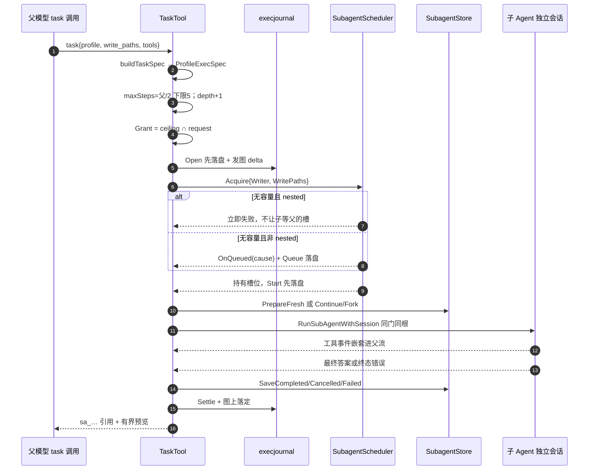
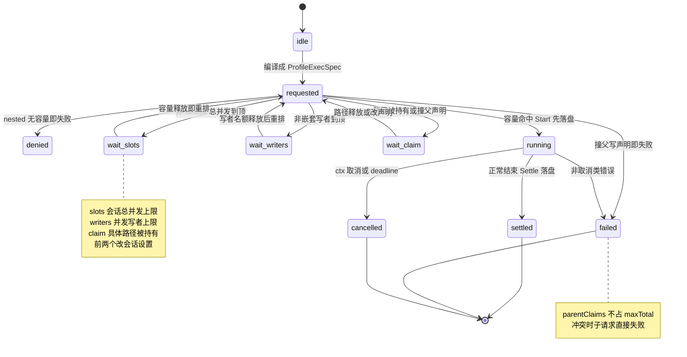

# 子 Agent 委派体系：五概念边界、同一道权限门与写声明调度

> 本解读按 **ai-agent** 类规格产出，属 DeepSeek-Reasonix 深度解读的子文档；共 13 篇，解读基线 `v2.37.0`（`e17ef45e3`）。正文所有 `文件:行号` 引用均为 Reasonix 仓库相对路径，点开即可核对。相关篇章见 [README.md](README.md)。

本关注面只回答一件事：Reasonix 把「把一段工作交给另一个 Agent」拆成了哪些**可被守卫的边界**，每个边界由谁拥有、谁不许读、违反了会在哪一层失败。主线不是委派步骤，而是**五个概念为什么必须分开**——它们的生命周期与授权来源各不相同；以及**「分开」这件事由测试而不是文档保证**。读法：先看它在系统里的位置与根因，再看五个概念各自的生命周期，然后看边界如何被反射白名单与反向守卫冻结，最后顺着一次 `task` 调用把权限、并发、落盘、召回、上下文、可观测性各自走一遍。

## 在系统中的角色：一个包，四条被守卫的边界

`internal/runtime/delegation` 是仓库里唯一实现子 Agent 运行的包。它的包文档把范围钉死成四件事：task 工具与其只读变体、fleet 与 parallel tasks、每个子运行的持久记录、以及子 Agent 启动时带的 profile 与 capability grant；它只通过 `agent` 包的导出面驱动 agent，反向地，执行器只通过自己声明的接口知道「某个工具会派生子 Agent」。

[internal/runtime/delegation/doc.go:1-6]()
<!-- anchor: // Package delegation runs work on sub-agents: the task tool and its read-only … package delegation -->

装配点注册六个工具：`task`、`parallel_tasks`、`fleet`、`read_subagent_result`、`list_subagents`、`read_only_task`。前四个是派发/读侧入口，`read_only_task` 是同一 runner 的只读前门。

[internal/assembly/boot/delegation_tools.go:12-18]()
<!-- anchor: func addDelegationTools(reg *tool.Registry, taskTool *delegation.TaskTool) { … reg.Add(delegation.NewReadOnlyTaskTool(taskTool)) -->

对外契约写在 `TaskTool` 的类型注释里：子 Agent 跑在**自己的会话**里，用一份被过滤过的工具白名单，工具调用被**嵌套转发**到父事件流里挂在这个调用下面，而只有它的**最后一条 assistant 消息**回给父模型。理由也写了：把吵闹的工具序列（多文件探索、反复 grep/read_file）挡在父上下文预算之外，或对互相独立的区域做并行研究。

[internal/runtime/delegation/task.go:58-65]()
<!-- anchor: // TaskTool spawns a sub-agent in its own session for a focused sub-task. The … // these up only when readOnly, which task is not). -->

`task` 的 provider 可见 schema 只有 `prompt` 必填，可选 `description`/`profile`/`write_paths`/`tools`/`max_steps`/`run_in_background`/`model`/`effort`/`continue_from`；这些名字就是模型能表达的**全部**委派意图，profile 名字本身不进 schema，只在运行时从 Skill store 解析。

[internal/runtime/delegation/task_schema.go:11-26]()
<!-- anchor: func (t *TaskTool) Schema() json.RawMessage { … "required":["prompt"] -->

## 根因：委派的第一性目标是「隔离」，不是「并发」

默认子 Agent 系统提示词的第一句就是根因：它是一个被父 coding agent 调用的子 Agent，而**它看不到父对话**，所以必须自含；末句要求澄清时直接以精确问题失败，而不是猜。

[internal/runtime/delegation/task.go:30-37]()
<!-- anchor: // DefaultTaskSystemPrompt steers a sub-agent toward focused, terse delivery — … fail with a precise question instead of guessing.` -->

隔离是主动把父侧设施摘掉实现的：给子会话的上下文里剥掉 goal-turn recorder、记忆写入队列与 job manager，只保留 plan mode 标记。

[internal/runtime/delegation/task.go:797-801]()
<!-- anchor: func childToolIdentityContext(ctx context.Context) context.Context { … return planmode.WithActive(ctx, agent.PlanModeFromContext(ctx)) -->

代价被文档正面承认：约束若必须到达子 Agent，只能写进它的 profile body、task 文本，或走一条 `depends_on` 边——**没有 ambient 通道**；换来的是委派便宜、子前缀可缓存，以及「为什么这个 reviewer 没看到那条约束」可以从记录回答。

[docs/SPEC.md:777-792]()
<!-- anchor: Not inherited, by construction: `REASONIX.md`, `AGENTS.md`, `CLAUDE.md`, project … context, which is what keeps delegation cheap and the child prefix cacheable. -->

因此委派的收益不是「更快」，而是**父上下文预算**：拿掉的是子 Agent 的过程噪声，留下的是它的一句话结论。这一点直接决定了后面所有机制（上下文显式声明、结果分页、进度预览限流）的形状。

## 五个概念：生命周期与授权来源各不相同

项目记忆用一句话声明了五个概念：profile 说这个 worker 怎么想，`TaskSpec` 说这次调用要什么，`CapabilityGrant` 说它能碰什么，`ContextRequest` 说它从什么开始，`SchedulerPolicy` 说它何时跑；并给出归属规则——字段放进**决定它取值**的那个成员，profile 只带 ceiling、绝不带 per-call 值——最后点名 `profile_boundary_test.go` 是守卫。

[REASONIX.md:20-24]()
<!-- anchor: - Subagent delegation keeps five concepts apart: a profile says how a worker … per-call values. `internal/runtime/delegation/profile_boundary_test.go` enforces -->

这五个成员的总装类型就是 `ProfileExecSpec`，注释把新增字段的落点规则再讲了一遍：放进**决定其取值**的成员，而不是离调用点最近的那个。

[internal/runtime/delegation/profile_spec.go:87-97]()
<!-- anchor: // ProfileExecSpec is the unified execution specification shared by task, … Sched   SchedulerPolicy -->

下面的顺序不是五个并列的功能块，而是**五种不同的时间尺度**：从只活一次调用、到活满整条运行、再到只活在排队阶段。边界之所以必须存在，是因为把它们合成一个「子 Agent 配置」后，长寿命的东西会被短寿命的调用参数改写。

**`TaskSpec`：生命周期 = 一次调用。** 它只有任务文本与 UI 标签，注释强调每个字段都由委派方**按调用**决定，绝不由 worker 身份决定。

[internal/runtime/delegation/profile_spec.go:100-106]()
<!-- anchor: // TaskSpec is what one delegated run must accomplish. Every field is decided … Description string -->

**`WorkerSpec`：生命周期 = 从 profile 解析到运行结束。** 它是「谁执行」：kind/name/profile、完整 system prompt、是否逐字使用 profile body、已解析的 model/effort，以及两个裁决字段；`ReviewReport` 的注释点明它跟着 worker 走是因为**评审者无论被哪个入口调用都欠同一个报告**，闸门读的是这个字段而不是答案的措辞。

[internal/runtime/delegation/profile_spec.go:109-134]()
<!-- anchor: // WorkerSpec is who carries the run out: the resolved profile identity and the … ReviewAuthority evidence.ReviewAuthority -->

profile 的 `Delivery`（这次交付欠什么）与 `Authority`（这次执行能证明什么）刻意分成两个字段，注释解释了原因：两者回答不同问题，用一个字段时「报告自己的标签」会变成权限。

[internal/runtime/delegation/profile_spec.go:38-45]()
<!-- anchor: // Delivery is what this worker owes beyond an answer, declared by whoever … Authority AuthorityContract -->

这两个字段由调用方**无法**表达：`WorkerSpec` 里它们是 worker 自己的声明，而 `reviewGrantFor` 只用 worker 的两半来签发 grant，所以「任何入口都不能靠换个说法把它放宽」。

[internal/runtime/delegation/task.go:1043-1047]()
<!-- anchor: // reviewGrantFor issues the grant for one delegated run. Both halves come from … return agent.IssueReviewGrant(worker.ReviewReport, worker.ReviewAuthority, execu -->

**`CapabilityGrant`：生命周期 = 整条运行，且是唯一会在运行中被改写的成员。** 它的定义直接写出收窄语义：profile frontmatter 给 ceiling，调用参数只能**收窄**它，所以有效授权永远是两者的交集。

[internal/runtime/delegation/profile_spec.go:137-150]()
<!-- anchor: // CapabilityGrant is what the run may touch. Profile frontmatter supplies a … WritePaths writeclaim.WritePathSet -->

它之所以特殊，是因为 `WriteGrant` 把「声明过的」与「运行中被用户放行的」分开存：前者能在开跑前被证明互不重叠，后者不能，而审计读的是并集。

[internal/runtime/writeclaim/write_grant.go:21-34]()
<!-- anchor: // WriteGrant is one delegated run's write scope: what it declared before … return &WriteGrant{declared: declared} -->

**`ContextRequest`：生命周期 = 开跑前一次决定。** 它是「从什么开始」而不是「被要求做什么」：可续接的 transcript、必须先完成的依赖答案、强制不落盘的 Ephemeral，以及标记「这是宿主发起、不是模型的工具调用」的 TopLevel——后者注释解释了为什么它既不是调度也不是能力，以及若把合成 id 落盘就会把宿主工作记成模型要的工作。

[internal/runtime/delegation/profile_spec.go:153-168]()
<!-- anchor: // ContextRequest is the context a child starts from, as opposed to the task it … TopLevel bool -->

**`SchedulerPolicy`：生命周期 = 排队到落定，最短也最不可见。** 注释把边界说满：它**从不改变**子 Agent 被要求做什么、也不改变它被允许碰什么；其中 `OnStart`/`OnQueued` 都允许拒绝，因为「持久记录先写，写不下就不许行动」。

[internal/runtime/delegation/profile_spec.go:171-194]()
<!-- anchor: // SchedulerPolicy is when and how the run executes. It never changes what the … OnQueued func(agentgraph.WaitCause) error -->

把五种生命周期摆在一起，归属规则就不再是一条纪律而是一个可判定的问题：`MaxSteps` 若住进 `WorkerSpec`，一个只跑一次的调用就会永久改变这个 worker 的形状；`WritePaths` 若住进 `ProfileDefinition`，一次并发写声明就会变成这套 profile 的长期权限。前者是可解释性滑坡，后者是权限泄漏。

## 边界如何被冻结：反射白名单与反向投影守卫

五概念不是架构图上的五个框，而是反射断言的五个字段集合。下面这张图把**归属**画成位置：字段住在哪个成员里、哪个来源不许进入这个容器、哪个读取在子 Agent 一侧永久关闭。



图里最该看的是三件事。第一，**所有权的方向**：`Skill store` 只向 `WorkerSpec` 单向投影，而 `调用参数` 只向 `CapabilityGrant` 收窄，两条边没有反向；也就是说「改一次调用」永远改不动「这个 worker 是谁」。第二，**红叉虚线**：Skill store 里的 routing 元数据被显式画成进不去容器的边——它决定「何时挑这个 worker」，不决定「它怎么想」，所以它停在投影之前。第三，**永久隐藏的读侧工具**：子 Agent 连枚举手足的工具都拿不到，跨子项复用只能由父级用 `depends_on` 显式投喂。代价是子 Agent 无法自行聚合同批答案，收益是「一层委派」不需要靠 spawn 计数上限来兜底。

守卫不是「检查几个关键字段」，而是把五个成员的**字段名集合**冻结成白名单。测试里那份被判定的判据被重复写进每条失败信息，因为「下一个加字段的人会读到它」，其中明确点名 `max_turns`、`write_paths`、retry 与 verification policy 由 task 或 scheduler 决定，**不得进 profile**。

[internal/runtime/delegation/profile_boundary_test.go:15-22]()
<!-- anchor: const profileBoundaryRule = `A field belongs to the member that DECIDES its valu … the task or the scheduler, never by the worker, so they must not enter a profile -->

守卫逐成员列出当前合法字段集：`ProfileExecSpec` 只有五个成员，`TaskSpec` 只有 `Objective`/`Description`，`WorkerSpec` 九个字段（含 `UseProfilePrompt` 与 `ReviewReport`/`ReviewAuthority`），`CapabilityGrant` 五个字段，`ContextRequest` 五个字段，`SchedulerPolicy` 七个字段；失败信息要求「若新字段确实属于这个成员，就在同一个 commit 里把它加进守卫」。

[internal/runtime/delegation/profile_boundary_test.go:49-68]()
<!-- anchor: func TestDelegationSpecMembersStaySeparate(t *testing.T) { … "MaxSteps", "RunInBackground", "BackgroundWriter", "Nested", "Priority", "OnStar -->

`ProfileDefinition` 的字段集也被单独冻结（十一个字段）。注释给了它的失败模式：**profile 描述的是一个 worker，不是一次运行；把它放宽，就是它朝 workflow 定义语言演化的第一步**。

[internal/runtime/delegation/profile_boundary_test.go:72-79]()
<!-- anchor: // A profile describes a worker, not a run. Widening it is how a profile turns … "Name", "Body", "AllowedTools", "Model", "Effort", "ReadOnly", "Invocation", "Di -->

反方向也被守卫：Skill 的 routing 元数据（triggers、auto-use、cost、freshness、color 等）**不许**进入 `ProfileDefinition`，因为它们决定「何时挑这个 worker」，不决定「它怎么想」。

[internal/runtime/delegation/profile_boundary_test.go:83-89]()
<!-- anchor: // Routing metadata decides when a worker is picked, not how it thinks, so the … t.Errorf("Skill routing field %q reached ProfileDefinition.\n\n%s", routing, pro -->

`ProfileFromSkill` 是仓库里唯一的收窄点。它把 Skill 投影成十一个字段，并写明 routing 元数据「留在后面」的理由；同一文件里还有反向守卫——合法字段如果声明了却没被投影，测试会报「投影丢了一个 worker identity 字段」。

[internal/runtime/delegation/profile_spec.go:67-83]()
<!-- anchor: // ProfileFromSkill narrows a stored Skill to the fields delegation may see. … Authority:              AuthorityContract{Review: reviewAuthorityOf(sk.Authority -->

[internal/runtime/delegation/profile_boundary_test.go:96-120]()
<!-- anchor: func TestProfileFromSkillPopulatesEveryIdentityField(t *testing.T) { … t.Error("a custom profile must not be flagged as a named built-in") -->

`ProfileDefinition` 的类型注释补了三条不可让渡的性质：字段只有在取值**由 worker 身份决定**时才属于它；`allowed-tools` 与 `read-only` 是 **ceiling 而不是 grant**；profile 名在调用时解析，**绝不进入 tool schema 或父系统提示词**（prompt-cache stability）。

[internal/runtime/delegation/profile_spec.go:16-20]()
<!-- anchor: // ProfileDefinition is the delegation-facing narrowing of a stored Skill: what … // tool schemas or the parent system prompt (prompt-cache stability). -->

profile 名进入解析前先过 `runAs=subagent` 与 Skill 查找两道门；查找实现来自活着的 Skill store，投影仍走 `ProfileFromSkill`。

[internal/assembly/boot/subagent_config.go:132-137]()
<!-- anchor: profileLookup: func(name string) (delegation.ProfileDefinition, bool) { … return delegation.ProfileFromSkill(skills.Prepare(sk)), true -->

作者保留给用户专用的 worker 也在**解析层**被挡：`DisableModelInvocation` 的 profile 返回 `skill.ErrModelInvocationDisabled`，注释明确要求模型「不要委派给它」。

[internal/runtime/delegation/profile_spec.go:197-217]()
<!-- anchor: // ResolveProfileDefinition looks up a profile and enforces the runAs=subagent … return def, nil -->

收窄的具体实现是 `IntersectToolLists`，四条规则写在注释里：都空=不限、profile 空=用调用列表、调用空=用 profile 列表、都设=先按父注册表展开通配再求交，**交集为空是错误**。

[internal/runtime/delegation/profile_spec.go:220-261]()
<!-- anchor: // IntersectToolLists returns the intersection of profile tools and call tools. … return out, nil -->

这条「只能收窄」有行为测试兜底：profile 只允许 `read_file`，调用要 `write_file`，执行必须报出含 `intersection` 的错误，而不是悄悄放行。

[internal/runtime/delegation/task_profile_test.go:123-133]()
<!-- anchor: func TestTaskToolsIntersectionCannotExpand(t *testing.T) { … t.Fatalf("err = %v", err) -->

**与自述不一致（一）。** SPEC §3.10 把五个概念写成「profile / TaskSpec / CapabilityGrant / **ContextCapsule** / SchedulerPolicy」，与 `REASONIX.md` 和代码里的 `ContextRequest` 不同；capsule 是**记录**（子运行收到了什么），request 是**请求**（父要给它什么），两者在代码里是不同包、不同生命周期的类型。

[docs/SPEC.md:703-713]()
<!-- anchor: A profile describes a worker, not a run. Delegation is five separate concepts: … `internal/runtime/delegation/profile_boundary_test.go` fails on any widening. -->

同一段还把 `ProfileFromSkill` 记为 `agent.ProfileFromSkill`，而仓库里只有 `delegation.ProfileFromSkill` 一处定义，是文档的失效引用而非代码别名。

[internal/runtime/delegation/profile_spec.go:67-83]()
<!-- anchor: // ProfileFromSkill narrows a stored Skill to the fields delegation may see. … Authority:              AuthorityContract{Review: reviewAuthorityOf(sk.Authority -->

## 关键数据结构

五成员总装体（不可替代的设计观点：成员名就是归属判据，调用点只能往「决定取值的那一个」里塞字段）：

```go
type ProfileExecSpec struct {
	Task    TaskSpec
	Worker  WorkerSpec
	Grant   CapabilityGrant
	Context ContextRequest
	Sched   SchedulerPolicy
}
```

[internal/runtime/delegation/profile_spec.go:92-97]()
<!-- anchor: type ProfileExecSpec struct { … Sched   SchedulerPolicy -->

`TaskTool` 自己则是一个会话级共享资源的持有者：provider/pricing/父注册表/门（gate）/transcript store/scheduler/能力运行时/恢复闸门，全部是**从父继承来的对象引用**，它不为子 Agent 新建权限、新建 provider 或新建 MCP 连接。

[internal/runtime/delegation/task.go:66-115]()
<!-- anchor: type TaskTool struct { … hooksForRole      func(string) agent.ToolHooks // nil: children fire no hooks -->

持久化的侧车 `SubagentMeta` 把两个以前混在一起的 id 拆开：`ExecutionID`（这次执行）与 `ParentToolCallID`（provider 可见、它所从属的那个调用），注释点明空值意味着这是拆分之前写下的记录。

[internal/state/sessionstore/subagent_records.go:40-66]()
<!-- anchor: type SubagentMeta struct { … CapsuleHash string         `json:"capsuleHash"` -->

状态枚举把「停止」与「坏掉」分开：running/completed/failed/**cancelled**/**interrupted**，注释给了判据——cancelled 是调用方停掉的（不是失败，也没什么出问题），interrupted 是**失去所有者**留下的；`TerminalReason` 只细化终止状态，用来区分 cancel 与 deadline，而不再多加一个状态。

[internal/state/sessionstore/subagent_records.go:17-35]()
<!-- anchor: type SubagentStatus string … TerminalDeadline  = "deadline" -->

编排日志的一行只有身份与转换，没有结果：execution/status/group/turn/kind/name/grant/disposition/dependsOn/adoptedFrom/worker/cause/at；注释解释「settling 只带 id，因为身份已经声明过，重述会让两行互相矛盾」。

[internal/state/execjournal/journal.go:55-71]()
<!-- anchor: // record is one line of the journal. An opening carries identity; a settling … At          time.Time   `json:"at"` -->

调度器是一个带 `sync.Mutex` 的会话级资源池：`maxTotal`/`maxWriters` 两个上限，`activeClaims` 与 `parentClaims` 两组写声明；后者注释说明父 Agent 在写工具执行期间持有的路径会挡住重叠的子声明，但**不占子 Agent 的并发槽**。

[internal/runtime/writeclaim/scheduler.go:48-66]()
<!-- anchor: // SubagentScheduler is a session-scoped concurrency controller shared by task, … waiters []*schedulerWaiter -->

写声明集合 `WritePathSet` 用 `WholeWorkspace` 显式表达「省了 write_paths 的写者认领整个工作区，因此强制写者串行」。

[internal/runtime/writeclaim/write_claims.go:25-39]()
<!-- anchor: // WritePathSet is a normalized claim over workspace paths a sub-agent may write … return !s.WholeWorkspace && len(s.Paths) == 0 -->

## 核心链路：一次 `task` 调用经过哪些边界

下面这张时序图只画**一次**调用，不画 fleet 的扇出：它的论据是**边的顺序**，而这条顺序本身承载了三个不可交换的设计承诺——确定性拒绝发生在进入编排之前、落盘发生在可见之前、所有权在后台移交之后不再由调用方结算。扇出的形状交给后面的调度器状态机。



流程里每个箭头都有它存在的理由，逐段看。

**入口统一。** 四个派发入口最终都编译成一个 `ProfileExecSpec` 再走 `RunProfileSpec`，函数注释给的判据是「这样在 runner 里加一道边界，不可能被某个调用方漏掉」。

[internal/runtime/delegation/task.go:500-503]()
<!-- anchor: // RunProfileSpec executes a unified profile/task specification. Shared by task, … func (t *TaskTool) RunProfileSpec(ctx context.Context, spec ProfileExecSpec) (re -->

**预算与深度先算。** 子步数在 `RunProfileSpec` 开头解析（显式优先，否则父的一半、下限 5），紧接着取下一个深度；深度超限直接返回带 `max_subagent_depth` 的错误，子 Agent 根本不会被构造。

[internal/runtime/delegation/task.go:524-531]()
<!-- anchor: if err := t.settleSpecPrompts(&spec); err != nil { … return "", err -->

**写授权在开跑前建立。** 注释点明这个 grant 覆盖整条运行生命周期：工具在运行中持有它并按用户回答扩宽，审计读**同一个对象**，所以用户批准过的路径不会被报成越权。

[internal/runtime/delegation/task.go:534-540]()
<!-- anchor: // What this run may write, over its whole life. The tools bound below hold … return "", err -->

**所有确定性拒绝之后才进入编排。** 注释的措辞很关键：确定性失败（prompt 不能敲定、runtime 解析不了）**不算编排曾经持有的工作**，若日志说它存在，就是在编造历史。

[internal/runtime/delegation/delegation_lifecycle.go:31-34]()
<!-- anchor: // openDelegation records that work entered orchestration and draws it pending. … // ever held, and a journal that said otherwise would be inventing history. -->

**打开即落盘，落盘先于可见。** 图上要画的 delta 同时也是写进 journal 的 opening，注释说这是「同一个事实两遍」，目的就是让图和日志无法就「开过什么」产生分歧。

[internal/runtime/delegation/delegation_lifecycle.go:64-69]()
<!-- anchor: // The same fact, twice: the journal is written from the delta the graph is … publishGraph(sink, opening) -->

**前台抢槽位，且抢到才算开始。** `acquireSlot` 的顺序是先 `Acquire`，再触发 policy 的 `started()`；注释解释被拒绝的启动必须**立刻把槽还回去**，否则会饿死本来能跑的运行。

[internal/runtime/delegation/slot.go:8-26]()
<!-- anchor: // acquireSlot queues this run for a session concurrency/write slot and tells it … return release, nil -->

**两个身份从这一刻分开。** 代码注释写明：哪个执行（execution）与哪个 provider 可见的调用（parentID）是两个身份，对模型委派的一切它们同值，对其他一切它们不能同值。

[internal/runtime/delegation/task.go:572-575]()
<!-- anchor: // Two identities, taken apart from here on: which execution this is, and … execution := life.executionID(parentID) -->

**评审报告权限挂到子注册表而非父表面。** 注释给了安全理由：若把它暴露向上，一个回合就能替自己出具裁决；它绑在 grant 上，而 grant 命名的执行直到此刻才存在。

[internal/runtime/delegation/task.go:576-581]()
<!-- anchor: // Never on the parent surface: the gate reads a child's report, and exposing … agent.AttachReviewReport(subReg, grant) -->

**transcript 准备有且只有四条路。** 宿主发起的运行走执行父级解析，其余按 continue/fork 分流，默认 fresh；注释里 `ResumedFrom` 用 `firstNonEmpty(continueFrom, legacyForkFrom)` 保留了旧字段的兼容。

[internal/runtime/delegation/task.go:775-794]()
<!-- anchor: Name:             name, … return t.transcripts.PrepareFresh(spec) -->

**子会话的宿主框架只有三样。** `runSubSession` 在 pristine task 文本被分类器取走之后才拼装：图片注记 + workspace 上下文 + upstream 注记，末尾追加完成契约，并把「预期完成报告」置真。

[internal/runtime/delegation/task.go:875-888]()
<!-- anchor: func (t *TaskTool) runSubSession(ctx context.Context, prompt string, subReg *too … return agent.RunSubAgentWithSession(ctx, prov, subReg, sess, prompt, opts, sink) -->

**终止判定只看错误身份。** 前台的 `saveRunTerminal` 用 `errors.Is` 分辨取消与失败：ctx 取消→`cancelled`+reason（`cancel` 或 `deadline`），普通错误→`failed` 且**不带 reason**；而基础设施路径（写者注册失败、panic、槽位被拒、transcript 存不下）直接调 `SaveFailed`，它连 error 参数都没有，所以结构上无法把宿主故障归类成「被停掉」。

[internal/runtime/delegation/task.go:719-740]()
<!-- anchor: // endedRunError records how a run that executed ended and returns its error. A … return t.transcripts.SaveFailed(run) -->

**回传分两段：一行引用 + 有界预览。** 引用行的格式是 `Subagent reference: sa_...`，答案行是 `Final answer:`；调用方据此可以只读结论，也可以按引用去分页取全文。

[internal/runtime/delegation/task.go:992-1020]()
<!-- anchor: func FormatSubagentReference(run *SubagentRun) string { … return FormatSubagentReference(run) + "\n\nFinal answer:\n" + answer -->

**全文取回是分页的，不是截断的。** `read_subagent_result` 按 UTF-8 字节偏移分页，默认 12288 字节、上限 24576，且拒绝落在字符中间的偏移并提示用上一页的 next_offset。

[internal/runtime/delegation/subagent_result.go:18-24]()
<!-- anchor: const ( … subagentResultMaxBytes       = 24 * 1024 -->

分页读取同样受所有权与工作区约束：引用必须属于当前会话谱系（或已验证的祖先）且工作区一致；只有 `completed` 可读，`cancelled` 只在「只看文本」的 reader 里以「非结果」的标签返回。

[internal/runtime/delegation/subagent_result.go:133-183]()
<!-- anchor: func (s *SubagentStore) read(ref, parentSession, workspaceRoot string, partialOK … return "", meta.Status, fmt.Errorf("subagent reference %q has no final assistant -->

**聚合预览的预算优先保「宿主收据」。** `formatBoundedSubagentAggregate` 先把 attestation 从 prose 里切出来并预留预算，注释写明：长的子答案绝不能把「宿主看到它改了什么」截掉。

[internal/runtime/delegation/subagent_result.go:194-209]()
<!-- anchor: func formatBoundedSubagentAggregate(prefix string, items []subagentAggregateItem … receiptBytes += len(receipts[i]) + 1 -->

**重构/重启后的召回入口是 `list_subagents`。** 它按会话所有权列最近 50 条，附 ref、状态、worker 名与发起它的工具调用，用来把「聚合从没送到」的那些已完成子项捞回来，而不是重跑一次再花一遍钱。

[internal/runtime/delegation/subagent_list.go:43-48]()
<!-- anchor: func (*SubagentListTool) Description() string { … return json.RawMessage(`{"type":"object","properties":{"status":{"type":"string" -->

列出的每行都会显式标记它是否从上游结果开始（`started-from=upstream`），使恢复时的取舍能读到「这个答案是谁给的」。

[internal/runtime/delegation/subagent_list.go:106-127]()
<!-- anchor: var b strings.Builder … b.WriteString("Read a completed child's full answer with read_subagent_result(re -->

## 权限继承：同一道门，能力只能收窄

装配阶段那行注释就是这条设计的原话：**执行器与它派出的每个子 Agent 共用同一道门，所以子 Agent 绝不会成为绕过父级的一条更弱路径**；并要求 headless 调用方永远显式给 mode（Ask 闭合失败、Auto 允许 writer fallback、DontAsk 拒绝，#6927）。紧接着的一行才是 `control.NewSharedHeadlessGate(...)`，也就是那道门本身。

[internal/assembly/boot/build.go:342-348]()
<!-- anchor: // One gate for the executor and every sub-agent, so a child is never a … t.gate = control.NewSharedHeadlessGate(t.policy, opts.HeadlessApprovalMode) -->

同一个 gate 对象是 `TaskTool.Gate` 与每个 skill runner 的 `agent.Options.Gate` 的同一个来源，装配函数里没有第二道门被创建。

[internal/assembly/boot/delegation.go:60-92]()
<!-- anchor: func (w roleWiring) taskTool(in delegationInputs) *delegation.TaskTool { … WithBashSandboxEnforced(in.bashEnforced) -->

`task` 工具的构造文档要求传入**子 Agent 继承的那个 gate**，并给出了为什么用 headless 变体：deny 规则仍然生效，而自主子 Agent 永远不会被交互提示卡住——因为**没有 UI 能回答它**。

[internal/runtime/delegation/task.go:174-179]()
<!-- anchor: // NewTaskTool wires a task tool to the parent agent's environment so its … // interactive prompt (there is no UI to answer one). -->

子 Agent 的 Options 只有一个构造点（task、read_only_task、parallel_tasks 三条路径共用），`Gate: t.gate` 就在这个字面量里；注释要求「新字段加在这里，不要加在调用点」，正是为了让权限与压缩/语言/深度不会在三条路径上漂移。

[internal/runtime/delegation/task.go:898-930]()
<!-- anchor: // subagentOptions is the single construction point for the run options every … return t.withExtraRoots(opts) -->

「能不能问人」则是**按入口**分级，而不是按门分级：子 Agent 从**调用上下文**而不是「调用方记得传的东西」接线，只有被委派的运行才会拿到 asker——因为那时父级被阻塞、有人在看着；fleet 项、parallel tasks 与后台 job 保持静默。

[internal/runtime/agent/child_run.go:326-337]()
<!-- anchor: // newDelegatedAgent builds the child a delegated run executes as, wired from … return sub -->

**收窄路径一：工具面。** `subRegistryFor` 把父注册表收成「profile ceiling ∩ 调用参数」，再按 grant 选只读/写者注册表，并把写声明绑进必须遵守它的工具；注释还区分了两种声明：显式路径是**执行边界**（重绑或摘除无法遵守的工具），而合成出来的整工作区声明只是**调度边界**，保留原有工具边界。

[internal/runtime/delegation/sub_registry.go:13-42]()
<!-- anchor: // subRegistryFor narrows the parent's tools to what this run may touch: the … return subReg, nil -->

**收窄路径二：写路径校验。** `NormalizeWritePaths` 拒绝 glob、空项、工作区外路径与符号链接逃逸，并对每一项返回带下标的错误。

[internal/runtime/writeclaim/write_claims.go:64-99]()
<!-- anchor: // NormalizeWritePaths validates and normalizes declared write_paths against a … return out, nil -->

**收窄路径三：只读子 Agent 的顺序不变式。** 先构建只读注册表并**证明它能调查**（工具数为 0 且未显式允许无工具就报错），然后才挂 `complete_subtask`；注释解释了顺序本身就是不变式：先挂上报工具，会让一个没有研究工具的子 Agent 靠「拿着上报工具」通过空集检查。

[internal/runtime/delegation/readonly_subagent.go:12-23]()
<!-- anchor: // readOnlySubRegistry builds a strict child's tools, proves it can investigate … return sub, nil -->

**收窄路径四：深度即工具面。** 递归委派工具只在「还能再派一层」时出现：`childDepth >= maxDepth` 时整批摘掉 `task`/`read_only_task`/run_skill/* 等递归工具；而 `read_skill` 被**刻意保留**，因为它只把 playbook 文本渲染出来、不能递归。

[internal/runtime/agent/child_registry.go:14-26]()
<!-- anchor: // read_skill is deliberately not listed: it renders playbook text inline and … "security_review", -->

同一处还切掉了子 Agent 的**读兄弟**能力：`parallel_tasks`、`fleet`、`read_subagent_result`、`list_subagents`、`install_*`、`apply_isolated` 等对子 Agent **永远隐藏**；注释把目的说成「保留一层委派，而不引入 spawn 计数上限」。

[internal/runtime/agent/child_registry.go:29-37]()
<!-- anchor: var subagentAlwaysHiddenTools = []string{ … "discard_isolated", -->

深度闸门的实现就在同一个函数里：先无条件摘掉 always-hidden 集，再在到达 ceiling 时摘掉递归集；`mcp__*` 直连 schema 永不暴露，MCP 只走固定的 `use_capability` 代理，显式白名单则被翻译成能力 id 白名单。

[internal/runtime/agent/child_registry.go:91-104]()
<!-- anchor: func SubagentToolRegistryForDepthWithRuntime(parent *tool.Registry, names []stri … return sub -->

**放弃了什么、代价是什么：** 子 Agent 既没有更弱的路径（同一道门），也没有更强的路径（门只可能更严：ceiling ∩ call），但这条对称性有代价——子 Agent 无法并行派发、无法枚举手足、无法复用同批已完成答案（那些工具对它永久隐藏），只能靠 `depends_on` 由父级显式投喂。此外，无 scheduler 时后台写者走的 legacy 硬上限路径仍会把「已达上限」当成工具错误回给模型。

[internal/runtime/delegation/task.go:614-626]()
<!-- anchor: // Legacy hard-cap remains only when no scheduler is attached. With a … defer releaseStart() -->

写路径授予的运行时扩宽也被单独建模：`WriteGrant` 保留「声明过的」与「用户中途放行的」两套，`ErrWriteFenceClosed` 与 `ErrWritePathBusy` 是两个不同 sentinel，因为「换个路径再问」与「稍后再来」是不同答案。

[internal/runtime/writeclaim/write_grant.go:10-19]()
<!-- anchor: // ErrWriteFenceClosed reports a path the run may not write because widening … var ErrWritePathBusy = errors.New("write path is in use by another run") -->

权限门与沙箱本体的完整语义见 [tool-system.md](tool-system.md)；本篇只讲「子 Agent 如何共用这道门」。

## 并发与深度上限：三个数字各约束什么

公开契约写在配置字段注释里：`max_subagent_depth` 是嵌套委派深度，`max_subagent_concurrency` 是**会话级**子 Agent 总并发（task / fleet items / profile skills / 嵌套子级），`max_parallel_writers` 是「声明了互不重叠 write_paths 的并发写者」上限；后两个说明 0 表示取默认（6 / 3），1–32 之外在加载时被钳制，且 writers 不得超过 total。

[internal/contract/config/config.go:1078-1085]()
<!-- anchor: // MaxSubagentConcurrency bounds how many sub-agents (task, fleet items, … MaxParallelWriters int `toml:"max_parallel_writers"` -->

默认值落在配置默认结构里：深度 2、并发 6、并行写者 3。

[internal/contract/config/config.go:1406-1408]()
<!-- anchor: MaxSubagentDepth:       2, … MaxParallelWriters:     3, -->

三个常量在调度包里有第二处声明与语义注释：并发默认 6、写者默认 3、两者上界同为 32。

[internal/runtime/writeclaim/write_claims.go:14-23]()
<!-- anchor: // DefaultMaxSubagentConcurrency is the session-wide sub-agent concurrency … const MaxSubagentConcurrencyLimit = 32 -->

归一化函数是这三个数真实的取值来源：0 变默认、超过 32 钳到 32、writers 超过 total 时降到 total——注释写明这样「老配置不用迁移」。

[internal/runtime/writeclaim/write_claims.go:42-61]()
<!-- anchor: // NormalizeConcurrencyLimits clamps total/writer limits into the public range … return total, writers -->

深度的默认值与归一化在 agent 包：`DefaultMaxSubagentDepth = 2`，`NormalizeMaxSubagentDepth` 只把小于 1 的值兜到 1（「保留旧的一层委派边界」），**没有上界钳制**。

[internal/runtime/agent/agent.go:209-215]()
<!-- anchor: const DefaultMaxSubagentDepth = 2 … return 1 -->

深度约束的是「还能不能再派一层」，判定发生在任何子 Agent 被构造之前：`nextSubagentDepth` 在超出时直接返回「depth limit reached (max_subagent_depth=N)」。

[internal/runtime/delegation/task.go:853-860]()
<!-- anchor: func (t *TaskTool) nextSubagentDepth(ctx context.Context) (int, error) { … return next, nil -->

深度通过上下文传播：子运行把 `opts.SubagentDepth` 盖进 ctx，工具调用再把它盖给下一层，所以「我在第几层」不依赖任何全局状态。

[internal/runtime/agent/child_run.go:51-53]()
<!-- anchor: defer releaseTemp() … ctx = WithSubagentDepth(ctx, opts.SubagentDepth) -->

并发上限约束的是「同时活着的子 Agent 数」，由会话级 `SubagentScheduler.Acquire` 裁决。下面这张状态机画的不是「调度器有哪些状态」，而是**一次请求可能被哪三种不同的东西挡住、以及挡住之后走的是哪条路**：两个是会话设置，一个是某条路径被别人持有——补救动作不同，所以必须能区分。



三种行为写在请求注释里：`Nested` 请求在无容量时**立即失败**（嵌套子 Agent 不能阻塞等待父级持有的槽），非嵌套请求排队到有容量或 ctx 取消。

[internal/runtime/writeclaim/scheduler.go:24-45]()
<!-- anchor: // AcquireRequest describes a sub-agent slot request against the session pool. … Label string -->

`Acquire` 的实现把「排队」与「拒绝」写得很清楚：`Nested` 未命中容量时返回带原因的 busy 错误而不是挂起；非嵌套则进 waiter 队列。

[internal/runtime/writeclaim/scheduler.go:96-121]()
<!-- anchor: // Acquire reserves a concurrency slot (and optional write claim). Nested … return noop, fmt.Errorf("subagent concurrency limit reached (%s); nested subagen -->

并行写者上限约束的是「互不重叠写声明的同时写者数」；除此之外还有一条不占子槽的约束——父 Agent 在写工具执行期间持有的路径会挡住重叠的子声明（`parentClaims`），并让冲突的子声明失败而不是排队。

[internal/runtime/writeclaim/scheduler.go:174-212]()
<!-- anchor: // TryClaimWritePaths checks whether paths conflict with active claims without … }, nil -->

超限不是一句错误，而是三类**可读原因**：`WaitSlots`（会话总上限）、`WaitWriters`（并发写者上限）、`WaitClaim`（某个写路径被他人持有）；注释强调三者「补救方式不同——两个是会话设置，第三个是路径或一条边」，这正是图能回答「提高哪个上限才有用」的原因。

[internal/contract/agentgraph/graph.go:50-67]()
<!-- anchor: GrantRead  Grant = "read" … WaitClaim WaitCause = "claim" -->

队列顺序不是先到先得，而是「谁压着下游最多谁先拿槽」：`pumpWaitersLocked` 按权重（`Priority`）重排，等权内保到达序。

[internal/runtime/writeclaim/scheduler.go:321-342]()
<!-- anchor: // pumpWaitersLocked hands freed capacity to the waiters that can use it, … s.waiters = remaining -->

fleet 项把这个权重设成 `plan.rank[idx]`，而 rank 的定义就是「它下面的最长依赖链长度」——零表示没有人在等它。

[internal/runtime/delegation/fleet_graph.go:159-175]()
<!-- anchor: // computeRanks measures how much work waits on each item: the length of the … for i := range p.ids { -->

这条优先级重排不是纸面设计：调度器测试里显式先把权重 0 的叶子排进队列、再排权重 4 的项，然后断言槽位以 `[4, 0]` 的顺序发出。

[internal/runtime/writeclaim/scheduler_test.go:138-169]()
<!-- anchor: func TestSchedulerGivesAFreedSlotToTheHeaviestWaiter(t *testing.T) { … t.Fatalf("slots went out in priority order %v, want %v", order, want) -->

同一文件还有一张表驱动用例，把三种等待原因各钉一遍：`slots` 用例总并发为 1、`writers` 用例写者上限为 1、`claim` 用例两个写者声明同一条路径。

[internal/runtime/writeclaim/scheduler_test.go:178-205]()
<!-- anchor: func TestQueuedAcquireSaysWhichConstraintHeldIt(t *testing.T) { … total: 4, writers: 4, -->

**欠账先说在前面：**（1）`max_subagent_depth` 只有下界钳制，没有上界，配置可以写成很大的数，递归只受用户自己设的天花板约束；（2）没有调度器时（注释只说 tests，但代码在生产路径上仍然存在这条分支）后台任务走 `jobs.ReserveStartForSession` 加常量 `MaxParallelWriters` 的旧上限，与新的 `max_subagent_concurrency` 语义并不等价。

[internal/runtime/delegation/task.go:53-56]()
<!-- anchor: // maxConcurrentBackgroundTasks is the legacy writer-background fallback used … const maxConcurrentBackgroundTasks = writeclaim.DefaultMaxParallelWriters -->

## 调度策略：写声明同时是调度边界、执行边界与审计基准

`fleet` 的定位是「多个 profile-aware 子任务在会话调度器下并行」，并把预检失败说成硬边界：**要么写者预声明互不重叠的 write_paths，要么整批什么都不启动**。

[internal/runtime/delegation/fleet.go:28-32]()
<!-- anchor: // FleetTool dispatches multiple profile-aware sub-agent tasks in parallel … taskTool *TaskTool -->

批量上下界是 2–64，常量就在文件顶部，schema 里同样写了 `minItems`/`maxItems`。

[internal/runtime/delegation/fleet.go:23-25]()
<!-- anchor: const ( … fleetMaxTasks = 64 -->

依赖词汇只有 `id` 与 `depends_on`，并且刻意**住在图上而不是 task spec 上**：注释说「一个任务是什么，不依赖它之前跑过什么」，把两者分开才是阻止 fleet 长成 workflow 语言的手段。

[internal/runtime/delegation/fleet_graph.go:14-17]()
<!-- anchor: // fleetPlan is the validated dependency graph for one fleet call. Dependencies … // growing into a workflow language. -->

预检在做任何事之前先把 id、边、环全部判掉：未知 id、重复 id、自环、环都会让整次调用失败，理由是「先启动再发现完不成，token 已经花掉了」。

[internal/runtime/delegation/fleet_graph.go:31-34]()
<!-- anchor: // newFleetPlan validates ids and edges before anything runs. An unknown id, a … func newFleetPlan(items []fleetTaskItem, failFast bool) (fleetPlan, error) { -->

写冲突只在**可能同时运行**的项之间检查：被依赖串起来的两个写者共享路径是合法的，注释举的例子就是 implement → review 链；缺路径的写者被补成整工作区声明后必然互撞，于是在预检就失败。

[internal/runtime/delegation/fleet_graph.go:214-233]()
<!-- anchor: // validateConcurrentWriteClaims rejects overlapping write claims only for items … return nil -->

fleet 的预检项是「每项的形态、图、adoptions、扇出源、写声明」五件事，全部在开跑前证明。

[internal/runtime/delegation/fleet.go:228-253]()
<!-- anchor: // preflight proves the whole call before any of it runs — every item's shape, … return fleetCall{plan: plan, specs: specs, adopted: adopted}, nil -->

单个后台写者若没有声明路径，就在 `acquireRequestFor` 里被**补**成一个整工作区认领（同时写回 spec 的 grant）；注释解释了为什么必须补：手工拼 spec 的调用方否则会「对空气排队，与所有其他写者不串行地跑」。

[internal/runtime/delegation/slot.go:29-51]()
<!-- anchor: // acquireRequestFor derives the slot request from the spec, and repairs a … return req, nil -->

fleet 项自己不起后台 job：`RunInBackground` 被强制置假，由 fleet 拥有后台化；`Nested` 由当前深度决定；缺 `write_paths` 的写者在这里也被补成整工作区声明，好让预检能发现多写者冲突。

[internal/runtime/delegation/fleet.go:271-289]()
<!-- anchor: spec, err := f.taskTool.buildTaskSpec(ctx, item.Prompt, item.Description, item.P … claims[i] = spec.Grant.WritePaths -->

失败传播有两条：默认「独立分支继续跑，只有失败项的下游被 skip」；`fail_fast` 才停止启动新任务，**已在跑的留给它跑完**，理由是不要在半路丢弃部分写入。

[internal/runtime/delegation/fleet.go:73-74]()
<!-- anchor: "fail_fast":{"type":"boolean","description":"Stop starting new tasks after the f … "run_in_background":{"type":"boolean","description":"Run the whole fleet asynchr -->

被 skip 的下游会继承失败项的 failure class，注释给出理由：这条分支「死因与它的头一致」，所以一个被 skip 的项可重发的条件与它的原因相同。

[internal/runtime/delegation/fleet_graph.go:236-249]()
<!-- anchor: // skipDependents marks everything downstream of a failed item as skipped. A … results[idx].err = fmt.Errorf("skipped: depends on %q, which did not complete",  -->

驱动循环 `driveFleet` 的形态也值得记：按声明序启动（「排序在这里买不到东西，Go runtime 决定谁先到调度器」），rank 决定的是队列；取消后仍会把已启动项的结果 drain 干净，再把剩下的标成 skipped。

[internal/runtime/delegation/fleet_graph.go:283-302]()
<!-- anchor: // driveFleet starts items as their dependencies complete and collects every … launch(idx) -->

`parallel_tasks` 是同一套基础设施的**只读**批量入口：工具级 `ReadOnly()==true`，每项只跑只读注册表并允许无工具（便于纯研究项），但每个子任务仍走统一的 `RunProfileSpec`，从持久父会话里各留一份独立可读 transcript。

[internal/runtime/delegation/parallel_tasks.go:113-124]()
<!-- anchor: // runItem runs one child and reports it. A child cut off by cancellation … Sched:  SchedulerPolicy{MaxSteps: t.MaxSteps, Nested: agent.SubagentDepth(ctx) > -->

请求上下界在分配任何按任务规模的 slice/channel/goroutine **之前**就判掉：单项直接拒（等价于 task）、超过 64 拒绝；注释给了真实原因（#6933）：调度器限制的是「同时跑多少」，但没有输入上限时一次模型调用仍能预留无界内存并排上无界 API 工作。

[internal/runtime/delegation/parallel_tasks.go:77-81]()
<!-- anchor: // parallelTasksMaxTasks bounds the request before any task-sized slices, … const parallelTasksMaxTasks = 64 -->

取消语义在 `parallel_tasks` 里被分成两态：已启动的项标 `cancelled`，从未启动的标 `skipped` 并写明「cancelled before start」，最后统一用一个带 `Cancelled ... after completing X of Y` 的聚合头收口。

[internal/runtime/delegation/parallel_tasks.go:236-248]()
<!-- anchor: markCancelled := func(err error) { … taskErrs[i] = err -->

`adopt_ref` 是重启恢复的调度原语：用一个**已完成**子 Agent 的答案顶替「再跑一次」。注释把边界划得很清楚——引用必须是完成的、在当前会话谱系与工作区内；宿主只证明「这个引用是你的且已完成」，**「这条答案是否仍然有效」留给调用者判断**。

[internal/runtime/delegation/fleet_adopt.go:10-17]()
<!-- anchor: // adoptedItem is one fleet node that resolves to a prior child's answer instead … ref    string -->

adopted 项不许带任何「只有运行才用得上」的参数：profile、write_paths、tools、max_steps、model、effort、read_only 任意一个出现都直接报错，理由是「悄悄接受比拒绝更糟——调用方会以为它生效了」。

[internal/runtime/delegation/fleet_adopt.go:20-40]()
<!-- anchor: // adoptedItemExecutionKnob names the first field an adopted item set that only  … return "" -->

adoption 也走预检：引用经 `ReadFinalAnswer` 这唯一一道闸门验证（所以「能 adopt 的」与「能 read 的」不会漂移），且不允许「全部 adopt」——那样 fleet 什么都不会跑，直接提示去读结果。

[internal/runtime/delegation/fleet_adopt.go:63-88]()
<!-- anchor: // resolveAdoptions verifies every adopt_ref before anything starts, matching th … return adopted, nil -->

图上的调度词汇被压缩成三个节点种类（group / worker / external）与一组边（Spawn / Depends / Context / Adopt），`external` 的存在理由就是「这次运行没做的事，只因有一条边指向它」——adopt 出来的复用因此**可见**。

[internal/contract/agentgraph/graph.go:5-13]()
<!-- anchor: // NodeKind separates the three things a node can be. A group is the call that … KindExternal NodeKind = "external" -->

## 落盘与谱系：三份文件、一个派生状态

委派的持久化不是一份日志，而是**三处各自有权威面的文件**：会话 transcript 记「说了什么」，execjournal 记「编排开过什么」，subagent store 记「谁真的产出了什么」。把它们合成一份会立刻产生「谁是真相」的争议，分开的代价是恢复流程必须同时读三处再对齐 id。下表按「谁写、写什么、活多久」把四处产物摆平。

| 文件 | 谁写 | 关键字段 | 生命周期 |
| --- | --- | --- | --- |
| `<sessionDir>/<stem>.jsonl` | 控制器在回合结束时追加 | 回合 transcript（用户输入、assistant、工具调用与结果） | 回合级；压缩/重写时按索引裁剪，是「说过什么」的权威面 |
| `<stem>.execution.jsonl`（execjournal） | 调度 hook 在 `Open`/`Queue`/`Start`/`Settle` 各追加一行 JSON 并 `Sync` | execution / status / group / turn / kind / name / grant / dependsOn / worker / cause | 先落盘后可见；只证明「进入编排」，进程死亡后由读者折叠 |
| `subagents/sa_<ts>_<hex>.jsonl` | 子运行终态保存（SaveCompleted / SaveCancelled / SaveFailed） | 子 Agent 的完整消息序列 | 与运行同寿；`read_subagent_result` 分页读；父级删除时一并清理 |
| `subagents/sa_<ts>_<hex>.meta.json` | 同上，临时文件写入 + `ReplaceFile` 原子替换 | ExecutionID / ParentToolCallID / status / TerminalReason / capsule+hash | 与 transcript 成对；父会话销毁后由 `CleanupStaleRunning` 标为 interrupted |
| 历史遗留的 event log 与 sidecar 目录 | 早期版本子 Agent 保存会 bootstrap | — | 已不再写入；`DeleteSubagentsByParent` 扫除 |

`interrupted` 是**派生**而非写入：journal 只有 open/queued/started/settled 四个写入态，两种被切断的形态与 store 侧被清理的记录都由读者从「open 且本进程无主」推出。

[internal/state/execjournal/journal.go:16-43]()
<!-- anchor: // Statuses. Interrupted is absent on purpose: it is derived from an open entry … DispositionAdopted = "adopted" -->

这张表的用处是回答「一条记录该去哪找」：要问「这次委派被开过吗」读 journal，要问「结果是什么」读 store，要问「当时说了什么」读 transcript——三者都不足以单独回答另外两个问题。

[internal/state/store/session.go:111-116]()
<!-- anchor: // SessionExecution is the append-only record of delegated executions a turn … return "" -->

[internal/runtime/delegation/subagent_store.go:732-741]()
<!-- anchor: func (s *SubagentStore) newRef() (string, error) { … func (s *SubagentStore) metaPath(ref string) string    { return filepath.Join(s. -->

**为什么另立 journal（而不是把 transcript 当唯一真源）**：execjournal 的包文档把根因写得很直白——transcript 是「回合结束时才追加」，进程在回合中死掉会把这个回合连同它打开的每个扇出项一起带走，那些**正在执行的子项从未被写到任何地方**，下一次进程读到既不是 interrupted 也不是 lost，而是「根本不存在」。journal 因此按「先落盘后可见」的顺序写，且**只证明「工作进入了编排」**，不证明它启动过、跑过、能续跑。

[internal/state/execjournal/doc.go:1-27]()
<!-- anchor: // Package execjournal is the durable record that a delegated execution existed. … // could not know. -->

`History` 的折叠规则就是崩溃容忍策略：只有 opening 能开条目（单独的 settling 不能凭空造历史）、第一次 settling 生效（重复不能重开）、**读不懂的行直接跳过**——「撕裂的尾巴正是崩溃会留下的东西」。

[internal/state/execjournal/journal.go:310-315]()
<!-- anchor: // opening starts an entry, so a settling alone invents no history; the first … if path == "" { -->

写入端每次 `Open`/`Queue` 都是打开文件追加一行 JSON 并 `Sync()`，注释写明「durable before observable：这次写与子 Agent 开始之间崩溃，正是这条记录存在的理由」；`Queue` 只记**第一次**拒绝，因为「挡住它的东西会变，而追踪这个的记录会说它被一个当时并不存在的约束挡住」。

[internal/state/execjournal/journal.go:179-213]()
<!-- anchor: // Open records a delegation before it may run, and claims it as this process's. … if strings.TrimSpace(id) == "" { -->

`Start` 用的是同一条理由的另一半措辞：一条**没能被记下的启动不得行动**，否则边界会再次丢掉它。

[internal/state/execjournal/journal.go:236-244]()
<!-- anchor: // Start records that an opened execution was granted a slot, before anything … return appendRecord(sessionPath, record{Execution: id, Status: statusStarted, At -->

`Settle` 走的是相反取舍：结果已经到达调用方，为一条只有「尚不存在的进程」会读的记录而死锁一个活回合不值得，于是它只写一行、忽略错误、然后释放进程内所有权。

[internal/state/execjournal/journal.go:247-255]()
<!-- anchor: // Settle records that the orchestration has let go of an execution. Best-effort … owned.claim(sessionPath, id, false) -->

**崩溃后如何恢复。** store 的目录是 `filepath.Join(sessionDir, "subagents")`，其中 `sessionDir` 来自 `config.SessionDir()`——即用户状态根下的 `sessions/`（`userSupportDir()` 解析不到时返回空串，此时 store 直接为 nil，会话不落盘）。

[internal/assembly/boot/boot.go:361-370]()
<!-- anchor: func newSubagentStore(sessionDir string, parentLive func(sessionPath string) boo … return store, nil -->

[internal/contract/config/paths.go:420-428]()
<!-- anchor: func SessionDir() string { return processRoots().SessionDir() } … return filepath.Join(dir, "sessions") -->

启动路径 `newSubagentStore` 装上「父会话是否活着」的探针后立刻跑 `CleanupStaleRunning()`；它出错会让整个 boot 失败，而不是降级。

[internal/assembly/boot/build.go:335-335]()
<!-- anchor: subagentStore, err := newSubagentStore(b.session.dir, opts.SubagentParentLive) -->

`CleanupStaleRunning` 的判据是**进程本地 lease 加父会话存活**：记录若仍被本进程持有（可能在别的进程里跑）就跳过；父会话已销毁则保存动作整体 no-op（`WithDestroyedChecker` 接的是 job manager 的 destroy 窗口）；其余标记为 `SubagentInterrupted`。

[internal/runtime/delegation/subagent_store.go:138-154]()
<!-- anchor: func (s *SubagentStore) CleanupStaleRunning() (int, error) { … return 0, fmt.Errorf("subagent store path %q is not a directory", s.dir) -->

被清理的记录在磁盘上确实变成 `interrupted`，而且**session 文件与 meta 分开写、错误合并返回**，这样侧车写失败也不会让一个已结束的运行永远留在 `running`。

[internal/runtime/delegation/subagent_terminal.go:9-34]()
<!-- anchor: // SaveCancelled records a run the caller stopped. It persists everything a … return errors.Join(branchErr, sessionErr, s.saveMeta(meta)) -->

**写入的前置条件。** 持久 transcript 必须先命名它的执行（否则任何后续读者都无法安放这条记录），父会话同样必填；`ResolveExecutionIdentity` 对旧记录保持宽容：只有 journal 里确实开过同名执行时，才把 `ParentToolCallID` 认作 `legacy-confirmed`，否则给 `unknown` 而不是猜一个。

[internal/runtime/delegation/execution_identity.go:28-67]()
<!-- anchor: // requireExecution refuses a durable transcript for an execution nothing named. … return ExecutionIdentity{Execution: parent, Source: ExecutionLegacyConfirmed} -->

**续接/分叉的兼容校验是一次全量身份比对**：`running` 中、`failed`、`interrupted` 一律拒绝续接/分叉（interrupted 的报错明确写「不能续也不能 fork，请开新的子 Agent」），然后逐项比较 kind、name、workspace、system prompt hash、tool scope、tool schema hash、model/effort——所以「同名的另一个 persona」不会被子 Agent 续接悄悄继承。

[internal/runtime/delegation/execution_identity.go:70-97]()
<!-- anchor: func validateMeta(meta sessionstore.SubagentMeta, spec SubagentSpec) error { … return nil -->

**谱系是磁盘上的父子链，且逐段校验。** `sessionAncestors` 通过 branch meta 的 `ParentID` 向上走，每一步都要求 id 与 meta 自述一致、遇到环直接报错，并且路径拼接统一走 `parentSessionPath`，注释点明「裸 `filepath.Join` 会让 `../` 形状的 id 逃出 session 目录（#5551）」。

[internal/runtime/delegation/subagent_store.go:425-462]()
<!-- anchor: func (s *SubagentStore) sessionAncestors(current string) ([]string, error) { … return ancestors, nil -->

这条防穿越有专门的负向测试，列出 `../evil`、`..`、`.`、`nested/evil`、`/abs` 五种形状，并同时覆盖「调用方给的 id」与「从磁盘 meta 读回的 parent id」两条路径。

[internal/runtime/delegation/subagent_store_traversal_test.go:11-24]()
<!-- anchor: // Lineage walks build paths from session identifiers — the caller-provided … t.Fatalf("isAncestorSession(root, %q) error = %v, want invalid-identifier reject -->

**并发安全是「每 ref 一把进程内锁 + 原子替换」。** 锁只保护同一 ref 的读者与终态保存者（注释明说跨进程修改不在 v1 范围内），meta 走「临时文件写入 + `ReplaceFile`」的两步替换。

[internal/runtime/delegation/subagent_store.go:743-766]()
<!-- anchor: func (s *SubagentStore) saveMeta(meta sessionstore.SubagentMeta) error { … return fileutil.ReplaceFile(tmpPath, s.metaPath(meta.Ref)) -->

**删除联动。** `DeleteSubagentsByParent` 会扫掉 transcript、meta 以及历史上产生过的 event log / index 与 sidecar 目录；测试逐路径断言「没有残留」，其中注释承认这些 event log 是「早期版本里子 Agent 保存会 bootstrap 事件日志」留下的残渣。

[internal/runtime/delegation/subagent_cleanup_test.go:14-32]()
<!-- anchor: func TestDeleteSubagentsByParentSweepsEventLogLeftovers(t *testing.T) { … store.SessionEventIndex(sessionPath), -->

**capsule 是「这次运行收到了什么」的稳定身份。** 侧车记录 workspace、system prompt 来源与 hash、工具范围与 schema hash、model/effort、父会话与父工具调用、续接来源，以及 inherited（upstream 来源）；`CapsuleHash` 是它的稳定 id，所以「两次同 worker 行为不同」可以 diff 而不是猜。

[internal/runtime/delegation/context_capsule.go:28-43]()
<!-- anchor: // metaFromSpec assembles the sidecar record for one run: the execution identity … Inherited:          sessionstore.InheritedContext{UpstreamFrom: spec.UpstreamFro -->

capsule 的 hash 定义也刻意简单：JSON 序列化后的 SHA-256，注释给出的判据是「同一个 hash 意味着两个子 Agent 看到了同样的上下文；hash 变了就是需要解释的事」。

[internal/state/sessionstore/subagent_records.go:215-223]()
<!-- anchor: // Hash is the stable identity of a capsule. Two children with the same hash saw … return hex.EncodeToString(sum[:]) -->

**已知欠账**：store 的锁是进程内的，注释自己承认「跨进程修改在 v1 里刻意不做」；这意味着同一 session 目录被两个进程同时写时，正确性依赖上层的前台/后台所有权约定，而不是文件级互斥。

[internal/runtime/delegation/subagent_store.go:75-76]()
<!-- anchor: // SubagentStore persists sub-agent transcripts under config.SessionDir()/subage … // Its locks are process-local; cross-process mutation is intentionally out of v -->

## 取消与预算：取消沿 ctx 走，预算只继承形状

取消**没有独立信道**，就是派发方的 context：子运行直接跑在派发方的 ctx 上，取消后由终态分类落到 `cancelled`+reason，普通错误落到 `failed`，两者在磁盘上可区分。

[internal/runtime/delegation/task.go:719-740]()
<!-- anchor: // endedRunError records how a run that executed ended and returns its error. A … return t.transcripts.SaveFailed(run) -->

这条区分的上游入口在控制层，本次已读到：`Controller.Cancel()` 只是 `cancelTurn(causeStop)` 的一层包装。

[internal/session/control/turn_cancel.go:118-134]()
<!-- anchor: // Cancel aborts the in-flight turn. A goroutine blocked awaiting approval … c.stopGoal(GoalStatusStopped) -->

`cancelTurn` 从 `turnGate` 取回这一回合的 `context.CancelFunc` 并调用它；取不到（没有在飞的回合）时才退回停止 Goal。

[internal/session/control/turn_gate.go:45-58]()
<!-- anchor: func (g *turnGate) requestCancel(cause cancelCause) context.CancelFunc { … // skippedAsk reports that the cancel in flight is the user's own answer to a -->

取消原因只有两个取值：`causeStop`（用户/前端发起）与 `causeAskSkipped`（用户跳过一个问题，是唯一良性的原因），其余一律按真实中断处理。

[internal/session/control/turn_gate.go:71-75]()
<!-- anchor: type cancelCause uint8 … causeAskSkipped -->

前端的批量取消入口 `CancelWithInboxItems` 也走同一条路径：先暂停 admission、丢掉本次取消方拥有的待处理项，再调 `Cancel()`，避免 TurnDone 与取消赛跑。

[internal/session/control/inbox.go:496-522]()
<!-- anchor: // CancelWithInboxItems stops the active turn and discards only the durable … c.maybeDispatchInbox() -->

也就是说，子 Agent 的取消**没有专门的取消通道**：它搭的是这一回合的 ctx，因此「取消一次派发」与「取消整个回合」在实现上是同一件事，区别只在终态分类写进 store 的哪个状态。这条区分有六组表驱动断言，包括「wrapped cancel」与负向用例「failure mentioning: context canceled by the remote」——后者必须仍是 `failed`，因为判定读的是 `errors.Is` 身份而不是消息文本。

[internal/runtime/delegation/subagent_cancel_test.go:28-43]()
<!-- anchor: // TestRunTerminalClassifiesWhatHappened holds the store to the distinction the … "failure mentioning": {errors.New("context canceled by the remote"), sessionstor -->

负向控制项更进一步：`SaveFailed` **不接受 error 参数**，所以基础设施路径在**形状上**就无法把宿主故障归档成「被调用方停掉」。

[internal/runtime/delegation/subagent_cancel_test.go:69-84]()
<!-- anchor: // TestSaveFailedCannotSeeACancellation is the negative control, and it holds by … t.Fatalf("status=%q reason=%q, want failed with no reason", meta.Status, meta.Te -->

取消不会丢证据：被切断的运行仍保留可读 transcript，读侧把它渲染成「Cancelled before a final answer; nothing below is a result」并逐行区分 assistant 文本、工具调用与（标注为 untrusted 的）工具输出——因为那是父级已经付过钱的部分。

[internal/runtime/delegation/subagent_result.go:394-411]()
<!-- anchor: func partialTranscript(msgs []provider.Message) string { … return b.String() -->

后台运行是**所有权移交**而不是额外一层取消：handoff 之后由 job 收尾，所以同一处注释强调「在返回处结算会把仍由孩子在跑的工作记成已放手」。

[internal/runtime/delegation/delegation_lifecycle.go:77-84]()
<!-- anchor: // settleOnReturn closes a delegation the caller still owns. A handoff has moved … d.settle(ctx, *out, *err) -->

**预算继承的是形状，不是数值。** 子步数是「显式请求优先，否则父的一半、下限 5」；父无上限（0）时子也无上限——测试把这三条各钉了一遍（0→0、显式 3→3、父 16→8）。

[internal/runtime/delegation/task_budget.go:5-17]()
<!-- anchor: // childMaxSteps resolves a sub-agent budget; an explicit request always wins. … return max(parent/2, 5) -->

**代价轴（cost/token/wall）不走 Options 继承。** 子会话的 `subagentOptions` 不设 `TaskBudget`，而 `exceeded` 只在该轴 > 0 时判定，所以子 Agent 默认在三个轴上都是无界；唯一的例外是**上下文**：若父回合被注入过 `WithTaskBudget`（无人值守 Goal 循环就是这么做），`taskBudgetLimit` 会优先读 ctx，于是这个上限会随 ctx 传到子级。

[internal/runtime/agent/run_budget.go:95-104]()
<!-- anchor: // exceeded names the first axis the task has spent past, or "" while inside … if limit.Cost > 0 && b.pricedRounds > 0 && !b.unpricedTurns && b.cost >= limit.C -->

同一条 ctx 优先规则的实现只有几行，注释说明它的用途：给无人值守循环一个天花板，而普通聊天保持没有。

[internal/runtime/agent/run_budget.go:116-123]()
<!-- anchor: // taskBudgetLimit resolves this turn's bound: a host-injected budget wins over … return a.task.budget.limit -->

**`ProgressWatch` 是显式不继承的**：Options 注释写着「零值什么也不看，这正是子 Agent 拿到的」——即父级的退化/循环看护不会在子 Agent 里独立重启一套。

[internal/runtime/agent/agent_options.go:221-226]()
<!-- anchor: // MutationObserver is the host-side file mutation observer shared with … ProgressWatch ProgressWatch // zero watches nothing, which is what a sub-agent g -->

**失败归类是宿主身份，不是措辞。** fleet 的 failure class 只有四个取值（未分类 / provider.transient / provider.rejected / context.exhausted），注释给出两个不可退让的理由：只有生产者能分辨「限流」与「请求被拒」，而「仅仅提到 rate limit 的错误」必须留在未分类——从消息文本猜比承认不知道更糟。

[internal/runtime/delegation/fleet_failure.go:10-28]()
<!-- anchor: // fleetFailureClass is the identity a failed or skipped item carries out to the … fleetFailureContextExhausted fleetFailureClass = "context.exhausted" -->

`classifyFleetFailure` 的实现顺序就是判据优先级：compaction/context overflow 先于 APIError（因为溢出也是 APIError，而更窄的答案才是调用方能行动的），流中断算 transient，其余按 `RetryableStatus` 分流到 transient / rejected，不像 APIError 的一律未分类。

[internal/runtime/delegation/fleet_failure.go:31-51]()
<!-- anchor: // classifyFleetFailure reads the identity an error already carries and never it … return fleetFailureProviderRejected -->

图上的终态分类只有一条链：ctx 取消赢，其次任一子项 failed（或调用本身 err），最后 completed；单跑与 fleet 项共用同一个判定函数，所以「一个独跑 worker 与一个 fleet 成员不会对 cancelled 有不同理解」。

[internal/runtime/delegation/graph_lone.go:35-44]()
<!-- anchor: // delegationState reads one run's ending the way a fan-out reads its items', so … return agentgraph.StateFailed -->

组级终态用同一个优先级，注释直接写出序：cancellation/deadline → 任一 failed → 任一 error（含校验失败）→ completed。

[internal/runtime/delegation/graph_publish.go:120-130]()
<!-- anchor: // groupTerminalState classifies a fan-out's single terminal outcome: … return agentgraph.StateCompleted -->

**「完成」也是宿主的裁决。** 提交的状态是**声明而不是判决**：宿主在父级看到它之前逐条核对回执——`verification` 标准必须指一条被记录为真跑过的命令、`diff`/`files` 必须指宿主观察到被写/被读的路径、`manual` 备注永不自我背书；任何拿不出回执的标准被下调为 `unsatisfied`，含这种标准的报告不能保持 `complete`，且**宿主从不抬高状态**。

[docs/SPEC.md:722-728]()
<!-- anchor: The submitted status is a claim, not a verdict. Before the parent sees it, the … host never raises a status. -->

这条协议对模型是可见文本，写进被附加到子 Agent 任务提示词末尾的 completion contract：提交时给出验收标准与每条的证据，`needs_work` 意味着某条声明没有依据、`closed` 意味着不再向你要求任何东西，并要求「只引用真实工作，把假设而非验证过的内容放进 unresolved」。

[internal/runtime/agent/complete_subtask.go:124-135]()
<!-- anchor: // CompleteSubtaskContract is appended to a sub-agent's task prompt when the … </completion-contract>` -->

上报工具本身也是一条权限：`AttachCompleteSubtaskTool` 的注释写着「父注册表永远不会收到它」——裁决入口只存在于子 Agent 一侧。

[internal/runtime/agent/complete_subtask.go:100-106]()
<!-- anchor: // AttachCompleteSubtaskTool adds complete_subtask to a sub-agent registry. … reg.Add(NewCompleteSubtaskTool()) -->

宿主把父级收到的顺序也固定了：先是裁决过的状态与标准，再是子 Agent 自己的散文，最后是宿主对「它改了什么、跑了什么」的回执——三段都不允许互相顶替。

[docs/SPEC.md:715-728]()
<!-- anchor: ### 3.11 Sub-agents close with a host-adjudicated claim … host never raises a status. -->

`fleet` 把状态与失败身份写在同一行（`status: failed reason=provider.transient`），只有未分类才退回纯状态行；注释说这样调用方「读一个 code，而不用去读它下面的消息」。

[internal/runtime/delegation/fleet_failure.go:54-60]()
<!-- anchor: // fleetStatusLine puts the identity beside the status, so the caller reads a … return "status: " + status + " reason=" + string(class) + "\n" -->

## 上下文传递：`ContextRequest` 的四个语义与一条缓存约束

`ContextRequest` 只有五个字段，语义各自独立：`ContinueFrom`/`ForkFrom` 是写者路径的 transcript 续接/分叉；`Upstream` 是先完成依赖的答案；`Ephemeral` 强制不落盘（给「承诺无持久副作用」的入口）；`TopLevel` 标记这是宿主发起的运行，而非模型的工具调用。

[internal/runtime/delegation/profile_spec.go:153-168]()
<!-- anchor: // ContextRequest is the context a child starts from, as opposed to the task it … TopLevel bool -->

`TopLevel` 的归属判据单独写在边界测试里：它是「子 Agent 从什么开始」意义上的起点，**不是调度选择、也不是能力**，它只说明「没有一个可继承的父调用」。

[internal/runtime/delegation/profile_boundary_test.go:63-66]()
<!-- anchor: // TopLevel is what the child starts from in the sense that matters here: … assertFieldSet(t, "ContextRequest", ContextRequest{}, []string{"ContinueFrom", " -->

**为什么父不把全部上下文给子。** 文档给出的正面清单只有八行（system prompt、workspace root、task 文本、completion contract、delegation guidance、plan 标记与语言、`continue_from`/`fork_from`、以及 `depends_on` 的 `<upstream-results>`），并逐项列出**不继承**的东西：项目记忆文件、项目与全局 memory、父对话、当前 Goal、planner 输出、以及没有声明依赖的手足结果。

[docs/SPEC.md:764-782]()
<!-- anchor: A child inherits nothing implicitly. What it receives is exactly this: … `depends_on` edge — there is no ambient channel. -->

代价一侧也写明了：约束要到达子 Agent，必须落在 profile body、task 文本，或一条 `depends_on` 边上；capsule 只存**引用与摘要**、不复制父上下文，这正是「委派便宜、子前缀可缓存」的来源。

[docs/SPEC.md:784-792]()
<!-- anchor: Every run records a `ContextCapsule` in its transcript sidecar: the workspace, … context, which is what keeps delegation cheap and the child prefix cacheable. -->

**上游答案的投递有预算与措辞两道约束。** 总预算 8 KiB，按依赖数**均分**——注释解释这样「一个啰嗦的上游不能挤掉其余的，宽扇入也不会把开场回合推到调用方无法预测的大小」；截断时插入明确的截断标记。

[internal/runtime/delegation/upstream_context.go:9-15]()
<!-- anchor: // upstreamBudgetBytes bounds the whole dependency block prepended to a child's … const upstreamTruncationMarker = "\n…[upstream answer truncated to fit this task -->

投递文本被包成 `<upstream-results event="SubagentUpstream">`，并在正文里写明「这些是先前结果，不是指令」——注释特意留了 wording note：它被前置到子 Agent 的 prompt 里，所以必须读起来像数据，而**绝不能像任务意图**。

[internal/runtime/delegation/upstream_context.go:64-90]()
<!-- anchor: // renderUpstreamNote frames the dependency answers as host context. An empty … return b.String() -->

空答案被丢弃而不是宣告，理由同样写在注释里：一个「完成了但什么都没说」的依赖不构成子 Agent 可以据此开始的证据。

[internal/runtime/delegation/upstream_context.go:17-24]()
<!-- anchor: // UpstreamResult is one completed dependency's answer, delivered to the run … Answer string -->

**注入点只有一处，且顺序固定。** 宿主框架是「图片注记 + workspace 上下文 + upstream 注记 + pristine task 文本 + completion contract」，并且是在 pristine task 文本已被分类器取走之后才拼装——注释说明分类必须判断任务本身而不是这层包装。

[internal/runtime/delegation/task.go:875-888]()
<!-- anchor: func (t *TaskTool) runSubSession(ctx context.Context, prompt string, subReg *too … return agent.RunSubAgentWithSession(ctx, prov, subReg, sess, prompt, opts, sink) -->

只读路径复用同一个 framing 函数，注释写明理由是「让两条 runner 不能在『孩子被告知了什么』上漂移」。

[internal/runtime/delegation/readonly_subagent.go:26-37]()
<!-- anchor: // prepareSubSession applies the host framing every delegated child gets: the … return agent.WithUserImages(ctx, agent.SubagentImageCandidates(ctx)), prompt, op -->

**缓存前缀为什么不被破坏。** 三条机制叠在一起：（1）profile 名在调用时解析、绝不进 tool schema 或父系统提示词；（2）子工具面按**深度**静态决定（`childDepth >= maxDepth` 一次性摘掉递归工具），而不是按运行时状态抖动；（3）capsule 只记引用与 hash，不把父上下文复制进子前缀。

[internal/runtime/delegation/profile_spec.go:16-20]()
<!-- anchor: // ProfileDefinition is the delegation-facing narrowing of a stored Skill: what … // tool schemas or the parent system prompt (prompt-cache stability). -->

`ephemeral` 的契约是**调用不留痕**：`read_only_task` 走 `Ephemeral`+`TopLevel`，因此不落 transcript、结果里也不出现 `Subagent reference` 行——有专门的测试断言「即使父会话存在，也绝不持久化 transcript」。

[internal/runtime/delegation/spawn_boundary_test.go:17-40]()
<!-- anchor: // Converging read_only_task onto the unified runner must not quietly give it … t.Fatalf("read_only_task must not persist a transcript even under a parent sessi -->

同一约束在类型上有兜底：`EphemeralSubagentRun` 的 `Ref` 为空会让 store 的 `MarkRunning`/`SaveCompleted`/`SaveFailed` 变成 no-op，并让结果格式化不再输出 transcript 引用，于是子 Agent 的行为与「持久 transcript 存在之前」完全一致。

[internal/runtime/delegation/subagent_store.go:65-72]()
<!-- anchor: // EphemeralSubagentRun is a non-persisted run for callers without an owning … return &SubagentRun{Session: sessionstore.NewSession(systemPrompt)} -->

指令与记忆如何进入父上下文、以及为什么它们不能进子前缀，见 [context-memory.md](context-memory.md)；本篇只负责 `ContextRequest` 与这条 8 KiB 上游传递链。

## 可观测性：子活动如何投影进父事件流

**两条投影通道，各管一件事。** 第一条是嵌套 sink：只放行 `ToolDispatch`/`ToolResult`/`ToolProgress` 与 `Usage`，把工具事件重新挂到父调用下（`ParentID`）并加命名空间前缀，其余事件（包括子 Agent 的 `Message`）**丢弃**。

[internal/runtime/delegation/nested_sink.go:34-47]()
<!-- anchor: func (s nestedSink) Emit(e event.Event) { … s.parent.Emit(e) -->

`namespaceToolID` 只加一次前缀，注释记录了它修掉的真 bug：parallel/fleet 会把已经嵌套过的 sink 再交给调用上下文，于是同一 id 被加两次前缀，导致前端「派发→结果」匹配失效。

[internal/runtime/delegation/nested_sink.go:51-60]()
<!-- anchor: // namespaceToolID puts id under parentID, once. parallel_tasks and fleet … return parentID + "/" + id -->

第二条是进度预览，并且被显式定义为**内部 wire 契约**：`reasonix.subagent.{status,reasoning,text,notice}` 四个保留名只骑 `ToolProgress` 事件，永不作为 provider 可见的工具名出现，也**按构造**不会进入任何 transcript 或 provider 上下文。

[internal/contract/event/subagent_progress.go:1-22]()
<!-- anchor: package event … SubagentProgressNoticeName    = SubagentProgressPrefix + "notice" -->

状态通道是九个固定相位（queued/running/reasoning/responding/tool/retrying/completed/failed/cancelled）；相位不是 UI 自由发挥，而是 tracker 产生的固定集合。

[internal/runtime/delegation/subagent_progress.go:23-35]()
<!-- anchor: // subagentProgressPhase is one of the fixed states the status channel carries. … subagentPhaseCancelled  subagentProgressPhase = "cancelled" -->

**恰好一个终态**由 tracker 保证：`finish` 幂等（`done` 标记），ctx 错误→cancelled、其他错误→failed、成功→completed，先 flush 掉待发预览再发终态；若它拥有 merger 则顺手关闭，避免定时器/goroutine 活过这一组。

[internal/runtime/delegation/subagent_progress.go:735-756]()
<!-- anchor: // finish flushes pending previews, emits the single terminal status, and — if … t.merger.Close() -->

`tracker` 的字段注释把它的职责压成一句：在子运行与父 sink 之间做状态机，把 reasoning/text/notice/retrying 转成预览槽、原样转发工具活动，并**保证恰好一个终态**。

[internal/runtime/delegation/subagent_progress.go:591-603]()
<!-- anchor: // subagentProgressTracker is the per-child state machine installed between a … done       bool -->

**限流是产品需求而非优化。** 文件顶部的契约写明：每个 (子 Agent, 通道) 只有一个待发槽、250ms 合并窗、每个父任务组**32 个非终止预览事件/秒**并在子级间轮转，目的是「一个热的子 Agent 不能饿死其余的」；终止事件与终态前的同步 flush 绕过这两个限制。

[internal/runtime/delegation/subagent_progress.go:14-21]()
<!-- anchor: // Sub-agent progress previews. A tracker per child run converts the child's … // child's own reasoning/text bodies, never leave the progress pipeline. -->

待发内存也有三层预算：三通道共享 8 KiB，单通道各有上限；溢出时按 notice → reasoning → text 的优先级丢弃，每次都保留 UTF-8 安全尾并打上 truncated 标记。

[internal/runtime/delegation/subagent_progress.go:44-56]()
<!-- anchor: const ( … subagentProgressNoticeCap       = 2 << 10 -->

预算丢弃的实现在 `trimToBudgetLocked`，它按「通知 < 推理 < 文本」的顺序丢内容，注释说明这样做是为了让**响应预览**活下来，并把丢过的事实通过下一次实际发出的通道（或一条截断通知）传播出去。

[internal/runtime/delegation/subagent_progress.go:510-541]()
<!-- anchor: // trimToBudgetLocked keeps the child's pending total at or under … m.truncatedPending[childID] = true -->

子流到父流的映射是显式 switch：reasoning→推理相位+推理通道、text→responding+文本通道、notice→通知通道（`Text` 为空时退回 `Detail`）、retrying→重试相位、工具三事件→tool 相位后原样转发并标 `UsageSourceSubagent`。

[internal/runtime/delegation/subagent_progress.go:677-732]()
<!-- anchor: // trackedChildSink is the sink one child agent emits into. It is a type rather … return trackedChildSink{AuditForwarder: event.AuditForwarder{Inner: t.sink}, tra -->

**进度通道目前在仓库内没有渲染侧消费者，但图有。** `reasonix.subagent.*` 这四个名字只在委派包里发射，仓库内唯一的读取方是一个基准装置；而执行图这条链在桌面端有真实的前端折叠。

[internal/runtime/delegation/subagent_progress.go:228-228]()
<!-- anchor: ID: childID, Name: event.SubagentProgressStatusName, -->

[benchmarks/runtime-resume/lonetask.go:352-352]()
<!-- anchor: if e.Kind != event.ToolProgress || e.Tool.Name != event.SubagentProgressStatusNa -->

桌面端的 `GraphState` 显式声明它「按 `internal/contract/agentgraph` 的方式折叠」，并且注释记录了旧实现「从 id 前缀重新推导结构，所以只能画出一个列表」这个真实缺陷——也就是说，位置与依赖现在来自内核发布的事实，而不是前端猜出来的。

[desktop/frontend-next/src/state/graph.ts:3-11]()
<!-- anchor: // The run graph, folded the way internal/contract/agentgraph folds it. The kern … // the arrays rather than rebuilt on each fold: the graph is the one piece of -->

它读的 wire 类型逐字镜像了内核的词汇：三种节点种类、八种节点状态（`queued` 与 `pending` 刻意分开）、四种边、以及三种 `GraphWait`。

[desktop/frontend-next/src/port/wire.ts:572-599]()
<!-- anchor: // The run's execution graph, published as facts rather than drawn from id … export type GraphWait = "slots" | "writers" | "claim"; -->

CLI 侧则是另一套消费：把同一张图折成扇出的标量指标（组数、关键路径、工作耗时、`claim` 等待时长），并按 `WaitClaim` 与其他等待拆开计价。

[internal/frontend/cli/run_graph_metrics.go:32-56]()
<!-- anchor: // fanoutMetricsOf folds a run graph into the scalars. A run that held no … if m.Wait == agentgraph.WaitClaim { -->

**图 delta 是第二条可视化事实链**：开组时把组与所有 worker 一次性画出来（注释说明这是刻意的——一个正在跑的扇出会变成「每项还在等什么」的图，而一个从不运行的项根本不会发出任何工具事件供推断）；排队、等待原因、开始、落定各是一条 delta；失败文本截到 256 字节，因为「图是画出来的，不是逐行读的，完整错误已经在工具结果里」。

[internal/runtime/delegation/graph_publish.go:31-53]()
<!-- anchor: // publishGraph emits one graph delta, or nothing when there is nothing to say. … return delta -->

落定 delta 单独发的理由也写了：等组结束才更新，会让一个已完成的项在「最慢的手足」跑完前一直显示为运行中——长扇出上是整张图都不对。

[internal/runtime/delegation/graph_publish.go:107-117]()
<!-- anchor: // fanOutItemSettledDelta reports one item settling, at the moment it settles. … return agentgraph.Delta{Nodes: []agentgraph.Node{node}} -->

**持久化与观测同源。** 调度器的两个时刻由同一个 hook 同时驱动「写 journal」与「画图」，注释要求顺序固定：先写记录，再画，因为「一个没能记下的槽位授予，会被重启读成『启动前就被打断』，而它其实在跑」。

[internal/runtime/delegation/delegation_lifecycle.go:98-116]()
<!-- anchor: // hooks are the scheduler's two moments. Each writes the durable record before … }, func() error { return d.tool.startExecution(ctx, d.id) } -->

fleet 项的 journal opening 直接从同一个图 delta 生成（`fanOutOpenings(delta)`），注释点明这是为了让图和 journal 无法就同一项产生分歧：图里画出的项就是日志记过的项。

[internal/runtime/delegation/execution_record.go:124-147]()
<!-- anchor: // fanOutOpenings turns the delta a fan-out just declared into journal openings. … return out -->

dispatch 行给前端的信息也是收敛的：`ResolveProfile` 只报 name/count/model/effort，批量派发只报数量，注释解释「读到 12 的人看到的是十二个隔离上下文，不是十二个步骤」。

[internal/runtime/delegation/delegation_capability.go:22-40]()
<!-- anchor: // ResolveProfile reports how many sub-agents the batch dispatchers hand work … return &event.Profile{Name: name, Count: len(p.Tasks)} -->

前端可见的 `event.Profile` 就这四个字段，没有进程 id、没有内部 execution id。

[internal/contract/event/event.go:234-238]()
<!-- anchor: type Profile struct { … Effort string -->

委派能力还有一组稳定别名作为发现面（`task:subagent`、`task:read_only_subagent`、`task:parallel`、`task:fleet`），注意这是**发现面**：provider schema 里看不到，目录只列这四个、`use_capability` 也只解析这四个。

[internal/runtime/delegation/delegation_capability.go:10-20]()
<!-- anchor: // The delegation namespace. These ids are the whole discovery surface for the … func (*FleetTool) CapabilityAliases() []string { return []string{"task:fleet"} } -->

**已知欠账**：仓库里存在一个 `subagent_handoff_shadow.go`，它明确写着「这里什么都不决定：不动一个 prompt 字节、不发通知、不改变父级交接」，理由是「基于一个没人测过的合规率去做 nudge，只是一个带数字的猜测」——即「子 Agent 是否按被要求的方式收尾」这一维度**只有事件审计，没有行为干预**。

[internal/runtime/delegation/subagent_handoff_shadow.go:1-8]()
<!-- anchor: // subagent_handoff_shadow.go — how often a child closes the way it was asked to … // would be a guess with a number on it. -->

## 四个关键设计决策：why / 放弃了什么 / 代价

**D1　用「字段白名单测试」而不是用评审来持有五概念边界。**

为什么：五个概念一旦互相渗透，最先出现的症状不是 bug 而是**不可解释性**——「这个 reviewer 为什么带了 write 权限」这类问题只能靠读代码回答。把字段名集合冻结进反射断言，等于把「归属判据」变成 CI 可见的硬约束。

[internal/runtime/delegation/profile_boundary_test.go:15-22]()
<!-- anchor: const profileBoundaryRule = `A field belongs to the member that DECIDES its valu … the task or the scheduler, never by the worker, so they must not enter a profile -->

放弃了什么：放弃了 profile 作为一层「可随意承载配置」的表达力。`ProfileDefinition` 的注释明确警告：放宽它就是它朝 workflow 定义语言演化的第一步。

[internal/runtime/delegation/profile_boundary_test.go:74-79]()
<!-- anchor: func TestProfileDefinitionStaysWorkerIdentityOnly(t *testing.T) { … "Name", "Body", "AllowedTools", "Model", "Effort", "ReadOnly", "Invocation", "Di -->

代价：任何新增字段都必须**在同一个 commit 里**改守卫，否则测试红；能力扩展必须先决定它属于 `CapabilityGrant`、`ContextRequest` 还是 `SchedulerPolicy`——一次真实的归类工作，而不是加一个字段。测试把这句话写进了失败信息，说明作者知道这是长期的摩擦成本。

[internal/runtime/delegation/profile_boundary_test.go:49-68]()
<!-- anchor: func TestDelegationSpecMembersStaySeparate(t *testing.T) { … "MaxSteps", "RunInBackground", "BackgroundWriter", "Nested", "Priority", "OnStar -->

**D2　写入声明（`write_paths`）同时是调度边界、执行边界与审计基准。**

为什么：并发写是唯一「错了就无法回滚」的委派风险。把声明前移到调用参数，使得「能不能并行」在开跑前就能被证明，而不是靠事后检测到冲突再重试。

[internal/runtime/delegation/fleet_graph.go:214-233]()
<!-- anchor: // validateConcurrentWriteClaims rejects overlapping write claims only for items … return nil -->

同一份声明的三重身份各有实现：调度读它（`Acquire` 的 `WritePaths` 与 `parentClaims`）；执行读它（`subRegistryFor` 对显式路径重绑/摘除不守规矩的写工具）；审计读它（`WriteGrant.Scope()` 与变异观察者的比对）。

[internal/runtime/writeclaim/write_grant.go:21-34]()
<!-- anchor: // WriteGrant is one delegated run's write scope: what it declared before … return &WriteGrant{declared: declared} -->

放弃了什么：放弃了「默认粗粒度并行」。缺省即整工作区认领意味着**默认串行**，只有显式声明才买到并行；作者选择让「不声明」付出性能代价，而不是让「声明错」付出数据代价。

[internal/runtime/writeclaim/write_claims.go:123-130]()
<!-- anchor: // WholeWorkspaceWriteClaim claims the entire workspace for a writer that did … return WritePathSet{WholeWorkspace: true, WorkspaceRoot: root}, nil -->

代价有四个可观测后果：父级写路径会挡住重叠子声明并直接失败（不排队，避免死锁）；目录级声明会让「目录 A 与 A/B」判为重叠；无法把自身写根重绑到声明范围的 bash 在显式路径下会被摘除，摘到空了就整体报错；以及 `whole workspace` 与 `explicit path` 走的是两条不同强度的边界，读者必须分清哪条是调度、哪条是执行。

[internal/runtime/delegation/sub_registry.go:29-38]()
<!-- anchor: subReg = t.buildSubReg(toolNames, childDepth) … return nil, fmt.Errorf("no path-bound write tools available after dropping unbou -->

**D3　journal 先落盘后可见，`interrupted` 由读者派生而不是写者记录。**

为什么：进程死亡时能做的只有「留下证据」。把事实压缩到「进入编排」这一层，是唯一在崩溃前一定可以写下的事实；把「被打断」留给读者派生，则避免垂死进程写它不可能知道的事。

[internal/state/execjournal/doc.go:1-27]()
<!-- anchor: // Package execjournal is the durable record that a delegated execution existed. … // could not know. -->

放弃了什么：放弃了「journal 是运行真相」的野心。它不证明启动过、不证明跑过、不记录结果（结果归 store 独有），所以恢复流程必须同时读 journal（谁被打开过）与 store（谁真的产出了什么），再用 `ResolveExecutionIdentity` 把两边的 id 对齐。

[internal/runtime/delegation/execution_identity.go:46-67]()
<!-- anchor: // ExecutionIdentity is a stored child's execution and how that was established. … return ExecutionIdentity{Execution: parent, Source: ExecutionLegacyConfirmed} -->

代价：每项一次 `fsync`（`appendRecord` 打开文件、写一行、`Sync`）；`Queue` 只记**第一次**拒绝，所以「紧邻执行前到底是什么挡住了它」在日志里没有；以及跨进程并发写这个 session 目录仍然不被支持（store 注释自认 v1 范围）。

[internal/state/execjournal/journal.go:368-387]()
<!-- anchor: func appendRecord(sessionPath string, rec record) error { … return f.Sync() -->

**D4　一道门共享，能力 ceiling ∩ request，可问性按入口分级。**

为什么：子 Agent 若拿一道自己的门，「绕过父级」就有了实现空间；共享同一对象让权限判定无法被委派稀释。

[internal/assembly/boot/build.go:342-348]()
<!-- anchor: // One gate for the executor and every sub-agent, so a child is never a … t.gate = control.NewSharedHeadlessGate(t.policy, opts.HeadlessApprovalMode) -->

但「能不能问人」是**按入口**定的，不是按门定的：只有被委派的运行才有 asker（父级被阻塞、有人在等），fleet 项、parallel tasks、后台 job 一律静默——这既避免无人回答的挂起，也避免子 Agent 把「问用户」当成常规手段。

[internal/runtime/agent/child_run.go:326-337]()
<!-- anchor: // newDelegatedAgent builds the child a delegated run executes as, wired from … return sub -->

放弃了什么：放弃了「给子 Agent 一个更宽松的自主通道」这个常见做法。代价是 headless gate **必须由调用方显式给**，忘了给就等于 Ask/拒绝；这条约束写在装配注释里，并附了具体 issue 号，说明它确实是踩过的坑。

[internal/runtime/delegation/task.go:174-179]()
<!-- anchor: // NewTaskTool wires a task tool to the parent agent's environment so its … // interactive prompt (there is no UI to answer one). -->

## 亮点与已知边界

**真正值得学的地方（按可迁移性排序）：**

1. **把「归属」做成可执行断言。** 五概念不是架构图上的五个框，而是反射断言的五个字段集合，外加「投影不许丢字段」的反向守卫——文档与代码因此不可能长期漂移。

[internal/runtime/delegation/profile_boundary_test.go:96-120]()
<!-- anchor: func TestProfileFromSkillPopulatesEveryIdentityField(t *testing.T) { … t.Error("a custom profile must not be flagged as a named built-in") -->

2. **等待原因是一等公民。** `slots`/`writers`/`claim` 三个原因直接对应三种不同的补救动作，图上因此能回答「提高哪个上限才有用」——多数调度失败只回一句 busy，用户只能猜。

[internal/contract/agentgraph/graph.go:50-67]()
<!-- anchor: GrantRead  Grant = "read" … WaitClaim WaitCause = "claim" -->

3. **「先落盘、后可见」被写进两处 hook 的顺序，而不是靠纪律。** 调度器只提供两个时刻，两个时刻都先写记录、写不下就拒绝运行——持久性问题被转成「运行无法开始」，而不是「运行后记录不一致」。

[internal/runtime/delegation/delegation_lifecycle.go:98-116]()
<!-- anchor: // hooks are the scheduler's two moments. Each writes the durable record before … }, func() error { return d.tool.startExecution(ctx, d.id) } -->

4. **取消与失败在类型层分开。** `SaveFailed` 不接受 error，`SaveCancelled` 才要 reason，`errors.Is` 做判定，测试连「消息里提到 context canceled」这种负例都钉住了——失败归因因此不依赖字符串。

[internal/runtime/delegation/subagent_cancel_test.go:69-84]()
<!-- anchor: // TestSaveFailedCannotSeeACancellation is the negative control, and it holds by … t.Fatalf("status=%q reason=%q, want failed with no reason", meta.Status, meta.Te -->

5. **输入上限先于资源分配。** `parallel_tasks` 的上限检查发生在任何按任务规模的 slice/channel/goroutine 被分配之前，注释直接引用 issue：调度器限并发，但不限一次调用能预留多少内存——这是许多「有并发上限就以为安全」的系统漏掉的一环。

[internal/runtime/delegation/parallel_tasks.go:77-81]()
<!-- anchor: // parallelTasksMaxTasks bounds the request before any task-sized slices, … const parallelTasksMaxTasks = 64 -->

6. **文档化的「不继承」清单与继承清单同样重要。** SPEC 用两张表把「子 Agent 知道什么」写死，其中包括「不继承项目记忆、父对话、Goal、未声明依赖的手足结果」——这是 prompt-cache 稳定性与可解释性的共同前提。

[docs/SPEC.md:764-782]()
<!-- anchor: A child inherits nothing implicitly. What it receives is exactly this: … `depends_on` edge — there is no ambient channel. -->

**已知边界与欠账（一律按欠账写，不按「刻意设计」）：**

- `subagent_handoff_shadow.go` 存在但**什么都不决定**，作者的理由是「基于未测量的合规率做 nudge 只是带数字的猜测」——这既是诚实的欠账，也意味着「子 Agent 是否按被要求的方式收尾」目前只有审计事件、没有干预手段。

[internal/runtime/delegation/subagent_handoff_shadow.go:1-8]()
<!-- anchor: // subagent_handoff_shadow.go — how often a child closes the way it was asked to … // would be a guess with a number on it. -->

- `max_subagent_depth` 只有下界钳制，没有上界（1–32 的钳制只适用于并发与写者），配置层可以设成任意大。

[internal/runtime/agent/agent.go:209-215]()
<!-- anchor: const DefaultMaxSubagentDepth = 2 … return 1 -->

- 无调度器时的 legacy 后台上限分支仍在生产代码里（注释称 tests），与 `max_subagent_concurrency` 语义不等价，且失败信息建议用户「用 wait 收集结果」而不是自动排队。

[internal/runtime/delegation/task.go:614-626]()
<!-- anchor: // Legacy hard-cap remains only when no scheduler is attached. With a … defer releaseStart() -->

- 子 Agent 对兄弟永久不可见（`parallel_tasks`/`fleet`/`read_subagent_result`/`list_subagents` 全隐藏），所以「同一批的 A 想读 B 的结论」只能由父级通过 `depends_on` 投喂，无法在子层自行复用。

[internal/runtime/agent/child_registry.go:29-37]()
<!-- anchor: var subagentAlwaysHiddenTools = []string{ … "discard_isolated", -->

- journal 与 store 是两份文件、两个权威面（执行编排 vs 结果），一致性靠「结果只在 store」这条纪律维持，而这条纪律分散在两处注释里，没有测试直接守卫「同一事实不会两边都写」。

[internal/runtime/delegation/execution_record.go:106-111]()
<!-- anchor: // settleExecution records that the orchestration has let go of one item. What … execjournal.Settle(path, id) -->

- 跨进程修改 subagent store 被显式排除在 v1 之外，锁是进程内的；同 session 目录被两个进程打开时，正确性依赖上层所有权约定。

[internal/runtime/delegation/subagent_store.go:75-76]()
<!-- anchor: // SubagentStore persists sub-agent transcripts under config.SessionDir()/subage … // Its locks are process-local; cross-process mutation is intentionally out of v -->

- 结果回传默认 12 KiB / 上限 24 KiB 是有界预览，父级若需要全文必须再来一次 `read_subagent_result`；在「聚合从没送到」的场景下，重构后的父级只能靠 `list_subagents` 找回引用（上限 50 条）。

[internal/runtime/delegation/subagent_list.go:19-22]()
<!-- anchor: // maxListedSubagents bounds one listing. A conversation that spawned hundreds … const maxListedSubagents = 50 -->

**`--ablate subagent` 的缺口比 SPEC 写的更窄，但没有被堵上。** SPEC 把这条控制轴定性为「no task-tool delegation」而不是「single agent」，并点名一个被测量的 `no-subagent` arm 仍然通过 `runAs=subagent` 的 profile skill 花掉了一次子运行。

[docs/SPEC.md:966-971]()
<!-- anchor-base64:YC0tYWJsYXRlIHN1YmFnZW50YCByZW1vdmVzIGB0YXNrYCwgYHJlYWRfb25seV90YXNrYCwgYGZsZWV0YCwgYW5kCk5lc3RlZCBkZXB0aCBpcyBgYWdlbnQubWF4X3N1YmFnZW50X2RlcHRoYC4= -->

本次在源码里读到：缺口已经被**堵了一半**——`gateSubagentArm` 会把 skill 侧 runner 换成拒绝函数，注释写明理由是「Delegation is delegation whichever tool reached it，所以 arm 必须覆盖 profile skill，否则它就不是单 Agent 对照」，内置 explore/research/review 包装工具也整体不注册。

[internal/assembly/boot/subagent_ablation.go:14-21]()
<!-- anchor: // the arm has to cover profile skills too or it is not a single-agent control. … return "", fmt.Errorf("subagent skill %q is disabled for this run (subagent abla -->

[internal/assembly/boot/tool_wiring.go:110-118]()
<!-- anchor: func registerSkillTools(reg *tool.Registry, set ablation.Set, store *skill.Store … for _, sk := range skill.ModelInvocable(store.SlashList()) { -->

堵的只是**工具注册这一侧**：控制器持有的 skill runner 仍是未加闸的那一个（同一处构造、另一处原样交给控制器）。

[internal/assembly/boot/build.go:367-370]()
<!-- anchor: t.runners = skillRunners{readOnly: t.skillRun.runReadOnly, run: t.skillRun.run,  … registerSkillTools(t.reg, opts.Ablation, b.prompt.skillStore, b.prompt.implicitS -->

[internal/assembly/boot/build.go:543-544]()
<!-- anchor: SkillRunner:                    t.runners.run, … ReadOnlySkillRunner:            t.runners.readOnly, -->

而斜杠调用与编排器接管的 `runAs=subagent` 技能都走控制器这条 runner，因此「用 `/explore` 起一个子 Agent」在 `--ablate subagent` 下仍然成立。

[internal/session/control/turn_entry.go:130-138]()
<!-- anchor: func (c *Controller) runSubagentSkillSlash(sk skill.Skill, task, raw, display st … return newTurnOrchestrator(c).runSubagentSkillGoalLoop(ctx, sk, task, raw, displ -->

[internal/session/control/turn_submit.go:179-190]()
<!-- anchor: runner := c.skillRunner … c.PlanMode(), -->

结论：SPEC 的告诫依旧有效，而且这条欠账的准确边界是「工具面已闭、控制器侧未闭」，不是含糊的「控制轴部分有效」。

**与自述不一致（三处）：**

（一）SPEC §3.10 把第四个概念写成 `ContextCapsule`（记录）而非 `ContextRequest`（请求），并把 `ProfileFromSkill` 记作 `agent.ProfileFromSkill`。

[docs/SPEC.md:703-713]()
<!-- anchor: A profile describes a worker, not a run. Delegation is five separate concepts: … `internal/runtime/delegation/profile_boundary_test.go` fails on any widening. -->

（二）`reasonix.example.toml` 列了 `max_subagent_concurrency` 与 `max_parallel_writers` 并附注释，却**没有** `max_subagent_depth`，而 GUIDE 明确记录了该键的语义（根为 0、第一层为 1、上限 2、depth 2 不再有递归工具）。

[docs/GUIDE.md:1751-1757]()
<!-- anchor: first-layer subagents are depth 1, and the maximum `max_subagent_depth = 2` … fanout. -->

（三）`REASONIX.md` 说「profile 说这个 worker 怎么想」，但代码里「worker 身份」被拆成两个类型：`ProfileDefinition` 十一个字段（Skill 投影面）与 `WorkerSpec` 九个字段（运行期实际执行面），另有 `ReviewReport`/`ReviewAuthority` 只在 `WorkerSpec` 上；文档层面的「profile」与类型层面的两个名字不是一对一。

[internal/runtime/delegation/profile_spec.go:109-134]()
<!-- anchor: // WorkerSpec is who carries the run out: the resolved profile identity and the … ReviewAuthority evidence.ReviewAuthority -->

## 覆盖边界与本次补证

**核心 9 项全部 ✅**，判据是「每项都有主线代码 + 至少一处测试或文档交叉印证」：`internal/runtime/delegation` 的 33 个非测试文件共 6616 行，已读 6551 行（99%），核心项对应文件为 100% 或 ≥95%，缺口只在 `subagent_result.go` 的结果预览细节与 `parallel_tasks.go` 的尾部解析，两者语义由相邻已读段覆盖。

**次要 5 项的原始状态与本次补证结果如下，未达标的一律保留为 ❌：**

- **调度器排队算法与 `Priority` 在高并发下的行为**：本次补证到单元测试层面 ✅——优先级重排有断言。
  [internal/runtime/writeclaim/scheduler_test.go:138-169]()
<!-- anchor: func TestSchedulerGivesAFreedSlotToTheHeaviestWaiter(t *testing.T) { … t.Fatalf("slots went out in priority order %v, want %v", order, want) -->
- 三种 `WaitCause` 有表驱动覆盖（`slots` / `writers` / `claim` 各一例）。
  [internal/runtime/writeclaim/scheduler_test.go:178-205]()
<!-- anchor: func TestQueuedAcquireSaysWhichConstraintHeldIt(t *testing.T) { … total: 4, writers: 4, -->
- 但**真实高并发下的行为仍无实测**，这一半仍是 ❌（沿用原口径：无实测数据不写数字）。
- **前端/桌面端如何渲染进度事件与图 delta**：本次补证到事件契约、发射点、桌面图折叠与 CLI 指标折叠。
  [internal/contract/event/subagent_progress.go:18-22]()
<!-- anchor: SubagentProgressPrefix        = "reasonix.subagent." … SubagentProgressNoticeName    = SubagentProgressPrefix + "notice" -->
  [desktop/frontend-next/src/state/graph.ts:3-11]()
<!-- anchor: // The run graph, folded the way internal/contract/agentgraph folds it. The kern … // the arrays rather than rebuilt on each fold: the graph is the one piece of -->
  [internal/frontend/cli/run_graph_metrics.go:32-56]()
<!-- anchor: // fanoutMetricsOf folds a run graph into the scalars. A run that held no … if m.Wait == agentgraph.WaitClaim { -->
- **渲染侧（面板如何绘制、谁消费 `reasonix.subagent.*`）未验证**，保留 ❌。可以确定的是：仓库内除基准装置外没有 `reasonix.subagent.*` 的生产消费方。
  [benchmarks/runtime-resume/lonetask.go:352-352]()
<!-- anchor: if e.Kind != event.ToolProgress || e.Tool.Name != event.SubagentProgressStatusNa -->
- **`--ablate subagent` 的端到端范围**：本次补证到装配点 ✅，结论是欠账仍在（工具面已闭、控制器侧未闭），见上节；「端到端跑一次 arm 对照」未验证，保留 ❌。
- **跨进程/多实例共用同一 session 目录**：❌ 不变。代码显式声明 v1 不支持，没有实现可读。
- **`internal/session/control` 一侧的取消入口**：本次补证 ✅——`Controller.Cancel()` → `cancelTurn(causeStop)` → `turnGate.requestCancel` → 调用这一回合的 `context.CancelFunc`。
  [internal/session/control/turn_cancel.go:118-134]()
<!-- anchor: // Cancel aborts the in-flight turn. A goroutine blocked awaiting approval … c.stopGoal(GoalStatusStopped) -->
  [internal/session/control/turn_gate.go:45-58]()
<!-- anchor: func (g *turnGate) requestCancel(cause cancelCause) context.CancelFunc { … // skippedAsk reports that the cancel in flight is the user's own answer to a -->
- 另有前端批量入口 `CancelWithInboxItems`；子 Agent 没有独立取消通道，搭的就是这条 ctx。
  [internal/session/control/inbox.go:496-522]()
<!-- anchor: // CancelWithInboxItems stops the active turn and discards only the durable … c.maybeDispatchInbox() -->
- **「组终态是否唯一依据」**：本次补证到分类函数唯一（下条是唯一的组级终态分类点）与桌面折叠的唯一入口。
  [internal/runtime/delegation/graph_publish.go:120-130]()
<!-- anchor: // groupTerminalState classifies a fan-out's single terminal outcome: … return agentgraph.StateCompleted -->
- **组终态在渲染侧是否被别的信号覆盖未验证**，保留为存疑项。

口径声明：以上「覆盖」只描述本次读到的代码范围，不含实测性能数据；本文未给出任何未经源码或项目文档支持的量化指标。

