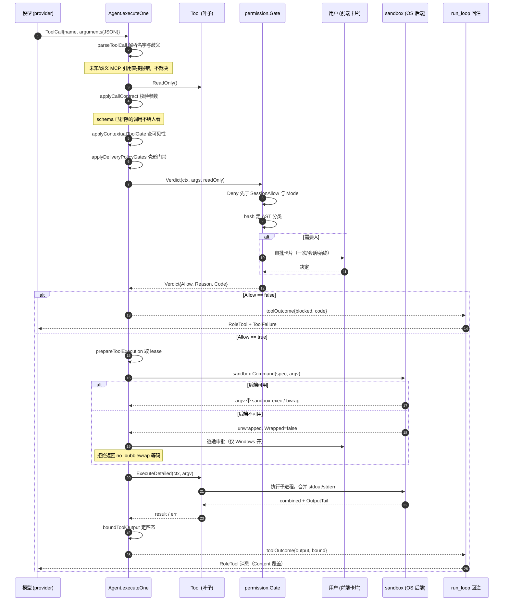

# 工具调用契约、权限审批与沙箱三维边界

> 本解读按 **ai-agent** 类规格产出，属 DeepSeek-Reasonix 深度解读的子文档；共 13 篇，解读基线 `v2.37.0`（`e17ef45e3`）。正文所有 `文件:行号` 引用均为 Reasonix 仓库相对路径，点开即可核对。相关篇章见 [README.md](README.md)。

## 在系统中的角色：三条互不替代的边界

Reasonix 对外的承诺是"宿主可裁决、可回退、可审计"。这三件事在本关注面各有一个落点：**模型能做什么**只由 `tool.Tool` 的声明决定；**宿主准不准**只由权限策略在单个调用上的返回值决定；**真做的时候能不能越界**，只由沙箱交给操作系统的那份 profile 决定。把这三层抽走，Reasonix 就退化成"把模型输出拼进 `os/exec` argv"的壳——模型的一句幻觉会直接落成宿主文件系统上的写、网络连接和签名请求。

所以这一层不是"工具清单"，而是**三条独立边界的交汇点**：契约（声明式，缓存敏感，模型可见）、裁决（策略式，宿主所有，模型只看到一句带 code 的理由）、强制（内核式，模型完全看不见）。这三者的可见性不同、失败模式不同、责任主体也不同，把它们混成一个"权限开关"是本层要避免的头号错误。

- 契约的类型入口是 `tool.Tool` 的五个方法，只读性也在其中。
  [internal/contract/tool/tool.go:22-34]()
<!-- anchor: type Tool interface { … ReadOnly() bool -->
- 裁决的结果类型把"给模型看的话术"与"给调用方分类的身份"分开。
  [internal/safety/permission/verdict.go:44-49]()
<!-- anchor: // Verdict is a gate's answer to one call: whether it runs, and when it does … Code   string -->
- 强制的输入是宿主侧的三维规格，而不是任何一个布尔。
  [internal/safety/sandbox/sandbox.go:24-82]()
<!-- anchor: type Spec struct { … SessionTemp string -->

## 根因：判断必须读结构，而不读措辞

### 前提一：工具 schema 是缓存稳定前缀的一部分，不能随权限姿态抖动

provider 可见的工具列表必须字节稳定，而权限姿态（Ask/Auto/Yolo）、工作流阶段、MCP 是否已连接都是运行时事实。项目用一个不对称设计解决它：provider schema 保持静态，只在 schema 里放**声明**（`Schema()` / `Description()` / `ReadOnly()`），运行时可用性走另一个契约。`ContextualTool` 的注释把这个取舍写得很直白——"Provider schemas remain static for cache stability; the host must still consult this contract before permissions, hooks, leases, or Execute so stale transcripts fail closed"（provider schema 为缓存稳定保持静态，宿主必须在权限、hook、租约或执行之前查询这个契约，让过期转录 fail closed）。

[internal/contract/tool/tool.go:37-42]()
<!-- anchor: // ContextualTool is an execution-time availability contract for tools whose … ProviderVisible(context.Context) bool -->

### 前提二：失败归因是宿主拥有的状态

截断、超时、策略拒绝、输出溢出、参数解析失败——这五类事实里模型只知道最后一类，其余四类只有宿主知道。如果宿主不把它写进模型可见的那一段，模型会自己编一个原因并长期沿用。代码里这条原则的落地是**每一个工具结果字符串都可能带附属说明**：`confinementNotes` 把沙箱拒绝的写根、被切断的出网域名拼在命令输出之后。

[internal/tools/builtin/bash_egress.go:33-42]()
<!-- anchor: func (b bash) egressNote(token string) string { … ". Bash reaches only the hosts in [sandbox] allowed_domains and those the user a -->

### 立场：措辞匹配在门禁里双向误判，而门禁的误判比没有门禁更糟

**为什么"读结构"是必须的，而不是洁癖。** 正则匹配命令文本的失败模式是双向的：`rm -rf /` 能匹配，`rm -rf ${HOME}` 不能；而 `echo "rm -rf /"` 会误报。更根本的是，一个措辞表无法回答"这条命令实际会执行什么"——它只能回答"这条命令像不像危险命令"。项目因此选择 `mvdan.cc/sh/v3/syntax` 解析成 AST，所有判定都在语法节点上做，`shellparse` 的每个导出函数都以 `*syntax.File` 为输入而不是以字符串包含关系为输入。

[internal/base/shellparse/bash.go:215-265]()
<!-- anchor: func AnalyzeApprovalFeatures(command string) (features ApprovalFeatures, ok bool … return features, true -->

**为什么门禁里的误判比没有门禁更糟。** 因为声明会被相信。项目对"声明的边界必须与真实的强制能力对齐"这句话给出的是一个后果判断而非风格判断："a claim that outruns its enforcement is worse than an absent one: it is believed"（一个超出其强制能力的声明比没有声明更糟：它会被相信）。这一条同时解释了后面沙箱一节的形态——每个平台只为它真正有强制原语的那些维度做声明。

[REASONIX.md:458-461]()
<!-- anchor: A protection claim exists only where a backend has a demonstrated enforcement … its enforcement is worse than an absent one: it is believed. -->

误判还有第二个下游代价：**原因会变成模型的重写目标**。给模型一个"最保守的标签"（"无法解析"）而不是最准确的原因（"here-doc 喂给了内联解释器"），模型会朝完全错误的方向重写命令。所以本层的纪律是"降级要给出最准确的原因"，而不是"降级要给最保守的答案"，这一点在命令安全一节的降级顺序里有完整实现。

## 契约定型：能力挂在工具上，表面按字节排序

**工具契约只有四个方法加一个只读位**，核心是"`ReadOnly` 回答的是审批，不是批次"这个切分。

```go
type Tool interface {
	Name() string
	Description() string
	Schema() json.RawMessage
	Execute(ctx context.Context, args json.RawMessage) (string, error)
	ReadOnly() bool
}
```

[internal/contract/tool/tool.go:22-34]()
<!-- anchor: type Tool interface { … ReadOnly() bool -->

**契约层放弃"中央工具表"。** 直觉方案是一张 `map[toolName]ToolSpec`，把 schema、只读性、权限需求、输出上限集中登记。项目反过来：能力是**可选接口**，工具自己实现，宿主用类型断言发现。`Previewer`（能否在落盘前算出 diff）、`WritePathResolver`（写路径解析）、`SequentialTool`（是否必须保序）、`Paged`（结果是否自带续页）、`SnipHinter`（被压缩时保留哪两端）、`PlanModeClassifier`（能否在计划阶段跑）全是可选接口。理由写在 `SnipHint` 的注释里：几何形状挂在工具上而不是按名字查表，"renaming a tool carries its snip policy with it and a new tool cannot silently fall back to a generic default unnoticed"（重命名一个工具会连它的裁剪策略一起搬走，新工具也不会静默退化到一个没人注意的通用默认值）。代价是发现成本——读代码的人必须知道接口存在才能看见能力。

[internal/contract/tool/tool.go:288-294]()
<!-- anchor: // SnipHinter is an optional capability a Tool implements when its output has a … SnipHint() SnipHint -->

**provider 表面的字节顺序也是契约的一部分。** `Registry.ProviderSchemas` 把工具分成"稳定工具"与"上下文工具"两组，各自排序后**稳定组在前**。注释给出的理由：这样一个工具的缺席是一个工具存在的**字节前缀**，缓存因此能保留边界之前的每一个 token。也就是说，一个因为阶段/连接状态而暂时消失的工具，只让缓存从它自己的位置开始失效，而不是让整个工具段失效。

[internal/contract/tool/tool.go:652-690]()
<!-- anchor: // ProviderSchemas is the surface one turn carries: stable tools first, … for _, name := range r.order { -->

同一机制的另一半是 `SetProviderVisibleTools`：它限制的是 **provider 表面**，`Get`/`Execute` 仍然能解析每一个已注册工具，所以 `use_capability` 可以在不改 provider schema 的前提下派发一个不在表面上的工具。这正是 `docs/TOOL_CONTRACT.md` 里"注册但不在表面上"那组工具的实现基础。

[internal/contract/tool/tool.go:392-430]()
<!-- anchor: // SetProviderVisibleTools restricts the provider-visible schema surface to the … // ProviderVisible reports whether name is currently provider-visible. -->

**裁决结果带两层身份**：`Allow`/`Reason` 是给模型看的话术，`Code` 是给调用方计数和分类的身份。

[internal/safety/permission/verdict.go:44-49]()
<!-- anchor: // Verdict is a gate's answer to one call: whether it runs, and when it does … Code   string -->

`Refusal` 类型把同一条规则推广到所有跨边界拒绝：`Code` 是身份，`Message` 是可改写、可翻译的呈现。

[internal/contract/tool/refusal.go:13-34]()
<!-- anchor: type Refusal struct { … return msg + " (refusal: " + r.Code + ")" -->

**输出边界是一个四态枚举**，而不是几个互相独立的布尔。注释解释了为什么必须是枚举："'truncated and spilled' is not a state anything can produce, so no type should be able to express it"（"既截断又溢出"不是任何东西能产生的状态，所以不该有类型能表达它）。

[internal/contract/event/bound.go:8-23]()
<!-- anchor: const ( … Path      string // where the full text lives (BoundSpilled) -->

## 一次工具调用的完整链路

导读：这张图画的是一次成功路径加两种典型失败（权限拒绝、结果溢出）。要点在于**裁决发生在叶子**——`executeOne` 的四个阶段（parse → policy → prepare → finish）里，权限检查在 `prepare` 之前完成，而 write lease 只在权限通过后才获取。

[internal/runtime/agent/execute_one.go:128-152]()
<!-- anchor: if blocked, early := a.parseToolCall(ctx, plan); early { … return a.finishToolExecution(ctx, plan) -->



图后的着落：这张图里最容易读错的一步是 `applyCallContract` 的位置。它排在权限检查**之前**，而权限检查又必须早于任何写租约：

[internal/runtime/agent/execute_one.go:212-219]()
<!-- anchor: // resolveToolPolicy applies Plan mode, proxy resolution, delivery gates, Auto … return blocked, true -->

注释说明意图是"keeps a user approval from being spent on a call that can only fail after it"（避免把一次人的审批花在一个注定之后才失败的调用上）：

[internal/runtime/agent/call_contract.go:19-31]()
<!-- anchor: // Execution was never possible, so this keeps a user approval from being spent … return toolOutcome{output: "error: " + msg, errMsg: msg, refusalCode: refusalArg -->

也就是说，参数级失败不消耗人的注意力；只有**语义级**的不确定（这条命令会不会写、写给谁）才会到人面前。这是整个审批体验的核心取舍。

## 权限裁决：规则在中央匹配，判断在叶子

**规则语法**独立成包，因为它同时是"配置里怎么写"和"人来读的时候怎么读"两件事。形式是 `ToolName` / `ToolName(glob)` / 历史遗留的 `ToolName=literal`，其中 `=` 形式下 `*` 和 `?` 是普通字符。

[internal/contract/permrule/permrule.go:12-18]()
<!-- anchor: type Rule struct { … Literal bool -->

**匹配对象是 subject，不是整份 args。** subject 按固定键序从 args 里取：`planId, command, file_path, path, source_path, destination_path, pattern, origin, app`。`planId` 排第一但语义上不是目标而是"票"，`move_file` 同时暴露 source 和 destination 两个 subject。

[internal/safety/permission/subject.go:10-23]()
<!-- anchor: // file tools expose path / file_path, grep & glob expose pattern. planId leads … return "" -->

**叠加顺序是硬编码的**，这是"forbid 永远成立"的代码依据：`Deny → ReadOnly 姿态 → SessionAllow → Ask → Allow → readOnly 兜底 → 需要人的形状 → Mode`。

[internal/safety/permission/permission.go:176-205]()
<!-- anchor: // DecideSubject evaluates a tool call when the caller already extracted the … return p.Mode -->

三处细节值得单独指出：

1. **`ReadOnly` 是最强的 Deny**，排在规则之前。它不是一个模式，而是一条无条件拒绝所有非读调用的姿态；`DeniesWriters()` 把这条事实暴露给"绕过了普通 gate"的调用方，于是授权的 MCP server 也不能在只读会话里写。
   [internal/safety/permission/verdict.go:70-77]()
<!-- anchor: func (g *Gate) Check(ctx context.Context, toolName string, args json.RawMessage, … func (g *Gate) DeniesWriters() bool { return g.Policy.ReadOnly } -->
2. **bash 走单独分支**。`decideBashSubject` 先取审批类别（可复用 / 仅精确 / 必须人），再把复合命令拆成顶层段逐段裁决；任一段 deny 则整体 deny，任一段 ask 则整体 ask，只有全段覆盖或被 writer fallback 覆盖才 allow。
   [internal/safety/permission/permission.go:269-288]()
<!-- anchor: func (p Policy) decideBashSegments(readOnly bool, parts []string) Decision { … // denied, asks if either endpoint requires approval, and is allowed only when -->
   这条规则让 `Bash(git push:*)` 这类前缀规则能覆盖 `git add . && git commit && git push`，同时**绝不从复合命令反向合成新前缀**。
3. **多个 subject 取最严**。`DecideSubjects` 对每个 subject 求值，任一 Deny 即 Deny，任一 Ask 即 Ask。注释把理由说清了：move 的两端都要在同一策略下被允许。
   [internal/safety/permission/permission.go:290-303]()
<!-- anchor: func (p Policy) DecideSubjects(toolName string, readOnly bool, subjects []string … return out -->

**档位不是三套策略，而是同一个 `Policy` 上的一个字段。** 文档给出 Ask / Auto / Yolo 三档。

[docs/TOOL_APPROVAL_MODES.md:19-23]()
<!-- anchor: | Mode | Behavior | Good for | Not ideal for | … | Yolo | Skip ordinary tool permission prompts so writes and commands run with f -->

代码里 `buildHeadlessGate` 按档位构造 Policy：Auto 把 `Mode` 设为 `Allow`，Yolo 额外打开 `dynamicBashBypass`，只读姿态则设 `ReadOnly`。

[internal/session/control/approval.go:92-133]()
<!-- anchor: // construction point for every headless-only gate — the top-level executor, … return &freshHumanHeadlessGate{gate: permission.NewGate(policy, denyPermissionAp -->

**"forbid 规则永远成立"是怎么保证的。** 关键在于**档位只改 `Mode` 这个兜底项，从不改规则表**。`DecideSubject` 的前三个 case 是规则匹配（Deny / SessionAllow / Ask），`Mode` 只在最后作为 fallback 出现；因此 Auto/Yolo 无论怎么调，`Deny` 规则都在同一条代码路径上被先检查：

[internal/safety/permission/permission.go:176-205]()
<!-- anchor: // DecideSubject evaluates a tool call when the caller already extracted the … return p.Mode -->

前端侧的自动放行也遵守同一条纪律：`autoApprovalWouldAllowLocked` 的做法是把 `Mode` 强制改为 `Allow` 后调用 `DecideSubject`，再要求结果**恰好等于 `Allow`**——deny 命中时返回的是 `Deny`，因此不满足。

[internal/session/control/approval.go:530-536]()
<!-- anchor: func (a *approvalManager) autoApprovalWouldAllowLocked(tool, subject string) boo … return policy.DecideSubject(tool, false, subject) == permission.Allow -->

`bypassAllowsLocked` 在 Yolo 下直接返回 true，但它前面横着一道 `requiresFreshApprovalTool` 硬闸，而后者保护的正是"必须有人的那几类工具"。

[internal/session/control/approval.go:510-527]()
<!-- anchor: // decision helpers (caller holds a.mu) … return policy.DecideSubject(tool, false, subject) == permission.Allow -->

**文档里那句"Dynamic Bash never inherits a broader rule"有对应的代码闸门。** `matchAnyAllow`（allow 规则的匹配入口）在做 glob 匹配**之前**先检查两件事：bash 命令是否 `bashSubjectRequiresExactRule`、browser subject 是否 `BrowserSubjectRequiresExplicitApproval`；任一为真就只接受**逐字精确**的规则，不进入 glob 匹配。

[internal/safety/permission/permission.go:505-517]()
<!-- anchor: func matchAnyAllow(rules []Rule, toolName, subject string) bool { … // given tool subject. It is used for session grants as well as persisted config -->

会话授权的规则字符串也由同一套保守逻辑生成：`BashCommandPrefix` 在命令含 shell 语法、需要精确规则、或有危险警告时返回空串，宁可用 `Bash=<完整命令>` 也不合成一个更宽的前缀；包管理器只在 `npm/pnpm/yarn/bun run <script>` 这一形状上放宽到三段。"always allow"因此永远是对**已经批准过的那一件事**的承诺，而不是对一个命令族的承诺。

[internal/safety/permission/permission.go:679-698]()
<!-- anchor: func BashCommandPrefix(subject string) string { … return fields[0] + " " + fields[1] + ":*" -->

**必读的一道边界**：`requiresFreshApprovalTool` 与 `approvalGrantsForRequest` 共同保证"新鲜人审批"类调用**不提供持久化规则**，因为那条规则在下一次启动时不会被查。也就是说，UI 上不出现"always allow"，不是省略，而是**避免承诺一个运行时故意不兑现的东西**。

[internal/session/control/approval.go:640-648]()
<!-- anchor: // approvalGrantsForRequest narrows the generic tool grant contract for calls … persist = false -->

**审批模式 × 协作模式的交叉也遵循同一原则**：Plan 确认永远需要人，因为它是"授权一批尚未发生的动作"，与"授权这一条命令"不是同一类决定。

[docs/TOOL_APPROVAL_MODES.md:141-146]()
<!-- anchor: | Plan + Ask | While planning, gated calls wait; after plan approval, ordinary w … | Goal + Yolo | For very clear, roll-backable goal work; highest risk. | -->

## 命令安全：读 AST，不读措辞

**AST 上具体判定 6 类，各自有独立的 blocker 身份**，因为"你被什么挡住了"必须准确，否则模型会朝错误方向重写。

[internal/safety/permission/bash_approval.go:22-41]()
<!-- anchor: type BashApprovalBlocker uint8 … BashApprovalBlockerHereDocBody -->

- `NestedExecution`：`$(...)`、反引号、`<(...)` 命令/进程替换。
- `DynamicCommandName`：命令名本身是运行时展开。
- `InlineCode`：`python -c` / `node -e` / `bash -c` 这类从参数取源码的解释器；也包括 `python3 - <<EOF`——因为 here-doc 喂给解释器和 `-c` 是同一个事实。
- `IndirectExecution`：`eval`、`source`、`xargs`、`find -exec`、`env` 前缀赋值等"argv 里没写出真正要跑的命令"的包装。
- `HereDocBody`：parser 读得懂，但审批读不懂——body 是文件内容，不是参数。
- `Unparsable`：连静态分析都读不出来，什么都不该信。

**判定一：管道/分号/`||` 会掩盖前序失败，而 `&&` 不会。** `CanMaskEarlierFailure` 只豁免 `&&` 链，因为 bash 对 `&&` 短路并返回第一个失败命令的状态；`;`、换行、`||`、`|`、`&` 全部按"能掩盖"处理。

[internal/base/shellparse/bash.go:341-362]()
<!-- anchor: func CanMaskEarlierFailure(command string) (canMask bool, ok bool) { … return false, true -->

这条判定直接支撑一个上游门禁："声明了 `verifies` 的调用必须是一条命令或 `&&` 链"，`;`、管道、`||` 一律拒绝（写在该工具的 schema 描述里）。理由是**退出码是唯一证据**：如果状态被交给别人，宿主记录的"检查通过"就不是这次检查的结论。

[internal/tools/builtin/bash.go:159-159]()
<!-- anchor: return json.RawMessage(`{"type":"object","properties":{"command":{"type":"string -->

**判定二：复合语句的叶子必须全可命名、全只读才放行。** `CompoundLeafCommands` 在 `for`/`if`/`while` 等复合语句上把每个叶子命令抽出来；任何替换、重定向、here-doc 在抽叶子之前就把整条语句否掉。

[internal/base/shellparse/bash.go:617-699]()
<!-- anchor: // CompoundLeaves is CompoundLeafCommands with the reason a statement could not … return leaves, "", true -->

这条让 `cd x && ls` 这类无害复合命令能自动通过，而 `cd x && python3 - <<EOF` 不能——注释明确指出这个 case：here-doc 喂解释器在任何嵌套层级都可见。

[internal/safety/permission/bash_approval.go:78-91]()
<!-- anchor: // `cd x && python3 - <<EOF` hides the same inline code a bare … return BashApprovalBlockerUnparsable -->

**判定三：递归删除有独立的启动前守卫，且目标必须严格位于允许根之下。** `refuseCommand` 在三件事上按顺序把关：外部 file reference、命令行检查、破坏性删除。

[internal/tools/builtin/bash_delete.go:42-58]()
<!-- anchor: if err := b.refuseExternalRef(command); err != nil { … return err -->

递归删除的判定逻辑先解析 extent（含 `find -delete`、`find -exec rm`、`xargs rm`、`cmd /c del /s`、PowerShell `Remove-Item -Recurse`），再检查目标：文件系统根、home、workspace 自身、以及 workspace 的祖先目录一律拒绝；只有**严格位于某个允许写根之下**的目标才放行。这条判定还专门处理"目标被解析成 workspace 之外"的情况，因为 `rm -rf ../..` 在语法上完全合法。

[internal/tools/builtin/bash_delete.go:210-263]()
<!-- anchor: func (b bash) boundedDeleteTarget(target string) bool { … return false -->

**判定四：动态形状只开一扇极窄的门。** 只读判定本身也要处理展开：`resolvedReadOnlyFields` 只接受一种动态形状——**双引号包裹**的命令替换，且嵌套命令本身必须是单个静态、参数安全的只读命令。未加引号的替换、参数展开、算术展开、进程替换、重定向、赋值、链式命令、后台作业全部保持 fail-closed。注释清楚说明了它**从不求值**输出："It never evaluates output."。这是"读结构"原则最锋利的一处：不是"拒绝一切含 `$()` 的命令"，而是"精确地认出那一种可以静态证明安全的形状"。

[internal/safety/shellsafe/shellsafe.go:170-176]()
<!-- anchor: // resolvedReadOnlyFields accepts one narrow dynamic shape: a command from the … func resolvedReadOnlyFields(command string, nested bool) ([]string, bool, bool)  -->

**降级路径：解析失败怎么办。** 这是本层最讲究的一处。`BashSubjectApprovalBlocker` 在 `SplitTopLevel` 失败时并不直接判"必须人"，而是**依次尝试三条更窄的判定**：

[internal/safety/permission/bash_approval.go:53-69]()
<!-- anchor: func BashSubjectApprovalBlocker(subject string) BashApprovalBlocker { … return BashApprovalBlockerNone -->

1. 若含 here-doc 且喂给解释器 → 判 `InlineCode`（比"未知"更准确）；
2. 否则若复合语句的叶子全只读 → 判"无需人"（`compoundIsReadOnly` 先失败关闭：叶子必须全可命名）；
3. 否则若含 here-doc → 判 `HereDocBody`；
4. 全都不是 → `Unparsable`。

这个顺序体现的原则是：**降级要给出最准确的原因，而不是最保守的标签**——因为标签会变成模型的重写目标，"inline interpreter code is blocked" 和 "无法解析"会让模型做完全不同的两件事。

删除守卫的降级更严格，因为它面对的是不可逆操作：depth > 12 的嵌套直接判"未知 extent"，语法错误给 `shell.syntax_error`，parser 超时给 `shell.parser_timeout`，PowerShell 无 parser 给 `shell.parser_unavailable`。**每个降级原因都是独立的 dotted code，不是一句散文**。

[internal/tools/builtin/bash_delete.go:63-86]()
<!-- anchor: func (b bash) judgeDelete(ctx context.Context, sh sandbox.Shell, command string, … return deleteRefusal(CodeShellSyntax, "Fix the shell syntax and retry: "+analysi -->

**分类结果如何影响审批复用。** 解析成功但含展开/赋值/重定向/未加引号的 glob/`env` 前缀赋值 → `bashApprovalExactOnly`：可以批准，但**不能作为可复用前缀**。理由是 glob 和循环变量让"同前缀的下一条命令"其实是另一条命令。这一条与文档自述的"Dynamic Bash never inherits a broader Bash, prefix, or glob rule"完全对应。

[docs/TOOL_APPROVAL_MODES.md:29-29]()
<!-- anchor: Dynamic Bash never inherits a broader Bash, prefix, or glob rule. Parameter/arit -->

**只读判定亦有单一真源。** `internal/safety/shellsafe` 的表同时被权限自动放行路径和显式只读 runner 使用，注释明说是为了让两边的分类"cannot drift"（不会漂移）。

[internal/safety/shellsafe/shellsafe.go:15-24]()
<!-- anchor: // ReadOnlyCommands holds commands whose base name alone implies a read; ones … "echo": true, "printf": true, -->

表里**故意缺席**的东西也是论据：`sed`/`awk` 能通过脚本语言写文件、`less`/`man` 能执行命令、`info` 能按指示写——所以它们不在只读表里，而不是"遗漏"。

## 沙箱三维正交：Integrity / Confidentiality / Authority

**三维在代码里的具体表达类型、强制原语与能力探测：**

| 维度 | Spec 字段 | 强制原语（macOS） | 强制原语（Linux） | 能力探测 |
|---|---|---|---|---|
| Integrity | `WriteRoots` + `Pins` | `(deny file-write*)` + 逐个 `(allow file-write* (subpath …))` | `--ro-bind / /` + 逐个 `--bind root root` | `IntegrityEnforced()` |
| Confidentiality | `ForbidReadRoots` | `(deny file-read* (subpath …))` + 同名写拒绝 | 目录 `--tmpfs`，文件 `--ro-bind /dev/null` | 随 Integrity |
| Authority | `HostAuthorities []HostAuthority` | `(deny network-outbound (literal sock))` / 反向 `(allow …)` | `--ro-bind /dev/null sock` | `GovernedAuthorities()` |
| （正交轴）网络传输 | `Network` + `Egress` | `(deny network*)` 或仅放行 loopback+代理端口 | `--unshare-net` 出现/移除 | `EgressSupported()` |

整张规格的宿主侧定义在 `Spec` 上，`ReadOnly` 只是其中一个维度的属性：

[internal/safety/sandbox/sandbox.go:24-82]()
<!-- anchor: type Spec struct { … SessionTemp string -->

`HostAuthority` 的注释把"拥有密钥 ≠ 有此权限"写成了设计约束："SSHAgent signs with keys the sandbox cannot read. Possession of the key file and the authority to use it are different things, which is why denying the read (ForbidReadRoots) leaves this wide open"（ssh-agent 用它读不到的密钥签名；持有密钥文件与有权使用它是两回事，这正是拒绝读却挡不住它的原因）。

[internal/safety/sandbox/authority.go:14-26]()
<!-- anchor: const ( … // endpoints are governed. -->

**为什么"网络传输"和"宿主 authority"必须分开。** macOS 上这两件事被 seatbelt 的同一个 `network*` 系列原语覆盖，所以最省事的做法是一个 `Network bool` 同时管两者。项目明确拒绝了这个做法，理由写在 `Spec.Network` 的注释里："transport and authority are separate questions, one flag cannot answer both"（传输与 authority 是两个问题，一个开关回答不了两个）。

[internal/safety/sandbox/sandbox.go:52-57]()
<!-- anchor: // Network allows *external* egress only; module downloads need it, so it … HostAuthorities []HostAuthority -->

这个结论有实证来源：`(deny network*)` 在 macOS 上**同时切断 ssh-agent**，所以一个开关无法表达"没有互联网，但仍能签名"。

[REASONIX.md:450-452]()
<!-- anchor: Network transport and host authority are independent even when a backend … flag could not express "no internet, still sign". -->

代码里的落地是 profile 的**规则顺序**：`seatbeltProfile` 把 authority 规则放在最后，且 denies 在 grants 之前——SBPL 取**最后匹配**，所以被授予的 endpoint 能存活于上面的整体拒绝之上。

[internal/safety/sandbox/seatbelt_darwin.go:119-126]()
<!-- anchor: // Authority rules last, and denies before grants: SBPL takes the final … fmt.Fprintf(&b, "(allow network-outbound (literal %s))\n", sbplString(p)) -->

被授予的 endpoint 由 `grantedAuthorityEndpoints` 从环境变量解析：`SSH_AUTH_SOCK`、`DOCKER_HOST`、`CONTAINER_HOST`、以及各 daemon 的默认 socket 路径。

[internal/safety/sandbox/authority_endpoint.go:31-46]()
<!-- anchor: func authorityEndpoints(a HostAuthority, getenv func(string) string) []string { … return out -->

这里有一个刻意的冗余：授权解析用 `EffectiveGetenv`（宿主环境叠加 `[tools.shell] env`），**被拒绝**的 endpoint 则取两个环境解析结果的并集——因为一个 preset 把客户端指向别处，不应该让宿主的 socket 从 mask 里消失。

[internal/safety/sandbox/authority_endpoint.go:13-21]()
<!-- anchor: // confined command will see, unioned: a preset that points a client at another … continue -->

出网侧还有一处同类分离：egress proxy 的 `admit` 先查策略、为 IP 字面量与域名解析结果分别做地址类别检查（loopback / link-local / metadata 一律 `blocked-by-address`），只有通过后才决定拨号目标；有上游代理时名字被透传，但本地解析仍会拒绝"这个名字在本机只解析到禁止地址"的情形。这是"策略允许某个域名"与"这个域名此刻实际指向哪里"两道独立检查，防止 `allowed.com` 解析到 `169.254.169.254`。

[internal/safety/egress/proxy.go:276-300]()
<!-- anchor: // admit decides host:port and returns where to dial. Through an upstream the … if upstream != nil { -->

[internal/safety/egress/address.go:21-21]()
<!-- anchor: func forbiddenAddress(ip net.IP, local func() []net.IP) bool { -->

**"文件可见性不是 authority"的代码依据。** Linux 后端里，authority 的 mask 是 `--ro-bind /dev/null <socket path>`，而注释专门解释为什么不给 socket 加文件可见性限制、也不用 `--unshare-net`："A pathname socket lives in the mount namespace, so `--unshare-net` misses it and `--unshare-ipc` is the wrong tool: that isolates SysV IPC, not sockets"（路径名 socket 活在 mount namespace 里，所以 `--unshare-net` 漏掉它，`--unshare-ipc` 是错的工具：它隔离的是 SysV IPC，不是 socket）。mask 放在所有 mount **之后**，注释说明"Maske last so no later mount re-exposes an endpoint"。

[internal/safety/sandbox/seatbelt_other.go:136-142]()
<!-- anchor: // Masks last so no later mount re-exposes an endpoint. A pathname socket … return args -->

这条注释正是"denying `file-read*` on a socket did not stop a connect"（在 socket 上拒绝 `file-read*` 并不能阻止 connect）在同一份代码里的回响。

[REASONIX.md:454-455]()
<!-- anchor: Filesystem visibility is not authority: denying `file-read*` on a socket did not … stop a connect. Possession is not authority: the key can be unreadable while an -->

**`ForbidReadRoots` 的强制细节也暴露了维度分离。** macOS 上给每个 forbid-read 根同时加 `deny file-read*` 和 `deny file-write*`，理由是一个**跨维度泄漏**：bubblewrap 用空 tmpfs 覆盖目录（连带取消写权限），如果不补写拒绝，那么"对它做盲写"在 macOS 上会成功。也就是说 Confidentiality 的强制手段如果不小心，会同时削弱 Integrity。

[internal/safety/sandbox/seatbelt_darwin.go:102-109]()
<!-- anchor: // Deny reads under forbid-read roots so even a permitted shell command … fmt.Fprintf(&b, "(deny file-write* (subpath %s))\n", sbplString(p)) -->

**Authority 的可强制集合是被"命名"的，不是"全部"。** `GovernedAuthorities()` 只返回 ssh-agent / docker / podman 三个，注释直接写明"host IPC at large is not isolated — DBus, Wayland, gpg-agent, keyrings and arbitrary sockets remain reachable, so the claim is 'these endpoints are governed', never 'host IPC is isolated'"（大范围的宿主 IPC 并未隔离——DBus、Wayland、gpg-agent、keyring 与任意 socket 仍可到达，所以主张只是"这些 endpoint 被治理"，绝不是"宿主 IPC 已隔离"）。零值 Spec 拒绝全部三个，所以新增调用点默认是关闭的。

[internal/safety/sandbox/authority.go:23-27]()
<!-- anchor: // GovernedAuthorities is what this package can actually enforce. Naming the set … func GovernedAuthorities() []HostAuthority { return []HostAuthority{SSHAgent, Do -->

authority 的具名集合本身定义在同一个文件里：

[internal/safety/sandbox/authority.go:18-20]()
<!-- anchor: SSHAgent HostAuthority = "ssh_agent" … Podman   HostAuthority = "podman" -->

`GovernedAuthorities` 的调用面在这里：

[internal/safety/sandbox/authority.go:27-27]()
<!-- anchor: func GovernedAuthorities() []HostAuthority { return []HostAuthority{SSHAgent, Do -->

endpoint 的解析入口：

[internal/safety/sandbox/authority_endpoint.go:32-32]()
<!-- anchor: switch a { -->

**写根身份是 pin 住的，不信任路径字符串。** `WriteRootPins` 在会话建立时记录每个写根的**符号链接解析后路径**与当时的 `os.FileInfo`；启动时若解析路径变了、或 `os.SameFile` 不成立，该根被丢弃并附上 `sandbox.write_root_changed`；若某个链接位于某个可写目录之内（命令自己能重指向它），丢弃并附 `sandbox.write_root_redirected`。

[internal/safety/sandbox/write_roots.go:13-21]()
<!-- anchor: // Write-root drop codes: the identity of why a root a caller named was left … WriteRootRedirectedCode = "sandbox.write_root_redirected" -->

`writeRootPins.refusal` 是这条判定的实现体：

[internal/safety/sandbox/write_roots.go:198-228]()
<!-- anchor: // refusal names why c may not be granted. A link a writable directory's own … return "" -->

`WriteRootPins` 的构造点：

[internal/safety/sandbox/write_roots.go:33-33]()
<!-- anchor: type WriteRootPins struct { -->

丢弃不是静默的：`writeRootNote` 把每个丢弃原因拼成 `[host] <code>: <path> is not a write root …` 附在命令输出后。这是"失败原因必须穿到模型"的又一处落点。

[internal/tools/builtin/bash_writeroots.go:17-26]()
<!-- anchor: func (b bash) writeRootNote(wrapped bool) string { … return strings.Join(notes, "\n") -->

**Integrity 的能力判定与三维严格对齐。** `IntegrityEnforced` 只回答写是否被强制，注释明确"it says nothing about reads or host authorities"（它对读与宿主 authority 什么也没说）；`WriteProtects` 只有在 spec 强制、本平台有可用后端、且目标的符号链接解析结果与所有可写目录**双向**都不重叠时才为真。

[internal/safety/sandbox/protects.go:18-22]()
<!-- anchor: // IntegrityEnforced reports whether a command confined by spec runs under a … return spec.Enforce() && Available() -->

`IntegrityEnforced` 本身：

[internal/safety/sandbox/protects.go:21-21]()
<!-- anchor: func IntegrityEnforced(spec Spec) bool { -->

**两条后端实现带。** macOS 把整份 SBPL 交给 `sandbox-exec -p`：

[internal/safety/sandbox/seatbelt_darwin.go:20-24]()
<!-- anchor: func Command(spec Spec, sh Shell, command string) ([]string, bool) { … return append([]string{"sandbox-exec", "-p", seatbeltProfile(spec)}, sh.argv(com -->

Linux 走 bwrap：

[internal/safety/sandbox/seatbelt_other.go:47-62]()
<!-- anchor: func Command(spec Spec, sh Shell, command string) ([]string, bool) { … // prefix without shell interpretation — suitable for direct binary invocations -->

**Windows：三维皆不强制，且是明确声明。** 三层落点：`BashModeForGOOS("windows")` 直接返回 `"off"`，即便配置写了 `enforce`。

[internal/contract/config/config.go:997-999]()
<!-- anchor: func (c *Config) BashModeForGOOS(goos string) string { … return "off" -->

`sandbox.Command` 返回原 argv 且 `wrapped=false`：

[internal/safety/sandbox/seatbelt_windows.go:10-23]()
<!-- anchor: func Command(spec Spec, sh Shell, command string) ([]string, bool) { … return false -->

`EgressSupported()` 返回 false，因此出网代理也不可用：

[internal/safety/sandbox/seatbelt_windows.go:26-28]()
<!-- anchor: // EgressSupported reports whether this platform can confine egress to the … func EgressSupported() bool { return false } -->

设计原则是：一个跑在自己强制能力之前的声明比没有声明更糟，因为它会被相信。

[REASONIX.md:458-461]()
<!-- anchor: A protection claim exists only where a backend has a demonstrated enforcement … its enforcement is worse than an absent one: it is believed. -->

**fail-closed 的具体形态。** Enforce 被要求而后端不可用时，`Command` 返回 unwrapped + `false`，调用方**不执行**，而是返回 `sandbox.UnavailableMessage()`；后端的可用性判定不是"二进制在 PATH 上"，而是真实探测：macOS 用 `(version 1)(allow default)` 跑 `/usr/bin/true`（区分"装了 sandbox-exec"与"`sandbox_apply` 真的能进"）。

[internal/safety/sandbox/seatbelt_darwin.go:47-84]()
<!-- anchor: // usableSandboxExec distinguishes an installed sandbox-exec from a usable … return usableSandboxExec() -->

Linux 用 bwrap 进一次 namespace 跑 `true`：

[internal/safety/sandbox/seatbelt_other.go:26-39]()
<!-- anchor: func usableBwrap() (string, bool) { … return bwrap, actual.(bool) -->

探测失败会被缓存（"every command does not pay the failed probe cost"），但**超时不会**污染缓存，因为慢主机不等于不可用。

## 沙箱三维正交结构图：位置本身就是论据

上面的表格已经把三种维度讲清楚了，但它讲不出**关系**：哪些线是"Spec 字段投影到维度表达类型"，哪些线是"维度压到内核原语"，哪些线是**反向**的"能力探测决定声明是否成立"，以及 `ReadOnly` 到底挂在哪一根轴上。这三种关系如果画成同一种箭头，读者就会把它们当成同一件事——而本项目最贵的一条经验恰恰是它们不是同一件事。下面这张图把三种边分开画，并单独标出唯一一条跨维度泄漏。


图后的着落：读这张图时该看三处。第一处是 `ReadOnly` 被画成 Integrity 轴上的**虚线旁挂节点**而不是一条独立轴——它是"仅属于 Integrity 维度"的属性，不承载任何 Confidentiality 或 Authority 声明。

[REASONIX.md:447-447]()
<!-- anchor: `ReadOnly` is therefore an Integrity property only; it makes no Confidentiality -->

第二处是 Network+Egress 轴与 Authority 轴**并列且不重叠**：`Network` 只回答外部出网，与 `HostAuthorities` 严格分离。

[internal/safety/sandbox/sandbox.go:52-57]()
<!-- anchor: // Network allows *external* egress only; module downloads need it, so it … HostAuthorities []HostAuthority -->

第三处是那条红色的跨维度泄漏边：Confidentiality 的强制手段（Linux 侧的 tmpfs mask）如果不额外补偿，会削弱 Integrity，所以 macOS 侧必须补一条 `deny file-write* (subpath …)`。

[internal/safety/sandbox/seatbelt_darwin.go:102-109]()
<!-- anchor: // Deny reads under forbid-read roots so even a permitted shell command … fmt.Fprintf(&b, "(deny file-write* (subpath %s))\n", sbplString(p)) -->

这三处的共同代价是：维度一多，用户要理解的概念也多（`ForbidReadRoots`、`HostAuthorities`、`Network`、`Egress`、`ClosedLoopbackPorts` 各管一件事），配置面变大，而且 profile 的**规则顺序**变成了承载语义的东西——顺序写错就是安全漏洞，而不是风格问题。

## Refuse / 错误身份：跨边界只传身份，不传句子

**三种身份载体，三种边界。** Go 进程内用 sentinel + `errors.Is`；HTTP 边界用 `refuse` 的 dotted code；工具结果里用 `Refusal{Code, Message}` 并要求两者同行——`String()` 把 code 拼在句子之后，注释说明"an identity the model never sees is one it cannot cite back"（模型从未见过的身份，是它无法回引的身份）。

[internal/contract/tool/refusal.go:24-34]()
<!-- anchor: // String renders the refusal for the model. The code travels with the sentence … return msg + " (refusal: " + r.Code + ")" -->

**refusal 的身份由"最先知道的那一方"拥有。** `Refusal` 的注释规定了归属："Whoever first knows why the call cannot proceed owns the code — a table of excuses kept elsewhere is half the contract, drifting from the state that decides it"（谁最先知道调用无法继续，谁就拥有那个 code；把借口表放在别处，等于只有半个契约，而且它一定会与做决定的状态漂移）。

[internal/contract/tool/refusal.go:8-15]()
<!-- anchor: // Refusal is one host refusal. Code is the identity and the only thing a reader … Message string -->

实现上就是 `ContextualReasoner`：一个 ContextualTool 若还想解释"什么条件下可用"，必须在**读同一份状态**的地方回答。注册表测试强制这条——新工具不能带着空 reason 或空身份上线。

[internal/contract/tool/tool.go:45-52]()
<!-- anchor: // ContextualReasoner is a ContextualTool that can say what would make it … Unavailable(context.Context) Refusal -->

**门禁强制这件事，不靠记忆。** `tools/repolint` 有两条规则：

- **`error-text`**：禁止对错误的渲染文本做 `strings.Contains` / `HasPrefix` / `HasSuffix` / `Index` / `EqualFold` / `Cut` / `Split`。
  [tools/repolint/errortext.go:9-13]()
<!-- anchor: // a message is where that knowledge dies: the reader is left matching words … "Contains": true, "HasPrefix": true, "HasSuffix": true, -->
  它还在赋值语句上一跳追踪 `err.Error()` 存进局部变量这种改写，规则消息直接给出替代方案："read its identity instead (errors.Is on a sentinel, or a typed code)"。
  [tools/repolint/errortext.go:36-58]()
<!-- anchor: func errorTextInBody(s *sourceFile, body *ast.BlockStmt) []Finding { … return true -->
- **`refusal-path`**：在 `internal/frontend/serve/` 下禁止 `http.Error` 和"只有 `{"error": …}` 的 JSON body"，因为两者都只传状态码和一句没人翻译的英文；唯一豁免是 `internal/frontend/serve/fail.go` 这个 adapter，而且豁免的是**文件本身**（"The exemption is this file, not its name"），这样其余代码可以逐个 adopt code 而不需要一次性 flag day。
  [tools/repolint/refusal.go:14-33]()
<!-- anchor: const ( … out = append(out, Finding{File: s.rel, Line: s.fset.Position(n.Pos()).Line, Rule -->

**为什么禁止句子。** 三个可验证理由，都写在门禁注释里：句子会被改写、会被翻译成读者的语言、可能是操作系统用别的语言给出的；而"读措辞"这条路在同一逻辑里的第二个副本一定会漂移。

**模板化拒绝的实现是单一 switch。** `sandbox.UnavailableCode()` 按 GOOS 返回 `sandbox.no_bubblewrap` / `sandbox.no_sandbox_exec` / `sandbox.unsupported_on_windows`，而 `UnavailableMessage()` 只负责英文话术。注释点明为什么必须这样拆："matching the English sentence above would be a second copy of this switch, in a place that cannot see when it changes"（去匹配上面那句英文，等于把这个 switch 复制到另一个看不见它何时改动的地方）。

[internal/safety/sandbox/sandbox.go:138-150]()
<!-- anchor: // UnavailableCode is that explanation's identity. A frontend says it in the … return "sandbox.unsupported_platform" -->

**审批提示本身的身份也是被设计过的。** 提示 id 在**每次 manager 重建时重新取随机前缀**，注释给出的原因是："a frontend drops a request whose id it already answered, so ids must not repeat across generations"（前端会丢弃它已经回答过的 id，所以 id 不能跨代重复）。

[internal/session/control/approval.go:285-302]()
<!-- anchor: // promptIDs issues the identity an answer is correlated by. A rebuilt controlle … *p = newPromptIDs() -->

同一处还有两条防御性约束。其一，`resolveTool(id, tool)` 只在 id 与期望的工具**同时匹配**时才消费一条待审批，注释说明其目的是防止"一次错配的 bridge 调用吃掉另一个恰好共享同一个短数字 id 的审批类型"。

[internal/session/control/approval.go:264-268]()
<!-- anchor: // resolveTool removes id only when it belongs to the expected specialized … a.mu.Lock() -->

其二，`registerAsk` 在**注册**而非**展示**时就让问题可观察（`queued` 标记），注释的理由是"a question waiting behind another prompt is visible rather than living only inside a blocked goroutine"（排在另一个提示之后的问题应当是可见的，而不是只活在一个被阻塞的 goroutine 里）。

[internal/session/control/approval.go:318-333]()
<!-- anchor: // registerAsk records the pending question batch under an identity already … defer a.mu.Unlock() -->

**拒绝身份被同步到 provider 消息的元数据上。** `run_loop` 在拼 `RoleTool` 消息时，只要 `errMsg`/`blocked`/`refusalCode` 任一非空，就挂上 `provider.ToolFailure{RefusalCode, Blocked}`。

[internal/runtime/agent/run_loop.go:696-724]()
<!-- anchor: results, images := batch.results, batch.images … if o := batch.outcomes[i]; o.errMsg != "" || o.blocked || o.refusalCode != "" { -->

这是**宿主本地元数据**，与 `ToolExecution`（shell 元数据）一样必须被 provider serializer 剥掉，永远不上线。

[internal/contract/provider/local_metadata.go:14-16]()
<!-- anchor: // ToolExecution is host-local shell metadata mirrored from tool.ShellExecution. … type ToolExecution struct { -->

## 可靠性：失败传播、超时、重试、权限交互与回注失败

这一层要处理的不是"命令会不会失败"（一定会），而是**失败的事实能不能活着走到模型面前，并且不带一个编造的原因**。

**失败传播的载体是结构，不是句子。** 一次 shell 调用的结果被拆成三个互不替代的部分：`Result.Combined`（模型可见的组合输出）、`Result.OutputTail`（至多 16 KiB 的结尾，只在失败时保留，成功时**故意清空**——注释说这是为了"keeps successful runs from persisting up to 16 KiB of ordinary stdout into every session record and tool card"），以及 `tool.ShellExecution` 这一组结构化字段（`State` / `FailurePhase` / `ExitCode` / `MutationRisk` / `Verification`）。

[internal/tools/shellrun/runner.go:154-201]()
<!-- anchor: // Timeout takes precedence when the tool-local deadline fired. … return out -->

分类顺序本身就是一条可靠的判据链：**工具本地超时优先于一切**，然后才是父级取消，然后无错即完成，然后"有退出码 = 执行失败"，最后才是"从未拿到退出状态 = 启动/依赖阶段失败"。

[internal/tools/shellrun/runner.go:166-200]()
<!-- anchor: out.ExitCode = exitCodeFromErr(err) … out.Err = err -->

这个顺序解决了一个真实的歧义：`cmd.Wait` 返回错误时，无法从错误本身区分"命令退出码非零"和"命令压根没启动"。项目用 `cmd.Process != nil` 与 `*exec.ExitError` 两个独立证据来分辨，并给两种情形不同的 `FailurePhase`。

[internal/tools/shellrun/runner.go:211-217]()
<!-- anchor: func processStarted(cmd *exec.Cmd, err error) bool { … return errors.As(err, &ee) -->

当进程从未启动时，宿主还会额外 `slog` 记录 shell 种类、路径、来源和错误——注释的理由是"every command in this session fails the same way"（这次会话里每一条命令都会以同样的方式失败），所以这一条日志比一条失败的工具结果更有诊断价值。

[internal/tools/shellrun/runner.go:204-208]()
<!-- anchor: func warnInterpreterStartFailure(source string, req Request, err error) { … "shell", req.ShellKind, "path", req.ShellPath, "source", source, "err", err) -->

**超时的身份是 sentinel，不是消息文本。** 工具本地 deadline 用 `context.WithTimeoutCause(ctx, req.Timeout, errForegroundTimeout)` 建立，判定时读 `context.Cause(runCtx)`。

[internal/tools/shellrun/runner.go:100-102]()
<!-- anchor: if req.Timeout > 0 { … defer cancel() -->

这与本文末尾「一处与项目自述不一致的发现」里 recovery 走文本匹配形成直接对照：**同一个事实在 runner 里有身份，在 recovery 里却变成了字符串**。

[internal/tools/shellrun/runner.go:167-167]()
<!-- anchor: if cause := context.Cause(runCtx); cause != nil { -->

同时，宿主还区分**是谁的超时**：`timeoutExit` 明确分成三支——没传 `timeout_seconds`、传了但被宿主上限覆盖、传了且有效——因为"告诉它去调大一个已经被上限覆盖的数字，会把它送回同一堵墙"。

[internal/tools/builtin/bash.go:555-565]()
<!-- anchor: // timeoutExit names the way out of a deadline, which differs by whose it was. A … default: -->

另一个专门处理"沉默超时"的辅助函数写着："no output and output that never arrived look identical, yet they call for opposite next moves"（没有输出与"输出从未到达"看起来一样，但两者要求相反的下一步）。

[internal/tools/shellrun/runner.go:238-245]()
<!-- anchor: // timeoutSilenceNote reports that a run reached its deadline having printed … return "; it produced no output before the deadline" -->

**重试的安全条件由宿主计数器定义，不由模型自述。** `IsSafeVerificationRetry` 要求 `SafeRetryLeft > 0`（该值来自运行时真值，用尽即 0），且必须同工具、同规范化命令或同调用指纹。

[internal/runtime/recovery/rules.go:72-94]()
<!-- anchor: // same host-proven verification command that failed. … CallFingerprint(failure.Tool, failure.Subject, "", failure.Args) -->

指纹是工具 + subject + diff 预览 + 规范化 args 的 SHA-256。

[internal/runtime/recovery/fingerprint.go:12-28]()
<!-- anchor: // tool name, resolved subject/target, arguments, and preview summary. … if len(args) == 0 { -->

这条设计的意义是：模型可以说"我再试一次"，但**能不能试是宿主的决定**，而"试的是不是同一件事"是密码学判定。

**权限与失败的交互有三条明确规则。** 其一，被拒绝的调用不算"失败"，因此不进入恢复分类（`QualifyingFailure` 明确排除 user rejections、host policy blocks、cancels、provider errors、空搜索结果）；其二，权限检查在写锁之前完成，所以一张等待中的审批卡片不会占着写租约；其三，用户拒绝的理由优先于宿主的模板理由，`Gate.ask` 会用 `approverReason` 覆盖默认句子，但**身份仍是 `permission.declined`**。也就是说：呈现可以换，身份不能换。

[internal/safety/permission/verdict.go:108-140]()
<!-- anchor: func (g *Gate) ask(ctx context.Context, toolName string, args json.RawMessage, r … if rule, ok := ParseRule(toolName); ok { -->

**参数级失败的兜底是"把 schema 一起发回去"。** 当 `Execute` 因为参数而失败、且原始 `call.Arguments` 不是合法 JSON 时，宿主在错误详情后追加 `malformedArgumentsDetail(args)`，再追加**该工具自己的 schema 原文**。注释解释了为什么要三重信息：把 `["a":"b"]` 这类"JSON 语法错但意图明显"的调用与"被截断"的调用分开，并让重试落在合法形状上而不是重复同一个坏形状。

[internal/runtime/agent/execute_one.go:750-766]()
<!-- anchor: detail := silentExitDetail(evidenceName, evidenceArgs, result) … out.rawOutput = rawErr -->

另一条相关纪律是：token 级截断和语法错要给出**不同的修法**，所以两者分别走 `io.ErrUnexpectedEOF` 与 `*json.SyntaxError`。

[internal/runtime/agent/call_contract.go:38-49]()
<!-- anchor: func malformedArgumentsDetail(arguments string) string { … return "The arguments were not valid JSON." + reemit -->

**回注失败的三种兜底。** 第一，溢出落盘要有地方可读，所以 `spillDir` 走三级降级：会话输出目录 → archive 输出目录 → scratch 输出目录；全都不存在时才退回截断，注释承认这条路径"discards almost all of a large result rather than parking it"（把一个大结果几乎全丢掉，而不是把它停下来存好）。

[internal/runtime/agent/tool_output_spill.go:62-74]()
<!-- anchor: // spillDir is where this agent's oversize results go: beside its transcript … return sessionstore.ScratchOutputsDir() -->

第二，**子 agent 以前没有会话路径，它们的超限结果只能被截断**——`archiveOutputsDir` 的存在就是为了让子 agent 从父级继承位置，注释把这段退化史写了下来。

[internal/runtime/agent/tool_output_spill.go:137-147]()
<!-- anchor: return strings.EqualFold(a, b) … func (a *Agent) archiveOutputsDir() string { -->

第三，读回判定宁可**误判为"这是在读溢出文件"**："Erring toward equal is the safe side: a false match only forgoes one spill, while a missed one restores the read-back loop"（向"相等"一侧犯错是安全侧：误判只放弃一次溢出，漏判会恢复读回循环）。

[internal/runtime/agent/tool_output_spill.go:133-139]()
<!-- anchor: // missed one restores the read-back loop. … return a == b -->

**内存侧的保护不依赖"工具结果会被截断"。** 注释指出工具结果截断发生在进程退出**之后**，因此无法保护宿主免受"永远在打印"的命令。方案是把内存中的合并缓冲上限设为 10 MiB、滚动尾 64 KiB、实时进度 64 KiB：

[internal/tools/shellrun/runner.go:27-40]()
<!-- anchor: const ( … progressOutputTruncated = "\n\n...[live shell output capped at 64 KiB; final dia -->

并且 `boundedBuffer.Write` **永远报告全额消费**——注释解释："a safety cap never changes child-process behavior into an artificial short-write failure"（安全上限绝不应把子进程行为变成一个人为的 short write 失败）。这是一个容易漏的细节：安全上限如果变成 short write，会把安全机制本身变成一种故障注入。

[internal/tools/shellrun/runner.go:279-316]()
<!-- anchor: // boundedBuffer keeps complete output up to limit. Once output crosses the … func (b *boundedBuffer) String() string { return string(b.Bytes()) } -->

**实时流里也要删掉宿主自己追加的那一行。** 宿主为了探测管道状态会给命令追加一段脚本；`progressWriter.suppress` 把它从**实时流**里也去掉，注释说明原因："The live stream is the one place it would still be visible, so it is dropped here rather than only from the finished output"（实时流是它唯一还会露面的地方，所以在这里就删掉，而不是只从成品输出里删）。

[internal/tools/shellrun/runner.go:362-375]()
<!-- anchor: type progressWriter struct { … pending  []byte -->

**后台作业的失败不继承 turn 的生命周期，但继承会话的。** `jobs` 的 Manager context 是 session 而非 turn；作业完成时会累积一条单行摘要，在下一次 turn 被 drain 进上下文（`DrainCompletedNote`）——也就是说"你在上一轮启动的构建失败了"这条事实会**自己**出现在下一轮，不需要模型主动去问。

[internal/tools/jobs/jobs.go:1-11]()
<!-- anchor: // Package jobs is the session-scoped background-job registry behind the agent's … // next turn (DrainCompletedNote) so the model itself learns of completions. -->

同时有一条显式的顺序约束：终态必须在 drain note 入队**之后**才发布，否则 `Wait` 可能先观察到完成、跳过 `j.done`，而 `DrainCompletedNote` 会跑在记账之前（该处注释与 `-race` flake 记录）。

[internal/tools/jobs/jobs.go:384-508]()
<!-- anchor: func (m *Manager) StartForSession(parentSession, kind, label string, run func(ct … err = fmt.Errorf("internal error: panic: %v\n%s", r, debug.Stack()) -->

## 与其他模块协同

- **与 provider 层**：契约字节必须与真正发出去的请求一致，这由 `TestBootToolContractMatchesProviderVisibleSurface` 双向校验（描述逐字比对，schema 逐字比对）。
  [internal/assembly/boot/tool_contract_surface_test.go:72-112]()
<!-- anchor: func TestBootToolContractMatchesProviderVisibleSurface(t *testing.T) { … if !json.Valid(e.Schema) { -->
  `docs/TOOL_CONTRACT.md` 本身也是生成物，由 `-update-contract` 重写——**文档漂移是测试失败，不是 review 意见**。
  [internal/contract/tool/contract_test.go:24-63]()
<!-- anchor: func TestBuiltinToolContractDocumentation(t *testing.T) { … firstDifference(string(doc), next)) -->
- **与上下文维护**：被淘汰的历史结果如何裁剪是挂在工具上的（`SnipHinter`），未实现的工具必须**显式**列进 `acceptsDefaultSnip`，否则 `TestEveryBuiltinDeclaresSnipStance` 失败。这不是风格洁癖：它的作用是让"重命名/新增一个工具"不会静默退化到通用 head/tail 几何。
  [internal/contract/tool/contract_test.go:114-157]()
<!-- anchor: // acceptsDefaultSnip lists built-in tools that deliberately take the … t.Errorf("built-in %q declares no snip stance: implement tool.SnipHinter for a t -->
- **与 recovery/evidence**：工具调用的 mutation/verification 分类喂给 Auto Guard 与交付门禁；恢复"批准一次继续"的授权用的是**调用指纹**（工具 + subject + diff 预览 + 规范化 args 的 SHA-256），而不是"同一工具名"。这条让"批准过的那一模一样的调用"和"看起来差不多的调用"在代码里可区分。
  [internal/runtime/recovery/fingerprint.go:12-28]()
<!-- anchor: // tool name, resolved subject/target, arguments, and preview summary. … if len(args) == 0 { -->
- **与 jobs**：后台作业故意不继承 turn 生命周期，Manager 的 context 属于**session**；输出写入 artifact 文件而不是内存。
  [internal/tools/jobs/jobs.go:1-11]()
<!-- anchor: // Package jobs is the session-scoped background-job registry behind the agent's … // next turn (DrainCompletedNote) so the model itself learns of completions. -->
- **与前端（三个共用）**：审批卡片、会话级 grant、模式切换都在 `internal/session/control` 里，不在任一前端。CLI/TUI/serve/desktop 各自只渲染。

## 关键设计决策

### 输出溢出把"哪一段重要"交给模型，而不是 head+tail

**问题**：一次 `grep`、一次构建、一次 `read_file` 都可能产出超过上下文预算的结果。传统做法是 head+tail 切片并加一句"内容被截断"。

**选择**：把超限正文**写进会话旁边的文件**，上下文里只留一个指针（大小、路径、怎么读回来），并让模型用自己已有的 `read_file` / `grep` 去取。注释把反方案的理由说得很直接："A head+tail sketch is a guess about which part mattered, made by the wrong party — only the model knows"（head+tail 摘要是关于"哪一段重要"的猜测，而且猜的人恰恰是错的那一方——只有模型知道）。

[internal/runtime/agent/tool_output_spill.go:18-20]()
<!-- anchor: // Oversize tool output goes to a file; the context keeps a pointer. A head+tail … // the model knows, and read_file plus grep let it decide. -->

**判定不是一个配置阈值，而是一个可推导的比较**：`spillPays` 要求正文超过 `MaxToolOutputBytes`（32 KiB），并且"正文 − 指针 ≥ 指针"。也就是说，溢出只有在**省下的字节至少等于付出的一轮读取成本**时才发生。注释解释了这个不等式为什么把"读回来那一轮"计入："a body a single fetch recovers whole buys both to arrive exactly where leaving it would have"（一次取回就能完整恢复的正文，买到的两个东西使它恰好落在"干脆不溢出"的同一位置）。

[internal/runtime/agent/tool_output_spill.go:50-59]()
<!-- anchor: // spillPays reports whether moving a result out of context earns its keep. What … return body-pointer >= pointer -->

**代价**：多一轮往返；一个无法写文件的会话会退化到截断（`spillDir` 的最后兜底是 scratch 目录）；文件与 transcript 的生命周期必须配对回收，于是有了 `sessionstore` 的孤儿溢出目录对账。还有一个必须防的循环：**读回溢出文件的那次调用绝不能再次溢出**，否则模型拿到的是"指向指针的指针"。

[internal/runtime/agent/tool_output_spill.go:100-135]()
<!-- anchor: // readsSpilledOutput reports whether this call is the model fetching a spilled … a, b = filepath.Clean(a), filepath.Clean(b) -->

**另一个细节**：溢出与截断是**互斥的单一状态**，不是两个布尔。`OutputBound.Lossy()` 只对 `BoundTruncated` 为真，因此前端能准确区分"还能读回来"与"已经彻底没了"。

[internal/contract/event/bound.go:8-23]()
<!-- anchor: const ( … Path      string // where the full text lives (BoundSpilled) -->

### 裁决在叶子，中央只做规则匹配

**替代方案 A**：把"这条命令安全吗"的判断提升到中央策略引擎，用一张按工具名索引的规则表 + 一批正则。
**替代方案 B**：完全靠 OS 沙箱，不做命令级裁决。

**选择**：中央只做**纯规则匹配**（`Policy` 无 I/O、无 AST、无文件系统），语义判断留在能拿到完整上下文的地方——`bash_approval.go` 拿 AST，`shellsafe` 拿命令语义表，`sandbox` 拿写根与后端能力。

**为什么**：`Policy` 一旦开始读 AST 或查文件系统，就无法被穷举测试，而权限逻辑恰恰是最需要穷举测试的部分。项目自述记录了这个判断的代价意识：敏感路径清单同时是 coverage gate 的对象，因为"the code deciding what the agent may execute was its least-tested part"（决定 agent 可以执行什么的代码，是它测试最少的部分）。

[REASONIX.md:377-383]()
<!-- anchor: One declaration, two effects: the same list is also the coverage gate's subject. … effects; there is no second list to keep in sync. -->

**代价**：判断点分散，读代码的人必须跨 4 个包才看得全一次决定；新增一种 shell 语法要在 `shellparse` / `bash_approval` / `shellsafe` 三处各想一遍。项目用"接口挂在工具上"和"分类结果必须是带身份的枚举"来对抗分散带来的漂移。

### 沙箱三维分离，而不是一个 ReadOnly 布尔

**替代方案**：一个"只读/可写"开关加一个"允许网络"开关。

**选择**：Integrity / Confidentiality / Authority 三个独立维度、三种独立表达类型、三个独立探测函数，并且**每个平台只为它真正有强制原语的那些维度做声明**。

**为什么**：依据是实测——"measured bypasses showed that protection on one dimension cannot be assumed to imply protection on another"（实测到的绕过表明，一个维度上的保护不能被假定为蕴含另一个维度上的保护）。

[REASONIX.md:437-439]()
<!-- anchor: it into three independent protection dimensions. Their separation is empirical: … imply protection on another. -->

具体到代码：`(deny network*)` 会同时切断 ssh-agent（传输与 authority 被同一个后端原语混淆）；给 socket 加 `deny file-read*` 拦不住 connect（文件可见性 ≠ authority）；密钥文件不可读但 agent 仍能签名（拥有 ≠ 权限）。

**代价**：维度一多，用户要理解的概念也多（`ForbidReadRoots`、`HostAuthorities`、`Network`、`Egress`、`ClosedLoopbackPorts` 各管一件事）；配置面变大；profile 的**规则顺序**变成承载语义的东西（SBPL 取最后匹配），顺序写错就是安全漏洞而不是风格问题。

## 亮点

1. **文档是生成物**。`docs/TOOL_CONTRACT.md` 由 `-update-contract` 从注册表重写，且测试比对**描述逐字**而不仅是"行是否存在"——注释记录了退化过程："a check that only asked whether a row existed let every description drift from the one the model is sent"（一个只问"这一行在不在"的检查，会让每一段描述漂离真正发给模型的那一份）。
   [internal/contract/tool/contract_test.go:44-46]()
<!-- anchor: // The document says it is generated from the registry, and a check that only … // model is sent — which is what a reader of this file is here to read. -->
2. **降级给出最准确的原因，而非最保守的标签**。`BashSubjectApprovalBlocker` 在解析失败时依次尝试三条更窄判定，因为原因会变成模型的重写目标。
   [internal/safety/permission/bash_approval.go:53-69]()
<!-- anchor: func BashSubjectApprovalBlocker(subject string) BashApprovalBlocker { … return BashApprovalBlockerNone -->
3. **拒绝原因附着在结果输出上**。沙箱丢弃的写根、被切断的域名、被切断的 authority socket 都会以 `[host] <code>: …` 形式跟在命令输出后，而不是让模型从"连接失败"里猜。
   [internal/tools/builtin/bash_egress.go:30-42]()
<!-- anchor: // egressNote is the host's account of what the egress proxy refused this … ". Bash reaches only the hosts in [sandbox] allowed_domains and those the user a -->
   [internal/tools/builtin/bash_writeroots.go:17-26]()
<!-- anchor: func (b bash) writeRootNote(wrapped bool) string { … return strings.Join(notes, "\n") -->
4. **读回来的调用不会再溢出**——这是"回注失败处理"里最容易漏掉的自环。
   [internal/runtime/agent/tool_output_spill.go:100-135]()
<!-- anchor: // readsSpilledOutput reports whether this call is the model fetching a spilled … a, b = filepath.Clean(a), filepath.Clean(b) -->
5. **工具失败时截图仍然回注**。`ExecuteWithImages` 的错误路径同样把 images 带上，注释理由是"a failed call's screenshot is often the only record of why it failed"（一次失败调用的截图，常常是它为何失败的唯一记录）。
   [internal/runtime/agent/execute_one.go:760-763]()
<!-- anchor: // A failed call's screenshot is often the only record of why it failed. … execution: execution, provenance: plan.provenanceOf(runTool, runArgs), refusalCo -->

## 覆盖范围与已知边界

### 覆盖范围（如实口径）

口径：只统计**非测试 Go 行**；复读/重复阅读的区段只计一次。**核心集**定义为"直接承载本文每一条论断的文件"，即契约类型与其文档生成、规则语法、权限裁决全链、shellsafe、shellparse、沙箱 Spec/三维/两个后端、egress policy+proxy、输出边界与溢出，以及把它们接起来的 agent 侧调用点。其余为**次要集**。分母为任务给出的建议探索范围（`internal/tools` 16,601 + `internal/safety` 15,264 + `internal/contract/tool` 2,177 + `internal/contract/permrule` 48 + `internal/base/shellparse` 1,476 = **35,566** 行），加上本文实际引用的范围外文件。

| 口径 | 分母 | 已读 | 覆盖率 | 达标情况 |
|---|---|---|---|---|
| 核心集（39 个文件） | 11,320 | 10,186 | **90.0%** | ✅ 达标（要求 ≥90%） |
| 次要集 | 17,725 | 1,791 | **10.1%** | ❌ 未达标（要求 ≥30%） |
| 建议探索范围（5 个目录，非测试） | 35,566 | 10,208 | **28.7%** | ❌ 低于 30% |
| 建议探索范围 + 范围外已引用文件 | 42,700 | 11,977 | **28.0%** | ❌ 低于 30% |

**这是欠账，不是"精选覆盖"。** 未达标的主因有两个：`internal/safety/evidence`（约 7,435 行）整包属『证据/验证』关注面，本次未纳入，本文只引用了它被 agent 侧调用的公开判定函数名；`internal/contract/config/config.go`（约 1,730 行）是全域配置面（模型/供应商/外观/密钥…），本文只对 `SandboxConfig`、`ForbidReadRoots*`、`BashModeForGOOS`、sandbox 默认值四处做了引用点核对，覆盖率约 7%。次要集里另有 `internal/tools/jobs/jobs.go`（14%）、`internal/runtime/recovery/rules.go`（10%）、`internal/runtime/agent/run_loop.go`（14%）、`internal/safety/sandbox/shell.go`（18%）、`internal/tools/productdocs/docs.go`（6%）、`internal/tools/builtin/readfile.go`（5%）等大文件只读了与本文论断直接相关的段。

对"未读部分可能推翻某条论断"的风险判断是：权限裁决链、沙箱三维强制、shell AST 判定、输出边界与溢出这四条主线的核心文件均已 ≥96% 通读，未读部分为编排/装配/其他关注面，不承载本文论断。反过来，如果要把全量口径推到 ≥30%，最短路径是补读 `internal/safety/sandbox/shell.go`（704 行，shell 发现与 Windows PowerShell 降级）与 `internal/safety/evidence/evidence.go`（754 行，mutation/verification 判定的实现体）——**本文没有做这件事**。

### 已知边界与欠账

1. **Windows 三维皆不强制**。`BashModeForGOOS` 强制 `"off"`，`Available()` 为 false，`EgressSupported()` 为 false。宿主的 `Writable` 在 Windows 上没有 OS 边界约束。
   [REASONIX.md:412-413]()
<!-- anchor: and toolchain caches — on macOS and Linux. Windows has no OS-level bash … sandbox, so there nothing the host enforces bounds `Writable`. -->
2. **被治理的 authority 是一个命名集合，不是"宿主 IPC 隔离"**。DBus、Wayland、X11、gpg-agent、keyring、任意 socket 仍可到达。
   [internal/safety/sandbox/authority.go:23-27]()
<!-- anchor: // GovernedAuthorities is what this package can actually enforce. Naming the set … func GovernedAuthorities() []HostAuthority { return []HostAuthority{SSHAgent, Do -->
3. **`Observable` 有明确上界**：`scanWorkspace` 只在 50k 文件以内、且无遍历错误时才 `complete`；符号链接按 `Lstat` 记录，因此穿过符号链接的写入落在扫描比较范围之外。
   [REASONIX.md:406-410]()
<!-- anchor: - `scanWorkspace` walks the workspace and every granted extra root recursively, … the walk compares. Confining the resolved target is the sandbox's job. -->
4. **`refusal-path` 门禁只覆盖 `internal/frontend/serve/`**，且只识别 `http.Error` 与"仅 error 字段"的 JSON body；`error-text` 门禁只能追踪 `err.Error()` 进局部变量这一跳。这两条规则都是**模式识别**，不是"这类问题已被消灭"。
   [tools/repolint/errortext.go:36-58]()
<!-- anchor: func errorTextInBody(s *sourceFile, body *ast.BlockStmt) []Finding { … return true -->
5. **macOS 宿主中介委派未测量**：Apple Events 与 Mach service lookup 不被当前 allow-default profile 拒绝；既有的 `osascript` / `launchctl submit` 探针结论不确定，因此没有声明任何效果。
   [REASONIX.md:463-467]()
<!-- anchor: **Known unmeasured surface — macOS host-mediated delegation:** Apple Events and … host-authority endpoint set. -->
6. **Linux bwrap 的 `/tmp` 挂载特例**：session 私有目录存在时 `/tmp` 被 bind 到它（同一逻辑会话共享临时文件），不存在时是空 tmpfs；随后又把恰好位于 `/tmp` 下的可执行文件以只读方式单独重新挂载。
   [internal/safety/sandbox/seatbelt_other.go:182-186]()
<!-- anchor-base64:ZnVuYyBid3JhcFRtcE1vdW50QXJncyhzcGVjIFNwZWMpIFtdc3RyaW5nIHsKcmV0dXJuIFtdc3RyaW5neyItLXRtcGZzIiwgIi90bXAifQ== -->
   [internal/safety/sandbox/seatbelt_other.go:241-272]()
<!-- anchor: func bwrapExecutableMountArgs(args []string) []string { … // ones are bound, and only ones that exist: bwrap refuses a missing source, and -->
   这是可用性与隔离度的显式折中。

### 未实测的部分

- **"Windows 三维皆不强制"未在 Windows 上实测**，结论来自读码，取自三条平台分支的返回值：
  [internal/contract/config/config.go:997-999]()
<!-- anchor: func (c *Config) BashModeForGOOS(goos string) string { … return "off" -->
  [internal/safety/sandbox/seatbelt_windows.go:10-23]()
<!-- anchor: func Command(spec Spec, sh Shell, command string) ([]string, bool) { … return false -->
  [internal/safety/sandbox/seatbelt_windows.go:26-28]()
<!-- anchor: // EgressSupported reports whether this platform can confine egress to the … func EgressSupported() bool { return false } -->
- **未运行 `go test`**。`TestBuiltinToolContractDocumentation` 的逐字比对、`-update-contract` 的重写语义、以及 `TestEveryBuiltinDeclaresSnipStance` 的失败条件，结论均来自读码与测试源码，而非执行结果。
- 覆盖率数字来自逐文件行数统计与阅读记录，**没有工具化复算**。

### 一处与项目自述不一致的发现

`REASONIX.md` 与门禁都主张"判断读结构，不读措辞"，且 `error-text` 门禁明确禁止对错误的渲染文本做包含匹配。但 **transient（超时类）失败的分类是纯措辞匹配**：`transientFailureText` 对 `observation.ErrSummary` 和 `observation.Output` 做 `strings.Contains` 匹配一张固定短语表（`command timed out`、`timed out after`、`timed out (>`、`context deadline exceeded`、`deadline exceeded`、`execution timeout`）。

[internal/runtime/recovery/rules.go:36-64]()
<!-- anchor: // The classifier is deliberately narrow: permission/sandbox/user blocks are … if strings.Contains(text, marker) { -->

而 `ErrSummary` 正是 `firstLine(err.Error())`（该构造点就在 observation 组装处）：

[internal/runtime/agent/recovery_gate.go:191-195]()
<!-- anchor: errSummary := "" … errSummary = firstLine(result) -->

门禁没拦住它，是因为 `errortext.go` 只追踪**局部变量**，不追踪结构体字段——`Observation.Output` 从 taint 集合里逃逸。

[tools/repolint/errortext.go:36-58]()
<!-- anchor: func errorTextInBody(s *sourceFile, body *ast.BlockStmt) []Finding { … return true -->

**公平性边界（必须与结论一起读）：** 这些短语多数**由宿主自己产生**（`shellrun` 生成 `command timed out (> %s)`），所以这不是"读第三方措辞"，也不是"读用户输入"。真正的问题是同一份 `Observation` 上已经有结构信号可用却未被使用：

- `RecoveryObservation` 结构体本身只有 `ErrSummary` / `Output` 两个字符串字段，没有任何失败阶段字段。
  [internal/runtime/agent/recovery_gate.go:54-102]()
<!-- anchor: type RecoveryObservation struct { … Output string -->
- 它的构建点 `observeRecoveryResult` 只拿到 `result string` 与 `err error`，shell 的结构化元数据没有传进来。
  [internal/runtime/agent/recovery_gate.go:178-178]()
<!-- anchor: func (a *Agent) observeRecoveryResult(ctx context.Context, toolName string, args -->
- 而 shell 结果一侧是有身份的：`ShellExecution.FailurePhase` 取值为 `timeout`，sentinel 是 `shellrun.errForegroundTimeout`。
  [internal/contract/tool/shell_execution.go:23-23]()
<!-- anchor: FailurePhase   string `json:"failurePhase,omitempty"` // preflight | authorizati -->
  [internal/tools/shellrun/runner.go:43-43]()
<!-- anchor: var errForegroundTimeout = errors.New("shell foreground timeout") -->

因此本文的判断是：**如果把 `FailurePhase` 这类结构信号上抬进 `Observation`，这张短语表可以整体退役。这是本文的推断（未实测、未改码），不是项目已完成的计划。**

