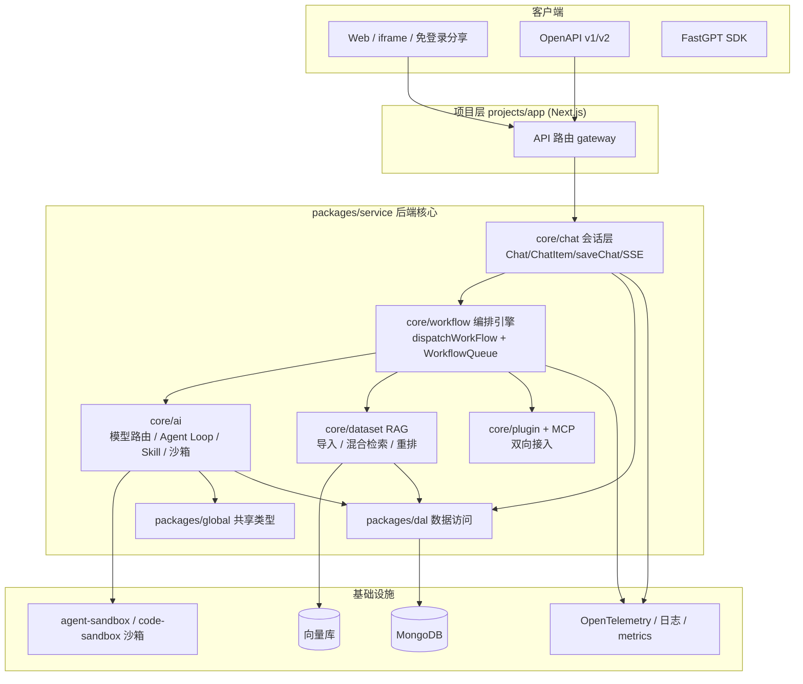
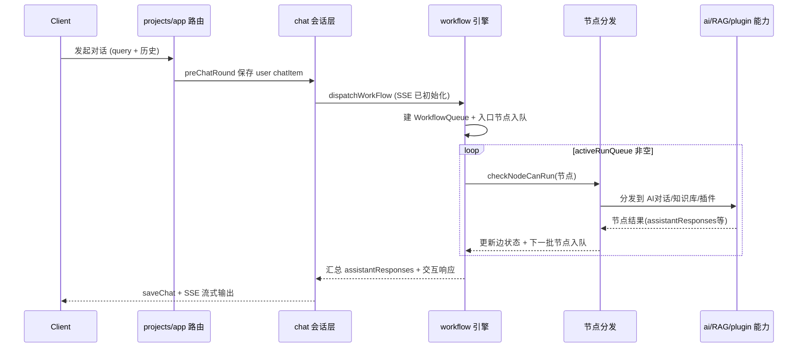

# FastGPT

> 本解读按 **ai-agent** 类规格产出（AI Agent 构建平台主类型 + ai-infra RAG 副类型，副类型并入）。FastGPT v4，约 30 万行，pnpm + Turborepo monorepo，Node.js / TypeScript / Next.js / MongoDB。

## 子文档索引

- [`workflow-engine.md`](workflow-engine.md) — 工作流编排引擎（Flow 图即运行时，Dispatch + WorkflowQueue 节点分发）
- [`rag-dataset.md`](rag-dataset.md) — RAG 知识库（文档导入/切分/向量化、混合检索与重排）
- [`llm-skill-sandbox.md`](llm-skill-sandbox.md) — AI 模型路由 + Agent Loop + Skill 技能 + 代码沙箱
- [`chat-orchestration.md`](chat-orchestration.md) — 会话层与对话链路（Chat/ChatItem 数据模型 + 流式响应）
- [`plugin-mcp.md`](plugin-mcp.md) — 插件系统与双向 MCP 接入
- [`data-model.md`](data-model.md) — MongoDB 数据模型（存储选型、核心实体、演进策略）

## 根因

FastGPT 要解决的根本问题：**把"构建复杂 AI 应用"从写大量胶水代码，变成可视化、可配置的编排**。一个真实 AI 应用不只是"调一次大模型"，它需要 RAG 知识库、多模型路由、工具调用、多轮 Agent 循环、代码执行、插件扩展、计费与多租户。若每个应用都单独写后端逻辑，成本高且不可复用。

FastGPT 的选择是：**Flow 工作流图即运行时** —— 一次对话请求被解析为工作流图中节点的执行，节点是内置能力（知识库搜索、AI 对话、文本处理、工具/插件），通过可视化编排组合出任意复杂逻辑；workflow 是唯一执行引擎，其余模块（RAG、AI 路由、插件）都是可以被编排进图的工具能力。运维/产品人员通过编排而非代码构建应用，这是它区别于"LLM 套壳"的核心。

## 核心能力清单

| 能力 | 说明 | 对应子文档 |
|------|------|-----------|
| Flow 可视化编排 | 对话工作流、插件工作流，含并行/循环/交互/条件节点，辅助生成工作流(未完成) | [`workflow-engine.md`](workflow-engine.md) |
| RAG 知识库 | 多库复用混用、chunk 管理、混合检索 & 重排、QA 拆分、API 知识库 | [`rag-dataset.md`](rag-dataset.md) |
| Agent Skill 编排 | Agent Loop 主循环、Skill 技能体系、工具调用、代码沙箱 | [`llm-skill-sandbox.md`](llm-skill-sandbox.md) |
| 双向 MCP | 作为 MCP 客户端调外部工具，作为 MCP 服务端暴露自身能力 | [`plugin-mcp.md`](plugin-mcp.md) |
| 会话与调试 | 多轮会话、SSE 流式、调用链路日志、应用评测、反馈标注 | [`chat-orchestration.md`](chat-orchestration.md) |
| 运营能力 | 免登录分享、iframe 嵌入、统一对话标注、运营日志 | — |
| 数据能力 | MongoDB 文档模型承载应用/会话/知识库/账单 | [`data-model.md`](data-model.md) |

## 技术栈一览

| 层 | 技术 |
|----|------|
| 后端 | Node.js + TypeScript, `@fastgpt/service`（核心，~198K 行） |
| 前端 | Next.js + React（`projects/app` 1225 文件）+ `packages/web` |
| 数据 | MongoDB（mongoose schema）/ 可选 PostgreSQL，向量库可插拔 |
| 编排 | Turborepo + pnpm workspace，node 子项目（agent-sandbox / code-sandbox / mcp_server） |
| 可观测 | OpenTelemetry（span/trace）、结构化日志、Prometheus metrics |
| 执行 | 工作流引擎（Dispatch + 队列），SSE 流式 |

## 架构总览

*架构图：一次对话请求从客户端经 Next.js API 网关进入会话层，会话层交由工作流引擎执行，按编排图分发到 AI / RAG / 插件节点，能力层各自读写 MongoDB 并通过 DAL 与向量库交互。*

## 核心请求链路

*完整链路：一个对话请求从客户端经会话层进入工作流引擎，引擎以队列驱动方式逐个执行编排图中的节点并流式回注（详见 [`workflow-engine.md`](workflow-engine.md) 请求链路）。*

## 核心模块导读

| 模块 | 定位 | 深读 |
|------|------|------|
| `core/workflow` | 工作流编排引擎，Flow 图即运行时，节点分发与队列控制 | [`workflow-engine.md`](workflow-engine.md) |
| `core/dataset` | RAG 知识库：导入/切分/向量化 + 混合检索/重排 | [`rag-dataset.md`](rag-dataset.md) |
| `core/ai` | 模型路由、Agent Loop、Skill 技能、代码沙箱 | [`llm-skill-sandbox.md`](llm-skill-sandbox.md) |
| `core/chat` | 会话层：Chat/ChatItem 数据模型、SSE 流式响应、反馈 | [`chat-orchestration.md`](chat-orchestration.md) |
| `core/plugin` + 沙箱/MCP 子项目 | 插件系统与双向 MCP 接入 | [`plugin-mcp.md`](plugin-mcp.md) |
| `packages/dal` + 各 schema | MongoDB 数据模型与存储选型 | [`data-model.md`](data-model.md) |

## 同类对比

| 维度 | FastGPT | Dify | Coze |
|------|---------|------|------|
| 编排方式 | 自研 Flow 图（WorkflowQueue 队列驱动，节点可并行/循环/交互） | 工作流节点 | 工作流/卡片式 |
| RAG | 自研混合检索：向量 + full-text + 图文 caption + rerank | 自研多路 RAG | 平台向量库 |
| Agent 运行时 | 自研 fastAgent 主循环（provider 化可插拔） | LLMNode/AgentNode | Coze 托管 |
| 双向 MCP | 客户端 + 服务端（projects/mcp_server） | 客户端为主 | 平台生态 |
| 扩展 | 插件 = workflow 子图 + 代码沙箱 | 插件市场 | 模板市场 |
| 协议 | FastGPT Open Source License（可商用禁止 SaaS） | Apache/MIT 分版本 | 闭源 |
| 多租户 | 社区版 row-level 数据隔离；完整运营闭环需商业版 | 自托管版支持 | 托管式 |

## 多租户（Team 模型）

FastGPT 的租户模型是 **Team（团队）→ TeamMember（成员）** 两级。根实体 `teams` 集合（`TeamCollectionName = 'teams'`）持有 `ownerId`（所有者用户）、`balance`（余额/点数）、`openaiAccount`（团队级自定义模型 key）、`limit`（团队级导出/同步等额度）`[packages/service/support/user/team/teamSchema.ts:7-40]()`。
<!-- anchor: const TeamSchema = new Schema({ …  type: Object, -->

用户通过 `teamMemberSchema` 加入团队，`teamId` + `userId` 构成成员关系（一个用户可属多团队，切换即切换租户上下文）`[packages/service/support/user/team/teamMemberSchema.ts:13-25]()`。
<!-- anchor:   teamId: { …   default: () => getRandomUserAvatar() -->

- **数据隔离是"行级"**：核心资源（`apps`、`datasets`、`chat`、Skill、插件）全部带 `teamId` 字段，查询显式收 `teamId` 入参过滤（如 `getAppBasicInfoByIds({ teamId, ids })`），而非分库分表。数据模型层面见 [`data-model.md`](data-model.md)。
- **团队级费用与限流**：`checkTeamAIPoints(teamId)` 在每次 workflow 进入前校验团队 AI 点数余额 `[packages/service/support/permission/teamLimit.ts:13-13]()`。
  <!-- anchor: export const checkTeamAIPoints = async (teamId: string) => { -->
  `countLimit` 按 teamId 记录资源用量、超限即拦（`if (countLimit.count >= maxCount)` 报超限）`[packages/service/common/system/countLimit/controller.ts:55-55]()`。
  <!-- anchor:     if (countLimit.count >= maxCount) { -->
- **权限矩阵**：`support/permission/` 有完整权限模块（app/dataset/mcp/model/skill/org 等 + `inheritPermission` 权限继承），支持团队内细粒度授权与分组。

**结论**：FastGPT 是标准 row-level 多租户数据模型（租户 = team）。但**社区版多租户更多是"单团队的内部空间隔离"**；而"多租户对外运营的完整闭环"（团队空间管理、按租户计费、管理后台、SSO）属商业版能力（见下节）。

## 商业版与差异

商业版不是对开源代码打补丁，而是**独立的闭源镜像**（`pro/admin` 管理后台 + `pro/sso` 单点登录），需 **License** 授权启动。本仓库 `pro/` 目录为空，但 CI（`build-admin.yml:103`、`build-sso-service-image.yml`）与 `dev.md`（"`pro/admin`: 商业版后台"）保留了其构建线索。**官方交付形态 = 社区版镜像 + 商业版镜像**，两者共享全部核心（工作流编排、RAG 混合检索、Agent Loop、双向 MCP 均在社区版）。

**商业版叠加的闭源能力（据官方对比表，doc.fastgpt.io/guide/version/commercial）：**

| 领域 | 社区版 | 商业版专属 |
|------|--------|-----------|
| 应用编排 | 工作流编排、分享链接/API | 发布安全配置、第三方发布（飞书/公众号）、运行日志看板、应用评测、Agent/Skill 辅助生成、系统工具远程调试 |
| 知识库 | 数据集、混合检索 | 第三方数据集定时同步、索引增强、网站同步、图片数据集 |
| 通用 | 多模型配置、模型日志看板 | 模型内容审核 |
| 企业级 | —（数据层 row-level 隔离） | **自定义品牌、多租户与计费、团队空间与权限、管理后台、SSO** |

**商业化形态（官方定价）**：Sealos 全托管 ¥10,000/月起（8C32G，3 个月起，¥120,000/年）、多节点 ¥22,000/月（32C128G）；自托管联系报价（含 6 版本免费升级支持）；技术服务 ¥2,000–3,000/人/天。

**与多租户呼应**：社区版数据层已内置 `teamId` 行级隔离（技术能力开源），但把它变成**企业对外可运营的多租户 SaaS**（团队空间、按租户计费台账、管理后台、SSO、品牌）需商业授权——这与开源协议"可商用但禁止提供多租户 SaaS 服务"一致，也是商业版最主要的差异化卖点。

## 设计亮点与可借鉴

- **Flow 图即运行时**：一次对话 = 工作流图的一次执行，节点是编排单元，能力模块都是可入图的工具（详见 [`workflow-engine.md`](workflow-engine.md)「图即运行时」）。
- **Agent 循环引擎 provider 化**：`AgentLoopProvider` 只暴露一个端口，自研 fastAgent + 第三方 piAgent 可插拔（见 [`llm-skill-sandbox.md`](llm-skill-sandbox.md)）。
- **Skill 延迟加载注入**：技能不直接作为 function tool，而是作为 `system-reminder` 清单让模型按需 `read_file` 读取，平衡上下文成本与表达力。
- **图文混合检索**：图片先经 VLM 转 caption 再参与文本召回，构成图文多路融合（见 [`rag-dataset.md`](rag-dataset.md)）。
- **双层沙箱安全纵深**：code-sandbox 进程池 + AST/原型链/SSRF 加固，agent-sandbox 虚拟机运行时（见 [`llm-skill-sandbox.md`](llm-skill-sandbox.md)）。

## 已知不足 / 风险

- **复杂度高、学习曲线陡**：编排引擎 + Agent 分层 + 双层沙箱，新维护者理解成本高；部分文件较大（`worker.ts` 932 行、`createLLMResponse.ts` 297 行、`dispatch/index.ts` 1741 行）。
- **fastAgent 默认值硬编码**：`maxRunTimes ?? 100`、`batchToolSize ?? 5` 等分散在 `index.ts`/`base.ts`，缺集中配置。
- **Skill 强绑定沙箱**：技能执行依赖 `agent-sandbox` 落地 SKILL.md 且需 read_file 工具，沙箱不可用时技能退化为纯描述。
- **双沙箱并存**（子进程池 + 虚拟机）是历史演进双实现，职责边界偶有交叉。

## 总结

FastGPT 的根因锚点是"**用可视化编排替代代码硬编码来构建 AI 应用**"。其架构重心落在三层：以 **workflow 编排引擎**为执行中枢（Flow 图即运行时），以 **RAG 混合检索 + AI 路由 + Agent Loop** 为能力底座，以 **会话层 + MongoDB 文档模型**承载多轮与状态。真正的差异化不是"能接哪个模型"，而是**编排的灵活度 + 自研 RAG 的检索深度 + 可插拔的 Agent 运行时**——它把 AI 应用的价值从"模型能力"转移到"如何组合能力"上。其他 AI 平台可借鉴其"图驱动 + 能力模块化 + 检索精细度"三层解耦模式。

（本解读用于技术解构与提炼，非文档翻译或使用教程。）

