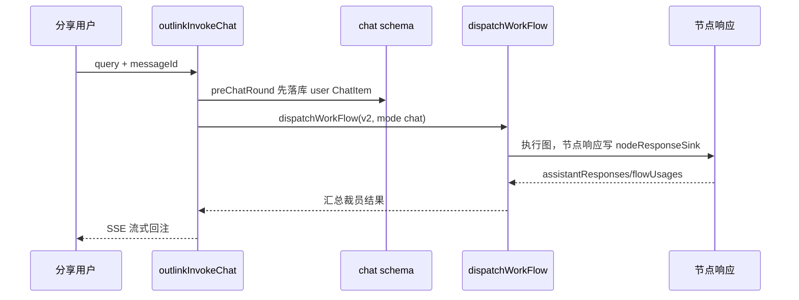

# FastGPT 会话层与对话链路

> 本文对应 README 的「core/chat」模块深读（见 [`README.md`](README.md)）。

## 根因：会话是"一次对话"的显式状态

AI 应用不是无状态的一次调用，而是**多轮对话**。FastGPT 把会话建模成显式的持久化状态（`Chat`/`ChatItem`/`ChatItemResponse`），根因是：

1. **多轮上下文要可续**：历史消息需按应用 + 会话维度组织，支持翻页、断点续跑、多源（app/plugin/分享/评测）共存。
2. **节点级要对账**：一次对话 = 工作流一次执行，其中每个节点（AI、知识库、工具）的响应都要落盘（`ChatItemResponse`），支撑调用链路日志、引用溯源、反馈标注。
3. **协议与执行解耦**：会话层负责 SSE 流式协议，工作流引擎只负责执行（见 [`workflow-engine.md`](workflow-engine.md) 决策二）。

核心在 `packages/service/core/chat/`，全解码在 schema（`chatSchema`/`chatItemSchema`/`chatItemResponseSchema`）与 controller。

## 会话数据模型

- **Chat**：一个会话（一次对话"窗口"）。核心字段 `chatId`、`sourceType`/`sourceId`（来源端点：app/plugin/outLink/评测）、`appId`（历史物理字段，语义为 sourceId）、`appVersionId`（关联应用版本，支持版本回溯）`[packages/service/core/chat/chatSchema.ts:15-30]()`。它还聚合反馈统计布尔位（`hasGoodFeedback` 等），避免每次读都要聚合子表。
- **ChatItem**：一条消息（用户/HI/工具运行等），按 `chatId` 归属；`nodeResponseId`/字段携带节点响应定位。
- **ChatItemResponse**：节点级响应详情（一个 AI 节点或知识库节点的完整输出：答案、引用、工具结果、错误），支撑"完整调用链路日志"与反馈标注。

## 对话入口与流式

会话层入口 `preChatRound` 把一条用户消息先存为 AI ChatItem（写入即持久化，保证崩溃不丢），再由**会话调用方**（app API / outlink）发起 `dispatchWorkFlow`。以 outlink（免登录分享）为例，函数 `outlinkInvokeChat` 的真实调用链见 `[packages/service/support/outLink/runtime/utils.ts:120-287]()`：
<!-- anchor-base64:ZXhwb3J0IGFzeW5jIGZ1bmN0aW9uIG91dGxpbmtJbnZva2VDaGF0PFQgZXh0ZW5kcyBPdXRsaW5rQXBwVHlwZT4oeyDigKYgfSA9IGF3YWl0IGRpc3BhdGNoV29ya0Zsb3coew== -->

`outlinkInvokeChat` 的调用体现两处设计：

- **消息先落库再执行**：`userContent` 以 `dataId: messageId` 构造后 `preChatRound` 立即保存，随后才 `dispatchWorkFlow`——保证即使执行失败，用户消息也已持久化，可重试/恢复。
- **apiVersion 语义化**：v1 支持客户端中断（TCP 断开即停机），v2 支持 Redis 停止标记续跑，会话语义随 API 演进（见 [`workflow-engine.md`](workflow-engine.md) 协同节）。

## 历史读取与反馈聚合

`getChatItems` 是历史读取入口 `[packages/service/core/chat/controller.ts:42-42]()`。设计要点：

- **游标分页**：支持 `offset`/`initialId`/`prevId`/`nextId`，配合聊天窗口"往前翻 / 往后翻"。
- **节点响应按需投影**：`nodeResponsePreviewProjection` 只取必要字段（引用 quoteList、toolId/toolRes、错误），`nodeResponseMode` 控制 `none/preview/full`，避免大响应拖慢历史加载 `[packages/service/core/chat/controller.ts:13-40]()`。
<!-- anchor-base64:YnVpbGRDaGF0U291cmNlQWdncmVnYXRlTWF0Y2gsIOKApiB9IGFzIGNvbnN0Ow== -->
- **Agent 数据兼容**：`normalizePersistedAgentData` 迁移旧 `planId` 关联为统一 `askId`，仅内存处理不回写——"避免回写数据库或让旧字段扩散到客户端"，是渐进式 schema 演进（见 [`data-model.md`](data-model.md) 演进策略）。

`updateChatFeedbackCount` 用 MongoDB aggregation 按会话维度聚合 `MongoChatItem` 的好评/差评/未读数，再回写 `MongoChat` 聚合布尔位 `[packages/service/core/chat/controller.ts:340-430]()`。这是"**读时聚合 + 写时冗余**"的经典取舍：反馈统计不实时 join，而是定时/触发聚合回写，换取列表页读取的高性能。

## 消息规范化

`completionMessage.ts` 把用户输入规范化成 LLM 可消费的 message（多模态）。

- **文本提取**：从最后一条用户消息提取纯文本，供分享/评测场景对齐 `getCompletionStartHookText`。
- **图片 Data URL 安全解析**：`parseImageDataUrl` 在解码前先校验格式与大小，"避免超大 base64 产生额外内存峰值"——对多媒体输入的先验防护 `[packages/service/core/chat/completionMessage.ts:48-60]()`。
<!-- anchor-base64:LyoqIOKApiB0aHJvdyBuZXcgVXNlckVycm9yKCdJbnZhbGlkIGltYWdlIGJhc2U2NCBkYXRhIFVSTCcpOw== -->

## 与其它模块协同

- **下游**：`dispatchWorkFlow`（见 [`workflow-engine.md`](workflow-engine.md)）——会话层只负责"准备会话状态 + 发起 + 流式回注"，执行全委托。
- **节点响应**：`nodeResponseSink` 在 dispatch 内建立，把每个节点的响应写回 `ChatItemResponse`，供 `getChatItems` 的 preview/full 读取。会话层与引擎通过"响应 sink + usageId"协作，中间不共享可变内存（除 runWithContext 作用域）。
- **计费**：`outlinkInvokeChat` 用 `getUsageSourceByPublishChannel` 区分来源，`createChatUsageRecord` 记录用量并回传 `flowUsages`，贯穿会话-工作流-账单。

## 设计决策与权衡

### 决策一：消息先落库再执行

- 反事实：若先执行再落库，执行中途崩溃则用户消息丢失。
- 方案代价：多一次写库（每条用户消息一次 `ChatItem` 插入），换取可恢复性。
- 评价：对长工作流（可达几十秒甚至交互暂停）尤为重要——这是"以存储换取可靠性"在会话层的体现。

### 决策二：反馈"读时聚合 + 写时冗余"

- 权衡：实时 join 最准但列表页每次聚合 N 条 ChatItem，成本高；选择归并到 Chat 的布尔位（`hasGoodFeedback` 等）换取 O(1) 读取，用定时聚合弥补实时性。
- 代价：聚合可能短暂滞后；崩溃时需重算。这是运营场景（对话标注、反馈展示）可接受的延迟。

### 决策三：协议（v1/v2）与应用分离

- find index 中 v1 走 `createClientAbortTracker`（监听 TCP 断开），v2 走 Redis 停止标记轮询。反事实：统一用 TCP 断开检测，则无法支持跨请求暂停恢复；统一用 Redis 轮询，则 v1 简单客户端过早暴露复杂度。
- 取舍：按 API 版本渐进引入暂停能力，破坏性最小。

## 亮点与问题

**亮点**：会话状态三层（Chat/ChatItem/ChatItemResponse）既独立又关联，历史读取投影/游标分页设计精细；"先落库后执行"与"聚合回写"是把可靠性和性能落到存储设计的典范；消息/协议/执行三端（会话层-协议-引擎）职责边界清晰。

**问题**：`updateChatFeedbackCount` 与 `getChatItems` 都较大且含大量 inline 数据结构（如投影字段），可读性受长度拖累；`appId` 字段名与语义（应为 sourceId）的历史遗留造成认知负担（schema 内已注释"历史物理字段名"）；v1/v2 两种停止机制并存，调用方需理解版本差异，属于渐进演进的遗留成本。

