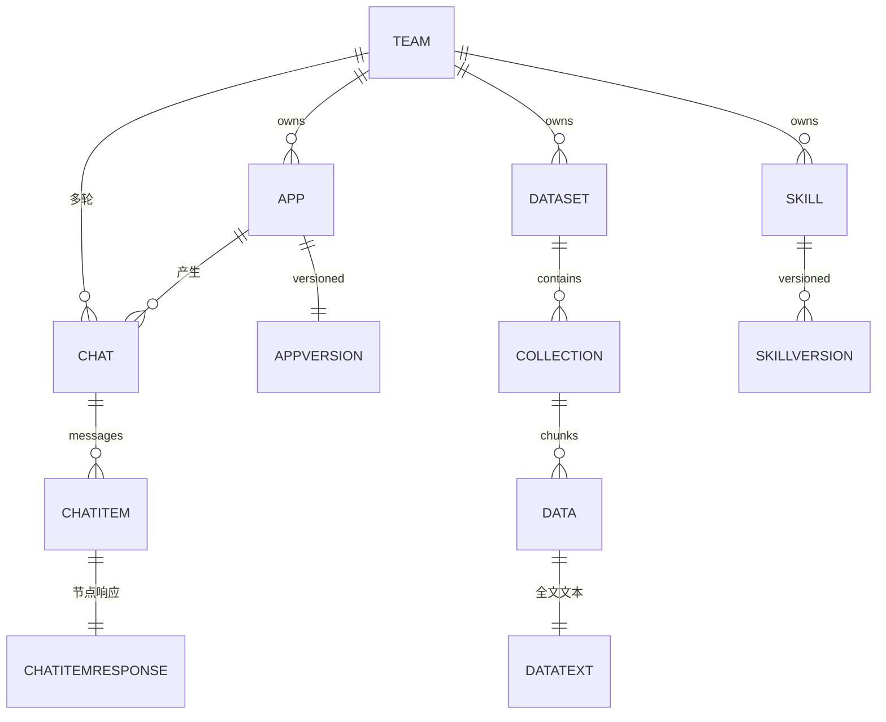
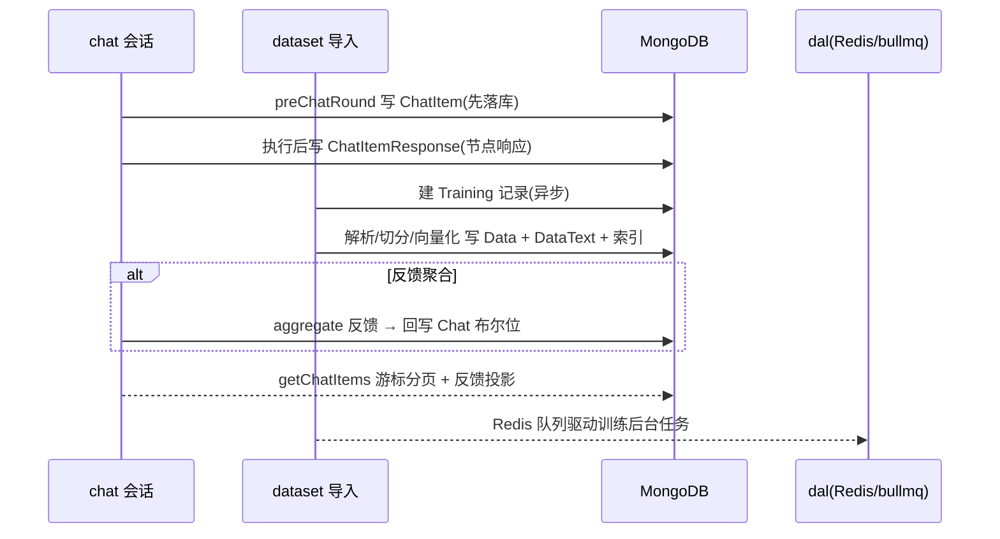

# FastGPT 数据模型

> 本文对应 README 的「packages/dal + 各 schema」数据模型深读（见 [`README.md`](README.md)）。数据模型探测命中：`core/{app,chat,dataset,ai,plugin}/**/schema.ts` 大量 MongoDB schema。

## 根因：文档型存储承载"图 + 会话 + 知识库"

FastGPT 的主存储选 **MongoDB（文档型）**，这不是惯例，而是由业务形态驱动的判断：其核心实体——工作流图（可变结构 JSON）、会话（多轮消息 + 节点响应）、知识库（Dataset/Collection/Data 层级 + 动态 chunk）——**内在结构都是"深浅不一、字段不固定、随版本演进的文档"**，而非规整的关系表。文档模型免去了"先定 schema 再开发"的前置代价，让 schema 随产品演进。

## 存储选型与理由

- **为何 MongoDB 而非关系型**：工作流图的节点/边是深度嵌套的变长 JSON；会话的 `ChatItemResponse` 需存任意节点输出（文本/引用/工具结果/错误）投影；知识库 chunk 带 `indexes` 索引数组。若强行关系范式化，图与节点响应会裂成几十张高度动态的表，join 成本高且 schema 漂移。文档模型直存嵌套结构，天然匹配"一次对话 = 一串附带结构的消息"。
- **一致性/可用性取舍**：FastGPT 单团队维度操作多（team_id 过滤），MongoDB 单节点为主，事务限于会话/ChatItem 的原子写（`ClientSession`），不追求分布式强一致——符合 "AI 应用多轮查询、写多读多但单团队强隔离" 的访问模式。群集化后不完整时 MongoDB 的最终一致（从库 `readFromSecondary`）用于降载。
- **向量库外置**：向量存独立向量库（`common/vectorDB` 抽象），Mongo 只存业务 chunk + 索引引用，避免文档库承担向量检索（性能/生态原因），用对账保证双写一致。
- **对比 SQL 的代价**：Mongo 无原生 join/强约束，FastGPT 用 `ref`（ObjectId 引用）+ 应用层聚合弥补；关系查询（如反馈聚合）需显式 aggregate。这是"牺牲强约束换取灵活"的权衡。

## 核心实体与字段

### App 与 AppVersion（应用）

`apps` 是编排产品的根实体 `[packages/service/core/app/schema.ts:31-45]()`。`chatConfigType` 把大量配置（欢迎语、变量、引导、TTS、指令、定时触发）统一放进一个 `chatConfig` **JSON blob**，是"配置聚合到单字段"的代表，换导出字段灵活但牺牲了字段级索引与校验。
<!-- anchor-base64:ZGVmYXVsdDogbnVsbCDigKYgcmVxdWlyZWQ6IHRydWU= -->

| 字段 | 类型 | 约束 | 说明 |
|------|------|------|------|
| `parentId` | ObjectId | ref apps | 支持应用分组树 |
| `teamId` / `tmbId` | ObjectId | ref team, required | 租户/成员归属 |
| `name` | String | required | 应用名 |
| `chatConfig` | Mixed | JSON blob | 欢迎语/变量/引导/TTS 等聚合配置 |
| `versionId` | ObjectId | ref appVersion | 当前生效版本，支撑回溯 |

`AppVersion` 存应用的历史版本快照，会话 `chatId` 关联 `appVersionId`，回滚/审计按版本读。

### Chat / ChatItem / ChatItemResponse（会话三层）

见 [`chat-orchestration.md`](chat-orchestration.md) 会话数据模型。要点：`Chat`（会话级元数据 + 反馈聚合布尔位）、`ChatItem`（单消息，先落库保证可靠）、`ChatItemResponse`（节点响应，支持 preview/full 投影读取）。

### Dataset / Collection / Data / DataText（知识库四层）

以 `dataset_datas`（chunk）字段表为例 `[packages/service/core/dataset/data/schema.ts:20-48]()`：
<!-- anchor-base64:dG1iSWQ6IHsg4oCmIGE6IFN0cmluZyw= -->

| 字段 | 类型 | 约束 | 说明 |
|------|------|------|------|
| `teamId`/`tmbId` | ObjectId | ref team, required | 归属 |
| `datasetId` | ObjectId | ref datasets, required | 顶层知识库 |
| `collectionId` | ObjectId | ref collection, required | 来源集合 |
| `q` | String | - | 检索问（或 chunk 文本） |
| `a` | String | - | 答案（QA 拆分时） |
| `imageId` | String | - | 图表引用 |
| `history` | Array | [{q,a,updateTime}] | QA 演进历史 |
| `indexes` | Array | vector/fulltext 索引定义 | 多路检索索引 |

`DatasetCollectionName='datasets'`；`DatasetCollection as collection` 承载文档源元数据与训练状态；`DataText` 存全文检索文本。三层模型让"多库混用、chunk 增删改、检索按 collection 过滤"成为可能。

### Skill 与 SkillVersion（技能）

`agentSkills` 主表 + `agentSkillsVersion` 版本表，主表 `currentVersionId` 指向激活版本（skill 与文件夹共用一表，靠 `type`+`parentId` 组织层级）`[packages/service/core/ai/skill/model/schema.ts:44-60]()`。`RuntimeSkillMetadataSchema` 存技能的 `name`/`description`/`path`（对应 `skills/<name>/SKILL.md` 的元数据，供 `system-reminder` 清单注入，见 [`llm-skill-sandbox.md`](llm-skill-sandbox.md)）。
<!-- anchor-base64:Y29uc3QgQWdlbnRTa2lsbHNTY2hlbWEgPSBuZXcgU2NoZW1hKHsg4oCmIH0s -->

## Schema 演进策略

- **JSON blob + 提升列**：`App.chatConfig` 是典型——新配置先进 blob，验证稳定、需索引/按需读取时再提升为独立字段（schema 内 `chatConfigType` 已把常用项提升为具名混合类型）。
- **物理字段兼容**：`chat.appId` 注释明示"历史物理字段名，业务语义为 sourceId"，即旧字段不重命名、新代码读语义——**向后兼容优先，不迁移存量数据**。
- **读时迁移**：`getChatItems.normalizePersistedAgentData` 把旧 `planId` 关联在内存转为 `askId`，"只在读取边界迁移历史数据，避免回写数据库或让旧字段扩散到客户端" `[packages/service/core/chat/controller.ts:80-110]()`。
<!-- anchor-base64:Y29uc3Qgbm9ybWFsaXplUGVyc2lzdGVkQWdlbnREYXRhID0gKGhpc3RvcmllczogQ2hhdEl0ZW1NaW5pVHlwZVtdKSA9PiB7IOKApiBjdXJyZW50ID0gY2hpbGRyZW5SZXNwb25zZTs= -->
- **迁移目录**：`dataset/migration/schema.ts` 专门承载知识库数据迁移的版本化控制；训练/导入对账依赖 `dataset/training/` 状态机。

## 读写路径

- **读**：历史读取走 `getChatItems`（游标 + preview/full 投影，避免拉全节点大响应）；知识库检索走 `searchDatasetData`（见 [`rag-dataset.md`](rag-dataset.md)），Mongo 全文与向量库分别召回。
- **写**：会话"先落库"保证可靠性；知识库导入异步经 Redis 队列（`packages/dal/redis/bullmq` 抽象任务队列、`redis/caches` 提供缓存）后台训练；反馈聚合定时回写冗余位。

## 权衡与问题

- **代价**：文档模型丢弃关系约束，跨实体一致性（训练状态 ↔ 向量库 ↔ 全文索引）依赖应用层对账与 `dataset/migration`，复杂度前置到代码；`chatConfig` 等大 blob 失去字段级索引，深查询受限。
- **Redundancy**：反馈"读时聚合 + 写时冗余"换取列表读取性能，但存在短暂滞后。
- **DAL 角色**：`packages/dal` 主要抽象 **Redis 数据访问**（bullmq 任务队列、caches），Mongo schema 归属各业务模块——两类存储的访问层职责分离清晰，Mongo 走 mongoose raw、Redis 走 DAL 封装。

**可借鉴**：以"实体内在结构"而非"技术惯例"选存储；渐进式演进用 JSON blob + 读时迁移 + 物理字段兼容三件套，避免大版本迁移的破坏性成本；响应式富数据结构（ChatItemResponse）用投影字段按需读取控制体积。

