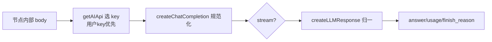
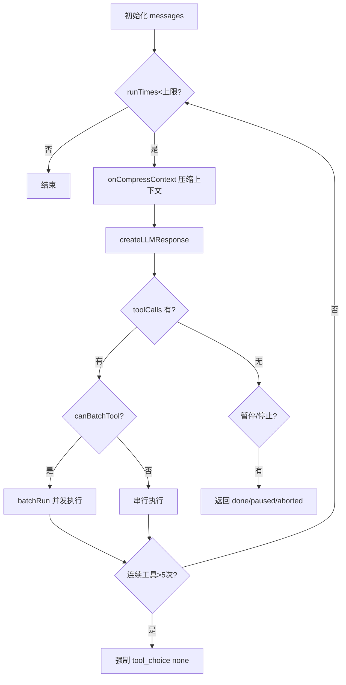

# FastGPT AI 模型路由 + Agent Loop + Skill + 代码沙箱

> 本文对应 README 的「core/ai」模块深读（见 [`README.md`](README.md)）。

## 根因：在多供应商模型和不可信代码之上构建可信 Agent

workflow 的 AI 节点（AI 对话 / Agent）点击运行后，背后是一整层"能力引擎"（`core/ai`，约 26K 行，是核心模块中最大者）。它回答四个问题：**模型怎么被路由调用、Agent 循环怎么迭代、Skill 技能怎么注入、代码怎么被安全执行**。根因是一个冲突——*要在能力参差不齐的多供应商模型之上，构建带工具调用、可多轮迭代、可运行用户代码的可靠 Agent*。

**去掉它系统会怎样**：AI 节点退化为一次性单请求文本生成，无工具调用、无 Agent 多轮、无技能文件、无代码执行。FastGPT 从"可编排 Agent 平台"退化为"OpenAI 套壳转发器"——这正是 README 宣传的"Agent Skill 编排"的直接载体。

## 模型路由：形态转换层

模型生态碎片化（有的不支持 `top_p`、字段名不同、无原生 tool_calls）迫使 FastGPT 把"参数裁剪 + 字段映射 + 协议归一"收敛到单点 `createChatCompletion` → `createLLMResponse`。

- `createChatCompletion`（17 行起）负责按模型能力组装请求体、选择 key（用户 key 优先于系统 key）`[packages/service/core/ai/llm/request/createChatCompletion.ts:17-17]()`。
- `createLLMResponse`（38 行起）是统一出口：**stream/非 stream、toolChoice/prompt 工具、缺失的 finish_reason 全部在这个单点归一**。finish_reason 兜底尤其讲究——"stream 有内容但没结束标记时记录 abnormal_close，非 stream 补 stop"，把供应商漏报的结束信号补全 `[packages/service/core/ai/llm/request/createLLMResponse.ts:165-170]()`。
<!-- anchor-base64:Y29uc3QgZmluaXNoX3JlYXNvbiA9IG5vcm1hbGl6ZUNvbXBsZXRpb25GaW5pc2hSZWFzb24oeyDigKYgfSk7 -->
- `getAIApi`（29 行起）路由 key：**用户自己的 key 优先**，否则走系统 key（OneAPI/AIProxy）`[packages/service/core/ai/config.ts:29-29]()`。

## Agent Loop：可插拔的循环引擎

Agent 不是一次调用，而是一个"感知→推理→调工具→回注→再请求"的循环。FastGPT 把循环抽成可插拔的 `AgentLoopProvider` 端口，**主循环（fastAgent）与第三方实现（piAgent）能共处同一契约**——这是分层架构的样板。

`base.ts` 的主循环（703 行）承载核心迭代 `[packages/service/core/ai/llm/agentLoop/provider/fastAgent/loop/index.ts]`：

设计要点（`[packages/service/core/ai/llm/agentLoop/provider/fastAgent/loop/index.ts:191-357]()`）：
<!-- anchor-base64:fSkg4oCmIGVycm9yTWVzc2FnZSw= -->

- **停止条件多层防御**：`toolCalls` 空 → 结束；`toolChildPause`（交互工具暂停）→ 暂停；`stop`/`isAborted` → 中止；外层 `maxRunAgentTimes`（默认 100）兜总步数。
- **工具死循环防御**：连续工具调用超 5 次强传 `tool_choice:'none'`，逼模型停止纯工具轮询直接回答。
- **并发分批**：`batchToolSize` 控制并行工具数，`canBatchTool()` 为 false 的工具有副作用（plan/ask_user）强制串行，避免并发写坏状态。
- **增量 token 统计**：压缩后只统计新增 message，避免每轮重复统计完整历史。

## Skill 技能体系：可用清单 + 延迟加载注入

Skill 不是数据库里的一条函数定义，而是一个**文件系统目录 + SKILL.md**。这是 FastGPT 技能机制的**精髓**所在：

- **定义**：`agentSkills` 主表 + `agentSkillsVersion` 版本表，Skill 与文件夹共用一张表，靠 `parentId`/`type` 组织树形层级、`inheritPermission` 控制权限继承 `[packages/service/core/ai/skill/model/schema.ts:44-60]()`。一个 Skill 包以 `skills/<name>/SKILL.md` 为约定位置。
<!-- anchor-base64:Y29uc3QgQWdlbnRTa2lsbHNTY2hlbWEgPSBuZXcgU2NoZW1hKHsg4oCmIH0s -->
- **注入**：`buildAgentLoopCoreSkillsPrompt` 把 `skillInfos` 渲染成 `<available_skills>` **清单**（含 name/description/location 指向沙箱内 SKILL.md 路径）注入用户消息 `[packages/service/core/workflow/dispatch/ai/agentLoopCore/application/context/reminder.ts:52-71]()`。模型需要时**先用 `sandbox_read_file` 读取完整 SKILL.md**，再按描述执行。
<!-- anchor-base64:ZXhwb3J0IGZ1bmN0aW9uIGJ1aWxkQWdlbnRMb29wQ29yZVNraWxsc1Byb21wdChza2lsbEluZm9zOiBEZXBsb3llZFNraWxsSW5mb1tdID0g4oCmIDwvYXZhaWxhYmxlX3NraWxscz5gOw== -->

**关键权衡**：不把整个技能文件塞进上下文，而注入"清单 + 路径"，模型判定需要用才 `read_file`——省上下文、避免无关技能污染输入；代价是模型需要会"先读再用"，能力依赖模型遵循力。这与把技能做成 function tool（每次都天然可见）是不同取舍，FastGPT 选"延迟加载"换取 context 效率。

## 代码沙箱：两层隔离

FastGPT 有两套沙箱解决不同场景：

### code-sandbox：独立 HTTP 服务 + 子进程池（workflow 代码节点）

`projects/code-sandbox` 是独立 Hono 服务，`/sandbox/js`、`/sandbox/python` 用**进程池**隔离，请求体有字节上限防内存攻击。核心防御 `[projects/code-sandbox/src/pool/worker.ts]`：

- **AST 静态分析**：`assertNoDynamicImport`（60 行起）拒绝动态 `import()`（逃逸源）。
- **函数参数遮蔽**：`new Function` 把 `process`/`globalThis`/`Bun` 换成安全替身注入（784 行起），用户代码只能拿受限版本。
- **原型链拦截**：不再全局覆盖 `Object.getPrototypeOf`（避免破坏 lodash），改为定向替换阻止拿到原始构造函数 `[projects/code-sandbox/src/pool/worker.ts:167-177]()`。
<!-- anchor-base64:Ly8g5LiN5YaN5YWo5bGA6KaG55uWIE9iamVjdC5nZXRQcm90b3R5cGVPZu+8jOmBv+WFjeegtOWdjyBsb2Rhc2gg562J5ZCI5rOV5bqTIOKApiBSZWZsZWN0LmdldFByb3RvdHlwZU9mID0gZnVuY3Rpb24gKG9iajogYW55KTogYW55IHs= -->
- **SystemHelper.httpRequest 防 SSRF**：URL 解析后先查 DNS，**对真正用于建连的 IP 再次校验内网**，防 DNS rebinding TOCTOU `[worker.ts:497]`。

### agent-sandbox：长驻运行时（Skill 文件 + 命令执行）

`projects/agent-sandbox` 是 `sleep infinity` 的长驻容器，统一 `ISandbox` 契约（lifecycle + command + filesystem + health），按 `AGENT_SANDBOX_PROVIDER` 路由到 opensandbox / sealos-devbox。生命周期用分布式锁 + 状态机 + provider 自愈管理。Agent 沙箱把 8 个内置工具（read_file/write_file/find/shell 等）以 `sandbox_*` 命名暴露给模型。

## 与其它模块协同

- **workflow**：AI 对话节点（ToolCall）在 `runToolCall` 汇集工具节点、组装消息链、初始化沙箱，走 Agent Loop；`runAgentLoopCoreWithSummary` 统一补齐 workflow 需要的 requestIds/token/assistantResponses 摘要，是 workflow 层复用底层循环的薄壳。
- **RAG**：`core/ai/embedding`、`core/ai/rerank`、vlm caption 均供数据集检索（见 [`rag-dataset.md`](rag-dataset.md)），`core/ai/model` 维护模型注册表。
- **plugin/MCP**：MCP/HTTP 工具通过 `toolCatalog.runtimeTools` 注册进 Agent Loop 的 executeTool（见 [`plugin-mcp.md`](plugin-mcp.md)）。【待主agent验证】工具注册的精确接口细节。

## 设计决策与权衡

### 决策一：Agent 循环 provider 化
定义统一端口、自研 fastAgent 为默认、piAgent 适配第三方库。代价是维护两套执行体且须保证 **result 语义一致**（done/paused/usage/requestIds）；收益是不锁定循环实现，未来可接外部 Agent SDK。单 loop 时此抽象是"过度设计"，但对多 Agent 框架演进值得。

### 决策二：协议双模式统一
toolChoice（原生 tool_calls）与 prompt（无原生工具协议的降级，文本 `0:`/`1:` 前缀在 prompt 里打协议）在 `createLLMResponse` 归一成统一 tool_calls。代价是接收层需区分模型能力；收益是**同一 Agent 循环可在是否支持 tool_calls 的模型间平滑切换**。

### 决策三：沙箱"纵深防御"而非单一隔离
进程池（OS 隔离）+ AST 静态检查 + 参数遮蔽 + 原型链拦截 + SSRF 双确认。代价是 `new Function` 参数遮蔽无法默认顶格，需维护允许/禁止清单且要与运行时内部 API 协调；收益是不依赖特定 VM 逃逸补丁，多层叠加显著降低单点突破风险。

## 亮点与问题

**亮点**：Agent 循环 provider 化是分层样板；Skill "可用清单 + read_file 延迟加载"是 context 效率的高明取舍；工具协议双模式归一站稳多模型兼容；沙箱 SSRF DNS rebinding 双确认 + 参数遮蔽细节极扎实。

**问题**：fastAgent 默认值（`maxRunAgentTimes ?? 100`、`batchToolSize`、连续 >5 停止）分散在 `index.ts`/`base.ts`（`base.ts:191-192`）缺乏集中配置；`base.ts` 703 行偏大、职责偏重；Skill 强绑定 agent-sandbox 运行时，沙箱不可用时技能退化为纯描述；code-sandbox 与 agent-sandbox 双实现并存，是历史演进的双实现、边界偶交叉。

