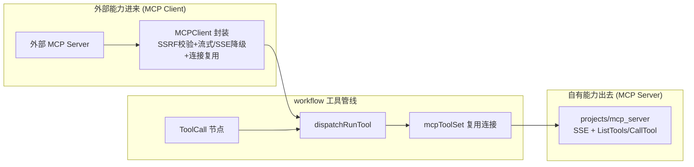
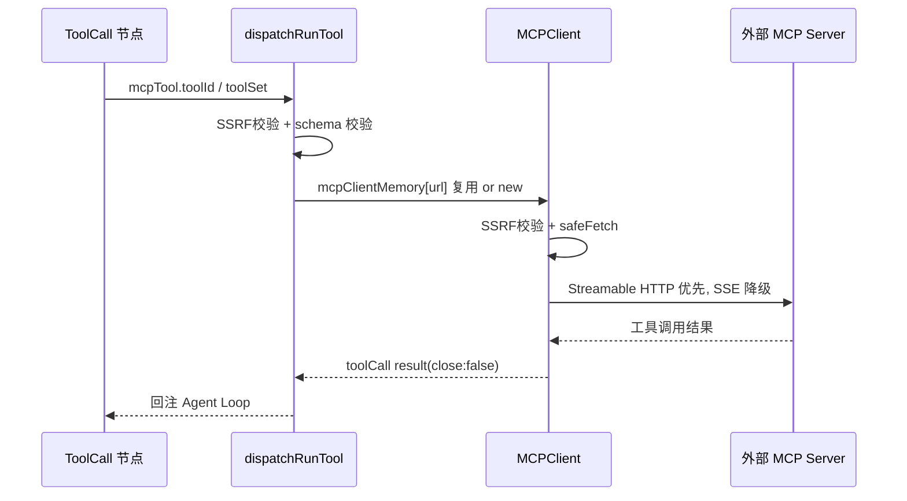
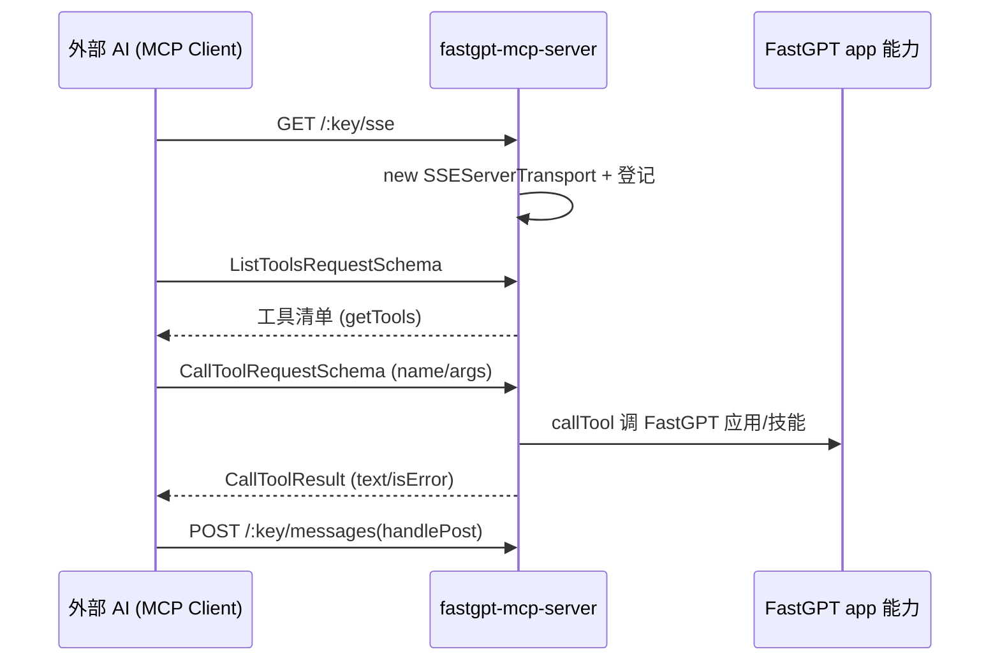

# FastGPT 插件系统与双向 MCP

> 本文对应 README 的「core/plugin + 沙箱/MCP 子项目」模块深读（见 [`README.md`](README.md)）。

## 根因：能力要"进得来"也要"出得去"

一个编排平台的能力不可能全内置。FastGPT 通过两件事解决"能力边界"：

1. **插件**：把第三方/自定义能力封装成可编排进 workflow 的单元。
2. **双向 MCP**（README 宣传的差异化卖点）：它既作为 **MCP 客户端**调用外部 MCP 服务器的工具（外部能力"进得来"），也作为 **MCP 服务端**把自己的能力按工具协议暴露给其它 AI（能力"出得去"）。

设计哲学延续 "Flow 图即运行时"：插件节点、MCP 工具最终都收敛为 workflow 里可被 AI 对话节点（Agent Loop）调度的工具（`toolConfig`），与内置工具走同一条调用管线。

## MCP 客户端：连接一个外部工具服务

MCP 客户端集中在 `packages/service/core/app/mcp.ts`（440 行）的 `MCPClient` 类（215 行起），并在 `dispatch/child/runTool.ts` 的工具分发处调用 `[packages/service/core/workflow/dispatch/child/runTool.ts:248-283]()`。
<!-- anchor-base64:fSBlbHNlIGlmICh0b29sQ29uZmlnPy5tY3BUb29sPy50b29sSWQpIHsg4oCmIGNvbnN0IHJlc3VsdCA9IGF3YWl0IG1jcENsaWVudC50b29sQ2FsbCh7IHRvb2xOYW1lLCBwYXJhbXMsIGNsb3NlQ29ubmVjdGlvbjogZmFs -->

**三层安全与可靠性设计**：

1. **SSRF 防护**：`doConnect` 先 `assertMCPUrlNotInternal(url)`，拦截指向内网地址的连接——这是 MCP 客户端必须守的边界，防止用户配置的 MCP 端点探测内网 `[packages/service/core/app/mcp.ts:231-257]()`。
<!-- anchor-base64:aWYgKHRoaXMuY29ubmVjdGlvblByb21pc2UpIHsg4oCmIH0= -->
2. **协议渐进增强**：优先 `<StreamableHTTPClientTransport>`，失败且判定"该报错应回落 SSE"时用 `<SSEClientTransport>` 重连 `[packages/service/core/app/mcp.ts:257-285]()`。这是对 MCP 生态"服务器协议支持不一"的宽容处理——兼容性优先，代价是连接逻辑更重。
<!-- anchor-base64:fSDigKYgdGhpcy5jbGllbnQub25lcnJvciA9IChlcnJvcikgPT4gew== -->
3. **连接复用 + 缓存**：`connectionPromise` 单例缓存连接（失败清空允许重试）`[packages/service/core/app/mcp.ts:219-241]()`；在 workflow 内用 `context.mcpClientMemory[url]` 复用同一 URL 的客户端、`closeConnection:false` 避免重复建连 `[packages/service/core/workflow/dispatch/child/runTool.ts:270-283]()`——一次对话多次调用同一 MCP 工具不重复握手，换取低延迟，代价是连接生命周期要随 workflow 结束统一清理（dispatch finally 关闭 `mcpClientMemory` 所有连接，见 [`workflow-engine.md`](workflow-engine.md)）。
<!-- anchor-base64:cHJpdmF0ZSBjb25uZWN0aW9uUHJvbWlzZTogUHJvbWlzZTxDbGllbnQ+IHwgbnVsbCA9IG51bGw7IOKApiByZXR1cm4gdGhpcy5jb25uZWN0aW9uUHJvbWlzZTs= -->

## MCP 服务端：把 FastGPT 能力暴露出去

`projects/mcp_server` 是一个独立 MCP 服务器，用 Node 子项目承载（自身是独立 Express + `@modelcontextprotocol/sdk`）。它让外部 AI（Claude/Cursor 等）能作为 MCP 客户端调用 FastGPT 的已部署应用/技能工具。`[projects/mcp_server/src/index.ts:35-95]()`。
<!-- anchor-base64:fSDigKYgaWYgKHRyYW5zcG9ydCkgew== -->

关键实现：

- **SSE 传输**：`SSEServerTransport` 处理 `/:key/sse` 与 `/:key/messages`，`transportMap` 按 `sessionId` 管理每个会话的传输（onclose/onerror 清理）`[projects/mcp_server/src/index.ts:35-58]()`。
<!-- anchor-base64:fSDigKYgY29uc3QgaGFuZGxlVG9vbENhbGwgPSBhc3luYyAo -->
- **工具协议**：`setRequestHandler(ListToolsRequestSchema)` 返回能力清单、`setRequestHandler(CallToolRequestSchema)` 把 `toolName + args` 转发给 `callTool` → `fastgpt.ts`，返回统一 `CallToolResult`（text/JSON 序列化 + isError）`[projects/mcp_server/src/index.ts:60-93]()`。

## 插件与工具的统一抽象

- 插件节点在 workflow 里就是普通节点，工具调用经 `dispatchRunTool` 统一分发（`tooch` 分支：HTTP 工具、MCP 工具、内置工具、插件工具），MCP 工具按 `toolId` 解析后走 MCPClient（见 runTool.ts）。
- 服务端 `teamInstalledPluginSchema.ts` 记录团队安装的插件（`pluginType`/`pluginId`），是团队级插件管理库（schema 注释标注"暂时没用，后续改造为团队层面的管理库"）`[packages/service/core/plugin/schema/teamInstalledPluginSchema.ts:18-25]()`。
<!-- anchor-base64:cGx1Z2luVHlwZTogeyDigKYgfSw= -->

**README 宣传核对**：宣称"系统工具热更新""双向 MCP"。双向 MCP 属实且实现深入（客户端 + 服务端双层）；"系统工具热更新"源码支撑为系统工具常驻、按需更新，热更新粒度的完整实现需进一步验证（见下方 `[WIP]`）。

## 设计决策与权衡

### 决策一：双向 MCP 而非只用单向
如果只做客户端（大量平台只做这个），FastGPT 能力永远只是"被调用方"；做服务端让 FastGPT 应用能嵌进其它 AI 工作流，构建生态互操作。代价是维护两套独立协议栈（客户端在 core/app，服务端是独立子项目）。这是站稳"MCP 生态参与方"定位的关键投入。

### 决策二：MCP 协议"渐进降级"
Streamable HTTP 优先、失败回落 SSE，是兼容未知服务器实现的选择。反事实：只支持一种，会丢失大量"只实现了旧版 SSE"的 MCP 服务器；双支持则连接逻辑必须处理两类错误与 fallback 判定（`shouldFallbackToSSE`），复杂度上移。

### 决策三：连接复用换取低延迟
同 workflow 内同 URL 复用客户端（`mcpClientMemory` + `closeConnection:false`）。反事实：每次调用新建连接，简单但 MCP 握手昂贵、对话中反复调用同一工具会显著变慢。代价是连接必须随 workflow 统一回收，漏回收会泄漏资源（dispatch finally 已兜底）。

## 亮点与问题

**亮点**：双向 MCP 完整实现且 SSRF 防护、协议降级、连接复用三层都在实战细节上落地；MCP 服务端做成独立子项目隔离复杂度；MCP 工具与内置工具走同一条 `dispatchRunTool` 管线，扩展成本低。

**问题**：`core/app/mcp.ts` 连接/重试/降级逻辑较集中，异常路径可读性受长度影响；服务端 `transportMap` 无显式清理定时器，长跑服务可能残留 session；"系统工具热更新"宣传与实现的承接关系需进一步验证 · `[WIP]`（hot-reload 的精确触发时机与广播机制待深读 `core/plugin/tool/` 与工具加载入口后补全）。

