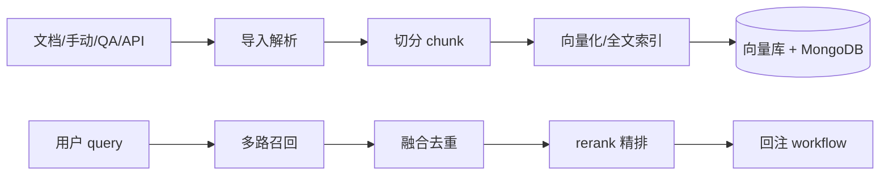
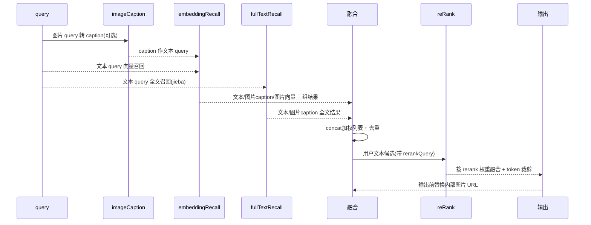

# FastGPT RAG 知识库

> 本文对应 README 的「core/dataset」模块深读（见 [`README.md`](README.md)）。

## 根因：知识库不是"向量库的封装"

FastGPT 没有把知识库做成"把文档塞进个开源向量库"的薄封装，而是自研了一条**从文档导入到混合检索的完整 RAG 管线**。根因有二：

1. **中文检索难**：向量检索对中文近义/表述变体召回弱，纯向量库不够；需要向量 + 全文（分词）+ 重排混合，且要容忍模型字段差异。
2. **知识库是产品能力而非存储**：chunk 管理、层级、训练、API 知识库、引用溯源都落在"数据集-集合-chunk"模型上，向量库只是末端存储抽象。

设计分层一目了然：`core/dataset/` 管业务模型（Dataset/Collection/Data/Training），真正的检索编排在 `core/dataset/search/`。数据模型见 [`data-model.md`](data-model.md)。

## 数据模型：三层结构

- **Dataset（数据集）**：顶层容器，定义 chunk 设置（切分模式、训练类型、chunk 触发配置），是"一个知识库"`[packages/service/core/dataset/schema.ts:20-30]()`。
<!-- anchor-base64:ZXhwb3J0IGNvbnN0IENodW5rU2V0dGluZ3MgPSB7IOKApiBjaHVua1RyaWdnZXJNaW5TaXplOiBOdW1iZXIs -->
- **Collection（集合）**：一个文档源（一个上传文件/一条 URL/手动输入/API）对应一个集合，承载该源的元数据、切分结果、训练状态。
- **Data / DataText（chunk）**：最小检索单元。`dataset_datas` 含 `q/a`（问答对）、`imageId`（图片引用）、`history`（QA 演进历史）、`indexes` 向量索引与全文索引 `[packages/service/core/dataset/data/schema.ts:20-45]()`。
<!-- anchor-base64:dG1iSWQ6IHsg4oCmIHR5cGU6IFs= -->

这种三层模型的权衡：数据/集合分层让"一个知识库混用多种来源、多库混用检索、chunk 级增删改"成为自然操作，代价是数据管理（尤其 chunk 与集合的关联、训练对账）链路长。

## 检索链路：多路召回 → 融合 → 精排

`searchDatasetData` 是知识库搜索的编排核心 `[packages/service/core/dataset/search/defaultRecall/index.ts:34-34]()`，其上方注释把整条链路归纳为五步：**补充 query → 多路召回 → 分组融合 → 精排/过滤 → 输出格式化**。这是全仓库对"混合检索"最清晰的单点阐述。

### 补充 query（图文联动）

图片 query 先经 VLM 生成 caption，转成文本 query 参与召回。"即使 embedding 模型不支持图片，也能通过 VLM 描述获得一条文本检索路径" `[packages/service/core/dataset/search/defaultRecall/imageCaption.ts:33-33]()`。这是图文混合检索的设计锚点——图片不全依赖视觉向量，而是先转成可检索的文本。

### 多路召回

`buildVectorRecallTasks` 把 query 划分成三类向量任务 `[packages/service/core/dataset/search/defaultRecall/embeddingRecall.ts:39-39]()`：

- **text**：用户文本 query → text embedding 召回。
- **imageCaption**：图片描述 query → 也按 text embedding 处理。
- **image**：原始图片仅当 embedding 模型支持图片时才 base64 参与 image embedding，单张失败只丢弃该图片路径。

`fullTextRecall` 走 MongoDB 全文索引（用 jieba 分词），处理用户文本与 caption，但不消费原始图片（Mongo 文本索引无法消费图片向量/URL）`[packages/service/core/dataset/search/defaultRecall/fullTextRecall.ts:27-27]()`。向量与全文构成**双路互补**：向量抓语义、全文抓精确词与专有名词。

### 融合与去重

先分别合并"用户文本 / 图片 caption / 图片向量"三类结果，再按图文混合权重合成，让文本搜索主导、图片作视觉补充 `[packages/service/core/dataset/search/defaultRecall/index.ts:34-34]()`。

### 精排与过滤

`reRankSearchResults` 用 rerank 模型对候选重排 `[packages/service/core/dataset/search/defaultRecall/rerank.ts:55-55]()`。设计精妙点：**rerank 只作用于用户文本召回，避免文本 rerank 误伤视觉相似结果**；最终统一做相似度阈值过滤（`similarity`）和 token 上限裁剪（`filterDatasetDataByMaxTokens`）。搜索模式的默认是 embedding（`DatasetSearchModeEnum.embedding`），可视需要开启全文/混合。

### 输出

只在返回前把 chunk 内容里的内部图片 key 替换为预览 URL，避免动态 URL 干扰中间去重与融合 `[searchDatasetData]`。这个"后置替换"避免了 URL 作为噪音参与检索。

## 处理与训练：导入即异步

文档导入不走同步请求，而是建 Training 记录、后台队列处理（解析 → 切分 → 向量化 → 写 DataText + 向量索引），对应 `dataset/training/` 与 schema 里的训练状态。这带来：大文档不阻塞 HTTP、失败可重试、chunk 增删改可异步同步。代价是需要对账机制保证训练完成状态与向量库/全文索引一致。

## 与其它模块协同

- **workflow 知识库搜索节点**调用 `searchDatasetData`，把召回结果（含引用 `quoteList`）回注到 AI 对话节点供模型回答时引用；引用保留 datasetId/collectionId/sourceId 溯源。
- **`core/ai`** 提供 embedding（`core/ai/embedding`）、rerank（`core/ai/rerank`）、vlm caption 模型；`core/ai/model` 维护模型注册表（默认 rerank/embedding 模型）。
- **`common/vectorDB`** 抽象向量库（controller），让召回不依赖具体向量库实现；`common/string/jieba` 提供分词。
- **MongoDB** 存业务模型与全文索引，向量存独立向量库，双写对账。

## 设计决策与权衡

### 决策一：自研 RAG 而非纯接向量库

- 代价：无嵌入向量库的默认能力，需自建导入/切分/训练/对账全套管线。
- 收益：中文召回质量可控（向量 + 全文 + rerank）、chunk 可精细化增删改、图文混合检索成为差异化卖点（README 宣传"混合检索 & 重排"）。
- 评价：对知识库为主要产品的平台，这是对的取舍——把检索质量握在自己手里。

### 决策二：图文 caption 先转文本再召回

- 反事实：若只依赖图像向量，通用 embedding（不支持图片）会直接失效；若全走 VLM caption 又贵又慢。
- 方案耦合：caption 作为文本 query 与文本走同一召回通道，图片能力成为"渐进增强"（embedding 支持才额外走图片向量），向下兼容低成本模型。

### 决策三：rerank 局限用户文本

- 权衡：对图片召回也 rerank 理论上更准，但会误伤视觉相似结果且需额外 rerank 调用成本。作者优先保视觉召回纯度，把 rerank 预算留给高价值文本候选——同类平台常无此精细区分。

## 亮点与问题

**亮点**：混合检索三路召回（文本向量/图片caption/图片向量）+ 全文(jieba) + rerank，检索精度在开源平台中领先；图文 caption 渐进增强设计优雅；检索编排集中在 `searchDatasetData` 单点，易测试与扩展（multiQueryRecall 补充查询也是同一入口的插件式扩展）。

**问题**：多层数据对账（Dataset/Collection/Data/Training/向量库/全文索引）一致性维护成本高，尤其是大规模连续导入；`searchDatasetData` 参数（`embeddingWeight`/`rerankWeight`/`similarity`）多且默认值分散，调优入口不够集中；检索后置过滤依赖 token 预算但上限来源分散在调用方与常量间。

