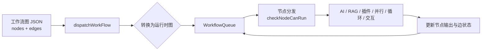
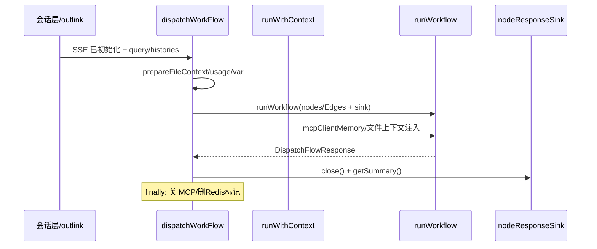
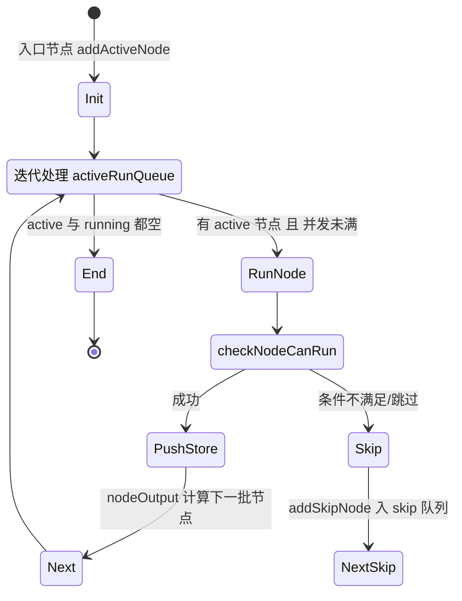

# FastGPT 工作流编排引擎

> 本文对应 README 的「core/workflow」模块深读（见 [`README.md`](README.md)）。

## 根因：为什么"图即运行时"

FastGPT 整座架构的支点是一个判断：**AI 应用逻辑应该是"数据"而非"代码"**。一张工作流图（节点 + 边）被存成 JSON，运行时被解释执行；产品表现为可视化拖拽，本质是编辑一个可执行数据结构。相比传统"每个应用写一个 controller"，图即运行时带来三个杠杆：

1. **编排与能力解耦**：图只描述"谁接谁"，节点背后的能力（AI 对话、知识库搜索、插件）独立演进，新能力 = 新节点类型，无需改调度内核。
2. **可调试/可续跑**：图是显式状态（节点输出、边状态、内存），因此天然支持断点、跳过、交互暂停后从内存续跑（下文交互机制）。
3. **一个执行引擎管所有**：对话、插件、工具子流程、调试全部复用 `dispatchWorkFlow`，靠 `workflowDispatchDeep` 分层递归，而非各自实现一套调度。

核心调度文件（`dispatch/index.ts`，1741 行）用一段注释直明队列设计意图"采用回调的方式，避免深度递归"，这是理解全局的钥匙 `[packages/service/core/workflow/dispatch/index.ts:404-413]()`。
<!-- anchor-base64:Lyog4oCmIC0g5q+P5qyh5re75Yqg5paw6IqC54K577yM5Lul5Y+K6IqC54K56L+Q6KGM57uT5p2f5ZCO77yM5Z2H5Lya5omn6KGM5LiA5qyhIHByb2Nlc3NBY3RpdmVOb2RlIOaWueazleOAgiBwcm9jZXNzQWN0aXZlTm9kZSDmlrnms5XvvIzlpoLmnpzmsqHop6blj5Hot7Plh7rmnaHku7bvvIw= -->

## 请求链路一：进入 Dispatch

`dispatchWorkFlow` 是工作流执行的**唯一入口**，它先做五件"进入前的事"，再委托给 `runWorkflow`：

1. **SSE 初始化校验**：若开启流式且响应未初始化，立即 reject。注释明示"HTTP SSE 响应必须由调用入口提前初始化，dispatch 只执行 workflow，不隐式管理响应协议"——把响应协议管理外置，dispatch 保持纯粹的执行职责 `[packages/service/core/workflow/dispatch/index.ts:202-207]()`。
<!-- anchor-base64:aWYgKHN0cmVhbSAmJiByZXMgJiYgIWlzV29ya2Zsb3dTc2VSZXNwb25zZUluaXRpYWxpemVkKHJlcykpIHsg4oCmIH0= -->
2. **文件上下文准备**：`prepareWorkflowFileContext` 处理 query/历史中的文件（注册、预览 URL、大小上限），文件成为沙箱/变量可直接引用的能力。
3. **用量记录**：新建或复用 `usageId`（交互续跑时复用 lastInteractive.usageId），串联整个 workflow 的计费。
4. **变量状态机**：`WorkflowVariableState.create` 建立运行时变量作用域，输入变量与历史合并，供节点引用求值。
5. **停止信号**：`delAgentRuntimeStopSign` 清除上次的停止标记；并发注入 `checkIsStopping` 供节点中断检查。

随后 `dispatchWorkFlow` 创建 `nodeResponseSink`（节点响应的统一写回通道），在一个 `runWithContext` 作用域内交给 `runWorkflow`，完成后关闭 sink、汇总 `nodeResponseSummary`，并在 finally 里关闭 MCP 客户端连接、删除 Redis 停止标记（保证一次执行资源必定回收）`[packages/service/core/workflow/dispatch/index.ts:338-395]()`。
<!-- anchor-base64:cmV0dXJuIG5ldyBQcm9taXNlKChyZXNvbHZlLCByZWplY3QpID0+IHsg4oCmIH0pOw== -->

## 请求链路二：队列驱动执行

`runWorkflow` 每次调用代表**一层图执行**（`workflowDispatchDeep` 分层，上限 20 防控失控递归），并区分 isRootRuntime。执行前先做运行时图重写与清洗 `[packages/service/core/workflow/dispatch/index.ts:1577-1660]()`：
<!-- anchor-base64:ZXhwb3J0IGNvbnN0IHJ1bldvcmtmbG93ID0gYXN5bmMgKGRhdGE6IFJ1bldvcmtmbG93UHJvcHMpOiBQcm9taXNlPERpc3BhdGNoRmxvd1Ig4oCmIGNvbnN0IHdvcmtmbG93UXVldWUgPSBhd2FpdCBuZXcgUHJvbWlzZTxXb3JrZmxvd1F1ZXVlPigocmVzb2x2ZSkgPT4gew== -->

- **rewriteRuntimeWorkFlow**：编译期语义（如 ToolSet 展开）落地为运行期节点。
- **filterOrphanEdges**：ToolSet 展开后删除孤儿边（注释强调必须先展开再过滤，否则 ToolCall → Tool 边的 selectedTools 会被误删，说明执行顺序有强依赖）`[packages/service/core/workflow/dispatch/index.ts:1627-1640]()`。
<!-- anchor-base64:YXdhaXQgcmV3cml0ZVJ1bnRpbWVXb3JrRmxvdyh7IOKApiB9KTs= -->

随后把入口节点（`isEntry`）入队，构造 `WorkflowQueue` 驱动执行。**核心是迭代式活动队列而非递归**：

队列实现要点（`WorkflowQueue`）`[packages/service/core/workflow/dispatch/index.ts:421-880]()`：
<!-- anchor-base64:ZXhwb3J0IGNsYXNzIFdvcmtmbG93UXVldWUgeyDigKYgdGhpcy5kYXRhLmxhc3RJbnRlcmFjdGl2ZS5lbnRyeU5vZGVJZHM/LmluY2x1ZGVzKG5vZGUubm9kZUlkKQ== -->

- **回调避免深递归**：节点执行是异步 fire-and-forget（不 await 单个结果），`runningNodePromises` 集合 + `Promise.race` 在任一节点结束时唤醒循环继续取活节点——既避免递归爆栈，又天然实现并发 `[packages/service/core/workflow/dispatch/index.ts:771-839]()`。
<!-- anchor-base64:Ly8g6L+t5Luj5aSE55CG6Zif5YiX77yI5pu/5Luj6YCS5b2S55qEIHByb2Nlc3NBY3RpdmVOb2Rl77yJIOKApiB9 -->
- **并发控制**：每 team 节点并发受 `maxConcurrency` 限制；`processingActive` 防止重复启动处理循环。
- **每个节点同时只执行一次**：`activeRunQueue` 是 Set，重复 addActiveNode 幂等。
- **skip 与 active 双队列**：不满足运行条件的节点进 `skipNodeQueue`，在主队列清空后由 `processSkipNodes` 处理；分支/交互节点通过 skipEdges 实现"跳过后不再触发分支内容"的递归防护 `[packages/service/core/workflow/dispatch/index.ts:1446-1456]()`。
<!-- anchor-base64:Lyog4oCmIH0= -->

### 节点如何"决定跑不跑"

`checkNodeCanRun` 是分发的裁决点 `[packages/service/core/workflow/dispatch/index.ts:1231-1505]()`。它先检查节点依赖的上游边是否满足（变量的 reference 求值）、是否被 skip，再调用具体节点执行，最后用 `pushStore` 把结果回填（runTimes、memories、toolResponse、assistantResponses、自定义反馈），用 `nodeOutput` 把节点输出值按 `outputs` 结构映射到下一批节点的输入，得出下一批 `nextStepActiveNodes` / `nextStepSkipNodes`。
<!-- anchor-base64:cHJpdmF0ZSBhc3luYyBjaGVja05vZGVDYW5SdW4obm9kZTogUnVudGltZU5vZGVJdGVtVHlwZSwgc2tpcHBlZE5vZGVJZExpc3QgPSBuZXcg4oCmIH0= -->

节点运行参数的构造在 `getWorkflowNodeRunParams`（调度热路径）统一处理：插件输入内联成对象、动态输入建 runtime 键、外部变量引用求值、静态输入跳过文本替换——避免无变量节点复制整张变量表 `[packages/service/core/workflow/dispatch/utils/runtime.ts:27-45]()`。
<!-- anchor-base64:cnVudGltZU5vZGVzTWFwOiBNYXA8c3RyaW5nLCBSdW50aW1lTm9kZUl0ZW1UeXBlPjsg4oCmIFtkeW5hbWljSW5wdXQua2V5XToge30= -->

## 交互节点：图的暂停与续跑

FastGPT 图不是一次性执行到底，交互节点（用户选择、表单输入、支付暂停、工具待确认）会在图中途**暂停**，等待用户输入后再**续跑**。这是图即运行时最体现设计深度的地方 `[packages/service/core/workflow/dispatch/index.ts:1468-1547]()`：
<!-- anchor-base64:Ly8gSW4gdGhlIGN1cnJlbnQgdmVyc2lvbiwgb25seSBvbmUgaW50ZXJhY3RpdmUgbm9kZSBpcyBhbGxvd2VkIGF0IHRoZSBzYW1lIHRpbWUg4oCmIH07 -->

- 交互响应通过 `nodeInteractiveResponse` 记录 `entryNodeIds`（多个节点同时触发时数组保留），随后`handleInteractiveResult` 计算"续跑所需全部状态"：
  - `memoryEdges`：记录每条边当前状态，且**入口前面的边全部置为 active**，保证下次进入一定执行。
  - `skipNodeQueue`：把尚未消费的 skip 队列序列化进交互响应，续跑时作为 `lastInteractive.skipNodeQueue` 注入。
  - `nodeOutputs`：当前全部节点的输出值快照。
- 返回的交互响应带 `interactiveId`，前端渲染交互 UI，用户提交后带着 `lastInteractive` 重新调用 dispatch，从记忆状态续跑——**用户的"等一下"被实现数据化，而非进程内状态**。

这解释了为何 SSH/会话能跨请求暂停恢复：**持久状态全部外置于图数据（边/节点输出/skip 队列），而非执行栈内**。

## 设计决策与权衡

### 决策一：回调式队列 vs 递归

图执行最常见的实现是 DFS 递归，简单直观但深图易爆栈、难控制并发、难在节点间让出进程。FastGPT 选择**事件循环驱动的迭代式队列 + 回调集合**。
- 代价：队列状态机（active/skip/finish/detach/交互）复杂度高，`checkNodeCanRun`/`nodeOutput` 需要精细维护入口与出口。
- 收益：天然支持并发、可控的 team 级限流、Debug 单步（debugNextStepRunNodes 记录下一批节点）、交互暂停的快照。
- 取舍评价：对以"任意复杂编排"为卖点的平台，这个复杂度是值得的刚性成本。

### 决策二：dispatch 不管理 SSE 协议

SSE 初始化被强制外置于 dispatch（校验后拒绝）。这是分层纪律的体现——**调度内核只承诺"执行图并返回结果"，协议（SSE/HTTP/回调）由调用方负责**。这让 dispatch 可复用于对话、插件、调试、工具子流程多种协议场景，代价是调用方必须履行协议初始化的约定，漏一步就报错（用显式异常而非隐式兜底）。

### 决策三：`workflowDispatchDeep` 分层（上限 20）控递归

插件/工具子流程会在 dispatch 内部再次触发 `runWorkflow`，形成分层递归。超过深度直接返回空结果而非抛错（防止级联 OOM），是典型的"防御式递归护栏"。区分 `isRootRuntime` 决定是否推送 SSE 时长事件。

## 与其它模块的协同

- **上游**：会话层（`core/chat`）与外部链接（`support/outLink/runtime/utils.ts`）都调用 `dispatchWorkFlow`，传入 `apiVersion`（v1 支持客户端中断）。v1 通过 `createClientAbortTracker` 监听 TCP 断开，v2 通过 Redis 停止标记轮询 —— 暂停语义随协议演进 `[packages/service/core/workflow/dispatch/index.ts:274-322]()`。
<!-- anchor-base64:Y29uc3QgY2xpZW50QWJvcnRUcmFja2VyID0g4oCmIDogdW5kZWZpbmVkOw== -->
- **下游能力**：AI 节点 (`dispatch/ai`)、知识库节点 (`dispatch/dataset`)、插件节点 (`dispatch/plugin`)、并行/循环子图 (`dispatch/parallelRun`/`loop`) 都由调度器分发。
- **可观测**：`observeWorkflowRun`/`observeWorkflowStep` 用 OpenTelemetry span 记录整图与每步耗时（`runningNodePromises` 每步续跑都借 span 上报），`workflowSpan` 打上 node_count/duration 属性，跨层 Tracing。

## 亮点与问题

**亮点**

1. 图执行状态全部外置数据（边状态/节点输出/memoryEdges/skipNodeQueue），支撑交互暂停续跑与反熵恢复，是"图即运行时"的完美兑现。
2. 迭代队列替代递归，优雅解决深图 + 并发 + 限流 + 单步调试四合一。
3. `filterOrphanEdges` 与 `rewriteRuntimeWorkFlow` 的先后顺序用注释显式约束，体现对运行时序的严谨。

**问题**

1. `dispatch/index.ts` 1741 行偏大，状态机（active/skip/finish/detach）隐式散落在 `checkNodeCanRun`/`nodeOutput`/`startProcessing` 间，缺少显式状态枚举，维护者需通读才能理清所有转移。
2. 交互暂停依赖"每次只能一个交互节点"约束（代码注释明示 current version only one interactive），多交互并发的设计被显式推迟。
3. 深度上限 20 是硬编码魔数，无配置化，极端嵌套下行为依赖隐式常量。

