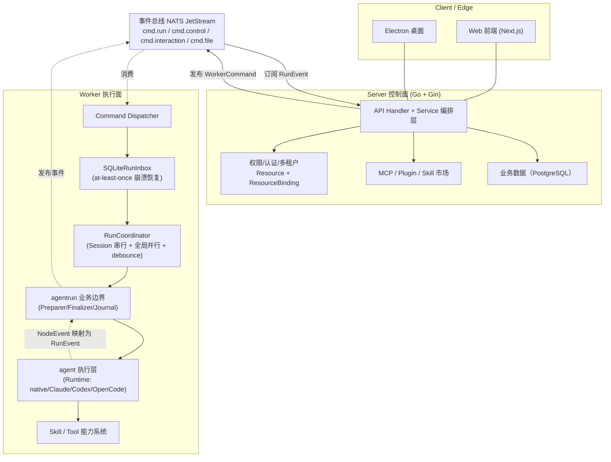
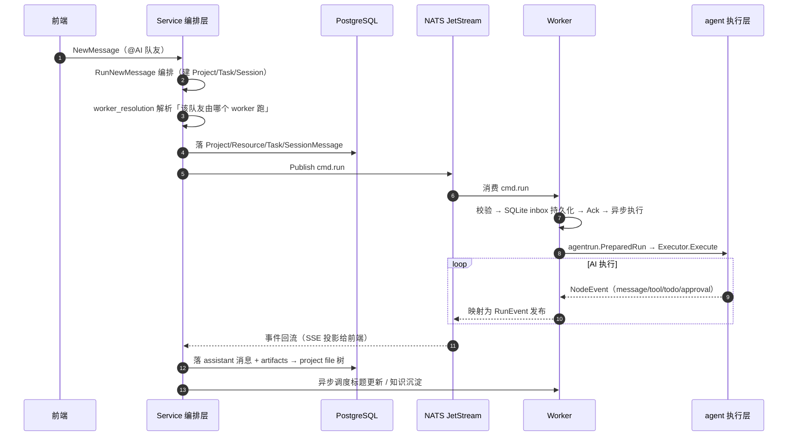

# Lework

> 让 AI 从聊天工具，变成可长期协同工作的团队成员——一套把「AI 当劳动力」来管理的企业级 AI 工作协作系统。

> 本解读按 **agent 类规格**产出（含记忆机制 / 主 Agent 循环 / 工具调用 / Skill 体系 / MCP 接入 / Runtime 运行时等关注面），并叠加多关注面大型仓库并行解读流程。源码对象为本地 fork `Lework-fork`（upstream `corekg/lework`，代码内部 alias `Leros`，Go 后端约 13.6 万行 + pnpm monorepo 前端）。

## 子文档索引

- [`agent-runtime.md`](agent-runtime.md) — 可脱离业务独立驱动的 Agent 执行层：多 Runtime（native/Claude/Codex/OpenCode）+ 强类型 NodeEvent 契约
- [`worker-system.md`](worker-system.md) — Worker 管理系统：SQLite inbox 的 at-least-once 崩溃恢复、RunCoordinator 并发模型、agentrun 业务边界
- [`automation.md`](automation.md) — 自动化定时调度：Planner/Dispatcher 两阶段、遗漏折叠、CAS 防重、租约领取，把 AI 从随叫随到变成可定时值守
- [`service-layer.md`](service-layer.md) — 业务编排层：把一条消息翻译成「项目+任务+会话+AI 队友执行」的完整链路
- [`skill-tool.md`](skill-tool.md) — Skill/Tool 能力系统：Tool 原子能力 + Skill 组合能力，SKILL.md 数据驱动、run-scoped 注入
- [`permission-auth.md`](permission-auth.md) — 权限/认证/多租户：基于资源的能力授权、worker token、内置 vs 委托 IAM 双模式
- [`mcp-plugin.md`](mcp-plugin.md) — MCP + 插件/集成体系：插件市场、OAuth 动态接入、GitHub 渠道连接器
- [`model-router.md`](model-router.md) — 模型调度：统一 IR 协议归一、Worker 代理、Server 模型管理/默认模型/连接测试
- [`data-model.md`](data-model.md) — 数据模型与存储：三层存储谱系、GORM AutoMigrate + 手写补偿迁移、Replayable 落库（含 Automation 双表）
- [`frontend.md`](frontend.md) — 前端客户端（Web + Electron）：长短双层 SSE 实时管线、双端同构、乐观更新
- [`CHANGELOG.md`](CHANGELOG.md) — 各版本变更汇总（自 v0.3.9 起）

> **本版增量更新说明（v0.3.9 → v0.5.2）**：本次解读把源码从既有基准（约 8/04）增量更新到 v0.5.2，新增能力包括——**自动化定时调度**（`automation.md`）、**模型管理与路由**（`model-router.md`）、**AI 队友共享权限**、**系统 MCP 连接器按配置初始化 + CatAPI + 凭据统一绑定**、**OpenCode 采样/多模态/固定配置目录**、**Worker Skill 缓存与任务目录清理**、**K8s 按 Deployment 隔离 workspace**、以及前端**工作台/考勤核算 / Token 展示 / HTML 预览 / 代码块主题**。各子文档以「增量演进（版本号）」小节就地补充，历史结构未被破坏；各版本详细变更见 [`CHANGELOG.md`](CHANGELOG.md)。

## 根因：AI 对话是一次性消费，劳动力是长期雇佣

Lework 要解决的根本问题：**AI 辅助工作越来越普及，但产出收不回来——对话结束即清零**。现实团队的协作有分工、有指派、有交付物、有追踪；而把 AI 当聊天工具，无法把它当劳动力来管理。

因此 Lework 建立了这样一套心智模型：

- **建团队**：定义角色、绑定技能，创建 AI 队友（有身份、有边界、有记忆）
- **派任务**：指定负责人、预期产出、验收标准
- **拿结果**：AI 独立执行，交付可追溯的产物
- **沉淀资产**：上下文与产出持续积累，越用越强
- **可管理**：进度、质量、调用成本全程可见可控

把「对话」升维成「劳动单元」，就是全篇架构叙事的锚点。

## 概览

Lework 是一套**企业级 AI 工作协作系统（AI Workspace）**，通过 `Project + Task + Agent + Skill` 核心模型，把 AI 队友组织进真实的工作流：用户创建项目、派任务给 AI 队友，AI 在独立的 Git 工作区里调用工具/Skill 干活、产出文件级资产，参与沉淀为知识库（`MEMORY.md`），全程可审计、可回放、可人工审批接管。

技术栈上它是一个 **Go（后端）双进程 + 事件驱动 + 多类型前端**的大型工程，核心卖点是「多运行时执行 + 本地/云端协同 + 企业级安全治理」。

### 核心能力清单

| 能力 | 说明 |
|------|------|
| AI 队友（Digital Assistant） | 有独立身份（SystemPrompt/Expertise）、可绑定模板、有部署与权限边界的 AI 员工 |
| 任务 + 会话双层 | Task 追踪「活干到哪、派给谁」，Session 承载「哪次执行、实时细节」 |
| 项目工作区 | 每个项目绑定 Gitea 私有仓库，AI 产出 file 级资产、可版本回放 |
| 多 Runtime 执行 | native（Eino）+ Claude Code / Codex / OpenCode 外部 CLI，统一 `agent.Runtime` 契约 |
| Skill / Tool 能力系统 | Tool 原子能力 + Skill 组合能力（SKILL.md 数据驱动，agent 可自写自改） |
| MCP + 插件市场 | 接入企业私有 MCP 服务器、OAuth 动态接入、官方插件/技能市场；系统连接器按配置初始化 |
| 自动化调度 | 日历/间隔定时任务，Planner/Dispatcher 两阶段、遗漏折叠、CAS 防重，AI 可定时值守 |
| 模型管理 | 统一 LLM 代理 + 模型增删改查/默认模型/连接测试，多供应商协议归一 |
| 记忆沉淀 | 短期上下文 + 项目级 `MEMORY.md` 长期知识，沉淀进 Git 可审计 |
| 企业治理 | 多租户隔离、基于资源的能力授权、AI 队友共享、worker token、任务审批、执行审计、成本追踪 |

### 技术栈一览

| 类别 | 技术 |
|------|------|
| 后端语言 | Golang |
| HTTP 网关 | Gin |
| 事件总线 | NATS JetStream（at-least-once） |
| 主数据库 | PostgreSQL 17（GORM + AutoMigrate） |
| Worker 本地 | SQLite（inbox 崩溃恢复） |
| LLM | 多模型；多运行时（Eino / Claude Code / Codex / OpenCode） |
| 前端 | pnpm + turborepo monorepo（Next.js Web + Electron 桌面） |
| 容器化 | Docker + Compose，私有化部署 |

## 架构总览

Lework 的架构核心是「三核（Event Engine + Execution Engine + Agent Runtime）」与「双进程（Server 控制面 / Worker 执行面）」的分离，所有模块之间只能通过事件总线（NATS JetStream）通信；同时用 `internal/` 强制隔离核心实现、`pkg/` 公开接口（领域驱动分层，而非按 controller/service 分层）。

- **Server（控制面）**：只负责「定义为什么做、给谁做」。Gin API 接收请求，Service 层把消息编排成项目/任务/会话，经 NATS 把 `cmd.run` 投递给 worker，再把 worker 回传的 `run.*` 事件投影给前端。
- **Worker（执行面）**：回答「怎么做、做到哪」。真正调 LLM、跑 agent、执行工具。Worker 是**可销毁重建的无状态节点**，本地只留 SQLite inbox 做崩溃恢复，业务状态全在 PostgreSQL。
- **界限**：`agent` 执行层严格不碰业务持久化/NATS，只管「跑完一次执行并吐出 NodeEvent」；业务终态由 Worker 的 `agentrun.Service` 独占决定（详见 [`worker-system.md`](worker-system.md)）。

## 一条请求链路

用户在 Web 说一句话，到 AI 产生可追踪的产出资产（详见各子文档）：

## 核心模块导读

| 模块 | 角色 | 一句话定位 | 深读 |
|------|------|-----------|------|
| agent 执行层 | 三核之一 | 业务无关的多 Runtime 执行契约，`Runtime First, Model Second` 的物理载体 | [`agent-runtime.md`](agent-runtime.md) |
| Worker 系统 | 主链路心脏 | 用「先落盘再 Ack」的 SQLite inbox 实现 at-least-once 的可持续执行 | [`worker-system.md`](worker-system.md) |
| 自动化调度 | 定时值守 | Planner/Dispatcher 两阶段把 AI 从随叫随到变成可周期执行 | [`automation.md`](automation.md) |
| 业务编排层 | 对话→劳动翻译官 | 一条消息编排出项目/任务/会话/队友执行 | [`service-layer.md`](service-layer.md) |
| Skill/Tool | 能力系统 | 原子 Tool + 组合 Skill，SKILL.md 数据驱动可生长 | [`skill-tool.md`](skill-tool.md) |
| 权限/认证 | 治理底座 | 基于资源的能力授权 + 双模式认证（Deny by Default） | [`permission-auth.md`](permission-auth.md) |
| MCP/插件 | 手与生态 | 接入外部 MCP / 插件市场 / 渠道连接器 | [`mcp-plugin.md`](mcp-plugin.md) |
| 模型路由 | 模型即资源 | 统一 IR 协议归一 + Server 模型管理/默认模型 | [`model-router.md`](model-router.md) |
| 数据模型 | 状态外置 | 三层存储 + 双轨迁移 + Replayable 落库 | [`data-model.md`](data-model.md) |
| 前端 | 人机界面 | 长短双层 SSE 实时驾驶舱，双端同构 | [`frontend.md`](frontend.md) |

## 同领域定位对比

| 项目 | 定位 | 与 Lework 的差异 |
|------|------|------------------|
| **Lework（本项目）** | 企业级 AI 团队协作 + 多运行时执行 + 企业治理 | Go 双进程，多 Runtime 并存（自带 native + 封装外部 CLI），三层沉浸式治理，Git 工作区当记忆库 |
| **Multica** | 托管式 AI Agent 协作，Agent 作为第一公民 | 主打托管派单，Lework 更强调本地/私有化部署与多运行时 |
| **OpenBee** | 自托管 24/7 数字员工，对话驱动 | 用对话驱动执行；Lework 用「任务 + 资产」结构化驱动，且执行不挂在单一对话上 |
| **OpenVort** | AI 员工 / 研发工作流引擎 | 深度绑定 IM + 研发链路；Lework 抽象更通用（任务/资产模型）、且可接多种外部运行时 |

## 设计亮点

1. **「Ack 只承诺落盘，不承诺执行」**：Ack 从「任务完成」移到「SQLite 持久化成功」，把 at-least-once、崩溃恢复、并发解耦三件事收敛到一套机制（`worker-system.md`）。
2. **「业务身份」与「执行资源」双 ID 解耦**：AI 队友（assistant）与 worker（进程/容器）是两个维度，`worker_resolution` 做安全翻译，角色稳定、执行可伸缩（`service-layer.md`）。
3. **基于资源的能力授权而非传统 RBAC**：角色只是资源上的强度标签，动作集由代码内 `SystemPolicy` 声明，Deny by Default 天然成立（`permission-auth.md`）。
4. **Skill 是数据不是代码**：`SKILL.md` 是 frontmatter + 正文的 markdown，agent 可经 `skill_manage` 自写自改、零发版演进，且「做事唯一托付给 Tool」收紧权限面（`skill-tool.md`）。
5. **`internal/` + 架构测试固化边界**：`architecture_test.go` 用 AST 遍历禁止执行层 import 业务包，把「业务解耦」从口头约定变成机器可验证的不变量（`agent-runtime.md`）。

## 不足与风险

1. **Task 状态机「定义了没跑起来」**：`TaskStatus` 的 8 态定义完备，但 service 层只在创建置 `created`、无自动推进引擎，真实执行进度由更细粒度的 `Message.Status` 驱动（`service-layer.md`）。
2. **凭据明文存储**：`ConnectorAuthDefinition.Values` 以明文存 DB 修订，源码注释自认「待引入专用凭据库」（`mcp-plugin.md`）。
3. **渠道成熟度不齐**：GitHub 连接器实装完整，GitLab 验签 `return nil`、企微仅剩壳，「框架先行、实现滞后」（`mcp-plugin.md`）。
4. **Skill 是 prose 编排**：无程序化执行保证，依赖模型遵循，复杂长流程 Skill 产出正确性无程序兜底（`skill-tool.md`）。
5. **双份手写翻译层需同步**：`Preparer`（业务→ExecutionRequest）与 `NodeHandler`（NodeEvent→RunEvent）是脆弱映射（`agent-runtime.md`）。

## 可借鉴的设计

- **at-least-once 的本地持久化 inbox 模式**：把「真正执行」从「消息确认」中解耦，用本地 SQLite + 幂等键 + 崩溃恢复救回长任务，值得任何异步任务系统借鉴（`worker-system.md`）。
- **领域驱动 + `internal/` 强制隔离 + 架构测试固化边界**：用 Go 编译器 + 测试 AST 检查锁死依赖方向，是比 ADR 更硬的架构护栏（`agent-runtime.md`）。
- **「资源 + 角色绑定 + 策略表」的能力授权 + 继承式角色解析**：把权限粒度收敛到「资源×动作」，支持树形继承，替代传统 role 表（`permission-auth.md`）。
- **Template vs 实例的「岗位标准 / 在职员工」分层**：模板锁定能力定义、实例只拥用户侧信息，平衡标准化与灵活性（`service-layer.md`）。
- **run-scoped Skill 视图（symlink）注入**：Skill 不进宿主 CLI 全局目录，per-run 隔离视图 + 环境变量传递，兼顾安全与隔离（`skill-tool.md`）。

## 总结

回到开篇的锚点：Lework 把「AI 是聊天工具」重构为「AI 是长期协作雇员」。它用 **任务+资产的结构化模型**承接劳动管理、用 **Server/Worker 双进程 + 事件总线** 保证执行的可持续与可回放、用 **多 Runtime + Skill/Tool + MCP** 扩展 AI 动手能力、用 **企业级权限/多租户/审计** 支撑作为团队成员被治理。它最值得学的地方不是「某个 AI 功能」，而是**把 AI 当成可调度、可治理、可沉淀组织资产的劳动力**这套完整的工程与产品思维。
