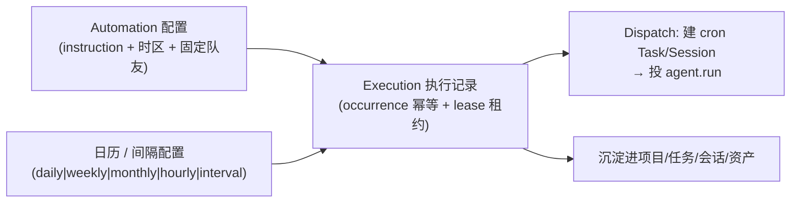
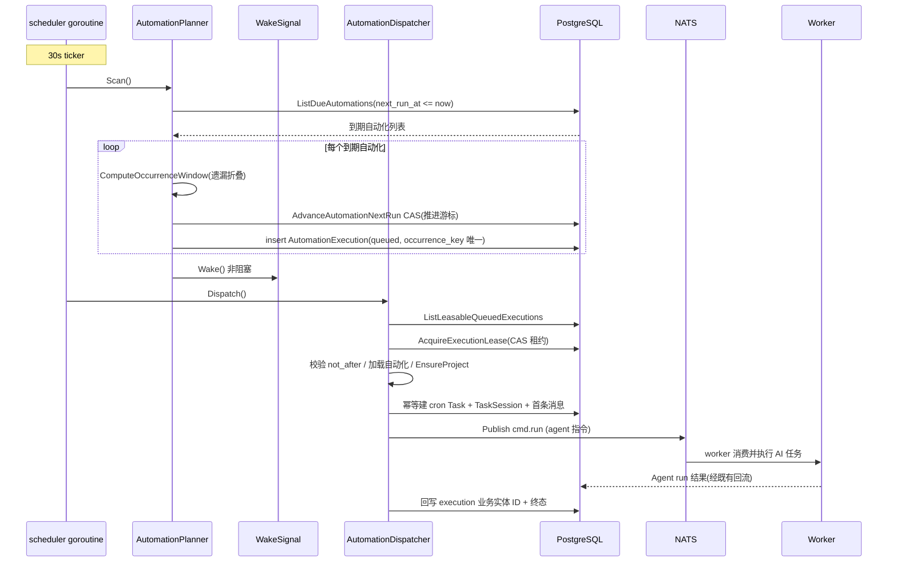

# Automation：把「AI 队友」从随叫随到变成可定时值守的长效劳动力

> 本关注面解读 Lework（后端 `Leros`）的自动化定时调度子系统，覆盖 `backend/types/automation*.go` + `backend/internal/service/automation_*.go`。数据模型部分并入 [data-model.md](data-model.md)。所有 `文件:行号` 引用均可回源验证。

## 自动化在项目中的角色

Lework 的既有主链路（`service-layer.md`）解决的是「用户发一句话，AI 队友立刻干活」的交互式执行。但「把 AI 当团队成员」的完整愿景里，还有一类任务是**周期性、无人值守**的：每天 9 点汇总昨日项目进展、按季度核算考勤工资、每周定时巡检代码质量——这些不该要求人类每次手动召唤，而应该让 AI 靠在后台的调度器**自己到点干活**。

Automation 子系统就是这条「定时值守」能力的第一落点。它把一条 Agent 指令（`Instruction`）按**日历规则**（每天/每周/每月/每小时）或**固定间隔**（每 N 分钟）自动执行：到点时调度器生成一条执行记录、幂等拉起一个 cron 任务、投递给 AI 队友，跑完沉淀进既有任务/会话/资产体系——与交互式执行复用同一条 worker 主链路。

它是 `service-layer` 的能力补全：**把「有人触发」补成「到点自动触发」，执行体依然是统一的 `RunCommand → worker → agentrun`**。

## 根因：长周期任务不能靠人肉轮询，也不能靠裸 crontab

### 核心矛盾

让 AI 定时干活，表面上是「写个 cron」的问题，实际有三个交互式执行不存在的难点：

1. **漏触发与重复触发的边界**：server 可能停机、重启、多实例部署。裸 crontab 在 server 重启时会漏掉停机期间的周期；而多个 server 实例同时扫描同一个自动化，又可能重复触发同一个周期。需要一个**幂等 + 防重**的调度边界，而不是「到点调一个函数」。

2. **触发不是终点，执行才是**：到点只是「该干活了」，真正要把指令变成一次可追踪的执行（建项目/建任务/建会话/发消息/投递 worker），且 server 在途中崩溃后要能恢复。这要求**执行意图先落库、再异步执行**——与 worker 侧 SQLite inbox 的 at-least-once 是同构思路，只是这次持久化载体是中心 PostgreSQL。

3. **周期语义很脏**：日历任务的月末回溯（每月 31 日 → 2 月取月末）、DST 夏令时切换、固定间隔的「锚点网格」、服务停机错过多个周期后的补执行策略——这些是纯时间计算的暗坑，不能交给系统 cron 的简化语义。



### 根因落点

一句话：**Automation 用「PostgreSQL 中的 `Automation` 配置 + `AutomationExecution` 执行记录」作为定时任务的持久化真相，用「数据库 CAS 推进 + 唯一索引」做防重边界，把「到点触发」和「真正执行」解耦成两阶段异步**，从而把 AI 从交互式随叫随到升维为可周期值守的劳动力。

## 设计思路：Planner（计划生成）与 Dispatcher（投递执行）的分离

整个子系统刻意分成两个职责互补的后台阶段，中间靠持久化的 `AutomationExecution` 表衔接：

- **Planner（到期扫描器）**：周期扫描 `next_run_at` 到期的自动化，计算遗漏窗口，用 **CAS 推进 `next_run_at`** 抢占本次 occurrence，再插入一条 `queued` 的 `AutomationExecution`。它回答「**现在该不该执行、为哪一次周期执行**」。
- **Dispatcher（执行投递器）**：扫描 `queued` 的执行记录，用 **`Lease`（租约）** 领取一条，校验未过期后，幂等创建该周期对应的 cron `Task`/`Session`/首条消息，投递 `agent.run`。它回答「**如何把它变成一次真正的执行**」。

两者不直接对话，而是通过 `AutomationExecution` 表状态机（`queued → running → succeeded/failed/skipped`）解耦，中间用数据库约束保证幂等。这正是「DB 才是状态」哲学的又一处落地——调度器的「当前该跑哪个周期」的状态，不放在进程内存里，而是落库。



## 关键数据结构

### Automation — 定时任务配置（真相）

`[backend/types/automation.go:21-66]()` 定义调度配置本身：

- `Instruction`：每轮发给 Agent 的完整指令（系统提示词级）。
- `ScheduleMode`：`calendar`（日历）/ `interval`（固定间隔），决定底层计算模式。
- `ScheduleSpec`（JSONB）：版本化规范化调度规则，`FormConfig`（前端回显）+ `Spec`（编译后规则）双段。
- `Timezone`：IANA 时区，默认 `Asia/Shanghai`。
- `AssistantID`：创建时固定的默认 AI 队友 ID——定时任务永远由同一个队友执行，避免每次重新路由。
- `NextRunAt` / `LastRunAt`：调度游标与最近执行时间。
- `ProjectID` / `ProjectGeneration`：当前自动化项目及「代数」（项目被删后换代重建）。

关键设计：`Enabled` 用指针 `*bool`，为了让 GORM 区分「显式 false」与「未赋值零值」，避免数据库默认值覆盖 false `[backend/types/automation.go:39-41]()`。`IsEnabled`/`SetEnabled` 封装了这套 nil 语义 `[backend/types/automation.go:74-82]()`。

### AutomationExecution — 每次触发的执行记录（outbox + 防重）

`[backend/types/automation_execution.go:18-94]()` 是一次周期触发生成的持久化执行记录，它承担三个职责：

1. **防重边界**：`(AutomationID, OccurrenceKey)` 组合唯一索引 `ux_auto_exec_occurrence`，其中 `OccurrenceKey` 用理论计划时间 `RFC3339`，保证「同一自动化同一周期只能有一条 execution」`[backend/types/automation_execution.go:24-38]()`。
2. **Server 侧 outbox**：注释明确「它充当 Server 侧的持久化 outbox，保证 NATS 失败时可重试、不重复」`[backend/types/automation_execution.go:15-17]()`——执行意图先落进这张表，再异步投递。
3. **执行生命周期追踪 + 快照**：携带 `Status`（queued/running/succeeded/failed/skipped）、`NotAfter`（最晚开始时间）、`MissedCount`（被折叠的更早遗漏数）、以及业务实体的快照（`Name/Instruction/AssistantID` snapshot）和产出实体的引用（`ProjectID/TaskID/SessionID/MessageID/RunID`）。

### OccurrenceWindow — 遗漏折叠的调度窗口

`[backend/internal/service/automation_schedule.go:275-330]()` 的 `ComputeOccurrenceWindow` 是「服务停机错过多个周期后干什么」的答案：

- `LatestDue`：**最近一次**遗漏的 occurrence（Planner 要为它创建 execution）。
- `MissedCount`：被折叠的更早遗漏数量。
- `Next`：推送到未来的下一次 occurrence。

**设计取舍**：服务停机 3 个周期，**只补最近一次、不补前面 2 次**，而是把前面 2 次计入 `MissedCount` 折叠掉。为什么？因为对周期任务来说，「积压补齐」的价值远低于「跟上节奏」——一次性补跑 3 次往往产生过时且无意义的结果，反而污染执行历史。这是「至少一次」语义在周期任务上的收敛：**每个周期最多触发一次、停机后只追最近一次**。

## 核心实现与权衡

### Planner：CAS 推进游标，先把「游标」与「插入」分离

`[backend/internal/service/automation_planner.go:42-110]()` 的 `processDue` 是防重设计的核心。它刻意把两件事拆开：

```
1. 先 CAS 推进 next_run_at：AdvanceAutomationNextRun(WHERE next_run_at = oldNext)
   —— 只有「推进成功」的实例获得本次 occurrence；
2. 再单独插入 AutomationExecution（含活跃执行判断）。
```

- **CAS 推进**：`AdvanceAutomationNextRun` 带 `WHERE next_run_at = oldNext` 条件，只有第一个实例能推进成功（其他实例 CAS 未命中返回 `!advanced`，直接放弃本次）。这是**多实例防重的第一层**——不依赖进程锁或分布式锁，全靠数据库条件更新 `[backend/internal/service/automation_planner.go:92-101]()`。
- **游标推进与插入分离**：即使 execution 插入失败（脏数据/并发冲突），`next_run_at` 也已推进，定时任务能滑到下一个周期继续执行，不会永远卡在同一个失败周期——形成「本次失败不影响后续」的自愈 `[backend/internal/service/automation_planner.go:70-77]()`。
- **活跃执行折叠**：`createAutomationExecution` 先查 `HasActiveExecution`，若该自动化已有 `queued/running` 的 execution，则本次标记为 `skipped`（而不是叠加一个并发执行），避免同一自动化同时跑多个 run 的语义错乱 `[backend/internal/service/automation_planner.go:118-151]()`。

### Dispatcher：租约领取 + 幂等建实体 + 投递

`[backend/internal/service/automation_dispatcher.go:55-160]()` 的 `Dispatch` 处理 `queued` 的执行：

- **租约（Lease）领取**：`AcquireExecutionLease` 用 `dispatcher-{now}` 作 owner + CAS 抢占，设置 `LeaseUntil` 租约。多实例同时领同一条时只有一人成功，避免重复投递 `[backend/internal/service/automation_dispatcher.go:123-133]()`。
- **过期兜底（两重扫描）**：`scanDispatchedExpired` 处理「已投递但超 not_after 未收到 started」，`scanRunningTimeout` 兜底「running 超过 not_after 仍未终态 → 标 failed，释放 active 占位，避免后续周期被无限 skipped」`[backend/internal/service/automation_dispatcher.go:78-115]()`。这是对「执行记录被卡死」的两张安全网。
- **退避重试**：临时错误（DB/NATS/Gitea 暂时不可用）按 `dispatchBackoff`（10s/30s/2min）退避重试，`AttemptCount` 达 3 次上限后标记 `automation_dispatch_failed`；永久错误直接 failed `[backend/internal/service/automation_dispatcher.go:162-177]()`。
- **幂等建实体**：`dispatchExecution` 按 `AutomationExecutionID` 幂等恢复/创建 `Task` 和首条消息——重复派发不会重复建实体，靠「按 execution 查已有再创建」实现 `[backend/internal/service/automation_dispatcher.go:217-317]()`。

### 调度主循环：wake 通道的低延迟唤醒

`[backend/internal/service/automation_scheduler.go:34-101]()` 的 `StartAutomationScheduler` 让非交互式调度也有低延迟：

- Planner 每 30s ticker 扫描 + **被 wake 唤醒**；Dispatcher 每 15s 轮询 + 被 wake 唤醒。
- `schedulerWakeSignal` 用带缓冲的 channel 实现**合并唤醒**：非阻塞写入，channel 已有待消费信号时丢弃本次，避免高频唤醒风暴，唤醒实际由 Planner 生成新 execution 后触发 `[backend/internal/service/automation_scheduler.go:13-28]()`。
- 这意味着「到点立刻干活」不必等下一个 30s tick：Planner 发现到期 → 立刻 Wake Dispatcher → 立即派发，延迟从「轮询间隔」降为「秒级」。

### 自动化 run 与交互式 run 的区别（DisabledPlugins）

Automation 投递的 agent run 与用户手动触发的 run，执行体共用同一套 worker 链路，但调度器在投递时显式声明了一个策略差异：自动化的 run **禁用 `lework-automation-manager` 这个 Skill** `[backend/internal/service/automation_dispatcher.go:290-297]()`。

```go
Policy: messaging.TaskPolicy{
    DisabledPlugins: []types.DisabledPlugin{{
        Kind: types.DisabledPluginKindSkill,
        Code: "lework-automation-manager",
    }},
},
```

设计意图：自动化是「由调度器驱动」的执行，上下文里**不允许 agent 再主动调用「管理自动化」的 skill**——否则可能出现定时任务自己创建/修改自动化配置的递归管理，破坏「人管配置、机器按配置执行」的主从边界。禁用集生效于 worker 的 `applyDisabledPluginPolicy`，把被禁插件从 run 的 `Plugins` 中剔除，并让 skill 装载阶段直接跳过这些 code `[backend/internal/worker/agentrun/disabled_plugins.go:85-107]()`。

## 时区与夏令时的严谨性（深挖）

自动化最容易出 bug 的地方就是时间本身，`automation_schedule.go` 对此做了大量防御：

1. **统一 UTC 绝对瞬间比较**：`ComputeOccurrenceWindow` 注释明确「统一为 UTC 绝对瞬间比较，避免 CST/UTC 混用导致 ±8h 偏移」`[backend/internal/service/automation_schedule.go:295-297]()`。`oldUTC := oldNextRunAt.UTC(); nowUTC := now.UTC()` 后再比较。

2. **DST gap / repeat 检测**：`constructLocalTime` 构造目标时区的墙钟时间后，校验 `cand.Hour() != hour || cand.Minute() != minute`——若不匹配，说明落在 DST 缺失时段（被隐式归一化），标记为无效由调用方顺延；DST 重复时段则靠 `time.Date` 的默认取第一次映射，保证同一墙钟只产生一个 occurrence `[backend/internal/service/automation_schedule.go:375-382]()`。

3. **月末回溯**：`matchesCalendar` 对「每月 31 日」这类配置，在目标月没有该日期时，用 `lastDayOfMonth` + `monthHasLessThanMax` 命中该月最后一天，边界策略 `MonthDayOverflow: "last_day"` 压缩规则 `[backend/internal/service/automation_schedule.go:398-433]()`。

4. **date 归一化防御**：`nextHourly` 用 `time.Date` 构造跨天基准并加一小时推进，`parseAnchor` 支持 HH:MM / RFC3339 / 本地时间多格式解析 `[backend/internal/service/automation_schedule.go:595-619]()`。

这套「按墙钟算 occurrence + 统一 UTC 判大小 + 显式处理 DST/月末」的组合，是调度系统时间正确性的地基——比把 `time.Unix` 简单递给系统 cron 要严谨得多。

## 与其他模块的协同

- **service-layer（`service-layer.md`）**：Automation 不是独立执行引擎，它复用了 `MessagePoster.PostMessage` 把指令投成 `cmd.run`，复用 `resolveProjectAssistantWorker` 解析固定 AI 队友路由，复用 `syncTaskResource` 把 cron 任务挂进权限树 `[backend/internal/service/automation_dispatcher.go:253-299]()`。可以说 Automation 是「在既有 message 管道前加了一层定时触发器」。
- **项目/工作区**：`AutomationProjectProvisioner.EnsureProject` 保证自动化首次执行懒创建项目、项目被删后按 `ProjectGeneration` 换代重建 `[backend/internal/service/automation_project_provisioner.go]()`——这让自动化不绑定一次性项目生命周期，可长期值守。
- **worker 主链路**：最终仍走 `cmd.run → SQLite inbox → agentrun`，与交互式 run 完全复用 at-least-once 与崩溃恢复（`worker-system.md`）。
- **data-model**：两张核心表 `automation` 与 `automation_execution` 纳入 PostgreSQL，字段已并入 [data-model.md](data-model.md)。

## 关键设计决策

### 决策一：用「DB CAS + 唯一索引」而非分布式锁做多实例防重

**权衡**：传统分布式调度（如 K8s CronJob、分布式锁）需要额外基础设施。Lework 选的是**纯数据库手段**：Planner 用 `AdvanceAutomationNextRun` 的 `WHERE next_run_at = oldNext` CAS 抢占 occurrence，Dispatcher 用 `AcquireExecutionLease` 的租约领取 execution，两层都靠条件更新保证「谁先成功谁拥有」。加 `(automation_id, occurrence_key)` 唯一索引兜底防同周期重复插入。

**收益**：零额外组件、天然适配「server 可水平扩展多个实例」——多实例同时扫同一批到期计划时，只有 CAS 成功的那个实例获得该周期，其余自动放弃。**代价**：调度实时性被轮询周期（30s/15s）限制，且排他语义完全依赖数据库事务正确性。

### 决策二：遗漏折叠——停机后只补最近一次

**权衡**：服务停机 3 个周期，方案 A「全部补齐」会产生 3 条过时不相关的执行；方案 B「全部跳过」会彻底漏掉最近一次重要触发。Lework 选 C「只补最近一次、更早计入 `MissedCount`」。这是周期任务的典型取舍：**优先跟上节奏而非追平欠账**，同时用 `MissedCount` 保留「漏了多少次」的可观测事实。

### 决策三：Execution 表当 outbox，两阶段异步

**权衡**：到点直接调 NATS 投递最简单，但 server 在「发出」和「worker 确认」之间崩溃会丢任务。Lework 把执行意图先写成 `AutomationExecution`（DB 持久化），Dispatcher 从表里读 `queued` 记录再投递，用「先落库再发 cmd.run」换来 at-least-once——这与 worker 侧 SQLite inbox 的模式完全同构，只是载体从 worker 本地 SQLite 变成中心 PostgreSQL（因为执行意图是跨实例共享的，必须中心化）。

## 覆盖率明细

| 文件 | 覆盖范围 |
|------|---------|
| `types/automation.go` | 核心表结构与调度配置全量 |
| `types/automation_execution.go` | 执行记录全量 |
| `internal/service/automation_schedule.go` | 调度纯逻辑全量（cron 编译/DST/遗漏窗口/间隔网格） |
| `internal/service/automation_planner.go` | 到期扫描 + CAS 推进 + execution 生成全量 |
| `internal/service/automation_dispatcher.go` | 租约领取/过期兜底/幂等建实体/投递全量 |
| `internal/service/automation_scheduler.go` | 调度主循环 + wake 通道全量 |
| `internal/worker/agentrun/disabled_plugins.go` | 禁用集生效链路（跨模块佐证） |
| `types/`/`service/automation_*_test.go` | 测试文件确认存在（interval_regression/missedcount/schedule/scheduler 等） |
