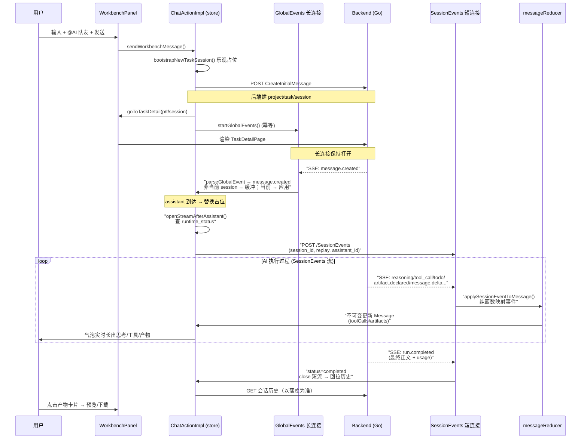
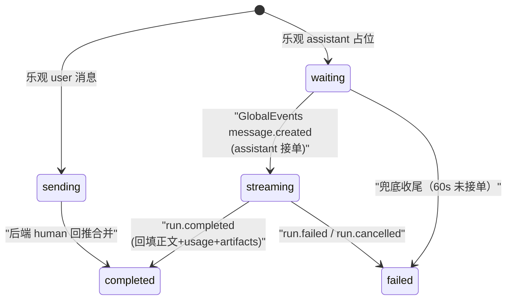

# 前端客户端深读

> 本解读覆盖 Lework（代码仓库内部命名 `leros`）的 `frontend/` 前端客户端：Web 应用（Next.js）+ Electron 桌面应用 + 共享落地包的整个 monorepo 前端架构。所有 `文件:行号` 引用均以 `frontend/` 为根。

## 前端在项目中的角色

Lework 把 AI 从"聊天窗口"变成"可长期协同工作的团队成员"（AI 劳动力管理系统：用户建 AI 团队、派任务、AI 独立执行、产物沉淀知识库）。前端是本系统唯一的"人机界面"，承载三个不可回避的核心诉求：

1. **实时看到 AI 动手干活**：任务发起后，AI 队友的思考、工具调用、子步骤、进度、产物都必须以近乎实时的流式方式呈现在界面上——这是"把 AI 当同事合作"而不是"当工具用"的心理模型根基。
2. **审阅产出物**：AI 执行完交付的是文件、表格、文档、图片等产物，前端要提供预览、版本、下载的能力。
3. **长期资产沉淀**：对话/任务/产物要留存为知识库，前端要负责"回放历史"——即使刷新页面、切换会话，也能把已落库的执行过程完整还原。

所以前端不是你熟悉的普通 CRUD 管理员界面，而是 **agent 执行事件实时可视化的"驾驶舱"**。这一点决定了它最有价值的设计不是组件多炫，而是"事件流 → 界面状态"这条管线的健壮性。

## 解决什么问题

### 管理 AI 劳动力的交互界面核心诉求

| 诉求 | 前端落点 | 对应机制 |
|------|----------|----------|
| 发起任务、@ 指定 AI 队友 | 工作台 `WorkbenchPanel` + AI 队友卡片 | `sendProjectMessage` 走 `CreateInitialMessage` |
| 实时看 AI 干活 | 消息时间线 + 气泡内过程步骤 | `GlobalEvents`(长连接) + `SessionEvents`(短连接) 双流 |
| 看 AI 思考 & 工具调用 | `ThinkingProcessIcon` / `ToolCallBlock` | `reasoning.delta` / `tool_call.*` 事件 |
| 进度可视化 | 任务 todo 面板 | `todo.snapshot` / `todo.updated` 事件 |
| 审批 / 提问 | 气泡内交互块 | `approval.*` / `question.*` 事件 |
| 审阅产物 | 气泡内产物卡片 + `FilePreviewDrawer` | `artifact.declared` 事件 + 文件预览生态 |
| 长期沉淀 | 历史回拉 + 项目文件树 | `loadConversationMessages` + `ProjectFileTree` |

### 一句根因

> 前端需要把**一条单向的、高吞吐的、不可预测结束时间的 agent 执行事件流**，稳定地折算成**可滚动、可操作、不丢失、可回放的消息时间线**，并让同一份 UI 同时活在浏览器和桌面里。

## 设计思路

### Monorepo 分层：通用性递减、业务性递增

目录 `packages/` 从底层基建到业务组装依次为：

```
packages/
├── tsconfig/   不可分发的共享 TS 配置 (base/next/react-library)
├── biome/      共享 lint/format 配置（biome.json 被根继承）
├── styles/     全局 CSS（Tailwind v4 注入 + App 外壳 token）
├── ui/         无业务语义的原子组件 + 网络/实时传输基元
├── store/      业务状态 + API 客户端 + 实时事件编排（纯逻辑，无视图）
├── app-ui/     有业务语义的页面/组件组合（同时被 web 与 desktop 复用）
```

依赖方向严格单向：`style <- ui <- store <- app-ui <- apps/*`。`@leros/ui` 只含 shadcn 风格的无头组件 + 网络基元，不含任何"Lework 是啥"的知识；`@leros/store` 承载全部后端 API 与实时编排但无视图；`@leros/app-ui` 把两者组装成完整页面，因此 **web 与 desktop 两个入口都只是 app-ui 的"壳 + 路由"**。

依赖链（从两个 app 的 `package.json` 可确认）：`apps/web/package.json:15-18` 同时依赖 `@leros/app-ui`、`@leros/store`、`@leros/styles`、`@leros/ui`；`apps/desktop/package.json:41-44` 依赖同样的四个包。这就是双端同构的物质基础。

### UI / 状态 / 样式三层分工

- **样式**：`@leros/styles` 用 Tailwind v4 的 `@source` 指令把上游包源码纳入扫描（`packages/styles/globals.css:704-707` 对 `../ui/**`、`../store/**`、`../app-ui/**` 做 `@source`），这样跨包写 Tailwind 类也能被一个全局构建正确 tree-shake，同时全局 CSS 用 CSS 变量 `--leros-*` token（`packages/styles/globals.css:11-63`）统一品牌色。
- **状态**：`@leros/store` 用 Zustand，以 **slice 模式**组织、单 store 组装。
- **组件**：`@leros/ui` 提供无头基元组件（基于 `@base-ui/react`），`@leros/app-ui` 二次组装成业务组件。

### 桌面 vs Web 同构：路由是唯一差异

关键洞察：**同一套页面组件，用两个不同的路由注入方式复用**。`@leros/app-ui` 不感知路由——它接受一个 `AppNavigation` 接口（`packages/app-ui/components/layout/Shell.tsx` 组件树的导航抽象，类型定义见 `packages/app-ui/components/layout/LeftRail.tsx:104-110`），由宿主端各自实现：

- **Web**：`apps/web/components/LerosShell.tsx:13-49` 用 Next.js 的 `usePathname`/`useRouter` 实现 `AppNavigation`，页面由 Next App Router 文件路由承载（`apps/web/app/(shell)/**`）。
- **Desktop**：`apps/desktop/src/renderer/src/routes.tsx:16-57` 用 `react-router-dom` 实现同一接口，`apps/desktop/src/renderer/src/App.tsx:40-53` 用 `HashRouter` 包裹并把 `AppRoutes` 交给 `Shell`。

两个端都渲染 `@leros/app-ui` 导出的同一批页面：`Shell`、`WorkbenchPanel`、`ProjectPage`、`TaskDetailPage`、`AssistantListView`、`SkillMarketView`、`ProjectsHubView`（见 `packages/app-ui/index.ts:1-8` 的统一出口；两端 `routes.tsx` / `route-pages.tsx` 都 import 自 `@leros/app-ui`）。

### 实时通信机制：长短结合的双层 SSE

实时部分没有用 WebSocket，而是 **两条基于 fetch 流式响应的 SSE 通道**，按"进程级 vs 会话级"分工（详细见下节）。传输原语封装在 `@leros/ui/lib`：

- `fetch-sse.ts` — 用 `fetch` + `ReadableStream` 手动解析 SSE 帧，好处是能做 **POST + 自定义 header**（Auth 头），这是原生 `EventSource` 做不到的。
- `sse.ts` — 基于原生 `EventSource` 的封装，带重连，但受限于只能 GET / 无法带 header，因而是次要方案。
- `websocket.ts` — 提供了可用的 WS 客户端（心跳、指数退避、离线消息队列），但**业务层实际并未使用**。

## 关键前端结构

### 目录到职责的映射

| 目录/文件 | 职责 |
|-----------|------|
| `apps/web/app/(shell)/**` | Web 文件路由页（workbench / ai-teammates / assistants / knowledge / projects / skills / tasks / settings 等） |
| `apps/desktop/src/main` | Electron 主进程（窗口、托盘、自动更新、生命周期） |
| `apps/desktop/src/preload` | contextBridge 暴露桌面 API |
| `apps/desktop/src/renderer/src` | React 渲染进程（HashRouter + 路由到 app-ui） |
| `packages/store/api/*` | 每个后端 REST 模块的 API 客户端（auth/task/session/project/file/plugin/orgAdmin…） |
| `packages/store/chat/*` | 实时编排核心（SessionStream / GlobalEvents / HistoryLoader / Composer / send 管道） |
| `packages/store/slices/*` | Zustand slice（auth / chat / layout / permission / da / topic / config） |
| `packages/app-ui/components/*` | 业务组件（chat 气泡 / layout 外壳 / input composer / digitalAssistant / skills…） |
| `packages/ui/{lib,components,ui}` | 网络基元 + shadcn 风格无头组件 |

### 核心状态 store：单 store + slice

`@leros/store` 用一个 Zustand store 组装多个 slice（`packages/store/appStore.ts:35-48`）：

```ts
const createStore: SliceCreator<AppStore> = (...params) => ({
	...authSlice(...params),
	...layoutSlice(...params),
	...topicSlice(...params),
	...chatSlice(...params),
	...daSlice(...params),
	...permissionSlice(...params),
	...globalConfigSlice(...params),
});

export const useAppStore = createWithEqualityFn<AppStore>()(
	subscribeWithSelector(devtools(createStore)),
	Object.is,
);
```

- 用 `createWithEqualityFn` + 自定义 equality 函数 `Object.is` 控制重渲染，规避 `subscribeWithSelector` 裁剪 selector 选择的默认浅比较。
- `layoutSlice` 内部持有 `currentView: ViewMode`（`packages/store/slices/layoutSlice.ts:196-206`，取 workbench / tasks / project / taskDetail / digitalAssistant / aiTeammates / knowledge / skills / settings）——这其实是一套**帧内的逻辑视图状态**，由 `switchView` 等 action 驱动；而 web/desktop 的物理路由则各自在宿主端与之协调。

### 核心组件/页面

- `WorkbenchPanel`（首页/工作台）：发起任务主入口。
- `TaskDetailPage`：任务会话详情的"驾驶舱"，内含时间线 + 右侧 todo/文件面板。
- `MessageTimeline` + `AIMessageBubble`：流式消息渲染。
- `StructuredComposer` / `ChatInput`：带 skill / @助手 token 的富输入。
- `Shell` + `LeftRail` + `RightRail`：应用外壳与导航。

## 核心交互流程：实时事件管线的状态流转

Mermaid 时序图展示"用户在 Web 发起任务 → 看到 AI 实时执行 → 审阅产物"的核心链路。这是前端最有价值的流程，也是 `chat/send/* + globalEvents + sessionStream + messageReducer` 协同的结果。



### 管线中的关键状态机（气泡内 Message）

`Message` 的 `status` 在 `packages/store/types/chat.ts:161-180` 声明为 `"sending" | "waiting" | "streaming" | "completed" | "failed"`，随事件流转：



## 与后端模块协同

前端消费的实时端点在 `sessionApi` / `sessionStream` / `globalEvents`（路径见前引）。跨模块的接口契约：

- REST API：经 `@leros/store/api/*` 的客户端走统一 `HttpClient`（拦截器注入 Bearer 与客户端版本头，`packages/store/api/client.ts:13-40`）。后端是 Go（Gin），前端每个 `xxxApi.ts` 对应一个后端路由模块。
- 实时通道：`POST /GlobalEvents`（进程级长连接）与 `POST /SessionEvents`（会话级短流），两者都是 POST+SSE、经 `FetchSSEClient`。后端端点在 `packages/store/chat/globalEvents.ts:90` 与 `packages/store/chat/sessionStream.ts:128` 硬编码拼接 `API_BASE_URL`。
- 事件协议：`message.delta / reasoning.delta / tool_call.* / todo.* / artifact.declared / approval.* / question.* / plan.published / run.completed / run.failed / run.cancelled`（`packages/store/chat/messageReducer.ts:957-1118` 的 switch 逐一处理）。这些事件名与 payload 结构必须与后端 worker/agent runtime 的产出严格对齐。

### 跨模块结论（【待主 agent 验证】）

- 前端的 `Message.runId` 语义被全局事件复用：`resolveReplyToFromRunId(runId, ...)` 用 `run_id`（形如 `req_<userMsgId>`）反推回复目标（`packages/store/chat/messageReducer.ts:162` 附近、`packages/store/chat/globalEvents.ts:319`）。这依赖后端把 user 消息 ID 编进 run_id 的约定，需与后端模块核对。
- `runtime_status`（`responding` / `completed` / `running`）字段被前端用来决定"GlobalEvents 到达后是直接开流还是拉历史"（`packages/store/chat/globalEvents.ts:361-374`），该字段由后端 session 接口返回，需与后端模块核对字段命名。
- 前端对 `CreateInitialMessage`（sendProjectMessage）、`AddMessage`（sendTaskRoomMessage）的响应协议有强假设（返回 `project_id/task_id/session_id`），需与后端核对。

## 关键设计决策

### 决策一：实时选 SSE 而非 WebSocket，且用"长短双流"

UI 层其实封装好了 `websocket.ts`（心跳、重连、离线队列基本齐全），但**业务层完全没用 WS，双流全是 POST-SSE**。为什么？

- **短流 `SessionEvents` 需要带 Auth header 和 POST body**（session_id / replay / assistant_id），而原生 `EventSource` 不支持。
- 团队因此专门写了 `fetch-sse.ts`：用 `fetch` 拿 `ReadableStream` 手动逐行解析 `event:`/`data:`/`id:`/`retry:` 帧。代价是**放弃了原生 `EventSource` 的自动重连与 Last-Event-ID**，把重连责任收到自己的 `sessionStream` 逻辑里（idle 兜底 + 终态回拉）。权衡很明确：宁可自己管重连，也要换来"带 body 的请求流式响应"这个能力。
- **长流 `GlobalEvents` 跨会话存活**，解决"用户发消息后立刻跳转页面、事件可能先在后台到达"的时序问题——用 `pendingEvents` 做短时缓冲（约 2 分钟、最多 50 条，`packages/store/chat/globalEvents.ts:176-182`），用户激活对应会话时 `drain()` 放出。这与聊天系统常见的"会话级"单流不同，是专门为"任务异步执行 + 随时跳转"设计的。
- 相比 WS，SSE 是单向服务端推送，天然适合"客户端不反推"的 agent 事件流；省掉心跳/帧协议复杂度（后端发起更简单）。前端这套选型认为**开一个长连接 + 按需开短流**优于一个持久 WS 管理所有消息路由。

### 决策二：乐观更新 + 事件驱动回填，而非"请求-响应"驱动 UI

前端不是"发消息→等后端响应→渲染"，而是**乐观先展 + 后端实时回推覆盖/补齐**：

- 发送瞬间先插入乐观 user 消息 + assistant "等待占位"（`packages/store/chat/send/sendProjectMessage.ts:86-100` 的 bootstrap），保证"用户提问永远排在 AI 回复之前"，即时反馈。
- `pendingBootstrapSessionId` 标记防止历史加载器冲掉乐观态（`packages/store/chat/state.ts:23` 注释）。
- GlobalEvents 里的 human `message.created` 回推用于把乐观 user 消息"替换/合并"为落库版本（`packages/store/chat/globalEvents.ts:227-279`），assistant 到达则替换 waiting 占位并启动短流。
- 这带来更复杂的合并逻辑（去重、按 sequence 定位、attachment/metadata 保留），但换来的是跨设备/多端实时一致——**另一端的队友发来的消息也能实时出现在你屏幕**。这是"协作系统"而非"聊天框"的必然形态。权衡：UI 状态机复杂度显著上升（这也是为什么有独立的 `messageMerge.ts` 纯函数库）。

### 决策三：Web 与 Desktop 共享全部业务 UI，路由用接口抽象而非硬编码

- 画面组件零重复：`@leros/app-ui` 承担全部业务视图，两端都不再抄一遍页面。
- 差异收敛到两点：**物理路由**（Next 文件路由 vs React Router）与**桌面专属能力**（托盘、自动更新、私部署门槛、原生窗口行为）。
- `AppNavigation`（`packages/app-ui/components/layout/LeftRail.tsx:104-110`）+ 宿主注入，使 app-ui 与路由解耦。Layer 边界清晰：web 的 `LerosShell` 只做"接 Next 路由 + 包 Shell"，desktop 的 `routes.tsx` 只做"react-router → app-ui 页面"。
- 代价：路由能力被压到 4 个方法（goToRoute/goToProject/goToProjectTasks/goToTaskDetail）的最低公共分母；两端各自可能在深层路由上受限。但换来最大复用，对这类"同质 UI 双端"非常划算。

### 决策四：状态用单 store + slice，动作编排集中下沉

- `chatSlice` 是 facade/编排层，注释明确"本文件只负责装配…业务实现已下沉到 `../chat/*`"（`packages/store/slices/chatSlice.ts:1-6`）。这是**控制反转**：slice 不内联协议，而是注入 `SessionStream` / `GlobalEventsManager` / `HistoryLoader` / `Composer` / `send` 这些类（`packages/store/slices/chatSlice.ts:92-97`）。
- 每个实时模块通过"依赖接口"（如 `SessionStreamDeps`、`GlobalEventsDeps`、`SendPipelineDeps`）访问 store，而不是直接依赖整个 ChatStore（见 `packages/store/chat/sessionStream.ts:22-38`、`packages/store/chat/send/deps.ts:14-49`）。这让它们可独立测试、职责单薄。
- `packages/store/chat/state.ts` 只放可序列化字段，SSE 连接等运行时资源由 `ChatActionImpl` 私有字段持有（`packages/store/chat/state.ts:3-5` 注释）——避免把连接对象塞进不可序列化的 store，是容易被忽略但对 Zustand + devtools 很重要的细节。
- Zustand 选型理由：无 Provider 包裹、selector 精确订阅、适合这种"自由状态 + 大量附带逻辑"的中型前端，比 Redux 模板代码少得多。

## 亮点

1. **双流实时 + 缓冲/drain 的时序治理**：`GlobalEvents` 缓冲非当前会话事件、`drain()` 在激活时放出，配合 `pendingBootstrapSessionId` 保护乐观态，把"异步执行 + 用户随时跳转 + 多端一致"三个难点的时序问题处理得相当系统化。
2. **纯函数 reduce 事件 → 状态**：`applySessionEventToMessage`（`packages/store/chat/messageReducer.ts:929-1119`）是纯函数，把几十种 SSE 事件映射到 Message 的不可变更新，不含任何 store/网络副作用——可单测、可回放。`applySessionEventsToMessage` 还能把历史 chunks 顺序重放，支撑"刷新后完整恢复执行过程"。
3. **幂等重连 + idle 兜底**：`SessionStream` 有 `idle` 超时（10s）+ 终态回拉（`packages/store/chat/sessionStream.ts:82-108`），即便后端漏发终态事件，前端也能兜底收尾，避免 UI 永远 stuck 在 generating。
4. **双端同构 + 逻辑/视图完全分层**：monorepo 分层让 store（纯逻辑）与 app-ui（视图）可独立演进；web 用 Next、desktop 用 RN web，但业务代码几乎不重复。
5. **网络拦截器纳管跨切面需求**：`HttpClient` 拦截器统一处理 JWT、客户端版本头、426 升级策略、401 刷新（`packages/store/api/client.ts:13-40`），业务代码无需关心。

## 问题

1. **POST-SSE 丢失原生重连**：`FetchSSEClient`（`fetch-sse.ts`）无内置重连，业务重连完全靠 `sessionStream`/`globalEvents` 自己写，缺 last-event-id 续传。若连接中断丢事件只能靠"终态回拉"弥补，极端场景可能漏中间过程。
2. **`websocket.ts` / `sse.ts` 成了死代码**：封装完备却未被业务使用，增加维护面。要么业务迁到 WS（可能更稳），要么删除这些未用传输类。TODO：potential dead code。
3. **`layoutSlice` 的逻辑视图与两端物理路由双轨**：`currentView` 是 app-ui 内部状态，web/desktop 又各自有物理路径。两套路由并存容易在深层跳转（如 `goToRoute("taskDetail")` 被两端都硬编码成 `/workbench`，见 `apps/web/components/LerosShell.tsx:25` 与 `apps/desktop/src/renderer/src/routes.tsx:77`）产生不一致——`taskDetail` 这类 view 其实没有对应顶层路由，实际是靠 goToTaskDetail 的三参方法走的，接口设计上略有隐晦。
4. **编辑框与发送链路耦合度较高**：`StructuredComposer`、`useComposerSkillOptions`、`buildComposerMetadata` 等把"@人 / skill token / 附件上传"都挂在 composer 状态上，配合多个 `.test.tsx`，维护难度偏高。
5. **依赖体积偏重**：`@leros/app-ui` 同时依赖 pdfjs-dist、xlsx、@silurus/ooxml、jszip（`packages/app-ui/package.json:20-28`），为文件预览功能拉了整套文档解析栈，Web 首包体积可能受压（有鉴于此仍有 `import.meta.url` 按需加载的尝试，见 `apps/desktop/src/renderer/src/App.tsx:34-37`）。

## 增量演进（v0.3.10–v0.5.2）

### 工作台新增「考勤工资核算」场景（v0.5.2）

既有首页是 `WorkbenchPanel`（任务工作台）。v0.5.2 侧边栏第二项新增专属**工作台视图**「工作台」，落地考勤+工资核算场景：

- 导航定义：`layoutSlice` 的 core 导航组第二项 `{ id: "workbench", label: "工作台", icon: "IconWorkbench" }` `[frontend/packages/store/slices/layoutSlice.ts:478]()`。
- 视图路由：`Shell` 里 `currentView === "workbench"` 渲染 `PayrollWorkbench`（而非聊天工作台）`[frontend/packages/app-ui/components/layout/Shell.tsx:78-79]()`。
- 核算页 `PayrollWorkbench`：提供考勤/历史工资/花名册三类角色附件上传（`:295-370`），并把 `"salary_accounting"` 场景标记连同文件传给 `sendWorkbenchMessage` 发起任务 `[frontend/packages/app-ui/components/layout/PayrollWorkbench.tsx:187-222,206]()`。

这是「把场景内置 Skill 封装成语义化工作台」的前端落地：用户不是手动选 Skill，而是进一个「考勤工资核算」页面、传文件、点发起——后端 `new_message_scene` 识别 `salary_accounting` 场景并强制注入对应内置 Skill（见 [skill-tool.md](skill-tool.md)）。

### HTML 源码预览 + 统一 Markdown 代码块（v0.4.1）

文件预览生态扩展出 `html` kind 的**预览/源码双视图**：`FilePreviewDrawer` 提供「预览 / 源码」切换，预览态用 `Blob([text], {type:"text/html"})` 生成 objectUrl 渲染 iframe，源码态复用统一 `CodeBlock` 组件 `[frontend/packages/app-ui/components/layout/FilePreviewDrawer.tsx:65,178-180,866-905]()`。同时 `MarkdownRenderer` 把所有 `pre` 统一换成 `CodeBlock`，Markdown 代码块样式全局一致 `[frontend/packages/app-ui/components/common/MarkdownRenderer.tsx:120]()`。

### 聊天代码块亮暗主题切换并记住偏好（v0.4.0）

代码块新增亮/暗主题切换开关，偏好经 localStorage + CustomEvent 持久化并跨组件同步（`leros-code-block-theme` key）`[frontend/packages/app-ui/components/common/CodeBlock.tsx:21,72]()`、`[frontend/packages/app-ui/components/common/codeBlockTheme.ts:3-22]()`。这是「实时看 AI 产物」体验的小幅增强：源码/日志代码块可随观感切换，且记住用户偏好不重启丢失。

### 助手回复展示 Token 消耗（v0.3.10）

助手回复气泡下方新增 `MessageTokenUsage` 指示器，读消息 `usage.totalTokens`（回退 `metadata.tokens`），展示「输入 / 输出」token 用量 `[frontend/packages/app-ui/components/chat/AIMessageBubble.tsx:85-120,305]()`；数值用 `formatTokenCount` 做 `1.0K/M` 友好缩写 `[frontend/packages/store/utils/format.ts:130-135]()`。这直接回扣 README「成本追踪 / 调用成本可见」卖点的**人机可见侧**。

### 产物文件时间按日历日展示（v0.5.2）

产物/任务文件时间改用 `formatArtifactTime`：按本地**日历日**差展示「今天 / 昨天 / 具体年月日」，避免跨天后仍显示「今天」的歧义 `[frontend/packages/store/utils/format.ts:89-103]()`，供消息气泡与任务侧栏共用 `[frontend/packages/store/utils/format.ts:32-36]()`。

### 私有化部署 UI 收敛到 app-ui（v0.3.11 佐证）

`apps/` 仅剩 `apps/web` 与 `apps/desktop` 两个入口壳，私有化部署相关 UI 全集中在 `packages/app-ui`（`Shell`/`WorkbenchPanel`/`org-admin` 等均为 app-ui 内共享组件）——印证既有文档「双端同构 + app-ui 承载全部业务视图」的设计，并对私有化形态做了收敛：私有化与 SaaS 复用同一套 app-ui 视图，仅入口不同。

## 覆盖率明细

| 主张/功能 | 验证文件 | 状态 |
|-----------|----------|------|
| monorepo 命令与依赖（turbo/pnpm-workspace） | `package.json:6-27`, `pnpm-workspace.yaml:1-28` | ✅ |
| 依赖单向分层 | `apps/web/package.json:14-26`, `apps/desktop/package.json:38-49` | ✅ |
| Zustand 单 store + slice 组装 | `packages/store/appStore.ts:35-48` | ✅ |
| chatSlice 为 facade 编排层 | `packages/store/slices/chatSlice.ts:1-6,92-97` | ✅ |
| 实时传输原语（fetch-sse / sse / websocket） | `packages/ui/lib/fetch-sse.ts`, `sse.ts`, `websocket.ts` | ✅ |
| GlobalEvents 长连接 + 缓冲/drain | `packages/store/chat/globalEvents.ts:81-182,188-209` | ✅ |
| SessionEvents 短流 + idle 兜底 + 终态回拉 | `packages/store/chat/sessionStream.ts:82-108,128-205` | ✅ |
| 事件→消息不可变 reduce（含 run 终态） | `packages/store/chat/messageReducer.ts:929-1134` | ✅ |
| 乐观更新 + bootstrap 保护 | `packages/store/chat/send/sendProjectMessage.ts:86-100`, `packages/store/chat/send/bootstrap.ts:23-64` | ✅ |
| 双端同构（AppNavigation + 两端路由注入） | `packages/app-ui/index.ts`, `apps/web/components/LerosShell.tsx`, `apps/desktop/src/renderer/src/routes.tsx` | ✅ |
| 桌面专属能力（托盘/更新/私部署/原生窗口） | `apps/desktop/src/main/index.ts`, `apps/desktop/src/renderer/src/App.tsx` | ✅ |
| 产物审阅入口 | `packages/app-ui/components/chat/AIMessageBubble.tsx:691-697`, `packages/app-ui/components/layout/file-preview-store.ts:119` | ✅ |
| 样式跨包 token + @source | `packages/styles/globals.css:11-63,704-707` | ✅ |
| 气泡实时滚动跟随 | `packages/app-ui/components/chat/MessageTimeline.tsx:45-80` | ✅ |
| 组织切换重连 GlobalEvents | `packages/app-ui/components/layout/Shell.tsx:52-63` | ✅ |
| 网络拦截器（JWT/426/401 刷新） | `packages/store/api/client.ts:13-40` | ✅ |

### 有待增强（深度受限于仅读前端源码）

- Web 端各 page/component 的交互细节（如 `StructuredComposer` 完整状态机、FilePreview 渲染实现）未展开，留给需要时按文件深挖。
- `applySessionEventToMessage` 内事件更细的 payload 结构（如 `todo.updated` 的字段）仅取了入口判断行，未逐字段考证——不影响主结论。
