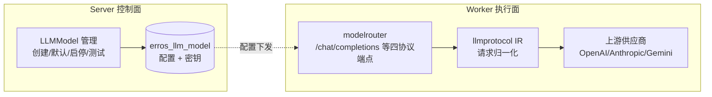
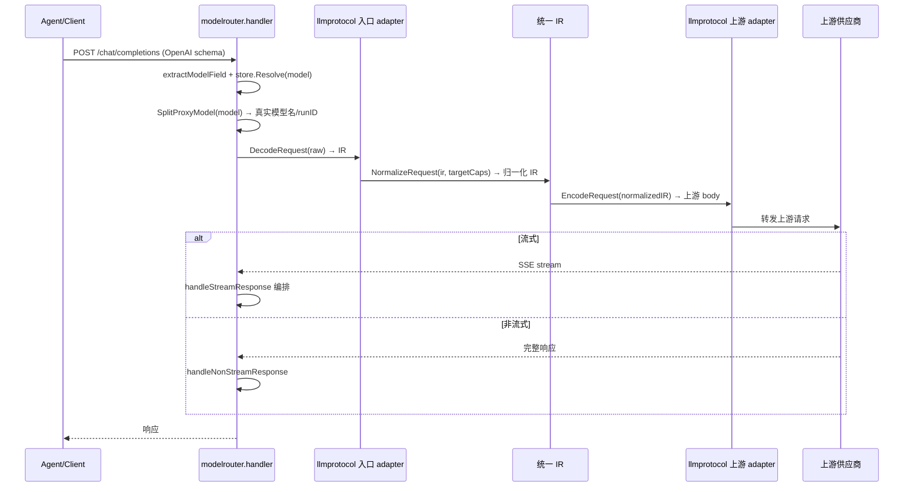

# ModelRouter：把「模型」从写死的供应商调用，变成可管理、可代理、可默认的执行资源

> 本关注面解读 Lework（后端 `Leros`）的模型调度与代理层：Worker 内的 `backend/internal/modelrouter`（LLM 统一代理）+ Server 侧的模型管理（`LLMModel` 配置、默认模型、连接测试）。数据模型部分（`LLMModel`/`LLMHistory` 表）见 [data-model.md](data-model.md)。所有 `文件:行号` 引用均可回源验证。

## 模型路由在项目中的角色

Lework 是多运行时多模型架构：native（Eino）+ Claude/Codex/OpenCode 外部 CLI，背后接 OpenAI/Anthropic/DeepSeek 等多家模型供应商。要让「AI 队友」真正可被企业治理，模型不能是写死在代码里的某个 URL + 密钥，必须满足三个诉求：

1. **模型是配置资源**：组织管理员能增删改查模型、设置默认模型、启用/禁用，而不用改代码。
2. **统一代理接入**：不同供应商的协议（OpenAI Chat/Responses、Anthropic Messages、Gemini）差异巨大，Worker 需要把它们收敛到一个统一内部表示（IR），做协议转换后再转发。
3. **可观测**：每次模型调用要能计费、追踪、调试（`LLMHistory` 落库）。

这个模块就是「模型作为可管理资源」的落地：**Server 侧管模型配置（管理面），Worker 侧管模型调用（执行面）**，中间靠 `LLMModel` 表和运行时配置传递。



## 根因：模型可用性 ≠ 模型不再锁死供应商

### 核心矛盾

Lework 想把「模型」从「三行写死的 API 调用」变成「可被组织治理、可被替换、可被观测的资源」。这带来三个根因问题：

1. **供应商协议撕裂**：OpenAI 的 Chat Completions 与 Responses 是两套 schema，Anthropic Messages 又是另一套结构，Gemini 是第四套。如果业务代码直接调某一家，一旦换供应商就是全栈重构。
2. **配置与执行脱节**：组织管理员在 Server 上配置哪个模型可用、哪个是默认，Worker 需要在每次 run 时按配置选中模型——配置必须能流转到执行端。
3. **成本与调试黑洞**：模型调用不落库，就无法按项目/任务统计调用成本（README 的「成本追踪」卖点），也无法在出问题时回放某次调用。

### 根因落点

一句话：**ModelRouter 用「统一 IR（Intermediate Representation）+ 协议适配器」把多供应商协议收敛成一套内部表示，再用 Server 侧 `LLMModel` 管理表把模型变成可配置、可默认、可启停的资源，用 `modelrouter` HTTP 代理把「配置→上游」的执行路径标准化。**

## 设计思路：统一 IR 的协议归一

模型路由的核心不是转发，而是**协议归一**。`backend/pkg/llmprotocol` 是这一内核的所在地（已从 `modelrouter` 拆分出去的公共包），负责四协议 ↔ 统一 IR 的双向转换：

| 方向 | 含义 | 承担者 |
|------|------|--------|
| OpenAI Chat Completions → IR | 统一入口解码 | 入口协议 adapter |
| Anthropic Messages → IR | 统一入口解码 | 入口协议 adapter |
| OpenAI Responses → IR | 统一入口解码 | 入口协议 adapter |
| IR → 上游编码 | 适配目标供应商 | 上游协议 adapter |

`modelrouter` 只负责 HTTP 代理层：注册端点、读请求体、调 IR 归一化、转发上游、编排 SSE 流、记调试日志——真正的协议转换在 `llmprotocol`。



## 核心实现

### Worker 侧 modelrouter：统一代理端点

`[backend/internal/modelrouter/handler.go:148-163]()` 的 `RegisterRoutes` 在 Worker 的 worker router 上注册四个协议端点：

```go
r.POST("/chat/completions", ...ProtocolOpenAIChat)
r.POST("/messages", ...ProtocolAnthropicMessages)
r.POST("/responses", ...ProtocolOpenAIResponses)
r.POST("/models/*modelAction", ...ProtocolGemini)
```

每个端点的处理管线 `handleModelRoute` 都是一样的五步：读体 → 存解析 → 入口解码 → IR 归一化 → 上游编码，然后按是否流式走不同响应路径 `[backend/internal/modelrouter/handler.go:163-272]()`。

- **模型解析**：`extractModelField(body)` 从 body 取模型字段，`store.Resolve(model)` 查上游配置 `[backend/internal/modelrouter/handler.go:183-192]()`。
- **代理拆分**：`SplitProxyModel(model)` 把 `model` 串拆成「真实模型名 + runID」——模型名里可能编入 run/请求级上下文，转发前要还原真实上游模型名 `[backend/internal/modelrouter/handler.go:121-127]()`。
- **SSE 编排**：`handleStreamResponse` / `handleNonStreamResponse` 在 `[backend/internal/modelrouter/response.go:22]()` 与 `:85`，统一管理流式与非流式两种回程。

### Server 侧模型管理：把模型变成可配置资源

管理面在 Server。契约接口 `[backend/internal/api/contract/llm_model.go:14-32]()` 声明了全套操作：

```go
GetDefaultLLMModel(ctx)          // 取默认
SetDefaultLLMModel(ctx, id)      // 设默认
SetLLMModelStatus(ctx, id, status) // 启用/禁用
TestLLMModel(ctx, req)           // 连接测试
```

API 入口 `[backend/internal/api/handler/llm_model_handler.go:24-39]()` 注册 `/CreateLLMModel` `/SetDefaultLLMModel` `/SetLLMModelStatus` `/ListLLMModels` `/TestLLMModel` 等 REST 端点。

服务适配层 `[backend/internal/llm/contract_adapter.go]()` 承担三条核心业务规则：

1. **组织创建者权限**：`requireOrgCreator` 用 `IsOrgCreator` 判定——只有组织创建者能管理该组织的模型，防止普通成员篡改模型配置 `[backend/internal/llm/contract_adapter.go:238-249]()`。
2. **状态约束**：`manager_db.go:443-456` 明写「启用中的模型不可编辑，请先禁用」「只能将启用中的模型设为默认」——非活跃模型不能被设默认，保障执行端稳定的默认值 `[backend/internal/llm/manager_db.go:443-456]()`。
3. **连接测试**：`TestLLMModel` 调 `manager.TestConnectivity` 返回 `Success/Endpoint/LatencyMS`，让管理员在持久化前验证模型端点可用 `[backend/internal/llm/contract_adapter.go:199-207]()`。

### 默认模型的流转

「默认模型」是连接管理面与执行面的关键：`SetDefaultLLMModel` 在 `LLMModel.is_default` 上置位（data-model 里 `idx_llm_model_org_default` 部分唯一索引保证每组织只有一个默认模型），执行时 Worker 从模型配置解析出默认模型注入 run。这回答了「组织管理员设了默认，AI 队友就用哪个模型」的闭环。

## 与其他模块协同

- **data-model（`data-model.md`）**：`LLMModel` 表承载模型配置（含 `api_key_encrypted` 密文 + `api_key_masked` 脱敏），`LLMHistory` 表承接每次调用记录，是「成本追踪」卖点的数据底座——`is_default` 部分唯一索引正是默认模型约束的落库体现。
- **agent 执行层**：`ModelConfig`（`backend/agent/runtime.go`）携带 APIKey/BaseURL/采样参数等，`modelrouter` 的 `UpstreamConfig` 由 runtime lifecycle 写入，二者衔接「管理面配置 → 执行面模型」。
- **worker 系统**：`modelrouter` 挂载到 worker 的 router（`backend/internal/worker/router/router.go:31`），与 MCP Server（`/v1/mcp`）并列，让一个 worker 子进程同时当好「模型执行者」与「能力提供者」。
- **Automation**：定时自动化投递的 run 同样走 worker 模型链路，默认模型一致生效。

## 关键设计决策

### 决策一：统一 IR 协议归一，而非按供应商写死适配

**权衡**：最直接的方案是「每个供应商一个 handler 各自转发」，但那样换供应商要改业务层。Lework 选择用 `llmprotocol` 的 IR 做中间表示：入口 adapter 把各家协议 `DecodeRequest` 成 IR，`NormalizeRequest(ir, targetCaps)` 按目标供应商能力归一，上游 adapter 再 `EncodeRequest` 成目标 schema。**收益**：新增供应商只需加一对 adapter，协议差异被隔离在 IR 两侧；**代价**：多一层间接，IR 需覆盖所有供应商能力的并集，某些供应商特有字段（如 Anthropic 的 tool-use 语义）需要 IR 能表达。

### 决策二：模型配置 Server 管、调用 Worker 跑，用集中表衔接

**权衡**：模型配置是组织级共享的（默认模型、启停状态让全组织一致），所以放中心 PostgreSQL；模型调用是 worker 本地高吞吐的，所以走 worker 内代理。二者靠 `LLMModel` 表 + runtime 配置下发衔接。**收益**：管理面（Server）与执行面（Worker）解耦，worker 可伸缩、配置集中治理；**代价**：配置变更需要同步到各 worker（有一定最终一致性延迟）。

### 决策三：默认模型 + 状态约束的治理闭环

**权衡**：允许任意模型随时启用会带来「执行端默认值漂移」。所以 Server 侧强约束「仅活跃模型可设为默认、启用中不可编辑」，配合唯一索引让默认模型全局唯一。**收益**：默认值稳定可预期，AI 队友每次 run 拿到确定的模型；**代价**：模型变更需要「停用→改→启用」的显式步骤，运维略繁琐，但换来治理确定性。

## 亮点与问题

### 亮点

- **协议归一 + SSE 双信道**：统一 IR 让多供应商接入成本降到「加一对 adapter」，流式/非流式统一编排。
- **默认模型与启停的强约束**：把「默认模型全局唯一」「非活跃不可设默认」落成数据库约束 + 业务校验双保险。
- **密钥托管与脱敏**：`api_key_encrypted` 密文存库、`api_key_masked` 脱敏展示，模型凭据不进明文日志。
- **连接测试先行**：`TestLLMModel` 让管理员验收端点，避免配了个不可用的默认模型。

### 问题 / 风险

- **模型配置下发的一致性窗口**：Server 改模型配置后，已启动的 worker 需经运行时配置更新才能感知，存在短暂不一致。
- **协议 IR 覆盖面**：若目标供应商推出 IR 未表达的新能力（工具调用变体等），需要同步扩展 IR 与 adapter，接口层面有维护成本。
- **`CallerHTTP` 超时外置**：v0.4.0 起不再内置 client 超时，改为依赖外部注入的 `*http.Client` 或请求 ctx 控制——调用方需自行保证超时，否则长请求可能悬挂 `[backend/internal/llm/caller_http.go:39-41]()`。

## 覆盖率明细

| 文件 | 覆盖范围 |
|------|---------|
| `internal/modelrouter/handler.go` | Worker 代理端点、模型解析、SSE 编排全量 |
| `internal/modelrouter/response.go` | 流式/非流式响应全量 |
| `api/handler/llm_model_handler.go` | Server 模型管理 REST 入口 |
| `api/contract/llm_model.go` | 契约接口（默认/启停/测试） |
| `internal/llm/contract_adapter.go` | 组织创建者权限、连接测试、默认模型 |
| `internal/llm/manager_db.go` | 必填/停用/默认模型强约束 |
| `backend/agent/runtime.go` | `ModelConfig`/`RuntimeKindOpenCode` 类型佐证 |
| `backend/internal/worker/router/router.go` | modelrouter 挂载点 |
| `backend/internal/llm/caller_http.go` | 超时外置 |
