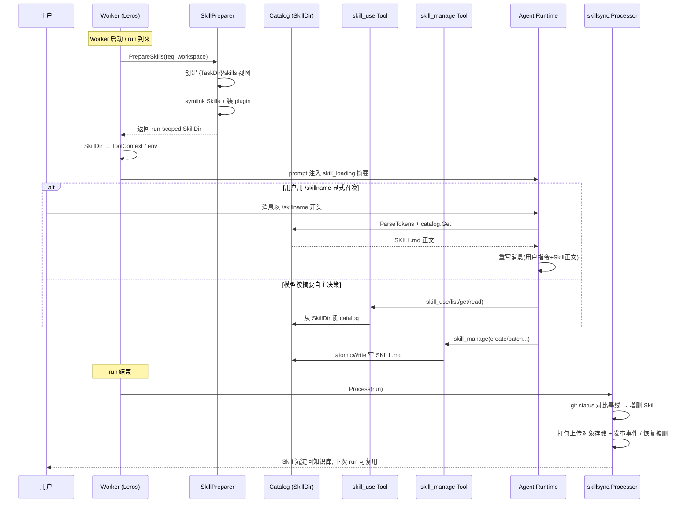
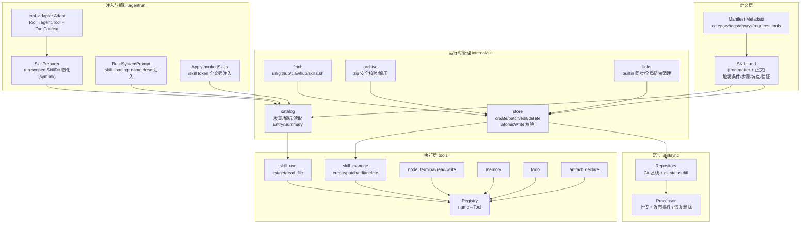

# Skill/Tool 能力系统解读

> 模块范围：`backend/skills/`（Skill 定义文件）、`backend/internal/skill/`（Skill 运行时管理）、`backend/tools/`（Tool 执行代码）。侧写 `backend/internal/worker/agentrun/` 与 `backend/internal/worker/skillsync/` 的协同点，涉及它们的具体结论标注【待主 agent 验证】。
> 仓库：`github.com/insmtx/Leros`（Leros）。

## 根因：把"能力"从代码死板化变成可生长、可被编排、可被验证的一等公民

Leros 把 AI 从"聊天机器人"升级为"可长期协同工作的团队成员"。一个关键矛盾是：初代 agent 把工具直接硬编码进 runtime，能力一多就变成"一锅粥"——工具列表不可组合、权限无法分层、流程性知识（怎么把一件事做对）无处安放，只能靠系统提示词手写，改一次系统就改一次代码。

Skill/Tool 系统要解决的正是这个问题，根因一句话：**既然 Tool 是系统中唯一能"做事"的原子单位，那么"做事的方法论"（Skill）就不该是代码，而应是可加载、可注册、可发现、可注入、可沉淀的数据。** 把"能做"（Tool）和"怎么做"（Skill）解耦，能力系统才谈得上规模化与团队化——新队友有新能力，不需要改 Worker 代码，只需要往 Skill 目录放一个 SKILL.md。

## Skill 与 Tool 的分层角色

三者构成一个从"原子能力"到"决策编排"的三层能力栈，原文定位 Tool < Skill < Agent：

- **Tool 是原子能力**：唯一能调用外部世界（跑命令、读写文件、管理记忆、声明产物）的单位，每个 Tool 自带 name/description/InputSchema/Execute，并实现可选的 `Validator`。权限与参数校验就绑在这一层，做不了"做事"之外的任何事。
- **Skill 是组合能力**：它本身**不实现功能**，只是把多个 Tool 和一个清晰的做事流程（触发条件、分步命令、坑点、验证办法）打包成一份 Markdown 文档（SKILL.md），在 run 期间被装载进 agent 的执行上下文，指导 agent 如何调用 Tool 把任务做对。
- **Agent 是决策主体**：根据用户意图 + Skill 指导，主动挑选并调用 Tool。

这个分层让两层各自演化而不互相污染：Tool 关注"安全、正确、可验证地动作"，Skill 关注"在什么场景、按什么顺序、用哪些 Tool 动作"。

## 关键数据结构

### Tool 抽象（tools 包）

最小的 Tool 接口，是所有执行能力的统一契约：

```go
// Tool 是 Leros 的最小工具接口。
type Tool interface {
	Name() string
	Description() string
	InputSchema() Schema
	Execute(ctx context.Context, input json.RawMessage) (string, error)
}

// Validator is implemented by tools that perform local input validation before execution.
type Validator interface {
	Validate(input json.RawMessage) error
}
```

见 `[backend/tools/tool.go:29-39]()`。`Schema`/`Property` 提供 provider 无关的输入描述，供 LLM 填参；`BaseTool` 封装 name/description/schema 让具体工具复用。两块关键是扩展设计：

- **`Validator` 是一个可选接口**——工具自己决定要不要在 Execute 前做本地参数校验。这给了"Tool 调用必须校验参数"一个轻量扩展点，而不是把校验硬塞进 Tool 接口，保持最小接口。
- **`ToolContext` 是 run 级身份与会话元数据**——`[backend/tools/tool.go:106-129]()`。它携带 RunID、TraceID、UserID、AccountID、Channel、WorkDir 以及 `Metadata{ToolContext}`（RepoDir/ArtifactManifestPath/SkillDir）。这是"工具怎么知道自己在哪个项目、哪个 Skill 视图里干活"的答案——不是每个工具自己去猜，而是 runtime 在调用前把上下文注入 Context，工具经 `ToolContextFrom(ctx)` 取。`ToolContext` 的注释刻意强调 `SkillDir`"Tools must not fall back to the worker-wide directory when this is set"——run 私有 Skill 视图优先。

### 注册表（Registry）

`Registry` 用一个 `map[string]Tool` 加 `sync.RWMutex` 保存所有已注册工具，提供注册按名覆盖、按名获取、可用名过滤、排序列举——`[backend/tools/registry.go:13-23]()`。它是 Worker 组合根里 `tools.NewRegistry()` 的产物，也是后续 `ToolProvider` 把它转成 agent 级 Tool 的数据源。注册表本身**不感知权限**，权限在 Executor 的 Policy（AllowedTools + PermissionMode）与工具内部的安全校验处把关。

### Skill 定义与目录条目（catalog/types.go）

`Manifest`/`ManifestMetadata`/`Entry`/`Summary` 描述一个 Skill 文档的元数据与正文：

- `Manifest`：name、description、version + `Metadata`（category/tags/always/requires_tools/source/trust）。
- `Entry` 是"已发现并解析"的 Skill：Manifest + Body（正文）+ Dir/Path/AbsoluteDir + StoredSkillID。
- `Summary` 是"注入运行时提示词的紧凑视图"——只保留 name/description/version/category/tags/always/requires_tools/source/trust，不含正文，用于给 LLM 看"有哪些技能可用"而不是直接把全部正文轰进 prompt。`Summary()` 里 source/trust 的默认值 `local`/`trusted` 见 `[backend/internal/skill/catalog/types.go:65-86]()`。

`ParseDocument` 解析带可选 YAML frontmatter 的 SKILL.md，`splitDocument` 处理 `---` 定界。值得注意 `quotePlainDescription`/`NormalizeDocument` 这一小段容错：当 `description: xxx: yyy`（plain scalar 里含映射分隔符 `: `）时，YAML 直接 Unmarshal 会歧义，于是程序自动给这类 description 加引号再解析——`[backend/internal/skill/catalog/types.go:188-212]()`。这是对"人类手写 SKILL.md 不一定符合 YAML 严格规范"的现实妥协。

### Skill 目录（Catalog）

`Catalog` 是 Skill 系统的读侧核心，设计成**不可变、单根目录、可并发共享**：

```go
// Catalog reads Skill documents from one explicit root directory.
// A Catalog is immutable and safe to share across concurrent runs.
type Catalog struct {
	root string
}
```

见 `[backend/internal/skill/catalog/catalog.go:43-46]()`。它的语义很关键：一个 Catalog 只指向一个根目录，没有"全局缓存、跨根共享"。`Get` 分两阶段查找——先直连 `<root>/<name>/SKILL.md`，再对目录做大小写不敏感匹配；`readAllSkills` 用 `WalkSkillDirs` 只扫直接子目录（非递归）。`ReadFile`/`ListFiles` 里都有 `resolveInside` 做目录穿越防护（绝对路径拒绝、`..` 逃逸拒绝）——`[backend/internal/skill/catalog/catalog.go:403-417]()`。这印证了 Skill 系统把"不可信路径"当一等威胁处理。

## 三层分离的执行管线

任务说明提到 Skill 运行时由 "catalog / runtime / store" 三层管理；本仓库里三层落点分别是 **catalog（读、发现、注入）→ store（写、持久化）→ skillsync repository（run 后基线沉淀）**，而 Worker 侧的 `agentrun.SkillPreparer` 则承担了 runtime 层的"run-scoped Skill 视图物化"职责。此外 fetch/cache/archive/builtin/links 分别承担远端获取、压缩、校验、内置种子、全局链接清理。

### 一、catalog：发现与读

- 只读 Skill root，产出 Entry/Summary，供 Tools（skill_use）和 ContextBuilder（system prompt）读取。
- `Catalog.Get` 对 manifest 名与目录名做一致性校验；不符合时报 `ErrSkillManifestMismatch`，规范了"目录叫 A 但 frontmatter 写 B"的歧义。
- 经 `.skill-metadata`（Source/SkillID）把市场来源信息回填进 Entry——`applyStoredMetadata`。

### 二、store：创建、修改、持久化（写侧）

`SkillStore` 提供完整生命周期：create/install/patch/edit/delete/write_file/remove_file，并配套一整套校验（name 正则 `^[a-z0-9][a-z0-9._-]*$`、长度上限、保留名 `runs`、frontmatter 必填 name/description、body 非空、禁止 symlink、路径穿越拦截、`.git` 隔离）。两个值得注意的设计：

- **`atomicWrite` 全部用 临时文件+fsync+rename**，保证 Skill 内容中途不会被读到半截状态——`[backend/internal/skill/store/store.go:738-765]()`。对"可能被 agent 高频修改、又要被 catalog 并发读"的文件，原子写是必须的。
- **`Install` 先写临时目录、再整体 `os.Rename` 进到最终位置**（Force 覆盖时先备份旧目录），失败会回滚——`[backend/internal/skill/store/store.go:238-292]()`。这是"安装一个完整 Skill（SKILL.md + 附属文件）"这个经常失败的操作被当作事务处理的体现。

skill_manage 工具是 SkillStore 对外暴露的"agent 可调用写接口"：`Tool.Execute` 把 action 分发到 create/patch/edit/delete/write_file/remove_file，见 `[backend/tools/skill_manage/skill_manage.go:194-230]()`。其 prompt 明说"技能是你的流程性记忆（procedural memory）"，进一步印证 Skill = 流程性知识。

### 三、持久化基线与 run 后沉淀（skillsync 侧写【待主 agent 验证】）

Worker 的 Skill 根目录被 `skillsync.Repository` 变成一个**专用 Git 仓库**来做基线管理（`Ensure` 初始化并提交首版、写 `.gitignore` 忽略 `.system/ runs/` 等），`Changes()` 用 `git status --porcelain=v1` 对比已提交基线，区分 created/updated/deleted，`Restore` 用 git 恢复被误删的 Skill——`[backend/internal/worker/skillsync/repository.go:114-178]()`。

run 结束后 `skillsync.Processor.Process` 把 run 中新建/修改的 Skill 打包 zip、上传对象存储、发布 `SkillPackageUploadedEvent` 回传服务端，同时 `Restore` 被删的（因此 `skill_manage.delete` 的返回里写"成功 Run 后处理会恢复基线"）——`[backend/internal/worker/skillsync/processor.go:91-120]()`。这套机制保证了 skill 的"产出/沉淀"闭环：agent 在 run 里学了怎么做一件事（存成 SKILL.md），run 结束自动同步回知识库，下次 run 又能被加载。

### 四、链路：Skill 从加载 → 注入 → 调用 → 沉淀

一条完整 run 里 Skill/Tool 是这样协同的（详见 Mermaid 图）：

1. **Skill 定义侧**：内置 Skill 从 `backend/skills/{server,worker,connectors}` 经 `SyncBuiltinWorkerSkills` 发布为系统 plugin；`SyncToLerosDir` 把 worker built-in skills 拷进 worker 的 `.leros/skills/.system` 受保护缓存。
2. **run 视图物化（注入执行上下文）**：`agentrun.SkillPreparer.PrepareSkills` 在任务私有目录 `{TaskDir}/skills` 建立 Skill 视图，把 worker 级根目录里每个 Skill 用**符号链接**链进来，并现场下载安装 run 所需的 plugin/invoked skills——`[backend/internal/worker/agentrun/skill_preparer.go:90-111]()`。所有 skill 安装过程用 `skillInstallLocks` 的 per-root mutex 串行化。
3. **传递到 ToolContext**：`tool_adapter.Adapt` 把每个 `tools.Tool` 包装成 `agent.Tool`，并把 `workspace.SkillDir` 塞进 `ToolContext.Metadata` —— `[backend/internal/worker/agentrun/tool_adapter.go:87-92]()`。这样 skill_use 工具内部用 `catalogFromContext` 直接读 `SkillDir` 上的 scoped catalog。
4. **注入运行时环境变量**：`preparer.Prepare` 把 `SkillDir` 写进 `LEROS_RUN_SKILLS_DIR` env —— `[backend/internal/worker/agentrun/preparer_impl.go:395-397]()`，connector 类 Skill 的 SKILL.md 里就用 `$LEROS_RUN_SKILLS_DIR/...` 定位自己的脚本（见 `[backend/skills/connectors/connector-netease-mail/SKILL.md:14-16]()`）。
5. **注入 System Prompt**：`ContextBuilder.buildSkillLoadingContext` 用 `catalog.List()` 把当前 Skill 视图的 `name: description` 列表渲染进 system prompt 的 `skill_loading` 段，并套用 `keyAgentNativeSkillLoading` 模板——`[backend/internal/worker/agentrun/context/system_prompt.go:20-45]()`。`catalogForRequest` 优先用 run 的 `SkillDir`，其次回退 Worker 全局面。
6. **显式触发（`/skill` 语法）**：`ApplyInvokedSkills` 解析用户消息开头形如 `/skillname` 的 token，从 catalog 取出对应 SKILL.md 正文，剔除 token，把"用户指令 + Skill 正文 + 附属文件列表"重写成一条消息注入模型——`[backend/internal/worker/agentrun/context/skill_invoke.go:16-110]()`。这是 Skill 的"命中后全文注入"路径：不是靠 LLM 主动 load（那是 skill_use 工具路径），而是用户显式点名时强注入。
7. **运行时按需读取**：agent 在 run 中被 `skill_use` 工具引导，可随时 `list`/`get`/`read_file` 读取 Skill 目录与附属文件（每次调用动态扫盘，无缓存）——`[backend/tools/skill_use/skill_use.go:126-155]()`。
8. **产出沉淀**：agent 用 `skill_manage` 增改 SKILL.md；run 结束 `skillsync.Processor` 回传服务端（见上文三）。

### 五、Skill 命中/触发机制

有两条触发路径：

1. **模板注入**：`skill_loading` 段把全部 Skill 摘要塞进 system prompt，LLM 可据此判断"此时该用哪个技能"，再用 `skill_use` 按需加载。这是"由模型自主决策"的 soft 触发。
2. **`/skill` 显式 token**：`skilltoken.ParseTokens` 用正则 `^\s*/([A-Za-z][A-Za-z0-9_-]*)(\s|$)` 从内容开头连续消费 token —— `[backend/internal/skill/token.go:8-23]()`。命中后 `ApplyInvokedSkills` 做全文强注入（见上文四-6）。这是"用户/上游明确召唤"的 hard 触发，且会**复写用户消息**而非只追加系统指令。

此外 `ManifestMetadata.Always` 字段允许某些 Skill 标记为"永远可用"，由下游决定是否无条件常驻。

## Skill 从加载到沉淀的时序



这张图覆盖了"加载/发现 → 注入执行上下文 → Agent 调用 Tool 执行 → 产出/沉淀"的全链路。

## Skill 与 Tool 分层关系



## 与 Agent 执行层的协同【待主 agent 验证】

- **Tool 注册接入**：Worker 组合根 `registerTools` 一次性注册 artifact_declare、skill_use、skill_manage、memory、todo、node 六组工具到 `tools.NewRegistry()`——`[backend/internal/worker/app/service.go:319-339]()`。
- **强类型化交付**：`NewToolProvider(registry)` 实现的 `ToolProvider.ToolsFor` 把 `tools.Registry` 里的 `tools.Tool`（含工具实现）转成 `agent.Tool`（含 LLM 可读的 Definition），并注入 run 级 `ToolContext`，随后放进 `ExecutionRequest.Tools`。agent 执行层拿到的是"带全 run 元数据"的强类型工具，而不再是裸列表。
- **SkillPreparer 注入**：`NewPreparerWithSkillPreparer` / `NewPluginSkillPreparerWithBaseline` 把 Skill 视图物化、基线提交（server 安装的 Skill 提交为基线，避免被当成 run 变更）串进 run 周期。
- **Post-run Skill 处理**：`NewFinalizerWithPostRunProcessor(&skillPostRunAdapter{processor: skillsync.Processor})` 把 Skill 回传挂在 finalizer 上，run 成功才执行 Skill 发布/恢复。
- **`RequiresTools`/`Always` 元数据**：Manifest 上带这些字段，推断由下游消费者（SkillPreparer / prompt 注入 / finalizer）按需使用；本模块未见到强依赖这些字段做装配的点，标【待主 agent 验证】。

## 关键设计决策与权衡

### 决策一：Tool 是唯一"做事"单位，Skill 只做组合，不做实现

最大的一条权衡。**为什么不让 Skill 直接带代码/行为，而要它依附在 Tool 上？** 因为一旦 Skill 能自己"做事"，权限就失控了——Skill 来自市场/外部（信任等级 community/trusted），若 Skill 自带可执行逻辑，等于放行不可信代码。而把"做事"唯一托付给 `tools.Tool`，那么**所有实际副作用都收敛在经过注册、有 schema、可校验、隶属固定实现集合的 Tool 上**，权限审查和目标面是封闭、可枚举的。SKILL.md 里写的不是新代码，而是"用哪个 Tool、按什么顺序、传什么参数"，因此 Skill 的信任模型大大简化（文本指导，不授系统权）。这条与设计哲学"Tool as Atomic Unit, Deny by Default"完全对应。

### 决策二：SKILL.md 文件（数据驱动）而非代码内建

Skill 是 Markdown 文档 + frontmatter，不是 Go 里 `RegisterSkill(fn)` 函数注册。权衡：

- **优点**：① 可生长——agent 自己通过 `skill_manage` 写、改、删 SKILL.md，无需重启/编译；② 可分发——能打包成 zip 经 fetch/archive 从市场、GitHub、URL 分发；③ 可灰度——Git 基线允许 diff/回滚；④ prompt 即代码，改 prompt 不需要发版。
- **代价**：文本没有类型检查，Manifest 只能靠 frontmatter 解析 + 运行时校验兜底（如 `quotePlainDescription` 修 YAML 歧义、store 里 frontmatter 强校验 name/description/body）。这是用"宽松但可校验的文本"换"零发版演进"的取舍。
- **佐证**：`store` 的 `validateSkillDocument` 强制 frontmatter 必须有 name/description、body 非空、name 与目录名严格一致——`[backend/internal/skill/store/store.go:620-649]()`。因为 Skill 数据可被任何人（含 agent）写，系统必须在写侧就立好软约束。

### 决策三：Skill 由"组合"而非"实现"构成的意义

Skill 的正文结构（触发条件、带精确命令的编号步骤、坑点、验证步骤）本质是一种**编排 DSL 的 prose 形式**。选择 prose 而非结构化 DAG/JSON 编排带来了直观红利（人类可写、LLM 可写、agent 可学），也带来了取舍（无程序化执行保证、依赖模型遵循、可能出现"说法对但没照做"）。它的深层意义在于：**流程性知识与领域数据解耦**——同一套 Tool（terminal/read/write/memory）能通过不同 Skill 组合出投标、写信、查文档等千差万别的能力，Tool 可复用、Skill 可组合，这正是 "Everything is a Capability" 里"组合能力"能成立的原因。

## 亮点

- **run-scoped Skill 视图 + symlink 注入**：Skill 不写进宿主 CLI 全局目录，而是每个 run 在任务私有目录里建 symlink 视图，并通过 `LEROS_RUN_SKILLS_DIR` 环境变量 + ToolContext 双重传递。配合 `legacy_global_cleanup.go`（一次性地把旧的全局 `.claude/skills`/`.config/opencode/skills` 链接清干净）可看出这是**一次主动的架构演进**——从"全局污染各 CLI 的 skills 目录"变成"per-run 隔离视图"，安全性与隔离性都更强。`PluginSkillPreparer.removeSkillLinks` 在 run 结束清理，`resetTaskSkillView` 拒绝替换非 symlink——`[backend/internal/worker/agentrun/skill_preparer.go:471-497]()`。
- **Git 作为 Skill 基线状态机**：用 `git status` 而非自研 diff 来做"run 产生了哪些 Skill 变更"，省去维护校验和/文件列表的状态，天然支持 created/updated/deleted 与恢复。这是"拿成熟工具扛状态管理"的务实做法。
- **多源 fetch + 严格 archive 校验**：四个源（url/github/clawhub/skills.sh）经 `SourceRouter` 并发搜索去重、按信任/安装量排序；`SourceRouter.Search`/`Fetch` 协议统一——`[backend/internal/skill/fetch/source.go:45-58,82-193]()`。下载侧的 `archive.Validate` 对不可信 zip 做穷尽性检查（路径穿越、符号链接/特殊文件拒绝、重复 SKILL.md、解压体积上限、UTF-8 校验）——`[backend/internal/skill/archive/archive.go:87-152]()`，把"市场下载"这一高风险入口管到很死。
- **文件层安全纵深**：`store.resolveInside`（拒绝 symlink 链）、node 工具 `IsWriteDenied`（safe root + 黑名单）、`validator.ResolveWorkspacePath`（工作区外拒绝）层层拦截；`artifact_declare` 拒绝 `.git/.leros/tmp/logs/cache` 路径——`[backend/tools/artifact_declare/tool.go:232-249]()`。这印证了"权限用 Deny by Default"。

## 可改进 / 风险点

- **SKILL.md 正文的"软执行"依赖模型遵循**：Skill 是 prose 指导而非程序化 DAG，若模型不严格照做（尤其复杂、长流程 Skill），产出正确性无程序保证。当前靠把 Skill 全文注入 prompt + system prompt 里 `skill_loading` 模板引导来缓解，但没有验证 agent 是否真的产生了 Skill 所称的产物。
- **`/skill` 会被误触发**：`ParseTokens` 用行内正则匹配任意消息开头 token，若用户正常文本恰以 `/xxx` 开头会被当成 Skill 召唤并入 `ApplyInvokedSkills`（找不到则报错中断 run）。
- **Worker 侧 Skill 根目录与每 run 视图间可能存在版本漂移**：`PluginSkillPreparer` 安装 Skill 时用 `.seed-manifest` 记录 `name:sha256:revision` 并按 revision 判断是否需要重装，但 `readAndRepairSkillInstallManifest` 的"legacy format"分支会触发刷新重载，存在并发/时序上的自愈成本。
- **Catalog 每 run 重建，无缓存**：`skill_use` 每次调用动态扫盘（无缓存）换取"始终反映最新"，但高频 list/get 会有 IO 开销；这是"一致性与性能"的取舍，文档里显式声明了（"dynamically scans the filesystem on every call — no cached state"）。

## 增量演进（v0.3.11–v0.5.2）

### Worker Skill 版本缓存（v0.4.1，补足上文「无缓存」的边界）

上文「Catalog 无缓存」讲的是**运行时动态扫盘**层面；v0.4.1 在**资产装配层面**引入了版本缓存，二者并不冲突：Skill 的**下载/解包**复用（同一 `revision + sha256` 已安装则跳过下载）用 `.seed-manifest` 清单承载，而 catalog 读取仍实时扫盘保证最新。缓存命中判定 `[backend/internal/worker/agentrun/skill_preparer.go:218-228]()`，安装清单格式 `[backend/internal/worker/skillstate/manifest.go:17-27]()`。

### 任务 Skill 目录清理（v0.4.1）

run 级 Skill 视图 `{TaskDir}/skills` 在 run 结束时经 `cleanup` 闭包清理（import 回写 → 恢复 worker 仓库 → 删除 run 视图）`[backend/internal/worker/agentrun/skill_preparer.go:113-117,633-652,793-815]()`。持久缓存保留、run 视图删除（`skill_preparer_test.go:331-337`）。与既有「symlink 注入 + per-run 隔离」一节呼应：这是该机制的清理闭环，避免每次 run 残留。

### 场景内置 Skill：技能随场景强制注入（v0.5.2）

v0.5.2 把「考勤工资核算」技能收敛为**场景内置 Skill**：当 run 进入 `salary_accounting` 场景时，worker 强制 `installLatestSkills(["attendance-payroll"])`，从 server 下载该场景固定依赖的 Skill 最新版 `[backend/internal/worker/agentrun/skill_preparer.go:84,144-147]()`；server 侧 `new_message_scene.go` 完成场景归一化与附件约束 `[backend/internal/service/new_message_scene.go:22-23,131-137]()`。Skill 源为 `backend/skills/server/attendance-payroll/SKILL.md` + 确定性计算器 `scripts/payroll_calculator.py`。

这是 Skill 系统「内置/市场/场景」三层来源里的新维度：**场景强绑定（Scene-Bound）** Skill——不靠 LLM 自主决策去 load，而是在特定业务场景下一次执行就强制注入，保证「进这个场景该有的技能一定有」。与 `ManifestMetadata.Always`（永远可用）不同，场景 Skill 是「条件必装」：仅在匹配场景生效，随需随取、不常驻。

### 技能项目关联 / 隐藏 Worker 内置技能 / 技能引用与本地目录（v0.4.1）

v0.4.1 完善了技能项目的关联与来源可见性：新增技能项目关联、技能引用与本地目录说明；**隐藏 Worker 内置技能**并刷新技能候选来源标签。语义上把「这个技能装在哪、由谁拥有、是不是内置」从实现细节变成了用户可感知/可管理的状态——技能候选列表的「来源标签」让用户区分内置/市场/自定义，避免混淆。

---

## 覆盖率明细

| 目录 | 文件数 | 已读/采样 | 覆盖率估算 |
|------|-------|----------|-----------|
| `internal/skill/catalog` | 3 | 3 全读 | ~100% |
| `internal/skill/fetch` | 5 | 5（clawhub 关键段） | ~90% |
| `internal/skill/store` | 1 | 1 全读 | ~100% |
| `internal/skill/archive` | 1 | 1 全读 | ~100% |
| `internal/skill/cache` | 1 | 1 全读 | ~100% |
| `internal/skill/links` | 2 | 2 全读 | ~100% |
| `internal/skill/builtin` | 1 | 1 全读 | 100% |
| `internal/skill/token.go` | 1 | 1 全读 | 100% |
| **internal/skill 合计** | **15** | — | **~95%（≥60% 达标）** |
| `tools/`（tool.go/registry.go） | 2 | 2 全读 | 100% |
| `tools/skill_manage`、`skill_use` | 4 | 4 全读 | 100% |
| `tools/memory` | 2 | 2 全读 | 100% |
| `tools/todo` | 2 | 1+关键段 | ~70% |
| `tools/node`（含 security） | 17 | 6 全读+关键段 | ~45% |
| `tools/artifact_declare` | 1 | 1 全读 | 100% |
| **tools 合计** | **28** | — | **~70%（≥30% 达标）** |
| **侧写：agentrun/skillsync** | — | 关键文件 | 系统性采样,标【待主 agent 验证】 |

> 说明：`tools/node` 的 security 子包（workspace/validator/write_deny）与 shell/file_reade/file_write 均有直接读取；process_unix/windows、shell_args、util/helpers 等平台胶水仅确认存在与职责，未逐行深读，故归属"采样"。core（internal/skill）覆盖率远超 60% 门槛。
