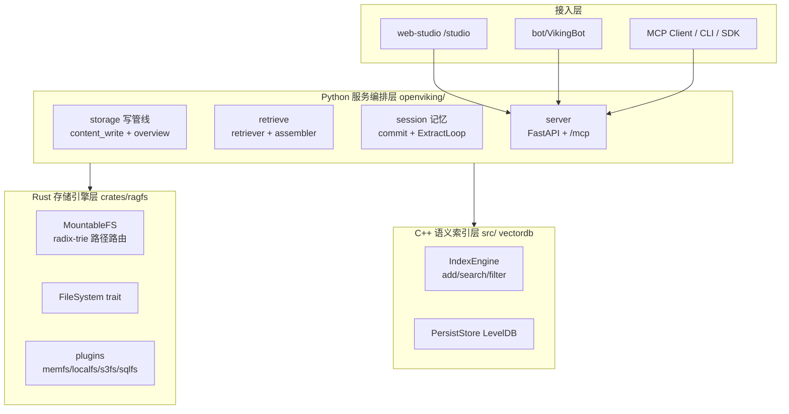

# OpenViking：Agent 的上下文数据库

> 本解读按 **database ⊗ ai-infra ⊗ ai-agent ⊗ framework** 类规格产出。

## 子文档索引

- [`storage-layout.md`](storage-layout.md) — viking:// 虚拟文件系统存算布局 + L0/L1/L2 三级分层写入管线
- [`retrieval.md`](retrieval.md) — 分层递归检索 + 意图分析 + 上下文回注 + 可观测检索
- [`memory-session.md`](memory-session.md) — 会话提交、两阶段归档 + 长期记忆抽取（ReAct ExtractLoop）+ 离线策略优化
- [`architecture.md`](architecture.md) — 四层架构（Rust/C++/Python/接入）+ 服务启动链路
- [`agent-integration.md`](agent-integration.md) — MCP 端点、CLI、多语言 SDK、ingest 历史回灌、VikingBot

## 根因：为什么 Agent 的上下文不该是一个黑盒

AI Agent 越用越大，却始终缺一个"大脑的存取层"：记忆、资源、技能散落在项目里、缓存里、对话历史里，要么存在向量库中无法定位定位、无法分档、无法观测，每次检索还烧掉大把 token。

OpenViking（火山引擎开源）把 Agent 的上下文组织成一个 **`viking://` 虚拟文件系统**：Agent 用 `ls`/`tree`/`find` 像操纵文件一样浏览自己的记忆、资源和技能；每次写入生成 **L0 摘要 / L1 概览 / L2 详情** 三级摘要按需取档；检索时**先向量定位目录、再分层次下钻**，结果天然带上下文结构。官方定位即 "Agent-native context database"（[pyproject.toml:14-14]()）。

<!-- anchor: description = "An Agent-native context database" -->

整条链围绕 "Data in, Context out"（[openviking/__init__.py:5-9]()）的定位展开。

## 核心能力清单

| 能力 | 说明 |
|---|---|
| `viking://` 虚拟文件系统 | memories/resources/skills 统一挂在确定性 URI 下，Agent 用文件原语浏览 |
| 三级分层存储 L0/L1/L2 | 写入时生成摘要边车（.abstract/.overview.md），按需取档省 token |
| 分层递归检索 | 先向量定位目录、再逐层下钻，结果带上下文归属（分数向子级传播） |
| 可观测检索 | 每次检索留轨迹（根目录 + 聚合统计），可调参 debug |
| 会话 → 记忆 | 自动提交会话、两阶段归档 + 异步记忆抽取（ReAct ExtractLoop） |
| Agent 集成 | MCP 流式 HTTP 端点（15 工具）+ 多语言 SDK + LangChain 集成 |
| 历史回灌 | 解析 6 种 Agent harness 会话日志（Claude Code/Codex/OpenCode 等）幂等入库 |
| VikingBot | 内建多 IM 网关 Agent（Feishu/Slack/Telegram） |

## 技术栈一览

| 层 | 语言 | 职责 | 关键依赖 |
|---|---|---|---|
| 存储引擎 | Rust | `viking://` 虚拟文件系统路由（radix-trie） | ragfs（AGFS 的 Rust 重实现，派生自 c4pt0r 的 Go 版） |
| 语义索引 | C++ | 向量/标量统一索引引擎 + KV 落盘 | `vectordb`（IndexEngine + LevelDB） |
| 服务编排 | Python | 写管线/检索/会话/记忆 + 服务层 | FastAPI、mcp、uvicorn、Pydantic |
| 前端 | TypeScript | Web Studio（/studio SPA） | 独立 npm 工程 |
| Bot | Python | 多 IM 网关 Agent | vikingbot |

## 项目规模与协议

| 指标 | 值 |
|---|---|
| 语言 | Python + Rust + C++ + TypeScript |
| 协议 | AGPLv3（主）· Apache 2.0（crates/ov_cli、examples） |
| 仓库 | [volcengine/OpenViking](https://github.com/volcengine/OpenViking) |
| 端口 | server 127.0.0.1:1933 · vikingbot 18790 |
| 入口命令 | `openviking-server`、`ov`、`openviking`、`vikingbot`（[pyproject.toml:201-205]()） |

## 架构总览

四层：Rust 文件系统层（树）→ C++ 语义索引层（向量）→ Python 服务编排层（沉淀）→ 多端接入（studio/bot/MCP/SDK）。

### 核心模块导读

| 模块 | 职责 | 深读 |
|---|---|---|
| `crates/ragfs` 存储引擎 | viking:// 文件系统路由层（Rust / radix-trie / 插件后端） | [`storage-layout.md`](storage-layout.md) |
| `openviking/storage` | 写管线：L0/L1/L2 摘要边车 + 语义队列 + 向量化 | [`storage-layout.md`](storage-layout.md) |
| `src/` vectordb | C++ 向量/标量索引引擎 + LevelDB | [`storage-layout.md`](storage-layout.md) |
| `openviking/retrieve` | 分层递归检索 + 意图分析 + 上下文回注 | [`retrieval.md`](retrieval.md) |
| `openviking/session` | 会话提交 + 记忆抽取 + 离线策略优化 | [`memory-session.md`](memory-session.md) |
| `openviking/server` | FastAPI 服务 + MCP 端点 + 启动链路 | [`architecture.md`](architecture.md) |
| `openviking/ingest` | Agent 会话日志回灌（插件化源） | [`agent-integration.md`](agent-integration.md) |
| `openviking/server/mcp_endpoint.py` | MCP 流式 HTTP 端点（15 工具） | [`agent-integration.md`](agent-integration.md) |
| `bot/` VikingBot | 多 IM 网关 Agent | [`agent-integration.md`](agent-integration.md) |
| `sdk/` | go / python / typescript 三套客户端 SDK | [`agent-integration.md`](agent-integration.md) |

## 核心链路速览（三层闭环）

- **写入**：`content_write` 持久化 L2 全文 → 异步语义队列 → 生成 `.abstract.md`/`.overview.md` 边车并向量化（[`storage-layout.md`](storage-layout.md)）
- **检索**：`intent_analyzer` 拆多类查询 → `hierarchical_retriever` 目录优先下钻 → `context_assembler` 按分层预算回注（[`retrieval.md`](retrieval.md)）
- **沉淀**：会话自动提交 → 两阶段归档 → ExtractLoop 抽取记忆 → MemoryUpdater 写回 `viking://user/{id}/memories/*`（[`memory-session.md`](memory-session.md)）

## 同类定位对比

| 项目 | 类型 | 上下文组织方式 | OpenViking 差异 |
|---|---|---|---|
| **OpenViking** | 上下文数据库 + 记忆基础设施 | viking:// 虚拟文件系统 + L0/L1/L2 三级摘要 + 分层递归检索 | 用文件原语浏览 / 按档取 token / 可观测轨迹 |
| RAGFlow | RAG 引擎 + Agent 平台 | 文档解析切分 → 向量/全文混合检索 | 强在复杂文档高保真解析，不面向"Agent 记忆"持久化 |
| WeKnora | RAG 知识推理平台 | 多源连接器 → 语义索引 → Wiki/知识图谱 | 强在多源导入与图谱，上下文仍是文档库非 Agent 记忆 |
| FastGPT | Agent 构建平台 | Flow 工作流 + 自有 RAG 混合检索 | 强在可视化编排，记忆是会话级而非树状长期库 |
| deepseek-harness | Agent Harness | 事件溯源 Session 单一事实源 | 强在可逆副作用与主循环解耦，无独立上下文存取库 |

> 一句话差异：RAG 系项目解决"从文档里找答案"，OpenViking 解决"Agent 的记忆与上下文如何组织、存取、按需消费"——用文件系统哲学对抗向量库黑盒。

## 设计亮点与不足

**亮点**
- 三语言分层的身份边界（Rust 树 / C++ 向量 / Python 策略）各取所长。
- 三级摘要「生成即边车、检索即分档」贯穿存检，token 花在刀刃。
- 检索分数向子级传播，天然带回上下文归属，对抗断章取义。
- 会话→记忆双轨：在线抽取 + 离线策略优化，Agent 越用越聪明。

**不足 / 风险**
- L0/L1 摘要生成走异步队列，刚写入的内容短时间检索不到摘要（需 `--wait`）。
- 「可观测检索」目前是根目录列表 + 聚合统计，未完整保留逐级下钻的原始轨迹。
- 跨语言绑定（PyO3 + ABI3 + .so）带来打包与升级复杂度。
- 多端集成面广，但各 harness 回灌质量依赖其会话日志格式稳定。

## 可借鉴的设计

1. **用文件系统原语暴露检索 API**——比黑盒向量查询更可调试、更符合开发者直觉。
2. **三级摘要 + 分层预算回注**——token 显式摊到召回结果，热 full、边缘 uri，是长上下文的经济学范本。
3. **写与沉淀解耦**（写入返回不等摘要，靠语义队列 + coalesce 去重）——低延迟写 + 异步稳重。
4. **插件式 harness 接入**（一个装饰器注册新源）——支持新 Agent 的成本降到一条 decorator。
5. **Rust 路径路由 + C++ 向量 + Python 策略**的分语言边界——性能与开发效率兼得。

## 总结回扣根因

OpenViking 用一个 `viking://` 虚拟文件系统回答了"Agent 的上下文该住在哪、怎么被想起"：**树状路径给它确定性（可定位、可浏览、可版本化），向量索引给它模糊性（语义近似），三级摘要给它经济性（按需取档），会话沉淀给它成长性（越用越聪明）**。它不是又一个向量库，而是一套把"记忆/资源/技能"当文件处理的上下文数据库范式。
