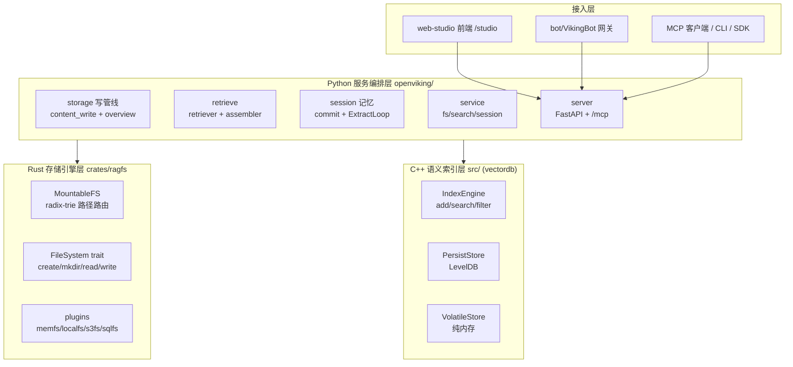
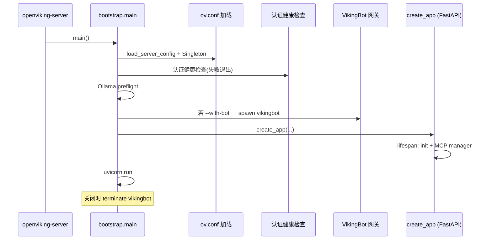

# 架构：三层引擎 + 服务编排 + 多端接入

> 本解读按 **database ⊗ ai-infra ⊗ ai-agent ⊗ framework** 类规格产出。本文是 OpenViking 的「架构总览」纵深：把四层子系统（Rust 文件系统 / C++ 向量索引 / Python 服务编排 / 前端+bot+MCP 接入）连成一条链，并拆解 server 启动链路。其余关注面（存储布局、检索、记忆、集成）在配套子文档各有独立深读。

## 架构定位

OpenViking 自我定位是 **"Agent-native context database"**（`openviking/__init__.py:5` 的 docstring："Data in, Context out"）。它是一个**面向 AI Agent 的上下文数据库产品**，而非一个单体 Agent 应用——它既存、又检、还反哺 Agent，靠统一的 `viking://` 命名空间把存算检索串起来。

## 四层架构总览

### 模块职责映射（目录树）

| 目录 | 职责 | 关键实现 |
|---|---|---|
| `crates/ragfs/` | Rust 虚拟文件系统（viking:// 背后路由层） | `MountableFS` radix-trie + `FileSystem` trait（[crates/ragfs/src/core/mountable.rs:67-72]()） |
| `crates/ov_cli/` | Rust CLI 客户端 | 独立二进制 |
| `src/` | C++ `vectordb` 向量/标量索引引擎 | `IndexEngine` + LevelDB（[src/index/index_engine.h:15-28]()） |
| `openviking/storage/` | 存储编排：VikingFS 门面 + 内容写管线 + 语义队列 | `content_write.py`、`abstract_overview.py`、`queuefs/` |
| `openviking/retrieve/` | 检索链：意图分析 + 分层递归检索 + 上下文组装 | `hierarchical_retriever.py`、`context_assembler/` |
| `openviking/session/` | 会话 + 记忆：提交策略、记忆抽取、离线策略优化 | `session.py`、`memory/`、`train/` |
| `openviking/service/` | 服务编排层（FS/Search/Session 能力） | `fs_service.py`、`search_service.py`、`session_service.py` |
| `openviking/server/` | FastAPI HTTP 服务 + MCP 端点 + OAuth | `app.py`、`bootstrap.py`、`mcp_endpoint.py` |
| `web-studio/` | Studio SPA 前端（/studio 静态资源） | 独立 npm 工程 |
| `bot/` | VikingBot 多 IM 网关 Agent | `bot/vikingbot/` |
| `integrations/` | 外部集成（langchain 等） | — |
| `sdk/` | go / python / typescript 客户端 SDK | — |

## 引擎身份三层

- **Rust ragfs = 文件系统层（树）**：上一份文档已讲，`MountableFS` 用 radix-trie（[crates/ragfs/src/core/mountable.rs:67-72]()）把路径前缀路由到插件，是"上下文放在哪、属于谁"的定位层。

- **C++ vectordb = 语义索引层（向量）**：`IndexEngine` 暴露 add/search/filter 统一语义操作（[src/index/index_engine.h:15-28]()），LevelDB 落盘。

- **Python = 编排与沉淀层**：`storage/content_write`（写）+ `retrieve/hierarchical_retriever`（检）+ `session/memory`（沉淀记忆），三层闭环。

> 这套架构的聪明处在**明确的分语言边界**：树形路径（Rust，需内存高效、类型安全）与向量索引（C++，需极致性能）用系统级语言，而与 Agent 交互的策略逻辑（意图分析、分层预算、记忆抽取）用 Python（FastAPI，开发效率高、生态全）。牺牲的是跨语言绑定的复杂度（PyO3 + ABI3 + .so），换来各层的性能与开发体验最优。

## 服务启动链路

server 是 FastAPI 应用，默认 127.0.0.1:1933（[openviking/server/config.py:323-324]()） ，可选 `--with-bot` 拉起 VikingBot 网关（端口 18790）。启动由 `bootstrap.main` 编排：

具体落点：

- **配置加载**：`resolve_config_path` + `load_server_config` + `OpenVikingConfigSingleton`（[openviking/server/bootstrap.py:210-217]()），随后配置日志。

- **认证健康检查**：启动即跑 `run_startup_health_check_or_exit`，失败退出——把"连不上提供商"在进程起来前就暴露（[openviking/server/bootstrap.py:225-228]()）。

- **Ollama preflight**：若配置本地 Ollama，先检测是否在跑、必要时拉起（[openviking/server/bootstrap.py:234-241]()）。

- **`--with-bot`**：需要时 `_start_vikingbot_gateway` 拉起 VikingBot 子进程（[openviking/server/bootstrap.py:281-283]()），退出时终止。

- **应用装配**：`create_app` 挂 24 个 router（system/admin/resources/filesystem/content/search/skills/sessions/webdav/bot 等，[openviking/server/app.py:609-613]()），`lifespan` 内先 `initialize()` + 启动 MCP session manager（[openviking/server/app.py:351-354]()）再接受流量。

- **运行**：`uvicorn.run`（单进程，[openviking/server/bootstrap.py:315-318]()）；多 worker 用 `create_worker_app` 导入串 + 环境变量传递 `--with-bot`。

### 前端与接入端

- **`/studio`**：[openviking/server/app.py:759-797]() 把 web-studio 构建产物挂为 `/studio` 静态站点，裸 origin 302 跳转到 UI；bundle 缺失则跳过挂载并告警。
- **`/mcp`**：`mcp_endpoint.py` 提供流式 HTTP MCP 端点（15 个工具），session 生命周期绑在 FastAPI lifespan（非子应用 lifespan），保证请求到达前 task group 已就绪。
- **VikingBot**：`bot/` 是随服务可选启动的多 IM 网关 Agent（Feishu/Slack/Telegram），通过 `viking://~` 家庭别名读写调用者自己的上下文空间。

## 架构的自我一致性

把四份文档连起来看，OpenViking 的设计哲学一以贯之：

- **一切皆可定位**：从 ragfs 的路径路由，到 MCP 的 URI 工具，再到 Agent 的记忆文件，都落在 `viking://` 确定性命名空间——"用文件系统的确定性对抗向量库的黑盒"。
- **分层即预算**：L0/L1/L2 三级摘要贯穿存储（写时生成）与检索（读时分档）与回注（预算摊牌），token 花在刀刃。
- **沉淀闭环**：会话（`memory-session.md`）→ 记忆 → 检索（`retrieval.md`）→ 回注 → 再沉淀，形成 Agent 越用越聪明的飞轮。

下一份文档看接入端与生态：MCP 端点、CLI、多语言 SDK 与 Agent 集成，见 `agent-integration.md`。
