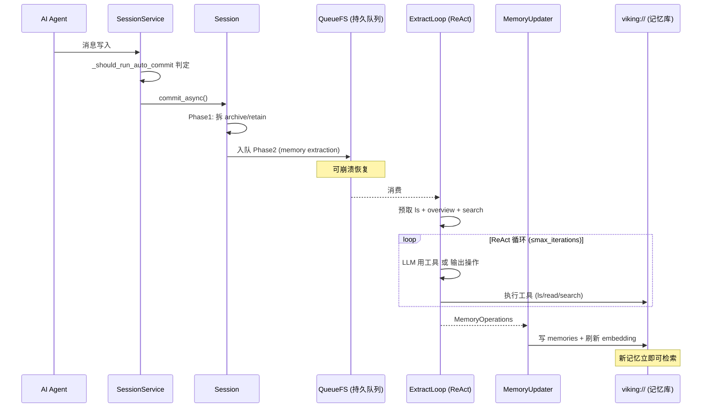

# 会话：提交、归档与长期记忆抽取

> 本解读按 **database ⊗ ai-infra ⊗ ai-agent ⊗ framework** 类规格产出。本文是 OpenViking 的「记忆/会话」关注面：一段 agent 会话如何被自动提交、归档，并被异步抽取成可复用的长期记忆。核心问题是：**Agent 的"经历"如何从一次性的交互日志，沉淀成跨会话可检索的记忆与"经验"。**

## 会话是记忆的原料

OpenViking 的记忆体系不是另起炉灶，而是把**会话（session）当作记忆抽取的输入源**：会话里的人类提问、Agent 行动、工具调用结果，都可能是值得长期记住的偏好、习惯或"做过某事的经验"。因此存储会话本身就是记忆工程的一环。

## 自动提交：什么时候触发沉淀

会话不会一直累积，而是按策略**自动提交**。默认策略在 `auto_commit_policy.py` 定义——token 达 150k、消息达 100 条、或空闲 1 天即触发：

[openviking/session/auto_commit_policy.py:19-28]() 定义默认阈值（pending_token=150000、message_count=100、idle_timeout=1 天）与 PRD 上限钳制（token 100 万、消息 1k、空闲 7 天），防止极端配置。

<!-- anchor: DEFAULT_PENDING_TOKEN_THRESHOLD = 150000 … MAX_IDLE_TIMEOUT_SECONDS = 604800  # 7 days -->

策略类 `AutoCommitPolicy`（pending_token_threshold / message_count_threshold / idle_timeout_seconds / keep_recent_count / min_commit_interval_seconds）可序列化进会话 meta，`from_dict` 时钳制到 PRD 区间。判定在 `session_service._should_run_auto_commit` 按策略阈值判是否要提交。

> **为什么用"阈值 + 空闲"多维触发？** 单一 token 阈值不适合空闲的小会话（永不达阈值）、单一空闲不适合高吞吐会话。用"任何一维超限即触发"覆盖了"长时间凉掉的老会话"和"短时刷爆的对话"两种形态，是 Agent 长时运行的务实折中——代价是策略配置项偏多、易被人为调乱（故有 PRD 上下限保证）。

## 提交的两阶段：先归档，后抽取

`Session.commit_async` 是核心，采用**两阶段**把"立即归档"与"异步抽取"解耦：

[openviking/session/session.py:1794-1814]() 头注释点明设计：Phase 1 **Archive prep**（拆 archive/retain、持久化可恢复 intent、写 raw、入队）、跨进程用分布式文件锁；Phase 2 **Memory extraction** 走持久化 QueueFS 队列，两阶段之间可重启恢复。

<!-- anchor:     async def commit_async( …         Phase 2 (Memory extraction): Runs through the persistent QueueFS queue. -->

- **Phase 1（在线，快）**：把消息拆成"归档部分 + 保留近段"，以可恢复的 intent 形式持久化，避免提交中途崩溃丢队。`keep_recent_count` 控制保留多少最近消息（默认 10，by 插件 afterTurn）。
- **Phase 2（后台，慢）**：通过持久化队列消费，做记忆抽取——一旦入队，进程重启也能续。`_PHASE2_QUEUE_WAIT_TIMEOUT_SECONDS=1800` 兜底等待。

消息本体在 `_append_messages_authoritatively` 追加进 `messages.jsonl`（`openviking/session/session.py:1239-1240`），会话 meta 以 `.meta.json` 持久化（含 pending_tokens / 自动提交策略 / 记忆策略）。

## 记忆抽取：一个精简的 ReAct 循环

Phase 2 的核心是 `memory/extract_loop.py` 的 `ExtractLoop`——它把自己设计成一个**简化版 ReAct**：先 ls + 读 `.overview.md` + 搜索预取上下文，然后让模型在"用工具"和"输出最终记忆写操作"之间抉择：

[openviking/session/memory/extract_loop.py:82-91]() docstring 明确工作流：**0** 预取（ls + 读 overview + search）→ **1** 带工具调 LLM（模型决定用工具 or 输出最终操作）→ **2** 用工具则执行并继续循环 → **3** 输出操作则结束。

<!-- anchor: class ExtractLoop: …     3. If operations output: Return and finish -->

- 有 `max_iterations`（默认 3~5）限制循环轮数、`max_tokens` 预算。
- 带"工具禁用"机制：识别到未知工具错误后，下一步禁用工具只让模型直接输出操作——防死循环。
- 产出的是**结构化的记忆写操作**（upsert/delete/links），不是人话摘要，交给 `MemoryUpdater` 执行。

### MemoryUpdater：把操作落进 viking:// 记忆库

`memory_updater.py` 是**系统执行器**——把 LLM 产出的 `MemoryOperations` 应用到存储：

[openviking/session/memory/memory_updater.py:3-7]() 头注释：memory updater 应用 MemoryOperations，是"把 LLM 最终输出落到存储系统"的系统执行器。

<!-- anchor: Memory updater - applies MemoryOperations directly. … to the storage system. -->

它把记忆写进 `viking://user/{id}/memories/*`，并按 `MemoryTypeRegistry` 维护记忆类型、`MergeOpFactory` 做合并操作，同时刷新 schema overview + embedding——使新记忆立即可检索。这正对应 README 的"会话提交后异步抽取用户偏好与 Agent 经验进长期记忆"。

### 记忆写入→立即可检索的闭环

## 记忆的"出向"：离线策略优化（train/）

除了在线抽取"静态记忆"，OpenViking 还提供 `session/train/` 的**离线策略优化训练框架**——用已有经验记忆做 case rollout → 分析 → 梯度估计 → 策略更新：

[openviking/session/train/pipeline.py:43-50]() `OfflinePolicyOptimizationPipeline` 头注释：是可组合的 case 驱动策略优化 pipeline，只"接线"各协议接口、不自己实现 rollout/LLM 分析/梯度估计/文件更新；`train` 从 case rollout 更新策略集，`eval` 只评估。

<!-- anchor: class OfflinePolicyOptimizationPipeline: … ``train`` updates the policy set from case rollouts. ``eval`` only executes -->

接口层（`CaseLoader / RolloutExecutor / RolloutAnalyzer / GradientEstimator / PolicyOptimizer / PolicyUpdater / PolicySnapshotter`）把这些关注点抽象开，`BatchPolicyTrainer` 批量训练。这套形态对应 README 宣称的"经验记忆提升任务成功率"（tau2-bench +6.87pp/+11.87pp）的底层支撑：把历史经验反哺进策略。

> **值得注意的分层定位**：`train/` 不是"在线记忆抽取"的替代，而是**离线、批量的策略优化**。在线 `ExtractLoop` 把会话变成可用记忆；离线 `train/` 把记忆再变成可优化的策略梯度。两套系统一个喂给"检索记忆"，一个喂给"调优 Agent 行为"——各管一段，职责清晰。

## 会话状态的持久化与恢复

- **会话本体**：`.meta.json`（SessionMeta：pending_tokens、auto_commit_policy、memory_policy）+ `messages.jsonl`（消息）。
- **崩溃恢复**：Phase1 的"可恢复 intent"配合 QueueFS 持久队列，Phase2 消费可续；`_PHASE2_QUEUE_WAIT_TIMEOUT` 兜底。
- **恢复入口**：session_service 的 `commit_async`/`extract` 手动触发，加上 `run_auto_commit`——既支持策略自动，也支持手动补抽。

## 决策与权衡小结

| 设计决策 | Why | 权衡 |
|---|---|---|
| 多维自动提交（token/消息/空闲） | 覆盖"凉掉的会话"与"刷爆的会话"两种形态 | 配置项多，靠 PRD 上下限防乱调 |
| 两阶段提交（在线归档 + 后台抽取） | 提交不阻塞、抽取可后台异步 | 需可恢复 intent + 持久队列保证不丢 |
| ExtractLoop = 精简 ReAct | 让模型在"动手查"与"定结论"间自主抉择，比纯模板更聪明 | 多轮 LLM 调用烧 token，有 max_iter 与工具禁用兜底 |
| 记忆写操作结构化（Ops 而非人话） | 交给 MemoryUpdater 程序化落库 + 刷新索引，可靠 | 端到端依赖 LLM 输出符合结构 |
| 记忆双轨（在线抽取 / 离线策略训练） | 静态记忆喂检索、经验记忆喂策略，各管一段 | 两套系统维护成本高 |

记忆与检索在此闭环：`ExtractLoop` 写出的记忆马上进检索索引，下一轮检索就能命中它们。下一份文档把整条链拉平到整体架构，见 `architecture.md`。
