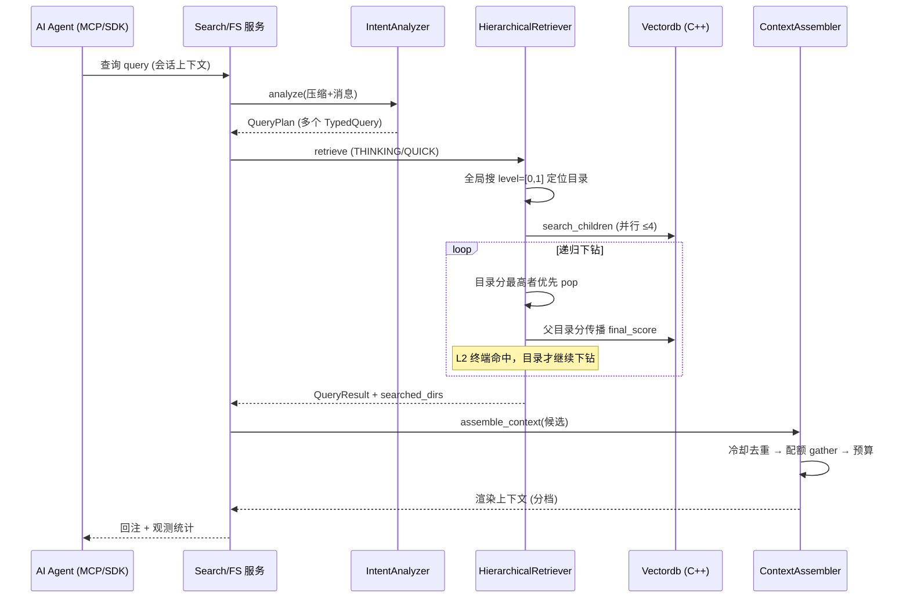

# 分层递归检索与上下文回注

> 本解读按 **database ⊗ ai-infra ⊗ ai-agent ⊗ framework** 类规格产出。本文是 OpenViking 的「检索」关注面：从意图分析出发，经**目录优先的分层递归检索**找到命中，再按预算组装回注给 Agent。核心问题是：**一条查询如何在保留上下文整体结构的前提下，既拿到结果、又把 token 花在刀刃上。**

## 检索的设计命题

上一份文档讲清了存储层把上下文组织成 `viking://` 目录树并生成 L0/L1/L2 三级摘要。检索层面对的问题是：

- 传统向量库返回的是**扁平结果片段**——你把一段文本摘出来，却丢了它所属的目录/项目上下文，Agent 拿到的是"断章取义"。
- 因为 L0/L1 摘要每级 token 量级不同（L0 ≈ 百 token、L1 ≈ 2k、L2 全量），检索完全可以**先看摘要决定要不要读全文**——但前提是检索本身要理解"目录"这个单位。

OpenViking 给出的答案是 **hierarchical retriever（分层递归检索）+ intent analyzer（意图分析）+ context assembler（上下文组装）** 三段式。

## 分层递归检索：先找目录，再往下钻

核心在 `HierarchicalRetriever`。它不吃"一条查询 → 一堆扁平命中"，而是**先全局向量定位最高分的目录，再沿目录树向下逐层下钻**，把命中结果连同它的上下文层级一起返回。

### 关键配置常数

[openviking/retrieve/hierarchical_retriever.py:56-60]() 定义了算法骨架：`DIRECTORY_DOMINANCE_RATIO=1.2`（目录分须超过子级最高分的 1.2 倍才算目录占了主导）、`MAX_PARALLEL_CHILD_SEARCHES=4`（对远端向量库每次扇形展开上限 4）、`LEVEL_URI_SUFFIX={0:".abstract.md", 1:".overview.md"}`（L0/L1 命中补 URI 后缀）。

<!-- anchor:     MAX_CONVERGENCE_ROUNDS = 3  # Stop after multiple rounds with unchanged topk …     LEVEL_URI_SUFFIX = {0: ".abstract.md", 1: ".overview.md"} -->

### 双模式：QUICK 与 THINKING

`retrieve()` 按是否启用 rerank / 是否图像查询切两条路径：

- **QUICK 模式**：无 rerank 时单次全局向量搜索直接返回，图快。
- **THINKING 模式**（有 rerank）——完整分层检索：**Step 2** 全局搜 level=[0,1] 找候选目录 → **Step 3** 对目录分 rerank、滤重作递归起点 → **Step 4** 从高分目录递归向下钻。

### 递归下钻的并行与收敛

下钻是一个带优先队列 + 并行扇形展开的循环：

[openviking/retrieve/hierarchical_retriever.py:472-486]() 用 `dir_queue`（按 `(-score, uri)` 排序的堆）每次弹出最多 4 个目录、`asyncio.gather` 并行 `search_children_in_tenant` 查其子节点。

<!-- anchor:         while dir_queue: …             batch_results = await asyncio.gather( -->

### 分数传播：子级继承目录分数

这是"结果带上下文"的关键：**子项最终分是自身分与父目录分的加权**，alpha 由配置 `score_propagation_alpha` 控制——于是目录强、其子项即使分低也抬起来，保证命中的子项总伴随它所属的高分目录一起出现：

[openviking/retrieve/hierarchical_retriever.py:504-506]() 计算 `final_score = alpha * score + (1-alpha) * current_score`（current_score 即父目录分），命中子项的分被父目录分"抬"了一截——这就是"结果带着上下文结构"的机制来源。

<!-- anchor:                 for r, score in zip(results, query_scores, strict=True): …                     final_score = ( -->

两层检索只对目录（L0/L1，level≠2）继续下钻，L2 文件是终端命中；收敛靠 `MAX_CONVERGENCE_ROUNDS=3`（topk 连续多轮不变即停）和停滞池检测，避免在深目录里无限钻。

> **为什么"目录优先 + 分数继承"？** 向量检索天然只懂"相似"，不懂"隶属"。把目录当作第一级命中对象、再让分数向下传播，是用一次额外的结构性排序换来了"召回结果天然带上下文归属"。代价：对深目录的递归下钻会产生多次向量查询（用 `MAX_PARALLEL_CHILD_SEARCHES` 控制扇形、用收敛兜底）。这是"召回质量"与"查询成本"的显式取舍。

## 意图分析：把一条查询拆成多类决策

`IntentAnalyzer` 把单个用户查询在会话语境下解析成多个**类型化查询（TypedQuery）**——比如一句话既可能想找记忆、又想找资源，甚至多个资源：

[openviking/retrieve/intent_analyzer.py:38-46]() 标明了意图分析的三职责：整合会话上下文（压缩摘要+最近消息+当前消息）、调 LLM 分析意图、产出多类 memory/resource/skill 的 TypedQueries。

<!-- anchor: class IntentAnalyzer: …     3. Generate multiple TypedQueries for memory/resources/skill -->

[openviking/retrieve/intent_analyzer.py:55-62]() `analyze` 以压缩摘要+消息+当前消息为输入、产出 `QueryPlan`；可配置轻量 query-planner 或回落 VLM。

<!-- anchor:     async def analyze( …         target_abstract: str = "", -->

每个 TypedQuery 自带类型/意图/优先级，后续 `context_assembler` 在**多查询并行 + 分桶配额**下执行，让不同上下文类型各得其所，而不是一股脑全量召回。

## 上下文回注：分层预算 + 组装

检索出了候选，还得精打细算地**往 Agent 上下文里放**——`context_assembler` 的 `assemble_context` 是全链路编排：

[openviking/retrieve/context_assembler/tiers.py:167-187]() `tier_text` 按候选的层级取 text：abstract 档取 `.abstract.md` 摘要、overview 档取目录概览、full 档读全文；目录的 full 会被 `None` 顶掉（目录全文=整棵子树，太大）。

<!-- anchor: def tier_text( …         return content.strip() or None -->

[openviking/retrieve/context_assembler/tiers.py:190-199]() `start_tier` 决定每个候选默认从哪级开始读：目录一律从 overview 起步（无摘要、且 full=子树不可行），文件按类别的默认档，摘要缺失再降级替换。

<!-- anchor: def start_tier(candidate: Candidate, pin: Optional[Tier] = None) -> Tier: …         return tier -->

### 管线五步

`assemble_context`（`openviking/retrieve/context_assembler/pipeline.py:52-58` 入口）逐段走：

1. **expand_queries**（`pipeline.py:68-72`）：语义意图开启时把查询拆成多类并行查询——这是对 intent 输出的执行对称。
2. **RecallLedger 冷却去重**（`pipeline.py:74-81`）：加载已召回 ledger、`cooled_uris()` 得到一段时间内别重复给的 URI，避免同一段上下文在连续轮次反复灌入。
3. **gather_candidates**（`pipeline.py:83-95`）：按 memory/resource/skill 分桶配额收集候选，支持 peer 惩罚。
4. **分层预算**：`tiers.py` 的 `start_tier`+`tier_text` 决定各候选读到哪一级，只对真正需要 body 的候选读全文。
5. **渲染 + 可选 digest 重写**（`pipeline.py:122-131`）：`render_context` 合成、`rewrite_context` 可选改写为 digest，进一步压 token。

> **三层预算的精髓**：不是"召回多少就灌多少"，而是**每个候选按"离主题多近"决定读到哪一级**——热命中的给 full，次热给 overview，边缘的只给摘要或 URI。token 预算被显式摊到检索结果上，这是 OpenViking 在"召回质量"与"token 成本"间做的核心优化。

## 可观测性：每次检索留痕迹

README 声称"每次检索保留轨迹可调试"。落地在 `retrieval_stats` 的全局 stats collector——每次 `record_query` 记录 query 数、结果数、分数分布、时延、是否 rerank：

[openviking/retrieve/retrieval_stats.py:103-115]() `record_query` 加锁累计 `total_queries`/`total_results`/`zero_result_queries`/分数统计，供 snapshot 观测；配合 `HierarchicalRetriever.retrieve()` 返回的 `searched_directories` 根目录列表，可回溯"本次从哪些目录浏览而来"。

<!-- anchor:     def record_query( …             self._stats.total_queries += 1 -->

> 值得说明的取舍：目前"轨迹"是**根目录列表 + 聚合统计**，未完整保留逐级的浏览路径原始序列（比 plan 阶段判断的轻）。检索出错时能看出"从哪几个根目录来、分数分布如何"，但还原不了每一次下钻的完整步骤。这是可观测性与日志成本之间的折中，值得在解读中如实标注。

## 检索→回注链路

下面用 `sequenceDiagram` 把"一条查询从到来直到写进上下文"串起来：

## 决策与权衡小结

| 设计决策 | Why | 权衡 |
|---|---|---|
| 目录优先 + 分数向子级传播 | 召回天然带上下文归属，对抗"断章取义" | 深目录递归产生多次向量查询，用并行上限+收敛兜底 |
| THINKING / QUICK 双模式 | 无 rerank 时省掉分层步骤、图快 | 快但有召回质量下限，语义场景仍需 THINKING |
| 多个 TypedQuery 分桶配额 | 单查询多意图时各上下文类型各得其所 | 依赖 LLM 意图拆分的准确性 |
| 三级分层预算回注 | 热命中 full、边缘只给摘要，token 摊到刀刃 | 摘要生成质量直接影响 overview 档可用性 |
| 冷却去重（RecallLedger） | 避免同一上下文多轮反复灌入 | 冷却参数需调优，过冷错过、过热重复 |

这份文档把"检索怎么把上下文还给 Agent"讲清了；下一份文档接住"检索回来之后，会话怎么沉淀成长期记忆"，即 `memory-session.md`。
