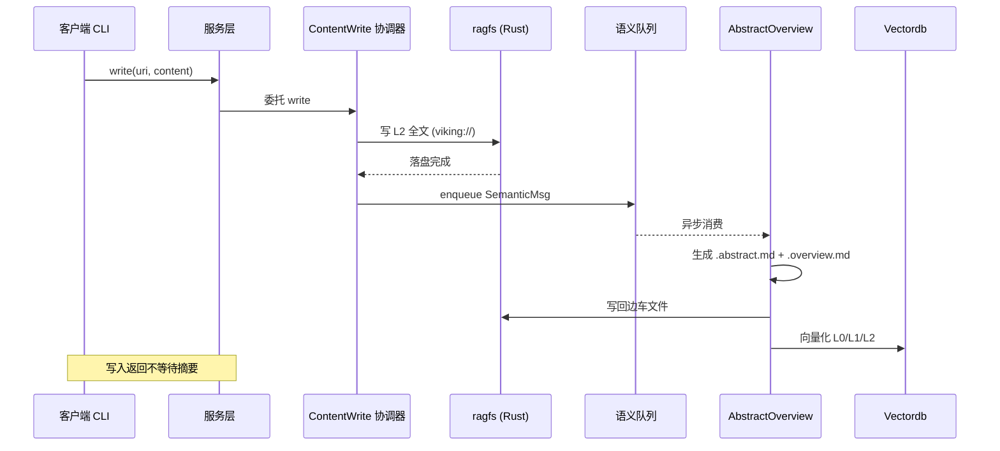

# viking:// 虚拟文件系统与三级分层存储

> 本解读按 **database ⊗ ai-infra ⊗ ai-agent ⊗ framework** 类规格产出。本文是 OpenViking 的「存储布局」关注面：Rust 侧的 `viking://` 虚拟文件系统（ragfs）承担上下文的可定位存算层，Python 侧的内容写管线在写入时生成 L0/L1/L2 三级摘要边车。核心问题是：**如何让 Agent 的上下文既"像文件一样可浏览"，又"按需分档省 token"。**

## 一句话根因

OpenViking 拒绝把 Agent 上下文塞进一个黑盒向量库，而是把它组织成一个**可浏览、可分档、可观测的虚拟文件系统**——每个上下文对象都挂在 `viking://` 的确定性路径上，每次写入都生成三级摘要，读取时按需取档。存算布局因此拆成两层职责：**Rust 虚拟路径路由层**（负责"它是什么路径、属于谁"）+ **C++/Python 语义索引层**（负责"它语义上像什么"）。

## 存算分层：文件系统归位，语义索引归位

### Rust ragfs = 可挂载的虚拟文件系统路由层

`crates/ragfs` 是字节跳动 AGFS（Aggregated File System for AI Agents，源自 c4pt0r 的 Go 实现）的 Rust 重实现——注意它解决的问题是**路径如何被解析和路由**，不是文件落盘与检索。

[crates/ragfs/ORIGIN.md:3-11]() 明确了血统：RAGFS 是 AGFS 的 Rust 重实现，并保持对该原版许可的兼容、完整复述来源与实现切换方式。

<!-- anchor: This crate (RAGFS) is a Rust reimplementation of the AGFS project originally authored by [c4pt0r](https://github.com/c4pt0r). … The original AGFS project is open source. -->

核心是 `MountableFS`——它在内存里维护一棵 **radix-trie**，把不同路径前缀路由到不同文件系统实现（插件）：

[crates/ragfs/src/core/mountable.rs:67-72]() 展示了 `MountableFS` 的骨架：`mounts` 是一棵 radix `Trie<String, MountInfo>`，`registry` 是插件注册表。

<!-- anchor: pub struct MountableFS { …    registry: Arc<RwLock<HashMap<String, Arc<dyn ServicePlugin>>>>, -->

而整个系统面向的上层抽象是 `FileSystem` trait——定义 create/mkdir/read/write/grep/tree 等一组**全异步**文件操作，让上层 Python 侧无需感知具体后端：

[crates/ragfs/src/core/filesystem.rs:127-127]() 声明了统一的文件系统接口 `FileSystem`，它是 viking:// 上层操作（ls/tree/read/write）最终路由到的抽象三件之一。

<!-- anchor: pub trait FileSystem: Send + Sync + Any { … pub trait FileSystem: Send + Sync + Any { -->

元数据用 `FileInfo` 承载（文件名、大小、权限、修改时间、是否目录），`serde` 序列化落盘：

[crates/ragfs/src/core/types.rs:134-149]() 定义 `FileInfo`，这是一份朴素的类 POSIX 文件元数据——刻意不携带语义指纹，把"内容像什么"留给语义索引层。

<!-- anchor: pub struct FileInfo { …    pub is_dir: bool, -->

> **为什么这么拆？** 把"路径"和"语义"分成两个系统，等于给上下文一个"稳定的定位坐标轴"（路径）和一条"模糊的语义坐标轴"（向量）。路径解析用 radix-trie、语义检索走向量索引，各自用各自最擅长的方式——这是 OpenViking 与纯向量库最大的分野：它不是拿一个向量库硬套树状上下文，而是树与向量各司其职、靠 URI 挂接。

### 插件化后端：memfs / localfs / s3fs / sqlfs / queuefs

ragfs 的 `plugins/` 目录挂着多套文件系统实现（memfs、localfs、kvfs、s3fs、sqlfs、queuefs……），`MountInfo` 持有 `Arc<dyn FileSystem>` 与统计、插件名。这意味着**同一个 viking:// 命名空间下，不同子树可以落在不同存储后端**——例如公共 `/resources/` 走本地磁盘、个人 `/user/{id}/memories/` 走 SQLite、高频热数据走内存。这是"聚合式文件系统"（Aggregated FS）一词的由来：多个后端在一个统一命名空间里各挂一段路径。

### C++ vectordb = 语义索引引擎

在文件系统"归位"之上，C++ 的 `vectordb`（`src/`）承担语义检索。`IndexEngine` 提供 add/delete/search/filter 一套向量操作：

[src/index/index_engine.h:15-28]() 定义 `IndexEngine`，暴露 `add_data`/`delete_data`/`search`/`search_with_filter_token`，配合 LevelDB 落盘（`PersistStore`）——这是标量/向量统一索引的引擎核心。

<!-- anchor: class IndexEngine { … SearchResult search(const SearchRequest& req); -->

> 存储层的"引擎"身份由此完整：**Rust 负责树（虚拟路径）、C++ 负责向量（语义）、Python 负责编排与分层摘要生成。**

## 三级分层（L0/L1/L2）的写入管线

README 声称"每次写入都处理成 L0/L1/L2"，这个承诺的落地不在普通文件写入本身，而在写路径上挂的**语义刷新队列**。核心协调器是 `ContentWriteCoordinator`：

### 写入口与分派

所有内容写入最终走到 `ContentWriteCoordinator.write`，统一做模式校验、URI 规范化、写权限检查：

[openviking/storage/content_write.py:117-128]() 是写入口：先校验 mode、归一化 URI、确保可变访问权限，再按 context_type 分派到直接写或记忆写路径。

<!-- anchor:     async def write( …         self._validate_mode(mode) -->

对不同 context_type（memory / resource / skill）走差异化刷新策略——记忆类内容要联动 memory 刷新，普通资源走直接写。

### 语义队列：异步生成 L0/L1 边车

写完原始文件（L2 全文）后，协调器**异步入队**一个语义刷新消息，后端消费该消息才生成 `.overview.md`（L1）与 `.abstract.md`（L0），不阻塞写入返回：

[openviking/storage/content_write.py:555-566]() 先把变化计数、调 `plan_abstract_overview_refresh` 决定是否立即刷新，拿到决策后再决定是否入队。

<!-- anchor:     async def _enqueue_semantic_refresh_changes( …         changed_entries = len({uri for values in changes.values() for uri in values}) -->

[openviking/storage/content_write.py:584-615]() 构造 `SemanticMsg`（携带 uri、context_type、account、user、coalesce_key）并 `semantic_queue.enqueue(msg)`——注意 `coalesce_key` 用于同类请求合并、避免写风暴重复生成摘要。

<!-- anchor:         msg = SemanticMsg( …         await semantic_queue.enqueue(msg) -->

### 边车文件即 L0/L1

L0/L1 不是存进某个特殊表，而是以**边车文件**形式与目录同挂：每个目录下可带 `.abstract.md`（L0，约百 token 的快速相关性判断）与 `.overview.md`（L1，约 2k token 的结构与要点），原始全文即 L2：

[openviking/storage/abstract_overview.py:387-388]() 明确边车命名：`overview_uri` 指向 `.overview.md`、`abstract_uri` 指向 `.abstract.md`，均为目录级隐藏文件。

<!-- anchor:     overview_uri = f"{dir_uri}/.overview.md" …     abstract_uri = f"{dir_uri}/.abstract.md" -->

> **为什么用边车文件而不是单独一张元数据表？** 边车文件与目录同构存在，天然继承 viking:// 的浏览语义——`ls` 一个目录既能看到 .abstract/.overview 边车、也能看到子项；文件系统的备份/同步/git 版本控制（OpenViking 支持基于 git 的目录版本化）会连带把这三级摘要一并管理。这是"用文件系统的原语做元数据"的一招，代价是摘要文件本身也会占存储、也要进检索索引。

### 向量化：L0/L1/L2 各有归宿

写入后还需把各级内容向量化，供检索时命中：

- **文件级（L2 全文）**：`_vectorize_written_file` 对单个文件做向量化入口，取父目录与文件名拼 summary 再 `vectorize_file`（`openviking/storage/content_write.py:903-920`）。
- **目录级（L0/L1）**：`_vectorize_semantic_directory` 读该目录的 `.abstract.md` / `.overview.md`，一并重新索引（`openviking/storage/content_write.py:931-944`）。

这样检索时既能命中全文（L2）也能命中摘要（L0/L1），为后文"目录优先下钻"的分层检索提供素材。

## 写入→三级摘要的链路

下面用图把"普通资源写入 → 三级摘要生成"串起来（`sequenceDiagram`）：

关键点：**写入返回发生在 L0/L1 生成之前**（除非 `--wait`），语义刷新走队列异步完成——这是把"写"与"沉淀语义"解耦，牺牲摘要即时性换取写入低延迟；代价是刚写入的目录短时间检索不到 L0/L1。

## 决策与权衡小结

| 设计决策 | Why | 权衡 |
|---|---|---|
| 树状路径（ragfs） + 向量索引（vectordb） 双系统 | 路径负责稳定定位、向量负责语义近似，各取所长 | 需在写入时把同一内容同时落两套索引，写放大 |
| 三级摘要用边车文件（.abstract/.overview.md） | 继承文件系统浏览/备份/版本控制语义 | 摘要占存储、也反哺进检索索引 |
| L0/L1 生成走异步语义队列 | 写入不阻塞，解耦写与沉淀 | 摘要生成有延迟，需 coalesce 防写风暴 |
| `FileInfo` 只存类 POSIX 元数据 | 语义交给索引层，职责单一 | 元数据不携带语义，需配合向量索引才能检索 |

这为下一份文档沉淀了检索侧的输入：分层检索正是沿"文件系统归位出的目录树"先向量定位目录、再往下钻。
