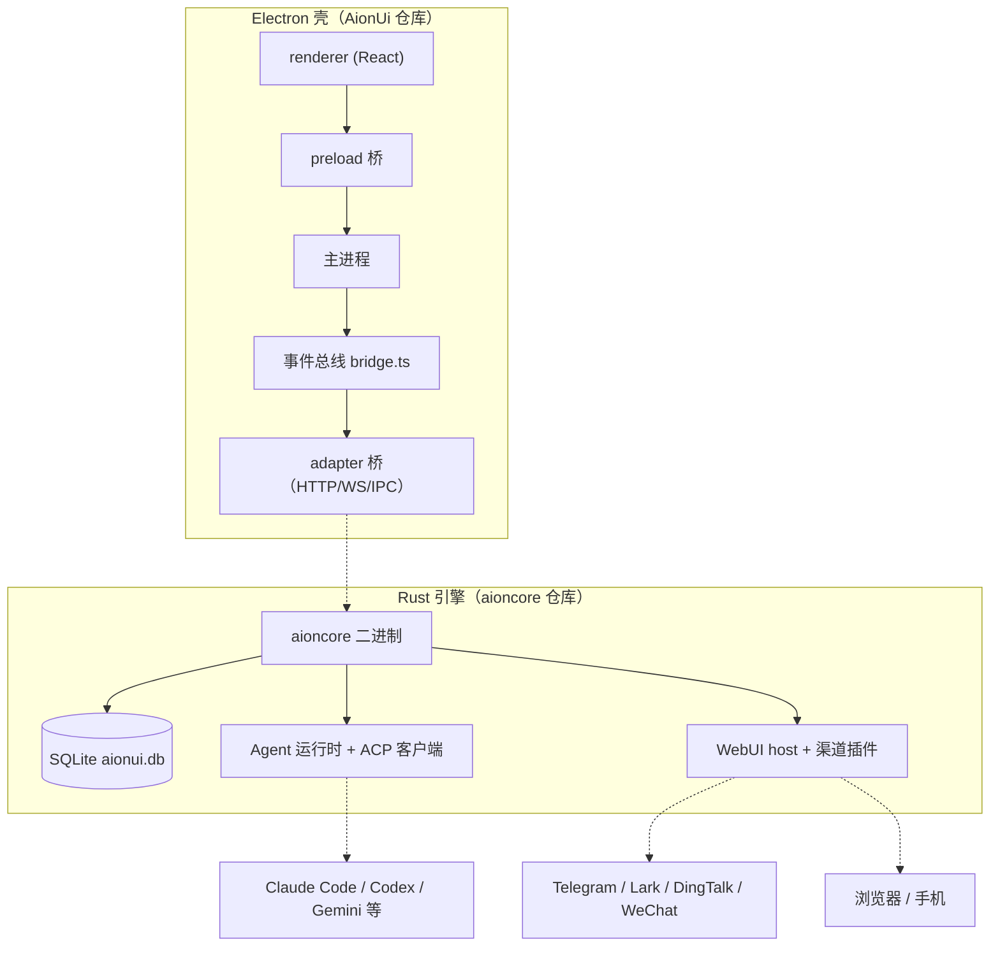

# AionUi：把 CLI Agent 变成带 GUI 的 24/7 Cowork 平台

## 子文档索引

- [`architecture.md`](architecture.md) — App-shell 双层架构、启动编排与 IPC/桥协议
- [`acp.md`](acp.md) — ACP 协议层：几十种 CLI Agent 的统一收敛
- [`data-model.md`](data-model.md) — SQLite 数据底座与 legacy 交棒迁移
- [`team-mode.md`](team-mode.md) — Team Mode：Leader/Teammate 多 Agent 协作编排
- [`automation.md`](automation.md) — Cron 24/7 自动化调度
- [`remote-access.md`](remote-access.md) — WebUI 远程访问与 IM 渠道接入
- [`mcp-skills.md`](mcp-skills.md) — MCP 统一管理与三层 Skill 体系
- [`CHANGELOG.md`](CHANGELOG.md) — 各版本变更汇总（基线 v2.1.61 → 本次 v2.2.1）

> **本版（v2.2.1）增量更新说明**：对照上游 v2.2.1（2026-09-01 发布，引擎 aioncore v0.2.1）校准既有 v2.1.61 解读——上游 #4198 移除 `confirmation.add` 死 emitter 后，ipcBridge 引用行号整体 −2、团队待确认徽标语义更新（见 [`team-mode.md`](team-mode.md)）；引擎版本表述 v0.1.72 → v0.2.1；25 处 STALE 引用全部校正，无 UNRESOLVED。变更细节见 [`CHANGELOG.md`](CHANGELOG.md)。

## 根因：CLI Agent 很强，但只住在终端里

Claude Code、Codex、Qwen Code、Hermes、OpenClaw、OpenCode 这些 CLI AI agent 能力很强，但交互形态停在终端：没有图形界面、不能无人值守、无法跨设备触达、更别提多个 agent 协作。AionUi 要解决的根本问题是——

> **把"命令行 AI agent 生态"整体搬进一个带 GUI、可无人值守、可异地访问、可多 agent 协作的 Cowork 平台。**

它不自研 agent，而是做"收敛层"：用 ACP（Agent Client Protocol）把几十种异构 CLI agent 统一成一套会话语义，再叠加 GUI、Cron、Team、远程访问、MCP/Skills 能力层。与之对比，同类产品要么只服务单一 agent（Claude Cowork），要么自研 agent 生态（Cumora/Tutti），AionUi 走的是"收敛既有 CLI 生态"路线。

## 概览

| 能力 | 说明 |
|------|------|
| 内置 Agent | 零配置随装随用，支持 30+ LLM 平台（Gemini/Claude/OpenAI/Bedrock/Ollama…） |
| 多 Agent 收敛 | ACP 统一接入 Claude Code、Codex、Gemini CLI、OpenCode 等 20+ CLI agent |
| Team Mode | Leader 拆解任务、Teammate 并行执行、异步 mailbox + 共享任务板 |
| Cron 24/7 | 自然语言建任务、三态调度、任务绑定会话保持上下文、keep-awake 防休眠 |
| 远程访问 | WebUI（浏览器/手机）+ Telegram/Lark/DingTalk/WeChat 渠道 |
| MCP 统一管理 | 按 agent 能力注入兼容 transport，内置浏览器/图片生成服务器 |
| Skills 三层体系 | builtin/custom/extension 技能 + 21 个内置专业助手（PPT/Word/Excel/论文…） |

## 架构总览

AionUi 的骨架是**壳-引擎分离**：Electron 前端壳只做窗口/进程/IPC/数据持久化，一切业务逻辑下沉到外部 Rust 二进制 `aioncore`（独立仓库，v0.2.1），二者经「HTTP REST + WebSocket」通信。壳与引擎之间隔着一层**平台无关事件总线**——同一套 renderer 业务代码，靠 `window.electronAPI` 是否存在在 Electron IPC 与 WebSocket 之间切换，于是桌面、WebUI、移动端共用一份前端。

各关注面在架构中的归属：ACP 收敛（引擎内 ACP 客户端 + 前端 `AcpChat` 会话面）、数据（引擎内 SQLite，壳只做 legacy 交棒迁移）、Team/Cron/远程（前端管理面 + 引擎编排执行）、MCP/Skills（引擎内服务器 + 壳内配置下发）。

## 核心模块导读

| 模块 | 职责 | 深读 |
|------|------|------|
| App-shell 骨架 | 双进程模型、启动编排、事件总线与 IPC 桥 | [`architecture.md`](architecture.md) |
| ACP 收敛层 | 几十种 CLI agent → 一套会话/工具/状态语义 | [`acp.md`](acp.md) |
| 数据底座 | SQLite 本地优先存储、v26 迁移与 legacy 交棒 | [`data-model.md`](data-model.md) |
| Team Mode | Leader/Teammate 多 agent 协作编排 | [`team-mode.md`](team-mode.md) |
| Cron 调度 | 24/7 无人值守任务执行 | [`automation.md`](automation.md) |
| 远程访问 | WebUI 服务器 + IM 渠道接入 | [`remote-access.md`](remote-access.md) |
| MCP 与 Skills | 工具统一接入 + 三层技能体系 | [`mcp-skills.md`](mcp-skills.md) |

## 值得借鉴的设计

- **壳-引擎双层架构**：业务逻辑全部下沉外部 Rust 进程，壳保持"只做 UI/进程/IPC"的纯净职责；引擎可独立发布、独立崩溃（子进程边界），代价是"启动成功"需要专门工程化（双就绪信号、结构化失败分类）。
- **平台无关桥**：事件总线 + 多适配器（IPC/WS/HTTP）让一份 renderer 跑桌面与 WebUI，是"Remote from Anywhere"卖点的架构前提。
- **ACP 收敛而非逐家适配**：协议收敛到 `acp` 一个槽位 + 一棵组件树 + 一个消息状态机，新增 agent 前端零改动；代价是壳-引擎隐式契约脆弱（无共享 Schema）。
- **防御式事件消费**：Team/Cron 面对 WS 事件可能丢失的现实，用 reconcile 快照 + 孤儿轮询 + 版本号把 UI 与后端收敛到一致。
- **本地优先**：数据单文件 SQLite、隐私是卖点，远程/多端为代价。

## 总结

AionUi 的定位是"CLI agent 生态的 Cowork 平台"而非又一个自研 agent。它的设计哲学高度一致：**壳-引擎分离**（业务归引擎、壳只做 UI/进程/持久化）、**协议收敛**（ACP 统一接入、MCP 统一工具、Skill 目录化）、**后端权威 + 前端乐观**（编排在引擎、UI 防御式消费事件）。解读的七个子文档按"骨架 → 收敛 → 数据 → 上层能力"的叙事展开，每个关注面都标注了与 aioncore 的边界（外部仓库不可验证处已注明）。
