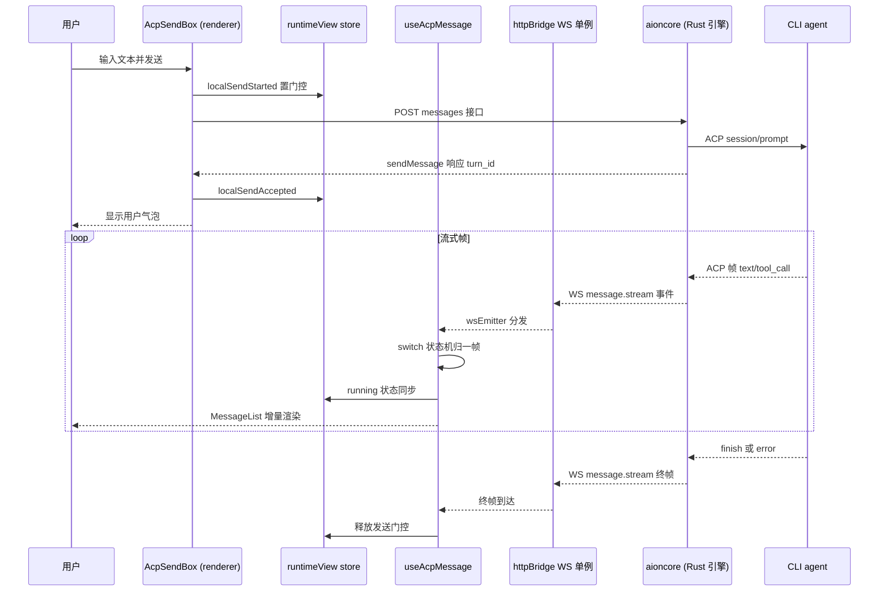

# ACP 协议层 / 多 CLI Agent 收敛

> 前置叙事：前一篇「architecture」讲完了 Electron 壳 + Rust 引擎 aioncore 的双层骨架与 adapter 桥；本篇深挖平台的核心价值——**如何用一个协议把几十种异构 CLI agent 收敛进同一套对话界面**。这也为后续 Team Mode（ACP backends 接入 teammates）铺垫协议层基础。

## 模块边界一句话

本仓库（AionUi）**不包含 ACP 客户端实现**——`@agentclientprotocol/sdk` 在 `package.json:78` 声明为依赖，但全仓库无一处 import（见下方边界证据）；真正的 ACP 客户端与 agent 进程托管在外部引擎 aioncore（Rust 二进制）内。本仓库承载的是 ACP 的**前端协议接入侧**：会话 UI（AcpChat）、发送/取消/模式/模型控制面（AcpSendBox）、消息流状态机（useAcpMessage）与协议消息到 UI 消息的归一映射（chatLib.transformMessage）。renderer 与 aioncore 之间通过 HTTP REST + WebSocket 通信，前端对 ACP 字段的理解全部来自 aioncore 透传的 opaque 数据。

## 在项目中的角色

ACP 层是"多 Agent 收敛"这一核心卖点的**协议面**。在 `ChatConversation.tsx:314-343` 中，`switch (conversation.type)` 对外接 agent 只有一个渲染分支——`case 'acp'`（`antigravity` 也复用同一 ACP 面，见同段注释），其余默认分支返回 null：

[packages/desktop/src/renderer/pages/conversation/components/ChatConversation.tsx:314-343]()
<!-- anchor: switch (conversation.type) { … default: -->

整个平台对"外部 CLI agent"只有一条渲染路径，这正是"收敛"的最直接证据：Claude Code、Codex、Qwen Code、Hermes、OpenClaw、opencode…… 只要 backend 侧被识别为 ACP 类型，就走同一个组件树。前端不再为每个 CLI 写一个聊天页面。

**去掉这个模块系统会怎样：**
- 所有 `agent_type = 'acp'` 的外部 CLI agent 在 `ChatConversation` 的 switch 里落到 `default: null`，聊天区空白、send box 不挂载、guid 页写入 `acp_initial_message_<id>` 的初始消息永远发不出去（该注释在 `ChatConversation.tsx:316-321` 里明说这正是曾经发生过的回归 bug）。
- README 宣传的 "Dozens of external agents — Claude Code, Codex, Qwen Code, Hermes Agent… in one unified interface"（`readme.md:164`）归零，平台退回"内置 aionrs + 只读 legacy"。
- Team Mode 的 teammates 接入失去协议基础（README 明言 "External agents connect through ACP"，`readme.md:186`）。

## 解决什么问题、根因

根因是**异构 CLI agent 协议不收敛**。每个终端 AI agent 都有私有交互语义：Claude Code 有 command_lifecycle / 权限确认、Codex 有 turn 边界与 unified-exec 后台进程、opencode/qoder 有自己的一套 mode 词汇（build/plan 而非 default）、Cursor 的 agent/plan/ask 模式、各家的模型列表与字段命名（`label` vs `name`、`current_value` vs `selected_value`、`id` vs `value`）全不统一。若逐 agent 写适配器，每接一个就多一份私有集成，平台无法横向扩展。

ACP 的思路是定义一个统一协议（初始化 → 会话 → 工具调用 → 权限 → 流式回显），让每个 CLI 用同一协议接入。AionUi 的工程做法是把问题**再拆一层**：连 ACP 客户端本身也不放在前端，而是收进 Rust 引擎 aioncore，前端只消费 aioncore 暴露的 REST/WS 接口。这样前端的收敛工作退化为两件事——**协议消息的 UI 归一**与**异构字段的防御性解析**，而不是真正的协议实现。

这解释了为什么仓库里能看到 ACP 语义词（session/new、config_options、acp_permission、request_permission 等，见 `common/types/platform/acpTypes.ts`）却看不到协议字节流：那些类型只是 aioncore 透传数据的**前端投影**。

## 设计思路

### 壳-引擎边界：前端不碰协议字节流

renderer 对 aioncore 的所有访问收敛在 `common/adapter`。`ipcBridge.ts` 文件头注释直言这是 IPC → HTTP/WS 的替换层：

[packages/desktop/src/common/adapter/ipcBridge.ts:8-13]()
<!-- anchor: * IPC Bridge → HTTP/WS adapter. … * calls routed to aioncore. Electron-native operations (window controls, -->

后端端口由 preload 注入 `window.__backendPort`，缺省回退 13400（`httpBridge.ts:37-43`）：

[packages/desktop/src/common/adapter/httpBridge.ts:37-43]()
<!-- anchor: function getBackendPort(): number { … return g.__backendPort ?? 13400; -->

ACP 会话的 REST 路由全部挂在 `/api/agents/*` 与 `/api/conversations/*` 下（`ipcBridge.ts:1124-1128` 的 `acpConversation` 对象），发送是 `POST /api/conversations/{id}/messages`（`ipcBridge.ts:369-381`），流式回显是 WS 单例上的 `message.stream` 事件（`ipcBridge.ts:422`）：

[packages/desktop/src/common/adapter/ipcBridge.ts:1124-1128]()
<!-- anchor: export const acpConversation = { … getManagedAgents: httpGet<import('@/renderer/utils/model/agentTypes').ManagedAgent[], void>('/api/agents/management'), -->

[packages/desktop/src/common/adapter/ipcBridge.ts:369-381]()
<!-- anchor: sendMessage: httpPost<ISendMessageResult, ISendMessageParams>( … inject_skills: p.inject_skills, -->

[packages/desktop/src/common/adapter/ipcBridge.ts:422-422]()
<!-- anchor: responseStream: wsEmitter<IResponseMessage>('message.stream'), -->

WS 是全局单例：`wsEmitter` 把事件名映射到监听器集合，一个 socket 承载所有事件通道（`httpBridge.ts:545-560`）；连接中断按指数退避自动重连（`httpBridge.ts:488-496`），身份失效（close 码 1008）走一次会话刷新、成功才重连（`httpBridge.ts:503-509`），避免无效重连循环。

### 收敛的两个落点：一套 UI + 一套消息状态机

前端没有 per-agent 渲染器，只有一套 ACP 会话面：
- `AcpChat`（`AcpSendBox` + `useAcpMessage` + `AcpE2EStreamInjector`）——所有 ACP 类型会话共用的组件树。
- `useAcpMessage` 订阅 `responseStream`（`useAcpMessage.ts:583-585`），用一个覆盖十余种事件类型的 `switch` 状态机把流式帧翻译成 UI 状态与消息列表更新。

### 双源归一 + 防御性字段解析

agent 的能力 catalog（model / mode / thought_level / config_options）存在两套来源：`session/new` 返回的结构化 `config_options` 与顶层 `available_modes` / `available_models`。前端统一以 config_options 为主、顶层字段兜底（`agentRuntimeCatalog.ts:219-232`），解析时对每个字段做别名兼容（`label`/`name`/`value`、`current_value`/`selected_value`/`currentValue`、`id`/`value`），让各家 agent 的差异在前端这一层被吞掉。

### Agent 类型体系：收敛后的五个槽位

`AgentType` 只剩五类，且 `codex`、`gemini` 已不再是独立类型——它们被收进了 `acp`（migration CHECK 约束的历史里能看到 `gemini`/`codex` 曾是独立 type，见 `process/services/database/migrations.ts:191,381`）：

[packages/desktop/src/renderer/utils/model/agentTypes.ts:19-20]()
<!-- anchor: /** Type of an agent. */ … export type AgentType = 'acp' | 'remote' | 'aionrs' | 'openclaw-gateway' | 'nanobot'; -->

`agentTypeSupportPolicy.ts:1-7` 更激进：`remote`、`openclaw-gateway`、`nanobot`、`gemini` 全被标为 deprecated runtime 类型，且 `resolveSupportedConversationType` 把后端收敛为**只有两个渲染面**——`aionrs` 或 `acp`：

[packages/desktop/src/renderer/utils/model/agentTypeSupportPolicy.ts:1-7]()
<!-- anchor: const DEPRECATED_RUNTIME_AGENT_TYPES = new Set(['openclaw-gateway', 'nanobot', 'remote', 'gemini']); … export function resolveSupportedConversationType(backend?: string | null): 'acp' | 'aionrs' { -->

这是"多 Agent 收敛"在类型层的最终形态：协议收敛到 ACP，运行时收敛到 aionrs + acp 两个会话面。

## 关键数据结构

以下只列承载设计意图、必须理解的数据结构（不复制类型定义全文）：

- **AgentType 判别联合**（`agentTypes.ts:20`）——外接 agent 的顶层运行时槽位，定义见上。它决定了一个会话走哪个渲染面。
- **AgentMetadata 与 AgentHandshake**（`agentTypes.ts:75-82`）——backend 持久化的 agent 目录行；`handshake` 是 ACP init 响应的**原样透传**，前端对 `agent_capabilities` / `available_modes` 等一律按 `unknown` 处理、只在消费点做防御性解析，绝不在结构上依赖：

[packages/desktop/src/renderer/utils/model/agentTypes.ts:75-82]()
<!-- anchor: export type AgentHandshake = { … available_commands?: unknown; -->

- **AcpConfigOptionDto 与 SetConfigOptionResponse**（`acpTypes.ts:204-240`）——mode/model/thought_level 切换的统一载体。核心是 `confirmation` 三态（`acpTypes.ts:202`）：`observed`（已生效）/ `pending_next_turn`（agent 接受但下轮才生效，如 codex 切模式）/ `command_ack`（收到但无法确认）。前端据此区分"切换成功"与"排队生效"，后者显示 ⏱ 待生效标记：

[packages/desktop/src/common/types/platform/acpTypes.ts:202-202]()
<!-- anchor: export type AcpConfigOptionConfirmation = 'observed' | 'pending_next_turn' | 'command_ack'; -->

- **IResponseMessage 消息流类型**（`chatLib.ts:59-72` 的 `TMessageType`）——ACP 会话的流式事件归一为十余种消息类型，其中 `acp_tool_call`、`acp_permission`、`acp_terminal_output` 是 ACP 特有语义（工具调用更新、权限请求、客户端托管终端快照）。
- **ConversationRuntimeView**（`conversationRuntimeViewStore.ts:9-24`）——前端维护的每会话运行时门控视图（state / isProcessing / canSendMessage / supportsMidturnDelivery），发送、排队、停止、hydration 全部经由它。
- **acp_session 表**（`migrations.ts:1194-1204`）——ACP 会话在应用重启间的 suspend/resume 持久化：以 `conversation_id` 为主键，记录 `agent_backend`/`session_id`/`session_status`/`suspended_at`，并建有 suspended 部分索引（`migrations.ts:1206-1208`）支持"恢复挂起会话"查询。注意这张表在**本仓库**只做数据库迁移声明，读写方在 aioncore。

## 核心流程：ACP 会话从发送到流式回显

对应源码落点：
- 发送入口在 `AcpSendBox.tsx:300-311`：`markSendStarted()` 先置门控，再 `ipcBridge.acpConversation.sendMessage.invoke(...)`，成功后 `markSendAccepted`：

[packages/desktop/src/renderer/pages/conversation/platforms/acp/AcpSendBox.tsx:300-311]()
<!-- anchor: markSendStarted(); … emitter.emit('chat.history.refresh'); -->

- 流式订阅在 `useAcpMessage.ts:583-585`：`responseStream.on(handleResponseMessage)` 把 WS 事件喂进状态机；`handleResponseMessage` 用 `switch (message.type)`（`useAcpMessage.ts:306-568`）分别处理 `start`（清 finished 门、置 running）、`finish`（关 running、释放门控、结束轮次时钟）、`text/content`（首 token 到达时清 processing）、`acp_context_usage`（token 计量）、`agent_status`（连接状态机）等，逐条注释都解释"为什么这类帧不该动 running 状态"——这是无数轮 bug 打磨出来的防御。
- 发送失败走 `buildSendFailureError`（`buildSendFailureError.ts:35-121`）把任意异常翻译成带 `ownership`（aionui / user_agent / unknown_upstream）与 `retryable` 的结构化错误，其中 ACP 断连专门映射为 `USER_AGENT_DISCONNECTED` + 建议跳转 Agent 设置页（`buildSendFailureError.ts:72-82`）；`errorDiagnostics.ts:21-47` 再对错误文本做密钥/邮箱/用户主目录脱敏后才进 Sentry。
- 门控状态机在 `conversationRuntimeViewStore.ts`：`localSendStarted`（`:560-568`）与 `localSendAccepted`（`:570-601`）负责提交期门控，`turnCompleted`（`:513-543`）处理终帧并防御"codex 后台 PTY 残留 turn 的 finish 晚于用户下一轮"的乱序（`:519-525` 的注释讲清了为什么非当前 turn 的完成必须忽略）。

一个值得注意的细节：**发送与回显在两条通道上解耦**。发送是 HTTP POST（请求-响应拿 `turn_id`），回显是 WS 推送（按 `conversation_id` 过滤），二者通过 turn_id 在运行时视图里汇合。这让发送失败（HTTP 4xx/5xx）与流式异常（WS 帧）能分别被结构化处理，也解释了为什么 `AcpSendBox` 要把 `markSendStarted`/`markSendAccepted`/`markSendFailed` 三个门控动作与 `responseStream` 状态机分开管理。

## 与其他模块的协同

### 与 adapter 桥（common/adapter）

ACP 层是 adapter 桥**最重的消费者**。`acpConversation` 路由对象（`ipcBridge.ts:1124-1200`）几乎覆盖 Agent 管理的全部操作：`/api/agents/management`（管理视图）、`/api/agents/custom/*`（自定义 ACP agent 的增删改 + `try-connect` 探测）、`/api/agents/{id}/enabled`、`health-check`、`overrides`（command/env 覆盖）等；会话侧复用 `conversation` 对象（sendMessage / responseStream / ensureRuntime / stop / getUsage）。可以说 adapter 桥的 HTTP/WS 工厂（`httpBridge.ts` 的 `httpGet/httpPost/wsEmitter`）就是为 ACP 会话这种"REST 控制面 + WS 数据面"模式量身定做的——同一模式也被 openclawConversation、remoteAgent 等次要通道复用。

### 与数据模型 / chatLib

流式帧进入前端后的第一站是 `chatLib.transformMessage`（`chatLib.ts:832-868`）：把 IResponseMessage 归一为可持久化的 TMessage。ACL 特有类型在此被折叠——`acp_permission`/`acp_terminal_output`/`acp_tool_call` 各有确定性 id 生成规则（如终端卡片用 `term:{msg_id}:{terminal_id}`，`chatLib.ts:843-857`，避免每帧 UUID 造成卡片堆叠）。`normalizeToolCall.ts:148-183` 再把 `acp_tool_call` 归一为渲染层统一的 `NormalizedToolCall`。这条链贯穿"协议帧 → UI 消息 → 持久化行"三个领域。

### 与 MCP 的关系

ACP 与 MCP 是"接入协议"与"工具协议"的分工：ACP 让 agent 进得来，MCP 让 agent 的工具出得去。前端在 `agentTypes.ts:268-278` 通过 `getSupportedMcpTransports` 读 `handshake.agent_capabilities.mcp_capabilities.{stdio,http,sse}` 判断 agent 支持哪些 MCP 传输；Team Mode 恰好在 ACP 之上叠加 MCP stdio——README 明言 "a built-in Team MCP Server"（`readme.md:180`），外部 agent 以 ACP 接入后再以 MCP stdio 作为 teammate 参与团队协作。具体到 renderer，TeamChatView 复用了与单聊完全相同的 `AcpChat` 面（`team/components/TeamChatView.tsx:23,260`），区别只在把 `teamSendMessage`/`teamRuntime`/`configOptionsPort` 注入，让 ACP 会话的发送与模式切换改走团队 API。

### 与 aionrs 内置 agent 的对比

aionrs 是唯一不走 ACP 的运行时面，可作对照：它也用同一 `responseStream` 与 `transformMessage`（`useAionrsMessage.ts:206-222`），但消息语义更简单（没有 acp_config_option 之类协议帧），而且它**在前端侧需要自管 token usage**——`finish` 帧的 `data` 里直接带 `input_tokens/output_tokens` 并回调 `conversation.update` 持久化（`useAionrsMessage.ts:267-284`），而 ACP 侧 token 由 backend 的 `acp_context_usage` 帧 + `GET /usage` 快照提供。这从侧面印证：ACP 收敛换来的统一性，代价是前端多了一层协议帧的防御解析；aionrs 是自家协议，反而更"直白"。

## 关键设计决策

### 决策一：前端不实现 ACP 客户端，协议字节流收进 aioncore

**选择**：`@agentclientprotocol/sdk` 仅在 `package.json:78` 声明，全仓库无 import；renderer 通过 HTTP REST + WS 消费 aioncore 已归一的事件流。

**反事实**：若在前端直接跑 ACP SDK，前端就得管理 agent 子进程的 spawn/生命周期/PTY/鉴权握手，还要把所有协议能力（load_session、fork、permission、mcp_capabilities）在 Electron 侧实现一遍。壳层会退化为"聊天 UI 夹着一大坨协议状态机"，与"壳只做协议 UI"的设计哲学相悖；跨平台二进制分发（aioncore 以 `bundled-aioncore/{platform}-{arch}/aioncore` 打包，`process/backend/binaryResolver.ts:14,121-134`）也要求协议实现必须是原生代码。

**代价**：前端对 ACP 语义的所有理解都来自 aioncore 透传的字段与事件名——双方必须靠"隐式契约"（字段名、事件 type、confirmation 枚举）对齐，缺一层的 Schema/版本校验，改动任一端的字段都只能靠回归测试兜底。协议升级的摩擦被推到壳-引擎边界上。

### 决策二：一份消息状态机消化所有协议帧，而不是 per-agent 渲染器

**选择**：`useAcpMessage` 用单个 `switch (message.type)` 状态机处理十余种帧类型，每类帧的"该不该动 running 状态"都有显式注释（`useAcpMessage.ts:306-568`）。

**反事实**：若按 agent 各写一套 message hook，agent 数量线性增长时渲染面也线性增长——而"几十种 agent 收进一个界面"正是卖点，线性增长直接杀死这个卖点。单状态机的另一面是**代码变脆**：新帧类型只要漏配 case，就会落进 `default` 分支的 `setRunning(true)`，从而出现"tips 帧点亮计时条但无人熄灭"这类回归——`useAcpMessage.ts:462-467` 与 `:509-519` 的注释记录的就是这类 bug 的现场。收敛换来单点，单点需要极端谨慎的 case 纪律。

### 决策三：mode/model 用 config_options 双源归一 + confirmation 语义

**选择**：模式与模型选择统一走 `setConfigOption`（`useAcpConfigOptions.ts:359-400`），对 `confirmation` 三态分别处理：`observed` 视为生效、`pending_next_turn` 记为 pending 并显示"下一轮生效"标记、`command_ack` 视为"已接受但无从确认"（`useAcpConfigOptions.ts:383-390`）；UI 的当前模式严格跟随"真正 governing 的值"而非用户点击的目标值（`AgentModeSelector.tsx:200-209` 的注释：deferred switch 返回的仍是旧值，那"是 backend 诚实，不是失败"）。

**反事实**：若硬编码一份"每个 agent 的 mode 枚举表"，新 agent 或 agent 升级换 mode 词汇（如 opencode 的 build/plan 替代 default）都需要发版；`AgentModeSelector.tsx:133-134` 正是为了"初始模式不在可用列表里"而做回退。config_options 方案把 mode 目录的权威交给了 ACP 协议本身，前端只消费协议声明的选项——这正是"协议收敛"思想在交互层的贯彻。代价是 setConfigOption 变成异步确认，前端被迫维护 pending 状态与快照回填（`useAcpConfigOptions.ts:186-221`），复杂度显著高于本地枚举。

## 亮点与问题

### 亮点

- **边界干净，前端零协议实现**。renderer 只消费 REST/WS 归一接口，agent 进程管理、鉴权、PTY、会话恢复全部在 aioncore 内（壳-引擎哲学在协议层的贯彻）。`httpBridge` 的工厂模式（`httpGet/httpPost/wsEmitter` 与原 bridge.buildProvider/buildEmitter 同形，`httpBridge.ts:1-7`）让迁移对业务代码透明。
- **防御性字段解析系统化**。`agentRuntimeCatalog.ts:49-232` 对每类字段都做别名兼容与非法值过滤，`handshake` 一律 `unknown` 透传、消费点才解析（`agentTypes.ts:70-82`）——把"异构 agent 的脏数据"挡在渲染面之外。
- **错误处理结构化 + 可观测**。`buildSendFailureError` 把任意异常翻译成 `ownership`/`retryable`/`resolution` 三件套（`buildSendFailureError.ts:35-121`），`errorDiagnostics` 对发往 Sentry 的文本做多层脱敏（`errorDiagnostics.ts:21-59`），且按 `error.code` 而非消息文本分支（`useAcpConfigOptions.ts:99-111` 明说"按 code 匹配、绝不按 message 文本，因为文本可被改写/本地化"）。
- **乱序防御有真实案例支撑**。codex unified-exec 的"后台 PTY 残留 turn 的 finish 晚于用户下一轮"被 `turnCompleted` 的 turn_id 校验拦下（`conversationRuntimeViewStore.ts:519-525`），这类跨界时序问题若不防御会在生产随机炸。

### 问题与风险

- **壳-引擎隐式契约脆弱**（依赖 aioncore 外部实现）。前端对 ACP 语义的全部理解依赖 aioncore 透传字段与事件名，本仓库找不到双方共享的协议 Schema/版本号；字段名、事件 type、confirmation 枚举任一改动，前端只能靠 E2E 测试（`tests/e2e/specs/acp-conversation.e2e.ts`）兜底。若 aioncore 源码不可见，这份"隐式契约"的风险无法在本仓库内评估。
- **`@agentclientprotocol/sdk` 声明未使用**（依赖 aioncore 外部实现）。`package.json:78` 声明了 `^0.18.2`，但全仓库无 import，且无源码 import 于 ACP 类型定义（类型均为手写投影）。可能是历史遗留或为 aioncore 传递依赖；建议确认是否可移除。
- **单状态机脆弱性**。`useAcpMessage` 的 default 分支会无条件 `setRunning(true)`，新帧类型漏配 case 即产生"虚假计时条/虚假忙碌"回归（`useAcpMessage.ts:560-567`）。防御完全依赖 reviewer 纪律与 E2E，缺少编译期约束。
- **conversation 类型耦合**。`ChatConversation.tsx:315-342` 的 switch 仍允许 `antigravity` 这种"自己报类型但复用 ACP 面"的特例，说明 conversation.type 语义并未完全收敛——这是收敛过程中留下的兼容后门，新增 agent 时容易再开一个。

## README 宣传点核对

- **"Dozens of external agents… in one unified interface"**（`readme.md:164`）：属实。前端只有 `case 'acp'` 一个渲染分支（`ChatConversation.tsx:314-343`），backend 目录可无限制扩充 ACP 类型 agent，前端零改动——这正是收敛设计要兑现的卖点。
- **"Auto Detection"**（`readme.md:172`）：**半属实、本仓库不可验证**。检测逻辑在 aioncore（本仓库只有消费端：`/api/agents/management` 返回 `available/installed/last_check_*`，`agentTypes.ts:102-139`，以及 `/api/agents/custom/try-connect` 探测，`ipcBridge.ts:1141-1144`）；前端看不到"谁被检测到"以外的检测过程，无法评估检测覆盖质量（依赖 aioncore 外部实现）。
- **"YOLO / Full-Auto Mode"**（`readme.md:176`）：属实但依赖 backend。实现是"legacy `yolo`/`yoloNoSandbox` 别名 → backend 的 native mode id → `session/set_mode`"（`agentTypes.ts:125-128` 的 `yolo_id` 字段；cron 任务面直接用 `agent?.yolo_id || 'yolo'`，`CreateTaskDialog.tsx:366`）。README 自己也承认"available modes and permission behavior depend on the selected agent"——平台只负责把别名翻译成协议 mode，不保证每个 agent 都有无监督模式。
- **"Parallel Sessions"**（`readme.md:174`）：属实。每个会话有独立 runtime 门控（`conversationRuntimeViewStore.ts` 按 `conversation_id` 维护视图）与独立 WS 订阅过滤（`useAcpMessage.ts:256-257` 按 `conversation_id` 丢弃异会话帧），多 agent 会话可并行互不干扰。
- **Team Mode 的 "External agents connect through ACP"**（`readme.md:186`）：属实。TeamChatView 复用 `AcpChat`（`TeamChatView.tsx:23,260`），teammates 以 ACP 会话为基础接入。

## 总结

回到根因：异构 CLI agent 的私有协议是横向扩展的障碍，AionUi 用 ACP 做协议统一、用壳-引擎边界把实现推给 aioncore、用前端单会话面 + 防御性解析做 UI 统一。本仓库的 ACP 层证明了"收敛"在工程上的落地形态：**类型收敛到 `acp` 一个槽位、渲染收敛到 `AcpChat` 一棵组件树、消息收敛到一个状态机、字段收敛到一批别名兼容的解析函数**。收敛换来的每一分统一，都以壳-引擎隐式契约和单状态机纪律为代价——这两笔账，是评估 AionUi 团队沿此路线继续（Team Mode、更多 backend）时必须记住的。

> 分析深度：本关注面按深度模式（核心模块 ≥90%）覆盖，覆盖率明细详见各 subagent 分析草稿；正文论断均带 `文件:行号` 可验证引用。
