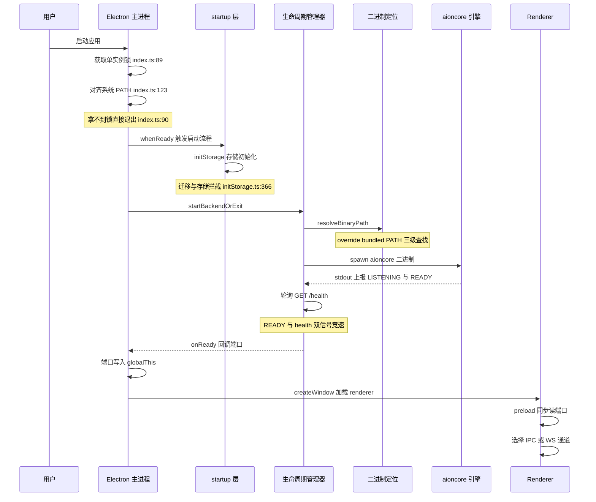
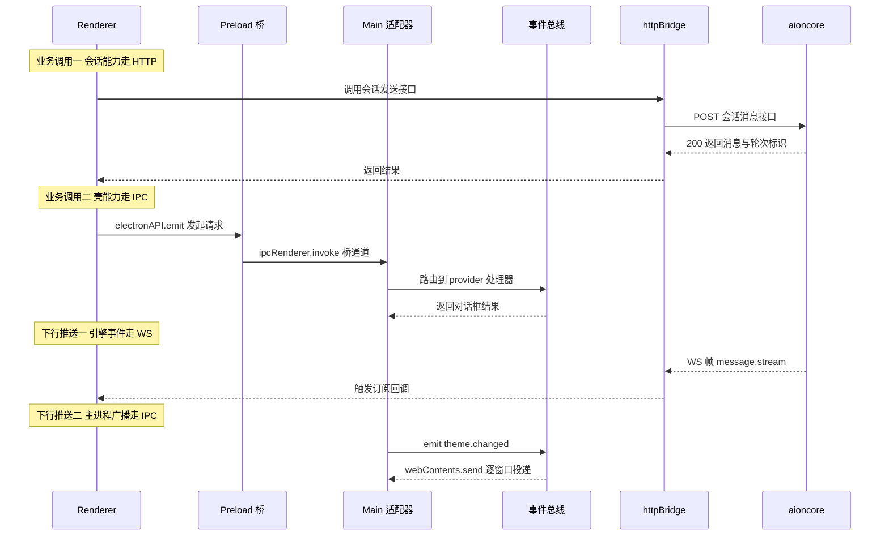

# App-shell 双层架构：启动流程与 IPC 桥

> 本文是 AionUi 解读第一篇，负责把整个系统的骨架讲清楚：这个桌面壳如何把外部 Rust 引擎包进 Electron 应用？IPC 桥如何承载整个平台的通信？后续的 ACP 收敛、数据模型、Team/Cron/远程各模块，都长在这两根骨头上。


## 一句话定位

AionUi 是一个 **壳-引擎分离（app-shell）** 的 Electron 桌面应用：TS 前端壳只做窗口/进程/IPC/数据持久化，一切业务逻辑（会话、Agent 运行时、DB、WebUI host）下沉到外部 Rust 二进制 `aioncore`，二者通过「HTTP REST + WebSocket」与「Electron IPC」两套传输层通信。

## 在项目中的角色（去掉它系统会怎样）

这层是整个系统的**骨架**，不是某个可插拔模块。从 `packages/desktop/src/process/index.ts:7-9` 的加载顺序可见它的优先级：platform 服务注册与 Chromium 配置被要求排在一切其他模块之前，因为它们决定 userData 路径与运行环境。

```ts
import '@/common/platform/register-electron';
// configureChromium sets app name (dev isolation) and Chromium flags — must run before other modules
import '@process/utils/configureChromium';
```

反事实检验——把这一层整体拿掉，系统会发生什么：

- **renderer 全屏无数据**：`ipcBridge` 里除窗口控制/主题/更新外的几乎全部调用都走 HTTP 打到 aioncore 的 127.0.0.1 端口（[packages/desktop/src/common/adapter/httpBridge.ts:37-42]() 兜底端口 13400 只是给 `ECONNREFUSED` 留个干净的失败路径）。没有主进程把 aioncore 拉起来，UI 一个会话都建不出来。 <!-- anchor: function getBackendPort(): number { … return g.__backendPort ?? 13400; -->
- **窗口级能力全断**：关窗到托盘、最小化/最大化、原生文件对话框、系统通知、开机自启、自动更新，这些只有主进程能做的操作全部失效——它们正是通过 `bridge.buildProvider` 注册成 `ipcBridge.windowControls.*`、`dialog.*`、`notification.*`（[packages/desktop/src/process/bridge/index.ts:18-27]() 一次性注册所有桥）。 <!-- anchor: export function initAllBridges(_deps: BridgeDependencies = {}): void { … initThemeBridge(); -->
- **WebUI/移动端远程访问直接不存在**：`browser.ts` 里 WebSocket 通道、`webuiBridge.ts` 的 WebUI 生命周期，都以主进程与 aioncore 已就绪为前提。

一句话：**没有这层，AionUi 退化成一张无法连接任何后端的空 Electron 窗口。**

## 解决什么问题、根因

根因可以压缩成一个矛盾：**AionUi 想给「命令行 AI agent 生态」套一个 GUI，但引擎不在壳的技术栈里，也不跟壳共享进程生命周期。**

展开是三组具体冲突，每一组都直接决定了下文的一个架构选择：

1. **跨栈集成**：核心引擎是 Rust 写的独立仓库 AionCore（v0.2.1），不是 npm 包。壳要运行它只能走「二进制分发 + 子进程 spawn + 生命周期管理」这条最传统的路（[packages/desktop/electron-builder.yml:110-112]() 用 `extraResources` 把预编译 aioncore 打进安装包；[packages/desktop/src/process/backend/binaryResolver.ts:71-93]() 运行时按「env 覆盖 → 捆绑资源 → 系统 PATH」三级查找）。这与 Electron 应用常选的「纯 Node 主进程」架构有本质差别——引擎不是主进程的一部分，而是壳管理的另一个进程。 <!-- anchor: # aioncore binary (pre-compiled per platform/arch, ships its own bun runtime) … to: bundled-aioncore --> <!-- anchor: export function resolveBinaryPath(): string { … diagnostics -->

2. **多进程 + 多传输**：一个会话里至少有 Electron 主进程、renderer（沙箱）、aioncore 三个进程，而同一套 renderer 业务代码还要能跑在 WebUI 浏览器里（无 Electron）。这逼出一个**进程内事件总线 + 可插拔适配器**的抽象：业务只认 `provider`/`invoke`/`on`/`emit`，传输层（IPC 或 WebSocket）由适配器决定（[packages/desktop/src/common/platform/bridge.ts:151-164]() 的 `buildProvider` 是这套抽象的最小单元）。 <!-- anchor: export const buildProvider = <Data, Params = undefined>(key: string) => { … export const buildEmitter = <Params = undefined>(key: string) => ({ -->

3. **CLI 引擎启动的失败是常态**：引擎是外部可执行文件，启动失败原因千奇百怪——Mac 上装了 x64 包但机器是 arm64（Rosetta）、Linux 缺 glibc 版本、安装包被删了 `bundled-aioncore/` 目录、两个实例竞争同一个数据目录……这些必须被**结构化分类**，让 UI 能区分「可恢复重试」「需要重装」「需要升级 AionUi」并给出对应用户的话术（[packages/desktop/src/process/startup/backendStartupFailure.ts:287-368]() 的 `classifyBackendStartupFailure` 是全套分类器入口）。这是把「进程拉起」从工程细节提升到「一等公民」的关键。 <!-- anchor: export function classifyBackendStartupFailure(error: unknown): BackendStartupFai … backendBoundaryStage, -->

## 设计思路

### 方案：壳-引擎分离 + 平台无关事件总线 + 三层启动编排

整体是**问题驱动**展开的三层设计：

**第一层：进程模型（壳 vs 引擎）。** 壳负责 UI、子进程、IPC、设置持久化；aioncore 拥有 SQLite 数据库、Agent 运行时、WebUI host、全部业务 API。二者唯一的边界是 HTTP/WS 端口。这条边界的好处是引擎可以在任何语言里演进、崩溃不会拖垮壳（子进程树清理见 [packages/web-host/src/backend-launcher.ts:436-467]()），坏处是「启动成功」变成一件需要专门工程化的事——于是有了第二层。 <!-- anchor: function killBackendProcessTree(childProcess: ChildProcess | null, signal: 'SIGT … return Promise.resolve(); -->

**第二层：启动编排（把"拉起引擎"做成一个可诊断的流程）。** 主进程 `src/index.ts` 里，`handleAppReady` 串联了：单实例门控 → `initializeProcess`（存储迁移/目录/interceptor）→ `startBackendOrExit`（二进制定位 → spawn → 就绪探测）→ 就绪后广播端口（[packages/desktop/src/process/startup/backendStartup.ts:22-37]() 是这层的中枢，把「成功返回端口 / 取消 / 失败分类 + 退出」折叠成一个小状态机）。BackendLifecycleManager 里则内建了两套就绪信号：stdout 上 aioncore 自报的 `AIONCORE_READY` 精确标记，与壳侧轮询 `/health`，谁先到算谁赢（[packages/web-host/src/backend-launcher.ts:856-860]()）。这套「双保险」不是防御性编程，而是实测教训——aioncore 可能先监听端口后做 DB 迁移，单看端口会误判就绪。 <!-- anchor: export async function startBackendOrExit(options: StartBackendOrExitOptions): Pr … return { ok: false }; --> <!-- anchor: const healthOrReady = await Promise.race([ … startupFailure, -->

**第三层：事件总线 + 适配器（平台无关的关键）。** `bridge.ts` 是一个与 Electron 完全无关的进程内总线：事件名是字符串，`subscribe`/`invoke` 用「请求 id + 回调事件名」做 RPC 配对（[packages/desktop/src/common/platform/bridge.ts:119-151]()）。真正的魔法在适配器： <!-- anchor: export const subscribe = <Params = unknown, Data = unknown>( … export const buildProvider = <Data, Params = undefined>(key: string) => { -->

- 主进程侧 [packages/desktop/src/common/adapter/main.ts:39-100]()：`bridge.adapter({...})` 把所有 emit 序列化后经 `webContents.send` 推到每个 BrowserWindow，同时把 renderer 的 `ipcRenderer.invoke` 转回总线。 <!-- anchor: bridge.adapter({ … export const initMainAdapterWithWindow = (win: BrowserWindow) => { -->
- renderer 侧 [packages/desktop/src/common/adapter/browser.ts:55-73]()：**同一个文件**里，`window.electronAPI` 存在走 IPC，否则走 WebSocket——这一行 `if` 就是"同一 renderer 跑桌面和 WebUI"的全部秘密。 <!-- anchor: if (win.electronAPI) { … } else { -->

### 放弃的替代方案

| 候选 | 放弃原因 |
|------|---------|
| 引擎做成 Node native addon（N-API 绑定） | 引擎要独立演进、独立崩溃、独立升级；addon 让引擎和壳共享 ABI 与进程，违反壳-引擎分离的初衷，且跨平台编译成本极高。 |
| renderer 直连 aioncore HTTP，绕过主进程 | 失去了统一生命周期入口（WebUI 开关、端口暴露、会话清理都挂在主进程）；preload 沙箱下也不可能给 renderer 任意网络权限。 |
| 纯 REST、不要 WebSocket | 会话消息是流式的（`message.stream`），Agent 运行状态要实时推给 UI，轮询无法承载 turn 级事件。 |
| 把 WebUI 当另一套代码 | 复制成本与漂移风险；项目选择的是「同一套 renderer + 同一套 ipcBridge 调用点，传输层按环境切换」。 |

### 核心模式小结

- **Provider/Invoke 逆配对**：定义方（主进程或 renderer 某侧）调 `.provider(handler)` 注册实现；调用方调 `.invoke()`。`buildProvider` 返回 `{ provider, invoke }` 一体两面，天然防止定义与调用两侧签名漂移（[packages/desktop/src/common/platform/bridge.ts:151-164]()）。 <!-- anchor: export const buildProvider = <Data, Params = undefined>(key: string) => { … export const buildEmitter = <Params = undefined>(key: string) => ({ -->
- **REST 优先、IPC 兜底**：`ipcBridge` 里每个域对象，能用 HTTP 表达的去 aioncore（`httpGet`/`httpPost`/…），必须留在壳里的（窗口、更新、对话框、主题缓存、WebUI 生命周期）才用 `bridge.buildProvider`。这从文件头注释就写明了（[packages/desktop/src/common/adapter/ipcBridge.ts:7-13]()）。 <!-- anchor: * IPC Bridge → HTTP/WS adapter. … * native dialogs, auto-update, devtools, zoom, CDP, deep links) remain as IPC. -->
- **结构化失败分类**：启动失败错误对象统一挂 `details` 字段，分类器按 `stage` + 边界码 + 文本正则逐级收窄（[packages/desktop/src/process/startup/backendStartupFailure.ts:57-61]() 定义的边界码常量是这套分类的字典）。 <!-- anchor: const TRANSIENT_CONCURRENT_STARTUP_PEER_CODE = 'BOOTSTRAP_PEER_ALREADY_RUNNING'; … const MAX_REPORTED_DIR_ENTRIES = 20; -->

## 关键数据结构

这层理解设计必需的类型/接口只有五个，其他都可以顺源码点进去看：

**1. `BridgeAdapter` —— 传输层与总线的焊接点**（[packages/desktop/src/common/platform/bridge.ts:17-20]()）。`emit(name, data)` 把总线上行的事件送向对端；`on(emitter)` 把对端的事件灌回总线。main.ts 与 browser.ts 各自实现一个，bus 不关心底下是 IPC 还是 WS。 <!-- anchor: export type BridgeAdapter = { … on: (emitter: BridgeEventEmitter) => void | (() => void); -->

```ts
export type BridgeAdapter = {
  emit: (name: string, data: unknown, ...args: unknown[]) => unknown;
  on: (emitter: BridgeEventEmitter) => void | (() => void);
};
```

**2. Provider 一体两面**（[packages/desktop/src/common/platform/bridge.ts:151-164]()）。`buildProvider(key)` 返回 `{ provider, invoke }`：`provider` 注册实现、`invoke` 发起调用，中间隔着 `subscribe-{key}` / `subscribe.callback-{key}{id}` 两个事件名。renderer 侧 `ipcBridge.xxx.invoke()`、主进程侧 `ipcBridge.xxx.provider(...)`，签名为同一把 key 锁定，天然防漂移。 <!-- anchor: export const buildProvider = <Data, Params = undefined>(key: string) => { … export const buildEmitter = <Params = undefined>(key: string) => ({ -->

**3. 域对象出口 `ipcBridge`**（[packages/desktop/src/common/index.ts:7-8]()）。整个平台唯一的 API 面：`export * as ipcBridge from './adapter/ipcBridge'`。内部每个域（`shell`/`assistants`/`conversation`/`application`/`windowControls`/`team`/`cron`/…）要么由 `httpGet/httpPost/…` 组成（去 aioncore），要么由 `bridge.buildProvider`/`buildEmitter` 组成（留壳内）。 <!-- anchor: export * as ipcBridge from './adapter/ipcBridge'; … export { conversation } from './adapter/ipcBridge'; -->

**4. 失败分类产物 `BackendStartupFailureInfo`**（定义在 [packages/desktop/src/common/types/platform/electron]()，分类逻辑见 [packages/desktop/src/process/startup/backendStartupFailure.ts:287-368]()）。是一个带 `reason` 判别联合的类型，UI 根据 `reason` 渲染「重试/重装/升级/报告」不同话术。 <!-- anchor: export function classifyBackendStartupFailure(error: unknown): BackendStartupFai … backendBoundaryStage, -->

**5. `BackendStartupErrorDetails`**（[packages/web-host/src/backend-launcher.ts:105-168]()）。spawn/health 阶段产生的全部诊断字段，随错误对象一路透传到分类器——这是「进程拉起可诊断」的载体：`stage`、`backendBoundaryCode`、`stderrTail`、`healthCheck*` 一组探针。 <!-- anchor: export type BackendStartupErrorDetails = { … healthTimeoutKeptAlive?: boolean; -->

## 核心流程

### 应用启动流程

整个壳只有一条启动主线：`src/index.ts` 的 `handleAppReady`。注意两点细节，它们决定了流程的健壮性：

- **单实例门控在最高层**：只有拿到 single-instance lock 的实例才注册 `whenReady().then(handleAppReady)`（[packages/desktop/src/process/startup/singleInstanceGating.ts:19-21]() + [packages/desktop/src/index.ts:1098-1105]()）。这是血泪教训：两个实例抢同一个数据目录，曾在 Sentry 135525166 制造过「本地数据修复失败」的假报警。 <!-- anchor: export function shouldRegisterBackendStartup(gotTheLock: boolean): boolean { … return gotTheLock === true; --> <!-- anchor: if (shouldRegisterBackendStartup(gotTheLock)) { … app.quit(); -->
- **CDP 桥必须先于后端启动**：单目标 CDP 通道的端口/口令靠进程环境变量继承链（壳 → aioncore → 内置浏览器 MCP）传给 Agent，spawn 之后再改 `process.env` 对已起的子进程无效（[packages/desktop/src/index.ts:741-771]() 的注释把这段硬顺序讲透了）。 <!-- anchor: * 启动单目标 CDP 通道，并把端口/口令写进自己的 env。 … const { cdpStartupEnabled, setActiveCdpPort } = await import('./process/utils/co -->



关键语义：**就绪 = 「端口可连」且「能服务」**。`/health` 轮询在 30s 窗口内打 200 才算 ready；超时但进程还活着时，走 `allowPendingOnHealthTimeout` 分支把进程留着继续等，而不是杀掉（[packages/web-host/src/backend-launcher.ts:862-887]()）。这对「慢启动但健康」的机器是必要的宽容，代价是 UI 的 "starting" 视图可能挂更久——分类器里专门有 `backend_startup_pending_slow` 一类来标记这个状态。 <!-- anchor: if (healthOrReady.kind === 'health' && !healthOrReady.health.ok) { … throw healthTimeoutError; -->

### renderer → preload → 主进程 → adapter → aioncore 事件链路

平台通信分「上行请求（RPC）」与「下行推送（事件）」两条方向，各走不同传输：

- **下行推送**：aioncore 经 WebSocket 推 `message.stream`、`team.*`、`cron.*` 等事件（renderer 的 `wsEmitter` 订阅）；主进程经 Electron IPC 推主题变更、通知点击、窗口最大化状态。
- **上行请求**：renderer 对 aioncore 的能力用 `httpGet/httpPost` 直连；对壳的能力用 `bridge.buildProvider(...).invoke()`，经 preload 的 `electronAPI.emit` 走 `ipcRenderer.invoke`。



图中两条「调用」路径就是 `ipcBridge` 域对象的两种实现来源，renderer 调用点完全不知道底层是哪个传输——这正是平台无关桥的收益。注意一个不对称：**下行推送里，renderer 永远是被动接收方**；renderer 主动订阅事件走 `wsEmitter(eventName).on(...)`，主进程广播走 `buildEmitter(key).emit(...)`，两者在总线里是同名 `on`/`emit` 的同一套机制。

## 与其他模块的协同

这层是下游所有功能模块的入口，依赖关系几乎都是单向「业务 → ipcBridge → 传输」：

- **存储与配置（`initStorage`）**：启动第一步，决定 cacheDir/logDir/workDir 与 JSON 配置文件句柄（`ProcessConfig`/`ProcessEnv`）。它通过 [packages/desktop/src/common/platform/storage.ts:18-24]() 的 `buildStorage` 与 `bridge.ts` 的 provider 机制把「文件存储」暴露成 IPC provider——renderer 的配置读写和主进程的文件读写是同一接口的两侧。 <!-- anchor: export const buildStorage = <S extends object>(namespace: string) => { … return { -->
- **backend 服务层（`services/`）**：i18n、自动更新、legacy DB 迁移都在 `initializeProcess`/`handleAppReady` 生命周期内被拉起或消费。[packages/desktop/src/index.ts:348-362]() 的 `scheduleBackendMigrations` 故意延后到 renderer 加载完成后执行，因为部分迁移步骤要经过 renderer 的 BroadcastChannel，早了会死锁——这是主进程-引擎-渲染器三者耦合的直接证据。 <!-- anchor: const scheduleBackendMigrations = (): void => { … function exposeBackendPort(backendPort: number): void { -->
- **web-host 包（`@aionui/web-host`）**：`BackendLifecycleManager` 和 `startWebHost` 被迁到独立包，桌面与 WebUI 复用同一套后端拉起与静态托管逻辑（[packages/web-host/src/backend-launcher.ts:1-9]() 注释说明了迁移史）。桌面 IPC 路径仍直接实例化 `BackendLifecycleManager` 以保留 stop/port 语义（[packages/web-host/src/backend-launcher.ts:1073-1089]()）。 <!-- anchor: * Lifecycle manager for the aioncore subprocess (web-host version). … * restart window) is byte-for-byte preserved from the original. --> <!-- anchor: * Functional wrapper for ownBackend usage in startWebHost (M5 will consume). … stop: () => manager.stop(), -->
- **renderer（UI 侧）**：通过 preload 注入的 `window.electronAPI`/`window.__backendPort` 与主进程/引擎通信，UI 层不直接 import Electron。后续 ACP 收敛、Team、Cron、远程访问全部挂在 `ipcBridge` 的域对象上。

数据模型（SQLite）完全在 aioncore 侧，本层只持有「引擎未起时也能读的」壳侧 JSON 存储（`JsonFileBuilder`，[packages/desktop/src/process/utils/initStorage.ts:125-133]()）与启动前的 legacy DB 迁移；两类存储的职责边界、迁移交接的细节在数据模型解读篇核对。 <!-- anchor: const JsonFileBuilder = <S extends object = Record<string, unknown>>(file_path:  … const loadSync = (): S => { -->

## 关键设计决策

### 决策一：二进制分发 + 子进程 spawn，而非把引擎编译进壳

**为什么**：引擎（Rust）与壳（TS/Electron）技术栈不同、发布节奏不同、崩溃隔离需求不同。子进程边界让引擎崩溃不至于拖垮 UI，也让引擎可以独立发布版本（壳 v2.2.1 / 引擎 v0.2.1 各自演进）。

**不选什么**：Native addon（N-API）会把两边绑进同一进程和同一编译链；「renderer 直连远程引擎」则把生命周期控制权拱手让给页面。

**代价**：进程边界换来的是启动编排的复杂性——端口分配（避开 fetch 禁止端口，[packages/web-host/src/backend-launcher.ts:240-245]() 那张端口黑名单）、就绪探测、崩溃重启、PATH 对齐、架构/glibc 校验。这些成本全部收在 `startup/` 与 `backend-launcher.ts` 里，可接受。 <!-- anchor: const FETCH_FORBIDDEN_PORTS = new Set([ … 6566, 6665, 6666, 6667, 6668, 6669, 6697, 10080, -->

### 决策二：事件总线 + 多适配器，让同一 renderer 跑桌面与 WebUI

**为什么**：WebUI/移动端远程访问是卖点（README 宣传「Remote access from phone」）。若为桌面单独写一套通信，WebUI 就得复制整套调用面，两套代码必然漂移。项目选择把「通信」抽象成与传输无关的总线，用 `window.electronAPI` 是否存在做一次运行时分支（[packages/desktop/src/common/adapter/browser.ts:55-73]()）。 <!-- anchor: if (win.electronAPI) { … } else { -->

**不选什么**：抽「接口层」由各平台实现。接口抽象的问题是跨层穿透（IPC/WS/REST 三套语义不一致时接口会漏）；项目选的是「传输细节全收进适配器 + 调用面保持同一个对象」的穷举式方案。

**代价**：`ipcBridge.ts` 因此变成一个 2506 行的巨型域对象清单，且 HTTP/WS/IPC 三种 provider 混排，读代码需要「看文件头注释 + 按域定位」两种技巧。这是平台无关性的直接成本。

### 决策三：启动失败结构化分类，UI 按 `reason` 分诊

**为什么**：外部二进制启动失败是常态且原因多态（架构不匹配/缺 glibc/资源缺失/并发竞争）。不分类，用户只会看到一行「Failed to start aioncore」。

**怎么实现**：错误对象带 `details`（stage + 边界码 + 输出尾部），分类器按固定顺序逐级收窄——先查结构性字段（架构、安装完整性），再查文本特征（glibc、目录权限），最后落到边界码组合（[packages/desktop/src/process/startup/backendStartupFailure.ts:287-368]()）。连「两个实例竞争数据目录」这种瞬时态都被单独识别成 `backend_transient_concurrent_startup` 并在 launcher 里带退避重试（[packages/web-host/src/backend-launcher.ts:262-264]() + [packages/web-host/src/backend-launcher.ts:547-580]()）。 <!-- anchor: export function classifyBackendStartupFailure(error: unknown): BackendStartupFai … backendBoundaryStage, --> <!-- anchor: const PEER_ALREADY_RUNNING_BOUNDARY_CODE = 'BOOTSTRAP_PEER_ALREADY_RUNNING'; … const PEER_RETRY_BACKOFF_MS = [250, 500, 1000, 1500]; --> <!-- anchor: async start( … throw lastPeerError ?? new Error('aioncore startup failed after peer retries'); -->

**代价**：分类器与引擎的输出格式（`BOOTSTRAP_*` 边界码、`stage=` 字段）形成跨仓库耦合，引擎改动输出时壳侧必须同步；但这比让 UI 解析纯文本错误信息的耦合度低得多。

## 亮点与问题

### 亮点

- **双就绪信号竞速（AIONCORE_READY vs /health）**：把「端口可连」和「真正能服务」解耦，是踩过「先监听后迁移」坑后的正确收敛（[packages/web-host/src/backend-launcher.ts:856-860]()）。换我设计会只轮询 /health，但这会在慢迁移场景误报。 <!-- anchor: const healthOrReady = await Promise.race([ … startupFailure, -->
- **单目标 CDP 通道的安全取舍**：不启用 Chromium 应用级 `remote-debugging-port`（会把所有 WebContents 无认证暴露），只让 Agent 通过桥控制用户当前在看的侧边浏览器 tab（[packages/desktop/src/process/utils/configureChromium.ts:263-281]() 的注释把威胁模型写得很清楚）。这是「Agent 可控浏览器」卖点的安全底座。 <!-- anchor: if (cdpStartupEnabled) { … console.log('[CDP] Agent browser control enabled (single-target bridge)'); -->
- **崩溃自动重启带退避与窗口限流**：`handleCrash` 在 60s 窗口内最多 3 次重启、指数退避（[packages/web-host/src/backend-launcher.ts:1022-1066]()），且不会在用户主动 stop 后重启——状态机语义严谨。 <!-- anchor: private handleCrash(code: number | null, signal?: NodeJS.Signals | string | null … error: getErrorMessage(error), -->
- **payload 超限护栏**：adapter 侧对 50MB 以上的桥事件直接丢弃并广播 `bridge:error`，防止大序列化阻塞主进程（[packages/desktop/src/common/adapter/main.ts:36-37]()）。 <!-- anchor: /** Maximum IPC payload size (50 MB). Messages exceeding this are dropped with a … const MAX_IPC_PAYLOAD_SIZE = 50 * 1024 * 1024; -->

### 问题

- **`invoke` 永不 reject（潜在挂死）**：`bridge.ts` 的 `invoke` 只注册一次性回调 resolve，没有超时或拒绝路径（[packages/desktop/src/common/platform/bridge.ts:138-149]()）。若某 provider 实现抛错或对端从未应答，调用方会永久 pending。HTTP 路径有 `BackendHttpError` 兜底，但走 IPC 的 provider 没有等价物。改进方向：invoke 加超时 + 拒绝回调。 <!-- anchor: export const invoke = <Data = unknown>(name: string, data?: unknown): Promise<Da … emit(`subscribe-${name}`, { id, data }); -->
- **`feedbackBridge.ts` 脱离总线体系**：它直接用裸 `ipcMain.on`/`ipcMain.handle` + 字符串通道名（`feedback:renderer-log` 等，[packages/desktop/src/process/bridge/feedbackBridge.ts:36-98]()），而其余桥都走 `bridge.buildProvider`。两套通道并存，renderer 侧要靠 preload 手工转发，违背了「统一总线」的初衷。 <!-- anchor: ipcMain.on('feedback:renderer-log', (_event, payload: RendererFeedbackLogPayload … return null; -->
- **`updateBridge.ts` 职责混杂**：872 行里同时承载 provider 注册、GitHub release 解析、CDN 下载重写、electron-updater 状态广播（[packages/desktop/src/process/bridge/updateBridge.ts:63-97]()），是「REST 优先原则」的自然漏网之鱼——更新是壳能力，但它把「查版本」和「下安装包」揉在一起。 <!-- anchor: const DEFAULT_REPO = 'iOfficeAI/AionUi'; … return `${CDN_BASE_URL}/${version}/${assetName}`; -->
- **跨 HMR chunk 的类型判断脆弱**：`isBackendHttpError` 靠 `instanceof` 加 duck-typing 双保险（[packages/desktop/src/common/adapter/httpBridge.ts:120-139]()），原因注释直说 vite-dev HMR 会跨 chunk 拆模块。这是开发/生产行为不一致的病灶，值得在打包配置层面解决而非打补丁。 <!-- anchor: export function isBackendHttpError(error: unknown): error is BackendHttpError { … return false; -->
- **引擎输出格式耦合**（见决策三代价）：`BOOTSTRAP_*` 边界码解析（[packages/web-host/src/backend-launcher.ts:356-366]()）跨仓库锁定，引擎发布新错误码时壳侧需跟随。 <!-- anchor: function parseBackendBoundaryError(text: string): ParsedBackendBoundaryError | u … return undefined; -->


## 跨仓库边界与待核实项

> 本解读的分析范围是 AionUi 仓库；以下结论涉及外部 Rust 仓库 aioncore，本仓库内无法完全验证，属双层架构的固有边界。

- aioncore 启动期数据目录竞争 → `backend_transient_concurrent_startup` 分类与 `BackendLifecycleManager.start` 的 peer 重试（`backend-launcher.ts:262-264`、`547-580`）是否为 Sentry 135525166 的完整闭环。
- 壳侧 `JsonFileBuilder` JSON 存储与 aioncore SQLite 的职责边界、v26 legacy DB 迁移交接（`initStorage.ts:404-417`）细节在数据模型解读篇核对。
- `ipcBridge.httpGet` 返回的 snake_case→camelCase 映射（`apiModelMapper`/`teamMapper` 等）与 aioncore API 契约的一致性，在 ACP 收敛/数据模型篇核对。
- README 宣传「Zero Setup / works the moment you install it」依赖 `resources/bundled-aioncore` 随安装包分发（`electron-builder.yml:110-112`）；开发态若未放置该目录，启动会回落到系统 PATH 查找——该降级路径是否在 CI/发布流水线有守门，需对照 AionCore 与 CI 配置核实。

> 分析深度：本关注面按深度模式（核心模块 ≥90%）覆盖，覆盖率明细详见各 subagent 分析草稿；正文论断均带 `文件:行号` 可验证引用。
