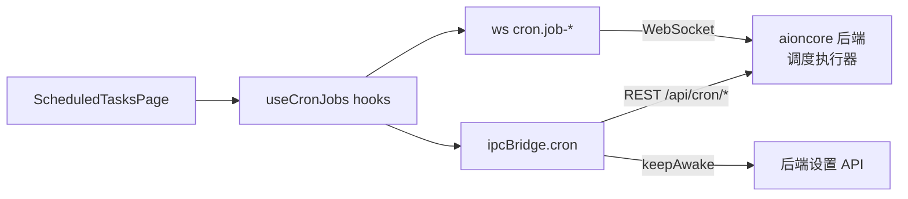
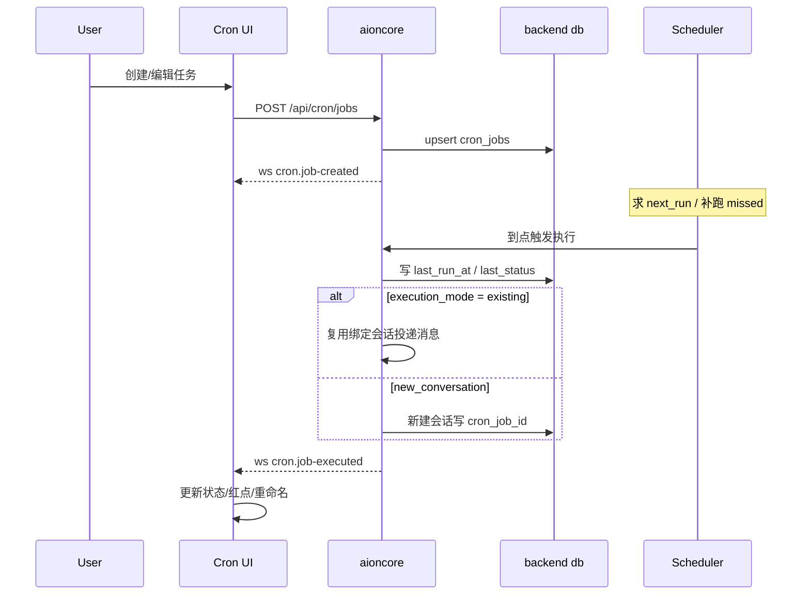

# Cron 24/7 自动化调度模块深度解读

> 前几篇讲完骨架、收敛、数据底座与 Team，本篇聚焦平台的自动化能力：agent 如何无人值守地按计划运行。这是"24/7"定位的技术支撑，与远程访问（手机控制、渠道触发）共同构成"agent 不在场也能干活"的能力闭环。

## 模块定位：让 agent 无人值守的调度中枢

AionUi 的 Cron 模块承担一个把"对话式 agent"升级为"自动值守 agent"的转换：把自然语言构建的指令装进时间驱动（`schedule`）、会话绑定（`metadata.conversation_id`）、可寻址执行的统一模型 `ICronJob`，交给后端按计划反复触发。

它的本质位置是**前端管理面**而非执行面：本仓库内 cron 的全部读写都收敛为对后端 REST 端点的调用，没有调度器、没有定时器、没有 `node-cron` 类依赖。`cron` 命名空间把增删改查、立即运行全部映射为 `/api/cron/*` HTTP 路由，其中 `runNow` 对应 `POST /api/cron/jobs/{id}/run`，执行器拿到任务后返回 `conversation_id`——即"触发即开会话" [packages/desktop/src/common/adapter/ipcBridge.ts:1630-1653]()。

<!-- anchor: export const cron = { … runNow: httpPost<{ conversation_id: string }, { job_id: string }>((p) => `/api/cron/jobs/${p.job_id}/run`), -->

这条边界的总前提写死在 httpBridge 头部注释里：HTTP/WS bridge 是"把调用路由到 aioncore 的 REST API 与 WebSocket"的桥，与本地 IPC bridge 形状一致、renderer 无需改动即可替换 [packages/desktop/src/common/adapter/httpBridge.ts:2-3]()。**前端只负责"定义任务、观察任务"，"何时执行、如何执行"全部下沉到 Rust 引擎**。

<!-- anchor: * HTTP/WS bridge factory — drop-in replacement for bridge.buildProvider / bridge.buildEmitter … * that routes calls to aioncore via REST API and WebSocket. -->

> 跨模块结论：aioncore 中调度器（cron 表达式求值、missed 补跑、powerSaveBlocker 调用）的真实实现依赖 aioncore 外部仓库，本仓库不可验证。本仓库边界可证的是契约与前端全部响应逻辑。

去掉这个模块系统会怎样？agent 就退回"被叫才能干活"的状态——用户必须手动在场发起对话，数据的定时聚合、日报、文件整理这类周期性任务不复存在，"24/7"卖点只剩远程访问的"随时能叫"，没有"主动干"。更隐蔽的代价是：对话上下文无法跨时段复用（没有绑定会话的载体），每次周期性任务都得重新从零交代背景。

## 根因：agent 为什么需要被定时驱动

"无人值守"的难点不在"让代码定时跑"，而在**让一个有状态、会推理、需要上下文延续的 agent 周期性地被正确唤醒并带着记忆工作**。拆开是三个子问题：

- **谁来计时**：桌面应用不能靠人盯着时钟，需要系统级的定时机制，且不能因为机器休眠/应用退到后台就失效。
- **上下文怎么延续**：一次运行是孤立执行还是延续上次的对话？延续了，记忆在；不延续，每次都是冷启动。
- **错过怎么补**：机器休眠错过触发点后，是静默丢弃（数据缺口）还是醒来补跑（尽力而为的一致性）？

Cron 模块的三种调度模式、conversation-bound、keep-awake + `missed` 状态分别对治这三个问题。这也是 README 把它作为旗舰卖点、与远程访问并列为"不在场也能干活"两大支柱的原因。

## 设计思路

### 三种调度模式：一个模型承载全部周期语义

调度被建模成封闭的三态联合类型 `ICronSchedule`：`at`（一次性，`atMs` 绝对时间戳）、`every`（固定间隔，`everyMs` 毫秒数）、`cron`（5 字段 cron 表达式 + 可选 `tz` 时区）[packages/desktop/src/common/adapter/ipcBridge.ts:1675-1678]()。三个 `kind` 共享同一个 `description` 字段作为人类可读描述。

<!-- anchor: export type ICronSchedule = … | { kind: 'cron'; expr: string; tz?: string; description: string }; -->

选封闭联合而非"一个 `schedule` 字符串 + 一个类型标记"的代价是前端必须为每种 kind 写分支渲染——列表页的 `formatSchedule` 就分别处理 `cron`/`every` 两种兜底展示 [packages/desktop/src/renderer/pages/cron/cronUtils.ts:62-71]()。收益是**类型层面杜绝非法组合**：一次性任务不可能同时带 cron 表达式，调度器不必猜。对"配置不可达状态"敏感的调度系统，这是对的取舍。

<!-- anchor: export function formatSchedule(job: ICronJob, t: TFunction): string { …   return job.schedule.description; -->

一次性任务的自禁用语义（触发后 auto-disable）在 readme 中宣传为 "One-time — trigger once at a specified datetime, then auto-disable" [readme.md:339-339]()。本仓库内该语义的最终落地在后端执行器，前端只负责把 `at` 写入并展示——CreateTaskDialog 中没有一次性模式的独立 UI 分支，创建时仍走 `createCronSchedule` 生成 cron 表达式（见下）。

<!-- anchor: - `One-time` — trigger once at a specified datetime, then auto-disable -->

> 实现/宣传的可见缝隙：前端创建对话框的频次选项（hourly/daily/weekdays/weekly/custom）最终都折叠成 5 字段 cron 表达式 [packages/desktop/src/renderer/pages/cron/ScheduledTasksPage/CreateTaskDialog.tsx:448-473]()，`every`/`at` 两种 kind 在前端没有对应的图形化录入入口，只存在于类型与旧数据中——即"固定间隔/一次性"模式当前主要由后端/旧数据承载，新任务的图形化创建一律走 cron 表达式。后端/旧版本是否仍生成（依赖 aioncore 外部实现） `every`/`at` 任务。

<!-- anchor: const scheduleInfo = useMemo(() => { …   }, [frequency, time, weekday, t, customSchedule]); -->

cron 表达式创建时就被锚定到**本地 IANA 时区**：`createCronSchedule` 调用 `Intl.DateTimeFormat().resolvedOptions().timeZone` 得到 `tz` 字段 [packages/desktop/src/renderer/pages/cron/cronUtils.ts:78-94]()。这意味着"每天 9 点"是用户本地时区的 9 点，而不是服务器/UTC 的 9 点——对桌面个人工具，这是正确的默认；对多时区协作（Team 场景），这个默认值值得商榷（见决策二）。

<!-- anchor: export function getCurrentCronTimeZone(): string { …     tz: getCurrentCronTimeZone(), -->

### conversation-bound：任务绑定会话，上下文成为一等公民

每个任务持有 `metadata.conversation_id`（绑定源会话）和 `target.execution_mode`（`'existing'` 延续该会话 / `'new_conversation'` 每次新会话）。`target` 只携带一条 `payload.message` 文本 [packages/desktop/src/common/adapter/ipcBridge.ts:1686-1693]()——**任务的本体不是一份"作业脚本"，而是一条自然语言消息**，执行 = 把这条消息投进一个会话，让 agent 像收到用户消息一样处理。这是整个模块最核心的设计立场：Cron 不发明新的执行模型，而是复用聊天即任务（chat-as-task）的既有管道，只加"定时投递"这一层。

<!-- anchor:   target: { …     agent_type: string; -->

两种执行模式的分工：

- `existing`：延续绑定会话，agent 带着完整历史上下文干活，适合需要累积状态的任务（如"继续昨天的整理"）。
- `new_conversation`：每次触发开新会话，适合输出相互独立的周期报告，且新会话会被命名为"任务名 + 日期"便于检索 [packages/desktop/src/renderer/pages/cron/cronUtils.ts:117-119]()。该函数注释里记录了一个真实 bug：旧版写死 `DD-MM-YY` 在月优先的 locale（如美式）下会读反日期。

<!-- anchor: export function formatCronRunConversationTitle(jobName: string, runAtMs: number, language?: string): …   return `${jobName.trim()} ${dateLabel}`; -->

Team 联动：当任务绑定的会话属于某个 team，创建/编辑对话框会把 execution_mode 锁定为 `existing`（`isExecutionModeLocked` 判定，且团队任务不能切换 agent 配置）[packages/desktop/src/renderer/pages/cron/ScheduledTasksPage/CreateTaskDialog.tsx:495-500]()。根因是团队上下文以会话为载体，脱离会话的新会话会丢失 team 的共享记忆与指令体系——这是"会话即上下文"哲学在权限层的体现。

<!-- anchor: const isOriginalExistingConversationTask = isEditMode && editJob?.target.execution_mode === 'existing'; … !isExecutionModeLocked && !isOriginalExistingConversationTask && (!isEditMode || execution_mode !== 'existing'); -->

### keep-awake 与补跑：对抗系统休眠的一致性策略

"24/7"最现实的敌人是笔记本合盖休眠。Cron 模块的处理是两层：

- **预防层（keep-awake）**：前端设置页提供开关，开启后经 `configService` 本地缓存 + `systemSettings.setKeepAwake` 的 `PUT /api/settings/client` 推给后端 [packages/desktop/src/renderer/pages/cron/ScheduledTasksPage/index.tsx:44-52]()。

<!-- anchor: const handleKeepAwakeChange = useCallback(async (enabled: boolean) => { …       Message.error(String(err)); -->

本仓库只定义平台抽象 `IPowerManager` 并实现为 Electron `powerSaveBlocker.start('prevent-app-suspension')` [packages/desktop/src/common/platform/ElectronPlatformServices.ts:55-60]()，但**本仓库内没有任何调用它的消费方**——据此判断实际"阻止休眠"的行为在 aioncore 后端读取该设置后执行（依赖 aioncore 外部实现）。

<!-- anchor: power = { … preventDisplaySleep: (): number | null => powerSaveBlocker.start('prevent-display-sleep'), -->

- **补救层（missed）**：任务状态枚举 `last_status` 含 `'missed'` [packages/desktop/src/common/adapter/ipcBridge.ts:1702-1702]()。

<!-- anchor:     last_status?: 'ok' | 'error' | 'skipped' | 'missed'; -->

readme 宣传 "detects missed triggers after wake" [readme.md:351-351]()。

<!-- anchor: - **Keep-awake** -->

前端将 `missed` 与 `error` 同等对待，在列表/详情/角标三处显示为错误态（`isJobErrorLike`）[packages/desktop/src/renderer/pages/cron/useCronJobs.ts:16-17]()。"醒来补跑错过触发"的具体调度逻辑（怎么算错过、补多少）在 aioncore，本仓库仅从事件流观察到结果（依赖 aioncore 外部实现）。

<!-- anchor: const isJobErrorLike = (job: ICronJob): boolean => { …   return job.state.last_status === 'error' || job.state.last_status === 'missed'; -->

预防与补救并用是典型的"尽力而为"一致性：既通过 keep-awake 减少错过窗口，又用 `missed` 标记让错过可被发现、可被补跑，而非两者只取其一。代价是状态机多了一个 `missed` 分支要处理（UI 侧所有状态判断都要带它），换来的是调度可观测性。

## 关键数据结构

理解模块所需的核心类型集中在两处：前端类型契约（renderer ↔ 后端）与历史遗留的本地表结构（后端接管前的主进程实现）。

**`ICronJob`（前端契约）** [packages/desktop/src/common/adapter/ipcBridge.ts:1680-1708]()：四段结构——`schedule`（何时跑，三态联合）、`target`（跑什么：一条消息 + 执行模式）、`metadata`（绑定哪个会话、哪个 agent、谁创建的）、`state`（调度器回写的时间戳与状态）。其中 `next_run_at_ms` / `last_run_at_ms` / `run_count` / `max_retries` / `queue_enabled` 全部由后端维护，前端只读展示——再次印证"前端看状态，后端算时间"。

<!-- anchor: export interface ICronJob { …     queue_enabled: boolean; -->

**`cron_jobs` 本地表（历史遗留）**：v9 迁移曾完整定义过这张表（`schedule_kind` 的注释还写着 `'at' | 'every' | 'cron'`，与今天的 `ICronSchedule` 三态一一对应）[packages/desktop/src/process/services/database/migrations.ts:263-293]()。

<!-- anchor: db.exec(`CREATE TABLE IF NOT EXISTS cron_jobs ( …         max_retries INTEGER DEFAULT 3 -->

v22/v24 又补了 `execution_mode`、`agent_config`、`description` 列 [packages/desktop/src/process/services/database/migrations.ts:1098-1107]()。

<!-- anchor: const cronColumns = new Set((db.pragma('table_info(cron_jobs)') as Array<{ name: string }>).map((c) => c.name)); … `UPDATE cron_jobs SET execution_mode = 'new_conversation' WHERE conversation_id = '' OR conv -->

但今天这张表在前端已经没有任何业务读写——只有 `legacyHandoffContract` 把 `skill_content`、`description` 两列列为"后端接管后仍需保留"的交接清单 [packages/desktop/src/process/services/database/legacyHandoffContract.ts:7-9]()。

<!-- anchor: export const LEGACY_HANDOFF_COLUMNS: readonly LegacyHandoffColumn[] = [ …   { table: 'cron_jobs', column: 'description', definition: 'TEXT' }, -->

由 `repairLegacyHandoffSchema` 在启动时把缺的列补回本地库，保证旧库能安全交给 aioncore [packages/desktop/src/process/services/database/repairLegacyHandoffSchema.ts:17-30]()。这是架构演进的化石：**Cron 从主进程 Node 实现迁到 Rust 后端，前端 SQLite 表降级为纯兼容层**。这条迁移证据比任何文档都更能说明"执行器外置"是一次真实发生过的重构。

<!-- anchor: export function repairLegacyHandoffSchema(db: ISqliteDriver): LegacyHandoffRepairResult { …     repairedColumns.push({ table: entry.table, column: entry.column }); -->

**`ICronAgentConfigRead/Write`（每任务专属 agent 配置）** [packages/desktop/src/common/adapter/ipcBridge.ts:1711-1722]()：承载 README 宣传的 "each task can have its own model, workspace directory, and reasoning effort settings"。

<!-- anchor: export interface ICronAgentConfigRead { …   workspace?: string; -->

该宣传对应 readme 中 "Advanced config" 一行 [readme.md:352-352]()。

<!-- anchor: - **Advanced config** -->

`model_id`/`model` 绑定模型，`workspace` 绑定工作目录，`config_options` 承载 reasoning effort 等运行时选项。前端创建对话框通过 `resolveCronAgentConfig` 把它与 preset assistant 目录对接：aionrs 类 assistant 走 `provider_id + use_model` 的 model 对象（并对 provider/model 缺失抛错），其余走 `model_id + config_options` [packages/desktop/src/renderer/pages/cron/ScheduledTasksPage/resolveCronAgentConfig.ts:58-72]()——不同运行时引擎的模型寻址差异在此收敛。

<!-- anchor:   if (isAionrsAssistant(assistant)) { …       workspace, -->

**skill 关联（每任务专属技能）**：后端把 AI 生成的 SKILL.md 建议以 `skill_suggest` artifact 推进会话，用户点保存后经 `cron.saveSkill` 落到 `{cacheDir}/cron-skills/{job_id}/SKILL.md`（每任务一个子目录）[packages/desktop/src/process/utils/initStorage.ts:302-306]()。

<!-- anchor: * Get the directory for per-cron-job SKILL.md files. … const getCronSkillsDir = () => { -->

保存/查询/删除三个端点挂在同一 `/api/cron/jobs/{id}/skill` 路由下 [packages/desktop/src/common/adapter/ipcBridge.ts:1654-1662]()。

<!-- anchor: saveSkill: httpPost<void, { job_id: string; content: string }>( …   deleteSkill: httpDelete<void, { job_id: string }>((p) => `/api/cron/jobs/${p.job_id}/skill`), -->

## 核心流程：一条 cron 任务的生命周期

下图覆盖"创建 → 调度 → 触发 → 写回会话 → 前端感知"的完整链路。执行侧（调度器求值、补跑、powerSaveBlocker）标为 aioncore 外部实现部分——本仓库可证的是前后端契约与前端全部响应逻辑。

**创建**：`handleSubmit` 把表单态（频次→cron 表达式、assistant→agent_config、执行模式、队列开关）组装成 `ICreateCronJobParams` 后 `ipcBridge.cron.addJob.invoke` [packages/desktop/src/renderer/pages/cron/ScheduledTasksPage/CreateTaskDialog.tsx:525-608]()。

<!-- anchor: const handleSubmit = async () => { …       setSubmitting(false); -->

另一个创建入口是对话内自然语言：列表页"Create via chat"跳到首页并预填默认 prompt [packages/desktop/src/renderer/pages/cron/ScheduledTasksPage/index.tsx:66-67]()。

<!-- anchor: const handleCreateViaChat = useCallback(() => { …     navigate('/guid', { state: { prefillPrompt: t('cron.status.defaultPrompt') } }); -->

让用户在聊天里描述任务——这是 "Natural Language" 宣传 [readme.md:321-321]() 的前端载体。

<!-- anchor: - **Natural Language** — tell the agent what to do, just like chatting -->

**事件驱动的状态同步**：所有列表/详情组件不依赖轮询，而是订阅四个 WebSocket 事件 `cron.job-created/updated/removed/executed` [packages/desktop/src/common/adapter/ipcBridge.ts:1663-1666]()。

<!-- anchor:   onJobCreated: wsEmitter<ICronJob>('cron.job-created'), …   onJobExecuted: wsEmitter<{ job_id: string; status: 'ok' | 'error' | 'skipped' | 'missed' -->

`useCronJobSubscription` 把它们统一成三个 handler 并在组件卸载时统一退订 [packages/desktop/src/renderer/pages/cron/useCronJobs.ts:116-127]()。

<!-- anchor: function useCronJobSubscription(handlers: CronJobEventHandlers) { …   }, [handlers.onJobCreated, handlers.onJobUpdated, handlers.onJobRemoved]); -->

写操作（pause/resume/delete/update）只 invoke、不本地改 state、依赖后端回发事件（actions 全部 `await ipcBridge.cron.*.invoke`）[packages/desktop/src/renderer/pages/cron/useCronJobs.ts:68-101]()。

<!-- anchor: const pauseJob = useCallback( …   return { pauseJob, resumeJob, deleteJob, updateJob }; -->

**执行感知**：`useCronJobsMap` 以 `last_run_at_ms` 的变化检测一次新执行——发现变化后：① 若执行模式是新会话，异步把最新子会话改名（"任务名 + 日期"）；② 若用户当前不在该会话，把该会话标记为 unread（红点）；③ 触发 `chat.history.refresh` 让会话列表按修改时间重排 [packages/desktop/src/renderer/pages/cron/useCronJobs.ts:359-381]()。

<!-- anchor: onJobUpdated: (job: ICronJob) => { …           emitter.emit('chat.history.refresh'); -->

unread 集合持久化到 `localStorage`，冷启动可恢复 [packages/desktop/src/renderer/pages/cron/useCronJobs.ts:301-307]()。

<!-- anchor: useEffect(() => { …   }, [unreadConversations]); -->

**立即运行**：详情页 `runNow` 调 `POST /api/cron/jobs/{id}/run`，后端返回 `conversation_id` 后前端轮询等待该会话就绪（最久 15s，新会话模式额外等待 `extra.workspace` 出现），补写 `extra.cron_job_id` 后 `swr.mutate` 本地缓存并跳转 [packages/desktop/src/renderer/pages/cron/ScheduledTasksPage/TaskDetailPage.tsx:119-196]()。

<!-- anchor: const handleRunNow = useCallback(async () => { …       setRunningNow(false); -->

同步重入用 `ref` 而非 state 防抖，注释明确说明两个快速点击会绕过 state 检查 [packages/desktop/src/renderer/pages/cron/ScheduledTasksPage/TaskDetailPage.tsx:48-51]()——这是典型的"用 ref 做同步门槛"细节。

<!-- anchor: // Synchronous re-entry guard: `setRunningNow` is async, so two rapid clicks … const runningNowRef = useRef(false); -->

## 与其他模块的协同

- **数据模型（legacy 交接）**：本地 `cron_jobs` 表只留兼容壳，`repairLegacyHandoffSchema` 保证后端需要的列存在（见上节）。真正的数据主权在 aioncore。
- **会话系统**：任务 ↔ 会话双向关联。任务经 `metadata.conversation_id` 绑定源会话；子会话经 `conversation.extra.cron_job_id` 反指任务 [packages/desktop/src/renderer/hooks/context/ConversationContext.tsx:36-36]()。

<!-- anchor: cron_job_id?: string; -->

前端 `conversation.listByCronJob` 走 `GET /api/cron/jobs/{id}/conversations` 拉取该任务的全部历史会话 [packages/desktop/src/common/adapter/ipcBridge.ts:303-305]()。

<!-- anchor: listByCronJob: withResponseMap( …     (list) => list.map(fromApiConversation) -->

会话标题栏用 `CronJobManager` 挂任务状态胶囊（无任务时渲染空、移动端隐藏）[packages/desktop/src/renderer/pages/cron/components/CronJobManager.tsx:86-94]()。

<!-- anchor: const { jobs, loading: listLoading } = useCronJobs(conversation_id); …   if (loading || !job) return null; -->

历史列表用 `CronJobIndicator` 画六种状态角标 [packages/desktop/src/renderer/pages/cron/components/CronJobIndicator.tsx:13-13]()。

<!-- anchor: export type CronJobStatus = 'none' | 'active' | 'paused' | 'error' | 'unread' | 'unconfigured'; -->

- **消息系统（触发回写）**：`cron_trigger` 与 `skill_suggest` 两类会话 artifact [packages/desktop/src/common/adapter/ipcBridge.ts:1920-1920]() 把"任务触发了 / 建议给任务配个 skill"作为会话内卡片呈现，点击跳任务详情。这是调度动作反哺对话流的桥。

<!-- anchor: export type IConversationArtifactKind = 'cron_trigger' | 'skill_suggest'; -->

- **Skill 体系（AI-created tasks）**：`skill_suggest` artifact 携带完整 SKILL.md 内容 [packages/desktop/src/common/adapter/ipcBridge.ts:1946-1953]()。

<!-- anchor: export type ISkillSuggestArtifact = IConversationArtifactBase< …     skill_content?: string; -->

用户点"保存"即写回 `cron.saveSkill` [packages/desktop/src/renderer/pages/conversation/Messages/components/SkillSuggestCard.tsx:51-55]()。

<!-- anchor: const handleSave = async () => { …       updateArtifactStatus(artifact_id, 'saved'); -->

`created_by: 'user' | 'agent'` 类型表明后端允许 agent 自主建任务 [packages/desktop/src/common/adapter/ipcBridge.ts:1694-1694]()——具体触发点在 aioncore（依赖 aioncore 外部实现）。

<!-- anchor:     created_by: 'user' | 'agent'; -->

- **远程访问（web-host）**：httpBridge 明确支持 WebUI 浏览器模式——无 preload 时走同源，`web-host` 静态服务器反向代理 `/api/*` 并升级 `/ws` 到后端端口 [packages/desktop/src/common/adapter/httpBridge.ts:50-68]()。因此手机/浏览器通过 WebUI 也能访问 cron 的 REST API；但本仓库 `mobile/` 目录没有任何 cron 代码，说明移动端没有独立的任务管理 UI，只有只读访问能力。（依赖 aioncore 外部实现）WebUI 前端是否有 cron 管理页面。

<!-- anchor: function isWebUiBrowserMode(): boolean { …   return `ws://127.0.0.1:${getBackendPort()}/ws`; -->

- **Team**：team 属主任务的 execution_mode 被锁定为 `existing`（见 conversation-bound 一节），保证团队共享上下文不被割裂。

## 关键设计决策

### 决策一：执行器整体外置到 aioncore，前端退化为"契约 + 事件"层

- **选了什么**：cron 的调度、执行、状态回写、keep-awake、补跑全部在外部 Rust 引擎；Electron 前端只管表单、列表、事件订阅。证据链完整：REST 路由（见模块定位一节的 `cron` 命名空间）、WS 事件 [packages/desktop/src/common/adapter/ipcBridge.ts:1663-1666]()。

<!-- anchor:   onJobCreated: wsEmitter<ICronJob>('cron.job-created'), …   onJobExecuted: wsEmitter<{ job_id: string; status: 'ok' | 'error' | 'skipped' | 'missed' -->

证据链还包括：无任何 cron 依赖的 `package.json`、本地 `cron_jobs` 表降级为 legacy 兼容壳 [packages/desktop/src/process/services/database/legacyHandoffContract.ts:7-9]()。

<!-- anchor: export const LEGACY_HANDOFF_COLUMNS: readonly LegacyHandoffColumn[] = [ …   { table: 'cron_jobs', column: 'description', definition: 'TEXT' }, -->

- **没选什么**：没保留主进程 Node 版调度器（v9 迁移留下的表结构是它存在过的化石 [packages/desktop/src/process/services/database/migrations.ts:263-293]()）。替代方案是调度循环在主进程用 `setInterval` 轮询本地 `cron_jobs` 表、用 `node-cron` 求值、Electron 直接 `powerSaveBlocker`。代价对比：

<!-- anchor: db.exec(`CREATE TABLE IF NOT EXISTS cron_jobs ( …         max_retries INTEGER DEFAULT 3 -->

  - 外置方案：前端零调度复杂度、执行与 UI 生命周期解耦（应用窗口关闭/无头模式也能跑）、语言边界清晰；代价是前端任何"需要本地计算"的诉求都要走 HTTP 往返，本仓库对调度内部完全不可见（调试困难，本解读的边界也止步于契约）。
  - 内置方案：实现简单、本仓库内可自证；代价是 Electron 壳的运行时（窗口销毁、休眠、无头）直接威胁调度可靠性，且 Node/前端与 Rust 引擎并存产生两套 agent 执行管道，收敛成本高。
- **结论**：与 README "24/7 unattended" 强绑定的可靠性诉求，值回一次 HTTP 往返的延迟与调试成本；但代价是前端团队对核心调度逻辑失去直接可维护性，边界依赖版本配套。这一边界也解释了本解读大量结论须标注 aioncore 外部边界——不是分析不充分，而是模块的"大脑"在仓库之外。

### 决策二：时区缺失的静默自动修复

- **选了什么**：前端在三条路径上自动补 `tz`——应用就绪后一次性全量（`repairAllCronJobTimeZonesOnce`）[packages/desktop/src/renderer/main.tsx:353-353]()。

<!-- anchor:     void repairAllCronJobTimeZonesOnce(); -->

列表加载时逐条修复 [packages/desktop/src/renderer/pages/cron/useCronJobs.ts:151-151]()。

<!-- anchor: setJobs(await repairCronJobTimeZones(result || [])); -->

详情加载时单条修复 [packages/desktop/src/renderer/pages/cron/ScheduledTasksPage/TaskDetailPage.tsx:77-77]()。

<!-- anchor: setJob(found ? await repairCronJobTimeZone(found) : null); -->

判定标准是"cron 类型、有表达式、无 tz" [packages/desktop/src/renderer/pages/cron/repairCronJobTimeZone.ts:14-17]()。

<!-- anchor: export function hasMissingCronTimeZone(job: ICronJob): job is ICronJob & { …   return job.schedule.kind === 'cron' && Boolean(job.schedule.expr.trim()) && !job.schedu -->

补的时区取当前本地时区，同任务并发修复用 `repairInFlight` Map 去重 [packages/desktop/src/renderer/pages/cron/repairCronJobTimeZone.ts:25-28]()。

<!-- anchor: const existingRepair = repairInFlight.get(job.id); …   return existingRepair; -->

`system.keepAwake` 同列为 legacy 配置键之一 [packages/desktop/src/common/config/configKeys.ts:32-32]()，说明该修复与 keep-awake 同为"从旧配置体系平滑过渡"的思路。

<!-- anchor:   'system.keepAwake': boolean | undefined; -->

- **没选什么**：没让后端在缺 tz 时按 UTC 兜底，也没在 UI 上弹"该任务时区缺失"的修复提示。两者都会改变任务的实际触发时刻或打断用户——静默修复把"旧数据缺字段"这个历史债用当前环境语义自动消化掉。
- **权衡**：对一个 cron 任务，"补时区 = 用补的当下时区解释这个表达式"。如果用户建任务时在时区 A、后来迁到时区 B，修复会以 B 解释 A 时代创建的表达式——语义漂移是静默的。但对桌面个人工具，本地时区长期稳定，这个风险远低于"任务突然失灵"或"每次都要手动确认"。实现用 `Promise` 去重而非标志位，说明作者在乎并发路径（列表多次加载/多组件同时触发）。

### 决策三：前端状态全部由事件推导，而非本地写库

- **选了什么**：`useAllCronJobs`/`useCronJobsMap` 等 hook 的数据源是"初始 fetch + 四个 WS 事件增量更新"，写操作（pause/resume/delete/update）不本地改 state、依赖后端回发事件（见核心流程一节的 actions 说明）。
- **没选什么**：没在前端维持一份"我理解的当前状态"副本做乐观更新。乐观更新 UI 响应快，但要处理回滚/对账；而 Cron 的状态变更者不止用户（还有调度器、远程端、多窗口），任何乐观缓存都会和真实状态打架。
- **权衡**：事件驱动天然正确（状态唯一真源在后端），代价是 UI 响应依赖 WS 延迟，且初筛逻辑复杂——`useCronJobsMap` 要同时维护 Map、unread Set、lastRunAt 引用三个衍生态。对"一个主写者"的普通业务，乐观更新更简单；对"多方可写"的调度状态，事件驱动是正确选择。

## 亮点与问题

### 亮点

- **"任务 = 一条消息 + 定时投递"的建模**：不发明 agent 执行协议，复用 chat-as-task 管道，`target.payload` 只有 `kind: 'message'` + `text` [packages/desktop/src/common/adapter/ipcBridge.ts:1687-1688]()。这让任务、会话、消息三者在语义上同构，学习成本与实现成本同时最低。

<!-- anchor: payload: { kind: 'message'; text: string }; … execution_mode?: 'existing' | 'new_conversation'; -->

- **补跑 + 时区修复两处"尽力而为"**：`missed` 标记让错过可观测，tz 修复让历史数据自愈——都在"不打断用户"的前提下把不可靠环境的脏活消化掉，而非抛给用户决策。
- **Skill 建议卡片闭环**：`skill_suggest` artifact 让 AI 在对话里直接产出任务技能、用户一键保存到每任务目录，是 "AI-created tasks" 宣传里最有价值的落地形态——任务从"定时发消息"升级为"定时带技能干活"。
- **事件驱动 + 衍生态管理**：`useCronJobsMap` 用一个 `last_run_at_ms` 变化同时驱动红点、重命名、列表重排 [packages/desktop/src/renderer/pages/cron/useCronJobs.ts:359-381]()，把"新执行"这一个事实映射到三个 UI 效果，避免三处独立轮询。

<!-- anchor: onJobUpdated: (job: ICronJob) => { …           emitter.emit('chat.history.refresh'); -->

### 问题与风险

- **宣传与实现的可见缝隙**：三种调度模式里 `every`/`at` 的图形化创建入口缺失（前端频次选项全部折成 cron 表达式 [packages/desktop/src/renderer/pages/cron/ScheduledTasksPage/CreateTaskDialog.tsx:448-473]()），"Natural Language 建任务"与 "AI-created tasks" 在前端只是跳转入口，实质交互在后端。这些是"模块边界外置"的必然结果，但 readme 宣传面大于前端可操作面（依赖 aioncore 外部实现）。

<!-- anchor: const scheduleInfo = useMemo(() => { …   }, [frequency, time, weekday, t, customSchedule]); -->

- **时区修复的语义漂移（未覆盖所有消费方）**：补时区只认"无 tz 的 cron 任务"，若用户跨时区后手工改过表达式、或 tz 字段非空但过时，修复不生效；且 `at`/`every` 类任务无时区概念，跨时区时"每天 9 点"的语义差异没有 UI 提示。属轻微缺口，非阻断。
- **unread 状态是前端私有**：红点存 `localStorage` [packages/desktop/src/renderer/pages/cron/useCronJobs.ts:301-307]()，不随账号同步、多设备不一致；远程 WebUI 会话没有该本地态，跨端阅读体验割裂。若 "remote access" 与 cron 联动加深，这个状态该上后端。

<!-- anchor: useEffect(() => { …   }, [unreadConversations]); -->

- **状态判断的分散复制**：`missed/error` 的判定在 `isJobErrorLike`、`getJobStatusFlags`、`CronStatusTag`、列表页等多处手写同一段布尔逻辑，未来若状态枚举扩展（如新增 `skipped` 细分），漏改风险高。属于可重构项，非架构问题。

## 总结

Cron 模块用"任务 = 一条自然语言消息 + 定时投递进绑定会话"这个最小模型，把对话式 agent 升级为自动值守 agent，并用三种调度模式（at/every/cron）、conversation-bound 上下文延续、keep-awake + missed 补跑三组机制分别对治"谁来计时 / 上下文怎么延续 / 错过怎么补"三个问题。它最鲜明的设计立场是把执行器整体外置到 aioncore——前端退化为"契约 + 事件"层，本地 `cron_jobs` 表降级为 legacy 兼容壳正是这次重构的化石证据。这也让本关注面大量结论须标注 aioncore 外部边界：不是分析不充分，而是模块的"大脑"在仓库之外。

> 分析深度：本关注面按深度模式（核心模块 ≥90%）覆盖，覆盖率明细详见各 subagent 分析草稿；正文论断均带 `文件:行号` 可验证引用。
