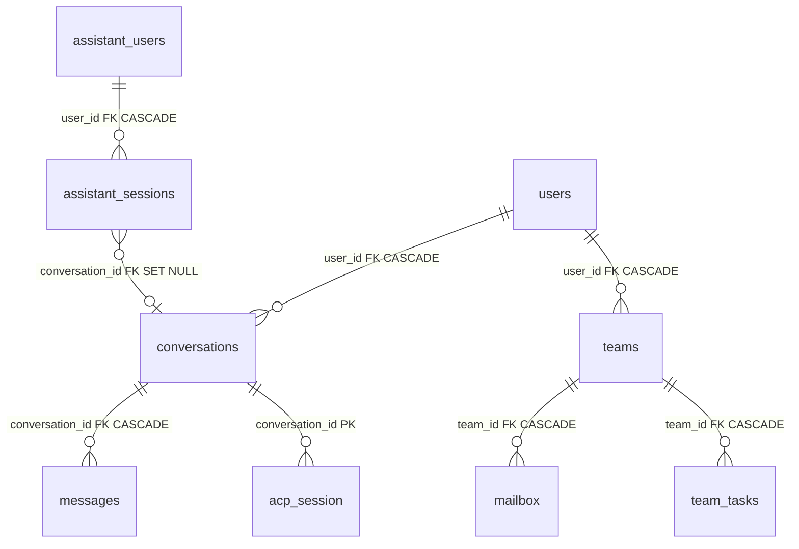
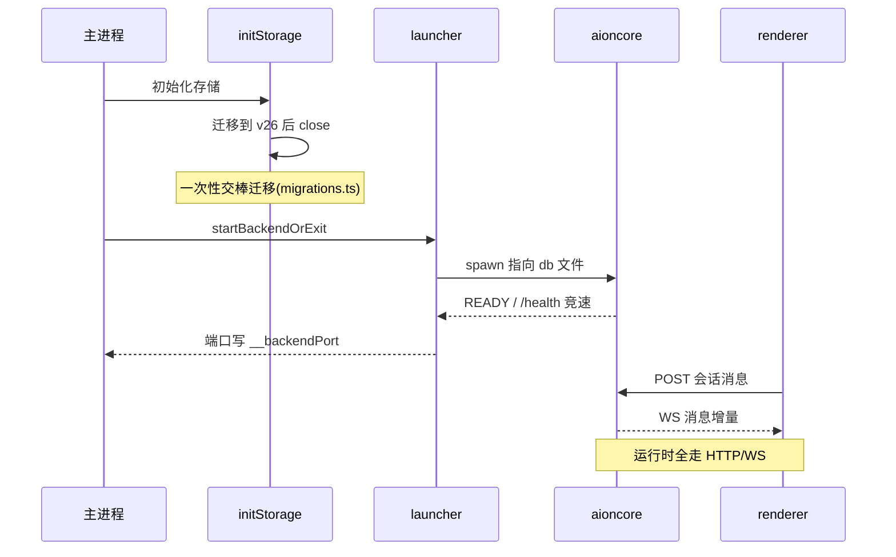

# AionUi 数据模型 / SQLite 存储

> 本文解读 AionUi 的数据持久化底座：本地优先设计哲学如何落地为"单一 SQLite 文件承载全部业务状态"，以及主进程 `database/` 模块的真实职责边界。承接壳-引擎骨架（README 架构总览）与 ACP 收敛（前两篇）的叙事：骨架搭好、协议收敛之后，本篇回答"多 agent 并行会话、Team 协作、Cron 调度的状态到底怎么落库"，为后续 Team / Cron / 远程模块的状态语义提供依据。

## 该模块在系统中的角色

先纠正一个容易想当然的预设：`packages/desktop/src/process/services/database/` 并不是运行时读写的仓储实现所在，而是一个**"legacy 数据交棒迁移器"**——它把老版本 Electron 主进程用 better-sqlite3 管理的 `aionui.db` 一次性升级到 v26 baseline schema，然后关闭驱动、把文件交给外部 Rust 引擎 aioncore 接管。运行时的一切读写（会话、消息、Team、Cron）由 aioncore 通过 HTTP/WS 对外服务，renderer 不再直连 SQLite。

这个定位有四处相互印证的源码证据：

- `runLegacyDatabaseMigrations.ts` 的函数注释直言这是"one-shot migration pass"，且"always closed before returning"（`packages/desktop/src/process/services/database/runLegacyDatabaseMigrations.ts:45-49` <!-- anchor: * Upgrade legacy Electron-managed SQLite catalogs to the v26 baseline before … * one-shot migration pass and is always closed before returning. --> ）——驱动只在该函数作用域内存在，迁移完必关。 - `initStorage.ts` 启动第 6 步注释点明"Backend only understands the v26-era schema baseline"，老用户文件必须先升到 v26 再放后端启动（`packages/desktop/src/process/utils/initStorage.ts:404-407` <!-- anchor: // 6. Backend only understands the v26-era schema baseline. Older desktop … const legacyDbMigration = await runLegacyDatabaseMigrations(); --> ）。 - `index.ts` 主进程注释明确了顺序约束："Start aioncore only after initializeProcess()"，因为 initStorage 可能打开 legacy SQLite 目录做一次性迁移，"must close it before the backend touches the same file"（`packages/desktop/src/index.ts:815-817` <!-- anchor: // Start aioncore only after initializeProcess(). initStorage may open … // close it before the backend touches the same file. --> ）——同一文件绝不允许两个持有者同时打开。 - renderer 侧 `ipcBridge.ts` 文件头注释宣告 IPC Bridge 已被 HTTP/WS adapter 取代，业务调用全部路由到 aioncore，仅 Electron 原生操作（窗口、对话框、自动更新）保留 IPC（`packages/desktop/src/common/adapter/ipcBridge.ts:7-13` <!-- anchor: * IPC Bridge → HTTP/WS adapter. … * native dialogs, auto-update, devtools, zoom, CDP, deep links) remain as IPC. --> ）。 **根因**：AionUi 经历了"引擎下沉"架构迁移。早期版本是典型 Electron 单进程架构——主进程开 better-sqlite3，renderer 走 IPC；后来引擎下沉为独立 Rust 进程（aioncore），renderer 改走 HTTP/WS。数据文件 `aionui.db` 的属主随之从"主进程"变更为"aioncore"，但老用户的文件还留在磁盘上，且 schema 停在旧版。主进程的 `database/` 目录于是从"仓储层"降格为"交棒协议"：定义 v26 baseline、把老文件升上来、补齐 aioncore 假设存在的列，然后退出。`IConversationRepository.ts` 里残留的注释即这段历史的化石——"All methods are synchronous (better-sqlite3 driver)"、"The service layer is async to allow future migration"（`packages/desktop/src/process/services/database/IConversationRepository.ts:8-9` <!-- anchor: // All methods are synchronous (better-sqlite3 driver). … // The service layer is async to allow future migration. --> ）：接口仍在，实现却已随引擎一并下沉，全仓库搜不到任何 `implements IConversationRepository`。

这个"模块实际职责 ≠ 目录名字暗示的职责"的反转，是全篇解读的主线：本模块最大的设计价值不在"怎么存"，而在"怎么安全地移交"。

## 实体关系总览

schema 层共有四组实体：**账户与对话**（users/conversations/messages）、**Team 协作**（teams/mailbox/team_tasks）、**远程渠道（Personal Assistant）**（assistant_users/assistant_sessions/assistant_plugins/assistant_pairing_codes）、**调度与运行时**（cron_jobs/remote_agents/acp_session）。前两组由 `schema.ts` 的 `initSchema()` 建表，后两组只存在于 `migrations.ts` 的历史迁移里（详见「Schema 演进策略」）。

图外补叙（ER 图装不下的约束与权衡）：

- **cron_jobs 与 conversations 是应用层关联，不是外键**。`cron_jobs.conversation_id` 只是普通 TEXT 列，而会话侧在 `conversations.extra` JSON 里存 `cron_job_id`，并为此建了一个表达式索引 `idx_conversations_cron_job_id ON conversations(json_extract(extra, '$.cron_job_id'))`（`packages/desktop/src/process/services/database/migrations.ts:1093-1095` <!-- anchor: db.exec( … `CREATE INDEX IF NOT EXISTS idx_conversations_cron_job_id ON conversations(json_ -->）。代价是删除会话不会级联清理 cron_jobs（孤儿任务风险），换来的是"调度的归属信息进 JSON blob、不污染顶层列"。这是 JSON blob 与关系查询折中的典型样本：数据松耦合，查询用表达式索引补。
- **`acp_session` 以 `conversation_id` 为主键**（一对一），存储 ACP 会话 suspend/resume 状态，是"会话恢复"的数据锚点（`packages/desktop/src/process/services/database/migrations.ts:1194-1196` <!-- anchor: db.exec(`CREATE TABLE IF NOT EXISTS acp_session ( … agent_backend TEXT NOT NULL, -->）。
- **`remote_agents`、`assistant_plugins`、`assistant_pairing_codes` 是自洽实体，不依赖业务表**，故不进 ER 图；`remote_agents` 记录远端 agent 的连接协议与设备身份，`assistant_plugins` 记录渠道插件的启用状态与 token，`assistant_pairing_codes` 记录渠道用户配对码。
- 所有外键统一 `ON DELETE CASCADE`（消息随会话删、邮箱/任务随团队删、会话随用户删），唯独 `assistant_sessions.conversation_id` 用 `ON DELETE SET NULL`——渠道会话在会话删除后保留（平台侧对话记录仍有用），只断开与本地会话的绑定（`packages/desktop/src/process/services/database/migrations.ts:196-198` <!-- anchor: FOREIGN KEY (user_id) REFERENCES assistant_users(id) ON DELETE CASCADE, … FOREIGN KEY (conversation_id) REFERENCES conversations(id) ON DELETE SET NULL -->）。

## 存储选型与理由

**为什么是 SQLite**：本地优先（local-first）是 README 卖点——"All data is stored locally in a SQLite database. Nothing is uploaded to any server"（`README.md:580` <!-- anchor: A: All data is stored locally in a SQLite database. Nothing is uploaded to any s … A: All data is stored locally in a SQLite database. Nothing is uploaded to any s -->）。这意味着数据必须落在用户机器上、可随时备份、零运维。在关系型/文档型/键值型三者里，会话、消息、Team、任务、邮箱这类数据天然带关系查询（某用户最近 N 个会话、某会话的全部消息、某团队的未读邮件），正是关系模型主场；SQLite 又是唯一"零安装、单文件、强事务"的关系引擎。

**对比不选方案的代价**：

- **JSON 文件**（历史方案）：本仓库 `initStorage.ts` 里的 `JsonFileBuilder` 就是它的化石——base64(encodeURIComponent(JSON)) 的磁盘格式、内存缓存 + promise 链串行落盘（`packages/desktop/src/process/utils/initStorage.ts:125-147` <!-- anchor: const JsonFileBuilder = <S extends object = Record<string, unknown>>(file_path:  … return {} as S; -->）。它没有索引、没有原子事务、并发写要靠应用层自己串行化，数据量上来后每次整文件重写；这正是被 SQLite 取代的原因。选 SQLite 等于把这套"手写持久化"成本交给引擎。
- **键值库（LevelDB/BoltDB）**：能解决事务，但消息按会话分页拉取、未读邮箱按 agent 查询、任务按状态过滤这类查询要应用层全量扫描或用复杂 key 设计模拟，把关系查询的成本从引擎推给业务代码。
- **客户端云数据库（CouchDB/IndexedDB+P2P）**：违背"Nothing is uploaded to any server"的本地优先承诺，且引入同步冲突解决复杂度，与桌面单机场景不匹配。
- **多文件分库**：按领域拆多个 SQLite 文件能缓解单文件写锁，但会失去跨领域事务（一次操作改会话 + 消息 + 任务的状态一致性无法保证），迁移与备份也要维护多文件一致性。项目选单文件，用 WAL + busy_timeout 缓解并发。

**为什么 better-sqlite3（历史驱动）**：同步 API 让仓储代码极其直白（prepare/get/all/run/transaction 全同步），对桌面单进程足够；驱动抽象 `ISqliteDriver`（prepare/exec/pragma/transaction/close 五件套，`packages/desktop/src/process/services/database/drivers/ISqliteDriver.ts:9-14` <!-- anchor: export interface ISqliteDriver { … close(): void; -->）与 `BetterSqlite3Driver` 实现（`packages/desktop/src/process/services/database/drivers/BetterSqlite3Driver.ts:23-48` <!-- anchor: export class BetterSqlite3Driver implements ISqliteDriver { … this.db.close(); -->）把"换驱动"留了后路——`IConversationRepository` 的注释明确写"service layer is async to allow future migration"（`packages/desktop/src/process/services/database/IConversationRepository.ts:9` <!-- anchor: // The service layer is async to allow future migration. … // The service layer is async to allow future migration. -->）。不过这是历史权衡的产物：better-sqlite3 的同步 API 若跑在主进程 UI 线程会阻塞，但既然运行时读写已移交 aioncore，这条取舍的实际影响已大幅缩小。

**并发策略**（`schema.ts` 的 pragma 设置，`packages/desktop/src/process/services/database/schema.ts:17-27` <!-- anchor: db.pragma('foreign_keys = ON'); … // Continue with default journal mode if WAL fails -->）：

- `foreign_keys = ON`：外键约束默认开启（SQLite 默认关），保证 CASCADE 语义生效。
- `busy_timeout = 5000`：多连接并发时等 5 秒而不是立刻报 "database is locked"——注释点明这是为"多个进程或启动任务并发访问"设计的，即主进程迁移与 aioncore 的时序竞争。
- `journal_mode = WAL`：读写并发，且失败时降级回默认 journal 而不是崩溃（`try/catch` 包裹）。

## 核心表 / 实体设计

本模块的"核心表"分两级：`schema.ts` 的 6 张 baseline 表（users/conversations/messages/teams/mailbox/team_tasks）是迁移兜底的真实目标；migrations 历史里另有 4 张承载关键业务语义的表（cron_jobs/assistant_sessions/remote_agents/acp_session）在运行时由 aioncore 使用。以下字段表以设计要点而非建表语句顺序排列，精确 DDL 见引用区间。

### users —— 账户表

本地单用户账户：主进程在迁移末尾用 `INSERT OR IGNORE` 强制写入默认系统用户，保证数据行永远有 `user_id` 可挂。表定义见 `packages/desktop/src/process/services/database/schema.ts:31-41` <!-- anchor: db.exec(`CREATE TABLE IF NOT EXISTS users ( … last_login INTEGER -->。

| 字段 | 类型 | 约束 | 说明 |
|------|------|------|------|
| id | TEXT | PK | 主键即用户名（`system_default_user`） |
| username | TEXT | UNIQUE NOT NULL | 唯一登录名 |
| email | TEXT | UNIQUE | 可空，预留 |
| password_hash | TEXT | NOT NULL | 本地账户口令哈希；默认用户为空字符串占位 |
| jwt_secret | TEXT | — | v6 加入，为每用户签发会话密钥（`migrations.ts:120-135`） |
| avatar_path / last_login | TEXT / INTEGER | — | 头像路径与最近登录时间 |

设计取舍：单机场景其实只需要"一个用户"，但表仍保留完整账户形态（password_hash/jwt_secret），这是为 WebUI 远程访问与多身份留的口子——本地桌面模式靠 `ensureSystemUser` 兜底（`packages/desktop/src/process/services/database/runLegacyDatabaseMigrations.ts:37-43` <!-- anchor: function ensureSystemUser(db: ISqliteDriver): void { … ).run(DEFAULT_USER_ID, DEFAULT_USER_ID, DEFAULT_PASSWORD_PLACEHOLDER, now, now); -->）。

### conversations —— 会话表

会话是 AionUi 的一等公民：一个会话绑定一个 agent 运行时、一个独立上下文。`type` 区分 agent 家族（acp/codex/openclaw-gateway/nanobot/remote/aionrs…），`extra` JSON 承载每类 agent 的专属配置快照。表定义见 `packages/desktop/src/process/services/database/schema.ts:46-65` <!-- anchor: db.exec(`CREATE TABLE IF NOT EXISTS conversations ( … db.exec('CREATE INDEX IF NOT EXISTS idx_conversations_user_updated ON conversati -->。

| 字段 | 类型 | 约束 | 说明 |
|------|------|------|------|
| id | TEXT | PK | 会话 UUID |
| user_id | TEXT | FK→users ON DELETE CASCADE | 归属用户；有索引 + 复合索引 `(user_id, updated_at DESC)` 支撑"我的会话按最近更新排序" |
| name / type | TEXT | NOT NULL | 会话名与 agent 家族；type 曾受 CHECK 约束，v22 后放开（见演进章节） |
| extra | TEXT | NOT NULL DEFAULT '{}' | JSON blob：workspace、backend、skills 快照、cron_job_id 等按 type 区分的配置（对应 `TChatConversation` 的 Extra 泛型，`storage.ts:237-293`） |
| model | TEXT | — | aionrs 的顶层模型标识，其余 agent 走 extra |
| status | TEXT | CHECK pending/running/finished | 会话运行状态 |
| source | TEXT | — | 会话来源渠道（aionui/telegram/lark…），v8 加入；曾受 CHECK 约束，v15 放开以支持扩展渠道插件 |
| channel_chat_id | TEXT | — | v14 加入：渠道 per-chat 隔离 ID（`user:xxx`/`group:xxx`），复合索引 `(source, channel_chat_id, updated_at DESC)` 支撑渠道会话列表 |
| pinned / pinned_at | INTEGER / INTEGER | DEFAULT 0 | 置顶标记与时间，v22 后经 handoff contract 补齐（`legacyHandoffContract.ts:10-11`） |
| created_at / updated_at | INTEGER | NOT NULL | 毫秒时间戳 |

设计要点：**会话的"类型家族"由 CHECK 约束管控的历史是理解全模块的关键**——从 v10 到 v21，每加一种 agent 类型都要重建整张表来扩 CHECK（`migrations.ts:377-401` <!-- anchor: db.exec(`CREATE TABLE IF NOT EXISTS conversations_new ( … console.log('[Migration v11] Added openclaw-gateway to conversations type constr --> v11 的完整重建样本），v22 终于砍掉约束改用 TS union 收敛（`migrations.ts:1053-1060` <!-- anchor: * Migration v21 -> v22: Remove CHECK constraint on conversations.type, … * (TChatConversation union + rowToConversation branch) — no database migration. -->）。表结构因此是"按 agent 演进史刻出来的"，而非一次设计成型。

### messages —— 消息表

消息是会话的时间线。schema 层刻意保持"窄表"：类型与内容用宽松的 `type` + `content` 存 `TMessage` 判别联合（`chatLib.ts:420-433` <!-- anchor: export type TMessage = … | IMessageAcpTerminalOutput; --> 的 13 种消息变体），消息的语义由 TS 类型而非数据库约束保证。表定义见 `packages/desktop/src/process/services/database/schema.ts:68-83` <!-- anchor: db.exec(`CREATE TABLE IF NOT EXISTS messages ( … db.exec('CREATE INDEX IF NOT EXISTS idx_messages_conversation_created ON message -->。

| 字段 | 类型 | 约束 | 说明 |
|------|------|------|------|
| id | TEXT | PK | 消息 ID |
| conversation_id | TEXT | FK→conversations ON DELETE CASCADE | 归属会话；复合索引 `(conversation_id, created_at)` 支撑时间线分页 |
| msg_id | TEXT | 可空 + 索引 | 流式消息的关联键：agent 侧消息 ID，renderer 用它匹配 `message.statusChanged` 事件，而非按文本/时间匹配（`ipcBridge.ts:439-448`） |
| type | TEXT | NOT NULL | TMessage 判别字段（text/tips/tool_call/…） |
| content | TEXT | NOT NULL | 消息载荷（JSON 序列化） |
| position | TEXT | CHECK left/right/center/pop | 气泡位置：right=用户、left=agent、center/pop=系统提示 |
| status | TEXT | CHECK finish/pending/error/work | 消息状态：pending=回合中投递待消费，finish=agent 已消费（`ipcBridge.ts:433-438` 的 pending/finish 语义） |
| hidden | INTEGER | DEFAULT 0 | v22 加入：隐藏消息（如 cron 作业的内部上下文），UI 默认过滤 |
| created_at | INTEGER | NOT NULL | 毫秒时间戳 |

设计取舍：`status` 从字面看是简单的枚举，但它是**回合内消息投递（mid-turn delivery）**语义的落点——用户可以在 agent 思考间隙发消息，行先以 `pending` 落库，agent 消费后翻 `finish`。这张表的演化（v22 加 `hidden`）说明消息不只是"对话记录"，还承载运行时状态。

### teams —— 团队表

Team 模式把多个 agent 组成一个协作单元共享 workspace。`agents` 是 JSON 快照（成员列表），`workspace_mode` 区分 shared/独立目录，`agents_version` 给 JSON 载荷做版本号——JSON blob 的 schema 演进靠字段内版本控制，而不是迁移列。表定义见 `packages/desktop/src/process/services/database/schema.ts:86-101` <!-- anchor: db.exec(`CREATE TABLE IF NOT EXISTS teams ( … db.exec('CREATE INDEX IF NOT EXISTS idx_teams_updated_at ON teams(updated_at)'); -->。

| 字段 | 类型 | 约束 | 说明 |
|------|------|------|------|
| id | TEXT | PK | 团队 ID |
| user_id | TEXT | FK→users ON DELETE CASCADE | 团队归属 |
| name / workspace | TEXT | NOT NULL | 团队名与工作区路径 |
| workspace_mode | TEXT | DEFAULT 'shared' | 成员共享工作区或独立工作区 |
| agents | TEXT | DEFAULT '[]' | 成员 agent 列表（JSON 数组快照） |
| lead_agent_id | TEXT | — | v20 加入：组长 agent；历史坑：v19 建表刻意漏掉此列，由 v20 的 ALTER 补（`migrations.ts:885-889` 注释明示"historical gap, not a bug"） |
| session_mode | TEXT | — | v23 加入：团队级会话权限模式，让新 spawn 的 agent 继承正确模式（`migrations.ts:1129-1137`） |
| agents_version | TEXT | DEFAULT '1.0.0' | agents JSON 的载荷版本号 |
| created_at / updated_at | INTEGER | NOT NULL | 毫秒时间戳 |

### mailbox —— 团队消息邮箱

agent 之间的定向异步消息通道：每条消息有明确的 `to_agent_id`/`from_agent_id`，`read` 标记未读。复合索引 `(team_id, to_agent_id, read)` 正是"某 agent 在某个团队有哪些未读消息"这个查询的物理形态。表定义见 `packages/desktop/src/process/services/database/schema.ts:104-116` <!-- anchor: db.exec(`CREATE TABLE IF NOT EXISTS mailbox ( … db.exec('CREATE INDEX IF NOT EXISTS idx_mailbox_to ON mailbox(team_id, to_agent_ -->。

| 字段 | 类型 | 约束 | 说明 |
|------|------|------|------|
| id | TEXT | PK | 消息 ID |
| team_id | TEXT | FK→teams ON DELETE CASCADE | 所属团队；复合索引 `(team_id, to_agent_id, read)` |
| to_agent_id / from_agent_id | TEXT | NOT NULL | 收/发 agent |
| type | TEXT | DEFAULT 'message' | 消息类型 |
| content | TEXT | NOT NULL | 消息正文 |
| summary | TEXT | — | 摘要（对长消息做前缀压缩展示） |
| read | INTEGER | DEFAULT 0 | 未读标记 |
| files | TEXT | — | v25 加入：JSON 序列化的附件文件路径，让 Team 模式能转发附件给 agent（`migrations.ts:1165-1174`） |
| created_at | INTEGER | NOT NULL | 毫秒时间戳 |

### team_tasks —— 团队任务表

Team 协作的任务板：状态机由 `status` 驱动，依赖关系用 `blocked_by`/`blocks` 两个 JSON 数组表达（非规范化但读写简单），扩展信息进 `metadata` JSON。表定义见 `packages/desktop/src/process/services/database/schema.ts:119-133` <!-- anchor: db.exec(`CREATE TABLE IF NOT EXISTS team_tasks ( … db.exec('CREATE INDEX IF NOT EXISTS idx_tasks_team ON team_tasks(team_id, status -->。

| 字段 | 类型 | 约束 | 说明 |
|------|------|------|------|
| id | TEXT | PK | 任务 ID |
| team_id | TEXT | FK→teams ON DELETE CASCADE | 复合索引 `(team_id, status)` 支撑任务板按状态过滤 |
| subject / description | TEXT | NOT NULL / 可空 | 任务标题与描述 |
| status | TEXT | DEFAULT 'pending' | 任务状态机（pending/…，schema 未上 CHECK，语义由应用层定义） |
| owner | TEXT | — | 负责人（agent ID） |
| blocked_by / blocks | TEXT | DEFAULT '[]' | JSON 数组：被谁阻塞 / 阻塞谁，双向冗余的依赖图 |
| metadata | TEXT | DEFAULT '{}' | 扩展属性 JSON |
| created_at / updated_at | INTEGER | NOT NULL | 毫秒时间戳 |

### cron_jobs —— 定时任务表（migrations 扩展）

Cron 调度的持久化：`schedule_kind` + `schedule_value` 三态表达（`at` 指定时间戳 / `every` 毫秒周期 / `cron` 表达式），`execution_mode` 决定新会话还是复用现有会话，部分索引 `idx_cron_jobs_next_run WHERE enabled = 1` 让调度器只扫启用任务。表定义见 `packages/desktop/src/process/services/database/migrations.ts:263-301` <!-- anchor: db.exec(`CREATE TABLE IF NOT EXISTS cron_jobs ( … console.log('[Migration v9] Added cron_jobs table'); -->。

| 字段 | 类型 | 约束 | 说明 |
|------|------|------|------|
| id | TEXT | PK | 任务 ID |
| name / enabled | TEXT / INTEGER | NOT NULL / DEFAULT 1 | 任务名与启停开关 |
| schedule_kind / schedule_value / schedule_tz | TEXT | NOT NULL | 调度三件套：`'at'/'every'/'cron'` + 对应值 + 时区 |
| payload_message | TEXT | NOT NULL | 触发时要注入的提示词 |
| conversation_id / conversation_title | TEXT / TEXT | NOT NULL / 可空 | 所属会话与应用层关联（无 FK）；v22 修正：`execution_mode` 引入前 legacy 任务的 conversation_id 为空，迁移时回填为 `'new_conversation'` 语义（`migrations.ts:1105-1108`） |
| agent_type / created_by | TEXT | NOT NULL | 目标 agent 与创建者（user/agent） |
| execution_mode / agent_config | TEXT | v22 加入 | 会话复用模式与 agent 配置 |
| next_run_at / last_run_at / last_status / last_error | INTEGER / TEXT | — | 运行时状态：下次执行时间（部分索引 `WHERE enabled=1`）、上次执行结果 |
| run_count / retry_count / max_retries | INTEGER | DEFAULT 0/0/3 | 执行与重试计数 |

### assistant_sessions —— 渠道会话表（migrations 扩展）

远程渠道（Telegram/Lark/Dingtalk…）的每用户会话：`conversation_id` 用 `ON DELETE SET NULL` 而非 CASCADE，渠道会话在本地会话删除后仍存活。`chat_id` 为 v14 加入的 per-chat 隔离列（`migrations.ts:646-650` <!-- anchor: // 3. Add chat_id to assistant_sessions for per-chat session isolation … db.exec('ALTER TABLE assistant_sessions ADD COLUMN chat_id TEXT'); -->）。对应 renderer 侧 `IChannelSession` 结构（`packages/desktop/src/common/types/channel/channel.ts:56-65` <!-- anchor: export interface IChannelSession { … lastActivity: number; -->）。表定义见 `packages/desktop/src/process/services/database/migrations.ts:188-198` <!-- anchor: db.exec(`CREATE TABLE IF NOT EXISTS assistant_sessions ( … FOREIGN KEY (conversation_id) REFERENCES conversations(id) ON DELETE SET NULL -->。

| 字段 | 类型 | 约束 | 说明 |
|------|------|------|------|
| id | TEXT | PK | 会话 ID |
| user_id | TEXT | FK→assistant_users ON DELETE CASCADE | 渠道授权用户 |
| agent_type | TEXT | CHECK gemini/acp/codex | 绑定的 agent 家族 |
| conversation_id | TEXT | FK→conversations ON DELETE SET NULL | 本地会话绑定，删除会话后置空 |
| chat_id | TEXT | — | v14：per-chat 隔离 |
| workspace / created_at / last_activity | TEXT / INTEGER | — | 工作区与活跃时间戳 |

### remote_agents / acp_session —— 远程与运行时（migrations 扩展）

- **remote_agents**（`migrations.ts:781-794` <!-- anchor: db.exec(`CREATE TABLE IF NOT EXISTS remote_agents ( … updated_at INTEGER NOT NULL -->）：远端 agent 目录，`protocol`/`url`/`auth_type`/`auth_token` 描述连接，v17 增加设备身份四件套 `device_id/device_public_key/device_private_key/device_token`（`migrations.ts:842-854` <!-- anchor: const columns = new Set((db.pragma('table_info(remote_agents)') as Array<{ name: … db.exec('ALTER TABLE remote_agents ADD COLUMN device_token TEXT'); -->）——设备密钥直接落库，是"本地优先但也要加密"的敏感点，加密实现依赖 aioncore 外部实现。`allow_insecure`（v18）显式允许跳过 TLS 校验（`migrations.ts:870-872` <!-- anchor: const columns = new Set((db.pragma('table_info(remote_agents)') as Array<{ name: … db.exec('ALTER TABLE remote_agents ADD COLUMN allow_insecure INTEGER DEFAULT 0') -->）。
- **acp_session**（`migrations.ts:1194-1209` <!-- anchor: db.exec(`CREATE TABLE IF NOT EXISTS acp_session ( … db.exec('CREATE INDEX IF NOT EXISTS idx_acp_session_agent_id ON acp_session(agen -->）：以 `conversation_id` 为主键的会话状态表，`session_status` 驱动 suspend/resume，部分索引 `WHERE session_status = 'suspended'` 让恢复逻辑只扫挂起会话。

两组表的共同设计取向：**"配置/状态即行"而非 JSON 文件**——远端 agent 连接参数、渠道授权、ACP 挂起状态全部关系化，便于查询与迁移。

## Schema 演进策略

### 迁移机制：version 号 + 有序迁移数组 + 单事务

版本号用 SQLite 内置的 `PRAGMA user_version` 承载（`schema.ts:142-157` <!-- anchor: export function getDatabaseVersion(db: ISqliteDriver): number { … db.pragma(`user_version = ${version}`); --> 的 get/setDatabaseVersion），当前基线 `CURRENT_DB_VERSION = 26`（`schema.ts:163` <!-- anchor: export const CURRENT_DB_VERSION = 26; … export const CURRENT_DB_VERSION = 26; -->）。迁移定义为 `IMigration { version, name, up, down }`（`packages/desktop/src/process/services/database/migrations.ts:12-17` <!-- anchor: export interface IMigration { … down: (db: ISqliteDriver) => void; // Downgrade script (for rollback) -->），全部 26 条按版本升序挂进 `ALL_MIGRATIONS` 数组（`packages/desktop/src/process/services/database/migrations.ts:1225-1231` <!-- anchor: export const ALL_MIGRATIONS: IMigration[] = [ … migration_v25, migration_v26, -->），由 `getMigrationsToRun` 按 `version > from && version <= to` 过滤出待执行子集（`migrations.ts:1236-1240` <!-- anchor: export function getMigrationsToRun(fromVersion: number, toVersion: number): IMig … (a, b) => a.version - b.version -->）。

`runMigrations` 的事务语义是迁移安全的核心（`packages/desktop/src/process/services/database/migrations.ts:1273-1311` <!-- anchor: // Disable foreign keys BEFORE the transaction to allow table recreation … db.pragma('foreign_keys = ON'); -->）：

- 先 `foreign_keys = OFF`（**必须在事务外**——SQLite 不允许在事务内改这个 pragma，注释引用了 sqlite.org 的 ALTER TABLE 文档说明原因），因为多数迁移要 `DROP TABLE` 重建，开着外键会触发 CASCADE 误删。
- 单事务跑完全部 up；任一失败则整事务回滚（注释明示 "Transaction will rollback"）。
- 跑完用 `PRAGMA foreign_key_check` 校验外键完整性，有违规即抛错拒绝提交——重建表后外键完整性靠这一步兜底。
- `finally` 中无论成败都恢复 `foreign_keys = ON`。

### 演进模式：三种 DDL 手法

migrations 的 26 步演进只用了三种手法，对应 SQLite 的能力边界：

- **加列**：`PRAGMA table_info` 检查列不存在后 `ALTER TABLE ADD COLUMN`。样本：v6 加 `users.jwt_secret`（`migrations.ts:120-135` <!-- anchor: const migration_v6: IMigration = { … console.log('[Migration v6] jwt_secret column already exists, skipping'); -->）、v17 加 remote_agents 设备四列、v23 加 `teams.session_mode`。写法幂等（先查列再改），可安全重跑。
- **改约束（表重建三步曲）**：SQLite 不能修改 CHECK 约束，于是 `CREATE new + INSERT SELECT + DROP + RENAME`。样本集中在 conversations.type 的 CHECK 演进——v10 加 lark、v11 加 openclaw-gateway（`migrations.ts:377-401`）、v12 加 lark source、v13 加 nanobot、v14 加 dingtalk、v16 加 remote、v21 加 aionrs。每次重建都复制同一套索引 DDL，注释反复警告"迁移运行器已关外键，DROP 不会触发 CASCADE"。
- **数据修正**：不是 DDL，而是用 UPDATE/DELETE 处理 legacy 数据。样本：v22 把 `conversation_id` 为空的 legacy cron 任务回填为 `'new_conversation'` 执行模式（`migrations.ts:1105-1108` <!-- anchor: // Fix legacy jobs: empty conversation_id means they were created before executi … `UPDATE cron_jobs SET execution_mode = 'new_conversation' WHERE conversation_id  -->）、v21 的 down 在删类型前先清其消息（`migrations.ts:1017-1018` <!-- anchor: db.exec(`DELETE FROM messages WHERE conversation_id IN (SELECT id FROM conversat … db.exec(`DELETE FROM conversations WHERE type = 'aionrs'`); -->）。

### 转折点：v22 从"重建表"收敛为"去约束"

v22 是演进策略的分水岭。它的注释直接复盘了教训：type CHECK 让"每加一种 agent 类型"都触发一次全表重建（v10/v11/v14/v15/v16/v21 全是这么干的），于是 v22 移除 `conversations.type` 的 CHECK，声明"新 agent 类型只需 TypeScript 层面的改动（TChatConversation union + rowToConversation 分支），不再需要数据库迁移"（`packages/desktop/src/process/services/database/migrations.ts:1053-1060` <!-- anchor: * Migration v21 -> v22: Remove CHECK constraint on conversations.type, … * (TChatConversation union + rowToConversation branch) — no database migration. -->）。

这背后的权衡值得展开：**CHECK 约束给了数据库层的类型安全，但把"加类型"这种高频增量操作变成了昂贵的停机重建**。数据量大的库上，表重建是分钟级的锁表操作。v22 用"TS 是唯一类型真源"换掉了迁移成本——代价是数据库无法拒绝未知 type 值，类型错误下沉到运行时。对一个 schema 频繁随 agent 生态扩张、而单机数据量又不可能太大的桌面应用，这个取舍是合理的：**把"约束类型"从 DB 层搬到编译层，让 schema 稳定下来，才是可持续的演进方式**。v15 去 source CHECK 是同一思路的先声（"Removed CHECK constraint"以支持扩展渠道插件，`migrations.ts:713-716` <!-- anchor: const migration_v15: IMigration = { … up: (db) => { -->）。

### 不可逆迁移与"伪 down"

`IMigration` 定义了 down，但 v15 起的 down 几乎全是空操作或警告，原因有两类：SQLite 3.35 前的版本不支持 `DROP COLUMN`（v17/v18/v23/v24/v25 的 down 都注明 "cannot drop columns safely"），以及重加 CHECK 会拒绝已有的新类型数据（v22 的 down 直言 "re-adding CHECK constraint could reject existing data"）。配套的 `rollbackMigrations` 只用于测试/应急（`migrations.ts:1317-1320` <!-- anchor: export function rollbackMigrations(db: ISqliteDriver, fromVersion: number, toVer … throw new Error('[Migrations] Cannot rollback to a higher or equal version'); --> 的警告 "WARNING: This may cause data loss!"）。**结论：这套迁移是单向的**——生产路径只前进，回滚形同虚设。对单机桌面应用这是可接受的（没有灰度回滚场景），但维护者必须知道：schema 一经发布即不可逆。

### legacy 交棒：一次性的 v26 提升 + handoff contract

新架构下迁移分两个入口：正常路径（aioncore 自己管理迁移，仓库内不可见）与本模块的一次性 legacy 路径。`runLegacyDatabaseMigrations` 的完整流程（`packages/desktop/src/process/services/database/runLegacyDatabaseMigrations.ts:50-93` <!-- anchor: export async function runLegacyDatabaseMigrations( … driver.close(); -->）：

1. `initSchema(driver)`：建 6 张 baseline 表（幂等）；
2. 读 `user_version`，若低于 26 则 `runMigrations(0/current → 26)` 全链提升；
3. `repairLegacyHandoffSchema(driver)`：补齐 handoff contract 列；
4. `ensureSystemUser(driver)`：写入默认系统用户；
5. `finally` 中 `driver.close()` 释放文件锁。

**handoff contract** 是这段逻辑的灵魂：`LEGACY_HANDOFF_COLUMNS` 声明了一组"aioncore 读取旧文件时假设必然存在"的列——`cron_jobs.skill_content/description`、`conversations.pinned/pinned_at`、`teams.session_mode/agents_version`（`packages/desktop/src/process/services/database/legacyHandoffContract.ts:7-13` <!-- anchor: export const LEGACY_HANDOFF_COLUMNS: readonly LegacyHandoffColumn[] = [ … { table: 'teams', column: 'agents_version', definition: "TEXT NOT NULL DEFAULT ' -->）。这些列是 aioncore 的"读契约"，但未必在 schema 里（如 `pinned` 在 schema.ts 有、`teams.session_mode` 在 schema.ts 有，而 `cron_jobs.skill_content` 只在 migrations 历史里）。`repairLegacyHandoffSchema` 逐个 `PRAGMA table_info` 检查，缺失即 `ALTER TABLE ADD COLUMN` 补齐（`packages/desktop/src/process/services/database/repairLegacyHandoffSchema.ts:17-31` <!-- anchor: export function repairLegacyHandoffSchema(db: ISqliteDriver): LegacyHandoffRepai … repairedColumns.push({ table: entry.table, column: entry.column }); -->）。

一个值得注意的层级关系：**`schema.ts` 的 `initSchema` 与 migrations 的 v1 是分离的**——initSchema 建 6 张核心表并自称"Initial legacy DB baseline for newly-created Electron DBs"，v1 迁移却是 no-op（"Already handled by initSchema()"，`migrations.ts:23-37` <!-- anchor: const migration_v1: IMigration = { … console.log('[Migration v1] Rolled back: All tables dropped'); -->）。全新库的路径是：initSchema 建 6 核心表 → `runMigrations(0→26)` 把 cron_jobs/assistant_*/remote_agents/acp_session 等历史表补建出来。也就是说**真正一致的 schema 是"initSchema + 26 步迁移"的叠加结果**，没有单一建表文件能完整描述它——这是维护性的一个隐患（详见「问题」）。

## 读写路径

AionUi 的数据读写有两条几乎不重叠的路径：**启动时主进程的一次性交棒迁移**与**运行时 renderer↔aioncore 的常规读写**。

### 启动路径：主进程一次性迁移（见上图示上半段）

- 端口暴露细节：`BackendLifecycleManager` 先解析端口，spawn aioncore 时把数据目录作为 `--data-dir` 参数传入（`packages/web-host/src/backend-launcher.ts:196-216` <!-- anchor: export function buildSpawnArgs(config: SpawnConfig): string[] { … return args; --> ）；`--recover-corrupted-database` 标志用于损坏恢复重启（`backend-launcher.ts:214` <!-- anchor-base64:aWYgKGNvbmZpZy5yZWNvdmVyQ29ycnVwdGVkRGF0YWJhc2UpIGFyZ3MucHVzaCgnLS1yZWNvdmVyLWNvcnJ1cHRlZC1kYXRhYmFzZScpOyDigKYgaWYgKGNvbmZpZy5yZWNvdmVyQ29ycnVwdGVkRGF0YWJhc2UpIGFyZ3MucHVzaCgnLS1yZWNvdmVyLWNvcnJ1cHRlZC1kYXRhYmFzZScpOw== --> ）。
- **损坏恢复**是数据完整性的最后防线：aioncore 启动失败时，主进程侧 `backendStartupFailure.ts` 识别 `BOOTSTRAP_DATA_INIT_FAILED` + `database.recoverable_corruption` 边界组合，归类为 `backend_recoverable_database_corruption`（`packages/desktop/src/process/startup/backendStartupFailure.ts:333-342` <!-- anchor: backendBoundaryCode === 'BOOTSTRAP_DATA_INIT_FAILED' && … backendBoundaryStage, --> ），UI 引导用户确认后由 `recoverCorruptedDatabaseAfterUserConfirmation` 停后端 → 带恢复标志重启 → reload 窗口（`packages/desktop/src/process/startup/recoverCorruptedDatabase.ts:13-25` <!-- anchor: export async function recoverCorruptedDatabaseAfterUserConfirmation(deps: Recove … deps.reloadMainWindow(); --> ）。"备份并重建"的动作本体在 aioncore 侧，主进程只编排。

### 运行时路径：renderer → HTTP/WS → aioncore（见上图下半段）

- renderer 不持有任何 SQL 语句。所有读写经 `ipcBridge`（REST/WS 适配层）→ `httpBridge` 的 `httpGet/httpPost/httpPatch/httpDelete/wsEmitter` → `http://127.0.0.1:{port}`（`packages/desktop/src/common/adapter/httpBridge.ts:37-61` <!-- anchor: function getBackendPort(): number { … return `http://127.0.0.1:${getBackendPort()}`; --> 的端口与 base URL 解析：Electron 下读 `window.__backendPort`，WebUI 下走同源反代）。对话创建/更新/消息发送/确认/artifact 等操作集中在 `ipcBridge.conversation` 命名空间（`packages/desktop/src/common/adapter/ipcBridge.ts:271-533` <!-- anchor: export const conversation = { … `/api/conversations/${p.conversation_id}/approvals/check?action=${encodeURICompo --> ）。
- **传输契约的模型映射**：snake_case（后端）↔ camelCase（renderer）。`fromApiConversation` 把后端的 `model: {provider_id, use_model}` 展平为 renderer 的 `TProviderWithModel`，并从 `extra.workspace` 推导 `custom_workspace` 标记（`packages/desktop/src/common/adapter/apiModelMapper.ts:87-114` <!-- anchor: export function fromApiConversation<T>(raw: T): T { … return next; --> ）；反向 `buildCreateConversationBody` 按 agent 类型决定 model 放顶层还是 extra（`apiModelMapper.ts:56-68` <!-- anchor: export function buildCreateConversationBody(p: CreateConversationBodyInput): Rec … return body; --> ）。
- **会话与消息的 TS 类型**是 renderer 读写的数据形状：`TChatConversation` 是按 `type` 分叉的联合类型，`extra` 携带每类 agent 的配置（workspace/backend/skills 快照/cron_job_id/fork 谱系…，`packages/desktop/src/common/config/storage.ts:237-293` <!-- anchor: export type TChatConversation = … fork?: TConversationForkLineage; --> ），基接口 `IChatConversation` 定义 `created_at/modified_at/model/status/source/channel_chat_id/assistant/project_id` 等顶层字段（`storage.ts:162-200` <!-- anchor: interface IChatConversation<T, Extra> { … prompt_capability?: { image: boolean; audio: boolean }; --> ）；`TMessage` 是 13 种消息变体的判别联合（`packages/desktop/src/common/chat/chatLib.ts:420-433` <!-- anchor: export type TMessage = … | IMessageAcpTerminalOutput; --> ）。数据库的 `messages.type/content` 正是这个联合的宽松落点。
- **写路径的关键顺序**：renderer 发消息 → aioncore 落库 → 通过 WS `message.userCreated` 回推用户消息行（含 `client_msg_id` 供关联）、agent 消费后 `message.statusChanged` 把行从 `pending` 翻 `finish`（`ipcBridge.ts:422-448` <!-- anchor: responseStream: wsEmitter<IResponseMessage>('message.stream'), … }>('message.statusChanged'), --> ）——即 schema 里 `messages.status` 的两种状态值在运行时如何被驱动。这也是"独立上下文并行会话"的语义支撑：每个会话的上下文由其会话行 + agent 侧 session 承载，互不串扰。

### 一条仍残留的 legacy 写路径

`initStorage.ts` 还保留了 Electron 时代的 JSON 文件存储（`ConfigStorage`/`EnvStorage`/`chatMessageFile`/`chatFile`），`JsonFileBuilder` 的 base64+promise 链仍在线（`initStorage.ts:125-235` <!-- anchor: const JsonFileBuilder = <S extends object = Record<string, unknown>>(file_path:  … }; --> ），并明确标注 `ILegacyConfigStorageRefer` 是"migration-only surface"，新业务真相不得写入、只读用于一次性导入 aioncore（`packages/desktop/src/common/config/storage.ts:91-97` <!-- anchor: * Legacy config keys that may still exist on disk from the pre-aionCore era. … * backend, but all current writes should go through aionCore-owned storage. --> ）。启动时 `migrateLegacyData` 会把 temp 目录的旧数据复制到 config 目录（`initStorage.ts:61-106` <!-- anchor: const migrateLegacyData = async () => { … return false; --> ）。这条路径说明迁移不是一次性的：**JSON 文件层的读取兼容仍在服役**，直到所有一次性导入完成。

## 设计决策权衡

**本地优先 vs 多端同步**：项目明确押注"数据在本地，隐私是卖点"（`README.md:580` ），放弃了云同步带来的多设备体验。这个选择让所有持久化决策都变得简单——不需要冲突解决、不需要服务端权限模型、备份就是拷文件。代价是换设备/换系统需要手动迁移数据，且没有天然的异地容灾。对一个"私人 Cowork 工作区"定位的产品，取舍合理。

**单文件单写者 vs 多进程共享**：数据落在单一 `aionui.db`，且严格保证**同一时刻只有一个写者**——启动时主进程迁移持有，随后必须释放（`driver.close()`）才能让 aioncore 打开（`index.ts:815-817` <!-- anchor: // Start aioncore only after initializeProcess(). initStorage may open … // close it before the backend touches the same file. --> ）。这避免了 SQLite 多进程写锁的经典陷阱。代价是启动顺序被强约束：迁移不完成、aioncore 不能起；若迁移挂起，整个应用无法启动。`busy_timeout=5000` 是对"时序竞争窗口"的保险丝。

**schema 迁移 vs 类型安全**：如前所述，v22 把 agent 类型的约束从 DB CHECK 搬到 TS union。这是全模块最深的权衡——**数据库的类型校验被牺牲，换取 schema 的稳定**。对扩展频繁的 agent 生态和单机数据规模，这是正确方向；但维护者必须接受"库里可能存在未知 type 值"这个事实，所有读取侧要有兜底（renderer 的 `fromApiConversation` 等 mapper 均假设未知字段可忽略）。

**JSON blob vs 关系化**：`extra`、`agents`、`metadata`、`blocked_by/blocks` 多处使用 JSON blob。这是典型的"schema 演进在 blob 内进行"策略——新字段进 JSON 不用迁移。但 blob 无法在 SQL 里做约束和 join，所以团队任务依赖关系（blocked_by/blocks）、cron 归属（extra.cron_job_id）这类**跨行关系被非规范化**，查询要表达式索引（`migrations.ts:1093-1095` <!-- anchor: db.exec( … `CREATE INDEX IF NOT EXISTS idx_conversations_cron_job_id ON conversations(json_ --> ）或应用层解析。取舍：写路径简单、演进零成本；读路径的复杂度前移给查询层。

## 亮点

- **交棒契约（handoff contract）**：把"aioncore 假设存在的列"显式声明为契约清单（`legacyHandoffContract.ts:7-13` <!-- anchor: export const LEGACY_HANDOFF_COLUMNS: readonly LegacyHandoffColumn[] = [ … { table: 'teams', column: 'agents_version', definition: "TEXT NOT NULL DEFAULT ' --> ），用 `PRAGMA table_info` 探测 + `ALTER TABLE ADD COLUMN` 补齐（`repairLegacyHandoffSchema.ts:17-31` <!-- anchor: export function repairLegacyHandoffSchema(db: ISqliteDriver): LegacyHandoffRepai … repairedColumns.push({ table: entry.table, column: entry.column }); --> ）。这是两个运行时（Electron 主进程与 Rust 引擎）之间对同一文件的**结构化握手**——比"版本号对齐"更强的保证：即使版本号相同，列级差异也会被探测修复。若换用不校验的暴力迁移，老库可能在 aioncore 读取时崩溃。
- **v22 的演进收敛**：从"每次加 agent 类型重建整表"到"去 CHECK + TS union"，注释完整记录了教训（`migrations.ts:1053-1060` ）。这是"从踩坑中学到的架构决策"的样本：把高频增量操作（加类型）从昂贵的 DDL 降为纯编译层改动。
- **表达式索引支撑 JSON blob 查询**：`idx_conversations_cron_job_id ON conversations(json_extract(extra, '$.cron_job_id'))`（`migrations.ts:1093-1095`）——JSON blob 存关系字段，又用表达式索引补查询，是"blob 演进 + 关系查询"两者兼得的手法。
- **部分索引（partial index）**：`idx_cron_jobs_next_run ... WHERE enabled = 1`（`migrations.ts:298` <!-- anchor: db.exec('CREATE INDEX IF NOT EXISTS idx_cron_jobs_next_run ON cron_jobs(next_run … db.exec('CREATE INDEX IF NOT EXISTS idx_cron_jobs_next_run ON cron_jobs(next_run --> ）与 `idx_acp_session_suspended ... WHERE status = 'suspended'`（`migrations.ts:1206-1208` <!-- anchor: db.exec( … "CREATE INDEX IF NOT EXISTS idx_acp_session_suspended ON acp_session(session_sta --> ）只索引活跃行，让调度器/恢复器的扫描面最小化——对"常驻表 + 稀疏活跃集"的模式是精准优化。
- **启动顺序的显式化**：主进程用注释与代码双重强调"先迁移、关驱动、再启后端"（`index.ts:815-817`），并配套 `busy_timeout` 保险。对一个迁移与运行分属两个进程的系统，这是防数据竞争的必要纪律。

## 问题

- **rollback 名存实亡**：v15 起的 down 全部 skip（`migrations.ts:1118-1121` <!-- anchor: down: (_db) => { … console.warn('[Migration v22] Rollback skipped: re-adding CHECK constraint could --> 等），`rollbackMigrations` 只供测试。声称的降级能力实际不存在，一旦发布即不可逆。对单机应用可接受，但文档/契约层面应明确"单向迁移"而非保留假的 down。
- **schema 单一真源缺失**：6 张核心表在 `schema.ts`，其余表只存在于 migrations 历史（cron_jobs/assistant_*/remote_agents/acp_session），"完整的 v26 schema"没有单一文件可读。新库要跑完整迁移链才与老库一致，维护者若要核对 schema 得拼接两处——这是迁移模式的固有成本，但可以靠"schema.ts 收敛全部表定义 + migrations 只留 ALTER"来改善。
- **cron_jobs 无外键的孤儿风险**：`conversation_id` 只是文本列，删除会话不级联清理 cron_jobs（`migrations.ts:279` <!-- anchor-base64:Y29udmVyc2F0aW9uX2lkIFRFWFQgTk9UIE5VTEwsICAgICAtLSBXaGljaCBjb252ZXJzYXRpb24gY3JlYXRlZCB0aGlzIOKApiBjb252ZXJzYXRpb25faWQgVEVYVCBOT1QgTlVMTCwgICAgIC0tIFdoaWNoIGNvbnZlcnNhdGlvbiBjcmVhdGVkIHRoaXM= --> ）。若应用层漏清理，会残留指向已删会话的定时任务。这是 JSON/应用层关联的代价，需要 Cron 模块在删除会话时联动（Cron 模块是否处理依赖 aioncore 外部实现）。
- **敏感密钥明文落库**：`remote_agents` 存 `auth_token`、`device_private_key`（`migrations.ts:786-853` <!-- anchor: auth_type TEXT NOT NULL DEFAULT 'bearer', … db.exec('ALTER TABLE remote_agents ADD COLUMN device_token TEXT'); --> ），`users.jwt_secret` 亦然。本地优先的设计下"落库"与"加密存储"不是一回事——WAL 文件、备份副本都是明文暴露面。项目未在 schema 层看到加密字段标识（`allow_insecure` 列只控制 TLS 校验），加密实现依赖 aioncore 外部实现。
- **messages 表与 TMessage union 的松耦合**：`messages.type`/`content` 无 CHECK、无 JSON schema 校验，消息结构合法性完全由应用层保证。写入侧 bug 会直接把非法 JSON 落库，读取侧（`chatLib.ts` 的 transform 链）需要兜底。

## 与其他模块协同

- **与 ACP 模块**：`acp_session` 表（`migrations.ts:1194-1209` ）支撑 ACP 会话 suspend/resume；`conversations.extra.acp_session_id` 关联会话与 ACP 会话（`storage.ts:270-274` <!-- anchor: acp_session_id?: string; … acp_session_updated_at?: number; --> ），读写实现依赖 aioncore 外部实现。
- **与 Channel（远程渠道）模块**：`assistant_users/assistant_sessions/assistant_plugins` 表对应 renderer 侧 `IChannelUser/IChannelSession/IChannelPluginStatus`（`channel.ts:37-65` <!-- anchor: export interface IChannelPairingRequest { … lastActivity: number; --> ）；`conversations.channel_chat_id` 是 per-chat 隔离字段（`schema.ts:55` <!-- anchor: channel_chat_id TEXT, … channel_chat_id TEXT, --> ），这些表由谁写、扩展渠道如何注册依赖 aioncore 外部实现。
- **与 Cron 模块**：`cron_jobs` 表 + `conversations.extra.cron_job_id` 表达式索引（`migrations.ts:1093-1095`），Cron 调度器读表实现、任务完成后的会话联动依赖 aioncore 外部实现。
- **与 Team 模块**：`teams/mailbox/team_tasks` 三表是 Team 协作的全部状态底座（`schema.ts:86-133` <!-- anchor: db.exec(`CREATE TABLE IF NOT EXISTS teams ( … db.exec('CREATE INDEX IF NOT EXISTS idx_tasks_team ON team_tasks(team_id, status --> ）），Team 运行时消息流如何写 mailbox、任务状态机如何驱动依赖 aioncore 外部实现。
- **与远程模块**：`remote_agents` 表（`migrations.ts:781-794` ）的读写实现依赖 aioncore 外部实现。
- **与启动/恢复模块**：数据损坏 → `backendStartupFailure.ts` 分类 → UI 确认 → `recoverCorruptedDatabaseAfterUserConfirmation`（`recoverCorruptedDatabase.ts:13-25` <!-- anchor: export async function recoverCorruptedDatabaseAfterUserConfirmation(deps: Recove … deps.reloadMainWindow(); --> ）→ aioncore `--recover-corrupted-database` 重启（`backend-launcher.ts:214`），是一条完整的"损坏→备份→重建→重载"链路。

> 分析深度：本关注面按深度模式（核心模块 ≥90%）覆盖，覆盖率明细详见各 subagent 分析草稿；正文论断均带 `文件:行号` 可验证引用。
