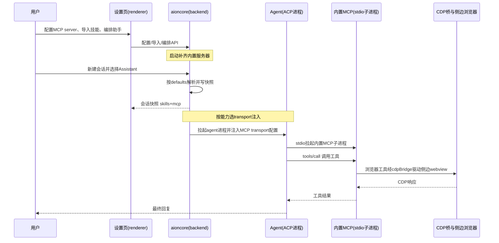

# AionUi 能力接入层深度解读：MCP 统一管理与三层 Skill 体系

本模块承接前几篇对 AionUi 骨架、数据收敛、Team/Cron/远程的解读，把目光转向平台的**能力接入层**：agent 的工具与技能从哪里来、按什么规则注入、如何做到按会话精细控制。AionUi 的核心卖点「MCP Unified Management」与「三层 Skill 体系 + 21 个内置 Assistants」都落在这一层，且与 ACP（Agent Client Protocol）的收敛方向直接相关——工具协议统一由 AionUi 注入，agent 只声明自己支持什么。

## 本模块在系统中的位置

去掉这一层，AionUi 的 agent 会退化成「只会聊天、不会干活」：没有 MCP，agent 摸不到浏览器、图片生成、文件系统这些工具；没有 Skills，内置的 PPT/Word/Excel/论文等专业助手就只是空壳提示词，无法把「生成一份 PPT」翻译成具体可执行的指令文件；没有 per-conversation 控制，工具与技能要么全量注入、要么全量禁用，多 agent 协作时无从分工。

反过来说，这一层的价值不在「有多少个工具」，而在**组织方式**：

- MCP 是 agent 工具能力的**统一接入层**——所有外部工具都表达为 MCP server，README 将其定位为 "manage MCP tools in one place; AionUi injects or syncs compatible transports according to each agent's capabilities"。

[readme.md:175-175]()

<!-- anchor: - **MCP Unified Management** — manage MCP (Model Context Protocol) tools in one place; AionUi injects or syncs compa … - **MCP Unified Management** — manage MCP (Model Context Protocol) tools in one place; AionUi injects or syncs compa -->

- Skills 是 assistant 能力的**可扩展层**——内置（builtin，随版本发布）、自定义（custom，用户导入）、扩展（extension，第三方 SDK 贡献）三层，按会话启用。

[readme.md:248-248]()

<!-- anchor: - **Three-tier Skills** — Builtin skills (shipped with AionUi), custom skills (your own), and Extension skills (con … - **Three-tier Skills** — Builtin skills (shipped with AionUi), custom skills (your own), and Extension skills (con -->

- Assistants 是上述能力的**组合分发器**——把「选哪套技能、挂哪些 MCP、用什么默认模型/权限」打包成一个可复用的入口，会话一开就按这份配置装填工具与技能。

三者构成一条「配置 → 注入 → 会话调用」的链路，本文按这条数据流展开。

## 根因：agent 工具能力的碎片化

多 agent 平台一旦接入多种引擎（ACP 协议 agent、内置 aionrs、远程 agent），会立刻撞上同一个问题：**每种 agent 对「工具怎么传」的回答都不一样**。原生 Claude Code 认 CLAUDE.md 里的技能目录约定，Gemini CLI 认自己的配置，远程 agent 只认一个远程地址——如果平台对每种引擎各写一套工具注入逻辑，N 种引擎就要维护 N 套接入代码，而且任何一个引擎升级改协议，全部注入逻辑跟着失效。

AionUi 的选择是用**两个正交的协议面**把碎片收敛掉：

- 工具面统一走 MCP。不管底下是什么 agent，工具都表达成 MCP server（stdio/sse/http transport），由 AionUi 负责按各 agent 的 `mcpCapabilities`（ACP 握手时声明的 transport 支持）选择兼容的 transport 注入。ACP 规范要求：agent 一旦声明 `mcpCapabilities`，stdio 就是必选 transport；若握手响应里缺失该字段，则所有 transport 视为不支持。这一步把「工具怎么传」从「每个引擎各答一遍」收敛成「引擎只回答一次：我支持哪些 transport」。

[packages/desktop/src/common/types/platform/acpTypes.ts:36-37]()

<!-- anchor:  * stdio is mandatory per ACP spec IF the agent declares mcpCapabilities at all. …  * If mcpCapabilities is absent from the initialize response, all transports are false. -->

- 技能面统一成「目录 + 按会话勾选」。技能不再是引擎私有的 prompt 注入，而是平台侧的一个目录（index），assistant 声明自己挂哪些技能，会话快照记录本次会话实际加载了哪些，agent 只负责按名字把技能文件物化进工作区。渲染侧从 ACP 握手记录里读取 `agent_capabilities.mcp_capabilities.{stdio,http,sse}` 得到 transport 清单，用于设置页向用户展示「这个 agent 能不能吃某个 transport 的 MCP」。

[packages/desktop/src/renderer/utils/model/agentTypes.ts:268-279]()

<!-- anchor: export function getSupportedMcpTransports(agent: AgentMetadata): string[] | undefined { …   return transports; -->

这个设计的收益在 ACP 收敛时最明显：agent 数量增加，平台侧的接入代码不增加——新增一个 ACP agent 只需要它自己在握手阶段如实声明 transport 能力，剩下的注入、同步、测试连接都由统一层完成。代价是**平台承担了兼容层复杂度**（每种 transport 的启动/探测/错误分类都要兜底），且「按能力注入」的完整闭环在 aioncore 侧才真正落地，Electron 侧只承担了声明解析与配置下发（依赖 aioncore 外部实现：`mcp_capabilities` → 实际 transport 选择/注入逻辑主体在 aioncore，需对照 AionCore 源码确认）。

## 设计思路：两条接入链路的分工

### MCP 统一接入：工具的统一入口

MCP 侧的核心是「一个管理入口 + 三类内置服务器 + 按 agent 能力注入」。

**一个管理入口**指设置页 Tools（`settings/tools`），集中管理全部 MCP server：列出、增删改、测试连接、OAuth 登录、JSON 批量导入。文件头注释明确这是从原 Capabilities 页拆出的独立入口，专门承载 MCP 与内置工具。

[packages/desktop/src/renderer/pages/settings/ToolsSettings/index.tsx:8-10]()

<!-- anchor:  * ToolsSettings — standalone settings page for MCP servers and built-in tools …  * so Tools has its own top-level entry in the settings sidebar. -->

**三类内置服务器**在 `builtinMcp/` 下：

- `imageGenServer.ts`——图片生成，注册为 `aionui_image_generation` 工具，作为独立 stdio 进程由 MCP 客户端拉起。

[packages/desktop/src/process/resources/builtinMcp/imageGenServer.ts:47-48]()

<!-- anchor:   server.tool( …     'aionui_image_generation', -->

它自己不带模型配置，靠环境变量读 provider——模型选择在设置页里完成，随后把 provider/model 同步成这个服务器的 transport.env。

[packages/desktop/src/process/resources/builtinMcp/imageGenServer.ts:21-38]()

<!-- anchor: function getProviderFromEnv(): TProviderWithModel | null { …     use_model: model, -->

- `browserServer.ts` + `cdpBridge.ts` + `cdpTargetProtocol.ts`——应用内浏览器控制。`browserServer.ts` 是启动器：读环境变量里的 CDP 端口与口令，把端口翻译成 `--browser-url` 后拉起真正干活的 `chrome-devtools-mcp`（固定版本 0.16.0，不用 `@latest`，理由见关键设计决策）。`cdpBridge.ts` 是主进程内的单目标 CDP 桥，`cdpTargetProtocol.ts` 是它的纯协议逻辑（可单测）。

- 另有一个默认**关闭**的 `chrome-devtools` 内置服务器，与 browserServer 的定位区分：前者是通用 CDP 但会自己开一个用户看不见的独立 Chrome，后者默认开启且强制连到应用自己的 CDP 端口，agent 的每一步操作都发生在用户能看到的侧边浏览器里。这正是「可观测性优先」的取舍。

[packages/desktop/src/process/utils/runBackendMigrations.ts:203-222]()

<!-- anchor: function buildDefaultMcpServers(): McpImportServer[] { …     buildBuiltinBrowserServer(), -->

[packages/desktop/src/process/utils/runBackendMigrations.ts:35-38]()

<!-- anchor:  * The built-in in-app browser MCP. Unlike `chrome-devtools` (default-disabled and …  * happens in the side preview panel where the user can watch it. -->

**按 agent 能力注入**体现在两处：image-gen 服务器按模型配置同步 env（`syncMcpServerEnv` 把设置页选择的 provider/model 解析成 `AIONUI_IMG_*` 环境变量写回服务器配置）；transport 兼容性则依据 ACP 握手中的 `mcpCapabilities` 判断。前者在 Electron 侧完整可见，后者主体在 aioncore（依赖 aioncore 外部实现：agent 实际运行时「按 mcp_capabilities 选 transport 并拉起 MCP」的逻辑需对照 AionCore）。

[packages/desktop/src/renderer/components/settings/SettingsModal/contents/ToolsModalContent.tsx:308-311]()

<!-- anchor:   const syncMcpServerEnv = useCallback( …       if (!builtinServer || builtinServer.transport.type !== 'stdio') return; -->

### 三层 Skill 体系：能力的可扩展层

Skills 侧的核心是「一个目录 + 三种来源 + 按会话快照」。

**目录**即 `listAvailableSkills`（`GET /api/skills`）返回的索引：每个技能带 `name/description/location/is_auto_inject/is_custom/source`，`source` 区分 `builtin`（内置）/`custom`（自定义）/`extension`（扩展）/`cron`（定时任务专用）。

[packages/desktop/src/common/adapter/ipcBridge.ts:910-921]()

<!-- anchor:   listAvailableSkills: httpGet< …   >('/api/skills'), -->

设置页 Skills Hub 把这份目录拆成两个 tab：Custom tab 只管用户导入的技能，Official tab 展示内置技能，并把 extension 技能与 auto-injected 技能作为只读分区并列展示。目录条目的 `SkillInfo` 形状本身反映了三层来源（`source` 字段）。

[packages/desktop/src/renderer/pages/settings/SkillsSettings/SkillsHubSettings.tsx:19-31]()

<!-- anchor: interface SkillInfo { …   source?: 'builtin' | 'custom' | 'cron' | 'extension'; -->

Custom/Official 的分区由组件内两段过滤逻辑实现。

[packages/desktop/src/renderer/pages/settings/SkillsSettings/SkillsHubSettings.tsx:173-177]()

<!-- anchor:   const mySkills = useMemo(() => availableSkills.filter((s) => s.source === 'custom'), [availableSkills]); …   const officialSkills = useMemo( -->

**三种来源**对应导入/归属路径不同：builtin 随版本发布、只读、不可删；custom 由用户从文件夹或 zip 导入（`handleImport` 调 `/api/skills/import`）。

[packages/desktop/src/renderer/pages/settings/SkillsSettings/SkillsHubSettings.tsx:261-263]()

<!-- anchor:   const handleImport = async (skillPath: string) => { …       const result = await ipcBridge.fs.importSkills.invoke({ skill_path: skillPath }); -->

导入时有 frontmatter、文件大小、总量、zip、symlink、命名等多重校验（错误码集中在一份映射表里）；extension 由第三方扩展贡献，在 Skills Hub 里只读展示，不可编辑。

[packages/desktop/src/renderer/pages/settings/SkillsSettings/skillImportMessages.ts:26-35]()

<!-- anchor: const SKILL_IMPORT_ERROR_CODES = new Set([ …   'SKILL_IMPORT_FAILED', -->

**按会话快照**是本设计的关键：会话创建时，后端把本次会话实际加载的技能名列表写进 `conversation.extra.skills`（渲染侧只读快照）。

[packages/desktop/src/renderer/pages/conversation/components/ChatConversation.tsx:255-255]()

<!-- anchor:         loadedSkills={(conversation.extra as { skills?: string[] } | undefined)?.skills …         loadedSkills={(conversation.extra as { skills?: string[] } | undefined)?.skills -->

这一份快照同时喂给 UI 的多处展示：会话头部的技能指示器、SendBox 的 `+` 菜单、斜杠命令。快照的好处是**会话一旦建立就稳定**——删除一个自定义技能不影响已建会话（Skills Hub 的删除确认文案明确说明 "Deleting only affects new conversations"）。

[packages/desktop/src/renderer/pages/settings/SkillsSettings/SkillsHubSettings.tsx:325-327]()

<!-- anchor:             {t('settings.skillsHub.deleteAffectsNewOnlyHint', { …                 'Deleting only affects new conversations. Skills already selected in existing conversations keep working.', -->

### 21 个内置 Assistants：能力的组合分发

README 宣传 "21 built-in professional assistants"，每个 assistant 是一份「身份 + 引擎 + 规则 + 技能集 + 默认值」的组合。

[readme.md:101-101]()

<!-- anchor: - **Ready-to-use assistants** — 21 built-in professional assistants (Cowork, PPT Creator, Word Creator, Word Fo … - **Ready-to-use assistants** — 21 built-in professional assistants (Cowork, PPT Creator, Word Creator, Word Fo -->

它的 canonical 定义在 AionCore 仓库的 assistant catalog，Electron 侧也印证内置 assistant 记录已迁移到后端 SQLite catalog，不再由桌面端 seed——即 21 个助手的**权威数据源在 aioncore**，桌面端只负责消费与定制（依赖 aioncore 外部实现：21 个 assistant 的完整清单与 `assistants.json` 结构需对照 AionCore 仓库确认）。

[readme.md:286-286]()

<!-- anchor: > 💡 The canonical built-in definitions live in AionCore's [assistant catalog](https://github.com/iOfficeAI/AionCore/blob/ma … > 💡 The canonical built-in definitions live in AionCore's [assistant catalog](https://github.com/iOfficeAI/AionCore/blob/ma -->

[packages/desktop/src/process/utils/initStorage.ts:387-391]()

<!-- anchor:  //    now live in the backend SQLite catalog (see aionui-assistant crate) and …  //    migration (T3b) imports them into the backend. -->

assistant 与技能/工具的绑定不是硬编码在助手文件里，而是通过三层字段表达：`enabled_skills`（挂载的内置技能）、`custom_skill_names`（挂载的自定义技能）、`disabled_builtin_skills`（显式禁用的内置技能），外加 `AssistantDefaults.skills` / `AssistantDefaults.mcps` 的 auto/fixed 默认策略。这样「21 个助手」只是初始目录，用户可以在编辑器里把任意技能挂到任意助手、改默认 MCP 集合，甚至复制一个官方助手改成自己的。

[packages/desktop/src/common/types/agent/assistantTypes.ts:95-100]()

<!-- anchor: export interface AssistantDefaults { …   mcps: AssistantDefaultList; -->

设置页顶部注释明确了 builtin 与 custom 的编辑权限边界：builtin 只能改引擎与默认值，prompt/技能只读，想改就 duplicate。

[packages/desktop/src/renderer/pages/settings/AssistantSettings/index.tsx:4-18]()

<!-- anchor:  * Editing permissions by assistant type: …  * read-only so users can inspect what's bundled. -->

## 关键数据结构

### Assistant 定义

`Assistant` 是平台侧对「一个可复用助手」的完整描述：`source` 区分 `builtin/generated/user`，`agent` 携带引擎类型与 ACP backend（`assistantRuntimeKey` 用 `acp_backend || type` 定位运行时），`enabled_skills`/`custom_skill_names`/`disabled_builtin_skills` 三个技能列表，`prompts` 是推荐开场白，`models` 是可用模型白名单。

[packages/desktop/src/common/types/agent/assistantTypes.ts:28-40]()

<!-- anchor: export interface Assistant { …   enabled_skills: string[]; -->

文件头注释声明这是 `aionui-api-types/src/assistant.rs` 的镜像，两侧形状变更必须同 PR 同步——即这一数据结构是 Electron 与 Rust 引擎之间的**契约**，不是桌面端私有定义。

[packages/desktop/src/common/types/agent/assistantTypes.ts:7-8]()

<!-- anchor: // Mirror of aionui-api-types/src/assistant.rs. … // Any shape change on either side requires a same-PR update on the other. -->

围绕 `Assistant` 的是三层读写视图：`AssistantDetail`（编辑器一次拉全的详情，含 rules/prompts/defaults/capabilities/preferences）、`AssistantDefaults`（新会话的默认策略）、`AssistantCapabilities`（技能挂载的实际值）。这份分层让列表接口轻、编辑接口全、保存接口只改差异字段。

[packages/desktop/src/common/types/agent/assistantTypes.ts:95-100]()

<!-- anchor: export interface AssistantDefaults { …   mcps: AssistantDefaultList; -->

[packages/desktop/src/common/types/agent/assistantTypes.ts:111-115]()

<!-- anchor: export interface AssistantCapabilities { …   default_disabled_builtin_skill_ids: string[]; -->

### Skill 定义与三层来源

Skill 的目录条目（`SkillInfo`）只携带**元信息**：名字、描述、位置、是否 auto-inject、是否 custom、来源。真正的内容是位置指向的一个 `SKILL.md` 目录——即技能本体是 Markdown 文件包，而不是数据库行。这是 Claude 系技能体系同构的设计：技能 = 目录 + 入口文档，文件里可以带参考脚本、模板等附属物。技能文件的读取由主进程的 `createSkillFileService` 提供。

[packages/desktop/src/process/services/skills/skillFiles.ts:74-78]()

<!-- anchor: export const createSkillFileService = () => ({ …     const root = await resolveSkillRoot(skillLocation); -->

对 `list/read` 都做根目录穿越防护（`isWithin` 双重校验，先解析候选路径、再 realpath 后二次校验，防符号链接逃逸）。渲染侧的 `SkillFileBrowser` 就是靠这个服务在技能详情页展示 SKILL.md 目录树。

[packages/desktop/src/process/services/skills/skillFiles.ts:11-14]()

<!-- anchor: const isWithin = (root: string, target: string): boolean => { …   return relative === '' || (!relative.startsWith(`..${path.sep}`) && relative !== '..' && !path.isAbsolute(relative)); -->

### MCP Server 配置

`IMcpServer` 是 MCP server 的持久化形态：`transport` 是四种 transport 的联合，`enabled` 表示是否默认启用（新会话默认勾选），`tools` 缓存上次连接探测到的工具列表，`original_json` 保留用户原始 JSON 配置以便编辑时精确还原，`builtin` 标记内置服务器（UI 隐藏编辑/删除）。

[packages/desktop/src/common/config/storage.ts:626-639]()

<!-- anchor: export interface IMcpServer { …   builtin?: boolean; -->

transport 在 renderer 侧映射时把 `streamable_http` 归一为 `http`，保持与 aioncore 契约一致。

[packages/desktop/src/common/config/storage.ts:620-624]()

<!-- anchor: export type IMcpServerTransport = …   | IMcpServerTransportStreamableHTTP; -->

## 核心流程：一次工具/技能从配置到会话调用的链路

链路分「配置期」与「调用期」两段。配置期的终点是三类持久化对象：MCP server 记录（`/api/mcp/servers`）、技能目录（`/api/skills`）、assistant 记录（`/api/assistants`）；调用期的起点是「会话创建」这个动作——后端按 assistant 的 defaults 把技能与 MCP 解析成会话快照，再把兼容 transport 注入 agent。

### 配置期：三类对象的落库路径

- **MCP server**：设置页 Tools 的 CRUD 全部走 `mcpService`，核心是 `GET/POST/PUT /api/mcp/servers` 与 `toggle`。

[packages/desktop/src/common/adapter/ipcBridge.ts:1204-1269]()

<!-- anchor: export const mcpService = { …   getAuthenticatedServers: httpGet<string[], void>('/api/mcp/oauth/authenticated'), -->

renderer 侧 `useMcpServers` 把 backend 管理的用户服务器与扩展贡献的服务器合并成一份列表。

[packages/desktop/src/renderer/hooks/mcp/useMcpServers.ts:10-13]()

<!-- anchor: export const useMcpServers = () => { …   const [isMcpServersLoading, setIsMcpServersLoading] = useState(true); -->

JSON 批量导入由 `parseMcpJsonImport` 承担，它要同时兼容两种形状——Claude Desktop 式的 `{mcpServers:{name:{command,...}}}` 对象表与数组表，并区分 stdio（有 `command`）与 URL transport（`/sse` 结尾归 sse，否则 http）。

[packages/desktop/src/renderer/pages/settings/ToolsSettings/mcpJsonImport.ts:140-141]()

<!-- anchor: export const parseMcpJsonImport = (config: unknown): McpJsonImportResult => { …   const rawServers = isRecord(config) && hasOwn(config, 'mcpServers') ? config.mcpServers : config; -->

- **技能**：导入走 `importSkills`（`/api/skills/import`），导入后由 `listAvailableSkills` 纳入目录；assistant 编辑保存时若挂着「待导入技能」（pendingSkills），会先逐批导入再写入 assistant 的 `custom_skill_names`。

[packages/desktop/src/renderer/hooks/assistant/useAssistantEditor.ts:408-430]()

<!-- anchor:       if (pendingSkills.length > 0) { …       const finalCustomSkills = Array.from(new Set([...customSkills, ...pendingSkillNames])); -->

- **assistant**：`useAssistantEditor.handleSave` 把编辑器的全部字段（profile/engine/defaults/skills/rules）按来源类型分三条更新路径提交——builtin 只允许 agent+defaults，generated 追加技能字段但不许改名字/头像/引擎，user 全量。

[packages/desktop/src/renderer/hooks/assistant/useAssistantEditor.ts:474-493]()

<!-- anchor:         if (isBuiltinAssistant(activeAssistant)) { …         } else if (isGeneratedAssistant(activeAssistant)) { -->

这正是「canonical 在 aioncore、本地只做覆盖」的落点：builtin 助手本身不可改，用户改的其实是「默认值覆盖」或「副本」。

### 调用期：快照与注入

会话创建后，后端把技能/工具解析结果写进 `conversation.extra`（`skills`、`mcp_servers`、`mcp_statuses` 三份快照），renderer 取出来下发给 `AionrsChat`，经 `ConversationProvider` 暴露给 SendBox 与附件按钮。

[packages/desktop/src/renderer/hooks/context/ConversationContext.tsx:44-47]()

<!-- anchor:    * Loaded skill names for this conversation (snapshot from conversation.extra.skills). …    loadedSkills?: string[]; -->

快照驱动 UI：SendBox 把会话技能注册成斜杠命令（`buildSkillSlashCommands`，只插入 `/name ` 模板不执行，`selectionBehavior: 'insert'`）。

[packages/desktop/src/common/chat/slash/mergeSlashCommands.ts:20-34]()

<!-- anchor: export function buildSkillSlashCommands( …     selectionBehavior: 'insert', -->

`+` 菜单用同一份 `skills-index` SWR 缓存 join 出技能描述。

[packages/desktop/src/renderer/components/media/FileAttachButton.tsx:90-98]()

<!-- anchor:   const skillNames = loadedSkills ?? conversationContext?.loadedSkills ?? []; …   const descriptionByName = new Map((skillIndex ?? []).map((s) => [s.name, s.description])); -->

技能注入 agent 的显式入口是 `materializeSkillsForAgent`（`POST /api/skills/materialize-for-agent`）：按会话把选中的技能物化进 agent 的工作区（依赖 aioncore 外部实现：该端点在 aioncore 侧的实现——如何把 SKILL.md 目录复制/软链进 workspace 并在 agent 提示词里声明）。

[packages/desktop/src/common/adapter/ipcBridge.ts:922-925]()

<!-- anchor:   materializeSkillsForAgent: httpPost< …   >('/api/skills/materialize-for-agent'), -->

真正的「注入」在 agent 进程侧：aioncore 拉起 agent 时按 ACP 握手声明的 `mcp_capabilities` 决定注入哪种 transport，stdio 服务器则由 agent 自己作为子进程拉起（内置服务器入口脚本的解析路径在 `initStorage.ts`——生产环境 ASAR 内不可读，必须落到 `app.asar.unpacked`）。

[packages/desktop/src/process/utils/initStorage.ts:360-364]()

<!-- anchor: const getBuiltinMcpScriptPath = (scriptName: string): string => { …   return path.resolve(getBuiltinMcpBaseDir(), `${scriptName}.js`); -->

渲染侧看不到这段，但能看到两个配套事实：browserServer 从 env 取 CDP 端口/口令，以及 image-gen 服务器在设置页改模型后立即同步 env——说明「transport 配置」确实是可被平台侧改写、再经进程继承链传给子进程的动态量。

[packages/desktop/src/process/resources/builtinMcp/browserServer.ts:46-71]()

<!-- anchor: const browserUrl = resolveBrowserUrl({ env: process.env }); …   process.exit(1); -->

[packages/desktop/src/renderer/components/settings/SettingsModal/contents/ToolsModalContent.tsx:316-330]()

<!-- anchor:       if (!model.id && !model.use_model) { …         env = { -->

## 关键设计决策

### 决策一：单目标 CDP 桥替代 Chromium 的 remote-debugging-port

Chromium 自带的 `remote-debugging-port` 是应用级开关：一开就把**所有** WebContents 暴露给本机任意进程，包括挂着 preload 桥的主窗口，且无 per-target ACL、无需认证（`configureChromium.ts` 的注释把这条旧路数写得非常直白）。AionUi 的选择是彻底弃用该开关，改由 `cdpBridge` 实现「单目标 CDP 桥」。

[packages/desktop/src/process/utils/configureChromium.ts:263-281]()

<!-- anchor: if (cdpStartupEnabled) { …   console.log('[CDP] Agent browser control enabled (single-target bridge)'); -->

- 只绑 `127.0.0.1`，端口用 `listen(0)` 由 OS 随机分配。

[packages/desktop/src/process/resources/builtinMcp/cdpBridge.ts:377-381]()

<!-- anchor:   const port = await new Promise<number>((resolve, reject) => { …     httpServer.listen(0, HOST, () => { -->

- 只服务一个目标：attach 时强校验 `webContents.getType() === 'webview'`，主窗口永远交不出去。

[packages/desktop/src/process/resources/builtinMcp/cdpBridge.ts:105-109]()

<!-- anchor:   const type = contents.getType(); …       reason: `Refusing to attach to webContents of type "${type}"; only the in-app browser webview may be exposed.`, -->

- 口令只在 WebSocket 段校验，HTTP 发现段不鉴权（因为 puppeteer 的 `new URL('/json/version', url)` 会丢 query，token 拼在 browserURL 上根本传不到服务端，威胁模型说明里讲得很透）。

[packages/desktop/src/process/resources/builtinMcp/cdpBridge.ts:297-316]()

<!-- anchor:  * 启动通道。返回 handle 供主进程在浏览器 tab 切换时改附加目标。 …  * getType() 校验）。把「同用户本机进程」算作可信边界是这里的显式假设。 -->

这个设计的诚实之处在于它明说了防线不是 token：同机同用户的任意进程扫到端口后一个 GET 就能取回 token，token 只阻止「盲连」，真实屏障就是 OS 分配的临时端口。替代方案「沿用 remote-debugging-port + 应用层 ACL」在 Chromium 层面并不存在 per-target ACL 这个旋钮，等于要么全开、要么全关——单目标桥的代价是实现复杂度高（要伪装成「只有一个标签页的浏览器」），换来的是安全边界从「整个应用」收窄到「一个 webview」。

### 决策二：stdio 中间层 + 环境变量传参，而非改写 MCP 注册记录

`chrome-devtools-mcp` 只认 `--browser-url` 命令行参数，不认环境变量；而 CDP 端口是启动时动态决定的（`listen(0)`）。如果直接把端口写进 MCP 注册记录的 args，每次启动都得改写数据库里的这条记录，多实例共用一份注册表时必然写串。AionUi 的解法是注册记录**永远静态地指向 `builtin-mcp-browser.js`**，端口与口令通过环境变量（`AIONUI_CDP_ACTIVE_PORT` / `AIONUI_CDP_BRIDGE_TOKEN`）经进程继承链传下去，由中间脚本在运行时翻译成 `--browser-url` 再拉起真正的 chrome-devtools-mcp（`browserServer.ts` 的注释完整交代了这条权衡，英文注释同义复述）。

[packages/desktop/src/process/resources/builtinMcp/browserServer.ts:22-29]()

<!-- anchor-base64:ICogV2h5IHRoaXMgaW5kaXJlY3Rpb24gZXhpc3RzOiBjaHJvbWUtZGV2dG9vbHMtbWNwIG9ubHkgYWNjZXB0cyB0aGUgQ0xJIGZsYWcg4oCmICAqIHRoaXMgc2NyaXB0IHRyYW5zbGF0ZXMgaW50byBgLS1icm93c2VyLXVybGAgYmVmb3JlIHNwYXduaW5nIHRoZSByZWFsIHNlcnZlci4= -->

这个中间层同时给了三个安全锚点：

- **拿不到端口/口令就退出，绝不回退**。缺了口令时 `chrome-devtools-mcp` 会退回去自己开一个独立 Chrome——agent 以为在驱动应用内浏览器，实际在驱动一个用户看不见的浏览器，侧边栏什么都不会发生，问题极难排查。`browserServer.ts` 选择 `process.exit(1)` 把这个失败模式直接消灭掉。

[packages/desktop/src/process/resources/builtinMcp/browserServer.ts:46-71]()

<!-- anchor: const browserUrl = resolveBrowserUrl({ env: process.env }); …   process.exit(1); -->

- **只信进程树继承的 env**。端口由 Electron 主进程写、经 aioncore 继承，读不到只可能是「CDP 被关了」或「不是从应用里启动的」，两种情况都拒绝启动而不是猜端口——猜错会把 agent 连到**另一个实例**的浏览器上（`browserServerPort.ts` 的注释）。

[packages/desktop/src/index.ts:771-789]()

<!-- anchor:   const { cdpStartupEnabled, setActiveCdpPort } = await import('./process/utils/configureChromium'); …       process.env.AIONUI_CDP_BRIDGE_TOKEN = bridge.token; -->

[packages/desktop/src/process/resources/builtinMcp/browserServerPort.ts:36-40]()

<!-- anchor:  * Only trust the port inherited down this process tree. The Electron main process …  * connects the agent to a *different* instance's browser. -->

- **固定版本不用 @latest**。`@latest` 每次首启联网解析、离线直接失败，还意味着不受控的上游能随时换掉驱动浏览器的代码——而那个浏览器里可能有用户登录态。固定 `0.16.0` 把供应链风险钉死。

[packages/desktop/src/process/resources/builtinMcp/browserServer.ts:103-108]()

<!-- anchor:  * Pinned rather than @latest: @latest re-resolves over the network on first launch … const CHROME_DEVTOOLS_MCP_VERSION = '0.16.0'; -->

### 决策三：per-conversation 快照而非实时查询

会话加载的技能/工具以**快照**形式固化在 `conversation.extra`，而不是实时 join 当前目录。收益是稳定：会话创建后，无论你之后删技能、改 assistant、卸载 MCP，这个会话已经装好的能力不受影响（删除确认文案明确"Deleting only affects new conversations"）。

[packages/desktop/src/renderer/pages/settings/SkillsSettings/SkillsHubSettings.tsx:325-327]()

<!-- anchor:             {t('settings.skillsHub.deleteAffectsNewOnlyHint', { …                 'Deleting only affects new conversations. Skills already selected in existing conversations keep working.', -->

代价是「会话内热更新」不存在——改了 assistant 的默认技能集，只有新会话生效。这在多 agent 协作里是刻意的：一个正在跑的长任务会话，不该因为用户在设置页删了个技能就中途工具失灵。快照也顺带解决了性能问题：会话列表页不需要 join 技能/工具详情，只在点开时用 `skills-index` SWR 缓存补描述。

## 与其他模块的协同

- **ACP 收敛**：能力接入层是「工具协议注入」的主战场。agent 在 ACP 握手时声明 `mcp_capabilities.{stdio,http,sse}`，平台据此决定注入哪种 transport。这意味着新 agent 进平台不需要改 AionUi 注入代码，只需要如实声明——ACP 收敛的直接收益，但注入执行在 aioncore（依赖 aioncore 外部实现）。

[packages/desktop/src/common/types/platform/acpTypes.ts:66-66]()

<!-- anchor:   mcpCapabilities: AcpMcpCapabilities; …   mcpCapabilities: AcpMcpCapabilities; -->

- **数据模型**：`Assistant` 等类型是 `aionui-api-types/src/assistant.rs` 的 TypeScript 镜像，shape 变更强制同 PR；会话快照（`conversation.extra.skills/mcp_servers`）是 Electron 与 aioncore 之间的第二份隐性契约。

[packages/desktop/src/common/types/agent/assistantTypes.ts:7-8]()

<!-- anchor: // Mirror of aionui-api-types/src/assistant.rs. … // Any shape change on either side requires a same-PR update on the other. -->

- **设置系统**：三个设置页（Tools/Skills/Assistants）互为入口闭环——assistant 编辑器的 Skills 行有「Manage in Skills Hub」跳转，MCP 行有「Open MCP settings」跳转，技能详情页的「used by」又跳回 assistant 编辑器。skill↔assistant 的关系以**技能详情页的 used-by 列表为单一事实源**（GitHub-collaborators 模式），assistant 侧只是同一关系的另一视角。

[packages/desktop/src/renderer/pages/settings/AssistantSettings/editor/DefaultsSection.tsx:273-278]()

<!-- anchor:                   onClick={() => navigate('/settings/skills') …                   {t('settings.skillsHub.manageInHub', { defaultValue: 'Manage in Skills Hub' })} -->

- **Team/Cron**：Team 模式依赖内置 Team MCP Server，技能来源里也有 `cron` 这一专门 source，说明能力接入层是平台所有上层编排（团队、定时任务、远程）的公共底座（依赖 aioncore 外部实现：Team MCP Server 与 cron 技能的实际注册处需对照 aioncore）。

[readme.md:180-180]()

<!-- anchor: Run multiple AI agents as an organized team: a **Leader** agent receives your instructions, breaks them into su … Run multiple AI agents as an organized team: a **Leader** agent receives your instructions, breaks them into su -->

[packages/desktop/src/renderer/pages/settings/SkillsSettings/SkillsHubSettings.tsx:31-31]()

<!-- anchor:   source?: 'builtin' | 'custom' | 'cron' | 'extension'; …   source?: 'builtin' | 'custom' | 'cron' | 'extension'; -->

- **aioncore 的 canonical 定义**：内置 assistant 与 builtin-skills 的权威版本在 AionCore 仓库，桌面端只读；本地 `initStorage` 已停掉往 ConfigStorage seed assistant 的旧路径。

[readme.md:286-286]()

<!-- anchor: > 💡 The canonical built-in definitions live in AionCore's [assistant catalog](https://github.com/iOfficeAI/AionCore/blob/ma … > 💡 The canonical built-in definitions live in AionCore's [assistant catalog](https://github.com/iOfficeAI/AionCore/blob/ma -->

README 宣传的内置技能清单（pptx/docx/pdf/xlsx/mermaid）本地仓库无 builtin-skills 目录可核（依赖 aioncore 外部实现：需对照 AionCore 的 `builtin-skills` 资产目录确认这五类技能的真实存在与内容）。

[readme.md:284-284]()

<!-- anchor: **Custom Skills**: Import or create skills from **Settings → Skills**, then attach them to assistants as needed. Skills co … **Custom Skills**: Import or create skills from **Settings → Skills**, then attach them to assistants as needed. Skills co -->

## 亮点与问题

### 亮点

- **双协议面收敛，agent 无关**。工具走 MCP、技能走目录 + 快照，两条协议面都与具体引擎解耦，是「N 引擎 × M 工具」接入问题的标准解法；新增引擎只多一次 `mcp_capabilities` 声明。
- **安全设计的诚实度**。CDP 桥的威胁模型注释明确写出「token 不是身份证明、只阻止盲连、真实屏障是 listen(0) 临时端口」，不吹防线；`webview` 类型强校验把主窗口排除在可注入目标之外。

[packages/desktop/src/process/resources/builtinMcp/cdpBridge.ts:105-109]()

<!-- anchor:   const type = contents.getType(); …       reason: `Refusing to attach to webContents of type "${type}"; only the in-app browser webview may be exposed.`, -->

- **内置 MCP 的自愈与可观测**。browser server 的绝对脚本路径每次启动对齐一次，应用搬家/换 worktree 后浏览器工具不会永久失效；image-gen env 在设置页改模型后即时同步。
- **可测试性被认真对待**。`browserServerPort.ts` 把启动逻辑从有顶层副作用的启动脚本里抽出来专供单测（Windows 分支以前零覆盖正是 issue #3883 溜过去的原因），`cdpTargetProtocol.ts` 把 CDP 伪装层做成纯协议逻辑。

### 问题

- **README 宣传的「chat header skill indicator」在桌面端未接入**。`ConversationSkillsIndicator.tsx` 完整实现了从 `conversation.extra.skills` 读快照、点击跳转技能设置的指示器，但全仓库 grep 不到任何组件引用它——README 宣传的 "skill indicator in the chat header" 实际落到的是 SendBox 的 `+` 菜单（`FileAttachButton`）而非 chat header。可能该组件是为后续版本预留或 Web 端使用（依赖 aioncore 外部实现）。

[packages/desktop/src/renderer/pages/conversation/components/ConversationSkillsIndicator.tsx:30-30]()

<!-- anchor:   const names = (conversation?.extra as { skills?: string[] } | undefined)?.skills ?? []; …   const names = (conversation?.extra as { skills?: string[] } | undefined)?.skills ?? []; -->

[readme.md:249-249]()

<!-- anchor: - **Per-conversation Control** — A skill indicator in the chat header shows active skills for the current conversation; search and exclude skills as needed … - **Per-conversation Control** — A skill indicator in the chat header shows active skills for the current conversation; search and exclude skills as needed -->

- **技能导入的校验规则散落在 renderer 侧**。frontmatter 解析、大小限制、zip/symlink 检查的错误码全部在 `skillImportMessages` 硬编码映射，真正的校验在 aioncore 的 `/api/skills/import`——错误码契约两边各维护一份，容易漂移。

[packages/desktop/src/renderer/pages/settings/SkillsSettings/skillImportMessages.ts:26-35]()

<!-- anchor: const SKILL_IMPORT_ERROR_CODES = new Set([ …   'SKILL_IMPORT_FAILED', -->

- **「按 agent 能力注入」的闭环在 Electron 侧不可独立验证**。渲染层只见 `mcp_capabilities` 的解析与 image-gen 的 env 同步，transport 选择与 MCP 拉起主体在 aioncore；对桌面端而言这是黑盒，出问题时的排查面更宽（依赖 aioncore 外部实现）。

[packages/desktop/src/renderer/utils/model/agentTypes.ts:268-279]()

<!-- anchor: export function getSupportedMcpTransports(agent: AgentMetadata): string[] | undefined { …   return transports; -->

- **`original_json` 双写漂移风险**。MCP server 同时存 `transport`（结构化）与 `original_json`（原始 JSON），编辑时以原始 JSON 为准展示，但任何程序化修改（如 image-gen env 同步）都要手动维护两份，漏一处即展示失真。

[packages/desktop/src/renderer/components/settings/SettingsModal/contents/ToolsModalContent.tsx:349-349]()

<!-- anchor:       const original_json = JSON.stringify( …       const original_json = JSON.stringify( -->

> 分析深度：本关注面按深度模式（核心模块 ≥90%）覆盖，覆盖率明细详见各 subagent 分析草稿；正文论断均带 `文件:行号` 可验证引用。
