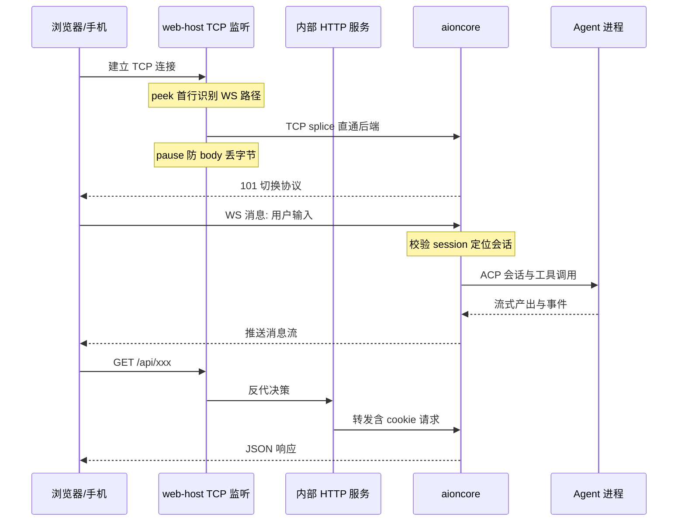
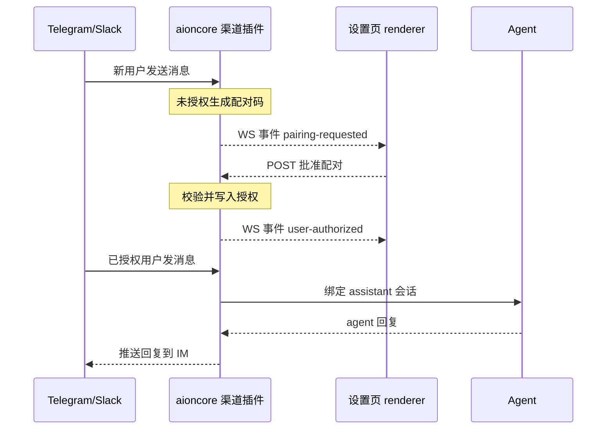
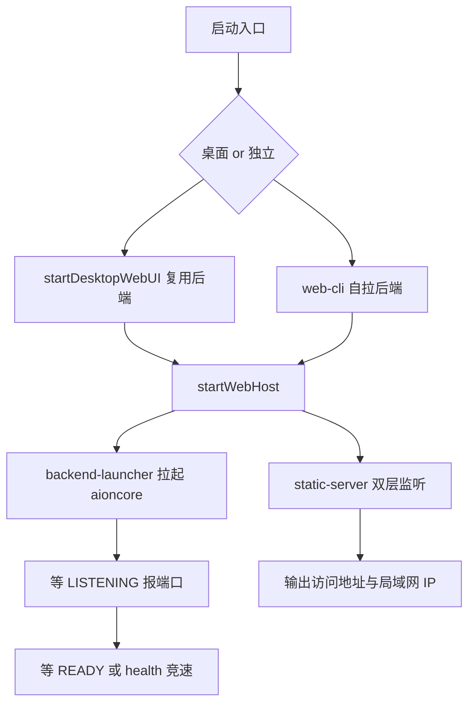

# AionUi 深度解读：远程访问与 IM 渠道接入（WebUI + Channels）

> 本解读对应 AionUi v2.1.61 源码，仓库相对路径均以 AionUi 根为基准。叙事承接前几篇（骨架 / 收敛 / 数据 / Team / Cron）——前几篇把桌面 Agent 的骨架、数据与自动化收拢完毕，本篇回答最后一个问题：**怎么让这套桌面系统在人不坐在电脑前时也能被触达**。


## 模块定位：把桌面 Agent 变成「anywhere 可用」的通道层

AionUi 的自我定位是「多 Agent 桌面 Cowork 平台」，双层架构——Electron 壳 + 外部 Rust 引擎 aioncore。「Cowork from Anywhere」是把桌面 Agent 从「装了这个 App 的机器」里解放出来的核心卖点，由三层协作构成：

| 层 | 承载包/文件 | 职责 | 关键文件 |
|---|---|---|---|
| 服务端 | `@aionui/web-host` | 拉起/复用 aioncore、服务 SPA、反代 `/api` 与 `/ws`、端口/LAN IP 管理 | `packages/web-host/src/static-server.ts`、`backend-launcher.ts` |
| 启动入口 | `@aionui/web-cli` + `scripts/webui.ts` | 无 Electron 的独立启动（bun 编译单文件）、初始密码引导、`resetpass` | `packages/web-cli/src/index.ts`、`ensureAdminPassword.ts` |
| 桌面集成 | desktop 主进程 + renderer | 设置页开关、QR 登录、渠道配置 | `webuiConfig.ts`、`webuiBridge.ts`、`WebuiModalContent.tsx`、`channels/*` |

三者在依赖方向上只有一个指向：**业务逻辑永远在 aioncore，Node/Electron 层只做「怎么把人连到后端」**。去掉这个模块，桌面 Agent 依然能对话、能调工具、能跑 Cron——但全部能力被锁在 Electron 窗口里：手机不能用、浏览器不能访问、IM 不能发消息，「24/7 无人值守」对用户毫无意义。它是把前几篇沉淀的桌面能力（数据、Team、Cron）对外的**唯一通道**，也是 README 反复宣传的卖点落地层。

## 要解决的问题与根因

桌面 Agent 的根问题是**可达性（reachability）**：CLI 时代的 Agent 住在终端里，AionUi 把它收进了 Electron GUI，能力更强了，但入口反而更窄——只能在本机、本窗口里用。而「Cron 24/7 无人值守」的价值（上一篇）恰恰建立在「人不在场也能触发、也能看到结果」之上：任务跑了没人看，等于没跑。

于是根因可以被精确表述为：**Agent 的执行引擎（aioncore）与展示壳（Electron renderer）在物理上绑死在同一台机器的同一窗口里，需要把「壳-引擎」的分离从进程边界（Electron 主进程 vs aioncore 子进程）延伸到网络边界（浏览器/手机/IM vs aioncore）**。README 的自我宣传印证了这个判断（[readme.md:292-303]()）：
<!-- anchor: ## Cowork from Anywhere …   - **WeCom (企业微信)**, **Slack**, **Discord** and more platforms coming soon -->

> "Cowork from Anywhere — Your 24/7 AI assistant, access AionUi from any device, anywhere. WebUI Mode supports LAN, cross-network, and server deployment. QR code or password login."（[readme.md:294-296]()）
<!-- anchor: _Your 24/7 AI assistant — access AionUi from any device, anywhere._ … - **WebUI Mode** — access via browser from phone, tablet, or any computer. Supports LAN, cro -->

解决它需要同时回答三个子问题：
- **同一套 renderer 怎么跑在浏览器里？** → 必须有一份不依赖 Electron 的服务端来托管 SPA 并复用后端（web-host）。
- **「人不在场」时谁能说话？** → 除了浏览器，还要让 IM 平台的 Bot 把消息送进同一个 agent 会话（Channels）。
- **怎么确保跨网络访问不裸奔？** → 密码/会话/QR 登录，且认证逻辑与业务逻辑一样只实现一份（在后端）。

## 设计思路：壳-引擎分离的网络化延伸

### web-host：零 Electron 依赖的「服务端包」

把 Electron 特有对象（`app.*`、`__dirname`、`process.execPath`）全部从服务端逻辑中剥离，换成构造函数注入的接口 `AppMetadata` 与 `BackendBinaryResolver`。这让同一份 `startWebHost` 能被三种完全不同的宿主调用：

```ts
// 类型已精简，非逐字；完整定义见 packages/web-host/src/types.ts
export type WebHostOptions = {
  app: AppMetadata;
  staticDir: string;
  port?: number;
  allowRemote?: boolean;
  backend: { kind: 'ownBackend'; resolveBackend: ... } | { kind: 'useExistingBackend'; port: number };
};
```
（[packages/web-host/src/types.ts:33-42]()）
<!-- anchor: export type WebHostOptions = { …   backend: { kind: 'ownBackend'; resolveBackend: BackendBinaryResolver } | { kind: 'useExis -->

`startWebHost` 是极薄的编排器：先按 `backend.kind` 决定拉起还是复用 aioncore，再起 static-server，任一失败则清理另一侧（[packages/web-host/src/index.ts:27-64]()）：
<!-- anchor: export async function startWebHost(opts: WebHostOptions): Promise<WebHostHandle> { …     await backendHandle.stop(); -->

- **桌面端**传 `kind: 'useExistingBackend'`，复用 Electron 主进程已拉起的后端端口（`globalThis.__backendPort`），避免两个后端抢同一 SQLite（[packages/desktop/src/process/utils/webuiConfig.ts:228-263]()）——注释明确写了这是有意的「复用而非再拉」。
<!-- anchor:   // Spawning a second backend here would race the first on the same SQLite file. …       port: backendPort, -->
- **独立部署（web-cli / scripts/webui.ts）**传 `kind: 'ownBackend'`，用自己的 `BackendBinaryResolver` 从 tarball 或 PATH 解析 aioncore 二进制，自拉自停（[packages/web-cli/src/index.ts:199-220]()）。
<!-- anchor:     const handle = await startWebHost({ …         resolveBackend: () => backendBin, -->

关键推论：**web-host 持有的不是「配置」，而是「依赖注入点」**。端口、远程开关、静态目录都来自调用方（Electron 的 ProcessConfig、CLI flags、环境变量），web-host 自己零持久化状态（[packages/web-host/src/index.ts:20-26]()）：
<!-- anchor:  * Orchestrates backend-launcher + static-server. web-host itself holds no … * of truth (Electron ProcessConfig, CLI flags, env vars). -->

这使得同一包可以同时服务桌面内嵌 WebUI、独立 CLI 服务、以及未来的任何 Node 宿主，而不需要为每种宿主开一条代码路径。

### 反代与路由：Node 原生 HTTP + 两层监听 + TCP splice

static-server 故意不引 Express、不写业务路由，只用 Node 原生 `http` + `serve-handler`（[packages/web-host/src/static-server.ts:10-16]()）：
<!-- anchor:  * Design: Node native http + serve-handler. No Express. No business routes. … import serveHandler from 'serve-handler'; -->

路由规则极简（[packages/web-host/src/static-server.ts:183-195]()）：
<!-- anchor:       // /api/* — reverse proxy to backend (includes /api/auth/*). …         rewrites: [{ source: '**', destination: '/index.html' }], -->
- `/api/*`、`/login`、`/logout` → 反代给 aioncore（auth 与全部业务归后端）；
- 其余 → `serve-handler` 提供静态文件 + SPA fallback 到 `index.html`。

WS/STT 升级不经过 `http.Server` 的 `upgrade` 事件，而是用一个纯 TCP 的 `net.Server` 监听用户端口，先 peek 首行判断路径（`peekWsRoute`），把 `/ws` 与 `/api/stt/stream` 直接 **TCP splice** 到后端，其余交给内部 HTTP 服务器（[packages/web-host/src/static-server.ts:155-160]()、[packages/web-host/src/static-server.ts:206-223]()）：
<!-- anchor: function peekWsRoute(buf: Buffer): boolean | null { …   return /^GET\s+\/(?:ws|api\/stt\/stream)(?:\?[^\s]*)?\s+HTTP\/1\.[01]\r?$/.test(firstLine); -->
<!-- anchor:   // Internal HTTP server — 127.0.0.1 ephemeral port, never visible to the user. …   const tcp_server = net.createServer((client: Socket) => { -->

这个「两层监听」的设计是因为 bun 1.3 的 http-compat 层不会如实转发 `upgrade` 回调里写入 socket 的数据，后端 101 响应到不了浏览器——纯 TCP 绕开了这条代码路径（源码注释记录 issue #2824）。

`spliceToTcpEndpoint` 里还踩过一个真实的坑（#4058）：peek 阶段移除了 `data` 监听后 socket 仍处于 flowing 模式，若在异步 `connect` 完成前有 body 字节到达，会因无消费者而丢失，后端永久等 Content-Length——修复是在 connect 前 `client.pause()` 让字节在 socket 缓冲，再由 `pipe()` 恢复（[packages/web-host/src/static-server.ts:113-142]()）：
<!-- anchor: function spliceToTcpEndpoint(client: Socket, targetPort: number, initialBytes: Buffer): void { …   client.on('close', tearDown); -->

### 认证：bcrypt + session 完全委派后端

web-host 里**没有任何密码逻辑**。`/login`、`/logout`、`/api/auth/*` 全部反代到 aioncore 的 `aionui-auth` crate（bcrypt + session），Node 层原样透传 `set-cookie` 与 session cookie（[packages/web-host/src/static-server.ts:4-8]()）：
<!-- anchor:  * /login and /logout are aionui-auth's top-level paths, the rest live under … * TCP level; /api/stt/stream is the STT streaming endpoint. -->

测试用 mock 后端验证了这一点：`/login` 返回的 `aionui-session=...` cookie 被原样转交给浏览器（[packages/web-host/src/static-server.unit.test.ts:91-112]()）：
<!-- anchor:   it('/login reverse-proxies to backend (no local handler)', async () => { …     expect(r.headers.get('set-cookie')).toMatch(/aionui-session=backend-token/); -->

这个「认证在 Rust、Node 只当管道」的决策带来三个直接结果：
1. **单一实现**：桌面内嵌 WebUI 与独立部署共用同一套认证，不会出现「两套密码逻辑、一个被绕过」的裂缝；
2. **web-host 保持薄**：不需要维护 session 存储、bcrypt 依赖、密码策略，复杂度全部留在后端；
3. **代价**：web-host 无法在无后端时提供任何认证——frontend-only 降级模式下 `/api` 直接 502（见下文）。

### 渠道接入：做在「远程访问层」，而非桌面层

渠道配置页面（Channels Tab）不依赖 Electron IPC 而是**直接 HTTP 访问 `/api/channel/*`**。启用/禁用/测试走插件 API（[packages/desktop/src/common/adapter/ipcBridge.ts:2177-2186]()）：
<!-- anchor: export const channel = { …   >('/api/channel/plugins/test'), -->

配对与用户授权走另一组端点（[packages/desktop/src/common/adapter/ipcBridge.ts:2190-2193]()）：
<!-- anchor:   approvePairing: httpPost<void, { code: string }>('/api/channel/pairings/approve'), …   revokeUser: httpPost<void, { user_id: string }>('/api/channel/users/revoke'), -->

实时事件（配对请求、状态变更、用户授权）通过 WebSocket 推送（`channel.pairing-requested` / `channel.plugin-status-changed` / `channel.user-authorized`）。

这意味着**浏览器里的设置页（WebUI 模式）和桌面里的设置页看到的是同一份渠道状态、走同一条 API**——`WebuiModalContent` 里 `isDesktop` 分支只是不渲染「WebUI 服务管理」部分，Channels 配置两者完全一致（[packages/desktop/src/renderer/components/settings/SettingsModal/contents/WebuiModalContent.tsx:558-565]()）：
<!-- anchor:   if (!isDesktop) { …               <ChannelModalContentLazy /> -->

渠道的「客户端」是一层通用协议（token / app_secret / extra_config），「服务端」是 aioncore 里的渠道插件；渠道协议差异（Telegram 的 bot token、Slack 的双 token、Lark 的 app_id+secret、Weixin 的扫码）被推到后端，Node 侧保持极薄。

## 关键数据结构

### 渠道插件状态：`IChannelPluginStatus`

renderer 展示的每个渠道卡片都对应一条这样的后端状态（[packages/desktop/src/common/types/channel/channel.ts:1-33]()）：
<!-- anchor: export interface IChannelPluginStatus { …     extensionName?: string; -->

```ts
// 字段经精简、非逐字；完整定义见 packages/desktop/src/common/types/channel/channel.ts
type IChannelPluginStatus = {
  enabled: boolean;    // 用户是否启用
  connected: boolean;  // 与 IM 平台的长连接是否在线
  hasToken?: boolean;  // 凭据是否已持久化
  activeUsers: number; botUsername?: string;
  isExtension?: boolean;
  extensionMeta?: { credentialFields?; configFields?; ... };  // 扩展渠道动态表单 schema
};
```

三个布尔维度（enabled / connected / hasToken）把「用户想用」「服务在线」「凭据已存」解耦，UI 据此决定：Switch 是否可拨、凭据输入框是否禁用（有已授权用户时锁定）、Next Steps 引导是否出现。

### 渠道级会话与绑定

渠道不直接操作 agent 进程，而是维护自己的会话抽象：`IChannelPairingRequest`（配对码+过期时间）、`IChannelUser`（授权用户）、`IChannelSession`（渠道会话→conversation 映射），以及每个渠道的 assistant 绑定（`IChannelAssistantBindingWrite`，新写一律用 `assistant_id`，旧字段 `custom_agent_id/backend/agent_type` 仅为读兼容保留）（[packages/desktop/src/common/types/channel/channel.ts:37-85]()）：
<!-- anchor: export interface IChannelPairingRequest { … export interface IChannelAssistantBindingWrite { -->

这条映射链正是渠道消息找到目标的依据：IM 用户 → 授权用户 → 渠道会话 → conversation。

### WebHost 句柄

`WebHostHandle` 对外暴露 `port / backendPort / url / localUrl / networkUrl / lanIP`（[packages/web-host/src/types.ts:47-55]()），让桌面设置页只凭这个句柄就能展示访问地址、局域网 IP、以及 `networkUrl`（用于拼 QR 登录链接）：
<!-- anchor: export type WebHostHandle = { …   stop: () => Promise<void>; -->

## 核心流程

### 从浏览器到 agent 会话：完整远程访问链路

浏览器访问时只有两类路径：需要长连接的 `/ws`（与 `/api/stt/stream`）走 TCP splice 直通，其余全部走内部 HTTP 服务器反代。**浏览器侧认证完全透明**：`/login` 时后端下发 session cookie，此后所有请求（包括 WS upgrade）带 cookie 即可，Node 层不做任何会话判断。



splice 决策的关键点：仅凭请求行（约 50 字节）就判定是否直通，不必等完整 header（peek 上限 `PEEK_LIMIT_BYTES`，[packages/web-host/src/static-server.ts:106-106]()）——这决定了它能在「不破坏大请求」的前提下把升级类流量以最小延迟交给后端。cookie 与鉴权则由 aioncore 在 WS/HTTP 两条路径上统一校验。
<!-- anchor: const PEEK_LIMIT_BYTES = 4096; -->

### IM 渠道接入链路：配对 → 授权 → 会话

渠道没有「浏览器登录页」，它的准入控制是**配对（pairing）**机制：IM 用户先被挡在门外，向 Bot 发消息触发配对码，用户在桌面/浏览器设置页批准后才成为授权用户。



配对码有 `expiresAt` 过期时间，UI 显示剩余分钟数，实时事件由 `channel.pairingRequested.on` 订阅（[packages/desktop/src/renderer/components/settings/SettingsModal/contents/channels/TelegramConfigForm.tsx:164-173]()）：
<!-- anchor:     const unsubscribe = channel.pairingRequested.on((request) => { …     return () => unsubscribe(); -->

授权后 token/凭据输入框被锁定（`authorizedUsers.length > 0` 时 disabled），防止有人在用户已授权后改 Bot 凭据造成断连或劫持。这个「先配对后对话」的设计把 IM 侧的攻击面收敛到「本机主人显式批准」这一动作上。

### 启动流程：两个宿主，同一个 startWebHost



readiness 判定是这套流程里最讲究的部分：aioncore 在 stdout 输出 `AIONCORE_LISTENING {port}` 与 `AIONCORE_READY` 两个标记，launcher 用「/health 轮询 vs ready 标记」竞速，谁先到谁定 ready；health 超时且有 `allowPendingOnHealthTimeout` 时不杀进程，转后台继续等（[packages/web-host/src/backend-launcher.ts:856-887]()）：
<!-- anchor:     const healthOrReady = await Promise.race([ …       throw healthTimeoutError; -->

这比「只轮询 /health」更稳——health 可能因后端暂时不可达而误报，而 `AIONCORE_READY` 是 aioncore 内部在 `axum::serve` 真正开始服务后打印的权威信号。

## 与其他模块的协同

| 协同对象 | 协作方式 | 关键引用 |
|---|---|---|
| 后端引擎 aioncore | 一切业务/认证/渠道插件的真正实现者；web-host 只做反代与生命线管理 | `packages/web-host/src/static-server.ts:183-195`；`packages/web-host/src/backend-launcher.ts` |
| Electron 主进程 | `__backendPort` 全局注入后端端口；webuiBridge 管 WebUI 生命周期，不碰凭据（凭据走 HTTP） | `packages/desktop/src/process/utils/webuiConfig.ts:228-263`；`packages/desktop/src/process/bridge/webuiBridge.ts` |
| 桥/数据模型 | renderer 通过 ipcBridge 的 HTTP 层直连 `/api/channel/*`、`/api/webui/*`，与桌面 IPC 并存 | `packages/desktop/src/common/adapter/ipcBridge.ts:2177-2193`、`1604-1622` |
| Cron（前一篇） | Cron 在 aioncore 内触发 agent；远程访问让「Cron 跑完的结果」可被浏览器/IM 触达，两者合起来才是 24/7 anywhere | — |
| 扩展系统 | 扩展渠道通过 `extensionMeta` schema 动态表单注册进 Channels 列表（含 `ext-wecom-bot` 回调 URL 提示） | `packages/desktop/src/renderer/components/settings/SettingsModal/contents/channels/ChannelModalContent.tsx:619-644` |

跨模块边界有一个明确的判断：**渠道的服务端实现（Telegram/Slack/Lark/Discord/DingTalk/Weixin 的机器人长连接、配对逻辑、授权库）在 aioncore（外部 Rust 仓库）中，本仓库只有 renderer 客户端与 `/api/channel/*` 契约**。据此，本文档凡是声称「某渠道已实现」的结论，仅指本仓库侧（API 契约 + 完整配置 UI + WS 事件订阅），后端侧实现是否与 UI 对齐（依赖 aioncore 外部实现）。

## 关键设计决策

### 决策一：零 Electron 依赖 + 依赖注入，换取三种宿主复用

`web-host` 把 `app.*`、二进制路径、静态目录全部变成注入项，是这套架构里代价最高也最值得的一笔投入。**不这么做的替代方案**是：把 WebUI 服务直接写进 Electron 主进程——像早期被取代的 `electron-vite dev -- --webui` 流程（[scripts/webui.ts:6-10]() 顶部注释记录了替代关系）：
<!-- anchor:  * Pure Bun CLI — launches the WebUI (backend + static server + auth) without … * Env vars: -->
<!-- anchor:  * launching Electron. Replaces the former `electron-vite dev -- --webui` flow. … * Env vars: -->

那样实现更快，但会一次性锁死三个能力：
1. **独立部署**——没有 Electron 的服务器（Android Termux、无头云主机、K8s Pod）无法启动服务。仓库根自带 `Dockerfile`（[Dockerfile:1-1]() 基于 `node:20-slim` 构建 web-cli 单文件后运行），即"零 Electron 依赖"红利下服务端容器化部署的落地形态； <!-- anchor: FROM node:20-slim AS builder … FROM node:20-slim AS builder -->
2. **bun 编译单文件分发**——`aionui-web` 可执行文件就是靠零 Electron 依赖才得以把 web-host + aioncore 打进一个 tarball（[packages/web-cli/src/index.ts:17-21]() 注释详述了 `bun build --compile` 下 `import.meta.url` 失效、必须用 `process.execPath` 定位兄弟文件的坑）；
<!-- anchor: // path, NOT the real tarball location — we MUST use process.execPath to find … // so fall back to import.meta.url there. -->
3. **测试**——web-host 的 vitest 全套 mock 掉 `spawn/fetch/net` 即可单测后端生命周期，不需要 Electron 测试环境（[packages/web-host/src/backend-launcher.test.ts:13-29]()）。
<!-- anchor: vi.mock('node:child_process', () => ({ …   cleanupRegisteredAgentProcesses: vi.fn().mockResolvedValue(undefined), -->

代价是注入面变大（每次新增宿主都要确认 `AppMetadata` 字段够用），以及 web-host 自身无法独立完成「从配置到运行」——但这恰好与项目「业务归后端」的分层哲学一致。

### 决策二：TCP splice 反代，而不是 http 升级事件

大部分反代服务用 `http.Server` 的 `upgrade` 事件转发 WebSocket。这里弃用的直接原因是 bun 1.3 http-compat 不转发 upgrade 写入（#2824），但深入看，**纯 TCP splice 还买到了 Node/bun 双运行时一致性**：`net.createServer` + `socket.pipe` 是两端运行时的公共语义，不依赖任何 http 层行为。代价是需要自己处理 peek 缓冲、routing 决策、以及 `pause()/pipe()` 之间的 body 丢字节竞态（#4058，[packages/web-host/src/static-server.unit.test.ts:338-399]() 用 512KB 上传做了确定性回归测试）：
<!-- anchor:     // Regression for #4058: WebUI uploads hang forever at 100%. When the routing …     expect(received).toBe(BODY_LEN); -->

这是一个「为平台兼容付复杂度、但用测试把复杂度焊死」的典型案例。

### 决策三：认证与渠道插件全部委派后端，「Node 不持有秘密」

从 bcrypt 密码到渠道 Bot token，所有凭据都只存在于 aioncore 的存储/内存里，Node 层只是一个不会解析、不会保存 cookie 的管道。替代方案（Node 侧自建 session）会让安全敏感逻辑分裂成两套，且独立部署模式（无 Electron）仍绕不开后端。这个决策的代价是 web-host 在没有后端时是「不设防的空壳」——frontend-only 模式只能展示 UI、所有 `/api` 请求 502（[packages/web-cli/src/index.ts:163-178]()）：
<!-- anchor:   const backendAvailable = fs.existsSync(backendBin); …       backendPort: 0, // invalid port → API proxy will fail cleanly -->

它把「安全」与「可用」的选择权完全交给了后端的有无，而不是在 Node 层做个残缺的保险。

## 亮点与问题

### 亮点

- **启动失败可观测性近乎偏执**：`BackendStartupError.details` 携带十几项健康检查诊断（attempts、interval、elapsed、lastError、TCP probe、polling delayed 等），并解析 aioncore stderr 里的 `BOOTSTRAP_*`/`CLI_*` 边界错误码。桌面端能据此区分「启动慢（可保留进程继续等）」与「数据库恢复失败（必须杀进程）」——`healthTimeoutKeptAlive` 标志就是为此服务的（[packages/web-host/src/backend-launcher.ts:59-168]()、[packages/web-host/src/backend-launcher.ts:356-366]()）。
<!-- anchor: type ParsedBackendBoundaryError = { …   healthTimeoutKeptAlive?: boolean; -->
<!-- anchor: function parseBackendBoundaryError(text: string): ParsedBackendBoundaryError | undefined { …   return undefined; -->
- **端口选择考虑 Fetch API 禁令**：`findAvailablePort` 会跳过浏览器 `fetch` 不允许访问的端口（FTP/ssh/redis 等），避免「后端端口健康但浏览器健康检查永远失败」这种隐蔽故障——因为后端端口最终要被浏览器侧的 `fetch` 健康检查访问（[packages/web-host/src/backend-launcher.ts:240-245]()）：
<!-- anchor: const FETCH_FORBIDDEN_PORTS = new Set([ …   6566, 6665, 6666, 6667, 6668, 6669, 6697, 10080, -->
- **局域网 IP 的智能选择**：`pickLanIP` 会跳过 APIPA（169.254/16）与 RFC 2544（198.18/15，Cloudflare WARP 隧道常被 OS 列在首位）网段，并按 `192.168 > 172.16/12 > 10/8` 排序私有网段，避免在 VPN 机器上把「手机根本连不到」的地址当访问地址广播（[packages/web-host/src/static-server.ts:49-73]()，配 `static-server-lanip.unit.test.ts` 全场景测试）：
<!-- anchor: const rankLanCandidate = (addr: string): number => { …   return candidates[0] ?? null; -->
- **孤儿 agent 进程回收**：aioncore 把 agent 子进程登记到 `runtime/agent-process-registry.json`，web-host 停止时按 SIGTERM→SIGKILL 两段回收，并用「pid+counter 临时文件 + 重读合并」防并发写坏文件（[packages/web-host/src/agent-process-registry.ts:20-20]()、[packages/web-host/src/agent-process-registry.ts:35-74]()）：
<!-- anchor: export const AGENT_PROCESS_REGISTRY_RELATIVE_PATH = path.join('runtime', 'agent-p -->
<!-- anchor: export async function cleanupRegisteredAgentProcesses(dataDir?: string): Promise<void …   await writeRegistry(registryPath, { -->
  `stop()` 后清理失败被注释明确标为「不得阻断关闭流程」——bookkeeping 永远让位于主流程。
- **降级不崩溃**：找不到后端二进制时 web-cli 仍能启动，以「frontend-only」模式服务 SPA，让用户看到错误而不是白屏（见决策三）。
- **对 agent CLI 环境的关怀**：独立启动前把 nvm 管理的所有 Node bin 塞进 PATH——否则 aioncore 派生的 ACP agent（如 gemini）找不到 CLI，ACP 握手 30s 超时、UI 看到 502（[scripts/webui.ts:167-179]()）：
<!-- anchor: function augmentPathWithNvm(): void { …       process.env.PATH = [...missing, current].join(path.delimiter); -->

### 问题与风险

- **README 宣传与实现不一致（后端需对照 AionCore 核实）**：README 说「WeCom / Slack / Discord and more platforms coming soon」（见开头 readme 引用），但本仓库里 Slack、Discord 已经是 `status: 'active'` 的内置渠道，有完整 ConfigForm 与 enable/disable 逻辑（[packages/desktop/src/renderer/components/settings/SettingsModal/contents/channels/ChannelModalContent.tsx:753-758]()、[packages/desktop/src/renderer/components/settings/SettingsModal/contents/channels/ChannelModalContent.tsx:775-779]()）：
<!-- anchor:     const slackChannel: ChannelConfig = { …       status: 'active', -->
<!-- anchor:     const discordChannel: ChannelConfig = { …       status: 'active', -->
  而 [docs/prds/remote/channels/channels.md:36-36]() 又把 Discord 标为「已从 coming_soon 升级为内置 active」。README 落后于实现。**后端是否真的实现 Slack/Discord 插件（依赖 aioncore 外部实现）。**
<!-- anchor: **说明**：Discord 已从占位（coming_soon）升级为内置 active 渠道，`comingSoonChannels` 占位列表已随之移除。 -->
- **WeCom 渠道状态自相矛盾**：`WecomConfigForm.tsx` 已完整实现（Bot ID + Secret + Save&Enable + 配对流程，[packages/desktop/src/renderer/components/settings/SettingsModal/contents/channels/WecomConfigForm.tsx:196-208]()），但 `ChannelModalContent` 中 wecom 仍标 `status: 'coming_soon'`、Switch 禁用（[packages/desktop/src/renderer/components/settings/SettingsModal/contents/channels/ChannelModalContent.tsx:851-856]()），而 PRD 却标「F-WEBUI-17 已实现」：
<!-- anchor:   const handleSaveAndEnable = async () => { …         plugin_id: 'wecom', -->
<!-- anchor:     const wecomChannel: ChannelConfig = { …       enabled: false, -->
  同时存在扩展渠道 `ext-wecom-bot`（webhook 回调模式）作为另一条企业微信路径（[packages/desktop/src/renderer/components/settings/SettingsModal/contents/channels/ChannelModalContent.tsx:619-644]()）：
<!-- anchor:       const callbackPath = '/ext-wecom-bot/webhook'; …           {pluginType === 'ext-wecom-bot' && ( -->
  内置 wecom 到底是「已实现未上线」还是「半成品」（依赖 aioncore 外部实现）。
- **远程访问无 TLS**：`--remote` 是明文 HTTP 暴露到局域网/公网，README 自己也写「Use only on trusted networks. Consider setting up authentication and firewall rules」（[docs/guides/webui.md:448-448]()）：
<!-- anchor: **Security Note**: Remote mode allows network access. Use only on trusted networks. C -->
  密码+session 能挡随机用户，但中间人可嗅探——对个人工具可接受，做公网生产部署是明显短板。
- **认证体验的已知取舍**：改密码不需要当前密码（依赖「能在设置页操作 = 已在本机」的假设）、QR token 存内存（主进程重启即失效）、远程切换要重启服务（最长 6s 中断）——这些是 PRD 附录明确记录的局限（[docs/prds/remote/webui/webui.md:507-522]()），属「本地信任 + 极简」下的合理妥协，但应被使用者知晓：
<!-- anchor: | 1   | F-WEBUI-01    | 启动 IPC 超时 3s 后乐观设置 `running: true`，同时持久化 `enabled=tru … | 14  | F-WEBUI-01    | 端口递增上限固定为 `DEFAULT_PORT + 10`，用户指定端口超出此范围时递增不 -->
- **web-host 包内 README 严重过时**：还写着「M3: skeleton + placeholder implementations (all throw)」（[packages/web-host/README.md:35-37]()），与已完整实现的代码不符，误导新读者：
<!-- anchor: ## Status … M3: skeleton + type definitions + placeholder implementations (all throw `not -->


## 总结回扣根因

远程访问模块回答的是「桌面 Agent 如何被异地触达」：web-host 用零 Electron 依赖 + 注入式接口，把同一套 renderer/后端通过网络暴露给浏览器与手机；渠道层用「插件状态 + 配对授权」把 IM 平台的每条消息安全地送进同一个 agent 会话。它没有发明新的业务能力，而是**把前几篇沉淀的桌面能力（数据、Team、Cron）从「窗口内」复制到「世界各处」**——与 Cron 的 24/7 无人值守拼合，才构成 README 那句 "Your 24/7 AI assistant, from any device, anywhere" 的完整语义：Cron 负责「什么时候干活」，远程访问负责「谁在哪都能看着它干活」。

> 分析深度：本关注面按深度模式（核心模块 ≥90%）覆盖，覆盖率明细详见各 subagent 分析草稿；正文论断均带 `文件:行号` 可验证引用。
