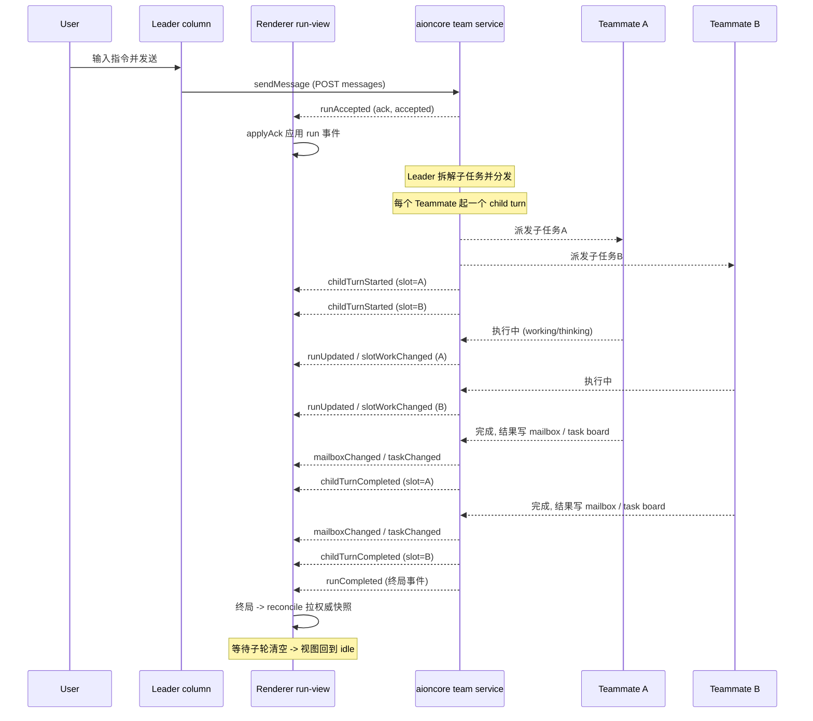

# Team Mode：多 Agent 协作编排

> 配套阅读：壳-引擎篇（aioncore 双层架构）、ACP 收敛篇、数据底座篇（SQLite schema）。

## 在项目中的角色

Team Mode 是 AionUi 把自己从"单 agent 客户端"区别开来的核心卖点：让多个后端 agent（Claude Code、Codex、Gemini、Snow CLI、Aion CLI 等）以 **Leader/Teammate 角色**组成一个可并行协作的团队。它是 README 开篇即提的三个能力之一（"Run multiple AI agents as an organized team"），并直接承诺了 Leader 拆解任务、异步邮箱、共享任务板、动态扩容、细粒度权限五件事（[readme.md:180-180]()）。 <!-- anchor: Run multiple AI agents as an organized team: a **Leader** agent receives your instr … Run multiple AI agents as an organized team: a **Leader** agent receives your instr -->

从代码看，这个模块**纯 renderer + 后端 HTTP/WS 契约**，不在 Electron main 进程落地任何逻辑：

- 页面层 `packages/desktop/src/renderer/pages/team/` 负责三件事——团队会话的并行渲染、活动看板、成员/权限 UI；
- 通信层走 `ipcBridge.team`（[packages/desktop/src/common/adapter/ipcBridge.ts:2254-2254]()），全部是 `httpPost/httpGet/wsEmitter` 封装的 `/api/teams/*` 接口，由 HTTP bridge 直连 aioncore（[packages/desktop/src/common/adapter/httpBridge.ts:1-7]()）； <!-- anchor: export const team = { … export const team = { --> <!-- anchor:  * HTTP/WS bridge factory — drop-in replacement for bridge.buildProvider / bridge.buildEmi …  * so existing renderer code works without changes. -->
- 持久化层只由 aioncore 读写 `teams` / `mailbox` / `team_tasks` 三张表（[packages/desktop/src/process/services/database/schema.ts:85-133]()），renderer 侧只能通过 `listMailbox/listTasks/listActivity` 只读拉取。 <!-- anchor:   // Teams table (团队模式) …   db.exec('CREATE INDEX IF NOT EXISTS idx_tasks_team ON team_tasks(team_id, status)'); -->

**去掉它会怎样**：单 agent 客户端只能一次跑一个会话；即使后台并行开多个会话，也没有"Leader 拆任务、按角色分发、异步收结果"的编排语义。这个模块承载的是"多 agent 协作"的产品叙事，去掉它 AionUi 就退回成"装了多个 ACP 客户端的壳"，卖点叙事坍塌。它的存在与壳-引擎双层架构一致：**编排语义在后端（aioncore），前端只做可视化与交互**。

## 解决什么问题

**根因是单 agent 无法并行协作。** 一个 agent 一轮只能推进一个目标：指令在会话里排队，模型按顺序消费，任务之间没有分工、没有合并点。要解决"多 agent 一起干活"，必须先回答三个问题：谁来当指挥？子任务怎么分？结果怎么汇？

AionUi 的选择是（[readme.md:186-186]()）： <!-- anchor: - **Parallel multi-agent execution** — Leader breaks tasks into subtasks and … - **Parallel multi-agent execution** — Leader breaks tasks into subtasks and -->

- **固定一名 Leader**：接收用户指令，拆解子任务，派发给 Teammate，最后聚合结果；
- **Teammate 并行执行**：每个 Teammate 用自己的后端与模型，互不阻塞；
- **异步媒介**：结果不靠同步返回值，而是落进 mailbox（消息）与 task board（任务），任何成员随时读。

这个分工模式在工程上对应一个清晰的职责切分：**编排（run 状态机）在后端权威驱动，渲染（并行列、看板）在前端**。前端不实现任何"派活"逻辑——它只把用户的输入转成 `/api/teams/{id}/messages`，把后端推送的 `team.run*` 事件映射成可读的 UI 状态。

> 反事实推理：如果编排放在前端，那么每个后端 agent 的启动、暂停、中断、超时都得前端自己管理，且跨进程状态难以一致性收敛；把编排下沉到 aioncore，前端只消费事件，是壳-引擎架构的自然推论。

## 设计思路

### Leader/Teammate 编排模型

成员的编排身份由 `role` 字段定义，取值 `leader | teammate`（[packages/desktop/src/common/types/team/teamTypes.ts:8-8]()）。渲染层处处体现这个二分： <!-- anchor: export type TeammateRole = 'leader' | 'teammate'; … export type TeammateRole = 'leader' | 'teammate'; -->

- Tab 栏 Leader 固定在 index 0，不可拖拽排序；只有 Teammate 参与 sortable（[packages/desktop/src/renderer/pages/team/components/TeamTabs.tsx:60-64]()、[packages/desktop/src/renderer/pages/team/components/TeamTabs.tsx:263-266]()）； <!-- anchor:   const { attributes, listeners, setNodeRef, setActivatorNodeRef, transform, transition, isDr …     disabled: isLeader, --> <!-- anchor:   const sortableIds = useMemo( …     [assistants] -->
- 消息入口分叉：Leader 列走 `sendMessage`（面向团队），Teammate 列走 `sendMessageToAgent`（面向单槽），并在有 active turn 时允许 `interruptAgent` 以 Leader 干预名义插入（[packages/desktop/src/renderer/pages/team/components/TeamChatView.tsx:156-169]()、[packages/desktop/src/renderer/pages/team/components/TeamChatView.tsx:196-214]()）； <!-- anchor:   const teamSendMessage = useCallback<TeamSendOverride>( …     [isLeader, onTeamRunAck, slot_id, team_id] --> <!-- anchor:   const interruptAndSend = …       : undefined; -->
- 成员操作权限不同：Leader 不可移除，Teammate 可移除；Leader 的 context-reset 目标被显式置为 `leader_not_targetable`（[packages/desktop/src/renderer/pages/team/TeamPage.tsx:426-431]()）。 <!-- anchor:   const contextResetAvailability = …         : assistant.context_reset.availability; -->

### 三种协作视图

`useTeamViewMode` 定义三种按团队记忆的视图（[packages/desktop/src/renderer/pages/team/hooks/useTeamViewMode.ts:9-15]()）： <!-- anchor:  * 团队协作视图模式 —— 团队整体属性，按团队记忆（localStorage）。 … export type TeamViewMode = 'parallel' | 'single' | 'board'; -->

| 视图 | 语义 | 定位 |
|------|------|------|
| `parallel` | 所有成员对话列并排，横向滚动 | 默认，协作的主战场 |
| `single` | 全屏当前选中成员 | 单聊聚焦 |
| `board` | 只读的 mailbox + task board 看板 | 协作的"沉淀层" |

parallel 视图的每一列是一个真实 agent 会话（[packages/desktop/src/renderer/pages/team/TeamPage.tsx:886-934]()），列间用成员身份色弱化区分；board 视图则是把 mailbox 消息与 task 统一成一个 feed、按成员泳道渲染的只读看板（[packages/desktop/src/renderer/pages/team/TeamPage.tsx:831-835]()）。三种视图切换不改变后端状态，纯粹是前端呈现层选择。 <!-- anchor:                   {assistants.map((assistant, index) => { …                       
 --> <!-- anchor:             {viewMode === 'board' ? ( …                 <TeamActivityView team={team} /> -->

### mailbox + task board：协作的持久化媒介

后端用两张表分别承载"对话流"与"工作流"：`mailbox`（谁发给谁的消息，含 read 标记）与 `team_tasks`（任务 subject/owner/依赖关系，含 `blocked_by`/`blocks` 图结构）（[packages/desktop/src/process/services/database/schema.ts:103-133]()）。前端对这两张表的消费方式是**统一的 activity feed**：后端把两类事件合并成一个 keyset 分页的连续流（`/api/teams/{id}/activity`，[packages/desktop/src/common/adapter/ipcBridge.ts:2322-2340]()），前端再按消息/任务各自的归属规则分到成员泳道（[packages/desktop/src/renderer/pages/team/activity/activityTypes.ts:52-70]()）。 <!-- anchor:   // Mailbox table (团队消息邮箱) …   db.exec('CREATE INDEX IF NOT EXISTS idx_tasks_team ON team_tasks(team_id, status)'); --> <!-- anchor:   listActivity: httpGet< …     return `/api/teams/${p.team_id}/activity?${q.toString()}`; --> <!-- anchor: export const resolveMessageLane = (message: ITeamMailboxMessage, knownSlots: ReadonlySet< …   return ACTIVITY_FALLBACK_LANE; -->

> 关键取舍：mailbox 与 task 不是两个独立的滚动列表，而是由一个 cursor 连续合并。这保证了"先发的消息/任务"在页面上时间有序，代价是前端的增删插入逻辑要按窗口边界做严格的"是否真的比当前最新还新"判定（见核心流程一节）。

### 状态可视化：一个活跃 run + 每槽工作状态

前端不为"整个团队"建模，而是为一个 **team run**（一次 Leader 下发的指令及其派生的所有子任务）和一个 **slot**（单个成员槽位）建模：`activeRun` 是当前跟踪的 run，`slotWorkBySlot` 是每个槽的工作状态（[packages/desktop/src/renderer/pages/team/hooks/useTeamRunView.ts:23-35]()）。run 与 slot work 是后端权威推送、前端消费的两层正交事件，运行视图（发送框状态、停止按钮、排队数、慢请求标记）全部由它们派生。 <!-- anchor: export type TeamRunViewState = { …   sessionStopped: boolean; -->

## 关键数据结构

### 持久化层：三张表

团队实体、消息、任务分别落库，全部以 `team_id` 外键级联删除（[packages/desktop/src/process/services/database/schema.ts:85-133]()）： <!-- anchor:   // Teams table (团队模式) …   db.exec('CREATE INDEX IF NOT EXISTS idx_tasks_team ON team_tasks(team_id, status)'); -->

- **`teams`**：一行一个团队，`workspace_mode` 区分 `shared | isolated`，`agents` 是成员摘要的 JSON 数组（`lead_agent_id` 与 `session_mode` 是后加列，见 [packages/desktop/src/process/services/database/migrations.ts:917-968]()、[packages/desktop/src/process/services/database/migrations.ts:1125-1137]()）； <!-- anchor:   name: 'Add lead_agent_id to teams, create mailbox and team_tasks tables', …     db.exec('CREATE INDEX IF NOT EXISTS idx_tasks_team ON team_tasks(team_id, status)'); --> <!-- anchor:  * Migration v22 -> v23: Add session_mode column to teams table …     console.log('[Migration v23] Added session_mode column to teams table'); -->
- **`mailbox`**：一条消息一行，`to_agent_id`/`from_agent_id` 描述定向投递，`read` 标记已读；`files` 列在 v25 迁移追加，承载 Leader 向 Teammate 传文件（[packages/desktop/src/process/services/database/migrations.ts:1165-1175]()）； <!-- anchor:  * Migration v24 -> v25: Add files column to mailbox table …       console.log('[Migration v25] Added files column to mailbox table'); -->
- **`team_tasks`**：任务以 `blocked_by`/`blocks` 存 JSON 数组，构成任务依赖图；`metadata` 留作扩展。索引 `(team_id, status)` 支撑按团队/状态扫描（[packages/desktop/src/process/services/database/schema.ts:118-133]()）。 <!-- anchor:   // Team tasks table (团队任务) …   db.exec('CREATE INDEX IF NOT EXISTS idx_tasks_team ON team_tasks(team_id, status)'); -->

### 契约层：状态归一化

后端通过 `/api/teams/*` 下发的字段命名与前端类型并不一致，`teamMapper.ts` 是唯一的映射层，承担三层转换：

1. **角色归一化**：后端 `lead` → 前端 `leader`（[packages/desktop/src/common/adapter/teamMapper.ts:56-59]()）； <!-- anchor: function toRole(raw: string | undefined): TeammateRole { …   if (raw === 'lead') return 'leader'; -->
2. **状态归一化**：后端 `working/thinking/tool_use` 全部折叠为前端 `active`，`error` → `failed`，并**刻意保留 `dormant`**（Leader 独有 warmup 状态，折叠成 idle 会丢失"从未唤醒"的视觉语义）（[packages/desktop/src/common/adapter/teamMapper.ts:61-75]()）； <!-- anchor: export function normalizeTeamStatus(raw: BackendTeammateStatus | undefined): TeammateStat …   return statusMap[raw ?? ''] ?? 'idle'; -->
3. **字段兼容**：`agent_type`/`backend`/`assistant_backend` 三路取值回退，兼容新旧后端版本（[packages/desktop/src/common/adapter/teamMapper.ts:98-120]()）。 <!-- anchor: export function fromBackendAssistant(raw: unknown): TeamAssistant { …     context_reset: toContextResetCapability(r.context_reset), -->

> 值得注意：`toBackendAssistant` 强制要求 `assistant_id`，且 role 回写 `lead`，等于把"前端类型"和"后端类型"做了双向镜像（[packages/desktop/src/common/adapter/teamMapper.ts:158-169]()）。这层 adapter 的存在让 renderer 完全不感知 aioncore 的字段命名演进。 <!-- anchor: export function toBackendAssistant(a: TeamAssistantInput): Record<string, unknown> { …     assistant_id: a.assistant_id, -->

### 运行态：run / slot work / child turn 三层事件

前端消费的三类运行事件（类型集中在 [packages/desktop/src/common/types/team/teamTypes.ts:93-168]()）： <!-- anchor: export type TeamRunTargetRole = 'lead' | 'teammate'; …   status: TeamRunStatus; -->

- **`ITeamRunEvent`**：一次 run 的整体现状，携带各槽 `slot_work` 快照与排队/启动/运行计数（[packages/desktop/src/common/types/team/teamTypes.ts:140-153]()）。生命周期 `accepted → running → completed/cancelled/failed`，`cancelling` 是终局前的过渡态（[packages/desktop/src/common/types/team/teamTypes.ts:94-94]()）； <!-- anchor: export type ITeamRunEvent = { …   active_enqueue_lease_count: number; --> <!-- anchor: export type TeamRunStatus = 'accepted' | 'running' | 'cancelling' | 'completed' | 'cancelled' | 'fai … export type TeamRunStatus = 'accepted' | 'running' | 'cancelling' | 'completed' | 'cancelled' | 'fai -->
- **`ITeamSlotWork`**：单槽工作态 `idle|queued|starting|running|paused|blocked`，附排队前后台数、active turn 耗时与慢阈值（[packages/desktop/src/common/types/team/teamTypes.ts:95-112]()）；`blocked_reason` 区分 `runtime_starting | runtime_failed | removing | session_stopped` 四种阻塞（[packages/desktop/src/common/types/team/teamTypes.ts:96-96]()）； <!-- anchor: export type TeamSlotWorkState = 'idle' | 'queued' | 'starting' | 'running' | 'paused' | 'blocked'; …   team_run_id: string | null; --> <!-- anchor: export type TeamSlotBlockedReason = 'runtime_starting' | 'runtime_failed' | 'removing' … export type TeamSlotBlockedReason = 'runtime_starting' | 'runtime_failed' | 'removing' -->
- **`ITeamChildTurnEvent`**：run 的派生子轮（Teammate 的某次回复），`childTurnStarted`/`Completed`/`Cancelled` 三事件驱动前端子轮计数。

另外还有一组**独立于 run** 的补充事件：`ITeamSlotWorkChangedEvent`（单槽工作态变化，run 之外的自唤醒排空 mailbox 也走它，[packages/desktop/src/common/types/team/teamTypes.ts:173-183]()）、`ITeamAgentStatusEvent`（成员级 agent 状态）、`ITeamMailboxChangedEvent` / `ITeamTaskChangedEvent`（协作媒介增量，[packages/desktop/src/common/types/team/teamTypes.ts:321-338]()）。这层"run 事件只带 run 绑定槽的工作态，非 run 态由独立事件补"的设计，是前端 run-view 能保持精确的根因（[packages/desktop/src/renderer/pages/team/hooks/useTeamRunView.ts:215-233]()）。 <!-- anchor:  * IPC event pushed to the renderer whenever a single slot's work state …   slot_work: ITeamSlotWork; --> <!-- anchor: /** IPC event pushed when a Team task board item changes. …   change: 'created' | 'read'; --> <!-- anchor:   // Per-slot work update, independent of any team run. Run events only carry …     [team_id] -->

### 状态机的三层纵深

把状态归拢看，系统其实维护了**三条相互独立的状态线**，前端各用一个 hook 消费：

| 状态线 | 来源 | 消费 hook | 关键取值 |
|--------|------|-----------|----------|
| 成员 agent 状态 | `agentStatusChanged` WS | `useTeamSession` | `pending/idle/active/completed/failed/dormant` |
| 运行时 warmup 状态 | `agentRuntimeStatusChanged` WS | `useTeamWarmup` | `dormant/pending/ready/failed` |
| run/slot 工作态 | `team.run*` + `slotWorkChanged` WS | `useTeamRunView` | run: `accepted→…→completed`；slot: `idle/queued/…/blocked` |

三者不共享一个 reducer，而是各订阅各的事件、各维护各的 map（[packages/desktop/src/renderer/pages/team/hooks/useTeamSession.ts:55-101]()、[packages/desktop/src/renderer/pages/team/hooks/useTeamRunView.ts:283-338]()）。这是"事件源 → 投影"的经典形态，但**没有合并成一个单一事件总线**——因为三者的生命周期不同步（agent 状态跟会话走、run 状态跟任务走），合并反而引入耦合。代价是同一成员在三个 map 里各有一份状态，UI 组合时要自己判断优先级（例如 badge 优先 agent 状态、发送框优先 run 态）。 <!-- anchor:     const unsubStatus = ipcBridge.team.agentStatusChanged.on((event: ITeamAgentStatusEvent) => { …       void revalidateAcpConfigOptions(event.conversation_id); --> <!-- anchor:   useEffect(() => { …   }, [applyChildStarted, applyChildTerminal, applySlotWork, applyRunEvent, reconcile, team_id]); -->

## 核心流程

### 一次 Team 任务的完整链路

从用户在 Leader 列发指令，到 Teammate 并行执行、结果汇合回 Leader，renderer 侧可验证的时序如下（Team MCP Server 的分发细节在后端 aioncore，前端只能观察到事件流，该分发细节依赖 aioncore 外部实现）：

这个时序里前端真正的"编排动作"只有三个：发送、停止/暂停、中断。其余全部是**被动消费事件**（[packages/desktop/src/renderer/pages/team/hooks/useTeamRunView.ts:283-338]() 订阅了 10+ 个 WS 事件）。 <!-- anchor:   useEffect(() => { …   }, [applyChildStarted, applyChildTerminal, applySlotWork, applyRunEvent, reconcile, team_id]); -->

### 事件消费的三个防御机制

前端消费事件时并不是简单 setState，而是围绕"**事件可能丢失/乱序/过期**"做了三道防御（这是本模块最有价值的部分）：

1. **终局后 reconcile 兜底**：`completed/cancelled/failed` 是终局状态，事件应用后立即主动拉一次权威快照对齐（[packages/desktop/src/renderer/pages/team/hooks/useTeamRunView.ts:149-175]()）。因为终局事件可能只带部分 slot 快照，快照才是真相。 <!-- anchor:   const applyRunEvent = useCallback( …     [reconcile, team_id] -->
2. **孤儿工作轮询**：终局事件可能携带"最后一个仍在 running"的残留槽；如果其最终事件丢失，就按 500ms 有界间隔轮询权威快照，直到忙碌形状清空（[packages/desktop/src/renderer/pages/team/hooks/useTeamRunView.ts:262-281]()、[packages/desktop/src/renderer/pages/team/hooks/useTeamRunView.ts:92-104]()）。这不是无限轮询——状态一旦恢复 idle 立即停止。 <!-- anchor:   // A terminal run can legitimately carry one last running slot snapshot while …   }, [reconcile, state]); --> <!-- anchor: const hasOrphanedProcessingWork = (state: TeamRunViewState): boolean => { …         work.queued_background_count > 0) -->
3. **版本号防覆盖**：`reconcileSeq` 与 `liveEventVersion` 双版本号保证"快照请求发出后又有新事件到达"时，过期快照直接作废重试（[packages/desktop/src/renderer/pages/team/hooks/useTeamRunView.ts:117-147]()）。这是典型的 read-your-writes 防护，避免旧快照覆盖新事件导致 UI 回跳。 <!-- anchor:   const reconcile = useCallback( …     [team_id] -->

### run-less 工作与 session 回收

两处容易漏掉的边界，前端都有专门处理：

- **run 之外的槽工作**：Leader 自唤醒排空 mailbox 之类的工作不绑定任何 run，`team.run*` 事件不会携带它的槽快照。`ITeamSlotWorkChangedEvent` 就是为此存在的独立通道（[packages/desktop/src/renderer/pages/team/hooks/useTeamRunView.ts:215-233]()）； <!-- anchor:   // Per-slot work update, independent of any team run. Run events only carry …     [team_id] -->
- **空闲回收**：后端在团队空闲时回收 session，广播 `sessionStatusChanged(stopped)`。前端把它单独建模为 `sessionStopped` 标志——它**不再视为致命**，发送框保持可发（下一次发送触发惰性恢复），只是提示文案切换（[packages/desktop/src/renderer/pages/team/hooks/useTeamRunView.ts:324-332]()、[packages/desktop/src/renderer/pages/team/components/teamSendRuntime.ts:69-73]()）。"可恢复即不阻塞发送"是个有意识的产品决策：session 回收不等于团队死亡。 <!-- anchor:       ipcBridge.team.sessionStatusChanged.on((event) => { …         // 'failed' leaves sessionStopped unchanged. --> <!-- anchor: // `session_stopped` is intentionally NOT fatal: an idle-reclaimed session is … const FATAL_BLOCK_REASONS = new Set<TeamSlotBlockedReason>(['runtime_failed', 'removing']); -->

### activity feed 的窗口边界判定

board 视图的 feed 用 keyset 分页（`PAGE_SIZE=100`），WS 增量事件到达时不能盲目插入——**只有比已加载窗口的最新项更新（desc 方向）的事件才插入**，落在未加载的旧区间的直接丢弃，等分页翻到再自我修复（[packages/desktop/src/renderer/pages/team/activity/useTeamActivityFeed.ts:149-167]()）。配合方向/类型切换时的 epoch 版本号丢弃过期响应（[packages/desktop/src/renderer/pages/team/activity/useTeamActivityFeed.ts:123-132]()），保证分页与实时流并发不互相污染。任务依赖标签则走"已加载即用 + 缺失懒批量拉取"的 `useBlockerTaskResolver`，不破坏 feed 分页（[packages/desktop/src/renderer/pages/team/activity/useBlockerTaskResolver.ts:38-66]()）。 <!-- anchor:     const newestEdge = (): { ts: number; id: string } | null => { …       return !hasMoreRef.current; --> <!-- anchor:   const resetAndReload = useCallback(() => { …   }, [fetchPage]); --> <!-- anchor:   useEffect(() => { …   }, [teamId, loadedTasks]); -->

## 与其他模块的协同

### ACP backend：团队成员的执行引擎

Team Mode 复用单会话的 ACP 聊天组件（`AcpChat`），通过两个 override 注入团队语义（[packages/desktop/src/renderer/pages/team/components/TeamChatView.tsx:252-276]()）： <!-- anchor:     switch (conversation.type) { …       case 'aionrs': -->

- `teamSendMessage`：把发送框的提交改道到团队消息接口（Leader→团队、Teammate→单槽）；
- `teamRuntime`：把发送框的"忙碌/排队/停止/重试"状态改由 run-view 派生（`teamSendRuntime.ts` 的 `buildTeamSendRuntime`/`buildTeamStopHandler`）。

模型切换与运行时重启复用单会话组件（`AcpModelSelector`、`AcpRuntimeRestartButton`），但走团队会话端口 `configOptionsPort`——读改写全部经 `/api/teams/{id}/conversations/{cid}/config-options`，让后端团队服务做 gating 并把模型切换持久化到成员 roster（[packages/desktop/src/renderer/pages/team/hooks/teamConfigOptions.ts:8-22]()、[packages/desktop/src/renderer/pages/team/hooks/TeamPermissionContext.tsx:66-80]()）。**这是"单 agent 能力被团队会话接管"的典型例子**：同一套 ACP 能力，在团队里换了一条带团队锁的通道。 <!-- anchor: type TeamConfigOptionsLoad = (conversation_id: string) => Promise<AcpConfigOptionDto[] | null>; …   load: TeamConfigOptionsLoad; --> <!-- anchor:   const configOptionsPort = useMemo( …     [leaderConversationId, runtimeStartingConversationIds, team_id, warmupSession] -->

> 跨仓库边界：`isAcpLikeBackend` 把 `aionrs/openclaw-gateway/nanobot/remote` 之外的 backend 一律视为 ACP 类（[packages/desktop/src/renderer/pages/team/TeamPage.tsx:53-58]()），非 ACP 后端走 aionrs 专用路径（[packages/desktop/src/renderer/pages/team/components/TeamChatView.tsx:276-289]()）。此分类是否与后端支持矩阵一致依赖 aioncore 外部实现。 <!-- anchor: const NON_ACP_BACKENDS = new Set(['aionrs', 'openclaw-gateway', 'nanobot', 'remote']); …   if (!backend) return false; --> <!-- anchor:       case 'aionrs': …             loadedMcpStatuses={capabilitySnapshot?.mcp_statuses} -->

### 数据模型与映射

`teams/mailbox/team_tasks` 三表是后端权威（[packages/desktop/src/process/services/database/schema.ts:85-133]()），前端从不写库，只通过 `ipcBridge.team` 读写（[packages/desktop/src/common/adapter/ipcBridge.ts:2254-2421]()）。映射层 `teamMapper.ts` 保证前后端字段解耦；`teamTaskPath.ts` 把任务查询路径（按 id 精确解析依赖 vs 最新 N 条）单独抽成可单测模块（[packages/desktop/src/common/adapter/teamTaskPath.ts:13-15]()）。 <!-- anchor:   // Teams table (团队模式) …   db.exec('CREATE INDEX IF NOT EXISTS idx_tasks_team ON team_tasks(team_id, status)'); --> <!-- anchor: export const team = { …   slotWorkChanged: wsEmitter<ITeamSlotWorkChangedEvent>('team.slotWorkChanged'), --> <!-- anchor: export function buildListTasksPath(p: { team_id: string; limit?: number; ids?: string[] }): string { …     return `/api/teams/${p.team_id}/tasks?ids=${encodeURIComponent(p.ids.join(','))}`; -->

### 权限对话框与侧边栏徽标

"每个 agent 有自己的权限确认对话框 + 侧边栏徽标"在 renderer 侧的落地是三层：

1. **页内徽标**：`useTeamPendingPermissions` 按 conversation 统计待确认数（初始从后端 `conversation.confirmation.list` 拉取，随后订阅 `add/remove` 事件实时增减，并持久化到 localStorage）（[packages/desktop/src/renderer/pages/team/hooks/useTeamPendingPermissions.ts:14-107]()）； <!-- anchor: export function useTeamPendingPermissions(team_id: string, conversation_ids: string[]) { …   return { pendingCounts, totalPending, clearStorage }; -->
2. **Tab 胶囊徽标**：待确认 >0 时在成员胶囊上显示 `‼️` 角标（[packages/desktop/src/renderer/pages/team/components/TeamTabs.tsx:162-169]()）； <!-- anchor:           {pendingCount > 0 && ( …              -->
3. **侧边栏徽标**：`useSiderTeamBadges` 汇总每团队待确认总数（初始用后端 `team.assistants[].pending_confirmations` 摘要，订阅同一套确认事件实时加减）（[packages/desktop/src/renderer/pages/team/hooks/useSiderTeamBadges.ts:6-10]()）。 <!-- anchor: const buildTeamCounts = (teams: TTeam[]): Map<string, number> => { …     map.set(team.id, total); -->

权限确认本身仍走单会话的 `conversation.confirmation.*` 通道——团队只是把"每个成员会话的待确认数"聚合成徽标，**没有引入独立的团队权限表**。这与 README"each agent has its own permission dialog"一致（依赖 aioncore 外部实现）。

### 侧边栏团队区

侧边栏把团队当作一等导航单元：置顶/改名/归档（archive-first，归档走 `sidebar.archive` 而非硬删，[packages/desktop/src/renderer/components/layout/Sider/TeamSiderSection.tsx:114-129]()）；运行中的团队以 spinner 替代图标（`useSiderTeamRunning` 用 `getRunState` 快照 + run 事件维护活跃 run 集合，[packages/desktop/src/renderer/components/layout/Sider/useSiderTeamRunning.ts:57-62]()）。团队列表用 SWR key `teams/{user_id}` 缓存，订阅 `listChanged/created/removed/renamed` 四事件刷新，并顺带清理孤儿 localStorage（[packages/desktop/src/renderer/pages/team/hooks/useTeamList.ts:15-50]()）。 <!-- anchor:   const handleArchiveTeam = useCallback( …     [refreshTeams, t] --> <!-- anchor:  * Tracks whether each sidebar team has active work. … export function useSiderTeamRunning(teams: TTeam[]): (team_id: string) => boolean { --> <!-- anchor:   const { data, mutate } = useSWR<TTeam[]>(`teams/${user_id}`, () => ipcBridge.team.list.inv …   }, [data]); -->

### 文件共享与 workspace 隔离

README 承诺的 "Leader 可以传文件给 Teammate" 落在两个层面：消息接口接受 `ChatFileRef[]` 并在后端解析为绝对路径注入（[packages/desktop/src/common/types/team/teamTypes.ts:76-82]()）；mailbox 的 `files` 列承载附件（[packages/desktop/src/process/services/database/migrations.ts:1165-1175]()）。workspace 隔离则体现在前端解析 `team.workspace` 与 Leader 会话 workspace 的优先级，并判断临时目录（[packages/desktop/src/renderer/pages/team/utils/teamWorkspaceView.ts:17-25]()）；当团队绑定了 project 时，Explorer 由 Layout 层接管、关闭 ChatLayout 自带 sider（[packages/desktop/src/renderer/pages/team/TeamPage.tsx:625-638]()、[packages/desktop/src/renderer/pages/team/TeamPage.tsx:644-647]()）。 <!-- anchor: export type ISendTeamMessageParams = { …   files?: ChatFileRef[]; --> <!-- anchor:  * Migration v24 -> v25: Add files column to mailbox table …       console.log('[Migration v25] Added files column to mailbox table'); --> <!-- anchor: export function resolveTeamWorkspaceView(teamWorkspace?: string, leaderWorkspace?: string): TeamWor …     isTemporaryWorkspace: !normalizedTeamWorkspace || isTemporaryTeamWorkspacePath(normalizedTeamWorkspace), --> <!-- anchor:   // Use team workspace if specified, otherwise fall back to leader assistant's …   const isTeamWorkspaceTemporary = teamWorkspaceView.isTemporaryWorkspace; --> <!-- anchor:   const { closePreviewIfScopeChanged } = usePreviewContext(); …   }, [teamProjectId, effectiveWorkspace, closePreviewIfScopeChanged]); -->

## 关键设计决策

### 决策一：后端权威 + 前端乐观 reconcile，而不是纯事件驱动

前端 run-view 的 `applyRunEvent` 先乐观应用事件（响应快、滚动条不抖动），再在终局时拉一次权威快照对齐（[packages/desktop/src/renderer/pages/team/hooks/useTeamRunView.ts:149-175]()）。为什么不纯事件驱动？因为 WS 事件可能丢、可能乱序、可能只带局部快照；纯事件驱动在这种链路下迟早出现 UI 与后端不一致。为什么不纯轮询？轮询浪费资源且不实时。**这个混合方案把"实时性"交给事件、把"正确性"交给快照，只在对齐的窗口期付出一次额外请求**——对桌面应用这是性价比最高的折中。替代方案的代价：纯事件驱动的实现更简单，但需要为"每个可能的丢事件路径"补自愈逻辑；纯轮询的实现最稳但实时性差一个量级。 <!-- anchor:   const applyRunEvent = useCallback( …     [reconcile, team_id] -->

### 决策二：mailbox 与 task 双通道，而不是单一活动流

协作媒介拆成 `mailbox`（消息，谁发给谁）与 `team_tasks`（任务，依赖图），而不是一个通用的 event log。理由：二者的消费方不同——mailbox 面向"对话式协作"（气泡、已读、广播），task 面向"工作流协作"（owner、依赖、状态）；合并成一张表会让消息与任务互相污染字段。代价是前端要在 feed 层再合并一次（[packages/desktop/src/renderer/pages/team/activity/activityTypes.ts:93-101]() 的 `buildActivityItems`）。如果当初用单一 event log，前端不用合并，但任务依赖图（`blocked_by`/`blocks`）和消息的定向投递语义会失去表结构的天然约束。 <!-- anchor: export const buildActivityItems = ( …     ...tasks.map((task) => taskToActivityItem(task, knownSlots)), -->

### 决策三：成员身份色的纯前端映射，而不是后端下发

身份色（`TEAM_MEMBER_PALETTE`，Leader 固定品牌色、成员增量分配最小空闲色号、移除成员释放色号、满色板取模复用）是纯前端 localStorage 映射（[packages/desktop/src/renderer/pages/team/identity/teamMemberColors.ts:42-86]()、[packages/desktop/src/renderer/pages/team/identity/useTeamMemberColors.ts:45-61]()）。为什么不让后端下发一个 `color` 字段？因为它是纯展示辅助、与协作语义无关，落库会增加后端契约；且它必须支持"同一助手被拉多次（多个独立成员实例）"的视觉区分——前端基于 `slot_id` 做增量分配恰好覆盖这个场景（[packages/desktop/src/renderer/pages/team/identity/teamMemberColors.ts:13-19]()）。代价是团队页没打开过就不分配色号（颜色无全局一致），但团队页恰好是唯一消费方。这个决策展示了 AionUi 在"后端契约最小化"与"前端体验自治"之间的明确取舍：**协作状态在后端，展示状态在前端**。 <!-- anchor: export function assignMemberColors(prev: Record<string, number>, assistants: MemberLike …   return next; --> <!-- anchor: export function useTeamMemberColors(team_id: string, assistants: TeamAssistant[]): TeamMemberColo …   }, [assistants, key]); --> <!-- anchor:  * 真源是一张 `slot_id -> 色号` 映射（成员实例级），按增量维护： …  * 颜色不落库，仅存 localStorage（见 useTeamMemberColors）。 -->

## 亮点与问题

### 亮点

- **状态机的防御式消费**：终局 reconcile + 孤儿工作轮询 + 双版本号防覆盖（[packages/desktop/src/renderer/pages/team/hooks/useTeamRunView.ts:117-175]()、[packages/desktop/src/renderer/pages/team/hooks/useTeamRunView.ts:262-281]()），把"事件丢失"从偶发 bug 变成有界自愈。这是多数多 agent 客户端欠账最多的地方。 <!-- anchor:   const reconcile = useCallback( …     [reconcile, team_id] --> <!-- anchor:   // A terminal run can legitimately carry one last running slot snapshot while …   }, [reconcile, state]); -->
- **run/slot 正交建模**：run 事件与 run-less 槽工作分开通道（[packages/desktop/src/common/types/team/teamTypes.ts:173-183]()），让"Leader 自唤醒排 mailbox"这类非 run 活动也能精确刷新单槽视图，而不污染 activeRun。 <!-- anchor:  * IPC event pushed to the renderer whenever a single slot's work state …   slot_work: ITeamSlotWork; -->
- **可恢复的 session 回收**：把"空闲回收"建模为"可恢复且不阻塞发送"（[packages/desktop/src/renderer/pages/team/components/teamSendRuntime.ts:69-73]()），而非致命错误——产品语义上团队从未死亡，只是睡了。 <!-- anchor: // `session_stopped` is intentionally NOT fatal: an idle-reclaimed session is … const FATAL_BLOCK_REASONS = new Set<TeamSlotBlockedReason>(['runtime_failed', 'removing']); -->
- **统一 feed + 窗口边界判定**：keyset 分页与实时 WS 并发不冲突，靠"只插比窗口最新更新的项"（[packages/desktop/src/renderer/pages/team/activity/useTeamActivityFeed.ts:149-167]()）避免乱序插入，工程上比双指针 merge 简单得多且够用。 <!-- anchor:     const newestEdge = (): { ts: number; id: string } | null => { …       return !hasMoreRef.current; -->
- **团队会话接管单会话能力**：`configOptionsPort`、`teamSendMessage`、`teamRuntime` 三个 override 让 AcpChat 无感复用（[packages/desktop/src/renderer/pages/team/components/TeamChatView.tsx:252-276]()），ACP 收敛篇的复用哲学在团队层得到延续。 <!-- anchor:     switch (conversation.type) { …       case 'aionrs': -->

### 问题

- **README 承诺与实现的核对**：
  - "silent agents auto-escalate to failed with one-click removal"（[readme.md:197-197]()）在 renderer 侧**没有对应实现**——前端只有 warmup 失败标红（[packages/desktop/src/renderer/pages/team/components/TeamWarmupOverlay.tsx:62-74]()）与 active 移除警告（[packages/desktop/src/renderer/pages/team/TeamPage.tsx:968-995]()），没有"静默自动升级为失败"的逻辑。若该逻辑在后端则前端无可验证（依赖 aioncore 外部实现）； <!-- anchor: - **Dynamic scaling** — add or remove Teammates while the team is running; silent … - **Dynamic scaling** — add or remove Teammates while the team is running; silent --> <!-- anchor:   const failedMembers = assistants …   const anyRemovable = failedMembers.some((m) => m.assistant.role !== 'leader'); --> <!-- anchor:   const handleRemoveAssistantWithConfirm = useCallback( …     [membershipMutationBusy, statusMap, removeAssistant, t] -->
  - "Team MCP Server" 的通信细节全部在后端 aioncore，前端只能观察到 `sendMessage → ack → run 事件`（[packages/desktop/src/common/adapter/ipcBridge.ts:2341-2346]()），"Leader 拆解→分发"的前端可见载体仅剩 run 事件流（依赖 aioncore 外部实现）； <!-- anchor:   sendMessage: httpPost<ITeamRunAck, ISendTeamMessageParams>( …       content: p.input, -->
  - "每个 agent 有自己的权限对话框"复用单会话权限通道（[packages/desktop/src/renderer/pages/team/hooks/useTeamPendingPermissions.ts:74-87]() 订阅 `conversation.confirmation.*`），团队层没有独立权限模型（依赖 aioncore 外部实现）。 <!-- anchor:     // Subscribe to real-time events …           [data.conversation_id]: Math.max(0, (prev[data.conversation_id] ?? 0) - 1), -->
- **board 视图只读**：`team_tasks` 有完整依赖图（`blocked_by`/`blocks`），但看板只能查看、跳转、高亮（[packages/desktop/src/renderer/pages/team/activity/TaskCard.tsx:36-85]()），不能拖拽改状态/改 owner。任务板的"协作写"能力完全依赖 agent 经 Team MCP 写库，用户没有直接操作入口——对追求"看得见、改得了"的协作产品这算功能留白。 <!-- anchor: const BlockedByTag: React.FC<{ dep: string }> = ({ dep }) => { …     </Popover> -->
- **状态三源并行**：agent 状态 / warmup 状态 / run 态各一份 map，UI 需自行判断优先级（如 [packages/desktop/src/renderer/pages/team/TeamPage.tsx:418-424]() 的 `resolveRuntimeActionAvailability` 手工归并多个信号）。事件源分离换来解耦，代价是"当前成员到底能不能点按钮"这类查询要反复横跳三张表。 <!-- anchor:   const runtimeActionAvailability = resolveRuntimeActionAvailability({ …     fallbackAvailability, -->
- **localStorage 状态散落**：视图模式、成员顺序、身份色、活动看板筛选、待确认数都各自独立持久化（[packages/desktop/src/renderer/pages/team/utils/teamStorage.ts:7-15]() 列了 6 个前缀），由 `pruneOrphanTeamStorage` 兜底清理（[packages/desktop/src/renderer/pages/team/utils/teamStorage.ts:22-39]()）。这个方案没有单点出错的全局状态，但新增一个团队级偏好就要新增一个前缀，演进成本会累积。 <!-- anchor: /** All per-team localStorage key prefixes (each stored as `${prefix}${team_id}`). */ … ] as const; --> <!-- anchor: export function pruneOrphanTeamStorage(existingTeamIds: string[]): void { …       localStorage.removeItem(key); -->
- **前端无法验证后端编排正确性**：run 事件、mailbox、task 全部由 aioncore 推送，前端对"Leader 是否真的把子任务并行下发了"没有观测手段，只能看到 run 计数（`ITeamRunEvent` 的 `starting_batch_count`/`running_batch_count`，[packages/desktop/src/common/types/team/teamTypes.ts:148-149]()）。若后端出现编排 bug，前端 UI 只会表现为"永远 running"——这是双层架构在可观测性上的固有代价。 <!-- anchor:   queued_intent_count: number; …   starting_batch_count: number; -->

## 总结

Team Mode 用"Leader 拆解 + Teammate 并行 + mailbox/task 双媒介"回答了多 agent 协作的三个核心问题，且把编排语义坚定地放在后端、把可视化留给前端——这与壳-引擎双层架构、ACP 收敛两篇的主线完全一致。renderer 侧做得最出色的是**防御式事件消费**：面对 WS 事件可能丢失的现实，用 reconcile 快照、孤儿轮询、版本号三重机制把 UI 与后端收敛到一致。最明显的留白是 board 只读与前端对后端编排无观测——前者是产品取舍，后者是双层架构的固有代价。

> 分析深度：本关注面按深度模式（核心模块 ≥90%）覆盖，覆盖率明细详见各 subagent 分析草稿；正文论断均带 `文件:行号` 可验证引用。
