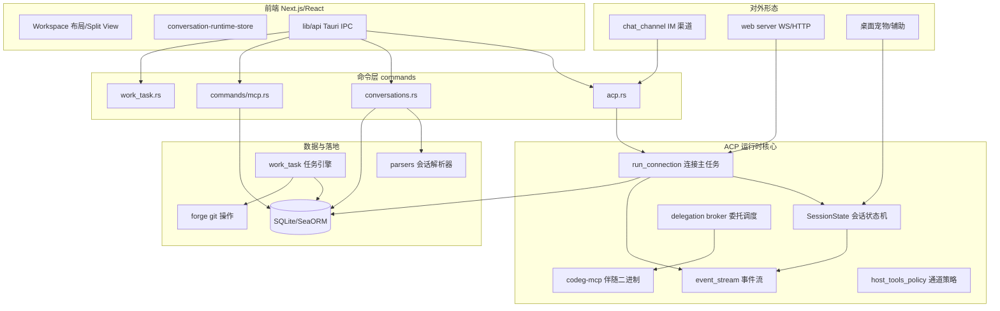
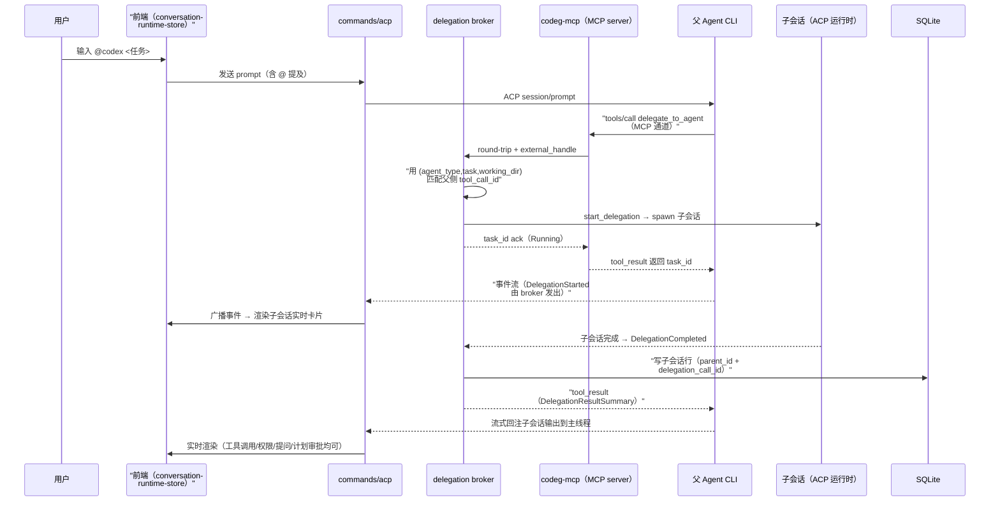

# Codeg（Code Generation）：把每个 AI 编码 agent 装进一个工作台

> 本解读按 **ai-agent ⊗ framework** 类规格产出。源码根 `/Users/morehao/Documents/study/ai-agent/codeg`（v0.28.2，Apache-2.0，[GitHub](https://github.com/xintaofei/codeg)）。

## 子文档索引

- [`acp-runtime.md`](acp-runtime.md) — ACP 运行时：事件模型、会话状态机、连接生命周期、权限排队与错误分级
- [`multi-agent-orchestration.md`](multi-agent-orchestration.md) — 多 Agent 编排：@ 委托、codeg-mcp 伴随二进制、双通道 tool_call 关联
- [`conversation-aggregation.md`](conversation-aggregation.md) — 会话聚合：AgentParser 统一接口、ACP-native transcript、跨会话引用
- [`work-tasks.md`](work-tasks.md) — 异步任务引擎：git worktree 隔离、两阶段安全合并、git 双检
- [`data-model.md`](data-model.md) — 数据模型：SQLite/SeaORM 底座、42 迁移演进、token 用量两表设计
- [`mcp-skills.md`](mcp-skills.md) — MCP 接入与 Skills：市场模型、HostToolsPolicy 通道托管权、专家/自定义技能
- [`deployment.md`](deployment.md) — 部署与远程接入：桌面/服务器/Docker、IM 渠道桥接、移动端遥控
- [`workspace-ui.md`](workspace-ui.md) — 前端工作台：事件驱动投影、Split View 布局树、流式分页

## 项目定位与根因

**单一 AI 编码 agent 是孤岛**——各自终端、各自会话历史、互不通信，agent 直接改动工作区还难以审查。Codeg 用 **ACP（Agent Client Protocol）** 把 15+ agent CLI（Claude Code、Codex、Gemini、OpenCode、OpenClaw、Cline、Grok、Cursor…）收敛进一个宿主运行时，提供：

- **托管**：统一的事件流、状态机、错误恢复（[`acp-runtime.md`](acp-runtime.md)）；
- **协作**：`@` 提及任何 agent 即开独立子会话并流式回注（[`multi-agent-orchestration.md`](multi-agent-orchestration.md)）；
- **聚合**：把各 agent 私有的磁盘会话统一成可搜索、可续接、可跨 agent 引用的历史（[`conversation-aggregation.md`](conversation-aggregation.md)）；
- **异步落地**：to-do 任务在自己的 git worktree 跑，完成后过审查 + git 双检才落主分支（[`work-tasks.md`](work-tasks.md)）。

**设计哲学（贯穿全篇的锚点）**：协议优先（统一 ACP 而非每 agent 适配器）· 本地优先 + 会话真源（实时事件流是真源，磁盘可回放）· 一切可委托 · 异步安全（worktree 隔离 + git 双检，不采信 agent 自证）。

## 概览

核心能力清单：

| 能力 | 一句话定位 | 承载模块 |
|------|-----------|---------|
| Conversation Aggregation | 导入/搜索/续接所有 agent 的历史会话，跨 agent 引用 | parsers + acp_transcript |
| Multi-Agent Collaboration | `@` 委托，子 agent 独立会话并行，流式回注 | delegation broker + codeg-mcp |
| To-dos | 任务在独立 worktree 跑，审查门控后安全落地 | work_task engine + forge |
| Custom Agents | 注册任意 ACP agent，装好即可用 | acp/registry + custom_registry |
| The Workspace | 文件树、diff、编辑器、git、终端一体化 | 前端 workspace + commands |
| Split View | 会话区拆任意 tab 组，布局记忆 + draft 保留 | tab-store + tab-group-layout |
| Token Usage | 状态栏计数器背后的完整报表 | token_usage service |
| Chat Channels | Telegram/Lark/WeChat 遥控 agent | chat_channel |
| MCP & Skills | 市场搜索/安装 + 全局/项目技能 | commands/mcp + experts |
| Desktop/Server/Docker/Mobile | 五种形态共享一个核心 | tauri + codeg-server + web |

技术栈一览：

| 层 | 技术 |
|----|------|
| 前端 | Next.js 16 / React 19 / TypeScript（1028 个 ts/tsx 文件）、Zustand、Monaco、xterm.js、shadcn/Tailwind 4 |
| 后端 | Rust（src-tauri/src 约 28.6 万行）、Tauri 2、tokio |
| 协议 | ACP（Agent Client Protocol）客户端、MCP 双向（server 注入 + 自身即 server） |
| 存储 | SQLite + SeaORM（42 迁移、20 service） |
| 服务 | axum（server 模式 HTTP/WS）、tokio-tungstenite |

同类定位对比：

| 项目 | 托管模式 | 协作方式 | 异步落地 | 协议 |
|------|---------|---------|---------|------|
| **Codeg** | 宿主外部 agent CLI（ACP） | `@` 委托 + 子会话流式回注 | git worktree + 审查门控 | ACP |
| OpenHuman | 进程内 Rust 核心（自带 agent 循环） | 分脑编排 + tinyagents graph | approval-gated 工作流 | MCP |
| AionUi | app-shell 守护外部 aioncore 引擎 | Team Mode 协作 | Cron 24/7 | ACP |
| OpenHands | 控制中心前端（多后端切换） | Agent Canvas | Automations | ACP/OpenHands |
| OpenWorker | 本地 sidecar + 审批门控 | 26+ 连接器 | 技能系统 | MCP |

Codeg 的差异点：**自己不写 agent 循环**（推理委托给各 CLI），专注做「托管、编排、聚合、安全落地」——这使它协议更薄、对 agent 生态的升级更宽容，但也决定了它的「记忆/上下文」深度受限于各 agent 自身能力。

## 架构总览



模块职责目录树（`src-tauri/src/`）：

```
acp/                  ACP 协议客户端运行时（连接/状态机/事件流/委托/注册/通道策略）
acp_transcript.rs     自定义 agent 的 ACP-native 转录（录 raw wire）
parsers/              17 个内置 agent 的磁盘会话解析器
work_task/            异步任务引擎（worktree 隔离 + 两阶段合并 + git 双检）
forge/                git 远端操作（GitHub/GitLab API + 交付）
automation/           定时/无头自动化
db/                   SQLite 持久化（42 迁移 + 20 service）
models/               SeaORM 实体
chat_channel/         Telegram/Lark/WeChat 渠道桥接
web/                  server 模式 axum HTTP/WS 服务
commands/             Tauri 命令层（对前端暴露）
pets/                 桌面宠物陪伴（差异化趣味功能）
office_watch/         Office 文档监听（live preview）
git_repo.rs           git 客户端封装
```

## 核心模块导读

| 模块 | 职责 | 深读 |
|------|------|------|
| ACP 运行时 | 事件模型 / 状态机 / 连接生命周期 / 权限排队 / 错误分级 | [`acp-runtime.md`](acp-runtime.md) |
| 多 Agent 编排 | @ 委托 / codeg-mcp / 双通道关联 / 取消传播 | [`multi-agent-orchestration.md`](multi-agent-orchestration.md) |
| 会话聚合 | AgentParser / ACP-native transcript / 跨会话引用 | [`conversation-aggregation.md`](conversation-aggregation.md) |
| 异步任务引擎 | worktree 隔离 / 两阶段合并 / git 双检 / 崩溃恢复 | [`work-tasks.md`](work-tasks.md) |
| 数据模型 | SQLite/SeaORM / 迁移演进 / token 用量 | [`data-model.md`](data-model.md) |
| MCP/Skills | 市场模型 / 通道托管权 / 技能体系 | [`mcp-skills.md`](mcp-skills.md) |
| 部署与远程 | 五形态 / token 认证 / IM 桥接 / 移动端 | [`deployment.md`](deployment.md) |
| 前端工作台 | 事件投影 / Split View / 流式分页 | [`workspace-ui.md`](workspace-ui.md) |

## 关键链路：一次 `@` 委托的全旅程



全链路把五篇子文档串成一条线：前端 store（[`workspace-ui.md`](workspace-ui.md)）→ 命令层 → broker 的 key 匹配与状态机（[`multi-agent-orchestration.md`](multi-agent-orchestration.md)）→ 子会话由 ACP 运行时托管（[`acp-runtime.md`](acp-runtime.md)）→ 会话行落 SQLite（[`data-model.md`](data-model.md)）→ 历史可被聚合回看（[`conversation-aggregation.md`](conversation-aggregation.md)）。

## 总结

Codeg 的根因是「agent 孤岛」问题，它的解法不是再造一个 agent，而是做一个**协议层的宿主**：以 ACP 统一托管（[`acp-runtime.md`](acp-runtime.md)）、以 MCP 工具承载委托（[`multi-agent-orchestration.md`](multi-agent-orchestration.md)）、以磁盘解析 + 转录统一历史（[`conversation-aggregation.md`](conversation-aggregation.md)）、以 worktree + 双检保证异步安全（[`work-tasks.md`](work-tasks.md)）、以 SQLite 沉淀一切（[`data-model.md`](data-model.md)）。

**值得借鉴**：① 协议收敛而非适配器——用统一协议把异构生态装进一个宿主；② 双通道关联的 key 匹配——异步协议里「身份匹配」是硬骨头，`(agent_type, task, working_dir)` 精确键 + TTL/预算权衡值得细读；③ 不采信 agent 自证——错误分级（`code`/`details`/`terminal` 三态）与 git 双检（`ScratchIndex` 验收度量）是「AI 时代验收」的可迁移范式；④ 前端窄 selector store + seam hash——实时流式 UI 的工程答案。局限：Codeg 的「记忆/上下文」深度受限于各 agent 自身，托管层不参与推理。
