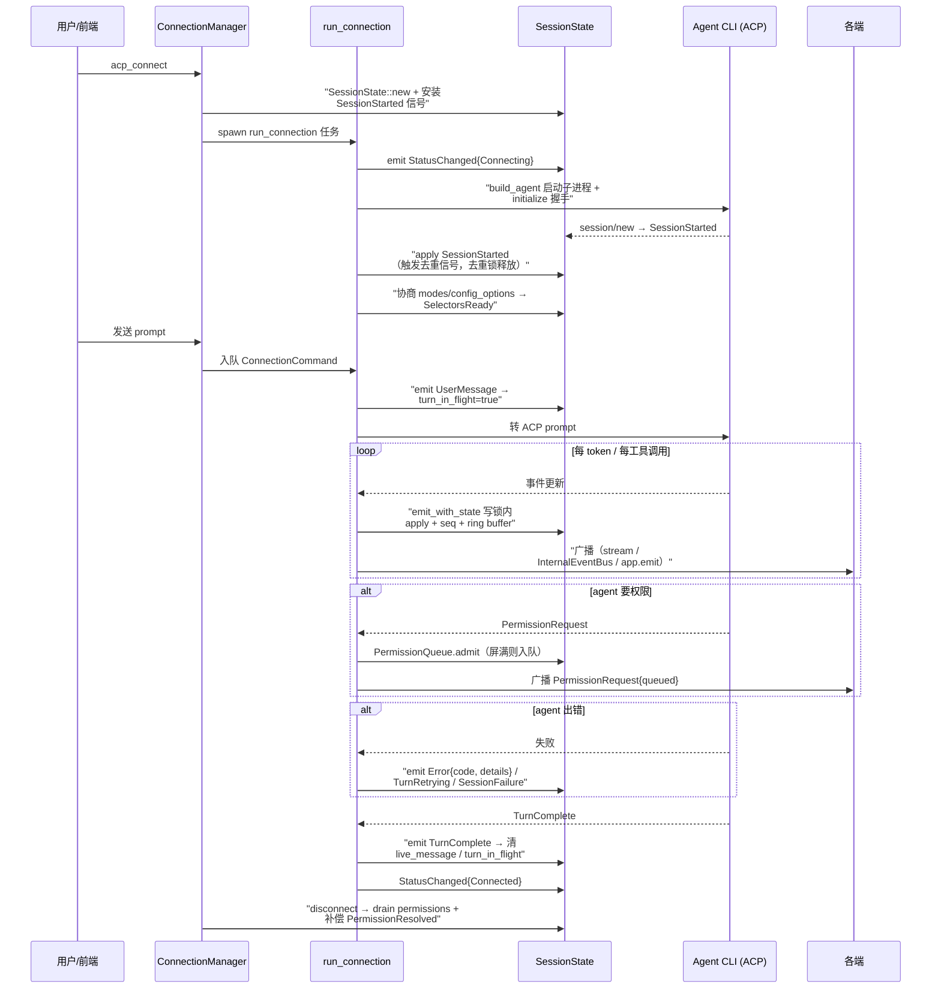

# ACP 运行时：如何把异构 agent 收敛进一个事件宇宙

> 本解读按 **ai-agent ⊗ framework** 类规格产出。

Codeg 支持的 15+ agent（Claude Code、Codex、Gemini、OpenCode、OpenClaw、Cline、Grok、Cursor…）彼此协议、会话格式、交互习惯截然不同。本模块回答：**Codeg 凭什么能在同一个宿主里托管它们全部**——答案不是给每个 agent 写适配器，而是让所有 agent 通过 ACP（Agent Client Protocol）对接到一套**统一的会话运行时**：事件归一、状态权威、生命周期托管。

## 根因：终端里的 agent 是黑盒

每个 agent CLI 在自家终端里时，Codeg 完全插不上手——看不到流式输出、接不住权限请求、不知道会话何时结束。要托管它们，Codeg 必须把「agent 与人类的终端对话」重写成「agent 与宿主的事件流对话」：`connection.rs` 起一个 ACP 客户端进程，把 agent 的 stdin/stdout 翻译成结构化的 `AcpEvent`，再广播给所有消费方。这个「翻译并广播」的动作，就是本模块的全部意义。

## 事件模型：`EventEnvelope` + `AcpEvent`

所有 ACP 事件统一走一个信封 [src-tauri/src/acp/types.rs:53-58]()：

```rust
pub struct EventEnvelope {
    pub seq: u64,
    pub connection_id: String,
    #[serde(flatten)]
    pub payload: AcpEvent,
}
```

`seq` 全局严格递增，是前端去重的锚点（Phase 0 占位 0，Phase 1 起真实累加）；`connection_id` 上提到顶层，配合 `#[serde(flatten)]` 让 JSON 保持平铺，WebSocket/Tauri 双通道传同一份载荷。

<!-- anchor: pub struct EventEnvelope { … pub payload: AcpEvent, -->

`AcpEvent` 枚举囊括 40+ 事件变体 [src-tauri/src/acp/types.rs:103]()，可按功能族归类：

| 功能族 | 代表事件 | 设计要点 |
|--------|---------|---------|
| 流式内容 | `ContentDelta` / `Thinking` | 每 token 一个事件，`parent_tool_use_id` 标注子 agent 归属 |
| 工具调用 | `ToolCall` / `ToolCallUpdate` | `raw_input`/`raw_output`/`locations` 透传，`images` 支持图像生成 |
| 权限审批 | `PermissionRequest` / `PermissionQueueDepth` / `PermissionResolved` | 一屏一卡的排队语义（见下） |
| 会话生命周期 | `SessionStarted` / `TurnComplete` / `ConversationLinked` / `StatusChanged` | `ConversationLinked` 一次连接只发一次，绑定 DB 行免轮询 |
| 错误与恢复 | `Error` / `TurnRetrying` / `SessionFailure` | 三级错误面（见下） |
| 多 agent 协作 | `DelegationStarted` / `DelegationCompleted` | 携带 parent/child 双向连接 id 与 `task_id` |
| 人机交互 | `QuestionRequest` / `PlanApprovalRequest` | 把 agent 阻塞式提问嵌入异步事件流 |
| 后台活动 | `BackgroundActivity` | 转录尾部轮询出的 out-of-turn 事件 |

<!-- anchor: pub enum AcpEvent { … } -->

**Why 平铺 + 事件化而非 RPC 快照？** 桌面/Web 双端都要实时渲染 agent 的一举一动，轮询拿快照无法做到逐 token 更新；事件流让「发送方增量发布、各端自行投影」。代价是接收端要处理乱序/重放——`seq` 与快照恢复机制就是为这个代价兜底。

## 错误分级：三次「命名失败原因」的尝试

README 承诺「failed turn 会命名错误种类、并给出 Retry/Sign in 等动作」。源码里这是三层递进的事件设计：

**第一层 `Error`** [src-tauri/src/acp/types.rs:283-319]()：携带稳定的 `code`（如 `initialize_timeout`）供前端按本地化文案渲染；`details` 是已脱敏、限长的 stderr tail 与解析失败摘要，专供 UI/WS 透传（避免污染通知与 tooltip）；`terminal: bool` 是**进程内信号**（`#[serde(skip)]` 不上线），区分「连接级死亡」与「单 turn 失败」——`terminal` 事件后即将发 `Disconnected` 拆会话，非终局错误则连接存活、下次 prompt 照常。

<!-- anchor: message: String, … terminal: bool, -->

**第二层 `TurnRetrying`** [src-tauri/src/acp/types.rs:333-358]()：codex 的 `_meta.codex.error` 只在 `willRetry == true` 时上报，表示「agent 在自动重试、turn 还活着」——渲染成瞬态 amber 提示，**不是失败**。pi 也借道此通道（它的 `auto_retry_start` 是散文文本，被分类器从 transcript 剥离后路由到这里）。`attempt/max_retries/retry_delay_ms` 均来自 pi 自己格式化的句子（`pi_parse_retry_announcement`）。

<!-- anchor: TurnRetrying { … retry_delay_ms: Option<u64>, -->

**第三层 `SessionFailure`** [src-tauri/src/acp/types.rs:78-93]()：JetBrains AIR 类型化失败记录，`category ∈ {connection, access, limit, request, service, unknown}` 正是 README「connection issue / access issue / limit reached / request rejected / service issue」的直译。协议只发 **UPSERT**（按 `id+revision` 原地修订、无 tombstone），接收端必须自己做单调合并、并在下一轮成功 turn 结束时把 `severity: warning` 推断为 `resolved`；`category/severity/actions` 故意用普通字符串，未来词表扩展时降级到前端兜底渲染而非反序列化崩盘。

<!-- anchor: pub struct SessionFailureRecord { … pub actions: Vec<String>, -->

**取舍**：用「类型化记录 + 纯字符串载荷」而非「强枚举」，是为了在 ACP 生态快速演进时不因新词表让老客户端崩溃——向前兼容优先于类型安全，这是协议边界上的务实选择。

## 事件分发：`emit_with_state` 的原子发布

事件不是「广播一下就完」，而是与应用状态强一致地发布。`emit_with_state` [src-tauri/src/web/event_bridge.rs:410-415]() 在持 `SessionState` **写锁**的临界区内完成五步：apply 事件 → 自增 `seq` → 构造 `EventEnvelope` → 推入 ring buffer → 记淘汰数，然后释放锁，广播到三条路径（per-connection `ConnectionEventStream`、进程内 `InternalEventBus`、Tauri `app.emit`）。`emit_with_state_gated` 还支持在**同一写锁内**先跑 `gate` 谓词——反馈提交就用它保证「校验 `turn_in_flight` + 追加」原子，杜绝 `TurnComplete` 夹在中间。

<!-- anchor: pub async fn emit_with_state( … payload: AcpEvent, -->

**Why 锁内发布？** 快照与后续事件必须严格串行，否则「读者先拿快照再注册接收器」会出现缝隙。`ConnectionEventStream::subscribe` 被要求持读锁调用，正是为了保证「快照读取 → 注册接收器」之间无广播插队。

## 断线续传：ring buffer 增量 replay，超龄回退快照

Web/多窗口场景下，客户端随时可能断线重连。`event_stream.rs` 设计了两层恢复 [src-tauri/src/acp/event_stream.rs:12-30]()：

- **broadcast channel 容量 4096**：慢订阅者落后时丢最旧事件，用 `RecvError::Lagged` 提示重连；
- **`RecentEventsBuffer` 环缓冲**：上限 128 KB 字节 + 128 个事件双限（防大量小事件绕过字节限），单事件超 64 KB（如超大 base64 图像）直接**清空整个 buffer** 并隐式标记空洞，让带旧 cursor 的 attach 走快照而非返回误导性的部分重放。

`range_after(since_seq)` 返回严格大于游标的连续事件，游标比最旧缓冲还老则返回 `None` 回退快照 [src-tauri/src/acp/event_stream.rs:164-178]()。尺寸估算用**无分配的结构化估算**（`estimate_envelope_size`）而非真实序列化——在每 token 都触发的持锁热路径上序列化只为测字节数，是原实现最大的浪费 [src-tauri/src/acp/event_stream.rs:330-340]()；估算保证「永不低估序列化长度」这条不变量，防止超大事件漏过单事件上限。

<!-- anchor: pub fn range_after(&self, since_seq: u64) -> Option<Vec<Arc<EventEnvelope>>> { -->

## 会话状态机：`SessionState` 是唯一权威

每个活跃连接持一个 `Arc<RwLock<SessionState>>` [src-tauri/src/acp/session_state.rs:244]()。它的字段哲学很明确：**只存当前 turn 的 in-flight 数据 + 元信息 + 协商出的能力**——已完成的 turn 不在这里，由 parser 从 agent 的 JSONL 读。三类字段：

- **in-flight**：`live_message`（流式累积）、`active_tool_calls`（工具调用运行态）、`pending_permission`、`pending_question`、`pending_plan_approval`、`active_delegations`、`feedback`、`background_outstanding`；
- **协商能力**：`modes`、`config_options`、`prompt_capabilities`、`fork_supported`、`usage`；
- **事件锚点**：`event_seq`、`last_activity_at`、`event_stream`、`recent_events`。

**快照可恢复性是设计主线**：凡是「一次性事件不会为重连者重放」的状态，几乎都额外落一份在 `SessionState` 上（`to_snapshot()` 携带），让冷 attach/刷新/多窗口能重建 UI——`pending_question`、`pending_plan_approval`、`active_delegations`、`feedback`、`session_failures` 全部如此。例如 `ActiveDelegationState` 注释明确说：`DelegationStarted` 是一次性事件，快照 attach 收不到，必须靠这字段重建 running 绑定 [src-tauri/src/acp/session_state.rs:213-226]()。

<!-- anchor: pub struct ActiveDelegationState { … pub task_id: String, -->

## 权限排队：一屏一卡，杜绝「盲签」

agent 连续发起多个权限请求时，不能把卡片全部堆上屏——用户在审批第一张时，后面几张的信息已过期。`PermissionQueue` [src-tauri/src/acp/connection.rs:2295-2300]() 用 `showing`（当前在屏卡片）+ `waiting: VecDeque`（等待队列）+ `responders`（阻塞的 responder）三件套实现：`admit` 在屏空时立刻发布，否则入队；`resolve` 应答后从队首提升下一张并返回它，未知/已答 id 幂等 no-op（两客户端竞答同一卡不能双发）；`drain` 取消全部阻塞 responder 并返回在屏卡 id，调用方必须补发 `PermissionResolved` 否则该卡在所有客户端上空挂。

<!-- anchor: fn admit(&mut self, responder: R, card: QueuedPermission) -> Option<QueuedPermission> { -->

而 `PermissionRequest.queued` 字段让前端不必猜「agent 是不是只等我一次」——发布 `PermissionRequest` 时 `queued=0` 说明屏是空的，非零只出现在「本卡被提升、还有卡在队尾」时 [src-tauri/src/acp/types.rs:179-179]()。

<!-- anchor: queued: u32, -->

## 连接生命周期：从 spawn 到事件流

`spawn_agent_connection` 先建权威 `SessionState` 并安装 `SessionStarted` 去重信号，立即 `emit_with_state` 发首个 `StatusChanged{Connecting}` [src-tauri/src/acp/connection.rs:1886-1912]()。`run_connection` 是连接主任务 [src-tauri/src/acp/connection.rs:4429-4548]()，一次性组装安全上下文（`fs_policy` 文件系统访问策略 + `host_tools` 通道策略 + `TerminalRuntime` + `FileSystemRuntime`），并记录安全姿态日志。Claude 专属：spawn 一个 per-connection 的 transcript watcher（`background_watch`）捕捉 out-of-turn 活动——异步子 agent 完成、cron/loop 自主 turn 等 wire 上不可靠的活动，转成 `BackgroundActivity` 事件。

**Why per-connection watcher 而非 per-loop？** 让它跨 fork 重启存活：`run_watch` 观察到 session-id 变化就地 re-arm，把未完成任务与已 settle 的 id 一并带过去。

一次会话从连接到消亡的完整生命周期：



## 空 turn 诊断：不采信 agent 的「成功」

一个与「git 双检」同源的设计哲学：**agent 报成功不等于真的成功**。`connection.rs` 维护 `TurnOutputProbe` 与 `EmptyTurnCause` [src-tauri/src/acp/connection.rs:7695-7706]()——当 turn 结束时 wire 上没有携带任何内容，诊断器依据 probe 的丢包统计把失败归因到 `turn_failed_empty*` 家族，并把 stderr tail 与解析失败摘要作为 `Error.details` 随事件发出。前端因此能区分「agent 真没输出」与「事件在途丢失」。

<!-- anchor: fn diagnose_empty_turn(probe: &TurnOutputProbe) -> EmptyTurnCause { -->

## 全局关联

这一整套「事件归一 + 状态权威 + 快照恢复 + 错误分级」的设计，是 Codeg 四条设计哲学的枢纽：**协议优先**在此落地为「所有 agent 都是 ACP 连接」；**会话真源**在此落地为「实时事件流是真源、磁盘 JSONL 可回放」；**一切可委托**（delegation 依赖本模块托管子会话）与**异步安全**（后台任务状态透传 `background_outstanding` 豁免 idle-sweep）都建立在这套事件/状态底座之上。后续「多 Agent 编排」「会话聚合」「前端工作台」三篇，读者会发现它们消费的正是这里生产的 `AcpEvent` 与 `SessionState`。
