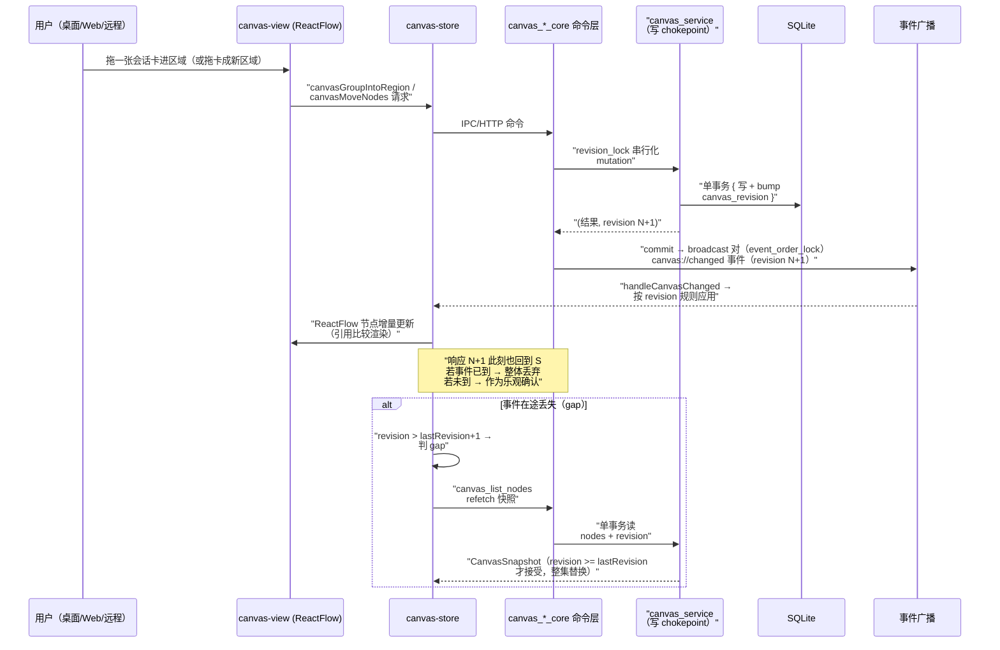

# Conversation Canvas：把会话从列表拖到无限画布上

> 本解读按 **ai-agent ⊗ framework** 类规格产出。v0.30.0 增量新增关注面（基于代码 diff，非官方 changelog）。前面各篇讲会话如何被托管、委托、聚合、落库、扩展、交付——本篇看 Codeg 最新给「看板」这层加的新形态：**把 folder/agent/会话/便签钉成卡片，铺在一块可缩放的无限画布上，跨窗口、跨 Web、跨远程实时同步**。

## 根因：列表是会话的最后一站，但不是组织它们的终点

侧栏以树形列表承载 folder 与会话，但列表隐含一个预设：**一条会话只属于一个地方**。实际工作里，一撮会话是「这周在做的需求」、另一撮是「某个 agent 的长期职责」、还有临时冒出来的想法要随手记下。README 到 v0.30.0 之前没有专门讲这块，代码层把它做成**会话画布（Conversation Canvas）**：会话不再只能待在列表里，而是可以被钉到画布上、收进自定义区域、展开成可继续对话的工作卡片——**空间组织**（几何 + 容器）成为侧栏树之外的第二种组织维度。

## 五类节点，一张表

CanvasNodeKind 定义了六种绑定，其中四种是「区域容器」、两种是单元素 [src-tauri/src/db/entities/canvas_node.rs:13-25]()：

<!-- anchor: pub enum CanvasNodeKind { … Custom, -->

| kind | 绑定 | 是否容器 | 语义 |
|------|------|---------|------|
| `folder` | 一个 workspace 文件夹 | ✅ | 展示该文件夹的全部会话（含 worktree 子会话） |
| `group` | 一个侧栏 folder group | ✅ | 展示组内每个文件夹的全部会话 |
| `agent` | 一种 agent 类型 | ✅ | 展示该 agent 的会话 |
| `conversation` | 单条会话 | ❌（单元素钉） | 会话被展开成工作卡片 |
| `custom` | 手选会话集合 | ✅ | 用户手工收藏的区域，`member_ids` 按插入序存 JSON |
| `note` | 无绑定 | ❌（便签） | 自由浮动的 sticky note |

**一张表装全部**是刻意取舍：所有 kind 共享几何（`x/y/width/height`）、生命周期与 `canvas://changed` 旁路通道，注释点明「One enum — and one table — because every kind shares geometry, lifecycle and the `canvas://changed` side-channel」 [src-tauri/src/db/entities/canvas_node.rs:4-9]()。

<!-- anchor: /// What a canvas node is bound to. The four binding kinds mirror the product … /// `canvas://changed` side-channel. -->

kind 专属的不变量（该设哪些绑定列、成员怎么校验）**不落 schema，落 service**——模型字段注释直说这些软引用与不变量由 `canvas_service` 这个单一写 chokepoint 保证 [src-tauri/src/db/entities/canvas_node.rs:45-82]()：

<!-- anchor: /// One element on the conversation canvas. `folder_id` / `conversation_id` are … pub created_at: DateTimeUtc, -->

### 软引用：画布不 cascade，靠显式 prune

`folder_id` / `conversation_id` 是**软引用**（无 FK）——folder 与会话都是软删除，级联删了画布节点会把「用户布置的空间」一起毁掉。迁移注释完整解释了取舍：会话删除走显式删除漏斗 `prune_for_conversations`，folder 区域则**故意存活**——folder 行还在、只是被关/删，重开时区域复活，期间 UI 渲染「unresolved」态 [src-tauri/src/db/migration/m20260830_000001_canvas_node.rs:9-22]()：

<!-- anchor: // canvas_node: one row per element on the conversation canvas — a … // meanwhile). -->

单个写 chokepoint 是这套软引用设计的守卫：`require_live_conversation` 在调用方写事务内、`revision_lock` 之下校验引用目标存活，杜绝「钉住一条已删会话」[src-tauri/src/db/service/canvas_service.rs:148-161]()：

<!-- anchor: async fn require_live_conversation<C: ConnectionTrait>( … "conversation {conversation_id} does not exist or was deleted" -->

## 同步协议：revision 全序 + 幂等事件

画布可以同时在桌面窗口、浏览器（server 形态）、远程会话里打开——多人共享同一个画布，必须有一套「**谁改了大家都一致**」的协议。它没有引入 CRDT，而是后端强序：

mutation 事务格式统一为 `lock → 一个事务 { 写 + bump revision } → commit`，一个提交对应**恰好一个**广播事件 [src-tauri/src/db/service/canvas_service.rs:1-9]()：

<!-- anchor: //! Single write chokepoint for the conversation canvas. … //! (unlike the tabs CAS, which protects whole-set replacement). -->

客户端因此有稠密全序：事件 revision `== lastRevision+1` 应用、`<= lastRevision` 丢弃、`> lastRevision+1` 判 gap 回退拉快照。

**逻辑时钟存进 `app_metadata` KV 表**（`canvas_revision` key，重启后仍单调），每次已提交的 mutation bump 一次，随 response 与 `canvas://changed` 事件携带 [src-tauri/src/db/service/canvas_service.rs:25-28]()：

<!-- anchor: /// Workspace-global logical clock for the canvas, stored in the `app_metadata` … const CANVAS_REVISION_KEY: &str = "canvas_revision"; -->

**为什么不是 CAS / 版本拒绝？** canvas_service 模块头对比了 tabs 的 CAS（保护整体替换）：画布是**每节点 last-write-wins**——revision 只负责排序 writer、不拒绝它们 [src-tauri/src/db/service/canvas_service.rs:8]()。两人同时拖一张卡，后 commit 的赢，没人被踢掉。

<!-- anchor: //! stay last-write-wins — the revision orders writers, it does not reject them -->

### 事件与响应分离：快照是逃生通道

**事件**：`CanvasChange` 是 full-state 且幂等的多态枚举（Upsert/Moved/Deleted/Detached/Grouped/Pruned 六种变体），全部带 revision，广播到每个窗口/Web/远程会话 [src-tauri/src/commands/canvas.rs:45-80]()：

<!-- anchor: pub enum CanvasChange { … revision: i64, -->

**响应**：`CanvasMutation<T>` 携带 revision 但**永不推进客户端的 `lastRevision`**——命令响应到达时若对应事件已到则整体丢弃，若未到则作为乐观确认 [src-tauri/src/models/canvas.rs:72-80]()。两种到达顺序都收敛，这就是「为什么无需 origin 字段特殊处理」。

<!-- anchor: /// Response envelope for every canvas mutation: the command's result value plus … pub revision: i64, -->

**快照**：`CanvasSnapshot` 在单个事务里读「节点全集 + revision」，防并发 mutation 撕裂「旧节点配新 revision」[src-tauri/src/db/service/canvas_service.rs:121-131]()；客户端只在 `snapshot.revision >= lastRevision` 时接受，且接受即整集替换。

<!-- anchor: pub async fn snapshot( … Ok((nodes, revision)) -->

### 双锁：commit 序与广播序不能倒

revision lock 只保证 commit 单调，不保证广播单调——两个命令可能按 N、N+1 提交却在反向广播，让每个客户端为幽灵 gap 白烧一次快照。所以 `commands/canvas.rs` 在外面加 `event_order_lock` 串行化整个 `commit → broadcast` 对，并固定「外锁在此、内锁在 service、永远同序获取」防死锁 [src-tauri/src/commands/canvas.rs:31-38]()：

<!-- anchor: fn event_order_lock() -> &'static Mutex<()> { … pub const CANVAS_CHANGED_EVENT: &str = "canvas://changed"; -->

## 前端投影：ReactFlow 画布是 store 的纯派生

前端把「revision 协议」原样搬进 `canvas-store`：后端每个 bump 发一个 `canvas://changed`，**没有 origin 字段**，所以自己的 mutation 和别人的走同一套规则 [src/stores/canvas-store.ts:12-28]()：

<!-- anchor: * Canvas node cache + the revision protocol that keeps it convergent. … *    or are covered by the reconnect refetch. -->

- 事件流是唯一推进 `lastRevision` 的通道；`revision > lastRevision+1` = gap → 丢事件并 refetch 快照；
- 命令响应永不推进 `lastRevision`，只在「自己的事件还没到」时作为乐观确认应用，否则整响应丢弃；
- 快照接受是整集替换，WS 断线丢的事件靠 reconnect refetch 补。

页面级接线还有一版精确的顺序设计：`canvas-data.tsx` **先订阅后拉快照**——先注册监听再 fetch，否则 snapshot 读到与订阅生效之间提交的 mutation 会被 broadcaster 丢掉、只能很久后当 gap 暴露 [src/components/canvas/canvas-data.tsx:9-17]()：

<!-- anchor: * Wires the canvas store to the backend while the canvas page is mounted: … * so keeping the node set hot while it's closed buys nothing. -->

`canvas-store` 的节点集「只替换不原地改」（`ReadonlyMap`），让 selector 与派生层能按引用比较。配合 ReactFlow，DB 节点 → 图的转换是**纯函数层**：DB nodes + live workspace store 进、ReactFlow-shaped graph 出，瞬态交互态（拖拽位置、展开区域）作为显式参数进入而非模块状态 [src/components/canvas/canvas-model.ts:11-15]()：

<!-- anchor: * Pure derivation layer for the conversation canvas: DB nodes + live workspace … * parameters, never as module state. -->

整块画布被做成**独立全页 route**：`workbench-content` 把 `canvas: CanvasPage` 注册进页面表 [src/components/workbench/workbench-content.tsx:34]()：

<!-- anchor: canvas: CanvasPage, -->

页面壳 `canvas-page.tsx` 对 ReactFlow 用 `next/dynamic` 懒加载——画布机器不占首次渲染 chunk，首访才加载（画布视图读 `window` 做 viewport 数学，`ssr: false` 是显式声明）[src/components/canvas/canvas-page.tsx:9-14]()：

<!-- anchor: * ReactFlow (and the canvas machinery) stays out of the first-paint chunk: … const CanvasView = dynamic(() => import("./canvas-view"), { -->

前端把同一张卡展开成「可继续对话的工作会话」，用 `draftNodeId`/`pinSurfaceKey` 给每张 live 卡稳定的 ACP connection key（`canvas-draft-<id>` / `canvas-node-<dbId>`），保证画布卡与其会话连接同生共死 [src/components/canvas/canvas-view.tsx:151-166]()：

<!-- anchor: function draftNodeId(id: string): string { … function pinSurfaceKey(pinDbId: number): string { -->

## 一条画布链路的全貌

## 全局关联

Canvas 是「会话真源」哲学的一次空间化延伸：它**不新增真源**——节点表只是会话/folder 几何索引的软引用投影，真正的会话内容仍在 `conversation_service` 与磁盘 transcript（[conversation-aggregation.md](conversation-aggregation.md)）。它的同步协议与 [acp-runtime.md](acp-runtime.md) 的 `seq` 事件流同构：**后端强序 + 前端单调合并**，只是把「每 token 事件」换成「每次布局 mutation」。它与 sidebar folder groups（[workspace-ui.md](workspace-ui.md)）共享 `folder_group` 绑定、与 [data-model.md](data-model.md) 的软删除语义配合（画布节点软引用、显式 prune）。这层抽象让 Codeg 的「工作区」从**树**进化到**树 + 画布双形态**——多 agent 工作台从「管理会话」走向「布置空间」。
