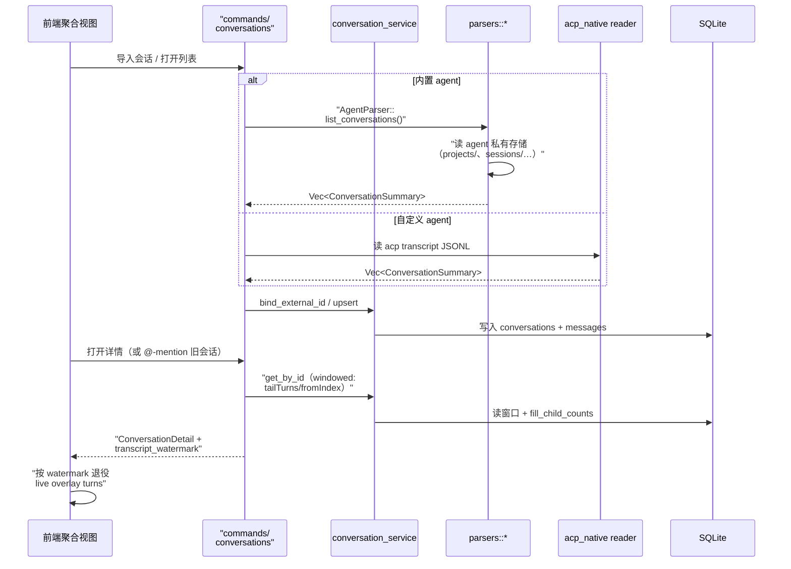

# 会话聚合：把异构 session 商店统一进一个工作区

> 本解读按 **ai-agent ⊗ framework** 类规格产出。延续前两篇：知道了 agent 如何被托管（[acp-runtime.md](acp-runtime.md)）、如何被编排（[multi-agent-orchestration.md](multi-agent-orchestration.md)），本篇回答 README 头号卖点 **Conversation Aggregation**——把每个 agent 私有的会话历史拉进同一个可搜索、可续接、可跨 agent 引用的工作区。

## 根因：每个 agent 都有自己私有的「会话商店」

Claude Code 把历史写在自己的 `projects/` 目录，Codex 写在 `~/.codex/sessions/`，Gemini 混着凭据藏在 base dir 里，格式各不相同。用户想做的事很简单：**一条搜索、一个列表、点开任何历史会话继续聊**——哪怕它是上周另一个 agent 写的。Codeg 必须把这些私有格式统一成一套自己的 transcript 模型。

## 双轨设计：内置 parser vs ACP-native transcript

聚合有两条路，按「agent 是内置还是自定义」分流：

- **内置 agent** → 每个一个专用 parser（`src-tauri/src/parsers/`），逆向该 agent 的私有存储来重建历史：`codex.rs`（9.7K 行）、`claude.rs`（5K 行）、`cursor.rs`、`grok.rs`、`codex_code_mode.rs`、`antigravity.rs`、`deepseek.rs`、`codebuddy.rs`、`openclaw.rs`、`gemini.rs` 等 17 个解析器；
- **自定义 agent** → 无 parser 可写，走 `acp_transcript.rs` 的 **ACP-native transcript**：不解析任何私有格式，直接记录 ACP 线上会话本身。

统一接口就是 `AgentParser` trait，只有两个方法 [src-tauri/src/parsers/mod.rs:254-257]()：`list_conversations()` 返回摘要列表、`get_conversation(id)` 返回完整详情。所有前端聚合视图都只依赖这两个方法，与具体 agent 格式解耦。

<!-- anchor: pub trait AgentParser { … fn get_conversation(&self, conversation_id: &str) -> Result<ConversationDetail, ParseError>; -->

## ACP-native transcript：录 wire 而非录内部事件

`acp_transcript.rs` 的模块头解释了关键设计决策[src-tauri/src/acp_transcript.rs:1-60]()：

- **为什么录 raw ACP wire 而不是录 codeg 自己的 `AcpEvent`？** `AcpEvent` 是内部类型，随每个 UI 特性演进；持久化它会在重构时悄悄腐蚀旧历史。而 ACP 的 `SessionUpdate` 是外部、有版本号的规范——今天写的 transcript 在任意内部重构后仍能解析。
- **文件布局**：`<codeg_acp_transcripts_root>/<registry-id>/<session-id>.jsonl`，第 0 行是 `TranscriptHeader`，后续每行一个 `TranscriptEntry`（`prompt` / `update` 两种）。未知/畸形行直接跳过、文件缺失即"无历史"——**录制是 best-effort 契约，永不阻塞或拖垮一轮 turn**。
- **Write-behind 合并写**：agent 流式回复是一长串小 chunk（实测一轮 turn 产生 32 条记录，而 agent 重放时合并成 1 条）——逐片段落盘会存出一个数量级更大的文件，且让每次读取都为此买单。所以流式文本缓冲最多 `FLUSH_WINDOW` 后合并写入；prompt、turn 结束、header 则即时写。所有写都是纯 append，崩溃最多损失最后一个未刷新的窗口。

<!-- anchor: //! codeg's own **ACP-native transcript** for custom agents. -->

**取舍**：内置 agent 的专用 parser 精准但脆弱（逆向私有格式，agent 升级可能破坏）；ACP-native 稳但只能覆盖「通过 codeg 的会话」。两条路共享同一个 `MessageTurn`/`ContentBlock` 产物模型，所以对上层完全透明。

## 统一产物：摘要 + 详情 + 跨会话引用

无论来源，聚合产物收敛到 `models/conversation.rs` 的模型。`ConversationSummary` 是列表卡片所需的一切 [src-tauri/src/models/conversation.rs:9-26]()——注意 `parent_id` / `parent_tool_use_id` / `delegation_call_id` 三个字段：它们让「子会话」在聚合视图里可见、可折叠（对应 README「child gets a card」）。DB 侧镜像 `DbConversationSummary` 额外计算 `child_count`——**不是存出来的**，是单次 GROUP BY 聚合算出的，保证「chevron 可见」与「list_children 有行」永远一致 [src-tauri/src/models/conversation.rs:46-52]()。

`ConversationDetail` 则携带 `transcript_watermark` [src-tauri/src/models/conversation.rs:88-102]()：live 的 out-of-turn 事件（`BackgroundActivity`）与冷解析出的持久化 turn 之间存在竞态，watermark 是「live overlay 何时可以退役、交给持久化版本」的无竞态交接线——前端把 `watermark <= 该值` 的 overlay turn 全部 retire。

<!-- anchor: pub struct ConversationDetail { … pub transcript_watermark: Option<u64>, -->

## 持久化与续接：`conversation_service`

解析出的会话要进 SQLite 才能搜索、续接、跨会话引用。`db/service/conversation_service.rs` 的核心职责：

- **`bind_external_id`**：把 agent 分配的 ACP `session_id` 绑定到会话行——这是「会话续接」的机制：自定义 agent 忘了旧会话时，Codeg 开新会话并链接 transcript，reader 与 parser 据此把"同一次对话的新 session"与"无关的新行"区分开（对应 `acp/mod.rs` 里 `bind_external_id` 的语义）；
- **`renormalize_external_id_alias`**：维护 external id 的别名归一，处理 agent 侧 id 漂移。

## 聚合链路

## 全局关联

会话聚合是「会话真源」哲学的两面性体现：**实时**真源是 ACP 事件流（[acp-runtime.md](acp-runtime.md)），**历史**真源是磁盘——内置 agent 的私有存储或 codeg 自己的 ACP transcript。两条真源最终都投影到同一个 `MessageTurn` 模型，让聚合、搜索、跨会话 `@` 引用（今天的 Codex 会话能读上周的 Claude Code 会话）成为可能。它是多 agent 协作闭环的历史底座：没有它，[multi-agent-orchestration.md](multi-agent-orchestration.md) 里那些子会话就只剩瞬态事件，无法回看。下一篇 [work-tasks.md](work-tasks.md) 将看到同一套会话模型如何承载「to-do 任务在自己的 worktree 里跑」。
