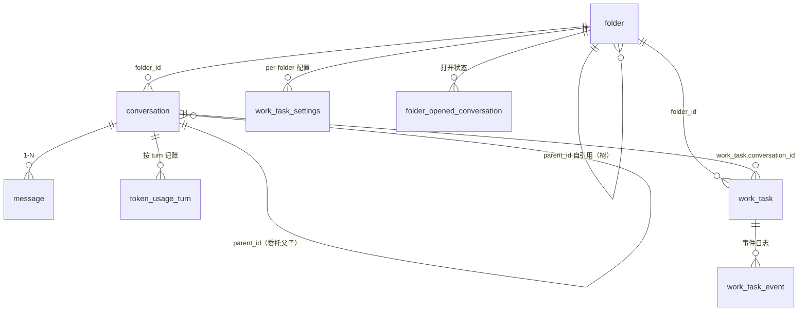
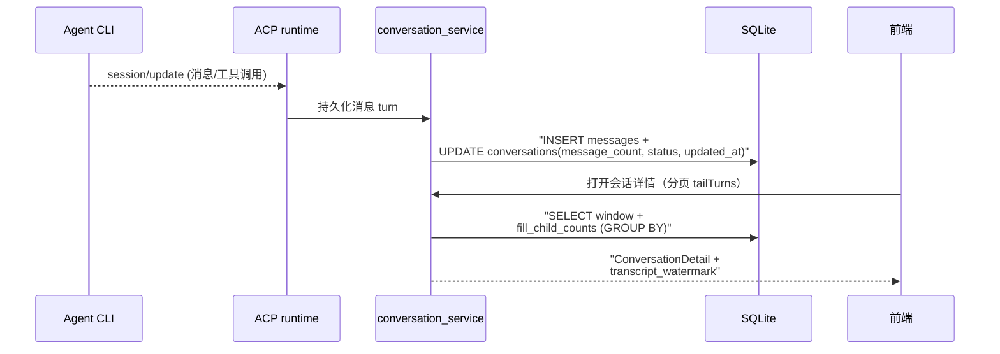

# 数据模型：本地优先的 SQLite 底座如何支撑全部业务

> 本解读按 **ai-agent ⊗ framework** 类规格产出。前四篇把 Codeg 的托管、编排、聚合、任务讲了遍，本篇俯视它们共同的存储底座——**42 个 SeaORM 迁移、20 个 service**，从一张 `folder` 表演进成完整的应用 schema。

## 存储选型：为什么是 SQLite + SeaORM

本地优先的定位直接决定存储选型：所有会话、任务、配置、token 用量都该留在用户机器上，网络只在用户触发时发生。SQLite 是唯一「零运维、单文件、本地强一致」的选择；SeaORM 提供类型安全的实体与迁移，`rusqlite` 在性能敏感处补充直连能力。

`init_database` 暴露了两个容易踩坑的决策 [src-tauri/src/db/mod.rs:1-60]()：

- **恢复先行**：任何待执行的备份恢复（`apply_pending_restore_on_startup`）必须在打开连接**之前**完成——在活着的 SQLite 句柄底下 swap `codeg.db` 会损坏库；
- **单连接跑迁移**：sea-orm 池会把迁移语句分散到空闲连接执行，导致「某语句引用了另一迁移刚加的列」时落到无此列的新连接上——所以迁移用专用单连接，运行时池另开多连接供读并发。

<!-- anchor: pub async fn init_database( … ) -> Result<AppDatabase, DbError> { -->

## 实体关系总览

从迁移与实体还原出的核心关系：

## 核心表设计

**`folder`** —— 工作区文件夹，从平铺演进为树。初始化时只有 `name/path/git_branch/default_agent_type`[src-tauri/src/db/migration/m20260211_000001_init.rs:50-92]()，后续迁移渐次补上 `is_open`（`folder_is_open`）、`sort_order`（`folder_sort_order`）、`color`（`folder_color`）、`parent_id`（`folder_parent_id`，正式成树）、`kind`（`folder_is_chat`→`conversation_folder_kind`）、`alias`（`folder_alias`）。

| 字段 | 类型 | 约束 | 说明 |
|------|------|------|------|
| id | integer | PK auto-increment | |
| path | string | unique | 工作区根路径 |
| git_branch | string | null | 当前分支 |
| default_agent_type | string | null | 该文件夹默认 agent |
| parent_id | integer | null, FK folder.id | 树形层级（后加） |
| kind | enum | | 常规/chat/loop 等文件夹类型 |
| sort_order / color / alias | | | 展示与组织（后加） |

**`conversation`** —— 会话行，Codeg 的事件真源在磁盘、但会话元数据在此。初始化字段 [src-tauri/src/db/migration/m20260211_000001_init.rs:95-151]()：`folder_id`（FK cascade）、`title`、`agent_type`、`status`、`model`、`git_branch`、`external_id`（agent 侧 session id，由 `bind_external_id` 维护）、**`parent_id`**（委托子会话指向父会话）、`message_count`。委托列随后由 `delegation_columns` 补充 `parent_tool_use_id` + `delegation_call_id`（让「子会话」可被父 tool-call 定位）[src-tauri/src/db/migration/m20260522_000001_delegation_columns.rs]()。

| 字段 | 类型 | 约束 | 说明 |
|------|------|------|------|
| id | integer | PK | |
| folder_id | integer | FK → folder, cascade | 归属工作区 |
| agent_type / status / model | string | | 会话元数据 |
| external_id | string | null | agent 分配的 session id |
| parent_id | integer | null, FK conversation | 委托父子 |
| parent_tool_use_id | string | null | 父侧 tool call 锚点 |
| delegation_call_id | string | null | 委托任务 id |

**`work_task`** —— 异步任务状态机持久化（一列一状态字段）。`m20260801_000001_work_task.rs` 一次性建齐：`status`（十一态枚举）、`run_seq`（任务代次）、`worktree_folder_id`/`base_branch`/`base_sha`/`work_branch`（worktree 隔离的全部元数据）、`merge_state`/`cleanup_state`/`verdict`（合并与验收）、`files_changed`/`additions`/`deletions`（审查用的 diff 统计）、`merge_commit`。同迁移建了 `work_task_event`（`kind/actor/payload` 事件日志——任务动作全程留痕）与 `work_task_settings`（per-folder 配置）。后续 6 个迁移继续演进：`work_task_p2`（加列）、`work_task_template`（新表）、`scheduled_at`、`conversation_title`、`source`、`completion_kind`。

**`token_usage`** —— Token 用量报表用**两表**而非单表 [src-tauri/src/db/migration/m20260803_000001_token_usage.rs]()：

- `token_usage_turn`：每 turn 一条明细（`turn_key`、`model`、四类 token 计数、`duration_ms`），是报表的事实来源；
- `token_usage_sync`：`conversation_id` 粒度同步水位（`source_updated_at`、`turn_count`、`total_tokens`、`synced_at`）——**增量同步的断点**，避免每次全量重扫。

**Why 两表？** 明细表要逐 turn 记录、可被报表聚合；水位表让「agent 在磁盘上续写了 session」能被增量发现而不是每次全量重扫全部会话——把「读 agent 磁盘日志」这个昂贵动作降为增量。

## Schema 演进策略

42 个迁移的演进轨迹呈现三种模式：

1. **基础表先行**：`init` 一次建 4 张核心表（`app_metadata` KV、`folder`、`conversation`、`folder_opened_conversation`）；
2. **渐进加列为主**：folder 树化、delegation、标题锁定、置顶、来源……都是 `Table::alter` 加一列，保持旧行兼容；
3. **新表承载新能力**：work_task 系列（7 个迁移）、token_usage（2 表）、custom_agent 系列（4 个迁移）、chat_channel 系列（3 个迁移）、automation、remote_workspace_connection 等。

还存在**回滚型迁移**（`drop_folder_parent_branch`、`model_provider_single_type_and_model`）——设计走错时显式迁移掉，而不是留脏数据。演进整体遵循「可加不可删、删必走迁移」的渐进式加字段哲学，配合 SeaORM `MigratorTrait` 的版本表保证可重放。

## 读写路径：一条会话消息的旅程

`conversation_service` 提供统一写面：`create_with_delegation` 建委托子会话、`bind_external_id` 绑定 agent session、`update_status` 维护状态机、`reparent_folder_conversations` 处理 worktree 移除后的会话改嫁。每个 service 对应一条业务链路的持久化侧，与 README 概览、架构总览一一对应。

## 全局关联

数据模型是全部业务模块的「落盘侧」：[acp-runtime.md](acp-runtime.md) 的实时事件流（真源在内存/磁盘 transcript）在此沉淀为可搜索的会话行；[multi-agent-orchestration.md](multi-agent-orchestration.md) 的委托在此留下 `parent_id` + `delegation_call_id` 的父子证据；[work-tasks.md](work-tasks.md) 的十一态状态机几乎一列一状态地映射到 `work_task` 表。`token_usage` 的「明细 + 水位」两表设计，是「读 agent 磁盘」这类昂贵动作做增量化的通用范式。下一篇 [mcp-skills.md](mcp-skills.md) 看 Codeg 如何把能力扩展面（MCP/Skills）接进这套系统。
