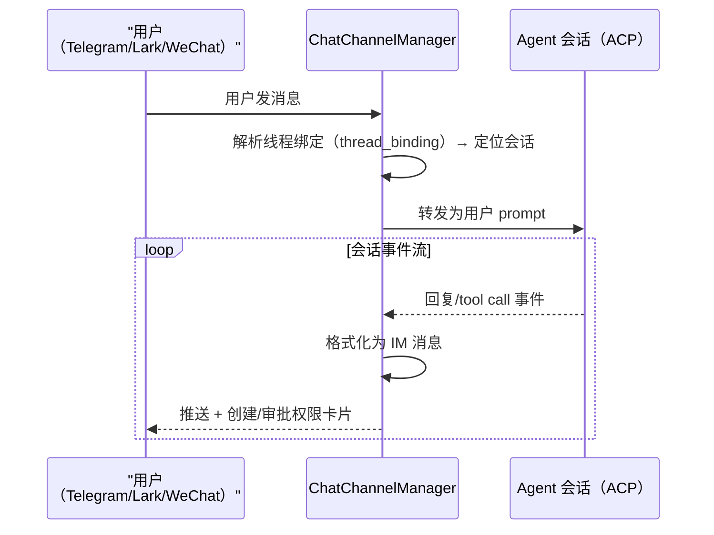

# 部署与远程接入：一个核心，五种形态

> 本解读按 **ai-agent ⊗ framework** 类规格产出。最后一块拼图是「怎么跑起来、怎么远程接入」——README 的 Desktop, Server & Docker / iPhone, iPad & Android / Chat Channels 三组卖点在此落地。

## 根因：本地优先不等于困在桌前

agent 工作台的宿命是「长时间运行」，但人不一定在桌前。Codeg 的多形态设计解决三件事：**无头运行**（server 形态复用同一 Rust 核心）、**远程遥控**（移动端/IM 渠道操作同一批会话）、**安全边界**（token 认证 + 数据留在跑 Codeg 的机器上）。

## 三形态如何复用同一核心

桌面与服务器不是两个程序，而是**同一 Rust 库的两个入口**：桌面走 `main.rs` → Tauri runtime；服务器走 `bin/codeg_server.rs` → 纯 Web 服务。Cargo features（`tauri-runtime`）编译期切分。

`codeg_server.rs` 的入口揭示了 server 形态的运维设计 [src-tauri/src/bin/codeg_server.rs:1-50]()：

- **`--version`**：即时的版本输出；
- **`--supervise`**：作为进程 supervisor 运行（Docker 里的 PID 1），spawn 无此 flag 的 worker 并在**就地升级**后 relaunch——把「原地换二进制」变成 supervisor 的职责；
- **`--credential-helper`**：被 git 调用的凭据子进程模式，立即响应后退出——否则 server 部署里每次 `git credential` 调用都会误启一个 server 实例；
- 启动路径里有 `resolve_persisted_server_token`（持久化 token）与 `find_static_dir_standalone`（`CODEG_STATIC_DIR` 指向前端静态目录）。

<!-- anchor: fn main() -> ExitCode { … -->

## HTTP/WS 服务：axum + 全站 token 认证

`web/router.rs` 用 axum 构建路由 [src-tauri/src/web/router.rs:21-130]()：`/health` 健康检查、`/debug/event_metrics`（operator 面向的 `EventBusMetrics` 快照：emit 量、lag/eviction、attach 决策）、随后是按功能分组的海量 POST 端点（conversations/delegation/feedback/question/session_info/chat_authoring…），`CorsLayer` 全开（`allow_origin(Any)`）——**认证全部交给 middleware 层**，而非各 handler。`/health` 也走同一 auth 链，避免给攻击者开未鉴权探测面。

WebSocket 鉴权走协议头：`web/auth.rs` 的 `token_from_ws_protocols` 从 WS `Sec-WebSocket-Protocol` 提取 token [src-tauri/src/web/auth.rs:12]()——浏览器的 `WebSocket` 无法自定义 Authorization 头，协议头是标准变通。

事件通道的多形态在 [acp-runtime.md](acp-runtime.md) 已见端倪：`EventEmitter` 抽象了 Tauri webview（`app.emit`）与 WS 客户端（`WebEventBroadcaster`）两种投递目标，同一 `emit_with_state` 在两种形态下行为一致。

## IM 渠道：把 agent 会话桥进聊天软件

`chat_channel/` 是第三个遥控入口（Telegram/Lark/WeChat 三 backend [src-tauri/src/chat_channel/backends/]()），本质是**IM 消息 ↔ agent 会话的双向桥**：

`ChatChannelManager::auto_connect_channels` 启动时恢复渠道连接[src-tauri/src/chat_channel/manager.rs:405]()，`session_commands`/`session_event_subscriber` 承担命令面与事件订阅两侧。IM 渠道的价值是「agent 干完活推给你、你在聊天里直接批权限」，对应 README「create tasks, approve permissions, and get live updates」。

## 移动端：遥控而非同步

iOS/Android 客户端（外部仓库 codeg-ios/codeg-android）连桌面 App 的 **Web Service** 或自己的 `codeg-server`：发起会话、看回复与 tool call 流式进来、应答权限、浏览项目分支。**没有任何数据上手机**——文件、agent CLI、会话都留在跑 Codeg 的机器上，访问 token 存在 iOS Keychain / Android Keystore。这是「本地优先」哲学在移动端的延伸：移动端只是 WebSocket 遥控器。

## 全局关联

三形态交付是「多形态」哲学的实现：桌面承载完整产品体验，server/Docker 承载无头与自托管，IM/移动端承载离桌遥控——而它们共享同一个 Rust 核心与同一套事件通道（[acp-runtime.md](acp-runtime.md) 的 `EventEmitter`、[multi-agent-orchestration.md](multi-agent-orchestration.md) 的 `InternalEventBus`），后端所有安全承诺（token 认证、本地优先数据边界）在每种形态下都成立。至此，Codeg 从「一个 agent 的托管」到「一群 agent 的协作、聚合、落地、扩展、遥控」的完整图景闭合。
