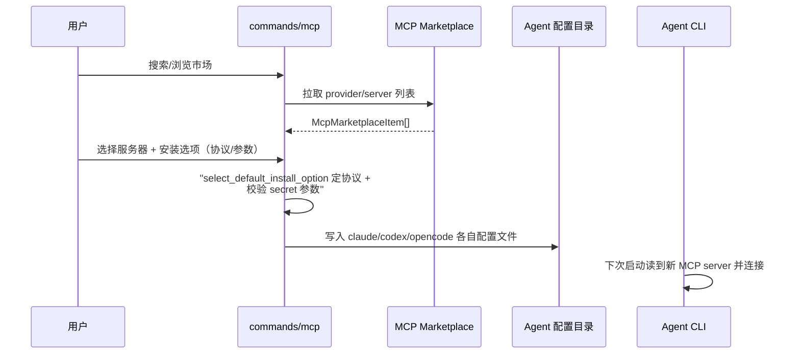

# MCP 接入与 Skills 体系：把 agent 的工具集打开

> 本解读按 **ai-agent ⊗ framework** 类规格产出。前五篇讲了 Codeg 托管/编排/聚合/任务/存储的完整闭环，本篇看它的**能力扩展面**——agent 的固定工具集不够用，MCP 与 Skills 怎么装进 agent 上下文，以及「codeg 自己也是 MCP server」的双向设计。

## 根因：agent 工具集是封闭的

每个 agent 自带一套工具，但用户总想要更多：连一个公司内部服务、跑一个自定义脚本、生成 Office 文档。Codeg 的答案是三大扩展面——**MCP**（接任意外部能力）、**Skills**（注入可复用技能包）、**Custom Agents**（注册任意 ACP agent），全部做成「装进去就能用」。

## MCP 接入：从市场到注入

`commands/mcp.rs` 实现的是「registry search/install」的完整模型。市场项 `McpMarketplaceItem` 携带 `provider_id/server_id/verified/protocols/score/downloads` 等资质字段 [src-tauri/src/commands/mcp.rs:91-107]()，安装参数 `McpMarketplaceInstallParameter` 区分 `secret`/`required`/`enum_values`——敏感参数单独标识，安装表单据此做掩码输入 [src-tauri/src/commands/mcp.rs:109-121]()。

<!-- anchor: pub struct McpMarketplaceItem { … pub is_deployed: Option<bool>, -->

**多协议安装**是差异化设计：一个服务器可能同时支持 stdio/HTTP/SSE 等多种 transport，`McpMarketplaceInstallOption` 每个选项带 `protocol` 与完整 `spec` [src-tauri/src/commands/mcp.rs:124-131]()；`select_default_install_option` 用 `protocol_priority` 打分选默认[src-tauri/src/commands/mcp.rs:646-655]()。安装目标是**落到各 agent 自己的配置文件**：`claude_config_path`/`codex_config_toml_path`/`opencode_config_path`/`gemini_config_path` 各归各位 [src-tauri/src/commands/mcp.rs:699-729]()——MCP 服务器按 agent 配置方言写进它的原生配置，而不是只对 codeg 生效。

<!-- anchor: pub struct McpMarketplaceInstallOption { … pub parameters: Vec<McpMarketplaceInstallParameter>, -->

## HostToolsPolicy：谁托管文件与终端通道

MCP 是「加能力」，`HostToolsPolicy` 是「**收回**能力」——一个开关决定 codeg 是否托管 `fs/*` + `terminal/*` 两个通道 [src-tauri/src/acp/host_tools_policy.rs:45-75]()`：

<!-- anchor: pub enum HostToolsPolicy { … Agent, -->

- **`Default`**：codeg 广告并服务两个通道（历史行为，多数 agent 无自带沙箱）；
- **`Agent`**：codeg 完全收回两个通道，agent 退回自己的文件/Shell 后端，由**它自己的 OS 沙箱与权限规则**统治。

三个精妙决策：

1. **`hosts_channels` 是单谓词** [src-tauri/src/acp/host_tools_policy.rs:95-102]()：拆开两通道不买任何边界——拒绝读 gate 的 agent 通过 shell 读同一文件，拒绝 shell 的通过 fs 通道读。只有**同时收回两者**才把操作真正挪回 agent 沙箱下。
2. **`Agent` 模式同时撤回 delegation 工具组** [src-tauri/src/acp/host_tools_policy.rs:57-64]()：`delegate_to_agent` 是「同一间房的第三扇门」——它让 codeg 以 agent 自己的策略再拉起第二个 agent 并回传输出，沙箱 agent 读不了 `.env`，会叫兄弟代读。剩余 companion 组（feedback/ask/session info）只暴露 codeg 自身状态、不执行任何机器操作，所以保留。
3. **fail OPEN 而非 fail closed** [src-tauri/src/acp/host_tools_policy.rs:143-149]()：错拼的开关若静默收回通道，会看起来像「agent 坏了」而非「配置错了」——所以未知值回落默认并打警告，用日志指出拼写错误。

## Skills 体系：专家技能 + 自定义技能

**专家技能**（experts）由 `experts.toml` 描述元数据 [src-tauri/experts/experts.toml:1-40]()：`id/category/icon/sort_order` 三件套 + 11 种语言的 `display_name/description`（多语言元数据直接嵌在技能包内，前端按 i18n 集渲染）。技能本体是 `skills/` 目录下的 skill 包（基于 Superpowers 生态，README 明确致谢），任意 agent 都能按需调用。

**自定义技能**（`commands/custom_skills.rs`）管理**全局/项目两种作用域**的 skill——对应 README「skills managed at global or project scope」。Skills 的注入机制与 MCP 的「写进 agent 配置」不同：技能内容是**随提示注入**的上下文（SKILL.md 等），所以 Codeg 控制的是「哪些技能对哪些 agent/作用域可见」，而非修改 agent 原生配置。

## Office 文档与科研：bundled 能力

- **office_watch / office_tools**：`officecli`（README 致谢 iOfficeAI/OfficeCLI）生成 `.pptx/.docx/.xlsx`，`office_watch` 监听文件变化驱动前端 live preview——agent 编辑同一文件、预览随之更新，无导出步骤；
- **science**：`src-tauri/science/` 打包科研技能（假设生成/实验设计/统计/可视化等），任意 agent 可调用。

## 全局关联

三大扩展面是 Codeg「可扩展」哲学的实现：[multi-agent-orchestration.md](multi-agent-orchestration.md) 里的 delegation 依赖 `codeg-mcp` 这个「codeg 自己当 MCP server」的双向设计；`HostToolsPolicy` 的通道托管权与 [acp-runtime.md](acp-runtime.md) 的 `fs_policy`/`terminal_runtime` 同属一套安全姿态；MCP 服务器写进各 agent 原生配置又与 [conversation-aggregation.md](conversation-aggregation.md) 的「不侵入 agent 私有存储」一脉相承——**Codeg 始终在 agent 的配置/存储边界上合作，而非重写**。下一篇 [deployment.md](deployment.md) 看这套系统如何以桌面/服务器/Docker/移动端多形态交付。
