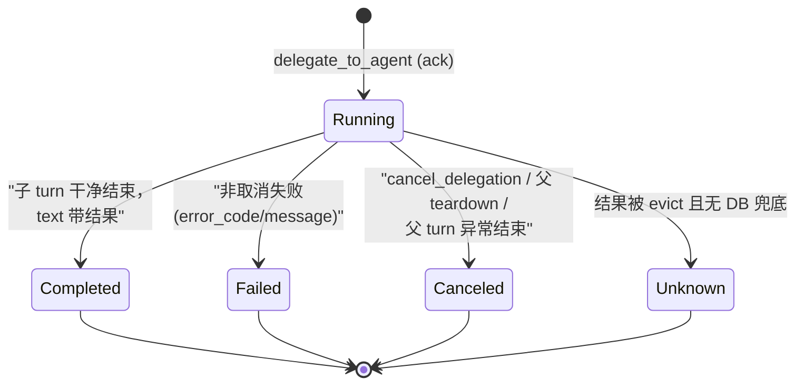

# 多 Agent 编排：把「@提及」变成一次协议握手

> 本解读按 **ai-agent ⊗ framework** 类规格产出。延续 [acp-runtime.md](acp-runtime.md)：上一篇讲了单个 agent 如何被托管成事件流，本篇讲**多个 agent 如何在同一线程内协作**——Codeg 的头号卖点 Multi-Agent Collaboration。

## 根因：终端之间的协作是「拷贝粘贴」

要一个 agent 把活交给另一个 agent，传统做法是用户手动复制任务文本、另开终端、再贴结果回来。Codeg 要的是：在同一个对话里 `@agent` 一提，任务就作为**独立会话**交出去，子 agent 一边干一边把工作流式回注到当前线程，两个 agent 还能并行（Claude Code 起草、Codex 评审）。这需要把「委托」从人的操作变成**协议动作**。

## 委托的物理形态：一次 MCP 工具调用

关键洞察：父 agent 自己也是 agent，它能调工具。于是 Codeg 把「委托」实现成一个 MCP 服务器（`codeg-mcp` 伴随二进制）暴露的六个工具：

| 工具 | 职责 |
|------|------|
| `delegate_to_agent` | 异步委托，立即返回 `task_id` ack |
| `get_delegation_status` | 轮询/长轮询子任务结果 |
| `cancel_delegation` | 取消在跑子任务 |
| `check_user_feedback` | 拉取用户 mid-turn steering 笔记 |
| `ask_user_question` | 阻塞在选择题卡片等用户作答 |
| `get_session_info` | 按 id 解析被引用的会话 |

`companion.rs` 的模块头注明了完整契约：codeg-mcp 讲 newline-delimited JSON-RPC 2.0（stdio），工具 schema 编译期从 `TOOL_SCHEMA_JSON` 嵌入，按 `--features` 分组暴露 [src-tauri/src/acp/delegation/companion.rs:5-6]()。也就是说**委托能力不是硬编码在父 agent 里的，而是像任何 MCP server 一样注入的**——这也解释了为什么自定义 agent 也能参与 `@` 委托。

<!-- anchor: //! The companion speaks newline-delimited JSON-RPC 2.0 on stdio: … //! one request → one response per line, with concurrent dispatch so -->

注入动作在 `run_connection` 里通过 `DelegationInjection` 完成 [src-tauri/src/acp/connection.rs:3995-4037]()：broker + token registry + UDS socket 路径 + 六个能力开关（delegation/feedback/ask/sessions/authoring/questions/plan_approvals）打包成一个注入点，`codeg-mcp` 二进制被定位为 Tauri sidecar（macOS 的 `Contents/MacOS/codeg-mcp`、Docker 的 `/usr/local/bin/codeg-mcp` 等）后启动。

<!-- anchor: pub struct DelegationInjection { … pub plan_approvals: Arc<dyn crate::acp::plan_approval::SessionPlanApprovalAccess>, -->

**Why MCP 而非进程内 RPC？** 父 agent 只认 MCP/工具面；用 MCP 工具承载委托，让「父 agent 发起委托」与「用户点按钮发起」走同一条真实工具调用链路，前端能复用已有的 tool-call 渲染。代价是引入了**双通道异步关联**的复杂性——这正是 broker 存在的理由。

## 核心难点：双通道关联

一次委托涉及两个异步通道，它们之间没有天然关联：

- **父 agent 的 ACP 通道**：发出 `ToolCall{delegate_to_agent}` 事件，有 ACP 侧的 `tool_call_id`；
- **codeg-mcp 的 MCP 通道**：`tools/call` round-trip 到达 broker，有自己的 `task_id`/`external_handle`，但**没有**父侧的 `tool_call_id`（MCP 客户端通常不填 `_meta.tool_use_id`）。

broker 的解法是 `DelegationMatchKey = (agent_type, task, working_dir)` [src-tauri/src/acp/delegation/broker.rs:1119-1123]()：从父 agent 的 `ToolCall` 的 `raw_input` 里解析出三元组，MCP round-trip 到达后用同样的三元组去**精确匹配**回它的 `tool_call_id`。纯 FIFO 按到达顺序分配会错绑并行委托；`match_key` 让并行调用各自归位 [src-tauri/src/acp/delegation/broker.rs:1127-1138]()。

<!-- anchor: pub struct DelegationMatchKey { … pub working_dir: Option<String>, -->

配套的时序设计细到可怕：

- **未 keyed 条目 TTL 60 秒**，但 keyed 条目**无限期保留**——因为 Claude Code 会一个接一个地发并行 `delegate_to_agent`，第二个 round-trip 可能比第一个晚 77 秒，年龄淘汰会把它误绑 [src-tauri/src/acp/delegation/broker.rs:1180]()；
- **claim 轮询预算 200×10ms = 2s**：MCP round-trip 先于 ACP `tool_call` 注册到达时（本地竞态 <5ms），花预算等自己的 key 落位，而不是抢走并排兄弟的 id [src-tauri/src/acp/delegation/broker.rs:1211-1212]()；
- **identityless 特殊通道**：Cursor 的 MCP 声明是 `"MCP: tool"` + 空输入，没有身份——broker 用 sticky 标记 `identityless_seen` 门控重写轮询，只在真出现无身份调用时才花代价 [src-tauri/src/acp/delegation/broker.rs:1153-1164]()。

## 委托状态机与「卡住」的语义

子任务是异步的，父 agent 随时用 `get_delegation_status` 轮询。`TaskStatus` 是 wire-stable 的五个状态 [src-tauri/src/acp/delegation/types.rs:153-168]()：

**真正的设计亮点是 `BlockedKind`** [src-tauri/src/acp/delegation/types.rs:170-187]()：一个还在 `Running` 的子 agent，可能正卡在等人决策（`session/request_permission` 权限、`ask_user_question` 选择题、Grok `exit_plan_mode` 计划审批）。这对父 LLM 来说是「运行中」与「卡住等人」两种完全不同的情况——前者该继续等，后者该提示用户。设计上**刻意不**把它并进 `TaskStatus`：因为那些字符串 wire-stable 且前端状态列表是闭合的，加枚举值会让不认识它的旧消费者把「阻塞轮询」误渲染成「已完成」。于是它作为普通 `Running` 报告上的**附加字段**随行，任何已有消费者都安全忽略。

<!-- anchor: pub enum BlockedKind { … Plan -->

## 委托失败：稳定 code 取代内部形状

`DelegationError` 序列化用 `#[serde(tag = "code")]`，每个失败模式映射成稳定字符串 [src-tauri/src/acp/delegation/types.rs:97-128]()：`depth_limit_exceeded`、`child_refusal`、`child_max_tokens`、`child_empty`、`canceled`、`parent_session_gone`… 前端和 MCP 消费者直接按 code 分支，不关心内部形状。`ChildEmpty` 与「空 turn 诊断」同源——子 agent 报 `end_turn` 却没产出任何内容，被 connection loop 的 silent-EndTurn 守卫合成出来。

最终结果统一收进 `DelegationOutcome`，连 `Err` 都尽力带 `child_conversation_id` [src-tauri/src/acp/delegation/types.rs:134-144]()——即使失败了，父侧也能跳转去看子会话的现场。

## 深度限制与取消传播

**深度限制**：`depth.rs` 沿会话 parent 链上溯算嵌套深度 [src-tauri/src/acp/delegation/depth.rs:1-50]()，`compute_depth` 带 `cap` 饱和——防循环链/超深历史造成无界 DB 负载。超限即 `DepthLimitExceeded`，拒绝「agent 再委托 agent 再委托 agent」的无限套娃。

**取消传播**是异步委托最难的部分。broker 提供四个取消入口 [src-tauri/src/acp/delegation/broker.rs:2947-3054]()：`cancel_by_external_handle`（MCP 侧 `notifications/cancelled`）、`cancel_by_child_connection`（子连接断开）、`cancel_by_parent`（父连接整体拆除）、`cancel_by_parent_turn`（父 turn 异常结束）。`start_delegation` 在**注册 in-flight 之后立刻做 pre-cancel 短路检查**——如果 MCP companion 在 round-trip 到达前就已收到取消，直接认领 handle 空手返回，绝不 spawn 任何子进程；并且提前把已 key 的 `tool_call_id` 消耗掉，防止它被后到的同 key 委托误绑 [src-tauri/src/acp/delegation/broker.rs:2131-2188]()。

<!-- anchor: pub async fn cancel_by_external_handle(&self, external_handle: &str, reason: String) { … pub async fn cancel_by_parent_turn(&self, parent_connection_id: &str) { -->

## 订阅端：进程内 typed 事件总线

委托事件不只给前端。`InternalEventBus` [src-tauri/src/acp/internal_bus.rs:1-60]() 是进程内 typed 总线，直接传 `Arc<EventEnvelope>`（而非 `WebEventBroadcaster` 的 `Arc<serde_json::Value>`），给 lifecycle/pet/chat-channel 等后端订阅者——**每个订阅者省一次 JSON 反序列化**，且拆掉全局火喉广播后，WS 客户端不再需要 receiver-side 的 `Set<connectionId>` 去重。

<!-- anchor: //! In-process ACP event bus. -->

## 全局关联

「委托 = 协议动作」是 Codeg「一切可委托」哲学的最纯粹实现：父 agent 通过标准 MCP 工具发起委托，broker 以可证伪的 key 关联双通道，`BlockedKind` 让协作对 LLM 透明。它与 [acp-runtime.md](acp-runtime.md) 共享 `DelegationStarted`/`DelegationCompleted` 事件与 `SessionState.active_delegations` 快照恢复（一次 `DelegationStarted` 是瞬态事件，快照 attach 靠 `ActiveDelegationState` 重建 running 绑定）——协作者能存活于任何窗口刷新。下一篇 [conversation-aggregation.md](conversation-aggregation.md) 将看到：这些跨 agent 产生的会话，如何被统一聚合进可搜索的工作区。
