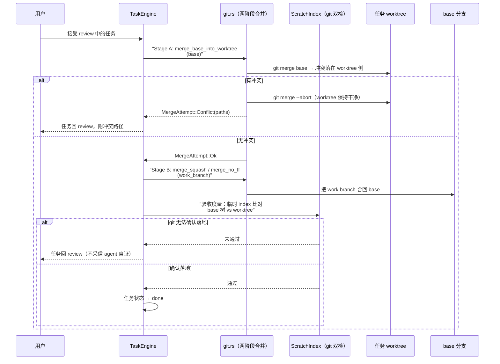

# 异步任务引擎：让 agent 在隔离沙地里干活，落地前过审查

> 本解读按 **ai-agent ⊗ framework** 类规格产出。延续前三篇的会话与协作，本篇是 README「To-dos / Automations / Git & Worktrees」卖点——**异步任务怎么安全地落到真实代码库**，也是「异步安全」哲学的核心实现。**本版增量（v0.28.2 → v0.30.0）补三块**：resume 会话的上下文预压缩（auto-compact）、abandon 保留 worktree 的新语义、worktree 删除前的未提交工作保护（[`CHANGELOG.md`](CHANGELOG.md)）。

## 根因：不是每件事都值得你盯着

写下一个任务（标题 + 描述 + 指定 agent），Codeg 让它自己在独立 worktree 里跑，完成后移到审查列等你看 diff。三个核心矛盾：**隔离**（不能污染你正在工作的主工作区）、**并发**（几个任务同时跑互不干扰）、**安全落地**（agent 说「完成了」不算数，要过 git 验证和人工审查）。

## 状态机：十一个状态，一个「不可取消」例外

`WorkTaskStatus` 定义在 DB 实体上 [src-tauri/src/db/entities/work_task.rs:17-47]()：

```
todo → queued → preparing → running ⇄ awaiting_input → review → merging → done
                                       ↓                 ↓
                                    (阻塞:权限/提问/计划审批)  review → todo (requeue, worktree 复用)
```

设计要点：

- **`preparing` 与 `running` 分开**：worktree 创建、init 命令、agent 拉起都算 `preparing`，此时任务已持有并发槽但还没开跑——可取消，重启视作被打断（同 `queued`）[src-tauri/src/db/entities/work_task.rs:23-28]()；
- **`awaiting_input`**：agent 卡在 `session/request_permission` / `ask_user_question` / 计划审批——对应编排篇的 `BlockedKind`。看板上明确显示「卡住等人」，而不是伪装成「运行中」（issue #447 的教训）；
- **`merging` 是唯一不可取消状态**：合并在途时取消只会制造半合并态。

<!-- anchor: pub enum WorkTaskStatus { … Canceled, -->

## 并发治理：TaskEngine 的三层锁

`TaskEngine` 的字段揭示了并发设计的谨慎 [src-tauri/src/work_task/engine.rs:79-145]()：

- **ownership token**（`launching`/`merging` 两个 map 都带 token）：慢收尾的 launch 不能顶掉同一任务的新 launch——「一个还在收尾的失败尝试，不得移除胜者现在依赖的条目」；
- **per-folder 泵锁**（`pump_locks`）：并发 pump 不能超额启动越过 `max_concurrent`；
- **DB 级排他锁**（`_engine_lock` 对 `<db>.tasks.lock` 的 advisory lock）：证明本进程是这台 DB 上唯一任务引擎，是**破坏性 boot reconcile** 的前提。

## 启动：CAS 状态机 + 可抢占的 kill 槽

`launch` 是所有启动路径的收敛点 [src-tauri/src/work_task/engine.rs:953-1012]()：先取 per-task 锁，检查状态与 `expected_status` 是否一致（不一致即「已被取消或移走」直接返回），再解析**有效 agent 配置**（`task override > folder task settings > folder default agent` 的继承链，运行时继承、不冻结）。

一个精妙细节：`reserve_setup_slot` 在行状态能被读成 `preparing` **之前**就预留 kill 槽——因为 cancel 无法等 task lock（本 launch 持锁跨越整个 init 命令），它必须总能找到地方记录自己，包括 `ensure_worktree` 在超大仓库上耗时数秒的期间。

## 落地：两阶段合并，冲突先在 worktree 内解决

README 说「把 base 分支 pull 进它的 worktree、先在那里解决冲突」。`work_task/git.rs` 把它实现成明确的两阶段 [src-tauri/src/work_task/git.rs:142-189]()：

- **Stage A** `merge_base_into_worktree`：把 base 分支 **merge 进任务 worktree**——冲突自然落在 worktree 侧；有冲突就 `merge --abort` 并返回冲突路径列表（worktree 保持干净）[src-tauri/src/work_task/git.rs:145-165]()；
- **Stage B** `merge_squash` / `merge_no_ff`：把 work branch 合回 base，由调用方 commit。失败用 `reset_merge` 清理（安全的前提是 preflight 已保证 index 干净）[src-tauri/src/work_task/git.rs:170-199]()。

`has_merge_head` 是崩溃恢复探针——`MERGE_HEAD` 存在即合并进行中，重启时据此恢复。

<!-- anchor: pub async fn merge_base_into_worktree( … ) -> Result<MergeAttempt, AppCommandError> { -->

**为什么先 merge base 进 worktree 而不是直接 fast-forward 合回？** 冲突在 worktree 内解决，base 分支（用户的主分支）永远是干净的；fast-forward 直接在 base 上解决冲突，一次冲突就污染主分支。这是「冲突就近解决」的物理隔离。

一次任务从接受审查到安全落地的完整链路：



## git 双检：不采信 agent 的自证

README「Codeg checks git rather than taking the agent's word for it」。`ScratchIndex`（临时索引）承担验收度量 [src-tauri/src/work_task/git.rs:354]()——它用临时 index 构建「base 分支树 vs worktree 状态」的比对，测试名直接写出设计意图：`status_and_base_diff_have_opposite_blind_spots`（status 与 base diff 有互补盲区，单看一个会漏）、`the_acceptance_measure_sees_work_that_was_never_committed`（验收度量看得见从未提交的改动）、`a_sparse_checkout_reports_no_phantom_deletions`（稀疏检出不报幻影删除）。合并后若 git 无法确认落地成功，任务回 review 而非报成功。

<!-- anchor: impl ScratchIndex { … -->

## 阻塞透传：委托子 agent 卡住也算 `awaiting_input`

`TaskEngine.awaiting` 集合用命名空间区分三类阻塞请求：`"q:<id>"`（提问）、`"p:<id>"`（权限）、`"a:<id>"`（计划审批）；非空 ⇔ `awaiting_input`。委托子 agent 的阻塞请求额外带子连接前缀（`"<child_conn>#p:<id>"`），让子连接消失时能整组清除[src-tauri/src/work_task/engine.rs:165-171]()。`delegation_parents` 映射把子连接的反向映射回来——否则子 agent 的阻塞事件落在子连接上，`index` 里没有它，看板会一直显示「运行中」实际却卡住（#447）。

<!-- anchor: awaiting: Arc<Mutex<HashMap<i32, HashSet<String>>>>, -->

## 崩溃恢复与自动化

- **boot reconcile**：重启时在持 `_engine_lock` 的前提下做破坏性恢复——任务卡在 `preparing`/`merging` 的按各自语义回滚或继续；
- **automation**：`automation/engine.rs` 与任务引擎共用同一套 `LaunchMode` 语义（`Fresh` / 后继轮次 / 合并代次），把「已配好的 composer」变成可 cron 调度的无头运行——本质上就是定时把任务推进 `todo` 队列。

## 上下文预压缩：resume 的会话只会变长，不会变慢

多轮任务（retry / follow-up / merge）**每次都 resume 同一个 agent 会话**，上下文窗口只涨不缩——过一定占用率后，下一轮要么静默截断、要么直接失败。v0.30.0 在 `work_task/compact.rs` 加了决策半段 [src-tauri/src/work_task/compact.rs:1-12]()：

<!-- anchor: //! Pre-prompt context compaction for task runs. … //! the bar. The turn itself is driven by `engine::TaskEngine::compact_context`. -->

folder 任务设置里可命名阈值 `auto_compact_percent`（默认 0 = 整个检查关闭）[src-tauri/src/models/work_task.rs:234-243]()；达到阈值时，resume 的 launch **先发 agent 的 compact 命令、等那一轮落地、再发本轮自己的消息**。

<!-- anchor: /// Context-window occupancy (percent, 0–100) at or above which a launch … pub auto_compact_percent: i32, -->

命令按三级优先级解析 [src-tauri/src/work_task/compact.rs:38-52]()：

<!-- anchor: /// Resolve the command that compacts this session, in precedence order: … /// skips compaction and says so on the timeline. -->

① 设置里的显式 `compact_command`（**原样用**，不补斜杠不重写——用户比我们懂）；② 会话自己广告的匹配名（`compact`/`compress`/`summarize`/`summarise`，对未知拼写的 agent 也不猜）；③ `builtin_default`（Claude/Codex/Grok→`/compact`、Gemini→`/compress`，其余 `None`）——广告目录只列项目命令、内置命令不列表的情形，不把「广告里没有」当成「否认」，仍回退内置默认。解析函数本体在 `compact.rs:53` 起 `pub fn resolve_compact_command`。

决策之外的实际发送在 `TaskEngine::compact_before_prompt` [src-tauri/src/work_task/engine.rs:1956-1969]()：先读实时上下文占用（agent 没报占用率就记 `usage_unknown` 跳过、而不是静默），超过阈值且解析出命令才继续；随后是**取消门 → kill 槽 → 再取消门**的三步与 init 命令同款——取消落在槽存在前被复查拦住，落在后则命中槽中止本轮。

<!-- anchor: async fn compact_before_prompt(&self, req: CompactRequest<'_>) { … let threshold = settings.auto_compact_percent; -->

**Why 等 compact 落地而不是 fire-and-forget？** 压缩是一个完整的 turn：发了 slash 命令若不等它结束，下一个 prompt 会与服务该压缩的 turn 竞争、或被会话状态机判定为 out-of-order。把「预压缩」当成一次有始有终的轮次，是「状态权威」哲学的延伸——每轮操作都有明确边界。

## abandon 与 worktree 的生命周期

v0.30.0 之前 abandon（放弃任务）几乎等价于删除任务；v0.30.0 让 **abandon 可以选择带走 worktree**，事后看板仍给删除入口（`feat(tasks): let an abandon take its worktree, and offer the removal afterwards`）——用户在 worktree 里可能留了想抢救的东西，放弃任务不等于放弃它的成果。

同时给 worktree 删除上了保护：删除一个**仍持有未提交工作**的 worktree 会被拒绝——`CleanupBlocked` 区分两种不可互换的失败 [src-tauri/src/work_task/engine.rs:115-129]()：**尝试失败**（`holds_work=false`，bookkeeping 可能过时，tombstone 可继续删）vs **保护拒绝**（`holds_work=true`，删除必须停止，否则「用户被告知会被删掉的目录」没了任何说明它的地方）。

<!-- anchor: /// Why [`TaskEngine::cleanup_task`] did not remove a worktree. … pub holds_work: bool, -->

探测函数 **FAILS CLOSED** [src-tauri/src/work_task/engine.rs:108-112]()：唯一能安全读成「干净」的 git 失败是「目录已不在盘上」（删除路径自己会处理缺失目录）；其他任何失败（损坏的 index、权限错误、瞬态 git 故障）都意味着**无法证明安全删除**，等待答案的是 `git worktree remove --force`——在「可恢复的卡顿」和「不可恢复的文件」之间，它永远选择后者。

<!-- anchor: async fn path_holds_uncommitted(path: &str) -> bool { … Ok(dirty) => dirty, -->

## 全局关联

「异步安全」在此完整落地：worktree 提供**物理隔离**，两阶段 merge 保证**冲突就地解决**，`ScratchIndex` 提供**git 双检**，`awaiting_input` 让**人机阻塞可见**——agent 自证不再被采信。这套设计与 [acp-runtime.md](acp-runtime.md) 的事件订阅（`on_event` 把 ACP 事件映射回 `(task_id, run_seq)`）、[multi-agent-orchestration.md](multi-agent-orchestration.md) 的 `BlockedKind` 语义一脉相承：Codeg 的所有安全承诺最终都落在「状态权威 + 协议事件 + git 现实」三者的对账上。下一篇 [data-model.md](data-model.md) 将俯视支撑这一切的 SQLite 底座。
