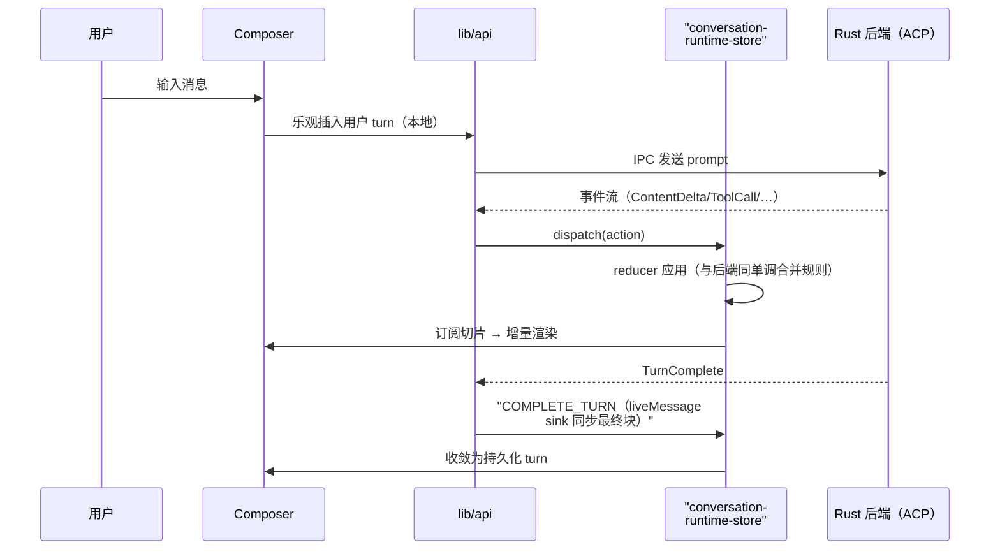

# 前端工作台：把后端事件流投影成实时产品

> 本解读按 **ai-agent ⊗ framework** 类规格产出。八篇解读的最后一篇，读者来到用户实际面对的界面层——看 [acp-runtime.md](acp-runtime.md) 的事件流如何在 1028 个 ts/tsx 文件的前端落地成 Workspace / Split View / Office 预览。

## 根因：agent 会话是「永远在路上」的 UI

agent 回复按 token 流式到达、工具调用中途切换状态、会话可中断恢复、多个 agent 并行跑。这样的 UI 用传统「请求-响应 + 轮询」写不出来——必须**事件驱动**：后端推什么，前端投影什么。而桌面/多窗口/Web 三种形态共享同一套前端，事件模型必须与后端严格对齐。

## 事件模型：订阅-投影，而非拉取

前端不存真源。`src/lib/api.ts`（5.4K 行）是 Tauri IPC 的封装总入口，定义事件常量（如 `LOG_APPENDED_EVENT`、`FOLDER_OPEN_IN_WORKSPACE_EVENT`）并订阅后端事件流。会话级状态落在 `conversation-runtime-store`——它的 reducer 用**显式 Action 联合类型**驱动 [src/stores/conversation-runtime-store.ts:262]()：`FETCH_DETAIL_START/SUCCESS/ERROR`、`LOAD_OLDER_TURNS`、`COMPLETE_TURN`、`APPLY_BACKGROUND_ACTIVITY`、`RESOLVE_BACKGROUND_TASK`…… 每个动作都对应后端一个事件或一次命令响应，前端 reducer 与后端 `SessionState::apply_event` 保持**同一套单调合并规则**（这正是 [acp-runtime.md](acp-runtime.md) 里 `SessionFailure` 注释强调的前后端双实现）。

<!-- anchor: type Action = … -->

## Store 划分哲学：窄 selector，宽订阅再见

`tab-store` 的模块注释记录了最直接的演进决策[src/stores/tab-store.ts:48-64]()：**从单值 `TabContext`（每次 tab/状态更新都改变身份、rerender 全部约 20 个消费者，含无法 memo 屏蔽的 `ConversationTabView`）改为 Zustand 窄 selector 订阅**——消费者用 `useTabStore(selector)` 只订阅自己渲染的切片。这是桌面型实时 UI 的性能命门：一个高频事件（keep-alive、状态流转）如果触发整个会话面板重渲染，任何优化都救不回来。

## Split View：布局是一棵树，draft 是持久化的枝

README 的 Split View（拆右/拆下、拖拽 tab、布局记忆、draft 保留）落到 `tab-store` + `lib/tab-group-layout`：

- **布局模型**：`LayoutNode` / `SplitDirection` / `normalizeTree` / `resizeSplitAt` / `splitGroup` / `toggleOrientation`——分屏布局是显式的树结构，拖拽分割条即树的 resize，拆分组即树的 split [src/stores/tab-store.ts:15-26]()；
- **draft 保留**：`PersistedDraft` 与 `message-input-draft` 的存储 key 机制（`buildNewConversationDraftStorageKey`/`sweepOrphanDraftKeys`），重启后未发送的文本原样回到输入框；
- **虚拟运行时 id**：`TabItemInternal.runtimeConversationId` 是新会话的**虚拟负 id**，与持久化的 `conversationId` 解耦——draft 在绑定真实会话前先以虚拟身份活着 [src/stores/tab-store.ts:71-74]()；
- **agentTypeProvisional 纠正**：draft tab 的 agent 类型可能是 stale localStorage seed 或显示顺序 fallback 的**系统猜测**，标记 `agentTypeProvisional`，等 agent 列表刷新后用纠正效果替换——绝不把猜测当成事实渲染 [src/stores/tab-store.ts:80-93]()。

<!-- anchor: export interface TabItemInternal { … } -->

## 流式分页：tail 窗口 + seam hash 防串线

长会话不能一次渲染完。`conversation-runtime-store` 定义了分页语义[src/stores/conversation-runtime-store.ts:116-117]()：`TAIL_TURNS_DEFAULT = 120`（打开时渲染最近 120 轮）+ `OLDER_TURNS_PAGE_SIZE = 120`（向上翻页一次 120 轮）。

**seam hash 是防串线设计**：`PREPEND_OLDER_TURNS` 动作携带请求时的 `detail.prefix_hash`，reducer 合并前**重新校验当前 detail 的 hash**——分页窗口在途时可能已被替换（reset/refetch），不同 lineage 的页绝不能拼接 [src/stores/conversation-runtime-store.ts:290-301]()。这是把「网络竞态」显式建模进 reducer 的典型。

## 流式渲染管线

`registerLiveMessageSink` 让 `session.liveMessage` 随每批事件**同步写入**——面板不再各自订阅 `conn.liveMessage`，减少一层订阅竞态 [src/stores/conversation-runtime-store.ts:321-333]()。out-of-turn 活动（`APPLY_BACKGROUND_ACTIVITY`）与持久化详情之间用 [conversation-aggregation.md](conversation-aggregation.md) 讲的 `watermark` 交接，live overlay 不再与冷解析 turn 双渲染。

## Office 实时预览与 Workspace

Office 文档（README 卖点）的前端侧：`html-preview-inline` / `@streamdown` 系列渲染器 + `html-to-image`，agent 每改一次 `.pptx/.docx/.xlsx`，`office_watch` 事件触发前端重新渲染同一文档——「无导出步骤、边改边看」。Workspace 的文件树/diff 面板/编辑器（Monaco）/终端（xterm）都围绕同一个「后端事件 → store 投影 → 增量渲染」管线，与聊天区共享 `app-workspace-store`。

## 全局关联

前端不是独立 UI，而是后端事件模型的**直接投影**：`conversation-runtime-store` 的 reducer 与后端 `SessionState::apply_event` 共享同一套单调合并语义（[acp-runtime.md](acp-runtime.md)）、`watermark` 交接来自会话聚合（[conversation-aggregation.md](conversation-aggregation.md)）、委托卡片消费 `DelegationStarted`/`DelegationCompleted`（[multi-agent-orchestration.md](multi-agent-orchestration.md)）。这正是「协议优先 + 会话真源」哲学的收尾验证：**前端没有任何自己的真源，它只是把后端唯一真源投影给用户看**——而 Split View 的树状布局与窄 selector store，是让这个投影在桌面级高频事件下依然流畅的工程答案。
