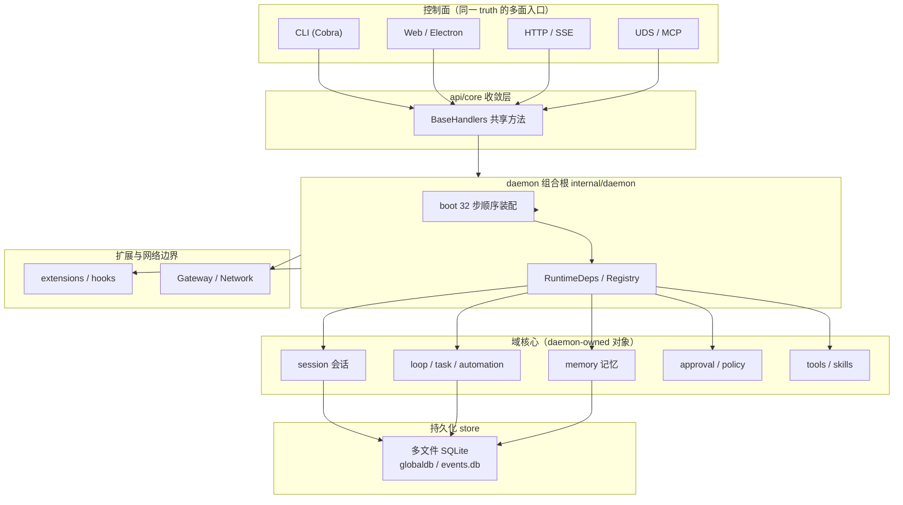

# CompozyOS 深度解读：把 ACP agent 收编成 daemon 拥有的操作系统

> 本解读按 **ai-agent 类规格** 产出，覆盖 10 篇子文档，解读基线为 compozy 源码 release/v0.3.0（HEAD 4efd8de）。

## 根因：prompt 一个 agent 很容易，让 agent 持续工作是工程问题

一句 prompt 就能驱动 Claude Code、OpenClaw、Hermes 跑一轮。但**让 agent 持续工作**是另一回事：它需要 loops（带反馈再来一轮）、triggers 与 cron（何时唤醒）、memory（跨会话记得结论）、permissions 与 approvals（危险动作谁点头）、observability（跑成什么样了），以及把它们粘起来的胶水脚本。官方 README 把这道题讲得很直白——"Anyone can prompt an agent. Making agents work continuously is still an engineering project"，且这套栈不该由每个用户各自拼装，而是"CompozyOS turns that entire agent stack into one product" [README.md:25-29]()。

<!-- anchor: Anyone can prompt an agent. Making agents work continuously is still an engineering project: loops, -->
<!-- anchor: together. CompozyOS turns that entire agent stack into one product, a complete environment to -->

CompozyOS 给出的解法不是再造一个 agent，而是把这些工作对象（session / loop / task / memory / automation / approval / skill）收编为一个 **daemon 拥有的操作系统**：单 Go 二进制的常驻 daemon，本地拥有全部 truth；web / CLI / HTTP / SSE / UDS / MCP / 原生工具都只是访问同一份 truth 的控制面。产品主张一句话——"The system around the agent, already built"。

## 是什么：一个不养 agent 的 agent 操作系统

### 定位

CompozyOS 常驻在 operator 自己机器上（local-first daemon），把用户**已经在用的 ACP 兼容 CLI agent**（Claude Code、OpenClaw、Hermes 等）当子进程收养，并让这些 agent 驱动 daemon 拥有的可复用对象。agent 工作不再挂在某个终端窗口上，关闭客户端不会抹掉工作。

它刻意区分两个角色：Compozy 自己是 ACP **宿主（client）**，会话里跑的 agent 是 ACP **agent（server）**——宿主侧收编进程、协商协议、审批往返；agent 侧专心执行。v0.3 是对 v0.2 workflow runner 的一次 hard cut（zero legacy tolerance）：v0.2 的 `tasks run` 一次性管线被降为执行原子，其上叠出 loop/task/automation/scheduler 四层（见 [loops-automation.md](loops-automation.md)）。

### 痛点

- **终端即牢房**：agent 会话绑死在打开它的终端/请求上，关窗即丢，无人值守无从谈起。
- **对象是"脚本"不是"资产"**：session、loop、capability 每次都重写，无法复用、无法审计、无法共享。
- **能力面散落**：HTTP、UDS、CLI、MCP 各自维护平行模型，状态没有单一权威。
- **自治与风险只能二选一**：要无人值守就要放开破坏半径，要安全就要人在场。缺一套可异步、可超时、可审计的审批治理。
- **远程/自动化与 local-first 拉扯**：本地优先容易变成"只能本机用"，跨设备又常变成"裸奔公网"。

### 适用人群

面向开发者和技术 operator：手上已有一套 ACP CLI agent 习惯、希望把它们变成**可持续运行、可监督、可编排**的后台工作流的用户；以及需要把 agent 工作对象化（复用、版本化、审计）的团队。beta 期（v0.3）也意味着它更接近给敢尝鲜的工程用户，而不是零运维小白。

## 核心能力清单

| 能力 | 一句话说明 |
| --- | --- |
| Create | Sessions、agents、Loops、capabilities 是**作者一次、反复复用**的对象，不是每次重写的脚本 |
| Automate | Cron、webhooks、triggers 让工作在无终端时持续运行 |
| Supervise | Approvals、permissions、run state、artifacts 全程可检视、可干预 |
| Work survives the terminal | Session 与 Loop run 归 daemon 所有，关掉一个客户端不抹掉工作 |
| Runs the agents you already use | ACP 兼容 CLI（Claude Code/OpenClaw/Hermes）操作同一份 daemon-owned state |
| Batteries included | 一个 runtime、一个状态模型：loops/approvals/memory 是核心对象而非插件，web/CLI/HTTP/SSE/UDS/MCP/native 多面可达 |
| Local-first by default | 单 Go 二进制 + SQLite，状态留在 operator 机器上 |
| Remote access stays explicit | Gateway 只暴露 operator 显式启用的私有/公开面 |
| Built to extend | agents/skills/capabilities/hooks/bridges/extension kits 走显式 runtime 契约接入 |
| Compozy Network | Session 之间发现 peer、交换类型化消息、委托工作并用收据闭合 |

## 技术栈一览

| 层 | 选型 | 用途 |
| --- | --- | --- |
| Runtime/daemon | Go（gin + httpapi、Cobra cli） | 单二进制常驻 daemon，组合根 + 生命周期 + 域服务 |
| Agent 接入 | ACPN `github.com/coder/acp-go-sdk`，JSON-RPC-over-stdio | 收养 Claude Code/OpenClaw/Hermes 等 ACP CLI agent |
| 持久化 | 多文件 SQLite（modernc 纯 Go、WAL），sqlc + Goose 迁移 + Atlas drift | globaldb / sessiondb(events.db) / workspacedb / memory 各自物理库 |
| Web shell | React 19（Vite/TanStack/Tailwind/shadcn） | 浏览器控制面 |
| Desktop | Electron | 桌面形态（含集成终端） |
| Monorepo | Bun、turbo、npm `@compozy/cli` | 前端/桌面/CLI 包管理 |
| 扩展 | extension manifest + typed hooks + bridge SDK（Go/TS 双镜像） | 声明化扩展生态 |

## 系统架构

CompozyOS 的架构骨架一句话：**多控制面 → daemon 组合根 → 域核心 → 多文件 SQLite 持久化，扩展与网络作为显式边界挂在组合根上**。官方 "How It Works" 也强调同一口径：人和 agent 通过公共控制面下命令，home-scoped daemon 解析 workspace、套用权限与运行时策略、协调 ACP agent，并把事件与资源状态持久化；web/流式客户端读同一份 daemon-owned truth，而不是各持平行模型 [README.md:109-112]()。

<!-- anchor: People and agents send commands through public control surfaces. The home-scoped daemon resolves the -->
<!-- anchor: model. -->

架构子文档 [architecture.md](architecture.md) 深入三条主线：一是 `daemon/` 作为唯一组合根与 32 步 boot 装配顺序——一百多个 `internal/*` 包如何按可回滚的步骤表"焊"成一台会开机的主板；二是 HTTP/SSE 与 UDS 两套 transport 如何不重复解析校验、共享 `internal/api/core` 的 `BaseHandlers` 收敛点；三是四层 config overlay、单实例 flock/pid 锁与分代 shutdown，以及面向用户的 web shell/Electron/集成终端形态。

需要强调几条贯穿全仓的架构纪律（它们写在 `internal/CLAUDE.md` 并被 `mage Boundaries` 强制）：`daemon/` 是唯一 import 所有包的组合根、没有任何包反向 import `daemon/`/`api/`/`cli/`；包间通信走"消费处定义的接口 + 直接函数调用 + Notifier typed pattern"，**没有事件总线**；网络接受先落盘、再进程内通知 [internal/CLAUDE.md:13-17]()。

<!-- anchor: - **`daemon/` is the sole composition root** — the only package that imports all -->
<!-- anchor: - **Direct function calls through interfaces** — no event bus or reflection-base -->

落在类型层，这套纪律的"物证"是 `Daemon` 结构体上那行注释——`// Daemon is the sole Compozy composition root.` [internal/daemon/daemon.go:267-267]()。

<!-- anchor: // Daemon is the sole Compozy composition root. -->

## 核心模块导读

| 模块 / 关注面 | 一句话定位 | 子文档 |
| --- | --- | --- |
| daemon 组合根 + 多控制面 | 谁按什么顺序把一百多个包焊成一个进程；HTTP/SSE/UDS 共享同一 handler 收敛点 | [architecture.md](architecture.md) |
| session 会话域 | 让"一个 agent 工作单元"成为**先于进程存在**的 durable 逻辑对象：双轴状态机、AgentDriver、先持久后广播 | [sessions.md](sessions.md) |
| loop/task/automation/scheduler | 无人值守执行的四层分工：loop 决定做到什么程度满意、task 决定此刻归谁、automation 决定何时触发、scheduler 决定如何被叫醒 | [loops-automation.md](loops-automation.md) |
| memory 记忆系统 | 把跑过的会话沉淀为跨会话仍成立的知识：作用域双重隔离、写入当危险代码、信号驱动合并 | [memory-system.md](memory-system.md) |
| approvals/policy 治理 | 无人值守 agent 的破坏半径收窄：哈希令牌、三通道审批、分层策略门 | [approvals-policy.md](approvals-policy.md) |
| ACP 宿主接入 | 把第三方 CLI agent 当不透明子进程收养：sandbox 三层接口、协商、失败分类与恢复 | [acp.md](acp.md) |
| tools/skills | daemon 的"可调用面"与"可注入面"：五段派发管道、八级技能优先级、toolruntime 进程足迹 | [tools-skills.md](tools-skills.md) |
| extension 扩展体系 | 开放作者生态与封闭运行时安全的中间地带：manifest 先声明后运行、typed hooks、bridge SDK | [extension-system.md](extension-system.md) |
| gateway / Network | 把 local-first 单机升级为可显式接入的系统：配对、无 broker 路由、先持久后通知、委托收据 | [gateway-network.md](gateway-network.md) |
| 数据模型 | daemon-owned truth 的物理落点：多文件 SQLite 即故障域、账本-投影同事务、迁移四层防线 | [data-model.md](data-model.md) |

## 子文档索引

- [architecture.md](architecture.md) — 组合根与 32 步 boot、多控制面在 api/core 的收敛、单实例生命周期与面向用户形态
- [sessions.md](sessions.md) — durable session 状态机、AgentDriver 五方法接口、先持久化后广播与 busy-input
- [loops-automation.md](loops-automation.md) — loop/task/automation/scheduler 四层、Run+generation 世代执行、claim 所有权与 lease 过期回收
- [memory-system.md](memory-system.md) — 记忆作用域物理+逻辑双隔离、scan+Decision WAL 的写入防线、recall→consolidation 合并闸门
- [approvals-policy.md](approvals-policy.md) — 审批令牌只存 sha256、local token→durable grant→ACP prompt 三通道、超时默认拒绝与分层策略门
- [acp.md](acp.md) — ACP 宿主收养 CLI agent：进程养子模型、能力协商、request_id 权限往返、失败分类与 fresh-start 恢复
- [tools-skills.md](tools-skills.md) — 工具冷热 descriptor 与五段派发管道、skill 八级优先级与每次装载重扫、toolruntime 进程所有权
- [extension-system.md](extension-system.md) — manifest 声明面、来源分档的授权上限、typed hooks 非事件总线、bridge 契约与 SDK
- [gateway-network.md](gateway-network.md) — Gateway 配对与显式暴露、无 broker 本地路由、durable acceptance 先落库后通知、委托/收据闭环
- [data-model.md](data-model.md) — 多文件 SQLite 布局即故障域、events.db 单写者与同事务投影、Goose/Atlas/sqlc 三层 schema 防线

## 同领域定位对比

| 项目 | 一句话定位 | 与 CompozyOS 的差异 |
| --- | --- | --- |
| CompozyOS | 面向开发者的 "AI agent 操作系统"：daemon 收编 ACP CLI agent，工作对象化、可无人值守 | 本解读对象 |
| multica | 把多款 agent CLI 组织进共享看板的协作平台，issue 即劳动单元 | 更偏"多 agent 上工协作"的任务看板；CompozyOS 更偏单 daemon 下 agent 工作对象的生命周期与治理（durable 会话/loop/memory/approval 皆为一等对象） |
| opencode | 终端原生的 AI 编码 agent（自身即 agent runtime，非宿主） | CompozyOS 刻意不养自己的 agent，而是收养 Claude Code 等既有 ACP agent；opencode 关注编码会话本身 |
| coze-studio | 一站式 AI Agent 开发平台（可视化搭建 + 插件生态） | 面向"构建 agent 应用"；CompozyOS 面向"运行与监督你已有的 agent 工作"，local-first 单机 |
| Lework | 企业级把 AI 当劳动力管理的工作协作系统 | 同为"agent 持续工作 + 监督"母题，但更偏企业管理/任务分发；CompozyOS 提供的是单机 agent OS 形态的底层对象模型 |

## 设计亮点

### 会话先于进程：durable 身份 + 延迟绑定

CompozyOS 把"会话"和"进程"拆成两个正交轴（Session 逻辑状态 vs Runtime 绑定状态）。创建会话时先预分配 durable 身份，ACP 进程刻意不绑，留到首个 prompt 才注入运行时快照——进程是**按需绑定**的资源，会话本身 durable [internal/session/manager_create_accepted.go:11-13]()。

<!-- anchor: // CreateAccepted durably creates an active logical user session. The ACP -->
<!-- anchor: // runtime snapshot. -->

这样后台 loop/automation 反复索要"同一个 task 对应的会话"时，可经身份摘要幂等复用（`EnsureCreated`），daemon 重启后也不会重复建会话。会话不再等于一个会死的终端进程，agent 崩了可自动恢复、事件可回放。

### 账本-投影同事务：多读模型的一致不是靠对账

session 域把 prompt 事件先写进 per-session events.db 这个 append-only 权威账本，再经 meta.json/global catalog 投射给 UI/CLI 低成本查询；broadcast 也是**先持久化后通知**，断线重连走 `after_seq` 回放。整条链路的兜底顺序写在一处注释里——先落权威账本、再 reconcile 投影，避免多读模型各自漂移后靠事后对账兜底。这条模式在 [sessions.md](sessions.md)、[data-model.md](data-model.md)、[gateway-network.md](gateway-network.md) 三处反复出现，是 CompozyOS 一致性工程的总纲（[internal/CLAUDE.md:53-54]() 的官方表述：append-only event store 是权威账本、session DB 是投影；live broadcasters 只在 durable append 后发布）。

<!-- anchor: - Append-only event store (`runtime.db`) is the canonical operational ledger; session DBs are projections, not authority. -->
<!-- anchor: - Live broadcasters publish only after durable append; reconnect/replay uses `after_seq`. -->

### 破坏半径分层收窄，而不是"全放行或全拒绝"

无人值守 agent 的自治度与破坏面正相关。CompozyOS 用分层策略门做收窄：授权令牌只存 sha256 且单次绑定 tool+session+workspace+agent+input；异步审批带超时默认拒绝；跨 workspace 无 resolver 即 fail closed；出站 HTTP 客户端先重建再放行（防 SSRF 带凭证）。hooks 只能 deny/narrow/annotate、不能绕过审批原语——扩展层再大也旁路不了 daemon 侧防线。详见 [approvals-policy.md](approvals-policy.md)。

### 先持久后广播 + 所有权唯一化：让"并发"变成"可审计的顺序"

多篇子文档反复出现同一组决策：daemon 同时只有一台，因此靠"单写者事务 + claim token/lease"而不是分布式锁保证不重跑。task 域用 `ClaimNextRun` 原子认领并让机械 scheduler **只叫醒、不认领**，所有权保持唯一；events.db 用单写者 `MAX(sequence)+1` 把并发广播摊平成可回放的序号流。这是把"local-first 单进程"这个看似简单的前提，兑现成"重启后可恢复、崩溃可对账"的系统性工程。详见 [loops-automation.md](loops-automation.md) 与 [data-model.md](data-model.md)。

## 不足与风险

- **v0.3 是 hard cut，迁移有真实成本**：v0.2.15 已被 deprecate，仅留 legacy 分支修关键问题；v0.2 `tasks run` 管线不再复活。存量用户要按 migration guide 重放配置/对象，beta 期踩坑需要跟随上游演进（root README 明示 beta 警告）。
- **单机 daemon 形态的上限**：所有 truth 归本地 daemon，跨设备/自动化触发需显式走 Gateway/Network；无 broker 的本地路由把协作限定在"能被折叠为本地 peer"的实体上。想做成多机高可用、团队共享控制面，需要自己搭建额外边界。
- **治理链条复杂度高**：五段工具派发、分层策略门、审批三通道、claim/lease 所有权、先持久后通知……单模块各自清晰，但全链路理解门槛陡峭；普通用户未必需要全部，文档的认知负载集中在 power-user 一侧。
- **内部文档口径偶有历史残留**：如 `internal/CLAUDE.md` 提到的 `runtime.db` 在代码里并没有同名物理文件——v0.3 的真实账本是每 session 一个的 `events.db`（见 [data-model.md](data-model.md) 的术语校准）。这类"抽象表述 vs 物理实现"的口径差，靠 docs 对账而非代码自查，存在误导风险。
- **loop DSL 是新契约**：`compozy.loop/v1` 的声明式编排把流程从 prompt 里提升为可 lint/可 gate 的资产，但作为 v0.3 新引入的格式，工具链（编辑器支持、迁移脚本、生态）成熟度还需时间验证。

## 总结：从"prompt 一个 agent"到"拥有一台 agent 工作机"

回到开篇的根因——prompt 一个 agent 很容易，让 agent **持续工作**才是工程问题。CompozyOS 的答案是把整个 agent 栈做成一个 daemon 拥有的产品：session/loop/task/automation/memory/approval/skill 都是可持久、可监督、可恢复的对象，ACP agent 只是这些对象背后的可替换执行体；多控制面共享同一份 daemon-owned truth，local-first 默认、远程显式、扩展走契约。

本解读的 10 篇子文档正是沿着这条主线逐层拆解：从"谁把包焊成进程"（[architecture.md](architecture.md)），到心脏的 durable session（[sessions.md](sessions.md)）与无人值守执行域（[loops-automation.md](loops-automation.md)），再到记忆（[memory-system.md](memory-system.md)）、治理（[approvals-policy.md](approvals-policy.md)）、ACP 收养（[acp.md](acp.md)）、工具与技能（[tools-skills.md](tools-skills.md)）、扩展（[extension-system.md](extension-system.md)）、网络边界（[gateway-network.md](gateway-network.md)），最后落到物理存储（[data-model.md](data-model.md)）。每篇都回答同一件事：这一层去掉，系统会退回什么老路——而这正是 CompozyOS 存在的全部理由。
