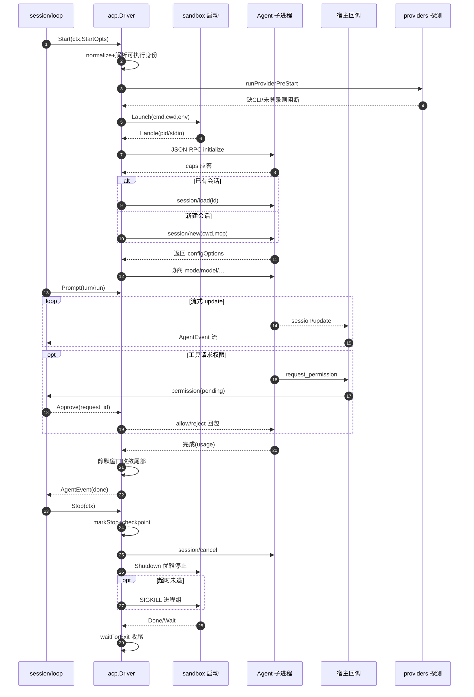
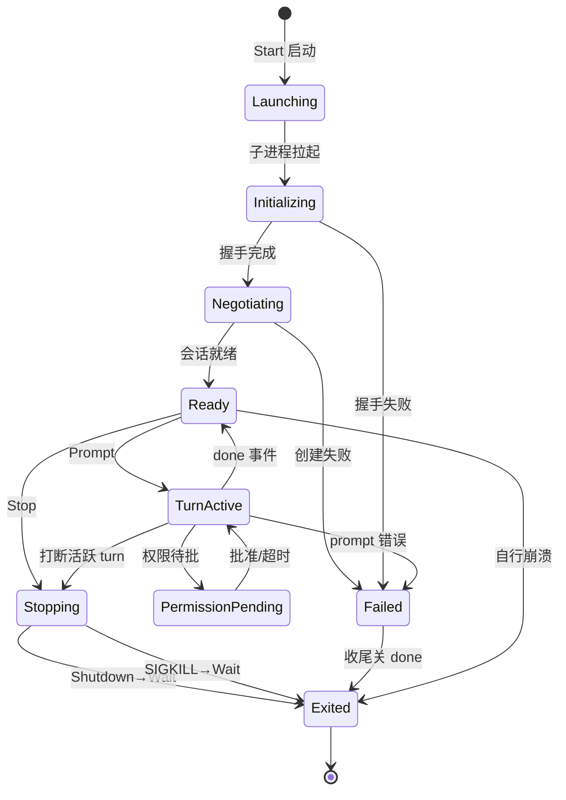

# CompozyOS ACP 宿主解读：子进程收养、协议协商与失败分类

> 本解读按 **ai-agent 类规格** 产出，解读基线为 compozy 源码 `release/v0.3.0`（HEAD 4efd8de）。

本文回答会话与循环背后那个基础问题：**到底怎么把一个真实 CLI agent 当子进程养起来？** 覆盖 `internal/acp` 宿主层——session/loop 只见一个五方法 `AgentDriver`，真实执行全在这一层：sandbox Launcher/Handle 三层接口的进程收养、能力探测与 session 配置协商、`session/new → prompt → session/update → stop` 生命周期、`request_id` 权限往返、主动停 vs 崩溃的失败分类与 fresh-start 恢复，以及 provider 登录态探测与凭据隔离边界。

## 角色：去掉它系统会怎样

去掉 `internal/acp`，CompozyOS 就只剩一个"空转的会话状态机"。`session/` 对下层只有一个接口视图——`AgentDriver`，接口定义在使用处（Go 风格）：

- [internal/session/interfaces.go:421-426]()<!-- anchor: type AgentDriver interface { -->：会话管理器只认识 `Start / Prompt / Cancel / Stop` 四个动词（另有两个可选面 `RuntimeConfigurator`、`ScopedInterrupter`），它从不直接触碰进程、JSON-RPC、权限协议
```go
type AgentDriver interface {
	Start(ctx context.Context, opts acp.StartOpts) (*AgentProcess, error)
	Prompt(ctx context.Context, proc *AgentProcess, req acp.PromptRequest) (<-chan acp.AgentEvent, error)
	Cancel(ctx context.Context, proc *AgentProcess) error
	Stop(ctx context.Context, proc *AgentProcess) error
}
```

- [internal/session/acp_driver_adapter.go:16-18]()<!-- anchor: var _ AgentDriver = (*ACPDriverAdapter)(nil) … var _ RuntimeConfigurator = (*ACPDriverAdapter)(nil) -->：具体驱动被 `ACPDriverAdapter` 包装后经编译期断言证明满足三张接口（`AgentDriver`、`ScopedInterrupter`、`RuntimeConfigurator`）
- [internal/acp/client.go:59-60]()<!-- anchor: // Driver launches ACP agent subprocesses and brokers JSON-RPC traffic. … type Driver struct { -->：Driver 的职责一句话概括——「启动 ACP agent 子进程并代理 JSON-RPC 流量」
- [internal/acp/client.go:158-194]()<!-- anchor: // New constructs an ACP driver with sensible defaults. … return driver -->：`New(opts ...Option)` 以函数式选项构造，无依赖注入时回落自建 `localLauncher`

**去掉它**意味着：session 状态机没有真实执行体；`COMPOZY_SESSION_ID`/`COMPOZY_AGENT` 身份注入、CLI 登录态探测、权限审批往返、外部 agent 的命令行收养全部归零——v0.3 "runs the agents you already use" 的根基不复存在。它是 daemon 侧唯一把"产品级 CLI agent"当黑盒子进程养起来的模块，也是 `store.FailureKind` 失败分类、`toolruntime` 进程记录、`sandbox` 工具宿主三个旁路系统的会合点。

## 解决什么问题、根因

根因是 v0.3 的核心命题：**不重造 agent，去运行用户已经在用的 agent**。背后的取舍是"生态/兼容 vs 控制力"：

- 协议层不私有：Compozy 不自研"自己人格式"，而是接入行业级 ACP（Agent Client Protocol，宿主接 agent 产品的 JSON-RPC-over-stdio 协议）。[internal/acp/client.go:11-11]()<!-- anchor: acpsdk "github.com/coder/acp-go-sdk" --> 直接依赖 `github.com/coder/acp-go-sdk`；ACP 客户端能力在 `initializeConnection` 时向 agent 声明（读/写文本文件、terminal）
- 产品层不做适配器森林：每个目标 agent 只是一条「命令字符串」。[internal/config/provider_builtin.go:5-12]()<!-- anchor: var builtinProviders = map[string]ProviderConfig{ --> 的 `builtinProviders` 里 Claude Code 用 `npx -y @agentclientprotocol/claude-agent-acp@latest`、Hermes/OpenClaw 直接用自有 `hermes acp`/`openclaw acp` 子命令，而 pi 系（[internal/config/provider_builtin.go:110-122]()<!-- anchor: "pi": { -->）走 `npx -y pi-acp@latest` 这个 "harness adapter"，让 pi 一程序物化多家下游 API provider
- 控制力则靠"协议共识下的双边检查"补回来：agent 进程持有的能力、provider 登录态、可执行文件、模型选项，宿主都不信任声明，逐一探测/协商/在执行边界复核（后文展开）。

一句话根因：**生态的红利必须付"收养"的税**——CompozyOS 要驱动一批由第三方维护、随各自上游演进的 CLI agent，只能把它们当不透明子进程养，把差异收敛到一个薄协议面 + 一套失败探测/分类/恢复约定上，而不是把差异扩散到会话状态机里。

## 设计思路与核心模式

### 进程养子模型：sandbox 抽象的三层接口

ACP 进程不直接 `exec.Command`，而是抽象出三层接口（都定义在 `internal/sandbox/types.go`，acp 复用并 type-alias）：

- `sandbox.Launcher` 只管"在某个执行环境里起一个 ACP-capable 进程"：`Launch(ctx, LaunchSpec) (Handle, error)`，可选 `LaunchPreparer` 负责把命令字符串解析成绝对 executable 身份（[internal/sandbox/types.go:254-261]()<!-- anchor: type Launcher interface { -->）
- `sandbox.Handle` 是"运行中的进程"统一视图：`PID/Cwd/Stdin/Stdout/Stderr/Done/Wait/Stop`（[internal/sandbox/types.go:291-300]()<!-- anchor: type Handle interface { -->）
- `sandbox.ToolHost` 是 daemon 落地的 ACP 客户端方法实现：读/写文件、`ResolvePath`、`Authorize(op)`、`PermissionDecision(req)`、terminal 五个动词（[internal/sandbox/types.go:335-346]()<!-- anchor: type ToolHost interface { -->）

[internal/acp/launcher.go:15-19]()<!-- anchor: // Launcher starts an ACP-capable agent process inside a sandbox. … type Handle = sandbox.Handle --> 把三者直接 re-export；默认实现 `localLauncher`/`localProcessHandle` 薄薄包一层 `subprocess.Process`（[internal/acp/launcher.go:69-87]()<!-- anchor: managed, err := subprocess.Launch(ctx, subprocess.LaunchConfig{ -->）。远程 sandbox 后端只需换 `Handle` 与 `ToolHost` 实现——spawn 之后的协议协商、权限往返、stop 治理与执行环境无关。这是收养之后全部治理逻辑所在的一层"隔离"。

### 接口契约：Driver 与 AgentProcess

- `Driver` 持有时钟/缓冲/超时类可调参数与依赖（[internal/acp/client.go:60-72]()<!-- anchor: type Driver struct { -->：launcher、toolHost、toolruntime.Registry、TerminalHost、ProviderPreStarter）
- `AgentProcess` 承载"一个 ACP 子进程的全部运行时状态"：`caps`（能力快照，带 RWMutex）、`conn`（JSON-RPC 连接）、`managed`/`handle`/`cmd` 三种底层句柄、`permissions` 策略、terminal 所有权表、`activePrompt`、`pendingPermissions`、child-task 表（[internal/acp/agent_process.go:17-80]()<!-- anchor: // AgentProcess represents one running ACP-backed agent subprocess. -->）
- 事件出口是 `events` 缓冲 channel，由 session/loop 消费（[internal/acp/agent_process_prompt.go:83-95]()<!-- anchor: active := &activePromptState{ … return active, nil -->），`done` channel 在 `waitForExit` 收尾时统一 close（[internal/acp/client_process.go:72-72]()<!-- anchor: close(p.done) -->）

### 宿主侧的"方法反打"：agent 调回来，daemon 本地落地

ACP 下 agent 是**发起者进程**，宿主是"被调用方"。`handleInbound` 是 daemon 实现的 agent 端 client 方法分发器（[internal/acp/handlers.go:72-104]()<!-- anchor: func (p *AgentProcess) handleInbound( -->）：

- `session/update`（notification，走流）→ `handleSessionUpdate`（[internal/acp/handlers_session_state.go:10-60]()<!-- anchor: func (p *AgentProcess) handleSessionUpdate(params json.RawMessage) error { -->）
- `fs/read_text_file`、`fs/write_text_file` → 先过 `intercept*`（工具网关补丁口）再落到本地 `ToolHost.ReadTextFile/WriteTextFile`（[internal/acp/handlers.go:142-181]()<!-- anchor: func (p *AgentProcess) handleReadTextFile( -->）
- `session/request_permission` → 权限决策往返（见下）
- `terminal/create|kill|output|wait_for_exit|release` → 本地 terminal 核心

`handleInboundRequest` 泛型解包 + 统一错误映射 `requestError`（[internal/acp/handlers_helpers.go:49-65]()<!-- anchor: func requestError(err error) *acpsdk.RequestError { -->：`ErrPermissionDenied`/`ErrInvalidPath`/越界→`InvalidParams`，其余→`InternalError`），所有出站错误经过 `acpsdk` 编码回 agent。**写文件是宿主代写**（`WriteTextFile` 在 daemon 侧 `os.WriteFile` 0600），agent 只提交意图。

### 权限往返：非交互直决 / 交互挂起 / 网关拦截 三路合一

`handleRequestPermission`（[internal/acp/handlers.go:183-263]()<!-- anchor: func (p *AgentProcess) handleRequestPermission( -->）是宿主侧授权核心：

1. **provider-native 网关拦截**：若存在 `ToolExecutionGateway`（agent 通过 Compozy 工具链执行，而非原生命令），先 `interceptProviderNativePermissionRequest`——解码工具 ID/输入 → 网关改写 → 校验 patch 是否可接受（native 回调不允许改输入，[internal/acp/tool_gateway.go:263-269]()<!-- anchor: if providerNativeToolPatchUnsupported(normalized, patched) { -->）
2. **策略直决**：`host.PermissionDecision(request)` 非交互返回时，直接选 `allow/reject` 的 `allow-once`/`allow-always` 偏好映射（[internal/acp/permission_event.go:11-50]()<!-- anchor: func selectPermissionOutcome( -->），发 `permission` 事件后立即回包
3. **交互挂起**：`decisionPending` 时注册 `pendingPermission`（requestID 从 meta `request_id`→`turnID:toolCallID` 序列推导，防碰撞加序号），发 `permission` 事件（含 raw request_id/tool_input/options）让上层（session/UI/operator）看到；然后 `select` 等待三路：`pending.response`（operator 经 `ResolvePermission` 写入）、`timeout`（默认 5 分钟，超时 `reject-once`）、`ctx.Done`（`cancelled` 回包）——[internal/acp/permission_pending.go:102-133]()<!-- anchor: func (p *AgentProcess) ResolvePermission(req ApproveRequest) error { --> 与 [internal/acp/permission_pending.go:154-159]()<!-- anchor: func (p *AgentProcess) permissionTimeoutOrDefault() time.Duration { -->
4. 每步决策都 `emitPermissionEvent`（[internal/acp/handlers_interceptors.go:147-171]()<!-- anchor: func (p *AgentProcess) emitPermissionEvent( -->），把"谁批的"（`resolvedBy`）带进事件流

`ResolvePermission` 先验决策字面量、再校验 provider 是否真的给出该选项（`supportedDecisions`，`ErrPermissionDecisionUnsupported`），杜绝宿主替 agent 发明决策（[internal/acp/permission_pending.go:118-123]()<!-- anchor: if len(pending.supportedDecisions) > 0 { -->）。RequestID 通过 ACP `_meta.request_id` 语义与宿主 UI 对齐（`PermissionRequestIDMetaKey`，[internal/acp/permission.go:15-20]()<!-- anchor: const ( -->）。

### 进程治理：managed-stop 三件套 + 进程树回收

治理规则三件套集中在 `client_control.go`：

- **分级停止**：`Stop` → `markStopRequested` → 先给 `processRecord` checkpoint（`interrupting`）→ 协议面 `session/cancel` notification（1s 预算，`cancelSessionForStop`）→ 句柄级优雅 `Shutdown` → `select` 等待 `proc.Done()`/`ctx.Done()`（[internal/acp/client_control.go:197-212]()<!-- anchor: func stopAgentProcessAndWait( -->）
- **超时升级**：exec 路径 `stopExecCommand` 用 `stopTimeout`（默认 5s）兜底，超时 `SIGKILL` 进程组后再等（[internal/acp/client_control.go:222-238]()<!-- anchor: waitCtx, cancelWait := context.WithTimeout(context.Background(), d.stopTimeout) -->）
- **进程组整树回收**：信号集中走 `procutil.SignalCommandProcessGroup`/`KillCommandProcessGroupAndWait`（[internal/acp/process_tree.go:19-25]()<!-- anchor: func signalManagedProcess(cmd *exec.Cmd, signal syscall.Signal) error { -->，unix/windows 双实现 [internal/procutil/process_group_unix.go:63-63]()<!-- anchor: func SignalCommandProcessGroup(cmd *exec.Cmd, sig syscall.Signal) error { -->、[internal/procutil/process_group_windows.go:83-83]()<!-- anchor: func SignalCommandProcessGroup(cmd *exec.Cmd, sig syscall.Signal) error { -->），符合 internal/CLAUDE.md「process-group 监管、Windows forced-exit 回退」的跨平台铁律

### 探测 / 协商 / 失败分类

- **探测**：`probe.go` 只做"可执行文件在不在 PATH"的轻探测（`ProbeTargetCommand`，2s 超时，`ok/missing/invalid/canceled/timeout` 五态，[internal/acp/probe.go:69-132]()<!-- anchor: func ProbeTargetCommand(ctx context.Context, target ProbeTarget, opts ProbeOptio -->）；真正的登录态探测由 `providers.PreStart` 做（见后 provider 边界）
- **协商**：session/new 或 session/load 返回 `configOptions/modes/models` 后，`applySessionConfiguration` 按序 apply：`set_mode`（把 Compozy 权限模式映射成 agent 会话 mode，如 deny-all→`read-only`/`ask`，见 [internal/acp/session_config_negotiation.go:202-274]()<!-- anchor: func preferredSessionMode( -->）→ `set_model` → reasoning → speed → 通用 config selections；每次 apply 都带 stage 日志与失败包装
- **失败分类**：出口统一 `WrapFailure(kind, summary, err)`（[internal/acp/failure.go:46-67]()<!-- anchor: // WrapFailure annotates err with a typed ACP/session failure classification. -->）→ 决策树归类：ctx cancel/timeout/EOF → `FailureCanceled/Timeout/Transport`；ACP `RequestError` 按 code/text 分 session-loss、peer-disconnect、cancellation（[internal/acp/failure.go:104-168]()<!-- anchor: func failureKindForError(err error, fallback store.FailureKind) store.FailureKin -->）；provider 面再叠加 `ProviderFailureDiagnosticFromError` 文本 needles（`invalid model`/`rate limited` 等，[internal/acp/provider_failure.go:57-84]()<!-- anchor: var providerFailurePatterns = []providerFailurePattern{ -->）与 provider 状态分类，最终以 `provider_failure_kind=...; next_action=...` 元数据打进脱敏摘要（[internal/acp/provider_failure.go:200-217]()<!-- anchor: func (d ProviderFailureDiagnostic) Summary(summary string) string { -->）

## 核心流程

### 完整时序：一个 agent 从探测到停止




### AgentProcess 生命周期状态演化（由源码控制流推导）

代码没有字面枚举状态机；此图从 `agent_process.go` 字段、`start.go` 阶段、`waitForExit`/`stop` 控制流反推。会话层的持久状态机（starting/active/stopping…）属会话域，不在本层。




## 关键实现归组

| 归组 | 文件 | 核心职责 |
|---|---|---|
| 启动管线 | `start.go` `start_process.go` `start_session.go` | 阶段化 Start：pre-start 探测→spawn→initialize→MCP 激活→session 协商；每阶段 `logStartStage` 埋点，失败统一 WrapFailure |
| 进程状态 | `agent_process.go` `client_process.go` `process_child_tasks.go` `process_tree.go` | AgentProcess 字段、waitForExit 收尾、child task 门禁、进程组信号 |
| 协议方法 | `client_protocol.go` `handlers.go` `handlers_helpers.go` `handlers_session_update.go` `handlers_session_state.go` `handlers_interceptors.go` | wire 结构、session/update 翻译、工具拦截 |
| 权限 | `permission.go` `permission_pending.go` `permission_event.go` `permission_helpers.go` | policy、pending 注册/解析、outcome 偏好映射 |
| prompt | `client_prompt.go` `agent_process_prompt.go` `prompt_meta.go` `prompt_attachments.go` `prompt_cache.go` `prompt_runtime.go` | runPrompt、事件合并/去重、meta 组装 |
| 配置协商 | `config_options.go` `config_option_selection.go` `session_config_negotiation.go` `generic_config_negotiation.go` `negotiation_error.go` `speed_config.go` | 能力→选项协商、冲突校验、结构化协商错误 |
| 失败/探测 | `failure.go` `provider_failure.go` `probe.go` | FailureKind 分类、provider 恢复元数据、CLI 轻探测 |
| 工具宿主 | `tool_host.go` `tool_gateway.go` `terminal*.go` `terminal_access.go` | 本地工具宿主、native 工具网关、terminal 所有权 |
| provider 边界 | `internal/config/provider_builtin.go` `internal/providers/*` `providerauth/*` `providerenv/*` `providerexec/*` | catalog、登录态分类、隔离 home/env、执行策略 |

## 与其它模块协同

- **session（AgentDriver 消费方）**：`ACPDriverAdapter` 转发 Start/Prompt/Cancel/Stop/ConfigureRuntime/Interrupt 到 `acp.Driver`，`AgentProcess.native` 回包给 session 包装（[internal/session/acp_driver_adapter.go:26-89]()<!-- anchor: func (a *ACPDriverAdapter) Start(ctx context.Context, opts acp.StartOpts) (*Agen -->）。session 侧 `provider_runtime.go` 组装 `StartOpts.ProviderAuthEnv`（`ProbeEnv`），把 provider home/env 策略注入本层 pre-start 检查。
- **store（失败/事件持久化）**：`FailureError.Kind` 直接用 `store.FailureKind`（[internal/acp/failure.go:16-27]()<!-- anchor: const ( -->），事件携带 `store.EventCorrelation`，usage/tool/session 事件可落库回放
- **toolruntime（进程注册/中断）**：ACP agent 与 sandbox terminal 都注册进共享 `toolruntime.Registry`，`Owner{SessionID,...}` 定域，`Interrupt` 回调即 `d.Stop`（[internal/acp/start_process.go:171-188]()<!-- anchor: handle, err := registry.Register(recordCtx, toolruntime.RegisterConfig{ … process.processRecord = handle -->）；`Driver.Interrupt` 委托 registry（[internal/acp/client_control.go:81-92]()<!-- anchor: func (d *Driver) Interrupt( -->）
- **modelcatalog（模型发现）**：`LiveProviderSource.listACP` 开**短命 ACP 会话**读 `model` config option 的取值生成模型行（[internal/modelcatalog/live_sources_acp.go:57-97]()<!-- anchor: func (s *LiveProviderSource) listACP( -->），探针 `InspectModels` 复用 `acp.InspectSessionConfigOptions`（[internal/acp/session_inspection.go:19-49]()<!-- anchor: func InspectSessionConfigOptions( -->，Inspection 模式跳过会话配置写入）
- **provider catalog/登录态**：`internal/config` 的 builtin registry 是"声明"，`internal/providers` 的 `ClassifyDeclared/ClassifyProbe/ClassifyError` + `PreStart` 是"探测/恢复建议"；两者经 `ProbeEnv`（[internal/providers/probe_env.go:39-55]()<!-- anchor: type ProbeEnv struct { -->）把 vault/env/LookPath/命令解析注入 acp 的 pre-start 检查（[internal/acp/start.go:122-172]()<!-- anchor: func (d *Driver) runProviderPreStart(ctx context.Context, opts StartOpts) error -->）
- **providerenv/providerauth/providerexec**：env/home 隔离目录（[internal/providerenv/env.go:22-51]()<!-- anchor: func ApplyHomePolicy( -->、`providerHomeSpecs` 296-315）、native CLI 状态探测与登录命令 env 投影（[internal/providerauth/native_cli.go:36-87]()<!-- anchor: func NativeCLIStatusForProvider( -->、`CommandEnv` 132-165）、直接 ACP/native-bridge/harness 三类执行策略与桥接 CLI env 注入（[internal/providerexec/native_cli.go:56-84]()<!-- anchor: func StrategyFor(provider compozyconfig.ProviderConfig) Strategy { -->）。这些与 daemon/session 的装配点在 daemon 组合根与 session launch 中。
- **sandbox（本地或远端执行）**：本层消费的是接口；本地默认实现 `subprocess.Process`（带 transport disable、ShutdownTimeout），远端后端如何选择 local/daytona 属装配话题，不在本层。
- **agentidentity（agent 回调 CLI/UDS）**：本层注入身份 env；agent 反过来以 `COMPOZY_SESSION_ID`/`COMPOZY_AGENT` 调 daemon CLI/UDS，daemon 用 session snapshot 校验身份与 workspace 访问（[internal/agentidentity/identity.go:46-77]()<!-- anchor: func Resolve(ctx context.Context, opts ResolveOptions) (Caller, error) { -->）。双向身份闭环

## 关键设计决策

### 不养自己的 agent：宿主产品级 ACP CLI 子进程，以失败分类兜底

**Why**：agent 的能力/模型/工具集随上游演进，CompozyOS 若自研 agent 就永远追不上已存在的几十万用户生态；宿主第三方 CLI 则让"模型、登录态、AGENTS.md 习惯"全部免费继承。

**权衡**：控制力换来了三类必还的债，全部在本层偿还——(1) 协议必须跟着上游 ACP SDK 语义走，SDK 未建模字段要手写 wire struct 补齐（`session/new` 的 `additional_dirs`、Hermes `models` 扩展、usage 的 `used/size/cost`：[internal/acp/handlers.go:31-49]()<!-- anchor: // wireNewSessionRequest keeps the workspace extension on the top-level -->、[internal/acp/session_model_state.go:9-22]()<!-- anchor: // wireSessionSetupResponse includes the Hermes model extension that the -->）；(2) provider 行为差异只能靠文本 needles/探测启发式收敛（`provider_failure.go`、`providers/classify.go` 的 needle 表），脆弱但至少给出稳定的 `next_action`；(3) 会话续跑要容忍上游"忘了会话"（`IsLoadSessionResourceMissing` 把 `-32002 resource not found` 归为 session-loss，让上层 fresh-start 兜底，[internal/acp/client.go:209-222]()<!-- anchor: // IsLoadSessionResourceMissing reports whether a resume failed because the -->）。

**替代代价**：若自研 in-process agent，可消除上述全部脆弱性，但要重造模型路由、工具准入、会话记忆与安全边界——正是 CompozyOS 想从外部生态免费获得的。

### 执行环境接口化：本地与 sandbox 后端共用同一治理代码

**Why**：进程组监管、managed-stop、权限路径、协议协商都是执行环境无关的；把它们写成对 `sandbox.Handle`/`ToolHost` 的调用，本地 daemon 与将来任何 sandbox 后端只差两个实现。

**权衡**：代价是 acp 必须容忍"句柄可能拿不到 exit status / stderr / process record"（[internal/acp/agent_process.go:118-134]()<!-- anchor: func (p *AgentProcess) ExitStatus() (subprocess.ExitStatus, bool) { --> 的多分支回落）；收益是本层所有流程可先跑在本地（`New()` 默认 `localLauncher`），且权限策略、进程注册、会话协商逻辑不随后端复制。工具网关 `ToolExecutionGateway` 进一步把"provider 原生工具（Bash/Read/Write）"的准入补丁与 ACP 权限请求解耦（[internal/acp/tool_gateway.go:31-33]()<!-- anchor: type ToolExecutionGateway interface { -->），是 sandbox 后端做工具落地的挂点。

### 权限闭环"宁慢勿假"：超时默认拒绝 + 决策字面量白名单

**Why**：agent 提交的 tool 意图必须先过宿主 policy；但宿主又不该为每个写操作发明一个决策。于是按权限模式分档：`approve_all` 直放、`approve_reads` 放读挂写、`deny_all` 直拒、写操作落入交互 `pending`——pending 的上限是 5 分钟且**超时默认拒绝**（[internal/acp/permission_pending.go:154-159]()<!-- anchor: func (p *AgentProcess) permissionTimeoutOrDefault() time.Duration { -->），不让不可达的审批把会话永久挂死。

**权衡**：交互档牺牲了无人值守吞吐（无人批准就等满超时），换来"宿主从不替 agent 默认放行写操作"。`ResolvePermission` 又校验决策必须是 provider 真实给出的 option（`supportedDecisions`），防止上层 API 把协议里不存在的 allow-always 强塞给 agent——这条边界让 ACP 的权限选项语义保持诚实。

## 亮点与问题

### 亮点

- **事件流 QoS 设计**：单 turn 事件缓冲有上界（cap 128），tool_call 投影按 toolCallID 做输入摘要去重、tool_result 若先于 tool_call 到达则**延迟重排**（最多留 128 条，超限丢最旧），`done` 前以 50ms 静默窗口收敛尾部异步 update（[internal/acp/client_protocol.go:89-114]()<!-- anchor: func (d *Driver) waitForPromptQuiescence(active *activePromptState) { -->、[internal/acp/agent_process_prompt.go:228-368]()<!-- anchor: func (a *activePromptState) deferToolResultLocked(event AgentEvent) bool { -->）——用一个小队列把"agent 消息乱序、重复、迟到"三件麻烦事全部吸收
- **"主动停 vs 异常退出"区分**：`stopWasRequested` 标志让 `waitForExit` 对两条退出路径给出不同语义——主动停时吞掉 Wait error（换进程树释放错误），未请求停时的任何退出都包装成 `FailureProcess`（[internal/acp/client_process.go:39-56]()<!-- anchor: if p.stopWasRequested() { … p.setWaitError(waitErr) -->），上层据此区分"用户叫停"与"崩溃"，绝不混淆
- **失败出口的三级结构化**：`FailureKind`（session 持久化）→ provider failure kind/action（CLI/API 恢复分支）→ 脱敏摘要（`RedactAndBound` 2048 上限）。错误永远不是裸文本，session 不需要 parse error string 就能决定持久化与恢复动作——本层只交付分类，会话层据此做退避重启的自动 recovery
- **权限 request_id 可寻址化**：`_meta.request_id` 在 ACP 线格式与宿主 UI/事件流间共用同一 ID 语义，pending 查重/防碰撞做在 allocate 序列里（[internal/acp/permission_pending.go:46-78]()<!-- anchor: func (p *AgentProcess) allocatePermissionRequestIDLocked( -->），让"外部谁批的哪条请求"可被审计
- **prompt meta 的隔离与自校验**：`PromptMeta.Validate` 禁止 network/synthetic 混入 user turn、禁止 network 带 synthetic/judge，结构化地防"来源污染"（[internal/acp/prompt_meta.go:128-155]()<!-- anchor: switch normalized.TurnSource { -->）

### 问题

- **provider 适配的文本启发式脆弱**：模型错误、限流、session-loss 全靠 needles 子串匹配（`provider_failure.go`、[internal/acp/failure.go:150-168]()<!-- anchor: func requestErrorIndicatesSessionLoss(reqErr *acpsdk.RequestError) bool { -->），上游改一句措辞就可能误分类——它至少给了稳定 `next_action`，但这是"语义解释"而非"协议保证"；另有按 provider 名硬编码的路径（如 prompt cache 只对 `claude`/`anthropic` 生效，[internal/acp/prompt_cache.go:32-39]()<!-- anchor: if providerName != "claude" && runtimeProvider != promptCacheAnthropicRuntime { -->）
- **交互权限默认 5 分钟超时偏保守**：无人值守 loop 下写操作可能整轮拖死；设计上留了 `WithPermissionTimeout` 可调，但默认值与无人值守场景的匹配值得商榷
- **tool_result 超限"丢最旧"**：`dropOldestPendingToolResultLocked`（[internal/acp/agent_process_prompt.go:350-357]()<!-- anchor: func (a *activePromptState) dropOldestPendingToolResultLocked() { -->）在极端乱序下会静默丢结果，宁可丢也不阻塞——对回放完整性是一次取舍，缺显式告警
- **SDK 未建模字段的手工 wire struct 面较广**：`wireNewSessionRequest`、`wireUsage`、`wireSessionModelState` 等多处手写镜像，随 ACP SDK 升级需同步维护，是隐性技术债（`handlers.go`、[internal/acp/handlers_session_state.go:23-41]()<!-- anchor: if envelope.SessionUpdate == "usage_update" { -->、`session_model_state.go`）
