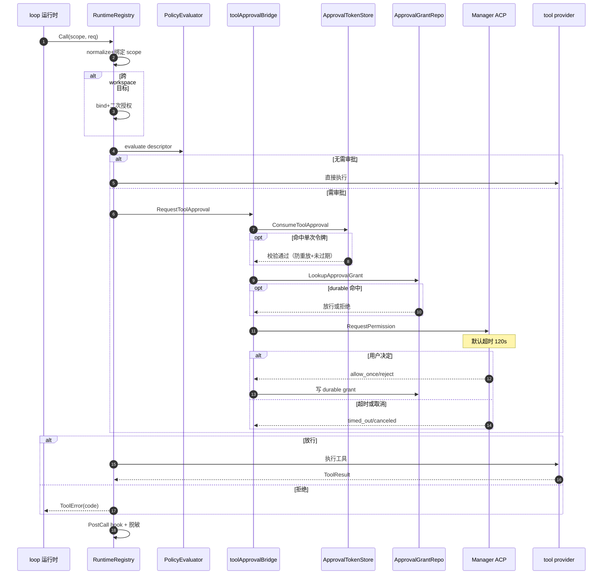
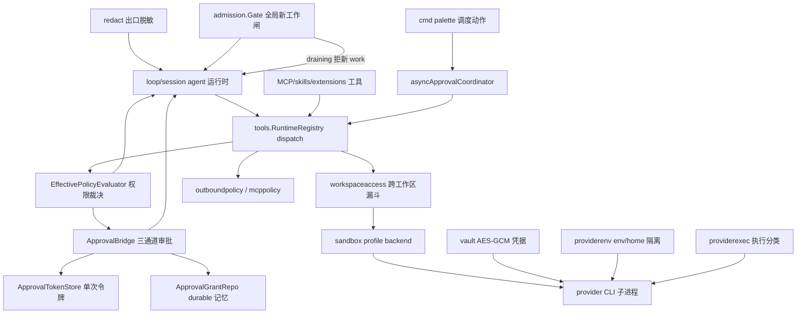

# CompozyOS 审批与治理：哈希化令牌、三通道放行与分层策略门

> 本解读按 **ai-agent 类规格** 产出，解读基线为 compozy 源码 `release/v0.3.0`（HEAD 4efd8de）。

## 角色：去掉治理层系统会怎样

去掉这一层，CompozyOS 无人值守 agent（loop/session 后台自主跑）的能力总和就等于"被授权模型"本身，破坏半径不做任何收窄：

- **工具零门槛**：`deny-all / approve-reads / approve-all` 三种权限模式（[internal/config/config_agent_session.go:108-110]()<!-- anchor: PermissionModeDenyAll      PermissionMode = "deny-all" -->）
  <!-- anchor: PermissionModeDenyAll      PermissionMode = "deny-all" -->
  <!-- anchor: PermissionModeApproveAll   PermissionMode = "approve-all" -->
  与 registry 的策略求值器（internal/tools/policy.go）一起消失后，`terminal/exec`、破坏性写工具和只读工具一视同仁，无人值守 loop 想点就点。
- **跨工作区边界消失**：session 只应持有本工作区（scope）的凭证与文件视野，但工具/任务/协调层都传 workspace id；去掉 workspaceaccess 这个单一裁决点，agent 顺手读别的 workspace 文件/发它的请求会从"fail-closed 的例外"变成默认值。
- **出站网络裸奔**：HTTP 客户端可直接访问内网/环回地址，跨源重定向能带走 Authorization 与 Cookie（SSRF 与凭证泄露合一）。出站客户端先按策略重建再放行（[internal/outboundpolicy/http_client.go:16-27]()<!-- anchor: func NewHTTPClient(base *http.Client, policy Policy, timeout time.Duration, maxR -->）
  <!-- anchor: func NewHTTPClient(base *http.Client, policy Policy, timeout time.Duration, maxRedirects int) *http.Client { -->
  <!-- anchor: 	client.Transport = secureRoundTripper(client.Transport, policy, timeout) -->
- **密钥成头等公民**：审批令牌、claim_token、vault 明文如果直接进 pending 表/日志/SSE，一次崩溃转储或日志旁路即可复现全部会话权限。
- **provider 登录态不隔离**：claude/codex 等 native CLI 直接共享操作员 $HOME 与其 auth 文件、cookies。
- **无人值守无人把关**：异步审批负责"跑起来但等人点头再执行"；没有它，调度面动作只能全做或全不做，自治度与风险只剩二选一。

一句话：这一层回答读者的三个问题——**谁能做什么**（工具投影 + allowed tools）、**危险动作要不要人点头、怎么点、超时怎么办、结果怎么记**（审批桥/令牌/授权记录/协调器）、**点头之后以什么身份在什么边界内执行**（scope 归一化、workspace access、sandbox、provider env/home、vault 注入）。

---

## 根因：自治度与破坏面正相关

根因是**自治度与破坏面正相关**：agent 越能无人值守地连续工作（loop、任务调度、自动化、cmd palette 预授权动作），请求"终态工具/跨工作区/内网/写终端"的概率越高；而人可能不在场，审批必须**可异步、可超时、可跨重启恢复、可审计**，不能假设请求与批准发生在同一进程同一时刻。

由此推出设计不变量（internal/CLAUDE.md 的权威表述，这里落到源码）：

1. **原始秘密永不持久化、永不进日志/SSE/内存状态**。审批令牌只存 sha256 哈希（[internal/tools/approval_token.go:301-301]()<!-- anchor: return sha256.Sum256([]byte(token)) -->）
   <!-- anchor: 	return sha256.Sum256([]byte(token)) -->
   vault 密文才落盘（[internal/vault/ciphertext.go:42-58]()<!-- anchor: func encryptValue(key []byte, plaintext string, identity ciphertextIdentity) (st -->）
   <!-- anchor: func encryptValue(key []byte, plaintext string, identity ciphertextIdentity) (string, error) { -->
   <!-- anchor: 	ciphertext := gcm.Seal(nil, nonce, []byte(plaintext), identity.additionalData()) -->
2. **超时默认拒绝**。异步审批由定时器在 `ExpiresAt` 后自动走 timeout 终态（[internal/tools/approval_async.go:191-199]()<!-- anchor: c.timers[status.ApprovalID] = time.AfterFunc(delay, func() { -->）
   <!-- anchor: 	c.timers[status.ApprovalID] = time.AfterFunc(delay, func() { -->
   <!-- anchor: 		if err := c.Resolve(ctx, status.ApprovalID, ApprovalTimedOut); err != nil && -->
   同步工具审批用 context 超时把结果判为 `approval_timed_out`（[internal/daemon/tool_approval_bridge.go:233-240]()<!-- anchor: if err != nil { -->）
   <!-- anchor: 		case errors.Is(context.Cause(approvalCtx), context.DeadlineExceeded): -->
   <!-- anchor: 				"tool approval timed out", -->
3. **失败必须关闭（fail closed）**。需要审批但审批通道不可达→工具直接不可见/不可调用（[internal/tools/policy.go:371-380]()<!-- anchor: func requireApproval(decision *EffectiveToolDecision, approvalAvailable bool) { -->）
   <!-- anchor: func requireApproval(decision *EffectiveToolDecision, approvalAvailable bool) { -->
   <!-- anchor: 	decision.VisibleToSession = false -->
   <!-- anchor: 	appendDecisionReason(decision, ReasonApprovalUnreachable) -->
   跨工作区无 resolver/无 policy→直接拒绝（[internal/tools/dispatch_workspace_access.go:50-72]()<!-- anchor: if r == nil || r.workspaceIDResolver == nil { -->）
   <!-- anchor: 	if r == nil || r.workspaceIDResolver == nil { -->
   <!-- anchor: 	if r == nil || r.workspaceAccess == nil { -->
4. **身份先归一化再求值**。调用方填的身份字段一律以 scope（可信上下文）覆盖或强校验，冲突即拒（[internal/tools/dispatch.go:112-166]()<!-- anchor: func normalizeCallRequest(scope Scope, req CallRequest) (CallRequest, error) { -->）
   <!-- anchor: func normalizeCallRequest(scope Scope, req CallRequest) (CallRequest, error) { -->
   <!-- anchor: 		return callScopeMismatchError(id, field) -->
5. **hooks 只能 deny/narrow/annotate，不能绕过审批**。dispatch 顺序是先 hook、再二次 bind+authorize、最后审批（[internal/tools/dispatch.go:89-97]()<!-- anchor: if err := r.authorizeBoundCallInput(ctx, scope, target.descriptor, patchedReq);  -->）
   <!-- anchor: 	if err := r.authorizeBoundCallInput(ctx, scope, target.descriptor, patchedReq); err != nil { -->
   <!-- anchor: 	if err := r.requestApproval(ctx, scope, target, &patchedReq); err != nil { -->
6. **命令必须与身份绑定**。审批令牌绑定 tool+session+workspace+agent+input digest，换任何一环即拒（[internal/tools/approval_token.go:304-318]()<!-- anchor: func approvalTokenRecordMatches(record approvalTokenRecord, call CallRequest, in -->）
   <!-- anchor: func approvalTokenRecordMatches(record approvalTokenRecord, call CallRequest, inputDigest string) bool { -->
   <!-- anchor: 	return subtle.ConstantTimeCompare([]byte(record.inputDigest), []byte(inputDigest)) == 1 -->

---

## 设计思路与核心模式

### 三套并行但互补的"点头"通道

- **同步会话审批（agent loop 主通道）**：`toolApprovalBridge`（daemon 侧，[internal/daemon/tool_approval_bridge.go:41-50]()<!-- anchor: type toolApprovalBridge struct { -->）实现 tools.ApprovalBridge
  <!-- anchor: type toolApprovalBridge struct { -->
  <!-- anchor: 	grants    toolspkg.ApprovalGrantStore -->
  <!-- anchor: var _ toolspkg.ApprovalBridge = (*toolApprovalBridge)(nil) -->
  dispatch 需要审批时把 pending tool_call 经 session 的 ACP `RequestPermission` 抛给运行中会话，等人选 allow_once/reject_once/allow_always/reject_always。
- **本地单次令牌（operator 预授权/离线通道）**：`ApprovalTokenStore`，内存 map、默认 TTL 120s（[internal/tools/approval_token.go:90-110]()<!-- anchor: // NewApprovalTokenStore builds a daemon-memory approval token store. -->）
  <!-- anchor: func NewApprovalTokenStore(ttl time.Duration, opts ...ApprovalTokenStoreOption) *ApprovalTokenStore { -->
  <!-- anchor: 		ttl: ttl, -->
  <!-- anchor: 		active: make(map[[sha256.Size]byte]approvalTokenRecord), -->
  签发时绑定一次 invocation（:115-182），消费时校验并防重放（:185-235）。
- **异步持久审批（无人值守 + cmd palette 调度面）**：`ApprovalCoordinator` 把请求落 SQLite `tool_approval_pending`，重启可 Recover，批准后 goroutine 执行并回写结果（审批序列时序见下文，异步实现见「异步协调器与无人值守执行面」）。

取舍：同步通道交互最直接但要有人在场且阻塞 loop；令牌通道把"预先批准"变成可审计的单次授权，可离线交给自动化；异步通道把"决定"与"执行"彻底解耦，专为无人值守的调度面设计。

### 工具面权限分层求值（tools 侧）

- 描述符自带安全分类：Visibility / RiskClass / ReadOnly / Destructive / OpenWorld（[internal/tools/tool.go:176-222]()<!-- anchor: // RiskClass classifies the safety posture of a tool. -->）
  <!-- anchor: // RiskClass classifies the safety posture of a tool. -->
  <!-- anchor: 	RiskDestructive RiskClass = "destructive" -->
- `EffectivePolicyEvaluator` 施加"权限模式天花板"：approve-all 全放行；approve-reads 只读自动放行、其余要审批；deny-all 全要审批（[internal/tools/policy.go:335-355]()<!-- anchor: func (e *EffectivePolicyEvaluator) applyPermissionCeiling(d Descriptor, decision -->）
  <!-- anchor: func (e *EffectivePolicyEvaluator) applyPermissionCeiling(d Descriptor, decision *EffectiveToolDecision) { -->
  <!-- anchor: 	case PermissionModeApproveReads: -->
  <!-- anchor: 		if isReadOnlyAutoApprovable(d) { -->
  <!-- anchor: 		requireApproval(decision, e.inputs.ApprovalAvailable) -->
  read-only 自动放行的精确条件：`ReadOnly && !Destructive && !OpenWorld && !RequiresInteraction && Risk==RiskRead`（:357-359）
  <!-- anchor: 	return d.ReadOnly && !d.Destructive && !d.OpenWorld && !d.RequiresInteraction && d.Risk == RiskRead -->
- 外部来源（MCP/extension 工具）默认 disabled，需显式 source grant 或 external_default=ask/enabled 才可触达（[internal/tools/policy.go:249-254]()<!-- anchor: func (e *EffectivePolicyEvaluator) externalDefault() ExternalDefault { -->, [internal/tools/policy.go:294-305]()<!-- anchor: case ExternalDefaultAsk: -->）
  <!-- anchor: 		return ExternalDefaultDisabled -->
  <!-- anchor: 	case ExternalDefaultAsk: -->
  <!-- anchor: 		decision.SourcePolicyResult = policyResultApprovalRequired -->
- 一切判定汇成带 reason code 的机器可读决策；审批相关 reason 自成体系（[internal/tools/reason.go:75-91]()<!-- anchor: // ReasonApprovalRequired reports required approval. -->）
  <!-- anchor: 	// ReasonApprovalRequired reports required approval. -->
  <!-- anchor: 	// ReasonApprovalTokenReplayed reports a replayed local approval token. -->
  <!-- anchor: 	// ReasonWorkspaceAccessDenied reports a workspace-axis policy denial. -->

### 身份归一化与单一策略漏斗

- 调用链最前面把所有 caller 提供的身份字段与可信 scope 绑定，不一致即 scope_mismatch（[internal/tools/dispatch.go:151-166]()<!-- anchor: func bindCallScopeField(id ToolID, field string, trusted string, supplied *strin -->）
  <!-- anchor: func bindCallScopeField(id ToolID, field string, trusted string, supplied *string) error { -->
  <!-- anchor: 	if trusted != "" && current != trusted { -->
- workspace 引用先经 resolver 规范化；只有显式跨工作区请求才交给 workspaceaccess.Policy（[internal/tools/dispatch_workspace_access.go:40-94]()<!-- anchor: trustedWorkspaceID := strings.TrimSpace(scope.WorkspaceID) -->）
  <!-- anchor: 	trustedWorkspaceID := strings.TrimSpace(scope.WorkspaceID) -->
  <!-- anchor: 	canonicalWorkspaceID, err := r.workspaceIDResolver(ctx, requestedWorkspaceID) -->
- workspaceaccess 是"单一裁决漏斗"：operator 恒允许；同 workspace 恒允许；否则按会话 permission mode 分叉，且每条决策都进审计（[internal/workspaceaccess/default_policy.go:43-110]()<!-- anchor: func (p *DefaultPolicy) Authorize(ctx context.Context, req Request) (Decision, e -->）
  <!-- anchor: func (p *DefaultPolicy) Authorize(ctx context.Context, req Request) (Decision, error) { -->
  <!-- anchor: 	if req.Actor.Operator { -->
  <!-- anchor: 	if req.Actor.Kind != ActorAgentSession { -->
  <!-- anchor: 	if req.Actor.WorkspaceID != "" && req.Actor.WorkspaceID == req.TargetWorkspaceID { -->
  <!-- anchor: 	switch mode { -->
  <!-- anchor: 	case ModeApproveAll: -->
  <!-- anchor: 		return p.authorizeFromConsent(ctx, req.Actor.SessionID, mode) -->

### 出站边界与 MCP 策略门

- `outboundpolicy`：默认只允许公网；环回/私网/组播/特殊网段全部拒绝（[internal/outboundpolicy/policy.go:159-179]()<!-- anchor: func (p Policy) validateAddress(address netip.Addr, explicitLoopback bool, allow -->）
  <!-- anchor: func (p Policy) validateAddress(address netip.Addr, explicitLoopback bool, allowPrivate bool) error { -->
  <!-- anchor: 	if !address.IsGlobalUnicast() || address.IsUnspecified() || address.IsLoopback() || -->
  HTTP 明文只允许显式 loopback 或受信 origin（:81-100）
  <!-- anchor: 	if parsedOrigin.scheme != schemeHTTPS { -->
- `Dialer` 在连接前校验**完整 DNS 应答**（防 DNS 重绑定），随后只连已 pin 的 IP（[internal/outboundpolicy/dialer.go:33-76]()<!-- anchor: // DialContext resolves, validates, and connects without performing a second hos -->）
  <!-- anchor: func (d Dialer) DialContext(ctx context.Context, network string, endpoint string) (net.Conn, error) { -->
  <!-- anchor: 	addresses, err := d.resolveAddresses(ctx, host, port) -->
  <!-- anchor: 	if err := d.policy.ValidateResolvedAddresses(addresses, host, port); err != nil { -->
- `NewHTTPClient` 克隆 transport：清 Proxy/DialTLS、装 policy dialer、跨源重定向剥敏感 header（[internal/outboundpolicy/http_client.go:29-93]()<!-- anchor: func secureRoundTripper(base http.RoundTripper, policy Policy, timeout time.Dura -->）
  <!-- anchor: func secureRoundTripper(base http.RoundTripper, policy Policy, timeout time.Duration) http.RoundTripper { -->
  <!-- anchor: 	clone.DialContext = NewDialer(policy, net.DefaultResolver, underlying).DialContext -->
  <!-- anchor: func stripSensitiveHeaders(headers http.Header) { -->
  <!-- anchor: 	headers.Del("Authorization") -->
- `mcppolicy` 管 MCP 端点 URL 形态（[internal/mcppolicy/url.go:13-34]()<!-- anchor: func ValidateRemoteURL(raw string) error { -->）
  <!-- anchor: func ValidateRemoteURL(raw string) error { -->
  <!-- anchor: 	if parsed.Scheme == "http" && !isLoopbackHost(parsed.Hostname()) { -->
  与 header 归属（content-type / mcp-* 保留，敏感 header 按 source 收紧）（[internal/mcppolicy/headers.go:10-15]()<!-- anchor: var sensitiveHeaders = map[string]struct{ -->, [internal/mcppolicy/headers.go:62-94]()<!-- anchor: if normalized == "content-type" || strings.HasPrefix(normalized, "mcp-") { -->）
  <!-- anchor: 	authorizationHeader:   , -->
  <!-- anchor: 	if normalized == "content-type" || strings.HasPrefix(normalized, "mcp-") { -->
  <!-- anchor: func validateSensitiveHeader(name string, source HeaderSource, authEnabled bool) error { -->

### 沙箱 profile 与执行运行时边界

- sandbox 定义 provider 中立契约：backend（local/daytona/e2b）、Resolved profile（Env 与 SecretEnv 分离 + NetworkPolicy）、Provider/Launcher/ToolHost（[internal/sandbox/types.go:18-25]()<!-- anchor: const ( -->, [internal/sandbox/types.go:96-130]()<!-- anchor: type NetworkPolicy struct { -->, [internal/sandbox/types.go:238-256]()<!-- anchor: // Provider manages the lifecycle of an execution sandbox. -->, [internal/sandbox/types.go:334-346]()<!-- anchor: // ToolHost abstracts ACP file, permission, and terminal operations for a runtim -->）
  <!-- anchor: 	BackendLocal Backend = "local" -->
  <!-- anchor: type NetworkPolicy struct { -->
  <!-- anchor: type Resolved struct { -->
  <!-- anchor: type Provider interface { -->
  <!-- anchor: type Launcher interface { -->
  <!-- anchor: type ToolHost interface { -->
- 注册表按 backend 解析 provider，默认 local（[internal/sandbox/registry.go:10-13]()<!-- anchor: const ( -->, [internal/sandbox/registry.go:71-85]()<!-- anchor: func (r *Registry) DefaultProvider() (Provider, error) { -->）
  <!-- anchor: 	DefaultBackend = BackendLocal -->
  <!-- anchor: func (r *Registry) DefaultProvider() (Provider, error) { -->

### 最小泄露的密钥边界

- redact：进程级规范化脱敏器。`Marker = "[REDACTED]"`（[internal/redact/redact.go:7-7]()<!-- anchor: const Marker = "[REDACTED]" -->）
  <!-- anchor: const Marker = "[REDACTED]" -->
  出口覆盖文本、JSON、slog attrs、claim-token 专用 JSON；精确保护永久生效，启发式 provider 前缀可关（[internal/redact/engine.go:8-28]()<!-- anchor: // Options configures one independent redaction engine. -->）
  <!-- anchor: 	// Disabled turns off additive provider-prefix and entropy heuristics. Exact -->
  <!-- anchor: func (e *Engine) RedactString(value string) string { -->
  <!-- anchor: 	return redactEntropyCandidates(redacted) -->
- vault：加密凭据后端。库表只存密文；对外只暴露 `Metadata{Present bool}`；明文只在 launch 注入时刻解出（见「redact / vault / providerenv 最小泄露细节」）。
- providerenv/providerexec：`home_policy=isolated` 时把 provider 的 HOME/XDG 与已知配置目录重定向到 `$COMPOZY_HOME/providers/<provider>`（[internal/providerenv/env.go:260-281]()<!-- anchor: return trimmedProvider, filepath.Join(homePaths.HomeDir, "providers", trimmedPro -->）
  <!-- anchor: 	return trimmedProvider, filepath.Join(homePaths.HomeDir, "providers", trimmedProvider), nil -->
  <!-- anchor: func setProviderHomeEnvValues(providerName string, providerHome string, env []string) []string { -->
  <!-- anchor: 	env = SetEnvValue(env, "HOME", providerHome) -->

---

## 核心流程

### 一次敏感工具调用的审批序列（同步会话通道为主体）

对应源码锚点（归组顺序同「关键实现归组」）：
- dispatch 顺序：授权与审批在二次 bind+validate 之后相邻出现（[internal/tools/dispatch.go:89-97]()<!-- anchor: if err := r.authorizeBoundCallInput(ctx, scope, target.descriptor, patchedReq);  -->）
  <!-- anchor: 	if err := r.authorizeBoundCallInput(ctx, scope, target.descriptor, patchedReq); err != nil { -->
  <!-- anchor: 	if err := r.requestApproval(ctx, scope, target, &patchedReq); err != nil { -->
- 审批桥三通道顺序：本地令牌 →（非 force）durable grant → session prompt（[internal/daemon/tool_approval_bridge.go:87-100]()<!-- anchor: if handled, err := b.consumeLocalToolApproval(ctx, scope, call); handled { -->）
  <!-- anchor: 	if handled, err := b.consumeLocalToolApproval(ctx, scope, call); handled { -->
  <!-- anchor: 		if handled, durableErr := b.consumeDurableToolApproval(ctx, scope, call, toolID); handled { -->
  <!-- anchor: 	response, err := b.requestSessionToolApproval( -->
- prompt 用 timer cancel 制造超时（[internal/daemon/tool_approval_bridge.go:208-240]()<!-- anchor: approvalCtx, cancel := context.WithCancelCause(ctx) -->）
  <!-- anchor: 	approvalCtx, cancel := context.WithCancelCause(ctx) -->
  <!-- anchor: 	timer := clock.AfterFunc(timeout, func() { cancel(context.DeadlineExceeded) }) -->
- terminal 审批前置分类：denied 类命令直接阻断（[internal/daemon/tool_approval_bridge.go:163-176]()<!-- anchor: classification := terminalpkg.ClassifyArgv(append([]string{input.Command}, input -->）
  <!-- anchor: 	classification := terminalpkg.ClassifyArgv(append([]string{input.Command}, input.Args...), nil) -->
  <!-- anchor: 	if terminalApprovalMustBeForced(classification) { -->

---

## 关键实现归组

### 审批令牌与授权记录（tools 包）

`approval_token.go` —— 内存单次令牌：
- 签发先做 scope 归一化与会话绑定（[internal/tools/approval_token.go:116-149]()<!-- anchor: func (s *ApprovalTokenStore) CreateToolApproval( -->）
  <!-- anchor: func (s *ApprovalTokenStore) CreateToolApproval( -->
  <!-- anchor: 	normalizedReq, err := normalizeApprovalRequest(scope, req) -->
  <!-- anchor: 	inputDigest, err := ApprovalInputDigest(req.Input, req.InputDigest) -->
- 32B CSPRNG → base64url 原始令牌只回给调用方（:289-298）
  <!-- anchor: func randomApprovalToken(random io.Reader) (string, error) { -->
  <!-- anchor: 	return base64.RawURLEncoding.EncodeToString(buf), nil -->
  存储与查询只用哈希（:160, 300-302）
  <!-- anchor: 	hash := approvalTokenHash(token) -->
  <!-- anchor: 	return sha256.Sum256([]byte(token)) -->
- 消费：token 必填→规范化→digest→查 active→过期删→replay 检测→绑定比对→删除（[internal/tools/approval_token.go:185-235]()<!-- anchor: func (s *ApprovalTokenStore) ConsumeToolApproval(ctx context.Context, scope Scop -->）
  <!-- anchor: func (s *ApprovalTokenStore) ConsumeToolApproval(ctx context.Context, scope Scope, call CallRequest) error { -->
  <!-- anchor: 		return approvalTokenError(call.ToolID, "tool approval token was already used", ReasonApprovalTokenReplayed) -->
  <!-- anchor: 		return approvalTokenError(call.ToolID, "tool approval token expired", ReasonApprovalTokenExpired) -->
  <!-- anchor: 	delete(s.active, hash) -->
  <!-- anchor: 	s.used[hash] = record.expiresAt -->
- input digest 规范化 compact JSON 后 sha256（:238-256）
  <!-- anchor: func ApprovalInputDigest(input json.RawMessage, suppliedDigest string) (string, error) { -->
  <!-- anchor: 	sum := sha256.Sum256(compact.Bytes()) -->
  <!-- anchor: 	computed := "sha256:" + hex.EncodeToString(sum[:]) -->
- 错误映射为稳定的 reason 体系（:333-342）
  <!-- anchor: 		ErrorCodeApprovalRequired, -->
  <!-- anchor: 		ReasonApprovalRequired, -->

`approval_grants.go` —— durable "remember" 决策：
- 两种管理 scope：agent（每 agent 每输入）/ tool（跨 agent 一条）（[internal/tools/approval_grants.go:31-36]()<!-- anchor: const ( -->）
  <!-- anchor: 	ApprovalGrantScopeAgent ApprovalGrantManagementScope = "agent" -->
  <!-- anchor: 	ApprovalGrantScopeTool ApprovalGrantManagementScope = "tool" -->
- terminal exec/write 明确禁止宽 grant 兜底，必须走精确 prompt-origin（:70-76）
  <!-- anchor: 	if r.ToolID == ToolIDTerminalWrite || r.ToolID == ToolIDTerminalExec { -->
  <!-- anchor: 			"%w: %s requires an exact prompt-origin grant", -->
- key 携带 input_digest 且 digest 必须 sha256（:110-116, 129-144）
  <!-- anchor: type ApprovalGrantKey struct { -->
  <!-- anchor: 	if k.InputDigest != "" && !strings.HasPrefix(k.InputDigest, "sha256:") { -->
- grant 反规范化存 profile 展示元数据（名字/颜色/图标/归档态），operator 列表不用再 join（:147-158）
  <!-- anchor: type ApprovalGrant struct { -->
  <!-- anchor: 	ProfileColor    string                `json:"profile_color,omitempty"` -->
- store 接口含 List/Revoke，治理面只管语义不管存储（:202-207）
  <!-- anchor: type ApprovalGrantStore interface { -->
  <!-- anchor: 	RevokeApprovalGrant(ctx context.Context, profileID, workspaceID, id string) error -->

`approval_scope.go` —— 所有公开 approval 操作都要求 ctx 绑定 profile 所有者（[internal/tools/approval_scope.go:11-30]()<!-- anchor: // WithApprovalProfile binds a public approval read or mutation to one profile o -->）
  <!-- anchor: func WithApprovalProfile(ctx context.Context, profileID string) context.Context { -->
  <!-- anchor: 	profileID, ok := ctx.Value(approvalProfileContextKey).(string) -->
  <!-- anchor: 		return "", fmt.Errorf("%w: approval profile is required", ErrApprovalInvalid) -->

dispatch 侧嵌入点：
- `requestApproval` 只在 `Decision.ApprovalRequired` 时触发；桥为空=不可达错误（[internal/tools/dispatch_hooks.go:49-84]()<!-- anchor: func (r *RuntimeRegistry) requestApproval( -->）
  <!-- anchor: func (r *RuntimeRegistry) requestApproval( -->
  <!-- anchor: 	if target == nil || !target.view.Decision.ApprovalRequired { -->
  <!-- anchor: 	if r.approvalBridge == nil { -->
  <!-- anchor: 	if err := r.approvalBridge.RequestToolApproval(ctx, scope, req, &view); err != nil { -->
- 桥错误归一化到 cancel/timeout/not-granted 三类 reason（:86-114）
  <!-- anchor: func normalizeApprovalBridgeError(id ToolID, err error) error { -->
  <!-- anchor: 		return approvalBridgeError(id, "tool approval was canceled", ErrToolApprovalRequired, ReasonApprovalCanceled) -->
  <!-- anchor: 		return approvalBridgeError(id, "tool approval timed out", ErrToolApprovalRequired, ReasonApprovalTimedOut) -->
- hook 只能带出既有 identity（改 tool_id 直接拒、identity 字段必须一致）（[internal/tools/dispatch_hooks.go:107-147]()<!-- anchor: return NewToolError( --> 与 [internal/tools/dispatch.go:197-222]()<!-- anchor: for _, check := range checks { -->）
  <!-- anchor: 		return NewToolError( -->
  <!-- anchor: 	for _, check := range checks { -->

### 异步协调器与无人值守执行面

- 协调器装配：store 是全局 registry（ApprovalPendingStore），执行器即 cmd palette executor；boot 先 Recover 再对外服务（[internal/daemon/cmd_palette_boot.go:22-59]()<!-- anchor: approvalStore, ok := state.registry.(toolspkg.ApprovalPendingStore) -->）
  <!-- anchor: 	approvalStore, ok := state.registry.(toolspkg.ApprovalPendingStore) -->
  <!-- anchor: 	coordinator, err := toolspkg.NewApprovalCoordinator(approvalStore, executor) -->
  <!-- anchor: 	if err := coordinator.Recover(ctx); err != nil { -->
- cmd palette 动作需审批时 `Begin` 建 pending，ExpiresAt=now+approvalTTL（[internal/daemon/cmd_palette_action_executor.go:94-125]()<!-- anchor: func (e *cmdPaletteActionExecutor) beginApproval( -->）
  <!-- anchor: func (e *cmdPaletteActionExecutor) beginApproval( -->
  <!-- anchor: 	ticket, err := e.approvals.Begin(ctx, toolspkg.ApprovalRequest{ -->
  <!-- anchor: 		Args: args, ExpiresAt: e.now().UTC().Add(e.approvalTTL), -->
- 决定后 `DispatchApproval` **重审策略**再执行；对仍需审批的工具重铸单次本地令牌，随调用进 registry（[internal/daemon/cmd_palette_action_executor.go:127-177]()<!-- anchor: func (e *cmdPaletteActionExecutor) DispatchApproval( -->）
  <!-- anchor: func (e *cmdPaletteActionExecutor) DispatchApproval( -->
  <!-- anchor: 	requiresApproval, err := e.ApprovalRequired(ctx, request) -->
  <!-- anchor: 		grant, err := e.approvalTokens.CreateToolApproval( -->
  <!-- anchor: 	return e.dispatch(ctx, request, approvalToken) -->
  审批动作的调用 scope 带 `Operator: true`（:240-246）
  <!-- anchor: func cmdPaletteToolScope(request cmdpalette.ExecutionRequest) toolspkg.Scope { -->
  <!-- anchor: 		ActorKind: "cmd_palette", Operator: true, -->
- 协调器核心：Begin 校验+持久化+武装过期定时器（[internal/tools/approval_async.go:52-71]()<!-- anchor: func (c *asyncApprovalCoordinator) Begin( -->）
  <!-- anchor: func (c *asyncApprovalCoordinator) Begin( -->
  <!-- anchor: 	status, err := c.store.CreateApproval(ctx, approvalID, cloneApprovalRequest(request), now) -->
  <!-- anchor: 	c.armExpiry(status) -->
- Resolve 先校验 outcome 再校验 profile 归属，approved→后台 dispatch，其余→complete（:73-106）
  <!-- anchor: func (c *asyncApprovalCoordinator) Resolve( -->
  <!-- anchor: 	if current.ProfileID != profileID { -->
  <!-- anchor: 	if outcome == ApprovalApproved { -->
  <!-- anchor: 		c.dispatch(status) -->
- dispatch 在 goroutine 内执行，执行超时 10 分钟，结果/错误回写 store（:153-183）
  <!-- anchor: func (c *asyncApprovalCoordinator) dispatch(status ApprovalStatus) { -->
  <!-- anchor: 		ctx, cancel := context.WithTimeout(c.ctx, approvalExecutionTimeout) -->
  <!-- anchor: 		if _, err := c.store.CompleteApprovalExecution( -->
- Recover：过期终态化→fence 掉崩溃时在途 dispatch→给存活 pending 重新武装（:127-151）
  <!-- anchor: 	expired, err := c.store.ExpireApprovals(ctx, now) -->
  <!-- anchor: 	recovered, err := c.store.RecoverDispatchingApprovals(ctx, now) -->
  <!-- anchor: 		c.armExpiry(status) -->
- clone 语义：请求/状态深拷贝，防调用方持有 slice 之后被改写（:250-262）
  <!-- anchor: func cloneApprovalRequest(request ApprovalRequest) ApprovalRequest { -->
  <!-- anchor: 	status.Result = append(json.RawMessage(nil), status.Result...) -->

- globaldb 持久层：pending 行存 UnixMilli 时间与 args/target JSON（[internal/store/globaldb/global_db_tool_approval_pending.go:30-44]()<!-- anchor: row, err := g.queries.CreatePendingToolApproval(ctx, sqlcgen.CreatePendingToolAp -->）
  <!-- anchor: 	row, err := g.queries.CreatePendingToolApproval(ctx, sqlcgen.CreatePendingToolApprovalParams{ -->
  <!-- anchor: 		ExpiresAt:   request.ExpiresAt.UnixMilli(), -->
- 读写前强制 profile owner，foreign 一律 not found（:177-196）
  <!-- anchor: func (g *ApprovalPendingRepo) requireApprovalOwner(ctx context.Context, approvalID string) error { -->
  <!-- anchor: 	if storedProfileID != profileID { -->
  <!-- anchor: 		return toolspkg.ErrApprovalNotFound -->
- SQL CAS：Resolve 无行=已是终态；Complete 无行=被 fence（[internal/store/globaldb/global_db_tool_approval_pending.go:86-88]()<!-- anchor: if errors.Is(err, sql.ErrNoRows) { -->, [internal/store/globaldb/global_db_tool_approval_pending.go:110-114]()<!-- anchor: if errors.Is(err, sql.ErrNoRows) { -->）
  <!-- anchor: 		return toolspkg.ApprovalStatus, g.approvalTransitionError(ctx, approvalID, toolspkg.ErrApprovalTerminal) -->
  <!-- anchor: 			ctx, approvalID, toolspkg.ErrApprovalDispatchFenced, -->
- 读回时校验所有持久化 JSON 的完整性（:210-235）
  <!-- anchor: func toolApprovalStatusFromRow(row sqlcgen.ToolApprovalPending) (toolspkg.ApprovalStatus, error) { -->
  <!-- anchor: 	if !json.Valid(status.Target.Payload) || !json.Valid(status.Args) || -->

### daemon 审批桥细节与终端特例

- 三通道顺序 + 标签回注（批准后写 `ApprovalGranted/ApprovalLabel` 给执行方与事件账本）（[internal/daemon/tool_approval_bridge.go:72-139]()<!-- anchor: func (b *toolApprovalBridge) RequestToolApproval( -->, [internal/daemon/tool_approval_bridge.go:89-101]()<!-- anchor: setToolApprovalLabel(request, toolApprovalApprovedOnceLabel) -->）
  <!-- anchor: func (b *toolApprovalBridge) RequestToolApproval( -->
  <!-- anchor: 			setToolApprovalLabel(request, toolApprovalApprovedOnceLabel) -->
  <!-- anchor: 	err = b.applyToolApprovalOutcome(ctx, scope, call, toolID, response.Outcome, promptPolicy.remember) -->
  <!-- anchor: func setToolApprovalLabel(call *toolspkg.CallRequest, label string) { -->
- 本地令牌消费只对"operator scope 或携带 token"的调用生效（:269-281）
  <!-- anchor: func (b *toolApprovalBridge) consumeLocalToolApproval( -->
  <!-- anchor: 	if !scope.Operator && strings.TrimSpace(call.ApprovalToken) == "" { -->
- 超时：默认 120s；`compozy__terminal_*` 下限 15 分钟（terminal 人类决策更慢且不可逆风险高）（:258-267）
  <!-- anchor: func (b *toolApprovalBridge) requestTimeout(toolID toolspkg.ToolID) time.Duration { -->
  <!-- anchor: 	if strings.HasPrefix(toolID.String(), "compozy__terminal_") && timeout < terminalToolApprovalMinimumTimeout { -->
- remember=false（terminal exec 的部分强制审批）时不提供 always 选项（:297-315）
  <!-- anchor: func toolApprovalOptions(remember bool) []acpsdk.PermissionOption { -->
  <!-- anchor: 	return []acpsdk.PermissionOption{ -->
- durable 层：lookup 命中 grant 才短路；找不到记录走 fail-open 继续 prompt（[internal/daemon/tool_approval_bridge_grants.go:28-39]()<!-- anchor: grant, found, err := b.grants.LookupApprovalGrant(ctx, key) -->）
  terminal exec/write 的 grant 必须 exact 匹配 agent+digest（:42-45, 165-167）
  <!-- anchor: 	if terminalApprovalRequiresExactGrant(toolID) && -->
  <!-- anchor: 	return toolID == toolspkg.ToolIDTerminalExec || toolID == toolspkg.ToolIDTerminalWrite -->
- 决定落地：allow_once/reject_once 即时；allow_always/reject_always 先持久化再决定放/拒（:61-110）
  <!-- anchor: func (b *toolApprovalBridge) applyToolApprovalOutcome( -->
  <!-- anchor: 		return b.persistToolApprovalGrant(ctx, scope, call, toolID, toolspkg.ApprovalGrantAllow) -->
  <!-- anchor: 		return toolApprovalRejectedError(toolID) -->
- terminal exec 的 digest 只取 command/args/cwd/env 结构，保证同命令同授权（:169-202）
  <!-- anchor: func toolApprovalInputDigest(input json.RawMessage, toolID toolspkg.ToolID) (string, error) { -->
  <!-- anchor: 		shape, err := json.Marshal(struct { -->
- 终端写不共用通用审批：走"代际 fence 的逐终端打字授权"（[internal/tools/policy.go:336-341]()<!-- anchor: if d.ID == ToolIDTerminalWrite { -->）
  <!-- anchor: 	if d.ID == ToolIDTerminalWrite { -->
  <!-- anchor: 		// A generic tool approval would duplicate that prompt and cannot be -->

### workspaceaccess 决策与装配

- 决策链 + 审计（审计失败仅告警，不阻断执行）（[internal/workspaceaccess/default_policy.go:43-61]()<!-- anchor: func (p *DefaultPolicy) Authorize(ctx context.Context, req Request) (Decision, e -->, [internal/workspaceaccess/default_policy.go:57-70]()<!-- anchor: if auditErr := p.audit.EmitWorkspaceAccess(ctx, record); auditErr != nil { -->）
  <!-- anchor: func (p *DefaultPolicy) Authorize(ctx context.Context, req Request) (Decision, error) { -->
  <!-- anchor: 	if auditErr := p.audit.EmitWorkspaceAccess(ctx, record); auditErr != nil { -->
- fail-closed：非 agent_session 的 actor、stopped/无法解析等全部拒绝（[internal/workspaceaccess/default_policy.go:70-90]()<!-- anchor: if req.Actor.Kind != ActorAgentSession { -->）
  <!-- anchor: 	if req.Actor.Kind != ActorAgentSession { -->
  <!-- anchor: 	mode, err := p.modes.SessionPermissionMode(ctx, req.Actor.SessionID) -->
  <!-- anchor: 	case ModeDenyAll: -->
- consent 决定（approve-reads 模式）：无会话记录→denied+PromptEligible；allow/reject 直接映射（:93-110）
  <!-- anchor: func (p *DefaultPolicy) authorizeFromConsent( -->
  <!-- anchor: 	consent, ok := p.consent.ConsentFor(ctx, sessionID) -->
  <!-- anchor: 		return deniedDecision(true), mode, nil -->
- 契约面（决策源可解释：operator/same_workspace/permission_mode/session_consent/denied）（[internal/workspaceaccess/policy.go:6-7]()<!-- anchor: const DenialHint = "cross-workspace access is denied by this session's permissio -->, [internal/workspaceaccess/policy.go:13-45]()<!-- anchor: ActorAgentSession ActorKind = "agent_session" -->）
  <!-- anchor: const DenialHint = "cross-workspace access is denied by this session's permission mode; " + -->
  <!-- anchor: 	ActorAgentSession ActorKind = "agent_session" -->
  <!-- anchor: 	SeamCoordination Seam = "coordination" -->
  <!-- anchor: 	SourceSessionConsent DecisionSource = "session_consent" -->
  <!-- anchor: type Decision struct { -->
- 请求强校验：workspace id 必须规范形态、seam/actor 白名单（[internal/workspaceaccess/default_policy_validation.go:10-40]()<!-- anchor: var workspaceIDPattern = regexp.MustCompile(`^(?:ws_[0-9a-f]{16}|[0-9A-HJ-KMNP-T -->）
  <!-- anchor: var workspaceIDPattern = regexp.MustCompile(`^(?:ws_[0-9a-f]{16}|[0-9A-HJ-KMNP-TV-Z]{26})$`) -->
  <!-- anchor: func validateRequest(ctx context.Context, req Request) error { -->
- 装配：ModeSource 读 live session 的 effective permission mode（stopped 即错）（[internal/daemon/workspace_access_mode_source.go:30-56]()<!-- anchor: func (s *workspaceAccessModeSource) SessionPermissionMode( -->）
  <!-- anchor: func (s *workspaceAccessModeSource) SessionPermissionMode( -->
  <!-- anchor: 	mode := workspaceaccess.Mode(strings.TrimSpace(info.EffectivePermissions)) -->
  consent 会话级、session 停止即清（[internal/daemon/workspace_access_consent.go:56-67]()<!-- anchor: func (c *workspaceAccessConsentCache) OnSessionStopped(_ context.Context, sess * -->）
  <!-- anchor: func (c *workspaceAccessConsentCache) OnSessionStopped(_ context.Context, sess *session.Session) { -->
  boot 组合 policy 注入 session manager 与 native 工具面（[internal/daemon/boot_workspace_access.go:19-41]()<!-- anchor: modeSource, err := newWorkspaceAccessModeSource(sessions) -->）
  <!-- anchor: 	modeSource, err := newWorkspaceAccessModeSource(sessions) -->
  <!-- anchor: 	policy, err := workspaceaccess.New(workspaceaccess.Deps{ -->
  <!-- anchor: 	binder.SetWorkspaceAccessPolicy(policy) -->
- native 工具输入里的 `workspace` 字段：binder 先归一化再绑定（global scope 仅 operator 可用）（[internal/daemon/native_workspace_input_binder.go:133-181]()<!-- anchor: func (b *nativeWorkspaceInputBinder) bindNativeWorkspaceField( -->）
  <!-- anchor: func (b *nativeWorkspaceInputBinder) bindNativeWorkspaceField( -->
  <!-- anchor: 	if nativeInputHasGlobalScope(payload) { -->
  <!-- anchor: 		if !hasOperatorAuthority { -->
- native 工具 authorizer：对输入中每个目标 workspace 走 policy，`PromptEligible` 才可弹 prompt（[internal/daemon/native_workspace_input_authorizer.go:62-104]()<!-- anchor: func (b *nativeWorkspaceInputBinder) authorizeWorkspaceTarget( -->）
  <!-- anchor: func (b *nativeWorkspaceInputBinder) authorizeWorkspaceTarget( -->
  <!-- anchor: 	if targetWorkspaceID == strings.TrimSpace(actor.WorkspaceID) { -->
  <!-- anchor: 	if !decision.PromptEligible || b.prompter == nil { -->
  <!-- anchor: 	allowed, err := b.prompter.RequestWorkspaceAccess(ctx, scope, call, descriptor, targetWorkspaceID) -->
- workspace prompt 独立选项 allow/reject once/session；session 级写 consent；用 `context.WithoutCancel` 脱离 loop 取消再上超时（[internal/daemon/workspace_access_prompt_bridge.go:77-100]()<!-- anchor: detached := context.WithoutCancel(ctx) -->, [internal/daemon/workspace_access_prompt_bridge.go:78-109]()<!-- anchor: promptCtx, cancel := context.WithTimeout(detached, timeout) -->）
  <!-- anchor: 	detached := context.WithoutCancel(ctx) -->
  <!-- anchor: 	promptCtx, cancel := context.WithTimeout(detached, timeout) -->
  <!-- anchor: 		b.consent.PutConsent(ctx, sessionID, workspaceaccess.ConsentAllow) -->
  <!-- anchor: 		b.consent.PutConsent(ctx, sessionID, workspaceaccess.ConsentReject) -->

### 出站与 MCP 策略门

- outboundpolicy 决策面（[internal/outboundpolicy/policy.go:27-42]()<!-- anchor: // Policy validates URL and resolved-address destinations. Values are immutable  -->, [internal/outboundpolicy/policy.go:41-71]()<!-- anchor: func New(allowLoopback bool) Policy { -->, [internal/outboundpolicy/policy.go:190-254]()<!-- anchor: func originFromURL(destination *url.URL) (origin, error) { -->）
  <!-- anchor: type Policy struct { -->
  <!-- anchor: func New(allowLoopback bool) Policy { -->
  <!-- anchor: func (p Policy) WithTrustedOrigin(raw string) (Policy, error) { -->
  <!-- anchor: 	if credentialOrigin.scheme != schemeHTTPS { -->
  URL 形态规范化含显式端口与 effectivePort（:190-215）
  <!-- anchor: func originFromURL(destination *url.URL) (origin, error) { -->
  特殊用途网段显式封禁清单（:237-254）
  <!-- anchor: var specialUsePrefixes = []netip.Prefix{ -->
  <!-- anchor: 	netip.MustParsePrefix("100.64.0.0/10"), -->
- securehttp 把同一 policy 复用于 MCP/OAuth 出站客户端（[internal/mcp/securehttp/policy.go:21-35]()<!-- anchor: func (p policy) shared() outboundpolicy.Policy { -->）
  <!-- anchor: func (p policy) shared() outboundpolicy.Policy { -->
  <!-- anchor: 	return outboundpolicy.New(p.allowLoopback) -->
- MCP 配置期即强制执行：远程 URL + header 归属在校验阶段被 mcppolicy 拦（[internal/config/mcp_server_validation.go:81-94]()<!-- anchor: func validateRemoteMCPServer(path string, server MCPServer) error { -->）
  <!-- anchor: 	if err := mcppolicy.ValidateRemoteURL(server.URL); err != nil { -->
  <!-- anchor: 	if err := mcppolicy.ValidateHeaders( -->
  <!-- anchor: 		mcppolicy.SourceOperatorSecret, -->

### sandbox 与本地/远程执行边界

- 本地 backend：launcher/toolhost 由 acp 构造，permission mode 决定运行时的文件/终端授权（[internal/sandbox/local/provider.go:84-135]()<!-- anchor: func (p *localProvider) Prepare( -->, [internal/sandbox/local/provider.go:93-98]()<!-- anchor: toolHost, err := acp.NewLocalToolHost( -->）
  <!-- anchor: func (p *localProvider) Prepare( -->
  <!-- anchor: 	toolHost, err := acp.NewLocalToolHost( -->
  <!-- anchor: func (p *localProvider) permissionModeFor(req sandbox.PrepareRequest) compozyconfig.PermissionMode { -->
  <!-- anchor: 		return compozyconfig.PermissionMode(mode) -->
- 会话创建侧：task/sandbox profile 可禁 sandbox、指定 sandbox ref、叠加 permission 模式；runtime evidence 模式仅在"选了 sandbox"时自动 approve-all（[internal/daemon/session_policy_gate.go:57-108]()<!-- anchor: func applySessionSandboxPolicy(opts *session.CreateOpts, p SessionPolicy) { -->）
  <!-- anchor: func applySessionSandboxPolicy(opts *session.CreateOpts, p SessionPolicy) { -->
  <!-- anchor: func applySessionPermissionPolicy(opts *session.CreateOpts, p SessionPolicy) { -->
  <!-- anchor: func sessionRuntimeEvidenceCanAutoApprove(p SessionPolicy) bool { -->
  <!-- anchor: 		opts.Permissions = compozyconfig.PermissionModeApproveAll -->
  allowed_tools 的收窄/物化落在 lineage 的 PermissionPolicy（[internal/session/manager_allowed_tools.go:50-61]()<!-- anchor: lineage.PermissionPolicy.Tools = append([]string(nil), override...) -->, [internal/session/manager_allowed_tools.go:59-85]()<!-- anchor: func (s *sessionStartSpec) materializeRootDelegationTools( -->）
  <!-- anchor: 	lineage.PermissionPolicy.Tools = append([]string(nil), override...) -->
  <!-- anchor: func (s *sessionStartSpec) materializeRootDelegationTools( -->
  override 不得 widen agent profile（[internal/session/manager_allowed_tools.go:200-216]()<!-- anchor: return fmt.Errorf("%w: allowed_tools override tool %q widens agent profile", Err -->）
  <!-- anchor: 		return fmt.Errorf("%w: allowed_tools override tool %q widens agent profile", ErrValidation, raw) -->

### redact / vault / providerenv 最小泄露细节

redact：
- 精确链：authorization header→Bearer→claim token→gateway secret→URL userinfo→赋值式/引号式→shell flag→secret ref→动态注册 secret（[internal/redact/redact.go:16-34]()<!-- anchor: func exactRedactString(value string) string { -->）
  <!-- anchor: func exactRedactString(value string) string { -->
  <!-- anchor: 	redacted = ClaimTokens(redacted) -->
  <!-- anchor: 	for _, secret := range dynamicSecrets.valuesSnapshot() { -->
- claim token 专用（文本 + JSON 键级 drop）（[internal/redact/redact.go:100-113]()<!-- anchor: // ClaimTokens removes raw task-claim bearer tokens without applying other redac -->; claim_token_json.go:47-77）
  <!-- anchor: func ClaimTokens(value string) string { -->
  <!-- anchor: 			if strings.EqualFold(strings.TrimSpace(key), "claim_token") || ClaimTokens(key) != key { -->
- 敏感字段语义统一在 `IsSensitiveKey`；启发式覆盖各大 provider token 前缀（[internal/redact/patterns.go:82-117]()<!-- anchor: func IsSensitiveKey(key string) bool { -->, [internal/redact/patterns.go:93-150]()<!-- anchor: if strings.HasSuffix(compact, "hash") || strings.HasSuffix(compact, "digest") || -->）
  <!-- anchor: func IsSensitiveKey(key string) bool { -->
  <!-- anchor: 	if strings.HasSuffix(compact, "hash") || strings.HasSuffix(compact, "digest") || -->
  <!-- anchor: 	return normalized == "token" || normalized == "secret" || -->
- 动态注册：`RegisterDynamicSecret`（≥8B 启发式）与 `RegisterRequiredSecret`（≥1B 必保）；快照按长度降序保证最长先替（[internal/redact/dynamic.go:35-38]()<!-- anchor: func RegisterRequiredSecret(value string) func() { -->, [internal/redact/dynamic.go:36-56]()<!-- anchor: return registerSecret(value, minRequiredSecretLength) -->, [internal/redact/dynamic.go:69-81]()<!-- anchor: func (r *dynamicSecretRegistry) storeSnapshotLocked() { -->）
  <!-- anchor: func RegisterRequiredSecret(value string) func() { -->
  <!-- anchor: 	return registerSecret(value, minRequiredSecretLength) -->
  <!-- anchor: 	sort.Slice(secrets, func(i int, j int) bool { -->
- slog 出口：content 类字段全量脱敏、敏感 key 整值替换、其它字段精确兜底（[internal/redact/slog.go:32-70]()<!-- anchor: func (e *Engine) RedactLogAttrs(attrs []slog.Attr) []slog.Attr { -->）
  <!-- anchor: func (e *Engine) RedactLogAttrs(attrs []slog.Attr) []slog.Attr { -->
  <!-- anchor: 	if IsSensitiveKey(attr.Key) { -->
  <!-- anchor: 		attr.Value = slog.StringValue(exactRedactString(attr.Value.String())) -->
- 精确 JSON 去重键碰撞即报错（防"脱敏后键合并"丢数据）（[internal/redact/exact.go:71-84]()<!-- anchor: if _, exists := redacted[redactedKey]; exists { -->）
  <!-- anchor: 		if _, exists := redacted[redactedKey]; exists { -->
  <!-- anchor: 				return nil, errExactJSONKeyCollision -->

vault：
- 密文行：`EncryptedValue` 语义上永不含明文（[internal/vault/types.go:65-81]()<!-- anchor: // Record is one encrypted vault row. EncryptedValue must never contain plaintex -->）
  <!-- anchor: // Record is one encrypted vault row. EncryptedValue must never contain plaintext. -->
  <!-- anchor: // Metadata is a redacted vault row safe for operator-facing status surfaces. -->
  ref 语法按命名空间收敛（providers/profiles/bridges/automation/mcp/hooks/extensions/sandbox/sessions）（:29-49）
  <!-- anchor: var vaultRefPattern = regexp.MustCompile( -->
  <!-- anchor: 	`^vault:(providers|profiles|bridges|automation|mcp|hooks|extensions|sandbox|sessions)/` + -->
- secret_env 分流：env 里凡是"看起来像密钥"的名字必须迁到 secret_env；secret_env 值只允许 env:/vault: 引用（:259-323）
  <!-- anchor: func SecretLikeEnvName(name string) bool { -->
  <!-- anchor: 		return fmt.Errorf("%s.env.%s must move secret-like values to secret_env", path, trimmedKey) -->
  <!-- anchor: func ValidateSecretEnvMap(path string, namespace string, secretEnv map[string]string) error { -->
- ResolveRef 只在注入时刻解明文；env: 直读操作员环境，vault: 走解密（[internal/vault/service.go:119-163]()<!-- anchor: // ResolveRef resolves env: and vault: refs to plaintext for launch-time injecti -->）
  <!-- anchor: func (s *Service) ResolveRef(ctx context.Context, ref string) (string, error) { -->
  <!-- anchor: 		value, ok := s.lookupEnv(envName) -->
  <!-- anchor: 		value, err := decryptValue(key, record.EncryptedValue, identity) -->
- 密钥管理：`COMPOZY_VAULT_KEY` 或 `vault.key`（0600/非符号链接/无 group other 位）；创建用 temp+link 原子安装（[internal/vault/crypto.go:38-76]()<!-- anchor: // NewFileKeyProvider returns a non-interactive key provider backed by COMPOZY_V -->, [internal/vault/crypto.go:120-196]()<!-- anchor: if mode.Perm()&0o077 != 0 { -->）
  <!-- anchor: // NewFileKeyProvider returns a non-interactive key provider backed by COMPOZY_VAULT_KEY or a 0600 key file. -->
  <!-- anchor: 	if mode.Perm()&0o077 != 0 { -->
  <!-- anchor: 	linkErr := os.Link(tempPath, path) -->
- AES-256-GCM，密文前缀 `aes-gcm-v1:`，AAD 绑定 ref+kind（[internal/vault/ciphertext.go:15-66]()<!-- anchor: const ( -->）
  <!-- anchor: 	encryptedPrefix    = "aes-gcm-v1:" -->
  <!-- anchor: func (i ciphertextIdentity) additionalData() []byte { -->
  <!-- anchor: 	return encryptedPrefix + base64.StdEncoding.EncodeToString(payload), nil -->

providerenv / providerexec：
- 目录防逃逸三层：rel 必须在 root 下 → 逐组件拒绝 symlink → EvalSymlinks 复核仍在 root 下；权限 0700（[internal/providerenv/env.go:123-212]()<!-- anchor: func ensurePrivateDirUnder(root string, path string) error { -->）
  <!-- anchor: func ensurePrivateDirUnder(root string, path string) error { -->
  <!-- anchor: 	if rel == ".." || strings.HasPrefix(rel, ".."+string(os.PathSeparator)) || filepath.IsAbs(rel) { -->
  <!-- anchor: func rejectSymlinkComponents(root string, path string) error { -->
  <!-- anchor: 	if info.Mode()&os.ModeSymlink != 0 { -->
  <!-- anchor: func verifyResolvedUnder(root string, path string) error { -->
- provider 名必须是安全单段，防路径穿越（:233-250）
  <!-- anchor: func SafeProviderHomeSegment(value string) bool { -->
- 已知 provider 的配置目录映射表与 env 注入（:263-334）
  <!-- anchor: func setProviderHomeEnvValues(providerName string, providerHome string, env []string) []string { -->
  <!-- anchor: var providerHomeSpecs = map[string]ProviderHomeSpec{ -->
  <!-- anchor: 		EnvKeys: []string{"CLAUDE_CONFIG_DIR"}, IsolatedChild: "claude", -->
- providerexec 把 command 归类为 direct_acp / native_cli_bridge / harness_adapter，bridge 用精确 env+cwd 解析绝对可执行路径（[internal/providerexec/native_cli.go:19-91]()<!-- anchor: StrategyNativeCLIBridge StrategyKind = "native_cli_bridge" -->）
  <!-- anchor: 	StrategyNativeCLIBridge StrategyKind = "native_cli_bridge" -->
  <!-- anchor: func StrategyFor(provider compozyconfig.ProviderConfig) Strategy { -->
  <!-- anchor: 	return Strategy{Kind: StrategyNativeCLIBridge, NativeCLI: nativeCLI} -->
  <!-- anchor: func ResolveNativeCLI(strategy Strategy, env []string, cwd string) (string, error) { -->

### admission 与 session 侧准入

- admission.Gate：daemon 级新工作准入闸，active/draining 两态，draining 时 `Check` 返回 ErrDraining（[internal/admission/gate.go:15-34]()<!-- anchor: StateDraining State = "draining" -->, [internal/admission/gate.go:18-29]()<!-- anchor: // ErrDraining reports that the daemon is temporarily refusing new work. -->）
  <!-- anchor: 	StateDraining State = "draining" -->
  <!-- anchor: // ErrDraining reports that the daemon is temporarily refusing new work. -->
  <!-- anchor: func (g *Gate) Check(ctx context.Context) error { -->
  <!-- anchor: 		return ErrDraining -->
  注入 session manager 作为启动新会话的前置检查（[internal/session/manager_admission.go:9-21]()<!-- anchor: // WithWorkAdmissionChecker injects the daemon-owned new-work gate. -->）
  <!-- anchor: func WithWorkAdmissionChecker(checker admission.Checker) Option { -->
  <!-- anchor: 	return m.workAdmission.Check(ctx) -->
- 工具面允许清单：root session 从 agent 工具模式 + toolsets 物化授权工具并滤掉 deny 模式；denied override 与 agent deny 合并（[internal/session/manager_allowed_tools.go:129-178]()<!-- anchor: if matchesAllowedToolsPattern(denyPatterns, id) { -->, [internal/session/manager_denied_tools.go:12-27]()<!-- anchor: func (s *sessionStartSpec) applyDeniedToolsOverride(resolved *compozyconfig.Reso -->）
  <!-- anchor: 		if matchesAllowedToolsPattern(denyPatterns, id) { -->
  <!-- anchor: 	slices.Sort(tools) -->
  <!-- anchor: 	merged := append([]string(nil), resolved.DenyTools...) -->

---

## 与其它模块协同

- **tools / session / loop**：审批桥的 `RequestPermission` 实际落在 session Manager 的 ACP 运行时权限路径（[internal/session/manager_prompt.go:138-162]()<!-- anchor: // RequestPermission asks an active session's permission path for a tool-call de -->）
  <!-- anchor: // RequestPermission asks an active session's permission path for a tool-call decision. -->
  <!-- anchor: func (m *Manager) RequestPermission( -->
  loop 只负责把 model 的 tool_call 转成 registry.Call，治理全在 registry 内部完成；loop 侧对 `approval_required` / `scope_mismatch` 的降级/重试逻辑未在本模块核实 [WIP]。
- **hooks**：pre-call hook 只能 annotate/narrow（改 tool_id 直接拒），之后仍会重新 bind+authorize+approval——hooks 无能力"自证放行"（[internal/tools/dispatch.go:71-97]()<!-- anchor: patchedReq, err := r.runPreCallHook(ctx, target, req) -->）
  <!-- anchor: 	patchedReq, err := r.runPreCallHook(ctx, target, req) -->
  <!-- anchor: 	if patched.ToolID != req.ToolID { -->
- **store**：治理层只依赖接口——ApprovalPendingStore / ApprovalGrantStore / vault Store / workspace access audit（approval_async_types.go:116-131、approval_grants.go:202-207、workspaceaccess/default_policy_contracts.go:36-39）
  <!-- anchor: // ApprovalPendingStore persists pending approvals across daemon restarts. -->
  <!-- anchor: // AuditEmitter appends one best-effort record per decision. -->
- **settings / config**：MCP server 的 URL/header 策略在配置校验期就强制 mcppolicy（[internal/config/mcp_server_validation.go:81-94]()<!-- anchor: func validateRemoteMCPServer(path string, server MCPServer) error { -->）；settings 大目录负责把策略配置投影/覆盖到 runtime，本文只核实其与 vault/mcppolicy 的接口面；provider env/home policy 与 mcp secret preservation 投影到 launch env 的具体链路在 settings 侧 [WIP]。
- **providerauth**：bound_secret（Compozy 注入的密钥）与 native_cli（provider 自有登录态）的边界属 providerauth 包；本文只覆盖运行环境侧（providerenv/providerexec），providerauth 内部不再展开 [WIP]。
- **admission**：daemon draining 时对新 work（会话启动）设闸，属"治理层最外层"，与审批/策略互为补充（见「admission 与 session 侧准入」）。

---

## 关键设计决策

### 决策一：审批令牌只存哈希，原始令牌仅一次返回
库与内存只保留 `sha256(token)`，并保留已用集合防重放（[internal/tools/approval_token.go:174-174]()<!-- anchor: s.active[hash] = record -->, [internal/tools/approval_token.go:300-304]()<!-- anchor: func approvalTokenHash(token string) [sha256.Size]byte { -->, [internal/tools/approval_token.go:300-302]()<!-- anchor: func approvalTokenHash(token string) [sha256.Size]byte { -->）
  <!-- anchor: 	s.active[hash] = record -->
  <!-- anchor: func approvalTokenHash(token string) [sha256.Size]byte { -->
32B 高熵使离线穷举不可行。
- 权衡：库中无法恢复令牌（不支持"列出现有令牌"），丢失只能重签。
- 替代代价：明文存令牌一次 DB 备份/崩溃转储即可冒充已授权调用；引 KMS 又会给 local-first 单二进制引入外部依赖。与 CLAUDE.md "claim_token 只存哈希、永不入日志/SSE/memory" 同构。

### 决策二：超时=默认拒绝，决定后执行异步化并加 CAS fence
同步通道 timer cancel 判 timed_out；异步通道 `time.AfterFunc(ExpiresAt)` 自动走 timeout 终态，同时 SQL 层用条件更新保证"首个终态者胜"，恢复时把崩溃残留的 dispatching 记录 fence 掉（[internal/tools/approval_async.go:185-201]()<!-- anchor: func (c *asyncApprovalCoordinator) armExpiry(status ApprovalStatus) { -->, [internal/tools/approval_async.go:136-160]()<!-- anchor: recovered, err := c.store.RecoverDispatchingApprovals(ctx, now) -->）
  <!-- anchor: func (c *asyncApprovalCoordinator) armExpiry(status ApprovalStatus) { -->
  <!-- anchor: 	recovered, err := c.store.RecoverDispatchingApprovals(ctx, now) -->
- 权衡：无人值守时未决审批默认"错过不放行"，需要 operator 主动回来处理。
- 替代代价：默认放行会放大不可逆操作的事故面；审批前同步阻塞执行线程，会让 loop 与 cmd palette 被单点拖死，daemon 崩溃还丢失决定上下文。

### 决策三：跨工作区收敛为单一裁决漏斗，而非各工具自裁
所有 seam（identity/task/tool/spawn/coordination/catalog）共用 DefaultPolicy；仅当目标≠actor workspace 且目标 id 规范化后才触发（[internal/workspaceaccess/policy.go:36-43]()<!-- anchor: SeamTool         Seam = "tool" -->; default_policy.go:63-91）
  <!-- anchor: 	SeamTool         Seam = "tool" -->
  <!-- anchor: func (p *DefaultPolicy) authorize(ctx context.Context, req Request) (Decision, Mode, error) { -->
native 工具输入里的 workspace 字段也先 binder 归一化再进漏斗（[internal/daemon/native_workspace_input_binder.go:133-181]()<!-- anchor: func (b *nativeWorkspaceInputBinder) bindNativeWorkspaceField( -->）。
- 权衡：策略语义与审计集中、拒绝文案统一（DenialHint 写给操作员），代价是"跨工作区"概念被硬编码为规范 workspace id。
- 替代代价：各 seam 各写一套，漏洞分散、审计碎片化、操作员拿到的拒绝提示不一致。

---

## 亮点与问题

### 亮点
- **fail-closed 无处不在**：审批通道不可达→工具不可见不可调（policy.go:371-380）；跨工作区无 policy→denied（dispatch_workspace_access.go:50-72）
  <!-- anchor: 		return CallRequest, workspaceAccessDeniedError(req.ToolID) -->
  出站全量 DNS 应答校验防重绑定（dialer.go:57-76）
  <!-- anchor: 	if err := d.policy.ValidateResolvedAddresses(addresses, host, port); err != nil { -->
  vault key 文件权限/符号链接强校验（crypto.go:109-128）
  <!-- anchor: 			"vault: key file %q permissions %o must not grant group or other permissions", -->
- **审批即审计**：ApprovalStatus 记录 requested/resolved/executed 与结果/错误 payload 且持久 JSON 完整性校验（global_db_tool_approval_pending.go:210-235）；workspace access 每条决策单独审计（default_policy.go:46-60）
  <!-- anchor: 	status.Result = rawJSON(row.ResultJson) -->
- **三通道互为备份且防放大**：本地令牌（离线预批）→ durable grant（记忆）→ live prompt（人在场）；durable grant 不给 terminal exec/write 兜底（approval_grants.go:70-76），cmd palette 恢复执行时**重审策略再重铸令牌**（cmd_palette_action_executor.go:150-176）——批准时刻≠执行时刻不会逃过重新裁决。
- **秘密四道闸**：不落明文（vault AES-GCM + 令牌只存哈希）、不进日志（redact slog/content 出口）、不进网络 payload（claim token 键级 drop）、不给 provider 越权（isolated HOME + secret_env 白名单 + SafeProviderHomeSegment）。

### 问题与观察
- [WIP] 异步 pending 的 approve/deny **外部入口**在本次源码核实中未定位到明确 handler：HTTP 面目前只有 Get/Cancel（[internal/api/httpapi/cmd_palette_routes.go:32-38]()<!-- anchor: approvals := api.Group("/tools/approvals") -->）
  <!-- anchor: 	approvals.GET("/:id", handlers.GetPendingToolApproval) -->
  <!-- anchor: 		handlers.CancelPendingToolApproval, -->
  协调器 approve 分支由内部 Resolve 驱动（approval_async.go:100-105）
  <!-- anchor: 	if outcome == ApprovalApproved { -->
  判断其"点头"面可能在 cmd palette/extension view 会话或桌面 authority 通道；该外部触发面不在本次源码核实范围内 [WIP]。
- `ContainsSecretArguments` 校验（`ErrCannotDeferSecrets`）在库中未见生产 setter（[internal/tools/approval_async_types.go:74-74]()<!-- anchor: ContainsSecretArguments bool            `json:"-"` -->, [internal/tools/approval_async_types.go:145-147]()<!-- anchor: if request.ContainsSecretArguments { -->）
  <!-- anchor: 	ContainsSecretArguments bool            `json:"-"` -->
  <!-- anchor: 		return ErrCannotDeferSecrets -->
  疑为"含密钥参数的审批不得走 durable pending"的声明性护栏；cmd palette 参数含密钥时须绕开可延期的审批（pending 持久化，原始密钥不得落库），其规避路径未完整核实 [WIP]。
- durable grant lookup 失败是 **fail-open**（记 Warn 后当无 grant 继续走 prompt）（[internal/daemon/tool_approval_bridge_grants.go:31-40]()<!-- anchor: "daemon: durable tool approval lookup failed open", -->）
  <!-- anchor: 			"daemon: durable tool approval lookup failed open", -->
  设计合理（grant 是优化、prompt 兜底），但 grant 查询故障没有独立指标暴露，运维不可见。
- 双轨工具治理：registry 策略求值（policy.go）与 session lineage 的 PermissionPolicy 物化（manager_allowed_tools.go:49-55）并存，二者合并优先级缺源码侧文档说明，易出现"同一工具两处配置"的认知成本 [WIP]。

