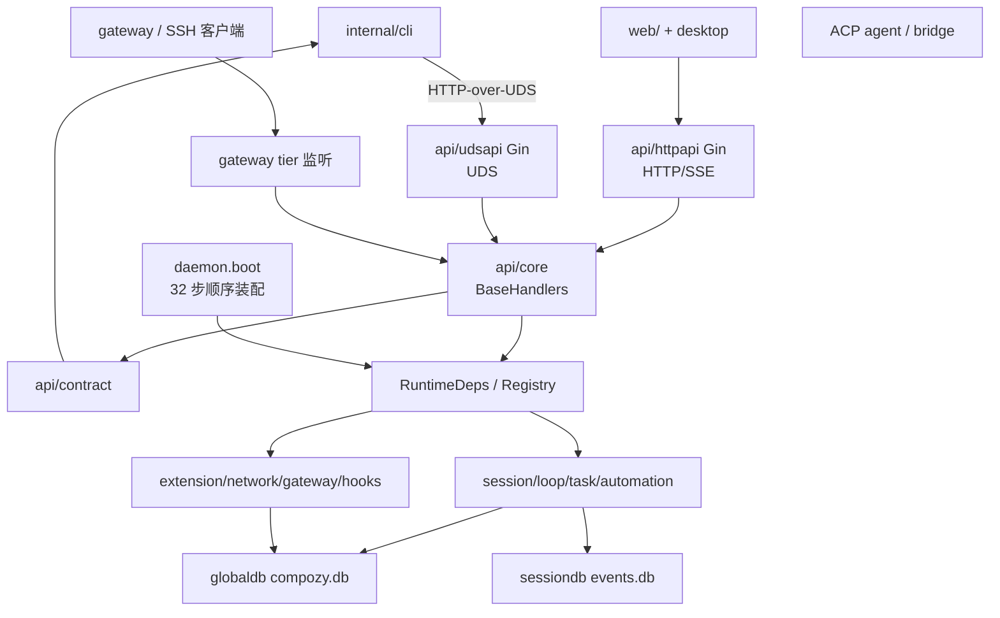
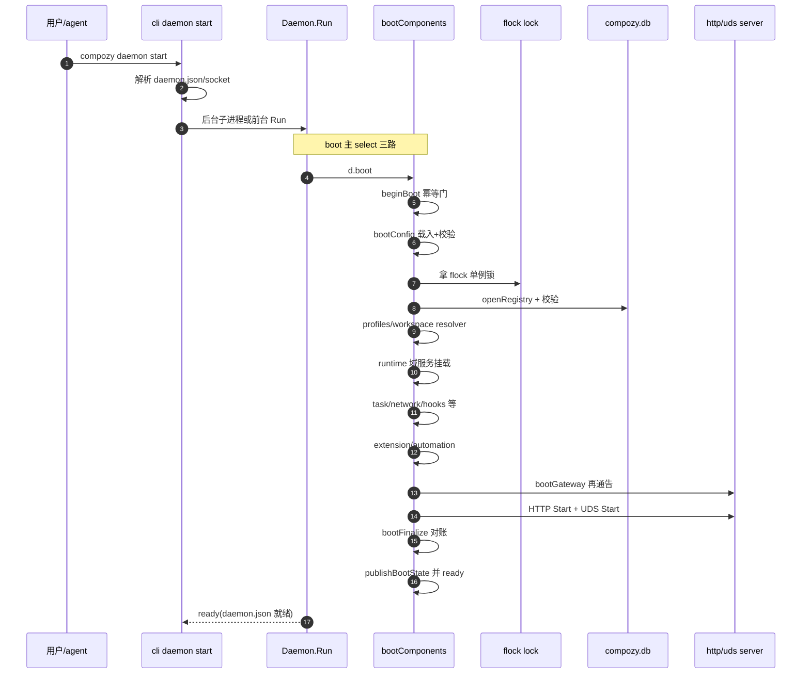
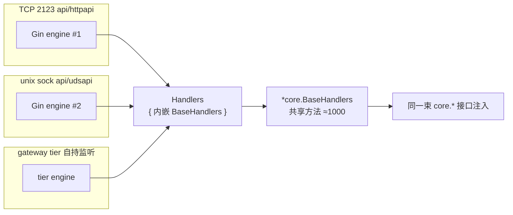

# CompozyOS 系统架构：组合根、启动链路与多控制面收敛

> 本解读按 **ai-agent 类规格** 产出，解读基线为 compozy 源码 `release/v0.3.0`（HEAD 4efd8de）。

本文覆盖：daemon 组合根与 32 步 boot 装配 → HTTP/SSE/UDS/CLI/gateway 多控制面在 `api/core` 的收敛 → 四层 config overlay 与单实例生命周期 → 面向用户的集成终端 / Web Shell / Electron desktop / packages/ui 形态。

## 根因：一百多个 internal 包如何变成一台"会开机的主板"

CompozyOS 的产品主张是 *"one runtime, one state model"*：单二进制常驻 daemon，让 web/CLI/HTTP/SSE/UDS/MCP/native tools 所有控制面访问**同一份 daemon-owned truth**，而不是各自维护一份平行模型。仓库内有一百多个 `internal/*` 包、三套 persist 面、两套 transport server——它们自己并不会组合。真正的工程问题是：

1. 这么多包由谁、按什么顺序"焊"成一个进程（组合根与启动时序）？
2. HTTP/SSE 与 UDS 两套 transport 如何不重复解析/校验、共享同一 handler 逻辑（收敛点）？
3. 三套配置来源（flag/workspace/global/内置）如何合并，cli 与 daemon 谁加载哪几层？
4. local-first 单实例 daemon 如何防并发实例、处理崩溃遗留（lock/status/stop/cleanup/dead-entity）？

本文逐条给出源码答案。内部权威架构声明见 [internal/CLAUDE.md:9-24]()<!-- anchor: ### Principles --> 的 Architecture 一节（引用见下）。

## 整体架构原则：谁可以 import 谁

先给纪律，再讲实现——因为该仓最"架构"的部分是**约束本身**写在 CLAUDE.md、并由 `mage Boundaries` 用 import 边界强制：

- `daemon/` 是唯一组合根，只有它 import 其余全部包；没有包 import `daemon/`、`api/` 或 `cli/`，依赖单向向下 [internal/CLAUDE.md:13-14]()<!-- anchor: - **`daemon/` is the sole composition root** — the only package that imports all -->。
<!-- anchor: - **`daemon/` is the sole composition root** — the only package that imports all -->
<!-- anchor: - **No package imports `daemon/`, `api/`, or `cli/`** — dependencies flow downwa -->
- 无事件总线：通信走"消费处定义的接口 + 直接函数调用 + Notifier typed pattern"，网络接受先落盘再通知 [internal/CLAUDE.md:16-17]()<!-- anchor: - **Direct function calls through interfaces** — no event bus or reflection-base -->。
<!-- anchor: - **Direct function calls through interfaces** — no event bus or reflection-base -->
<!-- anchor: - **Notifier pattern for fan-out** — typed interface for observability and SSE,  -->
- 包内"一文件一职责、500 行硬上限"；接口定义在使用处 [internal/CLAUDE.md:15-15]()<!-- anchor: - **Interfaces defined where consumed** (Go-style) — `session/` defines `AgentDr -->。
<!-- anchor: - **Interfaces defined where consumed** (Go-style) — `session/` defines `AgentDr -->
- `internal/api/core` 是 canonical handler home：REST/UDS 端点即共享 `BaseHandlers` 方法；HTTP 与 UDS 只选注册与认证 [internal/CLAUDE.md:24-24]()<!-- anchor: - **`internal/api/core` is the canonical handler home.** REST/UDS endpoints exis -->。
<!-- anchor: - **`internal/api/core` is the canonical handler home.** REST/UDS endpoints exis -->
- 单二进制、local-first、daemon 默认后台、agent 操作不依赖 web UI [internal/CLAUDE.md:43-45]()<!-- anchor: - Single-binary and local-first. Sidecars or external control planes require a w -->。
<!-- anchor: - Single-binary and local-first. Sidecars or external control planes require a w -->
<!-- anchor: - **Daemon runs in background by default.** No daemon should require a foregroun -->

落到类型层，这些纪律的"物证"全部在 `internal/daemon/daemon.go`：结构体注释直言 *"Daemon is the sole Compozy composition root"* [internal/daemon/daemon.go:267-267]()<!-- anchor: // Daemon is the sole Compozy composition root. -->，`Registry` 聚合接口注明"消费者只依赖局部窄接口而非聚合面" [internal/daemon/daemon.go:103-105]()<!-- anchor: // Registry is the composition-root database surface grouped by owning domain. -->；任何运行时部件要实现 `Server{Start,Shutdown}` 双相接口才能被当作用户自定义 factory 挂载 [internal/daemon/daemon.go:117-124]()<!-- anchor: // Server is a daemon-owned runtime component with explicit start and shutdown p -->。factory 全被做成可替换字段（`sessionManagerFactory`/`observerFactory`/`extensionManagerFactory`…），默认实现与测试替身走同一条注入缝 [internal/daemon/daemon.go:137-145]()<!-- anchor: type registryOpener func(ctx context.Context, path string) (Registry, error) -->。

<!-- anchor: // Daemon is the sole Compozy composition root. -->
<!-- anchor: // Registry is the composition-root database surface grouped by owning domain. -->
<!-- anchor: // Server is a daemon-owned runtime component with explicit start and shutdown p -->
<!-- anchor: type sessionManagerFactory func(ctx context.Context, deps SessionManagerDeps) (S -->

## 模块总览与目录树映射

### 架构总览图

### 模块职责表（关键 18 包）

| 包 | 职责 | 在架构中的角色 |
|---|---|---|
| `cmd/compozy` + 根 `main.go` | 唯一入口二进制，转 `cli.ExecuteContext` | 进程起点的起点 |
| `internal/cli` | Cobra 命令树、`-o json/jsonl/toon` 输出抽象、DaemonClient | 控制面 A + daemon 生命周期操作者 |
| `internal/daemon` | **组合根**：Daemon/Run/boot_* 全族/lock/drain/shutdown | 主板本体 |
| `internal/config` | TOML 分层加载/校验/合并、home 布局 | 电源规格书（三层覆盖） |
| `internal/api/contract` | 跨 daemon/CLI/HTTP 共享 DTO 与错误码 | 传输中立契约 |
| `internal/api/core` | `BaseHandlers` 共享方法、错误映射、SSE helpers | handler 收敛点 |
| `internal/api/httpapi` | Gin HTTP/SSE server、静态 web 面、认证/准入中间件 | 传输 B（人+浏览器） |
| `internal/api/udsapi` | UDS server（CLI IPC）、MCP host API | 传输 C（本机 CLI/agent） |
| `internal/api/spec` | OpenAPI/操作规格注册（MCP tools 面用） | agent 可编程面的规格源 |
| `internal/store` + `globaldb`/`sessiondb` | SQLite 迁移流、全局库与会话库 | 单一事实落点 |
| `internal/session` | 会话生命周期、Manager、prompt 运行 | 核心域之一（内部细节本文点到为止） |
| `internal/extension` | 扩展清单/宿主 API/安装运行时 | 被 boot 挂载的插件系统 |
| `internal/gateway` | 远端暴露策略、设备配对、tier 暴露 | 让控制面跨出本机 |
| `internal/workspace` | 工作区解析/注册、协调 | 请求落到哪个 workspace |
| `internal/resources` | 期望态资源投影/reconcile 驱动 | boot 后期资源收敛 |
| `internal/hooks` | typed hook 派发（非事件总线） | 观察者/策略点 |
| `internal/observe` | 事件记录、健康指标、查询 | 遥测与 SSE 数据源 |
| `internal/version` | build 元数据 | CLI/daemon 版本一致性 |

## 启动流程：一条 32 步 boot 装配链

### 开机时序图

### 时序的源码落点

`Daemon.Run` 是整机"通电主循环"：开一条 boot goroutine，主 select 三路——boot 出错、外部 ctx 取消、OS 信号；任何一路触发都先 `cancelBootBeforeReady`（ready 前取消才有效）再走统一 `Shutdown` [internal/daemon/daemon_lifecycle.go:17-52]()<!-- anchor: // Run boots the daemon, blocks until signal or context cancellation, then perfo -->。ready 之后进入"常驻等待"的第二 select，收到信号才优雅关停 [internal/daemon/daemon_lifecycle.go:73-81]()<!-- anchor: select { -->。

<!-- anchor: // Run boots the daemon, blocks until signal or context cancellation, then perfo -->
<!-- anchor: case <-ctx.Done(): … d.cancelBootBeforeReady(cancelRun) -->
<!-- anchor: select { … case sig, ok := <-sigCh: -->

boot 主体（`boot` 函数）把"装配"明确拆成：一个 `bootState` 当工作台、一个 `bootCleanup` 当倒序回滚栈，boot 失败即反向释放已拿资源 [internal/daemon/boot.go:181-213]()<!-- anchor: func (d *Daemon) boot(ctx context.Context) (err error) { -->。真正的顺序清单在 `boot_components.go`——一个 32 项的 `steps []func() error` 顺序表，逐条注释了启动链 [internal/daemon/boot_components.go:8-49]()<!-- anchor: func (d *Daemon) bootComponents(ctx context.Context, state *bootState, cleanup * -->。这是本文最重要的单点引用：它回答了"多少子系统、谁先谁后"。boot 完成后由 `publishBootState` 把 `state` 整块提升为 `daemonRuntimeState` 并 `close(readyCh)`——daemon 的 ready 信号是"发布一代运行时状态"，不是某个 server 起来就算数 [internal/daemon/boot_publish.go:3-19]()<!-- anchor: func (d *Daemon) publishBootState(state *bootState) { -->（ready 关闭点见 [internal/daemon/boot_publish.go:80-84]()<!-- anchor: if !d.readyClosed { -->）。

<!-- anchor: state := &bootState{ … mcpAuthGeneration:   mcpauth.NewMutationGeneration(), -->
<!-- anchor: steps := []func() error{ … func() error { return d.bootConfig(state, cleanup) }, -->
<!-- anchor: func() error { return d.bootScheduler(ctx, state, cleanup) }, … for _, step := range steps { -->
<!-- anchor: func (d *Daemon) publishBootState(state *bootState) { … d.mu.Lock() -->
<!-- anchor: if !d.readyClosed { … d.readyClosed = true -->
<!-- anchor: func (d *Daemon) boot(ctx context.Context) (err error) { … if ctx == nil { -->

每一步自身仍按"可回滚"组织：bootConfig 里 logger 也挂进 cleanup [internal/daemon/boot_config.go:53-59]()<!-- anchor: state.cfg = cfg -->；bootLockAndSocket 里 lock 挂进 cleanup、发现 stale PID 顺手清孤儿进程、清陈旧 socket 文件 [internal/daemon/boot_runtime_foundation.go:38-84]()<!-- anchor: if err := d.bootLockAndSocket(ctx, state, cleanup); err != nil { -->。DB 打开后先 `VerifyDefaultProfile`，再挂 registry.Close 的清理，随后在同一函数内串起 memory catalog、profiles、workspace resolver、dead-entity、network availability 等一串引导 [internal/daemon/boot_runtime_foundation.go:110-173]()<!-- anchor: func (d *Daemon) bootRegistryState( -->。

<!-- anchor: state.cfg = cfg … state.closeLogger = closeLogger -->
<!-- anchor: lock, err := d.acquireLock(d.homePaths.DaemonLock, pid) … return err -->
<!-- anchor: registry, err := d.openRegistry(ctx, d.homePaths.DatabaseFile) … return fmt.Errorf("daemon: open global database %q: %w", d.homePaths.DatabaseFil -->
<!-- anchor: if err := registry.VerifyDefaultProfile(ctx); err != nil { … return fmt.Errorf("daemon: verify default profile: %w", err) -->

域服务在 bootRuntimeServices 挂载：memory dream、hooksNotifier、进程注册表、terminal、sandbox、vault、model catalog、marketplace、bridge runtime、notification presets、hosted MCP、资源图与角色解析，最后落到 bootMemorySessionRuntime——"先数据后服务、先服务后 controller"的隐式分层一目了然 [internal/daemon/boot_runtime_services.go:12-70]()<!-- anchor: func (d *Daemon) bootRuntimeServices( -->。HTTP 与 UDS 两个 server 在 boot 链靠后位置（`bootServers`）被显式创建并 Start——先 gateway（把远端可达策略 reconcile 完再通告），再 HTTP，再 UDS [internal/daemon/boot_extension_publishers.go:49-86]()<!-- anchor: func (d *Daemon) bootServers(ctx context.Context, state *bootState, cleanup *boo -->；随后 bootFinalize 做资源 boot-reconcile 与 session 一致性 reconcile，给"一切就绪"下定义 [internal/daemon/boot_finalize.go:54-79]()<!-- anchor: func (d *Daemon) bootFinalize(ctx context.Context, state *bootState) error { -->。

<!-- anchor: func (d *Daemon) bootRuntimeServices( … ) error { -->
<!-- anchor: httpServer, err := d.httpFactory(ctx, state.deps) … return fmt.Errorf("daemon: create http server: %w", err) -->
<!-- anchor: if state.resourceReconcile != nil { … return fmt.Errorf("daemon: boot resource reconcile: %w", err) -->

server 的"默认装配"在 daemon 侧以 option factory 注入：默认 `httpFactory` 即 `httpapi.New(httpServerOptions(&deps)...)`、`udsFactory` 即 `udsapi.New(udsServerOptions(&deps)...)`，测试可整体替换 [internal/daemon/daemon_defaults.go:16-30]()<!-- anchor: func (d *Daemon) applyServerFactoryDefaults() { -->。`RuntimeDeps` 就是组合根交给 server factory 的"一整束接口依赖" [internal/daemon/runtime_deps.go:26-27]()<!-- anchor: // RuntimeDeps captures the composition-root dependencies available to server fa -->。

<!-- anchor: if d.httpFactory == nil { … return httpapi.New(httpServerOptions(&deps)...) -->
<!-- anchor: // RuntimeDeps captures the composition-root dependencies available to server fa … type RuntimeDeps struct { -->

### 并发防护与防重入（beginBoot 的幂等门）

`beginBoot` 在锁内检查：上一轮 shutdown 若失败且留尾，则先回收再重新武装 readyCh；只要任一运行句柄（lock/registry/sessions/network/gateway/observer…）非空即拒绝 "already booted" [internal/daemon/boot.go:225-262]()<!-- anchor: func (d *Daemon) beginBoot() error { -->。`booting` 标志在 `finishBoot`（仅出错时复位）与 `publishBootState`（成功复位）两处管理 [internal/daemon/boot_lifecycle.go:3-10]()<!-- anchor: func (d *Daemon) finishBoot(err *error) { -->。这是"组合根可复用重建、但不能双开"的运行时语义。

## 多控制面收敛：HTTP/SSE、UDS、CLI 为何共享同一 handler

### 收敛点结构图

`core.BaseHandlers` 是纯共享实现体：注释点名 *"shared transport-independent API handler logic"* [internal/api/core/base_handlers.go:119-121]()<!-- anchor: // BaseHandlers contains the shared transport-independent API handler logic. -->，构造由 `NewBaseHandlers` 统一完成，并吸收 transport 级差异（`TransportName`、`MaskInternalErrors`、流式关闭桥 `StreamDone`）[internal/api/core/base_handlers.go:215-232]()<!-- anchor: // NewBaseHandlers builds a shared handler set with transport-specific defaults  -->。共享 handler 方法全部以 `func (h *BaseHandlers)` 定义（全仓约 1000+ 处，抽样如 [internal/api/core/automation_suggestions.go:13-13]()<!-- anchor: func (h *BaseHandlers) ListAutomationSuggestions(c *gin.Context) { -->、[internal/api/core/status.go:40-40]()<!-- anchor: func (h *BaseHandlers) GetDoctor(c *gin.Context) { -->），所以 transport 只是把**同一个函数值**注册到各自的 gin 路由树上。

<!-- anchor: // BaseHandlers contains the shared transport-independent API handler logic. … type BaseHandlers struct { -->
<!-- anchor: // NewBaseHandlers builds a shared handler set with transport-specific defaults  … func NewBaseHandlers(cfg *BaseHandlerConfig) *BaseHandlers { -->
<!-- anchor: func (h *BaseHandlers) ListAutomationSuggestions(c *gin.Context) { -->
<!-- anchor: func (h *BaseHandlers) GetDoctor(c *gin.Context) { -->

两个 transport 各自的 `Handlers` 都以**内嵌**方式携带共享实现，外加极少数 transport 特有字段（httpapi 加 gateway admission/limiter/static 资源；udsapi 加 hosted MCP/MCP host API）：`httpapi` 在 [internal/api/httpapi/handlers.go:109-120]()<!-- anchor: // Handlers expose request/response and SSE endpoints for the Compozy API. -->（`Handlers{*core.BaseHandlers, …}`），装配 config 时声明 `TransportName="httpapi"`、`MaskInternalErrors=true`、SSE 含 workspace [internal/api/httpapi/handlers.go:179-197]()<!-- anchor: func coreHandlerConfig(cfg *handlerConfig, boundHost string) *core.BaseHandlerCo -->；`udsapi` 同样内嵌，但 `MaskInternalErrors=false`（UDS 是本机受信 IPC，错误可透出），pairing 源标 `local` [internal/api/udsapi/server_handlers.go:8-30]()<!-- anchor: func newHandlers(cfg *handlerConfig) *Handlers { -->。路由注册两处几乎同构：httpapi `RegisterRoutes` → `RegisterSurfaceRoutes` [internal/api/httpapi/routes.go:5-8]()<!-- anchor: // RegisterRoutes registers the shared Compozy API routes on the supplied Gin ro -->，udsapi `registerRoutes` → `RegisterRoutes` [internal/api/udsapi/server_setup.go:39-43]()<!-- anchor: func registerRoutes(engine *gin.Engine, handlers *Handlers) { -->。同一条 `handlers.ListWorkspaces` 这类方法在 HTTP 树与 UDS 树各注册一次，方法体零重复。

<!-- anchor: // Handlers expose request/response and SSE endpoints for the Compozy API. … *core.BaseHandlers -->
<!-- anchor: config.TransportName = "httpapi" … config.IncludeSessionWorkspaceInSSE = true -->
<!-- anchor: return &Handlers{ … BaseHandlers: core.NewBaseHandlers(udsCoreHandlerConfig(cfg)), -->
<!-- anchor: TransportName:                "udsapi", … MaskInternalErrors:           false, -->
<!-- anchor: // RegisterRoutes registers the shared Compozy API routes on the supplied Gin ro … func RegisterRoutes(router gin.IRouter, handlers *Handlers) { -->
<!-- anchor: func registerRoutes(engine *gin.Engine, handlers *Handlers) { … RegisterRoutes(engine, handlers) -->

### transport 各自的"接线差异"：监听、认证、准入

- **监听面不同**：httpapi `Start` 起 `net.Listen("tcp", host:port)` 标准 http.Server [internal/api/httpapi/server_start.go:45-57]()<!-- anchor: address := net.JoinHostPort(strings.TrimSpace(s.host), strconv.Itoa(s.port)) -->；udsapi `Start` 起 `unix` 监听并 `chmod 0o600`、通过 `ConnContext` 提取对端 peer info 供后续识别 [internal/api/udsapi/server_start.go:60-81]()<!-- anchor: var listenConfig net.ListenConfig -->。
- **认证/准入在中间件层，不进 handler**：httpapi 按绑定 host 是否为 loopback 决定是否整组 `/api` 加 `loopbackAPIGuard` [internal/api/httpapi/routes.go:15-23]()<!-- anchor: api := router.Group("/api") -->（`isLoopbackHost` 判定 [internal/api/httpapi/middleware.go:323-329]()<!-- anchor: func isLoopbackHost(host string) bool { -->），敏感变更路由再套 `privilegedMutationGuard`（loopback 才放行）[internal/api/httpapi/middleware.go:379-401]()<!-- anchor: func loopbackAPIGuard(boundHost string) gin.HandlerFunc { -->；错误统一经 `core.RespondError` 收敛 [internal/api/httpapi/middleware.go:340-348]()<!-- anchor: func errorMiddleware() gin.HandlerFunc { -->。UDS 端本地信任，错误策略由 `MaskInternalErrors=false` 表达。
- **gateway 暴露**：CLI/gateway 客户端可以走远端 HTTPS gateway profile（带设备 credential）或 SSH forward 回环等价通道；gateway tier 也是 daemon 自持的 loopback listener，仍回归同一套 gin 引擎/共享 handler [internal/daemon/daemon.go:126-132]()<!-- anchor: // GatewayTierServerFactory constructs one daemon-owned loopback listener for a  -->。本地 CLI 对"只有 UDS/SSH forward 才允许"的操作（agent/内部接口等）在客户端就拦截 [internal/cli/client_transport.go:351-375]()<!-- anchor: func isLocalOnlyClientOperation(method string, path string) bool { -->。

<!-- anchor: httpServer := &http.Server{ … ReadHeaderTimeout: defaultReadHeaderTimeout, -->
<!-- anchor: var listenConfig net.ListenConfig … ln, err := listenConfig.Listen(ctx, "unix", socketPath) -->
<!-- anchor: ConnContext: func(ctx context.Context, conn net.Conn) context.Context { … peer, err := mcppkg.PeerInfoFromConn(conn) -->
<!-- anchor: func isLoopbackHost(host string) bool { … return true -->
<!-- anchor: func loopbackMutationGuard(boundHost string) gin.HandlerFunc { … return loopbackGuard(boundHost, errLoopbackMutationRequired, false) -->
<!-- anchor: core.RespondError(c, http.StatusInternalServerError, c.Errors.Last(), true) -->

### CLI 客户端：HTTP-over-UDS 与"契约共享"的最后一块

CLI 不是"另一套客户端协议"，而是一个走 HTTP-over-unix-socket 的通用 HTTP 客户端：`baseURL = "http://unix"` [internal/cli/client.go:19-23]()<!-- anchor: const ( -->，`ClientTarget` 本地型只存 socketPath，远端型存 HTTPS base + credential [internal/cli/client_target.go:133-138]()<!-- anchor: func (t ClientTarget) requestBaseURL() string { -->；本地 target 构造 [internal/cli/client_target.go:28-40]()<!-- anchor: // ClientTarget describes one resolved daemon transport without exposing credent -->；请求统一带 agent 身份头（session/agent），远程 gateway 才加 Bearer [internal/cli/client_transport.go:300-303]()<!-- anchor: setAgentIdentityHeaders(req, options.Credentials) -->。所有命令输出走 `-o human/json/jsonl/toon` 抽象与结构化错误（`writeExecutionError`），实现"agent-manageable by default"。巨型 `DaemonClient` 接口即 CLI 能看到的整份 UDS 面 [internal/cli/client.go:25-26]()<!-- anchor: // DaemonClient is the CLI transport surface for talking to the CompozyOS daemon -->。本机 daemon 停机判定也是客户端能力：UDS 连接失败被映射为 `cli.daemon_unavailable` 结构化错误并提示 `compozy daemon start` [internal/cli/client_transport.go:389-413]()<!-- anchor: func newDaemonUnavailableError(socketPath string, method string, path string, er -->。

<!-- anchor: baseURL                        = "http://unix" … defaultUnixSocketClientTimeout = 30 * time.Second -->
<!-- anchor: // DaemonClient is the CLI transport surface for talking to the CompozyOS daemon … type DaemonClient interface { -->
<!-- anchor: func LocalClientTarget(socketPath string) ClientTarget { … return ClientTarget{kind: clientTargetLocal, name: clientTargetLocal, socketPath -->
<!-- anchor: func (t ClientTarget) requestBaseURL() string { … return baseURL -->
<!-- anchor: if c.target.isRemoteGateway() && strings.TrimSpace(c.target.credential) != "" { … req.Header.Set("Authorization", "Bearer "+c.target.credential) -->

## 配置系统：四层 TOML overlay 与 flag/workspace 选层

任务书里的"flag>workspace>global>内置"在源码里精确对应 `config.Load` 的 LoadOption 链（flag 提供 workspace root 与 profile 名）与 `loadWithHome` 的逐层深合并。加载顺序与优先级都写在同一函数 [internal/config/config_load.go:148-216]()<!-- anchor: func loadWithHome( -->：

1. `DefaultWithHome` 内置默认（含 HTTP `localhost:2123`、默认 agent 等）[internal/config/config.go:26-35]()<!-- anchor: // DirName is the CompozyOS directory name used for both the global home and wor --> [internal/config/defaults.go:23-26]()<!-- anchor: func DefaultWithHome(homePaths HomePaths) Config { -->；
2. global 层：`~/.compozy/config.toml`（`ApplyConfigOverlayFile` 深合并）+ global MCP JSON；
3. profile 层（若提供 profile）：`~/.compozy/profiles/
/config.toml` + MCP JSON；
4. workspace 层（`WithWorkspaceRoot` 显式提供才生效 [internal/config/config_load.go:41-54]()<!-- anchor: // WithWorkspaceRoot loads the optional workspace overlay from `<root>/.compozy/ -->）：`<workspace>/.compozy/config.toml` + MCP JSON + workspace-profile 层。

层与层之间是"后 apply 覆盖先 apply"的单向 overlay 深合并——每个字段指针非 nil 才覆盖 [internal/config/merge_load.go:14-43]()<!-- anchor: // ApplyConfigOverlayFile deep-merges an optional TOML config file into dst. -->（逐类型 Apply 示例 [internal/config/merge_load.go:193-212]()<!-- anchor: func (o httpOverlay) Apply(dst *HTTPConfig) { -->），未知 key 直接报错拒绝启动 [internal/config/merge_load.go:68-94]()<!-- anchor: func loadConfigOverlayBytes(contents []byte, source string) (configOverlay, erro -->。normalize 与 marketplace 环境后统一校验 [internal/config/config_load.go:202-214]()<!-- anchor: if err := normalizeConfigPaths(&cfg); err != nil { -->。daemon 侧只加载 global 层（`loadConfigFromHome`：DefaultWithHome + global overlay + socket 路径规整）[internal/daemon/boot_config.go:62-85]()<!-- anchor: func loadConfigFromHome( -->——daemon 是 home-scoped，workspace overlay 归请求解析时按 workspace 现算（daemon 用 `LoadForHome`+`WithWorkspaceRoot` 构造 workspace resolver）[internal/daemon/boot_runtime_foundation.go:194-201]()<!-- anchor: workspacepkg.WithConfigLoader(func(rootDir string) (compozyconfig.Config, error) -->。

<!-- anchor: cfg := DefaultWithHome(homePaths) … return Config, fmt.Errorf("load global config: %w", err) -->
<!-- anchor: // ApplyConfigOverlayFile deep-merges an optional TOML config file into dst. … func ApplyConfigOverlayFile(path string, dst *Config) error { -->
<!-- anchor: func (o httpOverlay) Apply(dst *HTTPConfig) { … dst.Host = *o.Host -->
<!-- anchor: cfg := compozyconfig.DefaultWithHome(homePaths) … return compozyconfig.Config, fmt.Errorf("daemon: load global config: %w", err) -->
<!-- anchor: // WithWorkspaceRoot loads the optional workspace overlay from `<root>/.compozy/ … func WithWorkspaceRoot(root string) LoadOption { -->

home 路径系统把整个 `.compozy` 布局固化为一份 `HomePaths`（agents/skills/loops/profiles/memory/sessions/db/socket/lock/logs/…共 30+ 字段），`ResolveHomePathsFrom` 一次性展开 [internal/config/home.go:74-105]()<!-- anchor: // HomePaths captures the filesystem layout for the Compozy home directory. --> [internal/config/home.go:214-278]()<!-- anchor: func resolveHomePaths(lookup envLookup) (HomePaths, error) { -->；`EnsureHomeLayout` 全目录 `0o700` 权限加固 [internal/config/home.go:280-312]()<!-- anchor: // EnsureHomeLayout creates the directories required by the Compozy home layout. -->。首次引导 `EnsureBootstrapAgent` 落默认 agent 定义 [internal/config/bootstrap.go:102-105]()<!-- anchor: // EnsureBootstrapAgent creates the managed default agent definition if it does  -->；install 向导把 provider/model 写进 global config [internal/config/bootstrap.go:48-100]()<!-- anchor: // SaveBootstrapConfig writes the global bootstrap config managed by `compozy in -->。CLI 的 `-o`/profile flag 是根命令持久 flag [internal/cli/root.go:168-173]()<!-- anchor: func configureRootFlags(cmd *cobra.Command) { -->，daemon start 用默认 `config.Load()`（不带 workspace overlay）作为"daemon 不跟随 cwd workspace"的依据之一 [internal/cli/root_defaults.go:27-31]()<!-- anchor: if d.loadConfig == nil { -->。

## daemon 生命周期与并发实例防护

local-first 的"单实例 daemon"全靠三件套落地：**文件锁 + pid 文件 + daemon.json 元数据**，外加 drain 语义与分代 shutdown。

- **单例锁**：`flock.TryLock`（advisory 警告锁）拿不到即报 `errAlreadyRunning{pid}` [internal/daemon/lock.go:57-106]()<!-- anchor: func acquireLock(path string, pid int, deps lockDeps) (*Lock, error) { -->；锁旁独立 `.pid` 文件记录归属，Release 时清空并解锁 [internal/daemon/lock.go:124-149]()<!-- anchor: // Release clears the lock file contents and releases the advisory file lock. -->。拿锁前读旧 pid，若持有者已死则记为 stale 由上层清孤儿 [internal/daemon/lock.go:75-92]()<!-- anchor: priorPID, err := readLockPID(lockPIDPath(cleanPath)) -->。
- **孤儿回收**：stale pid 存在时，`cleanupOrphans` 列出系统进程（`ps -axo pid,ppid`）把以 stale 为父的所有子进程 SIGTERM→宽限轮询→SIGKILL [internal/daemon/orphan.go:25-55]()<!-- anchor: func (d *Daemon) cleanupOrphans(ctx context.Context, stalePID int) error { --> [internal/daemon/orphan.go:99-125]()<!-- anchor: func listProcesses(ctx context.Context) ([]processInfo, error) { -->；陈旧 socket 文件在监听前删掉，避免 bind 冲突 [internal/daemon/orphan.go:87-97]()<!-- anchor: func removeStaleSocket(path string) error { -->。
- **状态互通**：`daemon.json`（Info：PID/Port/StartedAt/Network）是 CLI 判断"是否在跑、怎么发信号"的事实源 [internal/daemon/boot_extension_publishers.go:72-85]()<!-- anchor: networkInfo, err := daemonNetworkInfo(ctx, state.cfg.Network, state.deps.Network -->；CLI `daemon stop` = 读 daemon.json → `SIGTERM` → 轮询等待停止 [internal/cli/daemon.go:201-232]()<!-- anchor: func newDaemonStopCommand(deps commandDeps) *cobra.Command { -->，`daemon start` 默认拉起后台子进程并等 ready [internal/cli/daemon.go:138-178]()<!-- anchor: func newDaemonStartCommand(deps commandDeps) *cobra.Command { -->。
- **drain + 分代 shutdown**：关机先 `Drain`（admission 关新工），再按序拆（gateway→http→uds→support→bridge→network→hooks），运行中的 prompt/claim 计数汇算成 `SafeToStop` [internal/daemon/drain.go:117-145]()<!-- anchor: return composeDrainStatus( -->。`daemonShutdownOperation`（注释见 [internal/daemon/daemon_shutdown_operation.go:10-15]()<!-- anchor: // daemonShutdownOperation is one daemon-owned teardown attempt. Callers share -->）是一次可共享结果的 teardown 尝试，成功才 `resetRuntimeStateLocked` 清场 [internal/daemon/daemon_shutdown_operation.go:17-75]()<!-- anchor: func (d *Daemon) beginShutdownOperation( -->；`daemonRuntimeState` 被注释为"一代已发布运行时"，整体赋值/清空 = 一代句柄整体迁移 [internal/daemon/daemon_runtime_state.go:26-27]()<!-- anchor: // daemonRuntimeState is one published daemon generation. Assigning or clearing -->。整个 shutdown 预算 `GracefulShutdownTimeout` 会因 memory checkpoint 而拉长 [internal/daemon/daemon_lifecycle.go:134-146]()<!-- anchor: // GracefulShutdownTimeout returns the daemon's complete shutdown budget for a c -->。

<!-- anchor: fileLock := deps.newFlock(cleanPath) … return nil, fmt.Errorf("daemon: acquire daemon lock %q: %w", cleanPath, err) -->
<!-- anchor: if !locked { … return nil, errAlreadyRunning{pid: priorPID} -->
<!-- anchor: func (l *Lock) Release() error { … return nil -->
<!-- anchor: status, err := waitForDaemonStop(cmd.Context(), deps, runtime, info) … return err -->
<!-- anchor: status, err := runDaemonDetached(cmd.Context(), deps) … return err -->
<!-- anchor: return composeDrainStatus( … ), nil -->
<!-- anchor: // daemonShutdownOperation is one daemon-owned teardown attempt. Callers share … // its result while retaining independent wait contexts. -->
<!-- anchor: // daemonRuntimeState is one published daemon generation. Assigning or clearing … // this value moves every runtime-owned handle through the same transition. -->

## 与其它模块的协同（boot 挂载关系）

按 boot 链上"谁在什么时候拿到谁"列出协同断言：

- **session/loop/task**：boot 早期 `bootRuntime` 经 sessionManagerFactory 建 `SessionManager`，observer 同场创建并注入 state.deps；loop reconciler 在 registry 打开后即 startLoopReconciliation [internal/daemon/boot_runtime_foundation.go:126-128]()<!-- anchor: if err := startLoopReconciliation(ctx, state, registry, cleanup, d.readyCh); err -->。
- **extension/network/gateway**：extension runtime 在 boot 中后段（依赖 session/observer/tool 等齐全后）才挂载 [internal/daemon/boot_components.go:29-29]()<!-- anchor: func() error { return d.bootExtensions(ctx, state, cleanup) }, -->；network 在 hooks 前起，network wake runner 延后启动 [internal/daemon/boot_components.go:19-19]()<!-- anchor: func() error { return d.bootNetwork(ctx, state, cleanup) }, --> [internal/daemon/boot_components.go:22-22]()<!-- anchor: func() error { return d.startNetworkWakeRunner(ctx, state, cleanup) }, -->；gateway 在 server 前 reconcile，确保"先有暴露策略、后通告端口" [internal/daemon/boot_gateway.go:13-23]()<!-- anchor: func (d *Daemon) bootGateway(ctx context.Context, state *bootState, cleanup *boo -->。
- **resources/automation/bridges/scheduler**：全部集中在 boot 链后段，且 scheduler 是最后一步 [internal/daemon/boot_components.go:27-40]()<!-- anchor: func() error { return d.bootAutomation(ctx, state, cleanup) }, -->；`bootFinalize` 的 observer.Reconcile 是"索引与孤儿会话对账"的收口 [internal/daemon/boot_finalize.go:63-71]()<!-- anchor: reconcileResult, err := state.observer.Reconcile(ctx) -->。
- **windowmanager/terminal**：其内部细节不展开，仅见其在 boot 早期通过 `bootWindowManager`/`bootTerminal` 挂载 [internal/daemon/boot_runtime_foundation.go:161-163]()<!-- anchor: if err := d.bootWindowManager(ctx, state, cleanup); err != nil { -->；desktop 通过 `appstatecontract.SchemaVersion`（=2）做 app 态线版本握手；桌面壳是否经由独立 socket 与 daemon 通信仍未穷尽核对 [WIP]，形态详见后文「面向用户的运行时形态」。

## 关键设计决策

### 决策一：单二进制多 transport，而不是微服务

为什么：所有控制面必须看到**同一份进程内状态**与同一组窄接口——若 HTTP 与 UDS 是独立服务，会话所有权、claim、审批、事件顺序都要跨进程解决，等于把组合根的难题搬到网络上。证据：UDS/HTTP 共用 RuntimeDeps 一束接口 [internal/daemon/runtime_deps.go:26-27]()<!-- anchor: // RuntimeDeps captures the composition-root dependencies available to server fa -->，两个 server 由同一 `bootServers` 在**同一进程**内创建 [internal/daemon/boot_extension_publishers.go:49-71]()<!-- anchor: func (d *Daemon) bootServers(ctx context.Context, state *bootState, cleanup *boo -->。权衡/代价：单点故障面大、daemon 是唯一常驻面，所以配套了完备的 lock/orphan/drain/restart/分代 shutdown 来兜底（见生命周期章）；gateway 把"远端可达"做成 daemon 自持 listener 而不引入第二个常驻进程 [internal/daemon/daemon.go:126-132]()<!-- anchor: // GatewayTierServerFactory constructs one daemon-owned loopback listener for a  -->，是"单二进程但允许外部接线"的折中。

### 决策二：api/core 收口 handler，transport 只做"注册+认证"

为什么：业务校验/解析在 handler 层只写一遍，就杜绝"HTTP 与 UDS 行为漂移"——`contract` 提供类型，`core.BaseHandlers` 提供实现，transport 只差在 Gin 中间件与错误呈现开关。物证：httpapi 的 `MaskInternalErrors=true` 与 udsapi 的 `false` 是仅有的两处显著策略差 [internal/api/httpapi/handlers.go:184-186]()<!-- anchor: config.TransportName = "httpapi" --> [internal/api/udsapi/server_handlers.go:28-30]()<!-- anchor: TransportName:                "udsapi", -->。权衡/代价：core 包巨大（1000+ BaseHandlers 方法、且直接依赖 gin.Context），若未来换非 gin transport 需把 Context 抽薄；repo 接受该代价换取"web 与 CLI 语义必须一致"的硬承诺。

### 决策三：组合根 = 顺序表 + 可回滚 cleanup + 分代运行时状态

为什么：三十多步启动如果各自为政，失败路径会泄漏一半资源。`bootComponents` 顺序表让"新增能力=插一行"，`bootCleanup` 倒序回滚 + `daemonRuntimeState` 整代发布/整代清空，让"重建一代"像事务一样可判定。权衡/代价：boot 集中在 daemon 包使该包成为巨型包（靠 500 行/文件硬约束切碎），且启动链是隐式依赖——改顺序要人工判断，无编译期保证。

## 亮点与问题

亮点：
- **纪律文档化 + 工具强制**：`daemon/` 唯一组合根、单向依赖、无事件总线、core 收口，先写进 `internal/CLAUDE.md`，再由 import 边界/文件行数约束在 CI 兜住——"架构即代码评审标准"。
- **可回滚的 32 步 boot 表**：`boot_components.go` 一行一个子系统，配合 cleanup 栈与 beginBoot 幂等门，是极好的"装配即文档"范例。
- **transport 收敛干净**：CLI 用 HTTP-over-UDS 复用同一契约与 handler，`contract` 包让 daemon/CLI/HTTP 三方类型单一来源，几乎没有"CLI 单独解析一套"。
- **agent-manageable 落到每个面**：`-o json`、结构化错误、daemon.json、status/drain 全有结构化出口，UI 不是唯一可管理面。

问题/可挑剔处（[WIP] 标注为未穷尽验证）：
- **core 与 gin 强耦合**：`BaseHandlers` 方法签名是 `*gin.Context`，transport 理论中立但实现上锁死 Gin；未来非 HTTP transport 需做适配。[internal/api/core/automation_suggestions.go:13-13]()<!-- anchor: func (h *BaseHandlers) ListAutomationSuggestions(c *gin.Context) { --> 说明该耦合是真实的。
- **两个 transport 的 Server 字段近 70% 重复**：httpapi/udsapi 各自声明一整排 `core.*` 注入字段（httpapi [internal/api/httpapi/server.go:47-107]()<!-- anchor: sessions            core.SessionManager -->），重复靠同名 With* option 收敛，但仍是人力同步点。
- **boot 顺序为隐式知识**：除 `boot_components.go` 顺序表外没有声明式依赖图，boot 期顺序理解依赖人读整张表。
- 文档化纪律存在与实现的偏差风险（如 CLI 命令是否一律经 DaemonClient 连 daemon），命令族逐条核对仍属 [WIP]。

## 面向用户的运行时形态

前文回答了「主板怎么装起来、控制面如何收敛到同一束接口」；这一节把视线移到用户/agent 实际接触的形态：daemon 进程内一等公民的集成终端、以投影方式访问 daemon 的 Web Shell、Electron desktop 交付壳，以及 packages/ui 设计基座。共同点是——进程、屏态、租约、拓扑、工作副本的权威都落在 daemon 域内，前端只是经 wire 协议 / HTTP / SSE / WS 的投影与写入客户端。

### 为什么 terminal 由 runtime 拥有

`internal/terminal` 在 daemon 进程内"拥有一等公民"地管理长驻终端进程、字节流与写入控制租约，包注释开门见山：

- [internal/terminal/doc.go:1-1]()<!-- anchor: // Package terminal owns resident terminal processes, their byte streams, and co --> `// Package terminal owns resident terminal processes, their byte streams, and control leases.`
  <!-- anchor: Package terminal owns resident terminal processes, their byte streams, and control -->
- 域权威实体是 `Service`，由 daemon 组装（与 store、workspace、toolruntime 等并列）；它的注释明确写为 "daemon-owned"：
  [internal/terminal/manager.go:42-42]()<!-- anchor: // Service is the daemon-owned terminal domain authority. --> `// Service is the daemon-owned terminal domain authority.`
  <!-- anchor: Service is the daemon-owned terminal domain authority. -->

"runtime-owned shells" 的第一层含义即：shell 不是前端（web/desktop）的产物，而是 daemon 自己 fork 出来的 OS 进程；HTTP create 请求只负责把启动做完，请求结束后进程生命周期交给 terminal 域继续持有。`pty` 子包在启动路径里刻意把"启动上下文"与"进程生命周期"分离：

- [internal/terminal/pty/pty_unix.go:69-69]()<!-- anchor: // The context bounds startup only. The returned Proc owns the interactive --> `// The context bounds startup only. The returned Proc owns the interactive`
  <!-- anchor: The context bounds startup only. The returned Proc owns the interactive -->

### PTY 的进程模型与生命周期

`pty` 包提供 `ModePTY`/`ModePipe` 两种模式（交互式 PTY 与管道执行），由统一 `Platform.Start` 分派：

- [internal/terminal/pty/types.go:18-18]()<!-- anchor: ModePTY  Mode = "pty" --> `ModePTY  Mode = "pty"`
  <!-- anchor: ModePTY  Mode = "pty" -->
- [internal/terminal/pty/types.go:81-81]()<!-- anchor: if spec.Mode == ModePipe { --> `	if spec.Mode == ModePipe {`
  <!-- anchor: if spec.Mode == ModePipe { -->

Unix 侧交互启动用 `xpty` 创建 PTY、复制 master fd 为读/写两个句柄、以新 session + 控制终端拉起 shell，并把整个进程放进独立进程组：

- [internal/terminal/pty/pty_unix.go:75-75]()<!-- anchor: procutil.ConfigureCommandTerminalSession(command) --> `	procutil.ConfigureCommandTerminalSession(command)`
  <!-- anchor: procutil.ConfigureCommandTerminalSession(command) -->
- [internal/procutil/process_group_unix.go:33-33]()<!-- anchor: cmd.SysProcAttr.Setsid = true --> `	cmd.SysProcAttr.Setsid = true`
  <!-- anchor: cmd.SysProcAttr.Setsid = true -->
- [internal/procutil/process_group_unix.go:42-42]()<!-- anchor: cmd.SysProcAttr.Setctty = true --> `	cmd.SysProcAttr.Setctty = true`
  <!-- anchor: cmd.SysProcAttr.Setctty = true -->

这样 kill/resize/exit 都按"整棵进程组"为单位：先发 SIGHUP/SIGTERM，等待进程组消失，超时则升级 SIGKILL 再等（grace 升级），防止子 shell 派生的孙进程泄漏成孤儿：

- [internal/terminal/pty/pty_unix.go:218-218]()<!-- anchor: if err := procutil.SignalCommandProcessGroup(p.command, syscallSignal); err != n --> `	if err := procutil.SignalCommandProcessGroup(p.command, syscallSignal); err != nil {`
  <!-- anchor: procutil.SignalCommandProcessGroup(p.command, syscallSignal) -->
- [internal/terminal/pty/pty_unix.go:227-227]()<!-- anchor: if err := procutil.WaitForCommandProcessGroupExit(p.command, processGroupGrace); --> `	if err := procutil.WaitForCommandProcessGroupExit(p.command, processGroupGrace); err == nil {`
  <!-- anchor: procutil.WaitForCommandProcessGroupExit(p.command, processGroupGrace); err == nil -->

进程退出由独立 waiter goroutine 回收并分类（exit code / signal），daemon 侧 `session` 收拢"进程对象 + 输出管线 + 状态"：

- [internal/terminal/pty/pty_unix.go:108-108]()<!-- anchor: proc.waiter.start(func() waitResult { --> `	proc.waiter.start(func() waitResult {`
  <!-- anchor: proc.waiter.start(func() waitResult { -->
- [internal/terminal/session.go:13-13]()<!-- anchor: type session struct { --> `type session struct {`
  <!-- anchor: type session struct { -->
- [internal/terminal/session.go:137-137]()<!-- anchor: func (s *session) start() { --> `func (s *session) start() {`
  <!-- anchor: func (s *session) start() { -->
  启动后并行拉起"读输出"与"等进程"两条循环（[internal/terminal/session.go:137-137]()<!-- anchor: func (s *session) start() { -->），一个 session 聚合 `proc`/`ring`/`vt`/`lease`/`flow`/`audit` 各子件（[internal/terminal/session.go:20-20]()<!-- anchor: vt          *terminalvt.Actor -->）。

### 输出：屏态、环形缓冲与审计过滤

输出并不直接透传给观看者，而是先过一层安全过滤（OSC 序列清洗、脱敏），再同时进入内存环形缓冲与终端屏态解析器：

- [internal/terminal/session.go:98-98]()<!-- anchor: item.filter = newOSCSecurityFilter(nonce, item.programTitleChanged) --> `	item.filter = newOSCSecurityFilter(nonce, item.programTitleChanged)`
  <!-- anchor: item.filter = newOSCSecurityFilter(nonce, item.programTitleChanged) -->
- [internal/terminal/vt/actor.go:16-16]()<!-- anchor: const DefaultMailboxBytes = 256 * 1024 --> `const DefaultMailboxBytes = 256 * 1024`
  <!-- anchor: const DefaultMailboxBytes = 256 * 1024 -->

`vt` 子包在 daemon 内存里维护一份"屏态"（基于 charmbracelet 的 VT 解析），因此读端可以拿到绝对的屏幕快照而不仅是追加流：

- [internal/terminal/vt/actor.go:60-60]()<!-- anchor: sequence   atomic.Uint64 --> `	sequence   atomic.Uint64`
  <!-- anchor: sequence   atomic.Uint64 -->

输出在 wire 层表现为带绝对 seq 的帧协议（见后文「wire 协议」一节），其中"被脱敏的输入回显"是协议一等 op，防止把用户输入的敏感内容（如口令）当作终端输出回放给 agent 或观众。

### 单写入者租约：人/agent 共享同一 shell 的控制权

`contracts.go` 定义了三种租约状态与三种 actor 类型；一个终端同时只允许一个"控制器"写输入，其它观看者只读：

- [internal/terminal/contracts.go:46-46]()<!-- anchor: LeaseHumanOwned LeaseState = "human_owned" --> `LeaseHumanOwned LeaseState = "human_owned"`
  <!-- anchor: LeaseHumanOwned LeaseState = "human_owned" -->
- [internal/terminal/contracts.go:42-42]()<!-- anchor: ActorKindHuman  ActorKind = "human" --> `ActorKindHuman  ActorKind = "human"`
  <!-- anchor: ActorKindHuman  ActorKind = "human" -->

租约机 (`leaseMachine`) 记录当前 controller 与 displaced/fallback actor，并只有一条输入写入路径（每次写入都过授权检查，被拒时返回带 controller 指纹的错误）：

- [internal/terminal/lease.go:84-84]()<!-- anchor: Code: ErrorCodeWriteOwnerHeld, Message: "only the controlling agent can request  --> `			Message: "only the controlling agent can request terminal input",`
  <!-- anchor: Message: "only the controlling agent can request terminal input", -->
- [internal/terminal/lease.go:156-156]()<!-- anchor: Message:    "terminal input rejected because another actor controls it", --> `Message:    "terminal input rejected because another actor controls it",`
  <!-- anchor: Message: "terminal input rejected because another actor controls it", -->

关键语义：**agent 不能抢占 human 正在控制的终端**（agent 只能 claim 一个 available 的终端），而 human 可以 takeover 把 agent 挤到 displaced 槽位、之后通过 yield 归还；run 结束时 agent 自动交还回 fallback human：

- [internal/terminal/lease.go:218-218]()<!-- anchor: m.displaced = cloneActor(m.controller) --> `		m.displaced = cloneActor(m.controller)`
  <!-- anchor: m.displaced = cloneActor(m.controller) -->
- [internal/terminal/lease.go:253-253]()<!-- anchor: m.controller = cloneActor(&returned) --> `		m.controller = cloneActor(&returned)`
  <!-- anchor: m.controller = cloneActor(&returned) -->
- [internal/terminal/lease.go:295-295]()<!-- anchor: m.controller = cloneActor(&m.fallback) --> `	m.controller = cloneActor(&m.fallback)`
  <!-- anchor: m.controller = cloneActor(&m.fallback) -->

runtime 恢复（daemon 重启后 agent 上下文重建）时，原 agent 被记为 `recoverable`，新 run 必须 generation 一致才能 claim，否则报 generation-fenced —— 这是防"旧 run 继续控制已复活终端"的栅栏：

- [internal/terminal/lease.go:140-140]()<!-- anchor: if actor.Kind == ActorKindAgent && sameRun(actor, *m.controller) && actor.Genera --> `	if actor.Kind == ActorKindAgent && sameRun(actor, *m.controller) && actor.Generation != m.controller.Generation {`
  <!-- anchor: actor.Generation != m.controller.Generation -->
- [internal/terminal/lease.go:320-320]()<!-- anchor: m.recoverable = cloneActor(&current) --> `	m.recoverable = cloneActor(&current)`
  <!-- anchor: m.recoverable = cloneActor(&current) -->

所有输入收口在一个 choke point，审计闸（audit gate）可在其上整体阻塞输入（防审计/合规中断时夹带输入）：

- [internal/terminal/audit_gate.go:5-5]()<!-- anchor: // auditGate is the task_03 seam consulted by the single input choke point. --> `// auditGate is the task_03 seam consulted by the single input choke point.`
  <!-- anchor: auditGate is the task_03 seam consulted by the single input choke point. -->

### terminal 与 session/loop 的关系

终端进程会被登记进跨域共享的进程登记表（`toolruntime`），并以"所属 session/run/generation + terminal id"作为 owner 字段；terminal 域暴露 `RunEnded`/`SessionRunEnded`/`RuntimeRecovered` 接口给上层，当一轮 run 结束或 runtime 恢复时同步收紧/交还租约（见上文「单写入者租约」一节）：

- [internal/terminal/manager.go:416-416]()<!-- anchor: Source: toolruntime.ProcessSourceTerminal, --> `		Source: toolruntime.ProcessSourceTerminal,`
  <!-- anchor: Source: toolruntime.ProcessSourceTerminal, -->
- [internal/terminal/manager.go:421-421]()<!-- anchor: TerminalID: string(info.ID), --> `			TerminalID: string(info.ID),`
  <!-- anchor: TerminalID: string(info.ID), -->
- [internal/terminal/contracts.go:353-353]()<!-- anchor: RunEnded(ctx context.Context, workspaceID string, actor Actor) int --> `	RunEnded(ctx context.Context, workspaceID string, actor Actor) int`
  <!-- anchor: RunEnded(ctx context.Context, workspaceID string, actor Actor) int -->

`Info` 上同时携带 `Controller`（谁在控制）与 `BoundRun`（绑定到哪一轮），形成 terminal ↔ session/run 的双向身份；exec 形态（agent 单条命令）也走同一套 terminal 通道并给出 command row/recording 产物（`session` 侧如何消费 terminal 的整合未逐行读 [WIP]）：

- [internal/terminal/contracts.go:137-137]()<!-- anchor: Controller       *Actor       `json:"controller,omitempty"` --> `	Controller       *Actor       `json:"controller,omitempty"``
  <!-- anchor: Controller       *Actor       `json:"controller,omitempty"` -->
- [internal/terminal/contracts.go:140-140]()<!-- anchor: BoundRun         *RunRef      `json:"bound_run,omitempty"` --> `	BoundRun         *RunRef      `json:"bound_run,omitempty"``
  <!-- anchor: BoundRun         *RunRef      `json:"bound_run,omitempty"` -->

退出后的命令历史与字节产物落库到 per-workspace SQLite 的 terminal journal；命令解析（shell integration marker）→ 命令行 → journal 是"操作历史可回查"的主干：

- [internal/terminal/journal/service.go:33-33]()<!-- anchor: // Service implements the terminal journal over per-workspace SQLite stores. --> `// Service implements the terminal journal over per-workspace SQLite stores.`
  <!-- anchor: Service implements the terminal journal over per-workspace SQLite stores. -->
- [internal/terminal/journal/service.go:44-44]()<!-- anchor: lanes                map[string]*terminalLane --> `	lanes                map[string]*terminalLane`
  <!-- anchor: lanes                map[string]*terminalLane -->

### wire 协议：一次 attach 的字节流契约

后端与前端/其它读端之间的实时协议由 `wire/protocol.json` 单一声明（子协议 + 双方 opcode + 边界 + 兼容 digest），服务端 op 覆盖输出/附着/退出/错误/标题/resize/gap/owner/presence/redacted-input，客户端 op 覆盖 input/ack/resize/signal/takeover/detach/release：

- [internal/terminal/wire/protocol.json:2-2]()<!-- anchor: "subprotocol": "compozy.terminal.v2", --> `    "subprotocol": "compozy.terminal.v2",`
  <!-- anchor: "subprotocol": "compozy.terminal.v2", -->
- [internal/terminal/wire/protocol.json:12-12]()<!-- anchor: { "go_name": "ServerOpOutput", "ts_name": "output", "value": 1 }, --> `        { "go_name": "ServerOpOutput", "ts_name": "output", "value": 1 },`
  <!-- anchor: { "go_name": "ServerOpOutput", "ts_name": "output", "value": 1 }, -->
- [internal/terminal/wire/protocol.json:21-21]()<!-- anchor: { "go_name": "ServerOpRedactedInput", "ts_name": "redactedInput", "value": 10 } --> `        { "go_name": "ServerOpRedactedInput", "ts_name": "redactedInput", "value": 10 }`
  <!-- anchor: { "go_name": "ServerOpRedactedInput", "ts_name": "redactedInput", "value": 10 } -->

该 json 同时生成 Go（`wire/opcodes_generated.go`）与 TS（`web/src/generated/terminal-wire.ts`）两侧常量，保证跨端 opcode 一致（`compatibility_digest` 用于版本谈判）。

### subprocess 与 procutil：managed 子进程与进程组信号基座

`internal/subprocess` 管理"daemon 派生的长生命周期子进程"（如 MCP/工具侧进程），带 stderr 清洗、健康探测与可选的 JSON-RPC transport（`DisableTransport` 供 ACP 之类自接协议层）：

- [internal/subprocess/process.go:134-134]()<!-- anchor: // Launch starts a managed subprocess and optionally attaches the shared JSON-RP --> `// Launch starts a managed subprocess and optionally attaches the shared JSON-RPC transport.`
  <!-- anchor: Launch starts a managed subprocess and optionally attaches the shared JSON-RPC transport -->
- [internal/subprocess/process.go:60-60]()<!-- anchor: // StderrTransform scrubs complete stderr records before diagnostic capture or f --> `	// StderrTransform scrubs complete stderr records before diagnostic capture or forwarding.`
  <!-- anchor: StderrTransform scrubs complete stderr records before diagnostic capture or forwarding -->
- [internal/subprocess/process.go:63-63]()<!-- anchor: // DisableTransport leaves stdout unread so callers like ACP can attach their ow --> `	// DisableTransport leaves stdout unread so callers like ACP can attach their own protocol layer.`
  <!-- anchor: DisableTransport leaves stdout unread so callers like ACP can attach their own protocol layer. -->

其退出同样按进程组处理，信号/杀树全部委托给 `procutil`；`procutil` 提供 Unix 侧的进程组基座（setsid/setpgid、按 pgid 发信号、等待整组消失、SIGKILL 兜底），Linux 上甚至会枚举 `/proc` 逐成员下发信号再等孙进程退场：

- [internal/subprocess/signals_unix.go:14-14]()<!-- anchor: procutil.ConfigureCommandProcessGroup(cmd) --> `	procutil.ConfigureCommandProcessGroup(cmd)`
  <!-- anchor: procutil.ConfigureCommandProcessGroup(cmd) -->
- [internal/procutil/process_group_unix.go:54-54]()<!-- anchor: cmd.SysProcAttr.Setpgid = true --> `	cmd.SysProcAttr.Setpgid = true`
  <!-- anchor: cmd.SysProcAttr.Setpgid = true -->
- [internal/procutil/process_group_unix.go:57-57]()<!-- anchor: // RegisterCommandProcessGroup keeps Unix parity with Windows job registration. --> `// RegisterCommandProcessGroup keeps Unix parity with Windows job registration.`
  <!-- anchor: RegisterCommandProcessGroup keeps Unix parity with Windows job registration. -->

Windows 侧对应文件（`process_group_windows.go`/`pty_windows.go`/job object 等）存在于包内以维持同一抽象，本次未逐行核对 [WIP]。这一层是 terminal 与 subprocess 共享的进程树卫生基座：**凡是 daemon 拉起的进程，都以"组"为单位可观测、可清剿**。

### windowmanager / filesnap / worktree

- **windowmanager**：workspace 粒度的"窗口拓扑 + 语义变更"持久域，即 OS-shell（desktop/浏览器内多窗口）的 daemon 侧权威状态，与 web 的桌面化呈现一一对应：
  [internal/windowmanager/doc.go:1-1]()<!-- anchor: // Package windowmanager owns workspace-scoped window topology and semantic muta --> `// Package windowmanager owns workspace-scoped window topology and semantic mutations.`
  <!-- anchor: Package windowmanager owns workspace-scoped window topology and semantic mutations. -->
  聚合体是带 revision 的整快照（desktops/windows/history/overrides/closed entries），客户端（browser/shell 两种 kind，即 web/desktop 连接）携带期望 revision 做 compare-and-swap 提交：
  [internal/windowmanager/types.go:76-76]()<!-- anchor: // Snapshot is the complete durable workspace aggregate. --> `// Snapshot is the complete durable workspace aggregate.`
  <!-- anchor: Snapshot is the complete durable workspace aggregate. -->
  [internal/windowmanager/service.go:130-130]()<!-- anchor: // Execute applies one semantic command through one compare-and-swap commit. --> `// Execute applies one semantic command through one compare-and-swap commit.`
  <!-- anchor: Execute applies one semantic command through one compare-and-swap commit. -->
  [internal/windowmanager/service.go:69-69]()<!-- anchor: // NewService constructs the daemon-authoritative window manager. --> `// NewService constructs the daemon-authoritative window manager.`
  <!-- anchor: NewService constructs the daemon-authoritative window manager. -->
  [internal/windowmanager/types.go:20-20]()<!-- anchor: const GlobalDesktopWorkspaceID WorkspaceID = "global" --> `const GlobalDesktopWorkspaceID WorkspaceID = "global"`
  <!-- anchor: const GlobalDesktopWorkspaceID WorkspaceID = "global" -->
  未打开项目 workspace 时使用保留的 `global` 桌面分区（不授予任何项目数据 scope）。客户端注册返回带 attachment token 的 client-local 视图，说明"每个连接看到自己的焦点/活动桌面叠加在共享拓扑上"：
  [internal/windowmanager/clients.go:10-10]()<!-- anchor: // RegisterClient creates or refreshes one explicit client-local view. --> `// RegisterClient creates or refreshes one explicit client-local view.`
  <!-- anchor: RegisterClient creates or refreshes one explicit client-local view. -->

- **filesnap**：极小的元数据快照工具（`ModTime`+`Size`），用于"某文件集是否过期"的相等比较，是工作区/会话侧做 freshness 检测的公共件：
  [internal/filesnap/filesnap.go:11-11]()<!-- anchor: type Snapshot struct { --> `// Snapshot records the filesystem metadata used to detect staleness.`
  <!-- anchor: Snapshot records the filesystem metadata used to detect staleness. -->

- **worktree**：git worktree 域（每 profile/每 run 的材料化工作副本），实体携带 branch/path/gitdir 与 pending 阶段机，存储层用 CAS 迁移状态；退出动作（exit actions，如 commit/PR/terminal/cleanup 等动作族）作为可恢复操作记录收尾，且收尾事件可与持久化原子提交：
  [internal/worktree/worktree.go:156-156]()<!-- anchor: CompareAndSwapState(context.Context, string, string, State, State, time.Time) (b --> `	CompareAndSwapState(context.Context, string, string, State, State, time.Time) (bool, error)`
  <!-- anchor: CompareAndSwapState(context.Context, string, string, State, State, time.Time) (bool, -->
  [internal/worktree/exit_terminal.go:33-33]()<!-- anchor: if transactional, ok := s.events.(ExitTerminalEventSink); ok { --> `		return transactional.FinishExitOperationWithEvent(`
  <!-- anchor: return transactional.FinishExitOperationWithEvent( -->
  worktree 域内部实现（bootstrap/create/discovery/forge 等大量文件）本次仅读到实体与收尾层，[WIP]。

### Web Shell 的形态与技术栈

`web/` 是与 daemon 同源的 React 19 SPA（Vite + TanStack Router 文件路由 + TanStack Query v5 + Tailwind v4 + shadcn/ui + `@xstate/store`）：

- [web/CLAUDE.md:3-3]()<!-- anchor: React 19 SPA with Vite 8, TanStack Router (file-based) + Query v5, Tailwind v4,  --> `TanStack Router (file-based) + Query v5, Tailwind v4, shadcn/ui`
  <!-- anchor: TanStack Router (file-based) + Query v5, Tailwind v4, shadcn/ui -->
- [web/package.json:12-12]()<!-- anchor-base64:ImRldjpyYXciOiAidml0ZSAtLXBvcnQgMzAwMCIs --> `        "dev": "bun run codegen && bun run dev:raw",`
  <!-- anchor: "dev": "bun run codegen && bun run dev:raw", -->

目录组织为"路由（自动分包）+ 领域 systems"，每个 system 自包含 adapters/lib/hooks/stores/components，依赖单向 `adapters → lib → hooks → components`，跨 system 只能经公共 barrel 出口：

- [web/CLAUDE.md:93-93]()<!-- anchor: Domain features are self-contained **systems** under `src/systems/<domain>/`, ea --> `Domain features are self-contained **systems** under `src/systems/<domain>/`, each owning its API calls, query layer, hooks, components, and public API. See the `app-renderer-systems` skill for full patterns.`
  <!-- anchor: Domain features are self-contained **systems** under -->
- [web/CLAUDE.md:95-95]()<!-- anchor: - **Dependency flow** `adapters → lib → hooks → components` (unidirectional, nev --> `- **Dependency flow** `adapters → lib → hooks → components` (unidirectional, never reversed).`
  <!-- anchor: adapters → lib → hooks → components -->
- [web/CLAUDE.md:96-96]()<!-- anchor: - **Cross-system imports** only through the public barrel (`@/systems/<domain>`) --> `- **Cross-system imports** only through the public barrel (`@/systems/<domain>`) — never reach into internals.`
  <!-- anchor: only through the public barrel (`@/systems/<domain>`) -->

`systems/os` 是"桌面壳"的抽象（dock、窗口、新标签页），其下 `apps/*` 是按应用组织的目录（agents/session/terminal/vault/…）；`systems/*` 数量与 daemon 领域一一对应，几乎是一个"daemon 能力的投影清单"（session、terminal、scheduler、sandbox、workspace、marketplace…）。

### Web Shell 与 daemon 的契约边界：HTTP 写 / SSE+WS 读

前端 API 层是**由 OpenAPI 契约生成**的 openapi-fetch client（契约来自仓库根 `openapi/compozy.json`，前端产物在 `src/generated/`），所有写操作（POST/PATCH/…）打到 daemon 的 `/api/...`：

- [web/src/lib/api-client.ts:13-13]()<!-- anchor: export const apiClient = createClient<compozyPaths>({ --> `export const apiClient = createClient<compozyPaths>({`
  <!-- anchor: export const apiClient = createClient<compozyPaths>({ -->
- [web/src/systems/session/adapters/session-api.ts:63-63]()<!-- anchor: const { data, error, response } = await apiClient.POST("/api/sessions", { --> `	const { data, error, response } = await apiClient.POST("/api/sessions", {`
  <!-- anchor: const { data, error, response } = await apiClient.POST("/api/sessions", { -->

状态模型是"读强写弱、daemon truth"：所有服务端状态进 TanStack Query 缓存的规范 key，各查询显式配 stale/gc 分级（热路径会话详情 warm-cache 保活 30 分钟便于标签页回切、owner 30s、transcript 由 SSE tail 驱动）；写后失效/重读遵循 owner 的 reread 契约：

- [web/CLAUDE.md:104-104]()<!-- anchor: - **Server state has one authority:** keep API envelopes, totals/facets, cursors --> `- **Server state has one authority:** keep API envelopes, totals/facets, cursors, and stream fences in the canonical TanStack Query cache; flatten only at the view-model read boundary.`
  <!-- anchor: Server state has one authority: keep API envelopes, totals/facets, cursors -->
- [web/CLAUDE.md:105-105]()<!-- anchor: - **Public reads are server-owned:** authorize, scope, filter, sort, count, and  --> `- **Public reads are server-owned:** authorize, scope, filter, sort, count, and page before the cut; never present a loaded-page aggregate as complete truth.`
  <!-- anchor: Public reads are server-owned: authorize, scope, filter, sort, count, and page -->
- [web/CLAUDE.md:99-99]()<!-- anchor: - Reconcile mutations through canonical keys; optimistic updates snapshot/restor --> `- Reconcile mutations through canonical keys; optimistic updates snapshot/restore the full envelope, and invalidation follows the owner's reread contract.`
  <!-- anchor: optimistic updates snapshot/restore the full envelope, and invalidation -->
- [web/src/systems/session/lib/query-options.ts:41-41]()<!-- anchor: const SESSION_WARM_CACHE_GC_TIME_MS = 30 * 60 * 1_000; --> `const SESSION_WARM_CACHE_GC_TIME_MS = 30 * 60 * 1_000;`
  <!-- anchor: const SESSION_WARM_CACHE_GC_TIME_MS = 30 * 60 * 1_000; -->
- [web/src/systems/session/lib/query-options.ts:38-38]()<!-- anchor: const SESSION_DETAIL_STALE_TIME_MS = 2_000; --> `const SESSION_DETAIL_STALE_TIME_MS = 2_000;`
  <!-- anchor: const SESSION_DETAIL_STALE_TIME_MS = 2_000; -->

实时下行走两种通道，均从 daemon 单向投影、断线按序续传：
- **SSE**：`EventSource` 封装（本地同源用原生重连；经远端 gateway 会话时 ticket 一次性，断线必须重新 mint 票据再连），并用服务端事件的 `lastEventId` 做 after-sequence 续传；
  [web/src/lib/ticketed-event-source.ts:30-30]()<!-- anchor: * On a local same-origin session this is a native `EventSource` with its native --> ` * On a local same-origin session this is a native `EventSource` with its native`
  <!-- anchor: On a local same-origin session this is a native `EventSource` with its native -->
  [web/src/lib/ticketed-event-source.ts:19-19]()<!-- anchor: resumeWithLastEventId?: boolean; --> `  /** Re-seed a freshly ticketed socket from the last durable SSE event id. */`
  <!-- anchor: Re-seed a freshly ticketed socket from the last durable SSE event id. -->
- **终端字节流走 WebSocket**（v1 明确本地 surface，非目标不经过远端 gateway 票据，避免与 attach 票据争同一个 query 参数）；每次连接都先 mint 单次 attach pass 再升级 socket，随附 mode/flow/after_seq/尺寸：
  [web/src/systems/terminal/adapters/terminal-socket.ts:4-4]()<!-- anchor: * Terminals are a local surface in v1 — remote/gateway terminal access is an --> ` * Terminals are a local surface in v1 — remote/gateway terminal access is an`
  <!-- anchor: Terminals are a local surface in v1 — remote/gateway terminal access is an -->
  [web/src/systems/terminal/lib/terminal-stream-open.ts:37-37]()<!-- anchor: * Every attempt mints its own: passes are single-use, so a cached one would be --> ` * Every attempt mints its own: passes are single-use, so a cached one would be`
  <!-- anchor: Every attempt mints its own: passes are single-use, so a cached one -->
  [web/src/systems/terminal/adapters/terminal-api.ts:444-444]()<!-- anchor: return `/api/workspaces/${encodeURIComponent(workspaceId)}/terminals/${encodeURI --> `  return `/api/workspaces/${encodeURIComponent(workspaceId)}/terminals/${encodeURIComponent(terminalId)}/stream?${query.toString()}`;`
  <!-- anchor: /api/workspaces/${encodeURIComponent(workspaceId)}/terminals/${encodeURIComponent(terminalId) -->

字节流 client（`TerminalProtocolClient`）只持有流：解码帧、给 emulator 回 credit、gap 后重同步、带抖动退避重连；**不渲染、不推断租约**，lease 状态一律按 daemon 的 OWNER 帧如实上报——前端对控制权零猜测，佐证"租约真源在 daemon"：

- [web/src/systems/terminal/lib/terminal-protocol-client.ts:9-9]()<!-- anchor: * It owns no rendering and no lease policy. The emulator is reached through a --> ` * It owns no rendering and no lease policy. The emulator is reached through a`
  <!-- anchor: It owns no rendering and no lease policy. The emulator is reached through a -->
- [web/src/systems/terminal/lib/terminal-protocol-client.ts:11-11]()<!-- anchor: * it — this client never infers who holds the write lease. --> ` * it — this client never infers who holds the write lease.`
  <!-- anchor: this client never infers who holds the write lease. -->

### Desktop：Electron 交付壳 + 自带 daemon runtime

`desktop/` 是 Electron 打包层（主进程 `src/main.ts`，产物入口 `dist/main.cjs`），打包配置把 web 构建产物（`pages`）与 daemon runtime bundle（`.artifacts/runtime`，即单 Go 二进制）都作为 extraResources 一并交付，并做 asar 加固（禁用 runAsNode/CLI inspect、只从 asar 加载）：

- [desktop/package.json:8-8]()<!-- anchor: "type": "module", --> `        "main": "dist/main.cjs",`
  <!-- anchor: "main": "dist/main.cjs", -->
- [desktop/electron-builder.yml:1-1]()<!-- anchor: appId: com.compozy.os --> `appId: com.compozy.os`
  <!-- anchor: appId: com.compozy.os -->
- [desktop/electron-builder.yml:4-4]()<!-- anchor: electronFuses: --> `  runAsNode: false`
  <!-- anchor: runAsNode: false -->
- [desktop/electron-builder.yml:21-21]()<!-- anchor: extraResources: --> `  - from: dist/pages`
  <!-- anchor: from: dist/pages -->
- [desktop/electron-builder.yml:24-24]()<!-- anchor: - from: .artifacts/runtime --> `  - from: .artifacts/runtime`
  <!-- anchor: from: .artifacts/runtime -->

主进程负责任命周期：先 `BootWindow` → 启动/监视本地 runtime（`RuntimeHealthMonitor` + `ControlServer` 控制通道）→ `ProductWindow` 加载本地页面；注册 `compozyos://` 深链、全局快捷键、更新器（electron-updater + generic GitHub channel 发布）。崩溃恢复对话框明确表达"会话留在 runtime"——即用户数据与 daemon 同生命周期，与壳解耦：

- [desktop/src/window/product-window.ts:25-25]()<!-- anchor: detail: "Quit and reopen the app. Your sessions remain in the runtime.", --> `    detail: "Quit and reopen the app. Your sessions remain in the runtime.",`
  <!-- anchor: detail: "Quit and reopen the app. Your sessions remain in the runtime.", -->
- [desktop/electron-builder.yml:26-26]()<!-- anchor: protocols: --> `  - name: CompozyOS`
  <!-- anchor: - name: CompozyOS -->
- [desktop/electron-builder.yml:49-49]()<!-- anchor: provider: generic --> `  url: https://raw.githubusercontent.com/compozy/compozy/channel-beta/desktop/`
  <!-- anchor: url: https://raw.githubusercontent.com/compozy/compozy/channel-beta/desktop/ -->

> 即：desktop = 薄 Electron 壳 + 自带 compozy daemon，浏览器访问的是同一 daemon 的另一 HTTP 表面；"Web shell 与 Desktop 是同一 daemon 的两种宿主"是本小节的核心结论之一。desktop 与 windowmanager 客户端、desktop 如何把本地页面窗口映射为 windowmanager 拓扑，本次未逐行验证 [WIP]。

### packages/ui：设计系统与 primitives 基座

`@compozy/ui` 是跨面共享的通用 UI primitives 唯一来源（web 与 site 共用），`src/index.ts` 即规范库存清单；primitive 不允许领域导入、不打领域化的默认值，领域读事件/打 query 的组件一律归 `web/src/systems/*`：

- [packages/ui/CLAUDE.md:3-3]()<!-- anchor: `@compozy/ui` is the single source of generic UI primitives for every Compozy su --> `@compozy/ui` is the single source of generic UI primitives for every Compozy surface`
  <!-- anchor: `@compozy/ui` is the single source of generic UI primitives for every Compozy -->
- [packages/ui/src/primitives.ts:5-5]()<!-- anchor: export { Button } from "./components/button"; --> `export { Button } from "./components/button";`
  <!-- anchor: export { Button } from "./components/button"; -->
- [packages/ui/CLAUDE.md:7-7]()<!-- anchor: - **No domain imports.** Nothing from `web/src/**`, `@/systems/**`, TanStack, `c --> `- **No domain imports.** Nothing from `web/src/**`, `@/systems/**`, TanStack, `compozy-openapi` types, or product-domain stores such as `@xstate/store`. A primitive that owns a query, store, or SSE subscription belongs in `web/src/systems/<domain>/` instead.`
  <!-- anchor: A primitive that owns a query, store, or SSE subscription belongs in -->
- [packages/ui/package.json:9-9]()<!-- anchor: "exports": { --> `        ".": "./src/index.ts",`
  <!-- anchor: ".": "./src/index.ts", -->

设计令牌集中在 `packages/ui/src/tokens.css`（color/type/depth/shadow 等），surface 不得自造 hex，Shell 玻璃/窗口阴影等令牌特例在 OS-shell chrome 上使用：

- [web/CLAUDE.md:19-19]()<!-- anchor: Tokens come from `packages/ui/src/tokens.css` + generated `DESIGN.md` — never in --> `Tokens come from `packages/ui/src/tokens.css` + generated `DESIGN.md``
  <!-- anchor: Tokens come from `packages/ui/src/tokens.css` + generated `DESIGN.md` -->

终端渲染与 `@xterm/xterm`（WebGL 适配）也收在 `@compozy/ui` 侧（`components/terminal/*` + `terminal-tokens.css`），供 terminal system 作为视图消费：

- [packages/ui/package.json:35-35]()<!-- anchor: "@xterm/addon-fit": "0.11.0", --> `        "@xterm/xterm": "6.0.0",`
  <!-- anchor: "@xterm/xterm": "6.0.0", -->

### 面向用户形态如何收敛回 daemon-owned truth

- 终端字节流、控制租约、进程树归属、命令 journal 的权威都在 daemon 内（`internal/terminal` 自述 domain authority，进程登记进共享 toolruntime registry，进程组卫生由 procutil 统一负责）；web/desktop 只是经 wire 协议/HTTP 的投影与写入客户端，前端协议 client 明言不推断 lease、只上报 daemon OWNER 帧 → 可断言「agent 与 human 的终端交互真源 = daemon」。跨模块细节：terminal 的 session/run 归属如何被 `internal/session` 的实际调度循环消费（manager_prompt_terminal 等）尚未逐行核对 [WIP]。
- 读侧一律把 daemon 当唯一 truth：TanStack 规范缓存 + 分级新鲜度 + SSE 断点续传 + mutation 后按 owner reread；UI 明确禁止把"已加载页聚合"当完整真值 → web shell 是"daemon 聚合的可观面"，不存在浏览器侧权威状态（浏览器内交互的拓扑真源在 windowmanager，而非本地 reducer）。
- desktop 与 daemon runtime 同交付、同生命周期（crash 文案"会话留在 runtime"）→ "壳可重建、daemon 状态不丢"的交付形态，配合 windowmanager 持久快照 + worktree/journal 落库。
- windowmanager/filesnap/worktree 均为 daemon 域：windowmanager 是 OS-shell 拓扑的持久权威（CAS revision 提交），worktree 状态机与 CAS 由 daemon 落库 → OS 层"窗口/工作副本"同样不是前端的本地幻觉。
- 表层网关/隧道（gateway-access-signal、ticketed SSE/WS 的远端会话票据）暗示存在多机访问 daemon 的"gateway"通道，上文 Web Shell 一节只描述前端侧的票据处理，daemon 侧 gateway 域的真实传输形态留待 gateway 域解读核对 [WIP]。

## 总结

CompozyOS 把一百多个 `internal/*` 包收敛成一台可开机的单实例 daemon：`daemon/` 是唯一组合根，32 步 boot 顺序表配合可回滚 cleanup 栈与分代运行时状态完成装配；HTTP/SSE、UDS、gateway tier 与 CLI 全部收敛到 `api/core` 的同一批 BaseHandlers，读写的唯一事实源是 daemon-owned truth；配置由四层 TOML overlay 决定，单实例由 flock/pid/daemon.json/drain 与分代 shutdown 兜底。

面向用户的形态只是同一份 truth 的不同投影与宿主：集成终端、Web Shell、Electron desktop 都不自持权威状态——进程树归属、写入租约、窗口拓扑与工作副本全在 daemon 侧，壳可以重建、daemon 状态不丢。一句话贯穿全篇：任何控制面敲下的命令，最终都落回同一台 daemon 的同一束接口。
