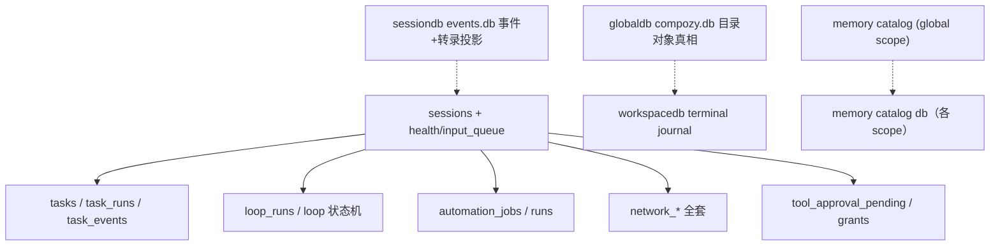
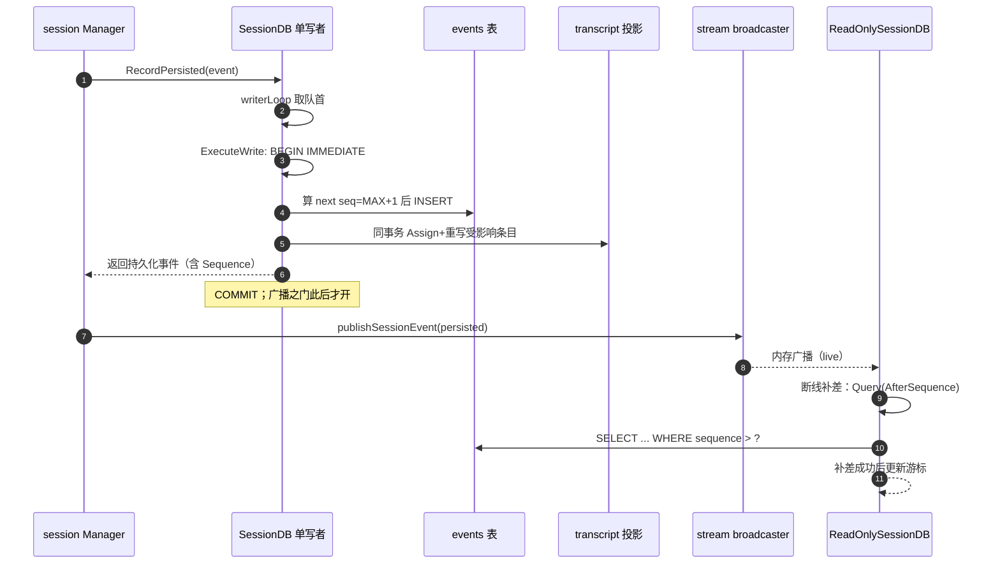

# CompozyOS 数据模型解读：多文件 SQLite、账本-投影同事务与迁移四层防线

> 本解读按 **ai-agent 类规格** 产出，解读基线为 compozy 源码 `release/v0.3.0`（HEAD 4efd8de）。

## 角色与根因：为什么是「本地优先 + 多物理 SQLite 文件」

CompozyOS 的 README 自述是 local-first daemon：状态持久化是它一切对象（session / loop / task / memory / automation / approval / network）的「daemon-owned truth」。本文要回答的核心问题：**这些状态物理上落在哪、为什么不是一个库、schema 怎么在几万行表面积里演进而不错乱、写读路径怎么穿过权威与投影**。

根因有三层：

1. **本地优先决定「能不开 server 就不开」**。CompozyOS 是单二进制、跑在 operator 自己机器上的 daemon，状态文件与 COMPOZY_HOME / workspace 一起走备份与搬家。SQLite 是唯一把「可搬走的文件」与「事务性、可查询」两者同时给足的选择；任何 server DB（Postgres/MySQL）都引入部署与运维回退，与 README 的本地优先冲突。这一点在 `go.mod` 依赖选择上可见一斑——纯 Go 的 `modernc.org/sqlite`（无 CGO），配合 `file://` URI DSN，见 `internal/store/sqlite_config.go`。

```go
// internal/store/sqlite_config.go:59
func sqliteDSNWithPragmas(path string, runtimePragmas bool, extraPragmas ...string) string {
```
<!-- anchor: func sqliteDSNWithPragmas(path string, runtimePragmas bool, extraPragmas ...stri -->

2. **单文件扛不住「爆炸半径」隔离**。会话事件可能无限增长、也可能被单个操作 clear/rewind；worktree/workspace 需要随目录删而删。若全放一个库，一次灾难性写（例如大事务 checkpoint）会拖垮全部；删一个 workspace 也必须在全局账本上做跨域清理。多文件把故障域、删除域、锁域切细：全局目录（operator home）、每个 workspace、每个 session、memory 各自一个物理库，互不阻塞（WAL 各管各的）。

3. **物理分界同时是生命周期分界**。下表是四个 SQLite scope 的实际职责，文件名常量在 `internal/store/store_paths.go`：

```go
// internal/store/store_paths.go:6
	// SessionDatabaseName is the filename for per-session event storage.
	SessionDatabaseName = "events.db"
	// GlobalDatabaseName is the filename for the global CompozyOS index database.
	GlobalDatabaseName = "compozy.db"
```
<!-- anchor: GlobalDatabaseName = "compozy.db" -->

| scope | 物理文件 | 目录级 | 谁打开 | 装载内容 |
|---|---|---|---|---|
| globaldb | `compozy.db` | operator home | `globaldb.OpenGlobalDB` | profiles/workspaces/sessions/automation/loop/task/approval/network…全部「全局目录对象」 |
| workspacedb | `compozy.db` | 每个 workspace 的 `.compozy/` | `workspacedb.Open` | terminal journal（终端录制/命令/产物） |
| sessiondb | `events.db` | `<home>/sessions/<session_id>/` | `sessiondb.OpenSessionDB` / `OpenSessionDBReadOnly` | 会话事件账本 + transcript 投影，一 session 一文件 |
| memory | 各 scope 目录下的 catalog 库 | profile/workspace/agent | `memory.catalog.open` | memory 目录 catalog + FTS 索引 |

> 注意术语校准：`internal/CLAUDE.md` 写「Append-only event store (`runtime.db`) is the canonical operational ledger; session DBs are projections」。**代码里没有名为 `runtime.db` 的物理文件**——v0.3.0 的真实账本是每个 session 一个的 `events.db`（见上表）。CLAUDE.md 此处是历史/抽象表述，物理文件名以 `store_paths.go` 为准。 [WIP：CLAUDE.md 的 runtime.db 措辞与 events.db 布局的对应关系]

sessiondb 的一 session 一文件是「以文件为牢房」：owner 表把 events.db 钉死给 (session_id, workspace_id)，迁移、只读、replay 都以文件为单位锁。这解释了为什么代码里反复出现 family lease、owner guard、immutable owner trigger——单一文件即边界。

## 实体关系总览：四个物理库与它们各自的对象集合

图例：SQLite 不能跨文件声明外键，跨库只有「应用层关联」，用虚线标注；同库 FK 实线。



**globaldb（compozy.db）**是「目录对象」的统一真相：profiles、workspaces、sessions 与其运行时调度表（`session_health`、`session_input_queue`、`session_prompt_admissions`）、task 全家（`tasks`/`task_runs`/`task_events`/`task_claim` 系）、loop 状态机、automation 目录、approval 两张表、network 全套、观察/配额投影。它没有「会话正文」，正文在 sessiondb。这个分工在 `internal/CLAUDE.md` 的模块表中表述为 globaldb = catalog（sessions, metadata），但 v0.3.0 实际远不止 sessions/metadata——task/loop/automation/network 的权威状态全在 compozy.db。

**sessiondb（events.db）**是每个 session 的正文账本，物理隔离、单写者、含 transcript 投影表（详见『核心表 / 实体设计』与『读写路径』）。

**workspacedb（compozy.db）**极小——只放 terminal journal（`terminal_recordings`/`terminal_commands`/`terminal_artifacts`），因为这些东西的生命周期跟着 workspace 目录走，且 profile 归属在 globaldb（trigger 注释明说跨库，见『其余表族综述』）。

**memory** 是「memory 目录」的 catalog：`memory_catalog_entries`（正文摘要）+ 两个 FTS5 虚拟表 + chunks/recall 信号/decisions/events。它与其他库不同——scope 是 profile/workspace/agent 三维目录树，catalog 与文件系统互相印证（见『memory_catalog_entries』小节）。

## 存储选型与理由：SQLite + WAL，为什么不选 server DB

证据与理由：

1. **配置即证据**：所有 scope 共用一套 DSN 构造与 pragma。`sqliteDSNWithPragmas` 固定 `busy_timeout(5000)`、`foreign_keys(ON)`，运行期再补 `journal_mode(WAL)` + `synchronous(NORMAL)`；打开后 `configureSQLite` 校验 WAL 真正生效，失败即拒开。

```go
// internal/store/sqlite_config.go:12
	// DefaultSQLiteBusyTimeoutMS is the shared SQLite busy timeout in milliseconds.
	DefaultSQLiteBusyTimeoutMS = defaultBusyTimeoutMS
```
<!-- anchor: DefaultSQLiteBusyTimeoutMS = defaultBusyTimeoutMS -->
```go
// internal/store/sqlite_config.go:80
func configureSQLite(ctx context.Context, db *sql.DB) error {
```
<!-- anchor: func configureSQLite(ctx context.Context, db *sql.DB) error { -->

WAL 之于本地优先的意义：读不挡写、写不挡读，是「daemon 常驻 + API/观察者并发读 + 单写者」三路并行的前提。`synchronous=NORMAL` 在 WAL 下把 fsync 压到 checkpoint 边界，换取单机吞吐。

2. **现代c无 CGO 且代码内嵌驱动**：`modernc.org/sqlite` 让二进制零依赖 C 库，配合 `go.mod` 整体看，与单二进制分发一致。

3. **并发写策略是显式的**：SQLite 是单写者，工程上不假装不是。全局写入口 `ExecuteWrite` 固定用**单连接 + BEGIN IMMEDIATE + 有界 BUSY 重试**（15 次、20–150ms 抖动退避），把「写冲突」变成「短暂重试」；错误归类里显式识别 `SQLITE_BUSY`/`SQLITE_LOCKED` 为可重试、主键/唯一冲突为不可重试。

```go
// internal/store/write.go:16
	const (
		defaultWriteMaxAttempts       = 15
```
<!-- anchor: const (
		defaultWriteMaxAttempts       = 15 … -->
```go
// internal/store/write.go:61
// ExecuteWrite runs fn inside a BEGIN IMMEDIATE transaction with bounded SQLITE_BUSY retries.
func ExecuteWrite(ctx context.Context, db *sql.DB, fn func(context.Context, *WriteTx) error) error {
```
<!-- anchor: // ExecuteWrite runs fn inside a BEGIN IMMEDIATE transaction with bounded SQLITE -->

为什么要单连接？SQLite 的 `BEGIN IMMEDIATE` 在同一连接内才能保证「拿写锁 → 做判断 → 提交」是原子的；跨连接提交会有升级锁的经典死锁窗口。配合每库一个 `*sql.DB`（max open 8），写路径刻意退化为「一写一事务」。

4. **为什么不选 server DB**：除部署成本外，还有一个方向性原因——本系统把「事务原子性」用在非常局部的范围（一次状态迁移、一个事件追加 + 其 transcript 投影），把「全局一致性」交给**状态机 + 幂等键 + 扫描修复**而不是分布式事务。多文件拆库正是这一取舍的载体：不需要 2PC，只需要把每个不可分割的写压进一个库的一笔 `BEGIN IMMEDIATE` 里。（观察：任务/网络等复杂调度大量使用 lease、claim、idempotency 表，见『核心表 / 实体设计』综述。）

## 核心表 / 实体设计

下面按「最能代表设计」的 8 张表给字段表 + 职责叙述；其后综述其余表族。字段表列出的行号指向 declarative schema 定义，追加列（历史 migration 累加）已在 definitions 中聚合。

### events —— 会话正文账本（sessiondb）

[internal/store/sessiondb/schema/schema.sql:1-1]()<!-- anchor: CREATE TABLE events ( -->

```sql
CREATE TABLE events (
		id         TEXT PRIMARY KEY,
		sequence   INTEGER NOT NULL,
```
<!-- anchor: CREATE TABLE events ( -->

| 字段 | 类型/约束 | 说明 |
|---|---|---|
| id | TEXT PRIMARY KEY | 事件 ID；`RecordPersisted` 之外预生成（带 `ev-` 前缀的 16 hex），`AppendEventIfAbsent` 用作幂等键 |
| sequence | INTEGER NOT NULL（UNIQUE 索引） | 库内单调递增、连续；replay 游标 |
| turn_id | TEXT NOT NULL | ACP turn 归属 |
| type | TEXT NOT NULL | ACP 事件类型 |
| agent_name | TEXT NOT NULL | 说话 agent |
| content | TEXT NOT NULL | 序列化正文（事件整体 JSON），**本表承载内容** |
| archived | INTEGER NOT NULL DEFAULT 0 | 非破坏性归档位：已归档行只做 forensic，不再进 transcript |
| timestamp | TEXT NOT NULL | ISO 时间，事件语义排序以 sequence 为准 |
| transcript_entry_key | TEXT NOT NULL DEFAULT '' | 追加投影：事件归属的 transcript entry |

职责：这是「会话正文唯一真相」。sequence 的唯一性、连续性与「单写者循环」互为因果——sequence 由写事务内 `MAX(sequence)+1` 产生（见『sequence 如何单调且连续』），没有自增主键、没有空洞（rewind/archive 不清行、只置 archived 位）。注意它是**每个 session 一份的账本**，不是全局流水。

### transcript_entries —— 同事务内维护的消息投影（sessiondb）

[internal/store/sessiondb/schema/schema.sql:42-42]()<!-- anchor: CREATE TABLE transcript_entries ( -->

| 字段 | 类型/约束 | 说明 |
|---|---|---|
| entry_key | TEXT PRIMARY KEY | 投影条目标识 |
| kind | TEXT NOT NULL | 条目种类（message/…） |
| logical_id | TEXT NOT NULL | 稳定逻辑 ID |
| turn_id | TEXT NOT NULL | 所属 turn |
| base_message_id / message_id | TEXT | message_id 唯一索引（部分索引，非空） |
| start_sequence / updated_sequence | INTEGER NOT NULL | 条目覆盖的事件序列区间；CHECK updated>=start |
| complete | INTEGER NOT NULL | 条目是否已收齐 |
| message_json | TEXT | 组装好的完整消息（自包含） |
| event_type / marker_json | TEXT | 事件类型标记 / 流式 marker |

职责：events 是扁平流，`transcript_entries` 是把多段事件（如流式 delta）**收拢成一条完整消息**的投影。关键设计：它**不是事后异步算的，而是在事件 append 的同一写事务里增量维护**（见『append 事务里同时做的事』）——这让「写后立即可读完整消息」成立，也让 events.db 被 CLAUDE.md 称为「projection 侧」。事故面由此收窄：append 失败则投影同滚，不会出现账本与投影两套真相。rewind 通过收据表（`conversation_rewind_receipts`）幂等地覆盖序列区间。

### sessions —— 会话目录行（globaldb）

[internal/store/globaldb/schema/definitions/20_sessions.sql:93-93]()<!-- anchor: CREATE TABLE sessions ( -->

```sql
CREATE TABLE sessions (
		id             TEXT PRIMARY KEY,
```
<!-- anchor: CREATE TABLE sessions ( -->

| 字段（截取核心） | 类型/约束 | 说明 |
|---|---|---|
| id | TEXT PRIMARY KEY | session ID，同时用于拼 sessiondb 的 events.db 路径 |
| profile_id | TEXT NOT NULL REFERENCES profiles(id) | 归属 profile（trigger 保证 owner 不可变） |
| workspace_id | TEXT NOT NULL | 归属 workspace；`CHECK ((scope='workspace')=(workspace_id<>''))`，scope='global' 时为空串 |
| agent_name / provider / model | TEXT | ACP 绑定参数 |
| runtime_status / runtime_generation / runtime_failure / runtime_recovery_json | TEXT / INTEGER | 运行期状态机：unbound→…；generation 递增 |
| state / archived_at | TEXT | catalog 状态（archived 由 trigger 约束必须 stopped 才能归档） |
| transcript_epoch | INTEGER | transcript 代际（rewind 推进） |
| pending_permission_count / pending_clarify_count | INTEGER | 与 approval 呼应的计数投影 |
| parent_session_id / root_session_id / spawn_depth / spawn_role | TEXT/INTEGER | 会话树（subagent 派生） |
| network_spec_json / network_mode / network_channel / network_source | TEXT | 网络参与规格与来源（local/live） |
| sandbox_* | TEXT | 沙箱运行时状态 |

职责：sessions 是「目录 + 运行时状态机 + 网络身份」的聚合行，正文不进这里。`UNIQUE(workspace_id, id)` + `CHECK` 把 global/workspace 两种 scope 编码进一行。sessiondb 的 `session_db_owner(singleton, session_id, workspace_id)` 与该行的对账是**应用层一致性**——打开 events.db 前先验 owner。

### session_input_queue —— 会话输入队列（globaldb）

[internal/store/globaldb/schema/definitions/20_sessions.sql:56-56]()<!-- anchor: CREATE TABLE session_input_queue ( -->

职责：面向 prompt/steer/interrupt 三类投递的持久队列；状态机 `queued→dispatching→sent`（及 failed/canceled），有 `attempt_count`、terminal 事件区间、`dispatch_token_hash`、fence 字段。表里大量字段是为「goal/loop/task 三方都能往队列塞 prompt 且可追溯」服务的：`loop_run_id/task_run_id/owner_epoch/binding_epoch/prompt_id/fence_kind/fence_disposition`。队列顺序靠 `(session_id, status, delivery DESC, enqueued_at ASC, id ASC)` 索引；并发安全靠部分唯一索引（例如同一 session 同时只允许一条 `mode='steer' AND status='queued'`，见同一文件 `:320`）。这是「daemon 作为调度中枢」的落点：输入是持久化的、可扫描的、可恢复的。

### tool_approval_pending / tool_approval_grants —— 审批（globaldb）

[internal/store/globaldb/schema/definitions/43_tool_approval_pending.sql:1-1]()<!-- anchor: CREATE TABLE tool_approval_pending ( -->、[internal/store/globaldb/schema/definitions/42_tool_approval_grants.sql:1-1]()<!-- anchor: CREATE TABLE tool_approval_grants ( -->

tool_approval_pending 关键字段：`target_kind`（tool/client_op/navigate/view）、`args_json`、双状态轴 `approval_status` 与 `execution_status`、`resume_fence`、`expires_at`；CHECK 约束把状态机写进 schema（pending ⇒ resolved_at 为空等）。审批行是**工具执行的生命线**：挂了还没批，执行不能 resume。recovery 用 `(approval_status, execution_status, resume_fence, expires_at)` 索引扫描过期/崩溃残留。

tool_approval_grants：`(profile_id, workspace_id, agent_name, tool_id, input_digest)` 唯一——把「这次参数形态批准过」记为 allow/reject，`input_digest` 是 sha256 化的入参指纹。这是「批准的记忆」：允许矩阵精确到入参，不给通配。

### network_timeline_log —— 网络消息的真相账本（globaldb）

[internal/store/globaldb/schema/definitions/60_network.sql:189-189]()<!-- anchor: CREATE TABLE network_timeline_log ( -->

| 字段（截取核心） | 类型/约束 | 说明 |
|---|---|---|
| sequence | INTEGER PRIMARY KEY AUTOINCREMENT | 库内线性序号 |
| message_id | TEXT NOT NULL | `UNIQUE(workspace_id, message_id)` |
| session_id / workspace_id / channel | TEXT | 归属与会话渠道 |
| surface / thread_id / direct_id | TEXT | thread 或 direct 二选一（CHECK 强制，含 work/greet 特例） |
| direction / peer_from / peer_to | TEXT | 谁发给谁 |
| kind | TEXT | say/capability/receipt/trace/greet/whois |
| text / preview_text / body_json / ext_json / mentions_json | TEXT | 内容与扩展 |
| work_id / work_state / work_opened / work_transitioned | INTEGER/TEXT | 与 network_work（任务投递）联动 |
| timestamp | TEXT | 墙钟时间 |

职责：network 域**不是把消息分库存**，而是在 globaldb 里放一条 append-only timeline（AUTOINCREMENT + 复合唯一 message_id），channels/threads/participants/subscriptions/work 全部是对它的周边索引与聚合。这跟 CLAUDE.md「规范账本 + projection」的口径一致：timeline 是权威，会话的收件箱视图（`network_*_projection` 系列 store）是投影。消息的「序」对观察者 replay 至关重要，对应 store 顶层大量 `network_conversation_*` 与 cursor anchor 文件。

### memory_catalog_entries —— memory 目录条目（memory）

[internal/memory/schema/schema.sql:1-1]()<!-- anchor: CREATE TABLE "memory_catalog_entries" ( -->

| 字段 | 类型/约束 | 说明 |
|---|---|---|
| id | TEXT PRIMARY KEY | 条目 ID |
| workspace_id / profile_id | TEXT | 归属（空串=global 维度） |
| scope | TEXT CHECK(profile/workspace/agent) | 目录作用域 |
| agent_name / agent_tier | TEXT | agent 维度 |
| type | TEXT CHECK(user/feedback/project/reference) | 条目类型 |
| slug / filename / name / description | TEXT | 文件身份 |
| content / content_hash | TEXT | 正文快照与哈希 |
| injection | INTEGER | 是否注入 prompt |
| mtime_ms / indexed_at / updated_at | INTEGER/TEXT | 时间戳 |

配套：`memory_catalog_fts`（FTS5 外连内容表，`content='memory_catalog_entries'`）、`memory_chunks` + 双 FTS（unicode61 与 trigram）、`memory_consolidations`、`memory_decisions`、`memory_events`（带 op 白名单 CHECK，审计事件）、`memory_recall_signals`（召回打分）。**schema 用 INSERT/UPDATE/DELETE trigger 保持 FTS 与内容表同步**（schema.sql:197 起），避免应用层漏同步——这是 memory 域把「索引一致性」交给 DB 触发器的一例。slug 唯一索引是目录不重复的防线。

### 其余表族综述

- **task 族**（`70_tasks.sql` / `71_task_profiles.sql` / `72_task_runs.sql`）：`tasks` 主行 + `task_events`（带 event_seq 与 actor/origin 枚举的领域事件流，[internal/store/globaldb/schema/definitions/70_tasks.sql:51-51]()<!-- anchor: CREATE TABLE task_events ( -->）+ `task_runs`/`task_run_idempotency`/review/claim/lease/coordination/starvation——任务调度靠 claim+lease+幂等键，不靠事务锁。
- **loop 族**（`50_loops.sql`/`51_loop_runs.sql` + store/globaldb 大量 global_db_loop_*）：loop 定义与 run 状态机、效果 outbox、wait/retry、汇总投影；`loop_output_blob.go` 处理大输出落盘。
- **automation 族**（`30_automation.sql` + global_db_automation_*）：jobs/runs/triggers/suggestions，job 有调度与保留（reservation）。
- **profile 完整性**（`98_profile_integrity.sql`）：profile_id 归属不可变 + owner active 的 trigger 网。
- **workspace scope 完整性**（`99_workspace_scope_integrity.sql`）：几十张带 workspace_id 的表一律有 insert/update guard trigger，校验 workspace 存在（因为空串 workspace 的 global 行与真实 workspace 行并存，普通 FK 表达不了）。这是「global 与 workspace 双 scope」在 schema 层最重的横切机制。
- **workspacedb terminal journal**：`terminal_recordings`/`terminal_commands`/`terminal_artifacts`，每条带 `profile_id` 且 trigger 保证 owner 不可变（[internal/store/workspacedb/schema/definitions/01_terminal_journal.sql:24-24]()<!-- anchor: CREATE TRIGGER terminal_recordings_profile_owner_immutable -->）；注释明写 profiles 在 globaldb、本库只管不可变归属——跨库无 FK 时的「降低承诺」范例。
- **sessiondb 其它表**：hook_runs、token_usage、conversation_rewind_*、session_db_owner/identity 两张 singleton（均带不可变 trigger）。

## Schema 演进策略：append-only 迁移、Goose 排序、Atlas drift、sqlc 静态查询

这是本篇迁移价值最高的部分。一句话：**运行时迁移引擎用 Goose 语义管理顺序与版本表，但目录清单与文件内容受 atlas.sum 指纹保护；声明式 schema（definitions / schema.sql）与迁移文件在 codegen 时被 Atlas diff 强制对齐；写库的 SQL 全部走 sqlc 生成**。四层防线各管一件事，谁都不能单独跳过。

### 分层与责任

**第一层：Goose 排序 + 每库专属版本表。** 每个 SQLite scope 一个 embedded `MigrationStream`，声明独立版本表与 legacy 表名：

```go
// internal/store/globaldb/migration_stream.go:8
const (
	globalMigrationStreamName   = "global"
	globalMigrationVersionTable = "goose_db_version_global"
)
```
<!-- anchor: const (
	globalMigrationStreamName   = "global"
	globalMigrationVersionTable = "goose_db_version_global" -->

实际注册的四个流见 `internal/store/globaldb/migration_stream.go`、`sessiondb/migration_stream.go`、`workspacedb/migration_stream.go`、`internal/memory/migration_stream.go`——名称/版本表分别为 global/goose_db_version_global、session/goose_db_version_session、workspace/goose_db_version_workspace、memory/goose_db_version_memory。这解释了「每 SQLite scope 有专属 version table」的落点。

**第二层：Atlas 校验目录指纹。** 迁移目录里每个 scope 都有 `atlas.sum`。运行时 `loadMigrationDirectory` 先把目录读进内存，用 `atlasmigrate.Validate` 校验 sum 与文件一致，再算 `sumDigest` 作为后续一切缓存的 key（`migration_manifest.go`）。也就是说：**即使二进制内嵌的迁移文件被意外改动，运行时也能在应用前发现**（虽然 embedded 后一般改不了，但 Validate 把「目录内容」变成了不可变承诺）。

```go
// internal/store/migration_manifest.go:75
	if err := atlasmigrate.Validate(memoryDirectory); err != nil {
```
<!-- anchor: if err := atlasmigrate.Validate(memoryDirectory); err != nil { -->

**第三层：codegen 时 Atlas diff 声明式 schema 与迁移序列。** `make codegen` → `storeschema.GenerateAtlas` 逐流做：在内存 dev DB 上 Replay 全部迁移得到 current → 读 declarative schema（`definitions/` 目录或 `schema.sql`）得到 desired → RealmDiff → 有差异才生成下一个 `000NN_schema.sql`（Goose 格式、**无 Down 段**），无差异只刷新 atlas.sum。`CheckAtlas` 反向做：`migrate.Validate` + 重放 diff，发现 drift 直接报错「run make codegen」。

```go
// internal/codegen/storeschema/atlas.go:89
func checkAtlasStream(ctx context.Context, descriptor stream) (err error) {
```
<!-- anchor: func checkAtlasStream(ctx context.Context, descriptor stream) (err error) { -->

Atlas 是 declarative 引擎、Goose 是 ordered runner，二者在此缝合：Goose 目录被 `sqltool.NewGooseDir` 读出版本，Atlas 只负责「diff 出下一个文件」，生成器 `sequentialGooseFormatter` 裁掉 Down（append-only，永不回滚）。dev 库是 ephemeral SQLite（`file:compozy-atlas-codegen-N?mode=memory`）。生成前还会用 sqlcheck analyzer lint（破坏性变更被拦在 codegen）。生成的文件长这样（Atlas 注释风格、反引号、每语句一行）：

```
-- internal/store/globaldb/schema/migrations/00100_schema.sql:1
-- +goose Up
-- create "workspace_deletion_intents" table
CREATE TABLE `workspace_deletion_intents` (...);
```
<!-- anchor: -- create "workspace_deletion_intents" table -->

> 为什么 trigger 要特殊处理：Atlas 对 SQLite trigger 的 diff 不完整，因此 definitions 里 trigger 被集中到两个「完整性」文件（98/99），codegen 用 `sqlite_triggers.go` 的 regex 提取并 diff/包装 `-- +goose StatementBegin/End` 块——这是工程对工具短板的显式补丁。相应地 `migration_sql_parser.go` 自己实现了 Goose 注释解析（Up/Down/StatementBegin/End/NO TRANSACTION），把每条迁移在内存里切成语句列表再喂给 Goose provider（`migration_plan.go` 的 goose.NewProvider + `WithGoMigrations`）。

**第四层：sqlc 管静态 SQL。** 每个 store 包一个 `sqlc.yaml`，schema 指向 declarative 文件、queries 目录是 `.sql`，生成到**包内** `sqlcgen/`（产出文件头 `// Code generated by sqlc. DO NOT EDIT.`）。`make codegen` 用 `go tool sqlc generate`（版本 pin 在 go.mod），随后 `modernizeSQLCGenerated` 把 `interface` 归一为 `any`。`CodegenCheck` 在临时树重跑 sqlc 并与已提交树逐文件比对，还跑 import 所有权扫描——`sqlcgen` 只能被**同目录 owner 包** import，杜绝生成代码被跨包借用。

```go
// internal/codegen/storeschema/sqlc.go:19
var sqlcPackagePaths = []string{
	"internal/store/globaldb",
```
<!-- anchor: var sqlcPackagePaths = []string{ -->
```go
// internal/codegen/storeschema/sqlc.go:55
// CheckSQLC regenerates into a temporary tree and rejects generated-code or import-ownership drift.
func CheckSQLC(ctx context.Context, root string) (err error) {
```
<!-- anchor: func CheckSQLC(ctx context.Context, root string) (err error) { -->

手写 SQL 保留给「结构性动态查询」：例如事件过滤查询按可选谓词拼 WHERE（`sql_clause.go` 的 clause builder、sessiondb `event_query.go`），以及不变量极强、sqlc 表达不了的部分唯一索引/trigger。所有这类动态 SQL 在源码里都有 `// dynamic-sql:` 标记注释（如 [internal/store/sessiondb/event_query.go:15-15]()<!-- anchor: // dynamic-sql: selected projection, optional event predicates, cursor bounds, a -->），这是把「为什么绕过 sqlc」显式归档的纪律。migration 连接级 pragma（如 `PRAGMA foreign_keys = ON`）也标 `// dynamic-sql` 说明归因。

### 启动与拒绝语义（boot 防呆）

打开任何一个库都走 `store.OpenSQLiteDatabase` → 初始化回调里 `store.Apply`。`Apply` 的四步：inspect（含 legacy 拒绝与 ahead 拒绝）→ 尝试 bootstrap → 无则 stepper.UpTo(max) → 记日志。关键错误码：

- `ErrLegacyDatabase`：发现 pre-goose 时代遗留表（`schema_migrations` 等），**拒绝打开并提示保留整目录后换新 home**——不修复。
- `ErrSchemaBehind` / `ErrSchemaAhead`：版本不在二进制头，**硬失败**。Ahead 的恢复指令是「换更新二进制或迁移整个 COMPOZY_HOME 去新环境」，绝不降级数据库。

```go
// internal/store/migrate.go:13
	// ErrLegacyDatabase reports a database created by the removed migration runner.
	ErrLegacyDatabase = errors.New("store: database was created by the removed pre-goose migration runner")
```
<!-- anchor: // ErrLegacyDatabase reports a database created by the removed migration runner. -->

只读句柄也受同一纪律约束：`ReadOnlySessionDB` 打开后必须 `RequireCurrent`（只校验、不建表不迁移），不一致则拒绝只读（[internal/store/sessiondb/read_only.go:212-212]()<!-- anchor: if err := store.RequireCurrent(ctx, db, MigrationStream()); err != nil { -->）。版本表本身存 `version_id/is_applied`，`readStreamStatus` 从表算出 applied count 与 max version（`migration_status.go`）。

### 拒绝 boot repair 的 Why（重点）

`MigrationStream.Bootstrap` 只在**全新库**上生效：bootstrap 的触发条件写死为「版本 0、applied 0、版本表不存在、bootstrap 的 head digest == 迁移目录 sumDigest」。它做的事是：同一事务里建好 declarative head（definitions/schema.sql + seed + Initialize 回调）再回填全部迁移版本号，让新库直接跳到 head，**跳过 100 条逐条回放**（globaldb 有 100 个迁移文件，session 6、workspace 4、memory 3）。

```go
// internal/store/migration_bootstrap.go:27
func tryBootstrapMigrationStream(
	ctx context.Context,
	db *sql.DB,
	stream MigrationStream,
	inspection migrationInspection,
) (bool, error) {
```
<!-- anchor: func tryBootstrapMigrationStream( -->

这背后是一套刻意的不对称：**新库走「直接建 head」，老库走「逐条回放」**。两者共享同一份 `atlas.sum` 与版本序列，因此 head 一定等于「所有迁移回放完」的结果——bootstrap digest 与迁移目录 digest 的一致性校验保证不会出现 head 与迁移各说各话。而**老库绝不允许用 declarative 直接 patch**（会绕开历史语义、破坏 sum 承诺）。为什么硬失败优于修复：本地优先的库横跨多个发布版本，越老越可能包含已被迁移语义淘汰的数据形态；用当前 declarative 去 diff 修补会制造「语义上从未存在过」的 schema 状态，之后任何基于 sum 的校验都会永久失明。因此纪律是**宁可拒绝启动、提示人工迁移整个 home**（错误消息甚至给出文件级恢复指引，[internal/store/migration_refusal.go:11-11]()<!-- anchor: const migrationFamilyRecoveryInstruction = "stop CompozyOS; preserve or move the -->）。

```go
// internal/store/migration_refusal.go:11
const migrationFamilyRecoveryInstruction = "stop CompozyOS; preserve or move the complete COMPOZY_HOME or " +
```
<!-- anchor: const migrationFamilyRecoveryInstruction = "stop CompozyOS; preserve or move the -->

migration 本身 append-only 的证据链：migration_plan.go 里编译计划用 `sync.OnceValues` 按 sumDigest 缓存；`migration_sql_parser` 拒绝「缺分号」「重复 Up」「StatementBegin 无 End」等脏输入；规划中若存在 NO TRANSACTION（非事务）迁移，还要校验连接池 ≥2 连接（[internal/store/migration_stepper.go:43-43]()<!-- anchor: if plan.requiresIndependentConnection() && db.Stats().MaxOpenConnections == 1 { -->）否则 `ErrMigrationConnectionCapacity`。换句话说：迁移被当作「一次只能前进、质量门禁极高」的流水线，而非随手 DDL。

## 读写路径：append → broadcast / replay（after_seq）

### 权威与投影在 session 域的落点

全局目录对象（session 状态行、approval、task…）的写走 globaldb 的 `BEGIN IMMEDIATE` 事务族（repo 基类 `withImmediateTransaction` 包装 `store.ExecuteWrite`，只读用 `BeginTx(ReadOnly)`）；会话正文走 sessiondb 的**单写者循环**。两者权限与容量模型不同，但都遵守「broadcast 只在 durable append 之后」——跨界证据在 session manager：

```go
// internal/session/manager_prompt_event_storage.go:90
func (m *Manager) recordEventWithAuthoredText(
	ctx context.Context,
	session *Session,
	event acp.AgentEvent,
	authoredText string,
) error {
```
<!-- anchor: func (m *Manager) recordEventWithAuthoredText( -->

方法体内顺序（同文件 :96-141）：enrich → applyAttention（先落 attention 事件）→ `recordPersistedSessionEvent`（durable append，拿到带 sequence 的持久化行）→ dispatch post-record hooks → dispatch message-persisted → `publishSessionEvent`（broadcast）→ 非 attention 时发 catalog wake。**broadcast 入参就是 durable 返回的带 Sequence 的事件**，绝无「先广播后落盘」。

```go
// internal/session/session_stream_broadcast.go:228
func (m *Manager) publishSessionEvent(ctx context.Context, session *Session, event store.SessionEvent) {
```
<!-- anchor: func (m *Manager) publishSessionEvent(ctx context.Context, session *Session, eve -->

replay 端依赖同一 sequence 空间：订阅可带 after-sequence（[internal/session/session_stream_broadcast.go:200-200]()<!-- anchor: afterSequence, --> 附近对订阅者提供 afterSequence 起点），落库查询用 `sequence > after_seq` 作为游标（EventQuery.AfterSequence + `buildEventQuerySQL`），断线重连补差即「from 已知 seq 往后拉」。

```go
// internal/store/sessiondb/event_query.go:31
		store.Int64Clause("sequence", ">", query.AfterSequence),
```
<!-- anchor: store.Int64Clause("sequence", ">", query.AfterSequence), -->



### sequence 如何单调且连续：单写者 + MAX+1

`nextEventSequence` 在写事务内 `SELECT MAX(sequence)` + 1（[internal/store/sessiondb/session_event_query.go:77-77]()<!-- anchor: func nextEventSequence(ctx context.Context, tx *store.WriteTx) (int64, error) { -->）。能这样做而不自增，前提就是『权威与投影在 session 域的落点』所述的单写者模型：所有 append 都汇入一个 writer goroutine（`SessionDB` 内嵌 `writeCh` 缓冲 256 + `acceptMu` 把关状态，[internal/store/sessiondb/session_db.go:52-52]()<!-- anchor: // SessionDB owns a per-session SQLite database and its dedicated writer loop. -->），同库不存在并发写，`MAX+1` 不会撞车；再加 events.sequence UNIQUE 兜底。批写时按 `nextSequence + idx` 顺序分配（[internal/store/sessiondb/session_event_write.go:316-316]()<!-- anchor: persisted[idx].Sequence = nextSequence + int64(idx) -->），保证批内连续。session 写循环每 128 次写触发一次 passive WAL checkpoint（[internal/store/sessiondb/session_writer.go:12-12]()<!-- anchor: const sessionPassiveCheckpointEvery = 128 -->），控制 WAL 增长，close 时 `Checkpoint` 收尾（globaldb/workspacedb Close 同款，[internal/store/globaldb/global_db.go:117-117]()<!-- anchor: checkpointErr := store.Checkpoint(ctx, g.db) -->）。

### append 事务里同时做的事（投影合并进账本写）

`writeEventBatch` 在**一笔 ExecuteWrite**里完成：加载投影状态 → 起 projector → 分配 sequence → 逐条 insert event → 对受影响的 transcript entry 重新投影 → 写回。评论点明这是「bounded write amplification」——为保留完整消息语义、读耗与结果窗口成正比，代价是每条 append 只重写它碰到的条目（[internal/store/sessiondb/session_event_write.go:384-384]()<!-- anchor: // Each append rewrites only the independently rebuildable entries it affects. -->）。这解释了 events.db 为什么既是账本又是投影源：**同一事务保证两者不撕裂**。

### 其它领域的「账本/投影」同构

同样的形状在别的域以不同名字复现：task 有 `task_events`（event_seq + actor/origin 语义枚举，[internal/store/globaldb/schema/definitions/70_tasks.sql:51-51]()<!-- anchor: CREATE TABLE task_events ( -->）与大量以它喂出来的状态/收件箱投影；network 有 append-only `network_timeline_log`（sequence 自增）与 conversation/channel 视图投影；memory 有 `memory_events`（op 白名单）+ catalog/chunks FTS。它们共享结论：**权威写成 append，读面建 projection**——这是贯穿四库的设计母题。

## 全局关联：每个 store 族连回它服务的对象

| store 族 | 服务对象 | 关联锚点 |
|---|---|---|
| globaldb sessions 系 | session 目录、runtime 状态机、输入队列、prompt admission、attention | `20_sessions.sql` |
| globaldb task 系 | 任务树、claim/lease、run、profile、review、starvation | `70_tasks.sql` / `71/72` + `global_db_task_*` |
| globaldb loop 系 | loop 状态机/run/输出/outbox | `50_loops.sql`/`51_loop_runs.sql` |
| globaldb automation 系 | 自动化 job/run/trigger/suggestion | `30_automation.sql` |
| globaldb approval 系 | 工具执行准入与记忆 | `42`/`43` |
| globaldb network 系 | 网络消息账本、频道/线程/工作/唤醒 | `60_network.sql` |
| globaldb memory 系 | 观察者目录投影（usage/retention） | `40_observability.sql` 等 |
| sessiondb | session 正文账本 + transcript + hook + rewind | `schema/schema.sql` |
| workspacedb | terminal journal（随 workspace 目录走） | `definitions/01_terminal_journal.sql` |
| memory | memory catalog + recall/decision 审计 | `memory/schema/schema.sql` |

纵向串起来：daemon 启动时依次打开 globaldb（operator home）→ workspace db → 需要时按 `sessions` 行拼路径打开对应 `events.db`（owner 校验）→ memory 各 scope。对象在 globaldb「出生」，其「行为流」append 进 sessiondb，跨 workspace/网络的调度走 compozy.db 里的队列与 timeline。

## 亮点与问题

### 亮点

1. **迁移的「四层防线 + 双侧不对称」**：Goose 管顺序、Atlas 管 drift、sqlc 管静态 SQL、sum 管指纹；新库 bootstrap 直建 head、老库逐条回放，digest 一致性把两条路收敛到同一终点。迁移既是能力也是承诺，append-only + 拒绝 boot repair 把它变成单向门。这是本地优先长命库最值得抄的一课。
2. **账本与投影同事务、单写者分文件**：events 与 transcript_entries 在同一写里演进，消除了「账本说 A、投影说 B」的经典撕裂；一 session 一文件让故障域与生命周期（clear/rewind/删除）都收敛到单文件操作。`session_db_owner/identity` 两个不可变 singleton + 只读 open 的 `RequireCurrent`，把「每个文件自证身份与版本」做成打开即校验。
3. **schema 级的硬约束（CHECK/trigger/部分唯一索引）当业务不变量用**：approval 双状态轴、sessions archive 状态机、队列 steer 单活、几十张 workspace guard、FTS 同步 trigger——大量本可在应用层写的判断下沉到 SQLite，读代码时能直接从 DDL 获得状态机。trigger 集中到 98/99 两个文件并让 codegen 专门 diff，是「把工具短板显式管理起来」的样板。
4. **细粒度但严格的写并发模型**：BEGIN IMMEDIATE 单连接 + busy 重试（写）、WAL + passive checkpoint（写放行读）、read-only immutable 打开（读不污染写）——把 SQLite 的能力边界画得清清楚楚，然后在边界内把每个写做成小事务 + 扫描修复兜底。

### 问题 / 观察

1. **CLAUDE.md 术语与实际物理文件漂移**：文档以 `runtime.db` 称呼权威账本，源码实际是每个 session 一个 `events.db`（且 events.db 同时承载权威与投影）。对维护者而言，`runtime.db` 这类历史命名在排障时会误导新人找文件。 [WIP：确定 runtime.db 一词在 v0.3.0 是否完全退役]
2. **单 session 单文件的代价**：session 极多时文件句柄/打开开销线性增长；observe 的 reconcile 要扫 `SessionsDir` 对账（`internal/observe/reconcile.go`），大目录下是全目录扫描。跨 session 聚合查询（token 报表、observe overview）只能靠 globaldb 侧投影兜着，无法直接 SQL join。 [WIP：未读 observe 全量聚合路径的代价量化]
3. **sessions 表非常宽**（definitions 里已聚合数十列，且不少是 `... TEXT NOT NULL DEFAULT ''` 追加式成长）：是「migration 只增列不重构」的直接后果，长表对代码可读性与未来拆表都有压力。这是 append-only 迁移纪律的已知 trade-off，不是 bug。
4. **trigger 管理依赖 codegen 的私有 regex 管线**（`sqlite_triggers.go`）：手写 trigger 必须写进 98/99 或经 StatementBegin 包装才能被 diff 识别；新 trigger 若忘了走这个通道，drift check 可能漏。属于「工具补丁」的长期维护面。
5. **多库 = 无跨库 FK**：跨 scope 的一致性只能靠 owner 对账、trigger guard 与扫描修复实现。`terminal_recordings` 的注释（profile 在 globaldb，本地只保不可变归属）是团队对「降低承诺」的自觉，但这类软一致性点分散在各 store，缺少一张集中声明表。 [WIP：未读 complete 的 owner 对账恢复（boot_session_repair）实现]
