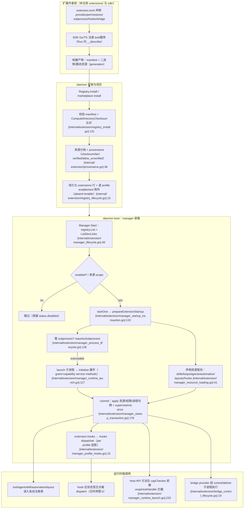
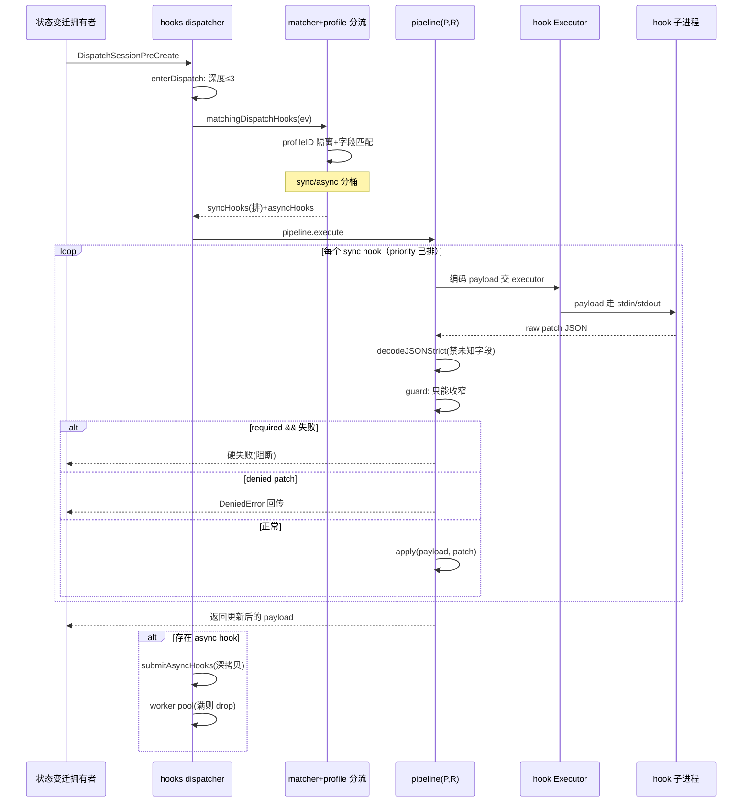

# CompozyOS 扩展体系解读：manifest 声明面、typed hooks 与 bridge SDK

> 本解读按 **ai-agent 类规格** 产出，解读基线为 compozy 源码 `release/v0.3.0`（HEAD 4efd8de）。

## 角色：去掉这一层，系统会怎样

没有扩展层，CompozyOS 就退化为「一个功能写死的单二进制」。这层系统承担四件事：

- **能力增长的唯一入口**：新增 tool、skill、loop、agent、自动化 job/trigger、hook、外部消息适配器（bridge）、甚至自定义模型源、watch source、代码托管 forge provider、命令面板 view，全部通过扩展 manifest 声明（[internal/extension/manifest.go:118-118]() <!-- anchor: type ResourcesConfig struct { --> 声明了 `ResourcesConfig`：skills/loops/agents/automation/layouts/hooks/tools/mcp_servers…）。daemon 组合根之外的任何新能力，不经过这套契约就没有装载点。
- **安全边界**：daemon 的会话、权限、任务、资源都以内置的假设运行。扩展是「不可信代码要获得部分权力」的通道，因此必须把信任决策（来源分档、checksum、允许列表）与运行时权力（capability 授权、Host API 方法白名单、资源 kind/scope）放在 daemon 侧统一裁决，而不是让扩展自报家门。
- **状态变换的"形而上"层**：hooks 让外部代码在 session/task/automation 等关键状态变迁点介入——可观察、可收窄、可否决，但不能绕过安全原语（见「核心流程」的流程（b）时序图）。
- **异构消息的归一化**：bridges 把 Slack/Telegram/Discord 等完全不同的外部协议，抽象成一套 `bridge.instance` 资源 + `bridges/deliver`、`bridges/messages/ingest`、target 快照等方法族，daemon 与 provider 都在这套封闭契约上工作（[internal/bridges/types.go:92-92]() <!-- anchor: type BridgeStatus string --> 状态机、[internal/bridgesdk/runtime.go:129-129]() <!-- anchor: func (r *Runtime) Serve(ctx context.Context, stdin io.Reader, stdout io.Writer)  --> 提供统一 stdio 运行骨架）。

去掉这层的直接后果：要么所有能力必须编进 daemon（上游成为唯一作者，无法承载"Built to extend"），要么允许运行时"随便塞代码"（一旦出现一个不守安全原语的插件，claim token/lease/TTL/权限收窄这些 daemon 侧防线都能被旁路）。扩展层就是为「开放的作者生态」与「封闭的运行时安全」这两个互相拉扯的目标，找到了声明化契约作为中间地带。

## 根因：为什么是"声明化 + 版本化 + 信任治理"

### 对比：往 daemon 里"随便塞代码"

最朴素的做法是插件走共享内存/进程内回调注册（如 VSCode 式的 in-process 插件、或暴露一堆 internal 包让扩展 `import`）。对 CompozyOS 这种"单 Go 二进制、local-first、自治 agent 操作系统"，这条路有三个致命问题：

1. **崩溃隔离与资源控制失效**：插件进程内崩溃会把 daemon 一起带走；无法单独做健康检查、重启退避、超时管控。CompozyOS 选择把可执行扩展一律拉成**受监督的子进程**，daemon 侧有完整的 health/restart/supervision（[internal/extension/manager.go:186-186]() <!-- anchor: type managedExtension struct { --> `managedExtension` 带 `consecutiveFailures`、`restartBackoff`、`generation` 等监督状态）。
2. **信任无法表达**：进程内插件一旦拿到 daemon 权限就没有"来源分档"可言。CompozyOS 需要区分 bundled（官方自带）/user（操作者本地信任）/workspace（项目信任）/marketplace（远程、默认只给只读能力），不同来源拿到的是**不同上限的授权**（[internal/extension/capability_resource_policy.go:17-17]() <!-- anchor: func sourcePolicy(source ExtensionSource) sourceTierPolicy { --> 的 `sourcePolicy`）。
3. **契约无法审计与演进**：进程内注册全在代码里，装了什么、要什么权限、从哪来都没有可持久化、可对比、可做 checksum 的记录。而 v0.3 的整个卖点就是「manifest/SDK 是新的版本化契约」，扩展是**先声明后运行**的：daemon 不执行任何扩展代码也能读明白它想要什么（[internal/extension/manifest.go:96-96]() <!-- anchor: // Manifest describes one extension without executing any extension code. --> 注释「Manifest describes one extension without executing any extension code」）。

### 声明化解决什么

manifest（`extension.toml`/`extension.json`，兼容 Agent Plugins 的 `plugin.json`）把扩展的「意图」与「实现」分离：
- 声明 identity（name/version/min_compozy_version）、要什么（`permissions.requires`、`resources.publish`）、提供什么（`capabilities.provides`）、进程怎么跑（`subprocess`）、挂钩什么事件（`resources.hooks`）。
- daemon 可以在**不执行任何扩展代码**的前提下完成校验、consent 派生、checksum 验证、授权上限计算，然后再决定要不要把进程拉起来。[internal/extension/registry_install.go:59-59]() <!-- anchor: func validateInstallConfig(manifest *Manifest, checksum string, config *installC --> 的 `validateInstallConfig` 甚至能在 install 阶段就拒绝不合规提供面（例如 bridge adapter 只允许 bundled 来源，外部 bridge authoring 是"planned follow-up"）。

### 版本化解决什么

- 两层版本：SDK/协议版本（`protocol_version`）+ manifest 对 daemon 的最低要求（`min_compozy_version`）。装载时 daemon 会做子集校验：扩展声明的 provides/permissions 必须落在 daemon 授予的子集内，能力服务方法必须真实实现（[internal/subprocess/handshake.go:235-235]() <!-- anchor: func validateInitializeResponse(request InitializeRequest, response InitializeRe --> `validateInitializeResponse`）。
- 进程启动握手 `initialize` 是双向版本协商：daemon 发 `InitializeRequest`（协议版本、支持版本列表、compozy 版本、授予的能力），扩展回 `InitializeResponse`（接受的 provides/permissions、实现的 methods、支持的 hook 事件）。任何一侧撒谎都会在握手校验处被识破。

### 信任治理解决什么

registry 持久化每条 install 的 checksum + provenance（来源 URL、registry tier、是否 verified、allow_unverified 决策），enablement 是**逐 profile 的例外记录**（absent 行 = enabled）。这样「装了但不信」与「装了且启用」被拆成两个正交决策，卸载/禁用/升级都能回到持久化记录上重放（[internal/extension/provenance.go:38-38]() <!-- anchor: type ExtensionProvenance struct { --> `ExtensionProvenance`；[internal/extension/registry_lifecycle.go:15-15]() <!-- anchor: func (r *Registry) IsEnabledForProfile(name string, profileID string) (bool, err -->）。

## 设计思路与核心模式

### 模式一：Manifest → 校验 → 装载的三段式，代码零执行

```
extension.toml ── LoadManifest ── Validate ── Registry.Install(checksum+provenance)
                                      │
                                      └── 发现期之后 Manager 才解析 manifest 得到资源并启动进程
```

关键点：**静态资源的解析路径全程在 manager 启动事务里做**，子进程装载是最后一步、而且有回滚（rollback）保护。扩展加载是事务性的：进程起来了、资源暂存了，一旦后续步骤失败就把已拉起的进程优雅停掉、把 capability 注册撤销（[internal/extension/manager_startup_transaction.go:27-27]() <!-- anchor: type extensionStartupTransaction struct { --> `extensionStartupTransaction`，:61 `rollback`）。

### 模式二：provide surfaces / capability 服务方法（"提供什么"是封闭集合）

daemon 认识的能力提供面是**枚举而非自由字符串**（[internal/extensionprotocol/capabilities.go:8-8]() <!-- anchor: const ( --> `memory.backend`、`bridge.adapter`、`tool.provider`、`model.source`、`loop.watch_source`、`connectivity.provider`、`forge.provider`、`view.provider`），每个 provide surface 绑定一组 daemon→extension 的服务方法（同文件 :51 的 `capabilityServiceMethods` 映射，如 `tool.provider` → `provide_tools` + `tools/call`）。这让 daemon 在握手时就能校验"你宣称提供 X，就必须实现 X 的方法族"，不存在扩展自造协议面。

### 模式三：来源分档决定授权上限（trust 驱动授权，而非 manifest 驱动）

授权 = **manifest 请求 ∩ 来源分档允许 ∩ 操作者策略 ∩ 会话 scope** 的多重收窄。同一个 manifest，从 marketplace 装和从本地装，拿到的 permissions/resources 天差地别：
- bundled/user/workspace：permissions 全放行（`allowAllPermissions`）；
- marketplace：只放行只读 consent 白名单 `marketplaceConsentCeiling`（[internal/extension/capability.go:109-109]() <!-- anchor: marketplaceConsentCeiling = []string{ -->）；
- 资源 scope：workspace 来源最多 `workspace`，其余最多 `user`（[internal/extension/capability_resource_policy.go:72-72]() <!-- anchor: func sourceTierMaxScope(source ExtensionSource) resources.ResourceScopeKind { -->）。

（详见「关键设计决策」的决策一。）

### 模式四：hooks 是"typed dispatch，不是 event bus"

这是模块内部最强的设计哲学，CLAUDE.md 也有权威表述。代码里非常具体：

1. **每个事件有独立的 payload/patch 类型对**，不是一把通用 `map[string]any`。例如 session 族各自是 `SessionPreCreatePayload`+`SessionCreatePatch`、`SessionPreResumePayload`+`SessionPreResumePatch`…（[internal/hooks/dispatch.go:17-17]() <!-- anchor: func (h *Hooks) DispatchSessionPreCreate( --> 开始逐个 `DispatchXxx` 的强类型入口）。
2. **事件族是封闭的、每个事件定义 syncEligible**：`HookEvent` + family 分类集中在 events 定义表（[internal/hooks/events.go:169-169]() <!-- anchor: var baseHookEventDefinitions = []hookEventDefinition{ --> `baseHookEventDefinitions`），只有声明了 `syncEligible: true` 的事件允许同步 hook（能影响返回结果的 hook）。观察类事件（如 message.delta、sandbox.ready）只能是 async，同步链不允许挂上去阻塞调用方。
3. **patch 有 guard**：hook 返回的 patch 在被应用前要过 guard——只能收窄/注解，不能放宽或篡改不可变字段。例如 session 的 `workspace_id` 不可改（[internal/hooks/dispatch_guards.go:9-9]() <!-- anchor: func guardImmutableSessionWorkspacePatch( -->）、task run claim 的 `priority_min` 不可降（:36）、spawn 的子权限必须是父权限子集（:87）；permission hook 甚至禁止把"已拒绝"改成"放行"（{internal/hooks/permission.go} 的 escalation block）。
4. **同步优先、异步投递、队列有界**：sync hook 按确定性顺序在调用链上执行并返回裁决；async hook 克隆 payload 后投到 worker pool（[internal/hooks/dispatch_async.go:11-11]() <!-- anchor: func submitAsyncHooks[P any, R any]( -->），队列满直接 drop 并计数，绝不反压调用方。

### 模式五：JSON-over-stdio 的对称子进程协议

daemon 侧 subprocess 协议与 bridgesdk 的 Peer 使用同一套新行分隔 JSON-RPC 2.0 帧（[internal/bridgesdk/peer.go:356-356]() <!-- anchor: func (p *Peer) writeFrame(frame rpcEnvelope) error { --> `writeFrame` 写出 `json + '\n'`）。可执行扩展（SDK Go/TS 写的 extension、bridge provider）都是这个形态：**一条 stdio 通道双向复用**——daemon 发请求、扩展发 Host API 调用与回包都走同一流（Peer 用 request id 区分方向，:120 `Call` 与 :258 `dispatchRequest`）。SDK 把这一层封装成 `Extension.Run(ctx)`（[sdk/go/extension.go:238-238]() <!-- anchor: func (e *Extension) Run(ctx context.Context) error { -->）与 `bridgesdk.Runtime.Serve(ctx, stdin, stdout)`（[internal/bridgesdk/runtime.go:129-129]() <!-- anchor: func (r *Runtime) Serve(ctx context.Context, stdin io.Reader, stdout io.Writer)  -->）。

### 模式六：bridge 是"资源层 + 控制层 + 运行层"三明治

- **资源层（desired state）**：`bridge.instance` 是一条 resource 记录，只放期望配置（platform/extension_name/secret_slots/dm_policy/routing_policy…），运行态 status/degradation 分离在桥运行时存储（[internal/bridges/resource.go:32-32]() <!-- anchor: type BridgeInstanceSpec struct { --> spec 注释明确"desired-state payload"）。
- **控制层**：provider 暴露的 `check`/`webhook_register` 等只读控制方法，通过隔离的 control 子进程执行（[internal/extension/bridge_control.go:26-26]() <!-- anchor: func (m *Manager) CheckBridge( -->，[internal/bridges/control.go:18-18]() <!-- anchor: const ( -->）。
- **运行层**：真正接外部平台的 adapter 是"bridge-capable extension"，由扩展 manager 以 service purpose 拉起，运行时经 initialize 拿到自己托管的 bridge instances + 已解析的 secret 绑定（[internal/subprocess/handshake.go:99-99]() <!-- anchor: type InitializeBridgeRuntime struct { --> `InitializeBridgeRuntime`）。

## 核心流程

### 流程（a）：一个扩展从声明到装载/使能的完整生命周期

下面两张图是本文主流程。第一张图描述「manifest → 发现 → enablement/信任 → 构建 → 装载 → 资源与 hook 进入运行时」；标 `{路径}:{行}` 的边表示该步的实现入口。



图上五个关键事实：

1. **安装期不执行扩展代码**：`LoadManifest` 只解析 TOML/JSON（[internal/extension/manifest_load.go:22-22]() <!-- anchor: func LoadManifest(dir string) (*Manifest, error) { -->），checksum 是对目录整体计算，从 artifact 展开目录开始就锁定了内容（[internal/extension/registry_install.go:142-142]() <!-- anchor: actualChecksum, err := ComputeDirectoryChecksum(artifactRoot) -->）。
2. **enablement 是每 profile 的例外表**：`extension_profile_enablement` 行只在 disabled 时写入；`IsEnabledForProfile` 用 `COALESCE(子查询, 1)` 表达"缺省启用"（[internal/extension/registry_lifecycle.go:28-28]() <!-- anchor: err = r.db.QueryRowContext(registryContext(), ` -->）。启用到默认 profile 还会轮换 `lifecycle_token`，用于"条件禁用/防陈旧实例误清理"。
3. **dev link 是工作区级覆盖层**：不修改 published 行，而是建 `extension_dev_links` 覆盖（[internal/extension/dev.go:48-48]() <!-- anchor: func (r *Registry) LinkDev(req DevLinkRequest) (*DevLink, error) { --> `LinkDev`），hook 投影时同时枚举 dev links（[internal/extension/manager_profile_hooks.go:56-56]() <!-- anchor: links, err := m.registry.ListDevLinks() -->）。
4. **子进程装载有事务回滚**：`prepareExtensionStartup` 一旦失败会反序跑 cleanups（停进程、撤销 capability grant、释放 source session）。
5. **hook 声明不直接进 dispatcher**：由 daemon 的 declaration provider 在每次 hooks `Rebuild` 时通过 `HookDeclarationsForProfiles` 按启用 profile 拉取（[internal/daemon/hooks_declaration_providers.go:42-42]() <!-- anchor: func extensionDeclarationProvider( --> `extensionDeclarationProvider`）。

### 流程（b）：一次 hook 触发（以 `session.pre_create` 为例）的 typed dispatch

第二张图展示一次同步 hook 触发的内部时序——事件源（session 状态变迁拥有者）→ hooks dispatch → 匹配 → pipeline 逐个执行 → guard/patch → 回注或拒绝；以及 async hook 的旁路投递。



时序图上能直接读出几个设计约束：

- **事件源即拥有者**：owner（session 管理等）直接调用对应 `DispatchXxx` 方法，hooks 不存在独立的"事件总线"进程或 topic，也没有 tail 事件表再触发的第二现场。
- **先判权后执行**：`enterDispatch` 的递归深度上限 3，避免 hook 又触发 hook 形成无限链（[internal/hooks/depth.go:9-9]() <!-- anchor: const maxDispatchDepth = 3 -->）。
- **同步链可以"否决/收窄"**：sync hook 返回的 patch 若带 deny 标记，pipeline 立即停止后续 hook（deny 短路），事件源拿到 `DeniedError`；guard 拒绝的 patch 返回 `ErrHookPatchRejected`。
- **异步是"尽力而为的观察"**：clone 后进有界队列，drop 也要记录一次 `HookRunOutcomeDropped`，绝不影响主链结果（[internal/hooks/dispatch_async.go:52-52]() <!-- anchor: h.emitHookRun( -->）。
- **JSON over stdin 严格执行 schema**：入站 patch 解析用 `DisallowUnknownFields`，扩展想偷偷塞字段回注会被拒（decode 失败即该 hook 执行失败）。

## 关键实现归组

### extension：manifest 与验证

- 声明模型集中在 `{internal/extension/manifest.go}`：`Manifest` 顶层（identity + `min_compozy_version` + `resources`/`capabilities`/`permissions`/`subprocess`/`bridge`/`profiles`），`ResourcesConfig` 收全部静态资源族，`HookConfig` 是 manifest 形态的 hook（自带 matcher/executor 两个子配置）。常量键全部集中，v0.2 遗留的 `[actions]`/`[security]` 段在解析时显式拒绝并指引改用 `[permissions]`（[internal/extension/manifest_load.go:284-284]() <!-- anchor: func rejectUnsupportedManifestTOML(keys []toml.Key) error { -->）。
- 校验链 `Validate()` 顺序：identity → runtime → resources → capabilities → permissions → publication（[internal/extension/manifest_load.go:84-84]() <!-- anchor: func (m *Manifest) Validate() error { -->）。提供 `bridge.adapter` 会额外强制 `bridge.platform`/`display_name`/`secret_slots`/`config_schema`（:117）。
- **Agent Plugins 兼容**：检测到 `plugin.json` 走 agentplugin 分类装载、合成 manifest（[internal/extension/extension_validation.go:107-107]() <!-- anchor: func extensionValidationFormat(dir string) (ExtensionFormat, bool, error) { --> 格式判定，:151 `validateAgentPluginBundleReport`）。install 上 agent-plugin 是可执行格式（提供 skills + MCP stdio server）。
- **daemon-free 验证入口** `ValidateBundleReport` 面向 CLI，产出 `ConsentAreas`（从 `permissions.requires` 派生 consent 摘要），装前就能向操作者展示"这个扩展要什么"（[internal/extension/extension_validation.go:64-64]() <!-- anchor: func ValidateBundleReport(dir string) (*ValidationReport, error) { -->）。

### extension：registry（enablement/信任/provenance）

- `Registry` 是 SQLite 表之上的 CRUD + enablement：`extensions` 主表含 source/format/checksum/lifecycle_token/registry_slug/provenance_json/network_requirement_digest（[internal/extension/registry.go:24-24]() <!-- anchor: const ( --> select 列）；`extension_profile_enablement` 是每 profile 例外表。
- `Enable(name)` = 对默认 profile 删除例外行；`Disable` = 写一条例外（[internal/extension/registry.go:134-134]() <!-- anchor: func (r *Registry) Enable(name string) error { -->-141）。
- 条件禁用 `DisableIfLifecycleToken` 用 CAS 式 `UPDATE ... WHERE lifecycle_token = ?` 保证只有持有当前生命周期 token 的实例才能把运行时停掉并落禁用记录（[internal/extension/registry_lifecycle.go:129-129]() <!-- anchor: func (r *Registry) DisableIfLifecycleToken( -->），防止陈旧实例误伤新装版本。
- provenance 携带：installed_from（marketplace_registry/bundled/github/local_path/git_url）、tier（official/community/unverified）、checksum_verified、allow_unverified、权限清单快照（[internal/extension/provenance.go:38-38]() <!-- anchor: type ExtensionProvenance struct { -->）。信任决策函数 `extensionTrustDecision` 把 provenance 折叠成 verified/allowed_unverified/blocked（:324）。
- 安装路径安全：managed 根下按名字约束子目录，`filepath.Rel` 证明不逃逸；符号链接全树拒绝（[internal/extension/install_managed.go:45-45]() <!-- anchor: func ManagedInstallPathChecked(homePaths compozyconfig.HomePaths, name string) ( --> 与 [internal/extension/resource_path_security.go:55-55]() <!-- anchor: func rejectResourceTreeSymlinks(rootDir string, resourceLabel string) error { -->）。

### extension：能力授权（capability checker）

- `CapabilityChecker` 以扩展实例为单位记录 effective grant（permissions+security+resourceKinds+resourceScopes），每个装载会话一个 `capabilityGrantID`（用实例 + session nonce 派生），因此**进程重启后旧 grant 不残留**（[internal/extension/manager_runtime_launch.go:54-54]() <!-- anchor: capabilityGrantID := extensionCapabilityGrantID(ext.instanceKey(), resourceSessi -->）。
- Host API 方法 → permission method 的白名单解析在 contract 层：`PermissionContractForMethod` 把每个方法映射到 operator 可读的 consent area（automation.read / session.write / …）（[internal/extension/contract/permissions.go:152-152]() <!-- anchor: func PermissionContractForMethod(method string) (PermissionContract, bool) { -->，映射表 :34）。
- 每个 Host API 调用实际发出前由 `wrapHostHandler` 先 `capChecker.CheckHostAPI(grantID, method)` 判权（[internal/extension/manager_runtime_launch.go:246-246]() <!-- anchor: if err := m.capChecker.CheckHostAPI(capabilityGrantID, method); err != nil { -->），然后才注入实例/scope/bridge runtime 上下文转交实际 handler。

### hooks：taxonomy 与事件分类

- 事件族 `HookEventFamily` 21 个（session/sandbox/input/prompt/event/automation/agent/turn/message/tool/permission/context/coordinator/task/task.run/loop/spawn/network/window_manager/worktree/terminal）（[internal/hooks/events.go:8-8]() <!-- anchor: const ( -->）。事件全集由 `buildHookEventCatalog` 聚合：基础定义 + session_attention/network/window_manager/worktree/terminal 五个扩展事件文件（[internal/hooks/events_catalog.go:7-7]() <!-- anchor: func buildHookEventCatalog() ([]HookEvent, map[HookEvent]hookEventDefinition) { -->）。
- 每个事件定义带 `syncEligible`——决定该事件允不允许同步 hook（影响结果的裁决）或只允许 async 观察。事件点名的策略意图从这里开始：**观察点不得变成阻塞点，除非该点本来就承载裁决**。
- 支持的事件按"状态拥有者"分布在 dispatch 文件：session/sandbox（dispatch.go）、input/prompt/event（dispatch_input_events.go）、tool/permission（dispatch_tools_permissions.go）、automation（dispatch_automation.go）、agent/coordinator/loop/spawn/task 等。
- matcher 字段按事件族白名单（[internal/hooks/matcher.go:28-28]() <!-- anchor: var allowedMatcherFieldsByFamily = map[HookEventFamily]map[string]struct{ -->）：声明时的 `ValidateMatcherForEvent` 拒绝在错误事件族用不该用的 matcher 字段（例如 session 事件不允许 `tool_name`）。

### hooks：typed dispatch 与 guard/depth/ordering

- 通用引擎是泛型 pipeline：`executeDispatch[P,R]` + `dispatchConfig{matcher, apply, denied, denyErr, guard}`。每个公共 `DispatchXxx` 只是替特定 payload/patch 对装配一个 config（[internal/hooks/dispatch_execution.go:11-11]() <!-- anchor: func executeDispatch[P any, R any]( -->）。
- ordering：source 层级优先（native→config→extension→agent→skill），同 source 按 priority 降序、同名按字母序（[internal/hooks/ordering.go:58-58]() <!-- anchor: func resolvedHookLess(left *ResolvedHook, right *ResolvedHook) bool { -->，默认优先级 :12，extension=300）。执行顺序确定且可预期。
- guard 家族（收窄性验证）：session 不可变 workspace（dispatch_guards.go:9）、task run 优先级只升不降（:36）、spawn TTL 必须为正且子权限 ⊆ 父权限（:63、:87）。
- 运行时快照 BindingState：`BuildBindingState`（校验+绑定 executor+算 fingerprint）与 `ApplyBindingState`（语义 fingerprint 相同则 no-op，原子换快照）分离，Reconfigure 热更新不抖（[internal/hooks/binding_state.go:26-26]() <!-- anchor: func (h *Hooks) BuildBindingState(decls []HookDecl) (*BindingState, error) { -->）。
- executor 三种：native（进程内 Go 回调）、subprocess（shell 命令 + JSON stdin/stdout）、wasm（stub 占位）；subprocess env 有白名单，secret_env 解析后注册动态 secret 脱敏（[internal/hooks/executor_subprocess.go:176-176]() <!-- anchor: func (e *SubprocessExecutor) subprocessProcessEnv(ctx context.Context) ([]string -->）。

### bridges：生命周期/ingress/delivery/notifier/projection

- **状态机**：instance 有六个 operator-visible 状态 disabled/starting/ready/degraded/auth_required/error，`ValidateInstanceStateTransition` + 转移矩阵逐源状态限制可达目标（例如 error 只能回 error/starting/disabled，不能直接跳 ready；degraded 不能跳 disabled…）（[internal/bridges/lifecycle.go:49-49]() <!-- anchor: func canTransitionInstanceState( -->）。
- **资源化实例**：`bridge.instance` 以 resource 记录持久化 desired state，provider manifest 元数据（secret_slots/config_schema/platform）在写库前与 provider 声明比对，防止在 spec 里伪造 provider 元数据（[internal/bridges/resource.go:270-270]() <!-- anchor: func validateBridgeProviderMetadata( -->）。运行态 status/degradation 是 projection 拼出来的（同文件 :372）。
- **Broker（delivery）**：`delivery_broker` 是 per-route worker + 有界队列 + ledger 的可靠投递中枢：注册一次 prompt turn 的 delivery（`RegisterPromptDelivery`），后续 session 输出事件 `ProjectEvent` 投影成 delivery 事件流，route worker 保证与 provider 顺序执行、可回放（[internal/bridges/delivery_broker.go:67-67]() <!-- anchor: func (b *Broker) RegisterPromptDelivery( -->、:304）。session 停时 `FailSession` 把所有未终局的 delivery 以终端 error 收口（:357）。
- **Host API 侧（extension 包内）**：provider 通过 Host API 上报状态（`bridges/instances/report_state`，disabled 由操作者控制、provider 不可设——[internal/extension/host_api_bridges.go:97-97]() <!-- anchor: if params.Status.Normalize() == bridgecontract.BridgeStatusDisabled { -->）与投递入站消息（`bridges/messages/ingest`，带 per-instance 锁 + 幂等 dedup + suppressed-route 短路 + prompt delivery admission，:139）。入站消息最终变成对既有 session 的 prompt 或按路由策略新建 session。

### bridgesdk：provider 运行骨架

- `Runtime` 是 provider 侧的 scaffold：构造时强制 Deliver 与 Check handler 必填；`Serve` 把 initialize / bridges/deliver / bridges/targets/snapshot / check / webhook_register / health_check / shutdown 全部注册到 Peer（[internal/bridgesdk/runtime.go:129-129]() <!-- anchor: func (r *Runtime) Serve(ctx context.Context, stdin io.Reader, stdout io.Writer)  -->）。
- `Peer` 实现单 stdio 双向 JSON-RPC：`Serve` 单读循环按行解帧，方法请求进 handler goroutine 分发，响应按 id 回填 pending map（[internal/bridgesdk/peer.go:180-180]() <!-- anchor: func (p *Peer) Serve(ctx context.Context) error { -->）；panic、协议版本错误都会终结 transport，不静默吞。
- `Session` 缓存 initialize 授予的托管实例（`InitializeBridgeRuntime` + `InstanceCache`），Host API 客户端封装 daemon 侧 bridges/instances/* 方法；provider 错误通过 `ReportClassifiedError` 折叠成状态迁移上报（[internal/bridgesdk/runtime.go:259-259]() <!-- anchor: func (s *Session) ReportClassifiedError( -->）。
- 控制面与运行面隔离：`CheckBridge`/`RegisterBridgeWebhook` 走独立 control 子进程（purpose=control），与常驻 service 进程分开（[internal/extension/bridge_control_launch.go:18-18]() <!-- anchor: func (m *Manager) executeBridgeControl( -->；[internal/subprocess/handshake.go:84-84]() <!-- anchor: // BridgeRuntimePurpose separates supervised service runtimes from isolated cont --> purpose）。

### SDK：契约如何镜像 daemon

- sdk/go：`ExtensionDefinition` 记录 provides/permissions/requires_env/subprocess/profiles/hooks 声明；`NewExtension` 默认 stdio transport，`Handle`/`Tool`/`CommandGroup` 在 initialize 前注册；`Run` 里如果 args 带 `__describe` 直接输出 build-time describe JSON（[sdk/go/extension.go:245-245]() <!-- anchor: if describeModeRequested(os.Args) { --> → [sdk/go/extension_describe.go:16-16]() <!-- anchor: func (e *Extension) Describe() (contracts.DescribePayload, error) { -->），daemon build 阶段用这段输出去组装 manifest，实现"SDK 注册即 manifest"。
- `DescribePayload` 是 build-time 契约（[internal/extension/contract/describe.go:9-9]() <!-- anchor: type DescribePayload struct { -->），daemon 侧 `manifestFromDescribe` 反解回 `Manifest` 并做能力覆盖校验（声明了 tools 就必须 `provides: ["tool.provider"]`，[internal/extension/build_describe.go:346-346]() <!-- anchor: func validateDescribeCapabilityCoverage(payload *extensioncontract.DescribePaylo -->）。
- initialize 握手在 SDK 侧同样做子集校验（declared provides/permissions ⊆ daemon granted），并只宣告真实实现的方法（[sdk/go/extension_initialization.go:43-43]() <!-- anchor: ); err != nil { --> ensureSubset）。
- sdk/typescript 镜像同一套 extension-runtime/host-api/transport，且提供 view.provider / connectivity / forge 等 TS 侧实现。仓库没有 `sdk/extension-sdk` 目录（实际为 sdk/go + sdk/typescript + sdk/create-extension）。
- bridge provider 样例（extensions/bridges/slack/extension.toml）：纯静态声明——provides=["bridge.adapter"]、platform=slack、两个 secret slot、4 个 Host API permission、subprocess 指向本地编译二进制。这是"扩展=声明+进程"的最小范式。

### 市场样例（catalog/ feed 结构）

`catalog/extensions.json`/`skills.json`/`mcp.json` 三份 feed 结构一致：`manifest_version: 2`，每 entry 钉死 HTTPS `.tar.gz` artifact 的 `digest_sha256` + tier + repository（[catalog/extensions.json:4-4]() <!-- anchor: "entries": [ -->）。信任链 = 固定 URL + 固定 digest + tier 分档 + install 时校验，catalog README 明确"entry 指向一个精确 artifact 并钉死 SHA-256"。

## 与其他模块的协同

- **daemon 装配**：extension manager 由 daemon 组合根装配——`applyExtensionManagerFactoryDefault` 创建 CapabilityChecker（注入 operator 资源策略）→ NewHostAPIHandler → NewManager，并把 HostAPI 的每个方法 handler 以 `WithHostMethodHandler` 注册到 manager（[internal/daemon/extension_manager_wiring.go:13-13]() <!-- anchor: d.newExtensionManager = func(deps extensionManagerDeps) extensionRuntime { -->）。hooks dispatcher 在 boot_hooks.go 装配，extension 侧由 `extensionDeclarationProvider` 喂声明。
- **hooks → session/task/automation**：hooks 包本身不 import 这些模块，事件源模块调用 `hooks.DispatchXxx`。本文只覆盖 dispatcher 侧，session/automation 侧的具体调用行在对应模块切片核实 [WIP]。
- **Host API → tools/skills/automation/sessions/store**：`HostAPIHandler` 通过一组窄接口依赖 session/automation/task/memory/skills 等服务（[internal/extension/host_api.go:164-164]() <!-- anchor: type hostAPISessionManager interface { --> 起的一组 interface），daemon 用 adapter 注入真实实现。
- **extension ↔ tools/skills**：可执行扩展的工具（extension-host backend）经 `ExtensionToolProvider` 桥进 tools 注册表；静态 skill/loop/agent 由 manager 解析后投给 skills/loop/agent 注册中心（[internal/extension/manager_resource_loading.go:88-88]() <!-- anchor: func (m *Manager) loadSkillResources(ext *managedExtension) ([]*skillspkg.Skill, -->）。
- **extension ↔ automation**：automation job/trigger 静态资源由扩展声明（[internal/extension/automation_resources.go:45-45]() <!-- anchor: func LoadAutomationResources( -->），automation 模块运行时经 `DispatchAutomationJobPreFire` 等 hooks 获得扩展介入点。
- **extension ↔ resources/store**：extension 进程对资源的所有写入以 `resources.MutationActor`（source=extension、id=实例）在 source-session 里记账，scope 从来源分档推导（workspace 扩展→workspace scope 等）（[internal/extension/manager_runtime_launch.go:308-308]() <!-- anchor: func (m *Manager) extensionWorkspaceScope( -->）。resource session 在启动事务里 activate、失败回滚时 reset（manager_startup_transaction.go:271）。
- **extension ↔ approvals/permissions（权限 hook）**：`permission.request` hook 的 guard 禁止把 denied 决策翻转回放行，这是"hook 可以收窄但不可以提升"原则的具体实现；approvals 模块在哪个环节调用 `DispatchPermissionRequest` 留待对应切片核实 [WIP]。
- **bridges ↔ extension manager**：manager 本身实现了 `bridgepkg.DeliveryTransport` 与 `TargetSnapshotTransport`（[internal/extension/manager.go:241-241]() <!-- anchor: var _ bridgepkg.DeliveryTransport = (*Manager)(nil) -->），bridges broker 通过它把 delivery 打到扩展进程（[internal/extension/manager_bridge_delivery.go:17-17]() <!-- anchor: func (m *Manager) DeliverBridge( -->）；daemon 的 bridge runtime 组合把 bridges registry + extension registry + broker 并置（[internal/daemon/bridge_runtime_construction.go:11-11]() <!-- anchor: func newBridgeRuntime( -->）。
- **bridges ↔ session notifier**：`BridgeDeliveryNotifier` 包装 session notifier，把 session 生命周期/agent 事件转成 broker 的 delivery 投影输入（[internal/extension/bridge_delivery_notifier.go:32-32]() <!-- anchor: func (n *BridgeDeliveryNotifier) OnSessionCreated(ctx context.Context, sess *ses -->）。

## 关键设计决策

### 决策一：授权上限由"来源分档"决定，而不是由 manifest 自述决定

**Why**：一个扩展来自哪，是 daemon 对它的信任度最可靠的先验。marketplace 的远程 artifact 可能作者未知或更新被投毒，而 workspace/user/bundled 是操作者直接控制的范围。让 manifest 的 `permissions.requires` 决定一切 = 让不可信代码自己开权限，等于没有安全。
**权衡**：marketplace 扩展因此拿到的初始授权非常小（只读 consent 白名单），很多功能要二次人工 allowlist 才能用——以"开箱即用的摩擦"换"默认安全的底线"。同一 manifest 在不同来源下行为不同，文档与诊断上需要把"granted（被收窄后）"与"requested"并列展示（`ErrCapabilityDenied` 的 data 结构里 required/granted 都带，[internal/extension/capability.go:151-151]() <!-- anchor: type CapabilityDeniedData struct { -->）。
**替代代价**：进程内插件或"manifest 全信"方案开发体验更顺，但要么需要每装一个插件就做一次内核级 sandbox（远超当前投入），要么放弃 multi-tenant 安全。当前方案用「来源分档 + 子集校验 + guard」三层把"给扩展权力"这个高风险动作压缩成可审计的收窄运算。

### 决策二：hooks 做 typed dispatch + patch guard，而不是通用事件总线 + 自由回调

**Why**：hooks 要表达的是"状态拥有者在关键点上的可裁决扩展"，不是一个发布订阅广播。typed payload/patch 让编译器与 schema 校验都参与进来——扩展回注的内容是 daemon 认识的 patch 结构，未知字段直接拒绝；guard 再兜底做"只能收窄"的语义检查（workspace 不可改、优先级不可降、权限不可扩）。event bus 会允许任何订阅者任意改事件，等于给扩展开了一个不受控的 daemon 后门。
**权衡**：每加一个事件族都要写 payload/patch 类型、match/apply/guard、同步异步策略声明——新增 hook 事件的成本高（本仓 hooks 内大量成对文件就是这个成本的体现）。收益是：hook 开发者拿到的是结构化、受限、可验证的介入面，daemon 可以静态保证 hook 破坏不了安全原语。
**替代代价**：事件总线实现更快更"通用"，但"通用"在此处等于"危险面开放"，长期要么补一堆事后 filter，要么回到进程内插件。

### 决策三：可执行扩展一律走"受监督子进程 + JSON-over-stdio + 双向握手"，不做进程内插件

**Why**：crash 隔离、独立健康检查/重启退避、按实例做资源 scope 记账，这些只有子进程边界能干净提供。双向 JSON-RPC（一条 stdio 同时承载 daemon→ext 请求与 ext→daemon 的 Host API 调用）让 SDK 侧不需要第二个监听端口，天然 local-first、无需网络暴露。
**权衡**：进程间序列化成本与每次调用的 IPC 延迟，换来的是"扩展崩溃不影响 daemon、扩展无权限网络面、可独立 supervise"。hook 每次触发是 exec 一个子进程（subprocess executor），这对高频观察点（message.delta 等）不现实——于是它们被声明成 async-only 且走 worker pool，而真正需要裁决的 sync 点频率低、成本可接受。
**替代代价**：进程内/共享库插件在性能与互操作上有优势，但 CompozyOS 把"agent 操作系统"的稳定性放在性能之前，且声明化装载（build 期 describe 静态生成 manifest）使得多数扩展甚至不需要起进程就能被审计。

## 亮点与问题

### 亮点

- **"不执行代码即可审计"的装载链**是整层的灵魂：manifest 校验、consent 派生、checksum、授权收窄都在拉起进程之前完成；install 阶段甚至能预检非法提供面。
- **hook 的"只能收窄"原则贯穿 payload schema（DisallowUnknownFields）、patch guard（workspace/priority/权限子集）、escalation block（denied 不能翻案）三层**，是把「可扩展」与「安全原语不可绕过」同时保住的少见设计。
- **来源分档 + 逐 profile enablement 例外表 + lifecycle token CAS**：把"信任、启用、运行实例"三层状态彻底解耦，升级/禁用/卸载都能回到持久化证据重放。
- **bridges 的资源化实例 + desired/runtime 分离**：bridge instance 作为 resource 记录让 daemon 的统一 reconcile 机制（含权限 scope 记账）可以管理外部消息适配器，而不是为每种 IM 各写一套生命周期。
- **dev link 不污染 published 行**的本地开发模型，配合 dev overlay 的 hook 投影，作者迭代体验与生产一致性都保留。
- SDK describe 双端镜像：Go/TS 的注册即 manifest，daemon 静态生成 manifest，作者不必手工维护两份。

### 问题 / 观察

- **事件族与 payload 文件量爆炸**：hooks 里一个事件往往横跨 types/matcher/payloads/dispatch 四五个文件，新增 hook 事件的学习与维护成本高；内部可能已有"名义上 typed、实际靠 copy-paste 扩展"的倾向（部分 match/apply 函数体高度相似）。
- **marketplace 默认只读 ceiling 与"external bridge authoring is a planned follow-up"并存**说明生态远未闭环：当前大多数能力要么 bundled 要么 operator 自装，市场信任模型仍在早期（允许 `allow_unverified` 显式绕过——[internal/extension/provenance.go:93-93]() <!-- anchor: func LocalPathProvenance( --> 本地路径装默认 unverified+warning，其实没有强制校验）。
- **extension 子进程的 exec 型 hook**（subprocess executor）把每个事件重开会话成本留给 async 池吸收，但若某 operator 在一个热事件（如 message.delta 或 terminal.recording）上误挂大量 sync-ineligible async 子进程 hook，队列 drop 日志会很容易刷屏——有 metrics 无自动熔断。
- **wasm executor 目前是 stub**：三执行器里 wasm 未实现，未来若真推 wasm 沙箱需要补齐与 typed dispatch 的完整接缝。
- 进程内 executor（native）仅在 daemon 侧源码有；扩展侧全部是 subprocess，SDK 作者无法在扩展里跑 native hook——这是一致性上的取舍（无法给扩展 native 快速路径）。
