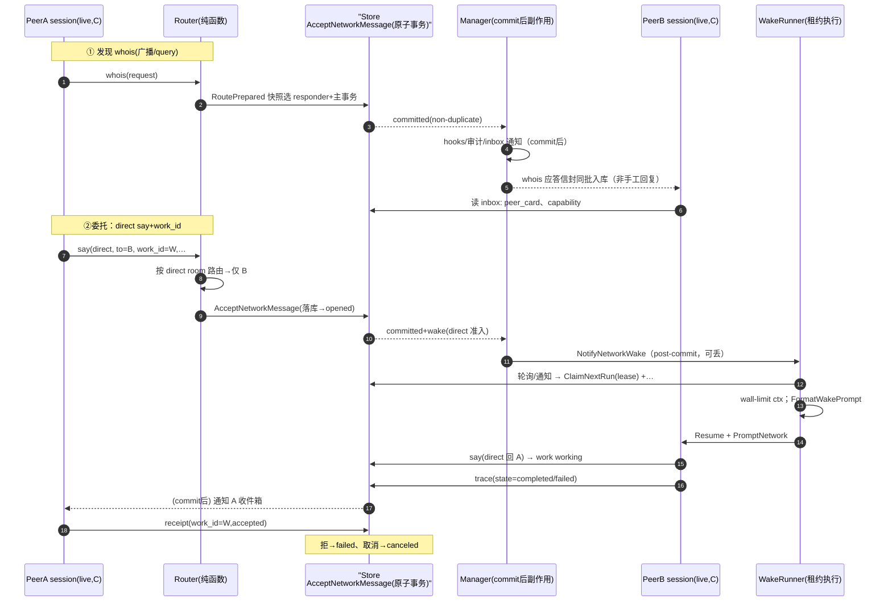
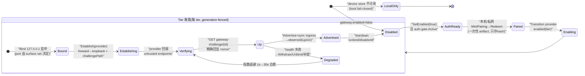

# CompozyOS Gateway 与 Compozy Network 解读：先持久后通知与收据闭环

> 本解读按 **ai-agent 类规格** 产出，解读基线为 compozy 源码 `release/v0.3.0`（HEAD 4efd8de）。

## 角色：去掉网关/网络层系统会怎样

CompozyOS 本体是单二进制 daemon：一个 workspace 里由 session manager 驱动 agent 执行，全部 local-first。去掉 `internal/network` 后，就只剩「单 agent 单轮对话」的闭环：

- 会话之间没有可见性。Peer 注册表只跟踪 daemon 本地成员，[internal/network/peer.go:45-45]()<!-- anchor: // PeerRegistry tracks daemon-local session membership only. -->：
  <!-- anchor: // PeerRegistry tracks daemon-local session membership only. -->
  Router 是无 broker、只基于本地 live presence 的纯路由，[internal/network/router.go:144-144]()<!-- anchor: // NewRouter constructs a broker-free router over daemon-local live presence. -->：
  <!-- anchor: // NewRouter constructs a broker-free router over daemon-local live presence. -->
  于是「一个 session 看到另一个 session、把消息点对点投给谁」在去掉网络层后根本不存在。
- 「唤醒」不存在。directed 消息在落库后如何变成目标 session 的一次执行，是 network+wake runner 的专属职责；拿掉后，活跃 loop 之间无法被“别处来的一条活”重新驱动，也谈不上「委托一段工作并以收据闭合」。
- 没有持久会话载体。thread/direct room/work 状态机全在 network 层语义里；拿掉后运行时协同只能靠进程内裸 channel，无法落库回放、审计。

去掉 `internal/gateway` 后，daemon 只剩下本地监听，没有任何受控的远程入口：

- 没有「设备」这一层身份，配对、撤销、把在途流踢下线这些远程管理原语全部消失。
- 没有 connectivity provider + challenge 验证链路，即使把端口转发到公网，operator 也无法证明转发真的指回本 daemon，暴露面只能是“盲配”。
- 没有 webhook ingress 的 subject 绑定与 endpoint-generation 确认，公网回调无法受控地路由进 workspace。

合起来：network 层把「一次执行」变成「可被其他执行发现、唤醒与委托的对象」；gateway 层把「daemon 进程」变成「可被可信设备从外部触达的对象」。二者同一目标的两面：把 local-first 单机升级为**可显式接入**的系统，且共用同一安全骨架（先持久后通知；先验证后暴露；身份不可伪造）。

## 解决什么问题、根因

### local-first 为什么仍需要显式远程与对等网络

根因在 1 中那两行注释已经给出：**路由是纯进程内的**。因为没有 broker，跨进程实体要参与协作，唯一途径是经 gateway 认证后以「本地 session」形态出现；出现后再经 session manager 的 BindNetworkPeer 绑定为 live peer，才被 Router 视为本地成员。绑定起点见 [internal/session/manager_network_peer_binding.go:33-41]()<!-- anchor: agent := session.AgentDefinition() -->：

<!-- anchor: 	agent := session.AgentDefinition() -->
该函数（BindNetworkPeer，真实行 33-41）逻辑为：仅当 `spec.Mode==ModeLive` 才继续，取 session 的 AgentDefinition 能力并经 `joinNetworkPeerWithBinding` 绑定进 live 通道。

- 所以 local-first 与显式远程不矛盾：单机内核保持「无 broker、可离线、可审计」的简单性；要联网时由 gateway 显式折叠远端为本地 peer，network 在本地把它们组织成 channel/thread/direct 会话。
- 底线是不变量：**没有 gateway 就没有任何非本地入口**。boot 时 device store 缺失会直接 fail-closed 成 local-only（见『边界场景』）。

### 收据（receipt）解决什么问题

“delegate work and close it with receipts”要消除的是**委托无法可信闭合**的三类不确定：

1. 对方到底收没收到（admission）？
2. 干到哪一步、成没成（progress）？
3. 结束后再发消息会怎样（状态机）？

协议答案编码在互咬的两套枚举里：

- 信封级 `ReceiptStatus`：`accepted/rejected/duplicate/expired/unsupported/canceled`，[internal/network/envelope.go:67-74]()<!-- anchor: const ( -->：
  <!-- anchor: 	ReceiptStatusAccepted    ReceiptStatus = "accepted" -->
  <!-- anchor: 	ReceiptStatusCanceled    ReceiptStatus = "canceled" -->
- work 级 `WorkState`：`submitted/working/needs_input/completed/failed/canceled`，[internal/network/envelope.go:164-171]()<!-- anchor: const ( -->：
  <!-- anchor: 	WorkStateSubmitted  WorkState = "submitted" -->
  <!-- anchor: 	WorkStateCanceled   WorkState = "canceled" -->

咬合逻辑（详见『Envelope 与生命周期』与『Network 核心』表）：receipt `rejected` → work `failed`，`canceled` → work `canceled`；`accepted/duplicate/expired/unsupported` 不推动 work（防收据把已推进的工作误复位）；work 进终态后所有后续消息统一 `reject_work`（reason `work_closed`）。收据因此同时回答三问：**admission 有显式状态；progress 用 trace 状态收敛；终态单向阀防重开**——委托以幂等、可审计方式闭合。

### 根因小结

| 约束 | 推论 |
|---|---|
| 无 broker 本地优先内核 | 远端必须经 gateway 折叠成本地 live peer，才可被 Router 路由 |
| 异步 agent 会话（A 唤醒 B，无同步 RPC） | 需要 durable 消息 + 显式 work 状态机 + receipt 闭合 |
| 崩溃要自愈、通知可丢 | durable-commit-then-notify（先落库后通知）+ store 轮询补偿（流程 (a)） |

## 设计思路与核心模式

### 身份与命名：peer_id 是本地作用域、不可伪造；verified 身份在其外

- **PeerID 文法**：`^[a-z0-9][a-z0-9._-]{0,127}$`，独立子包定义，[internal/network/identifier/peer.go:13-13]()<!-- anchor: PeerIDPattern = `^[a-z0-9][a-z0-9._-]{0,127}$` -->：
  <!-- anchor: 	PeerIDPattern = `^[a-z0-9][a-z0-9._-]{0,127}$` -->
  envelope 参与者校验（from/to/mentions）全量复用同一文法，[internal/network/validate.go:219-235]()<!-- anchor: func validateEnvelopeParticipants(env Envelope) error { -->：
  <!-- anchor: func validateEnvelopeParticipants(env Envelope) error { -->
  <!-- anchor: 	if err := ValidatePeerID(env.From); err != nil { -->
- **live peer_id 是“agent名+会话id”派生**，[internal/session/network_peer_identity.go:10-12]()<!-- anchor: func networkPeerID(agentName string, sessionID string) string { -->：
  <!-- anchor: func networkPeerID(agentName string, sessionID string) string { -->
  <!-- anchor: 	return strings.ToLower(strings.TrimSpace(agentName)) + "." + strings.TrimSpace(sessionID) -->
  也就是说 v0 的 peer 身份是一个**唯一锚定到本地 session** 的进程内标识（`agentName.sessionID`），不可能被另一进程“顶名”——daemon 认证并持有该 session。displayName 只是 UI 友好名，不是信任锚。
- **“verified 身份（nickname@fingerprint）”不在本文**：envelope 的 `Proof` 字段被刻意设计为 opaque、向前兼容（[internal/network/envelope.go:190-190]()<!-- anchor: // Proof preserves the opaque protocol proof payload for forward compatibility. -->），v0 network 不解释 proof：
  <!-- anchor: // Proof preserves the opaque protocol proof payload for forward compatibility. -->
  `nickname@fingerprint` 的签名验证与 “verified 无有效 proof 判 rejected、非 unverified” 防御位于身份/claim-token 侧（见『与其它模块协同』[WIP]）。network 层可验证性贡献是：capability 自带 canonical digest（见『发现与能力』），以及 envelope 全字段递归禁止 raw secret（见『不变量即代码』）。

### Envelope 与生命周期：线上一律是“可校验的确定形态”

**Envelope** 把所有会话维度展开为独立校验的顶层字段，[internal/network/envelope.go:196-218]()<!-- anchor: // Envelope is the shared Compozy Network v0 wire envelope. -->：

<!-- anchor: // Envelope is the shared Compozy Network v0 wire envelope. -->
<!-- anchor: 	Proof       *Proof          `json:"proof"` -->
要点：kind/from/to/mentions/work_id/reply_to/trace_id/causation_id/ts/expires_at/body/proof/ext 全部顶层化；解码先 reject legacy 字段（[internal/network/envelope.go:220-232]()<!-- anchor: // UnmarshalJSON rejects obsolete hard-cut wire fields before decoding. -->）：
<!-- anchor: // UnmarshalJSON rejects obsolete hard-cut wire fields before decoding. -->
body 解码是 kind-specific 且归一化后过 kind 规则（如 whois response 必须有 `reply_to` 且 `peer_card.peer_id==from`），[internal/network/envelope_body.go:81-113]()<!-- anchor: func validateKindEnvelopeRules(env Envelope) error { -->：
<!-- anchor: func validateKindEnvelopeRules(env Envelope) error { -->
<!-- anchor: 		if typed.PeerCard.PeerID != env.From { -->
freshness 用 `ts + max_replay_age`（默认 5 分钟）双向限窗并对显式 `expires_at` 优先，[internal/network/validate.go:276-292]()<!-- anchor: func validateEnvelopeFreshness(env Envelope, opts ValidateOptions) error { -->：
<!-- anchor: func validateEnvelopeFreshness(env Envelope, opts ValidateOptions) error { -->
<!-- anchor: 		return fmt.Errorf("%w: expires_at=%d", ErrExpired, *env.ExpiresAt) -->
信封有 1 MiB 硬上限且 body/proof/ext JSON compact 成 canonical 字节后才存，[internal/network/validate.go:129-143]()<!-- anchor: func validateEnvelopeEncodedSize(env Envelope) error { -->：
<!-- anchor: func validateEnvelopeEncodedSize(env Envelope) error { -->
<!-- anchor: 	if len(encoded) > maxProtocolEnvelopeBytes { -->

**Work 生命周期机**（`internal/network/lifecycle.go`）：

- 只有 **say 或 capability** 信封且带 `work_id` 才能开启新 work，首条 directed 消息即 `submitted`，[internal/network/lifecycle.go:120-128]()<!-- anchor: func OpenWork(profileID string, env Envelope, at time.Time) (Work, error) { -->：
  <!-- anchor: // OpenWork opens a new work from the first directed message. -->
  <!-- anchor: 	if env.WorkID == nil { -->
- 同一 container（workspace/channel/surface/thread-or-direct）内 work_id 必须与容器一致；只有 initiator/target 能推状态机，[internal/network/lifecycle.go:198-235]()<!-- anchor: func validateWorkEnvelope(current Work, env Envelope) (Work, error) { -->：
  <!-- anchor: 	if !current.IsParticipant(env.From) { -->
  <!-- anchor: 		return fmt.Errorf( -->
  <!-- anchor: 			"%w: work_id=%v current=%q", -->
- directed say/capability 只能发给对手方（`validateWorkDirection`，[internal/network/lifecycle.go:237-256]()<!-- anchor: func validateWorkDirection(current Work, env Envelope) error { -->）；trace 按 `canApplyTrace` 迁移（`lifecycle.go:336-348,360-376`）；终态后消息一律 `LifecycleActionRejectWork` + reason `work_closed`（[internal/network/lifecycle.go:258-269]()<!-- anchor: func terminalWorkResult(work Work) (LifecycleResult, bool) { -->）。
  <!-- anchor: func terminalWorkResult(work Work) (LifecycleResult, bool) { -->
  <!-- anchor: 		ReasonCode: &reason, -->
receipt 迁移在 `applyReceipt`（[internal/network/lifecycle.go:315-334]()<!-- anchor: func applyReceipt(work Work, receipt ReceiptBody, at time.Time) (LifecycleResult -->）：rejected→failed、canceled→canceled、其余 unchanged。
  <!-- anchor: func applyReceipt(work Work, receipt ReceiptBody, at time.Time) (LifecycleResult, error) { -->
  <!-- anchor: 	case ReceiptStatusRejected: -->

### durable acceptance：先落库、后通知（最重要模式）

发送路径 `acceptPrepared` 的顺序就是架构断言的实现，[internal/network/manager_send.go:61-128]()<!-- anchor: func (m *Manager) acceptPrepared( -->：

1. 组 request（消息 entry + 全量 dispositions + wake admissions），[internal/network/manager_send.go:101-105]()<!-- anchor: request := store.AcceptNetworkMessageRequest{ -->：
   <!-- anchor: 	request := store.AcceptNetworkMessageRequest{ -->
   <!-- anchor: 		Admissions:   admissions, -->
2. **先原子持久化**，[internal/network/manager_send.go:106-110]()<!-- anchor: result, err := m.acceptance.AcceptNetworkMessage(ctx, &request) -->：
   <!-- anchor: 	result, err := m.acceptance.AcceptNetworkMessage(ctx, &request) -->
3. 仅当成功且非 duplicate，才做**进程内**副作用：hook/统计/协议审计（observeConversationWrite+recordAcceptedMessage）、收件箱 waiter 唤醒，[internal/network/manager_send.go:111-115]()<!-- anchor: if !result.Duplicate { -->：
   <!-- anchor: 	if !result.Duplicate { -->
   <!-- anchor: 		m.observeConversationWrite(ctx, entry, result.Conversation) -->
   <!-- anchor: 		m.notifyInboxRecipients(result.Dispositions) -->
4. 最后对每个 admission 发 post-commit wake 通知，[internal/network/manager_send.go:116-120]()<!-- anchor: for _, notification := range result.Notify { -->：
   <!-- anchor: 	for _, notification := range result.Notify { -->
   <!-- anchor: 			m.wakeNotifier.NotifyNetworkWake(notification) -->
   WakeNotifier 注释点明权威在 durable 侧：通知可延迟/丢失，[internal/network/manager.go:54-58]()<!-- anchor: // WakeNotifier receives post-commit wake notifications. The durable task run -->：
   <!-- anchor: // WakeNotifier receives post-commit wake notifications. The durable task run -->
   <!-- anchor: // remains authoritative if notification is delayed or lost. -->
5. whois 自动应答在主消息提交后才产生；duplicate 时先按已提交 recipients 过滤再应答，[internal/network/manager_send.go:121-127]()<!-- anchor: if result.Duplicate { -->：
   <!-- anchor: 	if result.Duplicate { -->
   <!-- anchor: 	if err := m.acceptWhoisResponses(ctx, route); err != nil { -->

Manager 自述是 durable-commit-then-notify，[internal/network/manager.go:85-86]()<!-- anchor: // Manager owns live membership and durable-commit-then-notify dispatch. -->；启动日志亦标注该语义，[internal/network/manager.go:171-171]()<!-- anchor: manager.logger.Info("network.started", "dispatch", "durable_in_process") -->：

<!-- anchor: // Manager owns live membership and durable-commit-then-notify dispatch. -->
<!-- anchor: 	manager.logger.Info("network.started", "dispatch", "durable_in_process") -->

### 发现与能力：whois 是“生成的响应”，capability 必须自带可验证 digest

- whois request 按 peer_card 字段（peer_id/displayName/capabilities/profiles/artifacts/trust_modes）子串匹配广播（[internal/network/router_whois.go:49-64]()<!-- anchor: func matchesWhoisQuery(card PeerCard, query string) bool { -->），但**响应不是手工回复**：路由阶段即为每个 selected responder 生成确定性信封，id = sha256(workspace/channel/request.ID/sessionID) 前 16 字节（[internal/network/router_whois.go:128-136]()<!-- anchor: func whoisResponseID(request Envelope, responder LocalPeer) string { -->）：
  <!-- anchor: func matchesWhoisQuery(card PeerCard, query string) bool { -->
  <!-- anchor: 	digest := sha256.Sum256([]byte(strings.Join([]string{ -->
  响应随主消息同批入库，可审计可去重。
- 能力目录经 ext 的 `compozy.include=capability_catalog` + `compozy.capability_ids` 按需投影，可按 id 收缩（[internal/network/capability_catalog.go:104-155]()<!-- anchor: func selectWhoisCapabilityCatalog( -->）；peer_card 里只放 `compozy.capabilities_brief` 投影（[internal/network/capability_brief.go:51-79]()<!-- anchor: func applyCapabilityBriefProjection( -->）。
  <!-- anchor: func selectWhoisCapabilityCatalog( -->
  <!-- anchor: func applyCapabilityBriefProjection( -->
- 转移的 capability 是**自证明文档**：`CapabilityEnvelopePayload` 的 `digest` 由 canonical 字段重算强校验，字段不符即 `ErrVerificationFailed`，[internal/network/envelope_body.go:198-216]()<!-- anchor: expectedDigest, err := compozyconfig.CanonicalCapabilityDigest(compozyconfig.Cap -->：
  <!-- anchor: 	expectedDigest, err := compozyconfig.CanonicalCapabilityDigest(compozyconfig.CapabilityDef{ -->
  <!-- anchor: 		"%w: capability.digest=%q does not match canonical digest %q", -->
  这给接受委托的 B 侧一个无需信任 A 的校验点。

### bounded wake：远端委托如何变成一次本地 agent 唤醒

一条 directed say（含 work_id）落库后如何驱动对方执行一次？分两层：

**network 层只决定“可不可唤醒”。** wake admission 只对 **KindSay** 且 addressed（`to==recipient`→direct；否则 `mentions` 含 recipient→mention）生成；capability/receipt/trace 不触发。addressed 的 wake 预分配 `wake-*`/`run-*` id 与消息同事务入 store。[internal/network/manager_send.go:230-280]()<!-- anchor: func (m *Manager) wakeAdmissions( -->：

<!-- anchor: func (m *Manager) wakeAdmissions( -->
<!-- anchor: 		eligible := delivery.Envelope.Kind == KindSay -->
<!-- anchor: 			input.WakeID = wakeID -->

**daemon 层负责租约化执行**（`internal/daemon/network_wake_runner*.go`）：

- 进程内通知只是加速：`notifications` 是有界 chan（容量 256），满即记 `notification_deferred` 丢弃（`network_wake_runner.go:18-21,129-142`），因为每 1s 会从 store `ListQueuedNetworkWakes` 重新捞（[internal/daemon/network_wake_runner_dispatch.go:118-130]()<!-- anchor: case <-ticker.C: -->）——重启自愈，内存队列不权威。
  <!-- anchor: 	networkWakePollInterval = time.Second -->
  <!-- anchor: 	networkWakeQueueSize    = 256 -->
- 执行前 `ClaimNextRun` 领带租约的 run（RunKindNetworkWake、ScopeWorkspace、lease），冲突即让路（[internal/daemon/network_wake_runner_attempt.go:24-42]()<!-- anchor: claim, err := r.tasks.ClaimNextRun(ctx, taskpkg.ClaimCriteria{ -->），幂等由 task store 的 run-kind fence 保证。
  <!-- anchor: 	claim, err := r.tasks.ClaimNextRun(ctx, taskpkg.ClaimCriteria{ -->
- **bound**：每 wake 预留 wall time，执行用 `context.WithTimeout(turnCtx, wallLimit)` 掐表（[internal/daemon/network_wake_runner_attempt.go:95-103]()<!-- anchor: wallLimit, err := time.ParseDuration(reservation.ReservedWallTime) -->），心跳按 lease/3 续租（[internal/daemon/network_wake_runner_attempt.go:180-216]()<!-- anchor: func (r *networkWakeRunner) startHeartbeat( -->），结局统一 `SettleNetworkWake` 结算（[internal/daemon/network_wake_runner_settlement.go:12-45]()<!-- anchor: func (r *networkWakeRunner) terminalizeWake( -->）。
  <!-- anchor: 	turnCtx, cancel := context.WithTimeout(ctx, wallLimit) -->
  <!-- anchor: 	_, settlementErr := r.tasks.SettleNetworkWake(terminalCtx, taskpkg.NetworkWakeSettlement{ -->
- prompt 本身 bounded：最多 32 条、64 KiB（[internal/network/wake_prompt.go:15-19]()<!-- anchor: const ( -->）；超预算单条裁成 `body_omitted=true+body_preview`，附 fetch 指令，保证 agent 拿到的永远是**已提交且可回读**的内容（[internal/network/wake_prompt.go:94-133]()<!-- anchor: func renderNetworkWakePromptRecord( -->）。
  <!-- anchor: 	networkWakePromptMaxMessages = 32 -->
  <!-- anchor: 	networkWakeFetchInstruction  = "Read the committed inbox message by message_id for full content." -->
- 唤醒 meta `Trust: "untrusted"`，delivery mode 由持久化 PeerTo 判定（`wake_prompt.go:86-91,143-148`）——被唤醒 agent 得到的是“外部输入、不受信但已提交”的上下文。
  <!-- anchor: 		Trust:        networkWakeTrustUntrusted, -->
  <!-- anchor: func wakeDeliveryMode(message store.NetworkMessageEntry, targetSessionID string) string { -->

### 不变量即代码：raw secret 禁令双向落地

- **入闸**：`validateEnvelopeContainsNoRawSecrets` 递归扫 body/proof/ext（[internal/network/envelope_security.go:13-30]()<!-- anchor: func validateEnvelopeContainsNoRawSecrets(env Envelope) error { -->）。key 黑名单覆盖归一化后的 `claimtoken/apikey/accesstoken/password/secret/…`，但含 “hash” 的 key 放行（可携带 claim_token_hash），[internal/network/envelope_security.go:90-103]()<!-- anchor: func envelopeKeyCarriesRawSecret(key string) bool { -->：
  <!-- anchor: func envelopeKeyCarriesRawSecret(key string) bool { -->
  <!-- anchor: 	case "apikey", "accesstoken", "refreshtoken", "mcpauthtoken", "oauthcode", -->
  <!-- anchor: 		"clientsecret", "authorization", "password", "secret", "token", "claimtoken": -->
  值侧再叠加 `task.RedactClaimTokens`/`diagnostics.Redact` 判断字符串是否含可红action 敏感物（[internal/network/envelope_security.go:68-73]()<!-- anchor: func envelopeStringContainsSecret(value string) bool { -->）：
  <!-- anchor: 	return taskpkg.RedactClaimTokens(value) != value || diagnostics.Redact(value) != value -->
  这从协议层杜绝“把 claim_token 塞 body 外溢”。
- **出闸**：预持久化 rejection 日志只记 `payload_sha256` 摘要，不落 body/ext 原文（[internal/network/manager_send.go:428-456]()<!-- anchor: func (m *Manager) logPrePersistenceRejection( -->）；协议日志/审计字段化，无正文（[internal/network/manager_logging.go:111-156]()<!-- anchor: func networkLogFields(envelope Envelope, extra ...any) []any { -->）。
  <!-- anchor: 		"payload_sha256", hex.EncodeToString(hasher.Sum(nil)), -->
  <!-- anchor: func networkLogFields(envelope Envelope, extra ...any) []any { -->

### Gateway：配对 → 分层暴露 → 验证后可达，暴露面是“清单”不是“开关”

Gateway 领域分四层正交概念（`internal/gateway/types.go`）：

- **Tier**：`private` / `public`（[internal/gateway/types.go:39-44]()<!-- anchor: type Tier string -->），两条独立可达性管线；
  <!-- anchor: 	TierPrivate Tier = "private" -->
  <!-- anchor: 	TierPublic  Tier = "public" -->
- **Surface**：`operator_ui` / `webhook_ingress`（[internal/gateway/types.go:57-71]()<!-- anchor: type Surface string -->），同一 tier 内按 surface 精确启停；
  <!-- anchor: 	SurfaceOperatorUI     Surface = "operator_ui" -->
  <!-- anchor: 	SurfaceWebhookIngress Surface = "webhook_ingress" -->
- **Provider**：extension connectivity source，每 tier 同时只允许一个 enabled provider（[internal/gateway/types.go:22-22]()<!-- anchor: ErrTierProviderConflict = errors.New("gateway tier already has an enabled provid -->）：
  <!-- anchor: 	// ErrTierProviderConflict reports that a tier already has an enabled provider. -->
- **Device**：能访问 surface 的客户端，经 pairing 产生、credential/stream-ticket 认证。

核心模式是 **desired/observed 分离 + generation 乐观并发**：operator 写 desired（`Transition` 持久化），Reconciler 收敛 desired→observed（Bind→Establish→Verify→Advertise），任何一步失败都走补偿并 Degraded；每个副作用前后 `assertCurrent` 校验 generation 未变（防按陈旧意图执行外部效果）。[internal/gateway/reconciler.go:195-272]()<!-- anchor: func (r *Reconciler) enableTier(ctx context.Context, plan TierPlan) error { -->：

<!-- anchor: func (r *Reconciler) enableTier(ctx context.Context, plan TierPlan) error { -->
<!-- anchor: 	if err := r.effects.Advertise(ctx, reachability, surfaces); err != nil { -->
<!-- anchor: 	if err := r.assertCurrent(ctx, plan); err != nil { -->
compensation 回滚（withdraw+teardown+unbind）在 [internal/gateway/reconciler.go:303-317]()<!-- anchor: func (r *Reconciler) compensateTier( -->：
<!-- anchor: func (r *Reconciler) compensateTier( -->
**public operator UI** 还有两道额外闸：须已有 ≥1 台配对设备，且 operator 显式 consent（[internal/gateway/policy_transition.go:200-210]()<!-- anchor: if req.Desired == DesiredEnabled && req.Surface == SurfaceOperatorUI && req.Tier -->）；webhook_ingress 仅 public tier（[internal/gateway/policy_transition.go:188-193]()<!-- anchor: if req.Surface == SurfaceWebhookIngress && req.Tier != TierPublic { -->）。

<!-- anchor: 			if len(snapshot.Devices) == 0 { -->
<!-- anchor: 		if req.Surface == SurfaceWebhookIngress && req.Tier != TierPublic { -->

### 认证与暴露的“诚实投影”

- 认证全在 daemon 本地做：普通请求凭 device credential（Bearer/cookie，常数时间比对 hash），SSE 长流凭一次性 stream ticket；变更请求叠加“撤销感知 mutation lease”（commit 前再验 epoch），详见『关键实现归组』的 Gateway 小节。
- Status 只把**已通过 challenge 验证**的端点标 `Live:true`；provider 错误一律 redact+截断到 2 KiB（[internal/gateway/status.go:28-51]()<!-- anchor: if tierRuntime.Advertised { -->）：
  <!-- anchor: 					Live: true, -->
  <!-- anchor: 			Cause: diagnostics.RedactAndBound( -->
  gateway posture audit 把 exposure refused=critical、public operator UI=warning、90 天无活动设备=warning 编码成 findings（[internal/gateway/audit.go:129-161]()<!-- anchor: func auditFindings(status Status, highlights AuditDeviceHighlights) []AuditFindi -->）：
  <!-- anchor: 	if status.Refusal != nil { -->
  <!-- anchor: 		ID: "gateway.public.operator_ui_exposed", Severity: AuditSeverityWarning, -->
  <!-- anchor: 		ID:       "gateway.devices.stale", -->

## 核心流程

### 流程 (a)：两台 live peer 的对等交互——发现/握手/消息/委托/收据

说明（以源码为准）：peers 是 daemon 内的 live session（[internal/network/peer.go:45-45]()<!-- anchor: // PeerRegistry tracks daemon-local session membership only. -->（见『角色』）。第二台设备经 gateway 认证后成为本机 session 并绑定为 live peer（[internal/session/manager_network_peer_binding.go:33-41]()<!-- anchor: agent := session.AgentDefinition() -->），随后由 Router 按本地 presence 路由。跨 daemon 桥接见『与其它模块协同』[WIP]。

> 图中“打开 work / 推进状态”由 store 事务在持久化时一并判定（work_opened/transitioned/closed 作为写结果返回，network 只消费它派发 hook，见 [internal/network/hooks.go:217-241]()<!-- anchor: func networkHookEventsForWrite( --> 与『Network 核心』表）；whois 自动应答经 `acceptWhoisResponses` 在提交后同路径生成（见『durable acceptance』流程第 5 步）。

### 流程 (b)：gateway 配对与暴露面（以源码为准）

文字版关键路径（均给出证据）：

1. **配对只允许本机/私网**：MintPairing 拒绝 public source，[internal/gateway/device_service.go:147-152]()<!-- anchor: func (s *DeviceService) MintPairing(_ context.Context, req PairingRequest) (Pair -->：
   <!-- anchor: func (s *DeviceService) MintPairing(_ context.Context, req PairingRequest) (PairingArtifact, error) { -->
   <!-- anchor: 	if req.Source != PairingSourceLocal && req.Source != PairingSourcePrivate { -->
   artifact 为 `cpz_gwp_` 前缀 + 32B 随机（[internal/gateway/device_credential.go:34-51]()<!-- anchor: func generatePairingArtifact(entropy io.Reader) (string, error) { -->），store 只存 sha256（[internal/gateway/pairing.go:75-75]()<!-- anchor: p.entries[hashCredential(artifact)] = pairingEntry{expiresAt: expiresAt, source: -->），redeem 单次消费（[internal/gateway/pairing.go:101-126]()<!-- anchor: func (p *pairingStore) Redeem(artifact string, issue func(PairingSource) error)  -->）；设备行同样只存 TokenHash（[internal/gateway/device_service.go:189-194]()<!-- anchor: if createErr := s.store.CreateDevice(ctx, StoredDeviceSession{ -->）。authenticate 走常数时间比对 + 未 revoked 校验（[internal/gateway/device_service.go:203-218]()<!-- anchor: func (s *DeviceService) Authenticate(ctx context.Context, credential string) (De -->）。
   <!-- anchor: 	p.entries[hashCredential(artifact)] = pairingEntry{expiresAt: expiresAt, source: source} -->
   <!-- anchor: 	entry, ok := p.entries[digest] -->
   <!-- anchor: 			Session: device, TokenHash: hashCredential(credential), -->
   <!-- anchor: func (s *DeviceService) Authenticate(ctx context.Context, credential string) (DeviceSession, error) { -->
2. **暴露启停是显式转换**：`gateway.enabled=false` 是总闸，所有 enabled 意图都拒（[internal/gateway/policy_transition.go:149-155]()<!-- anchor: if req.Desired == DesiredEnabled && !p.enabled.Load() { -->）；auth gate（设备认证可用）未 active 也拒（[internal/gateway/policy_transition.go:158-172]()<!-- anchor: func (p *policy) validateTransitionAuth(ctx context.Context, req TransitionReque -->）；public operator UI 还需 ≥1 设备 + consent（[internal/gateway/policy_transition.go:200-210]()<!-- anchor: if req.Desired == DesiredEnabled && req.Surface == SurfaceOperatorUI && req.Tier -->）。
   <!-- anchor: 	if req.Desired == DesiredEnabled && !p.enabled.Load() { -->
   <!-- anchor: 	if req.Desired == DesiredEnabled { -->
   <!-- anchor: 		if !req.Consent { -->
3. **tier 收敛是单向依赖链**：preflight provider（live 重推导信任：manifest 需声明 `gateway.<tier>` scope，非 bundled 需 digest 三方一致，[internal/gateway/provider_supervisor.go:380-406]()<!-- anchor: func (s *ProviderSupervisor) authorize(ctx context.Context, activation ProviderA -->）→ Bind 本地监听 127.0.0.1（private/public 端口 + surface set，[internal/daemon/gateway_tier_server.go:14-45]()<!-- anchor: func defaultGatewayTierServerFactory( -->）→ Establish provider（把 loopback 转发出去，带 challengePath/deadline，[internal/gateway/provider_supervisor.go:214-247]()<!-- anchor: reachability, err := source.Establish(callCtx, EstablishRequest{ -->）→ Verify 每个 endpoint 精确回显 nonce（public 强制 HTTPS、禁 redirect、≤64KiB、经 outbound policy 拨号，[internal/gateway/endpoint_verify.go:92-150]()<!-- anchor: func (v *EndpointVerifier) Verify( -->）→ Advertise + sync ingress endpoint → mark observed。全程多次 `assertCurrent`，generation 变即 ErrStaleGeneration + 补偿（`reconciler.go:237-266,303-317`）。
   <!-- anchor: 	path, nonce, cleanup, err := s.challenges.Begin(activation.Tier) -->
   <!-- anchor: 	reachability, err := source.Establish(callCtx, EstablishRequest{ -->
   <!-- anchor: 		if err := s.verifier.Verify(verifyCtx, reachability.Tier, endpoint, session.path, session.nonce); err != nil { -->
   <!-- anchor: 	if string(body) != nonce { -->
   <!-- anchor: 		httpapi.WithHost("127.0.0.1"), -->
4. **tier listener 上的认证与准入**：deviceAuthMiddleware 区分普通请求（credential）与流式请求（一次性 stream ticket + 注册 ConnectionRegistry），mutation 请求叠 lease（commit 前 RevalidateForCommit），[internal/api/httpapi/gateway_auth.go:41-122]()<!-- anchor: if isGatewayStreamRequest(c.Request) { -->；请求级准入只在 surface 处于 Advertised+accepting 时放行，[internal/api/httpapi/gateway_admission.go:17-35]()<!-- anchor: func (h *Handlers) gatewayAdmissionMiddleware(tier gateway.Tier, surface gateway --> 与 [internal/gateway/reconciler.go:132-150]()<!-- anchor: func (r *Reconciler) Acquire(tier Tier, surface Surface) (func(), error) { -->：
   <!-- anchor: 		if isGatewayStreamRequest(c.Request) { -->
   <!-- anchor: 	device, err := h.deviceAuth.Authenticate(c.Request.Context(), credential) -->
   <!-- anchor: 		release, err := h.gatewayAdmission.Acquire(tier, surface) -->
   <!-- anchor: func (r *Reconciler) Acquire(tier Tier, surface Surface) (func(), error) { -->
5. **撤销**：先抢 revocation 门（等 in-flight mutation 排空、取消其 ctx，[internal/gateway/mutation_gate.go:73-102]()<!-- anchor: func (g *mutationGate) beginRevocation(ctx context.Context, deviceID string) (fu -->），持久化 RevokedAt 并 bump epoch（[internal/gateway/device_service.go:251-292]()<!-- anchor: func (s *DeviceService) RevokeDevice(ctx context.Context, deviceID string) (Revo -->），再经 ConnectionRegistry 掐断该设备所有流并等 teardown（[internal/gateway/connection_registry.go:67-92]()<!-- anchor: func (r *LiveConnectionRegistry) CancelDevice(ctx context.Context, deviceID stri -->）。
   <!-- anchor: func (g *mutationGate) beginRevocation(ctx context.Context, deviceID string) (func(bool), error) { -->
   <!-- anchor: 	canceled, cancelErr := s.connections.CancelDevice(terminationCtx, deviceID) -->
   <!-- anchor: func (r *LiveConnectionRegistry) CancelDevice(ctx context.Context, deviceID string) (int, error) { -->

### 边界场景（源码即语义）

- **fail-closed boot**：device store 缺失 → 构造无 effects 的 Policy，Reconcile 只吞 `ErrExposureRefused` 并留 warning “continuing local-only”（[internal/daemon/boot_gateway.go:25-42]()<!-- anchor: func (d *Daemon) bootFailClosedGateway( -->）；connectivity provider 不可用同样降级 local-only（[internal/daemon/boot_gateway.go:135-161]()<!-- anchor: func (d *Daemon) resolveGatewayProviderEffects( -->）。
  <!-- anchor: func (d *Daemon) bootFailClosedGateway( -->
  <!-- anchor: 	state.logger.Warn("daemon: gateway device store unavailable; continuing local-only") -->
- **provider 抖动**：degrade 事件收线并 mark Degraded（[internal/gateway/reconciler.go:402-436]()<!-- anchor: func (r *Reconciler) handleProviderDegraded( -->），随后 scheduleRecovery 以 1s→30s 指数退避、在 desired/generation 未变时自动重跑 enableTier（[internal/gateway/reconciler_recovery.go:43-111]()<!-- anchor: func (r *Reconciler) scheduleRecoveryLocked(activation ProviderActivation) { -->）。
  <!-- anchor: func (r *Reconciler) handleProviderDegraded( -->
  <!-- anchor: func (r *Reconciler) runProviderRecovery(recovery *providerRecovery) { -->
- **provider 端点“说谎”**：Establish 回报只是 untrusted 声明，必须过 Verify；Verify 前把 reachable 与 session 记录比对，变化即拒（防 TOCTOU），[internal/gateway/provider_supervisor.go:263-298]()<!-- anchor: // Verify proves every endpoint reaches the active challenge on the assigned tie -->：
  <!-- anchor: // Verify proves every endpoint reaches the active challenge on the assigned tier. -->
  <!-- anchor: 		return fmt.Errorf("%w: reachability changed before verification", ErrEndpointUnverified) -->

## 关键实现归组

> 表内行号是从源码逐行确认的**定位索引**；正文论点均附逐字锚点，表不再重复锚点。

### Network 核心（internal/network）

| 归组 | 定位索引 | 要点 |
|---|---|---|
| 协议常量 | `envelope.go:12,15-24,43-54,64-74,93-99,114-133,161-171,190-194` | ProtocolV0=compozy-network/v0；6 kinds；surface=thread/direct；receipt status；reason_code 注册表；work state；opaque Proof/Ext |
| Envelope/校验 | `envelope.go:196-218,220-232`；[internal/network/envelope_clone.go:10-33]()<!-- anchor: func normalizeEnvelopeCopy(env Envelope) Envelope { -->；[internal/network/envelope_security.go:13-113]()<!-- anchor: func validateEnvelopeContainsNoRawSecrets(env Envelope) error { -->；`validate.go:41-45,54-88,90-143,260-292` | 全字段 trim；1MiB 上限；canonical compact；replay 双向窗口；raw-secret 递归禁令；legacy 硬切 |
| 容器/会话身份 | `envelope_conversation.go:10-41,43-65`；[internal/network/envelope_body.go:81-113]()<!-- anchor: func validateKindEnvelopeRules(env Envelope) error { -->；[internal/network/router_envelope.go:26-79]()<!-- anchor: func buildEnvelope(input envelopeInput, now time.Time, maxReplayAge time.Duratio --> | work_id 归属 kind；direct_id 由双方 session identity 推导，自报不符即 ErrDirectRoomCollision |
| Router | `router.go:135-171,218-276,278-337`；`router_whois.go:16-47,66-83,128-136` | 预消息快照选收件人；thread 走 durable participant resolver；whois 应答确定性生成 |
| Peer 注册表 | `peer.go:14-36,45-51,98-165,232-252` | 本地成员；channel 内 peer_id 单主；session 换 peer 先 leave |
| Manager | `manager.go:17-21,23-30,85-109,143-173,194-245`；[internal/network/manager_membership.go:27-141]()<!-- anchor: // JoinChannel registers one daemon-local Live execution as visible presence. -->；`manager_send.go:25-152,230-302,428-456`；`manager_inbox.go:15-92,144-194` | durable-commit-then-notify；detached send ctx(30s)；wake admission 只算 say+addressed；inbox 永远从 durable store 读 |
| Work 生命周期 | `lifecycle.go:10-38,120-155,157-269,271-376` | 开启仅 say/capability；参与者/方向/容器三重校验；receipt/trace 迁移；终态 reject |
| 唤醒 prompt | `wake_prompt.go:15-19,32-92,94-148` | bounded(32/64KiB)；body 可裁 + fetch 指令；Trust=untrusted |
| hooks/审计/日志 | `hooks.go:12-46,55-85,217-290`；`audit.go:17-26,237-286,361-396`；`manager_logging.go:12-66,111-196` | hook 只看 committed write；sent 审计 commit 后 file-only；字段化日志 |
| 参与契约 | `participation/types.go:6-32,43-136`；`participation/bounds.go:16-24,51-133,135-190,270-288`；`participation/resolver.go:42-127,188-212,247-352`；[internal/network/rules/channel.go:5-9]()<!-- anchor: var channelPattern = regexp.MustCompile(`^[a-z0-9][a-z0-9_-]{0,63}$`) --> | live bounds 全 positive+ceiling+JS-safe；named 校验存在；run/loop_run 派生通道名 |
| 能力投影 | `capability_catalog.go:11-13,38-102,104-181`；[internal/network/capability_brief.go:16-79]()<!-- anchor: func projectCapabilityBriefView( -->；[internal/network/greet_summary.go:13-38]()<!-- anchor: func ResolveGreetSummary(card PeerCard, summary string) string { -->；[internal/network/body_preview.go:8-44]()<!-- anchor: func previewForBody(body Body) string { --> | whois 可选按 id 投影目录；peer_card 只带 brief |

### daemon 侧唤醒执行（internal/daemon/network_wake_runner*.go）

| 定位索引 | 要点 |
|---|---|
| `network_wake_runner.go:16-21,33-54,72-90,129-142` | 1s 轮询 + 256 有界通知队列 + scan limit 1000 + 100ms 重试；Notify 非阻塞，满即 deferred |
| `network_wake_runner_dispatch.go:33-55,57-65,67-134,136-199` | workspace\x00session 去重；per-session 串行（activeKeys）；周期 reload durable wakes 崩溃自愈 |
| `network_wake_runner_attempt.go:17-85,87-156,158-217` | ClaimNextRun(lease)→LoadNetworkWake→wall-limit ctx→Resume+PromptNetwork→heartbeat→fail/release |
| [internal/daemon/network_wake_runner_outcome.go:12-58]()<!-- anchor: func (r *networkWakeRunner) collectWakeOutcome( --> | 结局收敛：succeeded/failed/deadline_exceeded/canceled + 实际 token usage |
| [internal/daemon/network_wake_runner_settlement.go:12-78]()<!-- anchor: func (r *networkWakeRunner) terminalizeWake( --> | SettleNetworkWake 结算；失败则 release lease 待重试 |
| [internal/daemon/boot_network.go:12-66]()<!-- anchor: func (d *Daemon) bootNetwork(ctx context.Context, state *bootState, cleanup *boo --> | runner 先建并 SetEnabled(cfg.Network.Enabled)；manager 注入 store/hook/wakeNotifier |

### Gateway（internal/gateway + daemon 装配）

| 归组 | 定位索引 | 要点 |
|---|---|---|
| 领域类型 | `types.go:12-23,39-44,57-91,119-136,163-250` | tier/surface/desired/observed/generation/reachability |
| 策略与转换 | `policy.go:23-42,67-113`；`policy_transition.go:10-36,142-240` | Transition→持久化 desired→reconcile；validate 先于持久化（refusal 带 cause+fix） |
| 收敛器 | `reconciler.go:20-28,132-193,195-317,386-489`；[internal/gateway/reconciler_enable.go:28-54]()<!-- anchor: func (r *Reconciler) bindTierForEnable( -->；[internal/gateway/reconciler_recovery.go:43-111]()<!-- anchor: func (r *Reconciler) scheduleRecoveryLocked(activation ProviderActivation) { --> | bind→establish→verify→advertise + generation 栅栏 + 补偿回滚 + 退避自愈 |
| Provider 监督 | `provider_supervisor.go:121-247,249-346,349-461`；[internal/gateway/provider_trust.go:12-33]()<!-- anchor: type ProviderTrust struct { -->；[internal/gateway/connectivity.go:23-99]()<!-- anchor: type EndpointStability string --> | 每次重推导信任(scope+digest)；challenge 一次性；Reachability 变化即拒 |
| 端点验证 | `endpoint_verify.go:30-150,167-282` | public 强制 HTTPS、DoT public resolver、禁 redirect、≤64KiB、nonce 精确回显 |
| 设备/配对/凭证 | `device_service.go:147-218,251-356`；[internal/gateway/device_credential.go:15-78]()<!-- anchor: const ( -->；[internal/gateway/pairing.go:17-134]()<!-- anchor: // pairingStore is a bounded, process-local set of single-use pairing artifacts. -->；[internal/gateway/stream_ticket.go:16-97]()<!-- anchor: // streamTicketStore is a bounded, process-local set consumed atomically at stre --> | mint 仅 local/private；单次 redeem；只存 sha256；常数时间比对；单次 stream ticket |
| 撤销/并发 | [internal/gateway/mutation_gate.go:36-175]()<!-- anchor: func (g *mutationGate) acquire(ctx context.Context, deviceID string) (context.Co -->；[internal/gateway/connection_registry.go:15-94]()<!-- anchor: // LiveConnectionRegistry indexes live stream cancellation by durable device ID. --> | 撤销等 in-flight 排空；commit 前 epoch 校验 |
| 认证中间件 | [internal/api/httpapi/gateway_auth.go:24-202]()<!-- anchor: func (h *Handlers) deviceAuthMiddleware() gin.HandlerFunc { -->；[internal/api/httpapi/gateway_admission.go:17-36]()<!-- anchor: func (h *Handlers) gatewayAdmissionMiddleware(tier gateway.Tier, surface gateway -->；[internal/gateway/auth_limiter.go:54-139]()<!-- anchor: // Allow reports whether a source may attempt authentication. Local operator tra --> | credential vs stream-ticket 双路径；mutation lease；admission 只在 Advertised 时放行 |
| webhook ingress | `ingress.go:62-138,193-256,298-352`；[internal/gateway/ingress_types.go:10-137]()<!-- anchor: // IngressSubjectKind identifies a resource that can receive public callbacks. --> | 绑定确认在当前已验证 endpoint generation；agent 只允许 workspace 级；事件失败补偿回滚 |
| 状态/审计 | [internal/gateway/status.go:9-99]()<!-- anchor: func projectStatus( -->；[internal/gateway/audit.go:66-161]()<!-- anchor: func (s *Service) Audit(ctx context.Context) (AuditReport, error) { -->；[internal/gateway/store.go:8-39]()<!-- anchor: // Store owns the atomic desired-state transitions used by Policy. --> | 只投影 verified live；错误全 redact；generation 持久化 |
| daemon 装配 | `daemon/boot_gateway.go:13-42,44-110`；[internal/daemon/gateway_tier_server.go:14-45]()<!-- anchor: func defaultGatewayTierServerFactory( -->；`gateway_listener_effects.go:40-158,160-265` | fail-closed local-only；127.0.0.1 端口与 surface set 由 desired 决定 |

### openapi 契约概貌（对照）

openapi 标题 `Compozy API 1.0.0`，共 438 条 path。对照源码只概貌：

- **网络面**收敛为 workspace 作用域 REST：`/api/workspaces/{id}/network/{channels,channels/{ch}/threads|directs|subscriptions,peers,inbox,send,usage,work/{id}}`，另有 `/api/workspaces/{id}/network-coordination`（含 invitation）与 `/api/agent/channels`（channels/recv/send/reply，agent caller 协作通道，路由见 [internal/api/httpapi/agent_routes.go:14-17]()<!-- anchor: agent.GET("/channels", handlers.AgentChannels) -->）。compozy-network/v0 作为**值**出现在 peer_card 的 `profiles_supported` 等字段约束（源码常量 [internal/network/envelope.go:12-12]()<!-- anchor: const ProtocolV0 = "compozy-network/v0" -->），openapi 无独立 version 段。
  <!-- anchor: 	agent.GET("/channels", handlers.AgentChannels) -->
- **网关面**：`/api/gateway/{status,pairings,pairings/redeem,devices,devices/{id},stream-tickets,surfaces,providers/{name}/enable|disable,ingress-bindings}`，对应 Policy/DeviceService/ingress 方法集（[internal/api/core/gateway_interfaces.go:10-25]()<!-- anchor: type GatewayService interface { -->）。
  <!-- anchor: type GatewayService interface { -->
- 一致性：枚举/错误码在代码中定义并经 `internal/api/spec/*` 生成契约（[internal/api/spec/participation_schema.go:30-30]()<!-- anchor: string(participation.SourceWorkspaceCoordination), --> 引用 SourceWorkspaceCoordination 即一例）；codegen 是否双向 [WIP]。

## 与其它模块协同（跨模块断言）

- **store 族**：Manager 的“先持久”语义来自 `NetworkAcceptanceStore.AcceptNetworkMessage`（entry+dispositions+wake admissions 原子提交）与 conversation/inbox/causation/subscription store（接口引用散见 [internal/network/manager_send.go:18-23]()<!-- anchor: type networkSubscriptionStore interface { -->、[internal/network/manager.go:67-73]()<!-- anchor: conversations store.NetworkConversationStore -->）；表结构/事务归 data-model 切片；store 侧确切行号 [WIP]。
- **session/loop 唤醒**：peer 绑定经 session 的 BindNetworkPeer/RestoreNetworkPeer（[internal/session/manager_network_peer_binding.go:14-70]()<!-- anchor: func (m *Manager) BindNetworkPeer( -->）→ `network.Manager.JoinChannel`（[internal/network/manager_membership.go:27-84]()<!-- anchor: // JoinChannel registers one daemon-local Live execution as visible presence. -->）；PromptNetwork 内部与 claim 身份衔接 [WIP]。
- **hooks（observe）**：网络事件只发生在 committed write 后（[internal/network/manager_send.go:111-115]()<!-- anchor: if !result.Duplicate { --> + [internal/network/hooks.go:12-46]()<!-- anchor: // HookDispatcher observes committed network conversation state changes. -->），供 observe/web 投影；hooks 模块内 `DispatchNetwork*` 消费方 [WIP]。
- **api（httpapi/core）**：network 经 `core/interfaces.go` 的 NetworkService（Send/ListPeers/WaitInbox）暴露；agent channels 是 agent caller 的协作入口（[internal/api/core/agent_channels.go:73-100]()<!-- anchor: func (h *BaseHandlers) AgentChannelRecv(c *gin.Context) { -->）；agentidentity 与 peer 的衔接 [WIP]。
- **sse 助手**：`internal/sse` 提供增量解码（decode.go）与 memory-context 围栏清洗（[internal/sse/scrub.go:22-52]()<!-- anchor: // ScrubMemoryContextBytes removes prompt-only memory fences from raw SSE bytes. -->），是“SSE 只出可展示内容”的助手层，非 network 专用。
- **身份防伪（nickname@fingerprint）**：verified 分类与 “无有效 proof 判 rejected” 位于身份/claim-token 处理侧 [WIP]；本文呼应点是 Proof 不透明保留（[internal/network/envelope.go:190-190]()<!-- anchor: // Proof preserves the opaque protocol proof payload for forward compatibility. -->）与 raw-secret 入闸禁令。
- **跨 daemon 对等**：本文内 peer 均为 daemon-local live session（[internal/network/peer.go:45-45]()<!-- anchor: // PeerRegistry tracks daemon-local session membership only. -->）；第二台设备的对等感由 gateway 接入后以本地 session 参与获得。两个独立 daemon 的直接 peer 语义 [WIP]。

## 关键设计决策（Why + 权衡 + 替代代价）

### 决策一：无 broker、纯本地 presence 路由
- **Why**：进程内 live presence 上做路由，免去 broker 可用性/排序/一致性成本；消息可靠性全部下沉 store 事务，内存只做加速。
- **权衡**：跨进程就绪必须由 gateway 显式折叠成本地 session；Router 只能看到“本地有哪些 live session”，无法感知远端在线状态。
- **替代与代价**：自建跨进程 broker/gossip 需引入分布式一致性 + 新信任根，与 local-first+显式接入叙事冲突。现状让单机可离线可审计，代价是“远程协作先走网关”。

### 决策二：先持久化、后进程内通知
- **Why**：通知丢失/崩溃时，执行仍可经 store 轮询自愈（runner 每秒重扫，见『核心流程』的流程 (a)）；durable run 才是权威，进程内全部是 after-commit 投影。
- **权衡**：每次发送过一次原子事务（thread 快照、订阅 mute、causation root、wake admission），峰值吞吐受 SQLite 单写事务限制。
- **替代与代价**：事件总线 + 内存收件箱更简单，但 daemon 崩溃即丢唤醒与消息——对“消息=待办工作”的 agent OS 不可接受。

### 决策三：暴露先验证后广而告之（Verify→Advertise + generation fence）
- **Why**：provider 回报的 endpoint 是 untrusted 声明；challenge 回显用密码学方式证明“可达路径真的回指本机 loopback 监听”，杜绝 provider 谎称已达或劫持流量。
- **权衡**：public 强制 HTTPS + DoT 公共 DNS + 禁 redirect + 每次 establish 一次 challenge，验证较重；换来 status 里 `Live` 地址是**经证明**的（[internal/gateway/status.go:28-38]()<!-- anchor: if tierRuntime.Advertised { -->）。
- **替代与代价**：直接信任 provider URL（多数隧道做法）实现省，但把“声明”当“事实”，正是本模块刻意避免的信任缺口。

## 亮点与问题

### 亮点
1. **ordering 纪律贯穿两层**：network 先 commit 后 notify；gateway 先 verify 后 advertise、desired 先落库再收敛；raw-secret 禁令在入闸（envelope_security.go:13-30）与出闸（manager_send.go:428-456）双向落地。
2. **身份不可伪造的最小化实现**：peer_id=agentName.sessionID 本地锚（[internal/session/network_peer_identity.go:10-12]()<!-- anchor: func networkPeerID(agentName string, sessionID string) string { -->）+ capability canonical digest（[internal/network/envelope_body.go:198-216]()<!-- anchor: expectedDigest, err := compozyconfig.CanonicalCapabilityDigest(compozyconfig.Cap -->）+ direct room 由 session identity 推导（[internal/network/router_envelope.go:61-77]()<!-- anchor: directID, _, _, err := store.NetworkDirectRoomIdentity( -->）。没有复杂 PKI 就堵住冒名/塞密/room 抢占。
3. **bounded wake 是可工程化的异步委托原语**：32 条/64KiB prompt 上限 + 租约执行 + outcome 结算 + durable 自愈（见『核心流程』的流程 (a)），把“被别处唤醒干活”变成与 task 系统同构、可计费可审计的机制。
4. **gateway desired/observed + generation** 使远程暴露可逆、可自愈、可审计（degrade 自动补偿+退避重试，见『边界场景』）。
5. **诚实的 status/audit**：地址只报 verified live（[internal/gateway/status.go:28-38]()<!-- anchor: if tierRuntime.Advertised { -->）、错误全 redact、公开 operator UI 开着会 warning（[internal/gateway/audit.go:208-219]()<!-- anchor: if surface.Tier == TierPublic && surface.Surface == SurfaceOperatorUI && -->）。

### 问题 / 观察
1. **[WIP] wake 调度只按 (workspace,session)+readyAt，缺基于在线度/能力的优先级**：同 session 串行由 activeKeys 保证（[internal/daemon/network_wake_runner_dispatch.go:184-199]()<!-- anchor: func nextRunnableNetworkWake( -->），未见优先级策略。
2. **发现是快照式**：whois 应答在提交时确定性生成（见『发现与能力』），join/leave 的新 peer 不会自动补发 greet（本文未发现 greet 自动发射路径）；动态发现依赖再次询问或持久 roster。
3. **设备粒度粗于 tier**：设备是全局的、不按 tier/surface 授权；多 provider 单 tier 互斥（[internal/gateway/types.go:22-22]()<!-- anchor: ErrTierProviderConflict = errors.New("gateway tier already has an enabled provid -->）。颗粒度靠 surface 开关 + consent/设备闸弥补。
4. **[WIP] openapi 与代码一致性靠 codegen 单向**（见『openapi 契约概貌』），未深挖 schema 生成器。
