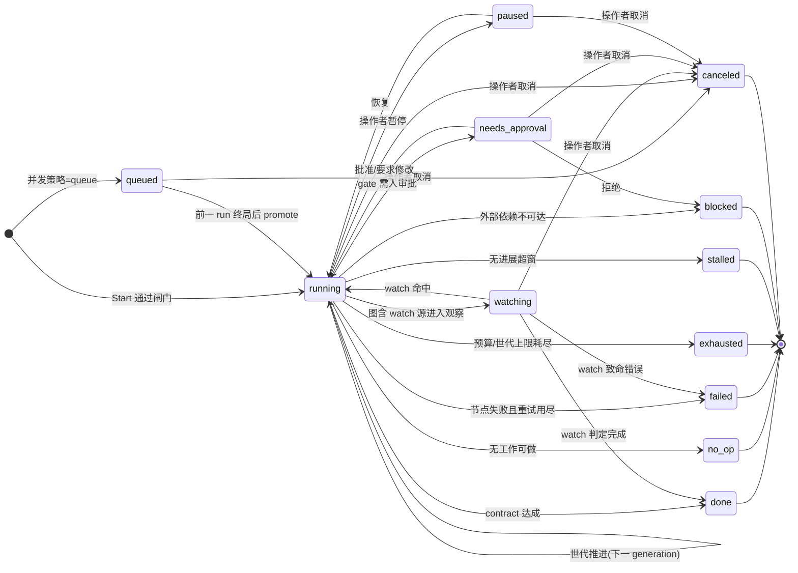
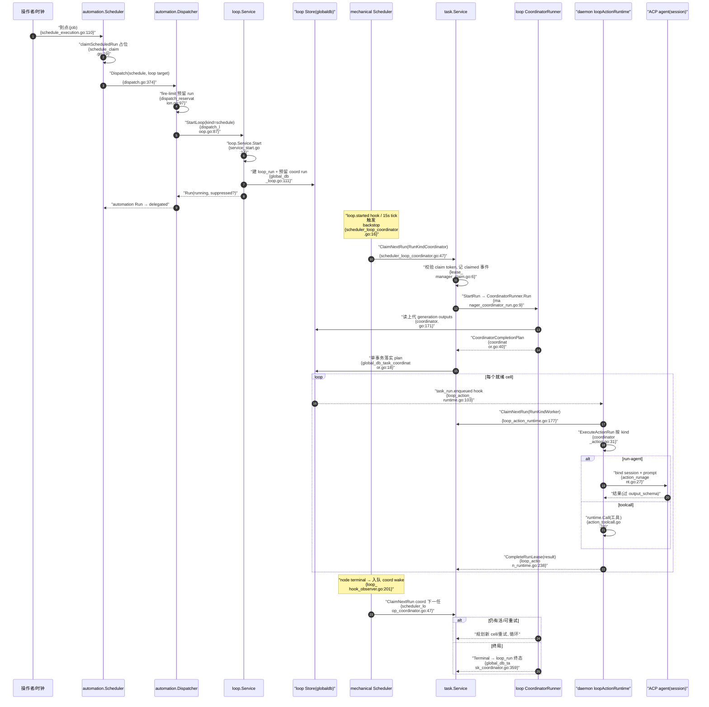

# CompozyOS Loop 与自动化解读：持久 Loop、世代执行与所有权

> 本解读按 **ai-agent 类规格** 产出，解读基线为 compozy 源码 `release/v0.3.0`（HEAD 4efd8de）。

## 角色：去掉它系统会怎样

先推演「删除每个域」的后果，这决定了它的不可替代性。

- **去掉 `internal/task`**：执行失去所有权。谁在跑、claim 之后是否还有效、崩溃后由谁恢复，全部悬空；daemon 同时只有一台，本应靠"单写者事务 + claim token"保证不重跑，失去 task_runs 就没有了"当前在途工作"的单一事实源 [internal/task/lease.go:51-70]()。task 是整条无人值守链路的**账本层**：loop/automation 只是决定"要发生什么"，task 决定"这件事此刻归谁、凭证是什么、过期了怎么收" [internal/task/lease_manager_claim.go:5-39]()。
<!-- anchor: // ClaimCriteria captures the atomic next-work filters for one claiming session. … Now                        time.Time            `json:"now"` -->
<!-- anchor: // ClaimNextRun atomically claims the next eligible run for one session and retu … return &result, nil -->
- **去掉 `internal/loop`**：无人值守只剩"一次性执行"。daemon 需要一个能保存"执行到哪一步、本轮结果如何、要不要进下一轮"的**持久执行对象**——这正是 loop run 及其世代（generation）概念 [internal/loop/service_types.go:48-71]()。没有它，scheduler/automation 只能一次次从头跑，谈不上恢复与收敛。
<!-- anchor: // StatusQueued is a live deferred same-loop start. … StatusCanceled Status = "canceled" -->
- **去掉 `internal/automation`**：定时/触发与"不随终端关闭"的产品承诺落空。它把"何时执行"做成一等可持久化资源（schedule/trigger + fire limit + catch-up），并把三种目标（agent 会话 / 直接 task / Loop）统一收敛到 dispatcher [internal/automation/model/types.go:151-169]()。
<!-- anchor: // Job is the canonical scheduled automation definition used by runtime and stor … UpdatedAt   time.Time       `json:"updated_at"` -->
- **去掉 `internal/scheduler`**：排队 run 无人唤醒。task 域刻意不让调度器 claim（所有权唯一化），因此必须有一台"只叫醒、不认领"的机械钟在后台兜底：扫过期 lease、广播可认领、饥饿升级 [internal/scheduler/doc.go:1-7]()。
<!-- anchor: // Package scheduler implements the daemon-owned mechanical task scheduler. … package scheduler -->

一句话：loop 决定"做到什么程度满意"，task 决定"此刻归谁、能否恢复"，automation 决定"何时触发"，scheduler 决定"沉睡的执行者如何被叫醒"。四层加一起，agent 才从"一次性工具"变成"可值守、可恢复、可编排的后台流程"。

## 解决什么问题：从一次 run 到持久自动化

根因分三层：

1. **结果不可迭代**。一次 prompt 拿不到好结果就结束，缺少"带反馈再来一轮"的结构。Loop 用世代推进解决：每轮 action 输出写入持久 snapshot，coordinator 在轮末判定"继续 / 停 / 终局" [internal/loop/coordinator_generation.go:22-88]()。
<!-- anchor: func (r *CoordinatorRunner) buildGenerationFinisherPlan( … state.live, -->
2. **过程不可复用、不可校验**。流程写在 prompt 里，无法 lint、无法 gate、无法复用。Loop 把过程提升为声明式 DSL（`compozy.loop/v1`）并经编译器固化契约（lint、模板、CEL、工具 schema 快照）[internal/loop/dsl/types.go:22-32]()。
<!-- anchor: // Definition is the canonical compozy.loop/v1 document. … Extra                     map[string]any `json:"-"                     yaml:",in -->
3. **"何时跑"与"怎么跑"耦合**。旧模型里调度逻辑散落各处。v0.3 把触发（automation）、所有权（task）、执行规划（loop）拆成三个包，各自可独立测试与演进。

### 与 v0.2 `tasks run` 的分野

v0.2 的 task run 是一次性排队执行：入队 → 被 session claim → 跑完结束。v0.3 把同样的 task run 机制**降为执行原子**，在其上叠加：

- loop run 不再是一个 run，而是**一个运行实体 + 一串世代**，每个世代可产生多个 cell（node×item），每个 cell 对应一个携带自身 attempt/epoch 的持久 output 行与一个 task run [internal/loop/generation_snapshot.go:33-61]()。
<!-- anchor: type GenerationOutput struct { … runtimePayload json.RawMessage -->
- coordinator 型 task run（`RunKindCoordinator`）作为"世代推进器"在 daemon 内被认领并现场产出下一批 work [internal/task/types.go:157-181]()。
<!-- anchor: // RunKind identifies which executor owns a task-run body. … return "" -->
- 于是调度对象从"task run"升级为两类：普通 worker（agent/自动化一次性任务）与 **loop coordinator**（世代引擎），mechanical scheduler 同时为两者兜底 [internal/scheduler/scheduler.go:265-336]()。
<!-- anchor: // RunOnce executes one sweep/notify pass. … return result, errors.Join(errs...) -->

## 设计思路与核心模式

### 模式一：执行对象 = Run + 世代（generation）快照

一个 loop run 持有一个从 `queued` 到终局的显式状态机 [internal/loop/service_types.go:48-71]()；内部执行则以世代推进，每代结束时把输出、尝试、控制快照作为**单个事务的产物**写库 [internal/loop/generation_snapshot.go:16-29]()。世代让三件事成为可能：
<!-- anchor: // StatusQueued is a live deferred same-loop start. … StatusCanceled Status = "canceled" -->
<!-- anchor: // GenerationSnapshotPayload is the loop-owned payload carried by task.Generatio … BoundaryEffects       map[Status][]RenderedEffectIntent `json:"boundary_effects, -->

- **重试与恢复有锚点**：某 cell 失败只重试该 cell，而非整轮重来 [internal/loop/coordinator_lifecycle.go:164-239]()。
<!-- anchor: func (r *CoordinatorRunner) applyFailedNodeLifecycle( … return nodeLifecycleResult{attempt: attempt, events: events, handled: true}, nil -->
- **进度可审计**：每代 output 行带 attempt/epoch/状态，谁在何时做到哪一步一目了然 [internal/loop/generation_snapshot.go:32-61]()。
<!-- anchor: // GenerationOutput is one loop_generation_outputs row mutation. … runtimePayload json.RawMessage -->
- **终局判定有依据**：coordinator 依据本代 outputs 决定进入终态（done/failed/stalled…）还是继续下一代 [internal/loop/coordinator_terminal_helpers.go:27-69]()。
<!-- anchor: func (r *CoordinatorRunner) terminalForFailedGeneration( … return &terminal, nil -->

世代推进的关键是把"下一个计划"表达为**原子可应用的计划对象** `CoordinatorCompletionPlan`，task 域用单事务落实它：建 node 任务、入队 run、写 snapshot、可能置终态 [internal/task/coordinator.go:39-56]()。
<!-- anchor: // CoordinatorCompletionPlan contains all coordinator mutations that task applie … PostCommitTimers []CoordinatorTimerSpec -->

### 模式二：两级编译——定义编译与世代编译

Loop 没有把整个 run 预编译成一张永不改变的 DAG 执行单，而是两级动态：

- **第一级（发布/编译）**：`Compiler.Compile` 把作者 DSL lint、模板化、把条件表达式与工具 schema 快照固化进 `ResolvedDefinition` [internal/loop/compiler.go:86-147]()。run 启动后工具 schema 若漂移，`ResolvePinned` 会以"契约过期"拒绝执行，防"启动时对、跑的时候工具变了" [internal/loop/action.go:186-192]()。
<!-- anchor: // Compile lints, parses templates/CEL, snapshots tool schemas, and folds defaul … return resolved, nil -->
<!-- anchor: func (r *ActionRegistry) ResolvePinned( … return r.resolve(ctx, scope, kind, expected, true) -->
- **第二级（世代执行）**：每个世代现场由 `CoordinatorRunner.Run` 结合上一代 outputs 决定本代要跑的节点、依赖与终局，产出 `CoordinatorCompletionPlan` [internal/loop/coordinator.go:171-225]()。
<!-- anchor: // Run returns the coordinator plan for a claimed coordinator task_run. … return plan, nil -->

这使"不可变定义"与"可变运行时事实"分离：定义编译一次、世代不断重算。

### 模式三：action 执行器——把"一个 step"抽象成统一接口

图中真正干活的 action 节点（tool call / run-agent / run-loop / transform）全部收敛到 `ActionExecutor` 的 Execute/Harvest 两段式 [internal/loop/action_types.go:83-86]()：
<!-- anchor: // ActionExecutor runs one loop action node and converts its raw result into nod … Harvest(ctx context.Context, raw ActionRawResult, node dsl.Node) (ActionOutput,  -->

- Execute 负责真正执行并把后端结果归一到 `ActionRawResult`；同文件 Harvest 按 harvest 策略（同步/事件区间/异步/channel result）收敛成 `ActionOutput` [internal/loop/action_toolcall.go:24-113]()。
<!-- anchor: func (e *ToolCallActionExecutor) Execute( -->
- run-agent 肉身负责绑定 ACP session 并 prompt 一个 agent，产出还要过 output_schema 校验，失败自动带 schema 反馈再试一轮 [internal/loop/action_runagent.go:27-107]()。
<!-- anchor: func (e *RunAgentActionExecutor) Execute( … return rawFromPromptResult(binding, second, structured, resolvedRuntime), nil -->
- run-loop 肉身负责启动子 loop，await 语义让父 coordinator 等子终局、detach 语义不等 [internal/loop/action_runloop.go:20-82]()。
<!-- anchor: func (e *RunLoopActionExecutor) Execute( … return raw, nil -->
- transform 肉身纯内存求值，作为廉价编排节点 [internal/loop/action_transform.go:15-40]()。
<!-- anchor: func (TransformActionExecutor) Execute( … return ActionRawResult{Structured: structured, Value: output}, nil -->

registry 依据 kind 在「保留执行器」与「运行时工具表工具」之间解析 [internal/loop/action.go:195-256]()。
<!-- anchor: func (r *ActionRegistry) resolve( … }, nil -->

### 模式四：所有权模型——claim 唯一、凭证单点、lease 过期回收

无人值守最大的事故源是"两个执行者以为自己在跑同一个 run"。task 域用四个机制压死它：

1. **claim 唯一入口**：`ClaimNextRun` 同时过滤 scope/capability/run kind/归属，返回携带 run 状态的 ClaimResult [internal/task/lease_manager_claim.go:5-39]()。
<!-- anchor: // ClaimNextRun atomically claims the next eligible run for one session and retu … return &result, nil -->
2. **claim token 只回一次**：服务端仅存哈希（`sha256:` 前缀），后续 heartbeat/complete/fail 都必须出示原 token 并经常数时间比较 [internal/task/lease.go:190-226]()。
<!-- anchor: // NewClaimToken generates one raw bearer token for a successful claim response. … return subtle.ConstantTimeCompare([]byte(computed), []byte(hash)) == 1 -->
3. **lease 限时持有**：默认 5 分钟，需心跳续租 [internal/task/lease.go:27-36]()；worker 长任务由 daemon 自动心跳 [internal/daemon/loop_action_liveness.go:334-351]()。
<!-- anchor: const ( … LeaseRecoveryExhaustedReason = "lease_recovery_exhausted" -->
<!-- anchor: func (r *loopActionRuntime) extendActionLease( … return err -->
4. **过期即回收**：到期未续的 lease 由 scheduler 扫回队列重新可认领 [internal/scheduler/scheduler.go:350-365]()。
<!-- anchor: func (s *Scheduler) sweepExpiredLeases(ctx context.Context, now time.Time, resul … return nil -->

scheduler 永远不会 claim（只叫醒），注释里逐字写着 “It never claims work” [internal/scheduler/types.go:160-167]()。task 域之外，daemon 内建两个专用 runtime（loop coordinator 推进器与 loop action 执行器）都以 daemon actor 身份 claim [internal/daemon/scheduler_loop_coordinator.go:16-86]()。
<!-- anchor: // EscalationActor is the single seam through which the scheduler drives converg … MarkRunNeedsAttention(ctx context.Context, runID string, diagnostic string) (tas -->
<!-- anchor: func (s schedulerTaskSource) RunLoopCoordinatorBackstop( … return started, nil -->

### 模式五：两套调度分工——事件钟 vs 机械钟

- **automation.Scheduler（业务事件钟）**：管理已注册 job，每 job 一个协程按持久 cursor 等待下一 fire 时间；到点后先 `ClaimScheduledRun` 在库中抢占该 fire，再派发，天然防多 fire 重复 [internal/automation/schedule_execution.go:110-158]()。错过窗口的 fire 按 catch-up 策略追或弃 [internal/automation/schedule_catchup.go:59-90]()。
<!-- anchor: func (s *Scheduler) executeScheduledJob(ctx context.Context, jobID string) error … return err -->
<!-- anchor: func reconcileMissedSchedulerCursor( … return state, "" -->
- **internal/scheduler（机械钟）**：单全局 ticker（15s），每轮扫 pending/active run、过期 lease、task block，再对空闲且能力匹配的 session 发唤醒消息；饥饿 run 沿四级收敛阶梯升级 [internal/scheduler/scheduler.go:404-414]()、[internal/scheduler/starvation.go:41-75]()。
<!-- anchor: func (s *Scheduler) loop(ctx context.Context) { … s.logger.Warn("scheduler.cycle.error", "error", err) -->
<!-- anchor: func (s *Scheduler) escalateCandidate( … return errors.Join(errs...) -->

两钟都只读 task_runs 快照、都通过 task 域接口而非直接 claim——差异只在"触发主体"：automation 钟由 job 到期驱动，机械钟由 daemon 周期驱动。

### 自动化触发形态：cron / every / at / 事件触发器

automation 将触发资源建模为 Job（定时）与 Trigger（事件），共享同一 dispatch 面：

- 定时三 mode：cron 表达式、every 间隔、一次性 at（RFC3339）[internal/automation/schedule_execution.go:15-54]()。
<!-- anchor: func (s *Scheduler) buildSchedulePlan(job Job) (schedulePlan, error) { -->
- 事件 ingress 以统一信封（ActivationEnvelope）收敛四类来源：hook 完成（hookCompletionEnvelope）、session 生命周期（sessionEnvelope）、memory 合并（memoryConsolidatedEnvelope）、webhook（webhookEnvelope），全在 trigger_envelope.go 一字排开 [internal/automation/trigger_envelope.go:21-165]()；webhook 主链（端点解析→验签→幂等占位→分发）在 HandleWebhook [internal/automation/trigger_lifecycle.go:192-241]()。
<!-- anchor: func (e *TriggerEngine) hookCompletionEnvelope( … }, nil -->
<!-- anchor: func (e *TriggerEngine) HandleWebhook(ctx context.Context, request WebhookReques … return result, err -->
- 目标三分流：直接 task（Job.Task）、Loop（LoopTarget）、一次性 agent 会话（默认）[internal/automation/dispatch_reservation.go:14-94]()、[internal/automation/dispatch_loop.go:87-148]()。
<!-- anchor: func (d *Dispatcher) dispatchAttempt(ctx context.Context, req DispatchRequest, a … return d.finishRunAfterSessionStop(ctx, runningRun, createdSession.ID, RunComple -->
<!-- anchor: func (d *Dispatcher) dispatchLoopBackedAttempt( … return delegatedRun, nil -->
- dispatch 前做 fire-limit 滚动窗口计数，超限返回带 retry_at 的错误，由 job 时钟把下一 fire 推迟 [internal/automation/dispatch_reservation.go:193-222]()。
<!-- anchor: func (d *Dispatcher) reserveWithinFireLimit( … return result, window, nil -->
- 全程可被 pre-fire hooks 改写或取消，完成后有 post-fire/run 终局 hooks 外发 [internal/automation/dispatch_hooks.go:12-64]()。
<!-- anchor: func (d *Dispatcher) dispatchPreFireHook( … return prompt, false, nil -->

### automation 与 loop/task 的接线

automation 不 import loop：通过 `LoopStarter` 边界接口解耦，daemon 在组合根实现（先解析定义、编译并校验，再 `service.Start` 起 loop run，concurrency 冲突映射为自动化错误）[internal/daemon/automation_loop_starter.go:163-208]()。
<!-- anchor: func (s *automationLoopStarter) StartLoop( … return result, nil -->

## 核心流程

### loop run 生命周期

loop run 状态机（词表见 [internal/loop/service_types.go:48-71]()，合法迁移见 [internal/loop/service.go:397-429]()）：
<!-- anchor: // StatusQueued is a live deferred same-loop start. … StatusCanceled Status = "canceled" -->
<!-- anchor: func allowedTransition(from Status, to Status, cause TransitionCause) bool { … return to == StatusCanceled && cause == TransitionCauseOperatorCancel -->

世代内每个 cell（node×item）还有独立 cell 状态（pending/enqueued/running/retrying/waiting/paused/succeeded/failed/canceled/quarantined…）[internal/loop/generation_snapshot.go:32-61]()；run 终态由 coordinator 依 outputs 决定 [internal/loop/coordinator_terminal_helpers.go:72-86]()。
<!-- anchor: // GenerationOutput is one loop_generation_outputs row mutation. … runtimePayload json.RawMessage -->
<!-- anchor: func failedOutputTerminal(output GenerationOutput) task.CoordinatorTerminal { … ReasonCode: reasonCode, -->

### 一次自动化触发的完整链路

以 cron job 触发一个 Loop target 为例，跨模块时序如下。图中消息 {file:line} 即对应跨模块触点的源码定位（文件名省略包前缀，配合各节 [path:line]() 空链接精确追溯）：

关键点：worker cell 并不由 agent session claim，而是 daemon 内 loopActionRuntime 用 daemon actor claim 后在 daemon 内执行；agent 只出现在 run-agent action 内部被 prompt 的一步 [internal/daemon/loop_action_runtime.go:177-248]()。
<!-- anchor: func (r *loopActionRuntime) executeQueuedRun( … return r.failClaimedRun(ctx, claim, actor, reason, result.TokensUsed, err) -->

## 关键实现归组

### loop 域内部

- **编译**：`compiler.go`（lint+模板+工具 schema 快照）、`compiler_subloop.go`（sub-loop body 递归编译）、`config.go`（EffectiveConfig 四层 merge：definition/defaults/stored/per-run，带来源溯源）。
- **执行态状态机**：`service_types.go`（Status/TransitionCause/GateDecision/ReattemptStrategy/Run 聚合）、`service.go`（Transition 的 CAS 与 allowedTransition）。
- **世代规划**：`coordinator.go`（Runner.Run）、`control_plan.go`（advanceControlNodes：fan-out/gate/wait/route/collect 的推进循环）、`control_tasks.go`（为 outputs 建 node task 与依赖）、`control_gate.go`（gate 求值→verdict→路由）。
- **action 执行**：`action.go`（registry 解析）、`action_runagent.go`、`action_runloop.go`、`action_toolcall.go`、`action_transform.go`、`action_managed.go`（Goal 的 managed session）、`action_channel_result*.go`（channel harvest）。
- **cell 账本**：`generation_snapshot.go`（StoreFinalizer 在 task 事务内 upsert outputs/attempts/controls/waits/requests；epoch 围栏防旧世代覆盖新世代）。
- **失败与恢复**：`failure_class.go`/`failure_classify.go`（evidence → 分类）、`coordinator_lifecycle.go`（成功/失败后按 retry/autopause/route/absorb/escalate 分流）、`coordinator_retry.go`、`death_resume.go`、`amendment.go`（人修订 cell 输出后继续）、`cancel_control.go`（取消第一写者）。
- **服务操作面**：`service_start.go`（Start/StartInline/DryRun）、`service_cancellation.go`、`service_control.go`（Pause/Resume/Approve/Node 控制）。

### task 域内部

- **所有权**：`lease.go`（ClaimCriteria/Lease 载荷/claim token 生成与校验）、`lease_claim.go`（criteria normalize/validate）、`lease_manager_claim.go`（编排）、`lease_manager_settlement.go`（各类 lease 事务结算 + 事件）。
- **run 命令**：`manager_run_claim.go`（StartRun 分派到 coordinator 或普通 worker）、`manager_coordinator_run.go`（coordinator run starting→running→plan→complete）、`manager_coordinator_run_completion.go`、`force_ops.go`（强制失败/释放，带限流）。
- **coordinator 计划类型**：`coordinator.go`（CoordinatorCompletionPlan 及各类 spec、finalizer）。
- **接口/存储分层**：`interfaces.go`（Manager 全方法 + 细分 Store 接口），`types_run_event.go`（Run/Event 持久化视图）。

### automation 域内部

- **模型**：`internal/automation/model/types.go`（Job/Trigger/Run/Envelope/SchedulerState）、`model/target_validate.go`、`model/schedule_validate.go`。
- **dispatch**：`dispatch.go`（重试外层）、`dispatch_reservation.go`（fire-limit 预留+流转）、`dispatch_task_run.go`（task 落库）、`dispatch_loop.go`（loop 目标）、`dispatch_hooks.go`、`dispatch_retry.go`。
- **scheduler runtime**：`schedule.go`/`schedule_lifecycle.go`/`schedule_registry.go`/`schedule_execution.go`/`schedule_claim.go`/`schedule_catchup.go`/`schedule_time.go`。
- **trigger runtime**：`trigger.go`/`trigger_lifecycle.go`（注册/更新/Fire/webhook 主链）、`trigger_envelope.go`（事件→统一信封）、`trigger_filter.go`（filter 编译）、`trigger_delivery_claim.go`（幂等占位）、`trigger_webhook.go`（HMAC）。
- **manager**：`manager.go`/`manager_lifecycle.go`（启动顺序：同步 TOML→build runtimes→注册→start）、`manager_definition_sync.go`、`manager_triggers.go`/`manager_jobs.go`/`manager_loop.go`（CRUD + 热应用）、`manager_runtime_apply.go`、`manager_startup_definitions.go`。

### scheduler 域内部

- `scheduler.go`（周期 RunOnce 编排）、`selection.go`（run×session 匹配选择）、`capacity.go`（scope/owner/capability 判据）、`wake_dispatch.go`（唤醒状态+冷却）、`starvation.go`（收敛阶梯与持久预算）、`types.go`（TaskSource/EscalationActor/Waker 等边界接口）。

## 与其它模块协同

- **session/ACP**：loop run-agent 用 binder 绑定 ACP session；daemon 以 SessionManager 作为机械钟的 session 源，向空闲会话发"可认领"唤醒消息 [internal/daemon/scheduler_session_source.go:27-63]()。[WIP: session 侧收到 wake 后走向 ClaimNextRun 的确切接线点未逐点追踪]
<!-- anchor: func (s schedulerSessionSource) Sessions(ctx context.Context) ([]schedulerpkg.Se … return snapshots, nil -->
- **hooks（typed dispatch）**：daemon 侧以 hook observer 形态把 task 事件接回 loop：node terminal → 入队 coordinator wake、loop terminal → promote 排队 run [internal/daemon/loop_hook_observer.go:113-176]()。hooks 不绕过所有权原语，只做"追加效应"。[WIP: hooks 分类注册清单与 automation pre/post fire 的同源关系未核查]
<!-- anchor: func (o *loopNativeHookObserver) OnTaskRunTerminal( … return errors.Join(errs...) -->
- **store/globaldb**：`CompleteCoordinatorAndEnqueueNext` 是 task store 对 coordinator 计划的单事务应用（含 loop snapshot finalizer）[internal/store/globaldb/global_db_task_coordinator.go:17-73]()。[WIP: loop_runs 表迁移归属与 globaldb/sessiondb 分片规则未核]
<!-- anchor: // CompleteCoordinatorAndEnqueueNext applies a coordinator plan in one BEGIN IMM … return result, nil -->
- **approvals/治理**：loop gate 需人审批时进入 needs_approval；预算用尽可选 escalate 为审批而非直接终局。此面由 approvals 解读承接，不在此展开。[WIP: gate 判定与人工审批完整闭环的 API 汇聚点未追踪]
- **resources/extension**：automation 定义可走 resource projection（desired-state 同步）；扩展可声明 automation 资源。此面实现细节留作扩展解读素材，仅标注存在性。[WIP: resource projection 与 automation store 的权威边界未核]

## 关键设计决策

### 决策一：世代（generation）作为执行与恢复的单位

- **Why**：结果要迭代、失败要局部重试，必须有一个比"整个 run"更细、又比"单个 action"更稳的推进单位。
- **权衡**：世代模型在每轮结束做一次全局规划 + 快照事务，吞吐不如一次性执行；换取的是崩溃可从中断世代恢复、且任何 cell 都能被审计。
- **替代方案代价**：把循环写死在 prompt（不可校验/不可恢复），或用无限重试的单一 run（饥饿与无进展无法识别）。世代是两者之间的结构化折中。

### 决策二：claim 唯一化，scheduler 永不 claim

- **Why**：双重执行是无人值守系统最危险的 bug，单 owner 把并发收敛成"一个账本 + 一把锁"。
- **权衡**：一切唤醒都必须绕回 session 或 daemon runtime 主动 claim，机械钟无法"直接指派"，多一跳；换来恢复语义单一、无抢跑。
- **替代方案代价**：允许 scheduler 指派 = 出现第二个 claim 权威，恢复与对账会分裂成两套逻辑；分布式锁在单二进制定位下是过度设计。

### 决策三：两级编译，而非把 Loop 编译成静态执行图

- **Why**：Loop 的下一轮取决于本轮结果（gate/route/wait/retry），静态预编译会退回"脚本"而失去判定能力。
- **权衡**：每世代现场规划 = 运行时开销 + 复杂；换来得"不可变定义"可安全复用、且执行路径始终以真实事实为依据。
- **替代方案代价**：静态展开全部路径 = 状态爆炸且无法处理人类 gate；纯解释执行 = 无编译期校验，定义损坏要到运行才暴露。

## 亮点与问题

### 亮点

- **可点开验证的边界契约**：scheduler 的 TaskSource/EscalationActor 等接口只暴露快照读与升级动作，注释里写明 “It never claims work”，把所有执行者挡在"只能叫醒、不能认领"之外 [internal/scheduler/types.go:63-77]()。
<!-- anchor: // TaskSource provides durable task-run snapshots and lease recovery. … ) (taskpkg.ExpireTaskBlocksResult, error) -->
- **两级执行抽象干净**：action（干什么）与 control（怎么走下一步）分离，新增动作类型只需实现 Executor，控制逻辑不动 [internal/loop/action.go:195-256]()。
<!-- anchor: func (r *ActionRegistry) resolve( … }, nil -->
- **世代快照 = 自带审计日志**：每个 cell 的 attempt/epoch/状态都持久化，天然回答"它到底跑到哪了、失败了几次" [internal/loop/generation_snapshot.go:32-61]()。
<!-- anchor: // GenerationOutput is one loop_generation_outputs row mutation. … runtimePayload json.RawMessage -->
- **失败语义结构化**：failure 分类（authoring/transport/target/budget/timeout/cancel）+ 每类带 recovery hint，编排与展示都能给可操作信息 [internal/loop/coordinator_lifecycle.go:406-447]()。
<!-- anchor: func classifyGenerationOutputFailure(output GenerationOutput, taskRun task.Run)  … return ClassifyNodeFailure(evidence) -->

### 问题与待观察

- **世代调度的实时性依赖回环**：cell 终局依赖 node-terminal hook 或 15s tick 来唤醒下一 coordinator，长尾任务会有可感知延迟；这是"机械钟 + hook"回环设计的固有特性，观察其在重负载下的抖动 [WIP: 未量测唤醒到下一 coordinator claim 的端到端延迟]。
- **coordinator 在 daemon 内同步执行规划**：`CoordinatorRunner.Run` 在 claim 后同步跑完整个世代规划再提交，超大型图（数千节点）的单世代耗时与事务时长是潜在瓶颈 [WIP: 未读 daemon 对 coordinator 的并发上限与超时护栏全貌]。
- **概念密度高**：Run / TaskRun / NodeRun / CoordinatorRun / WorkerRun 五个"run"词汇并存，世代/cell/attempt 三层又叠加状态；初读代码库心智负担极重，文档与术语表价值大。
- **失败路径数量庞大**：retry/route/absorb/autopause/quarantine/death-resume/amendment 互相交叉，测试覆盖要求极高，边缘语义（如 retry 与 gate revision 交互）需要专门维护 [WIP: 未逐条审计 failure 分类与 attempt disposition 的完整交叉矩阵]。
