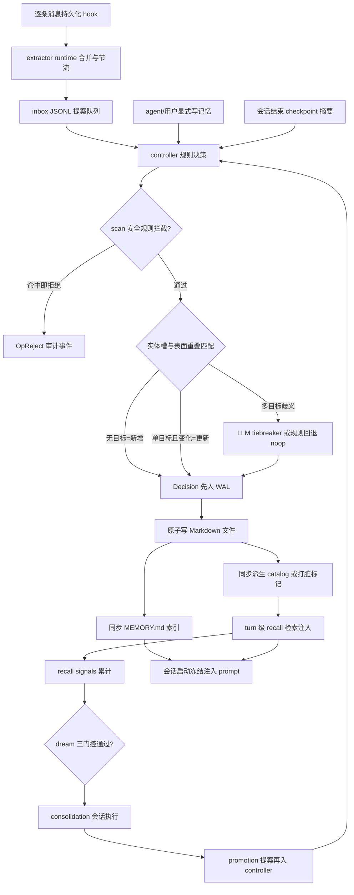
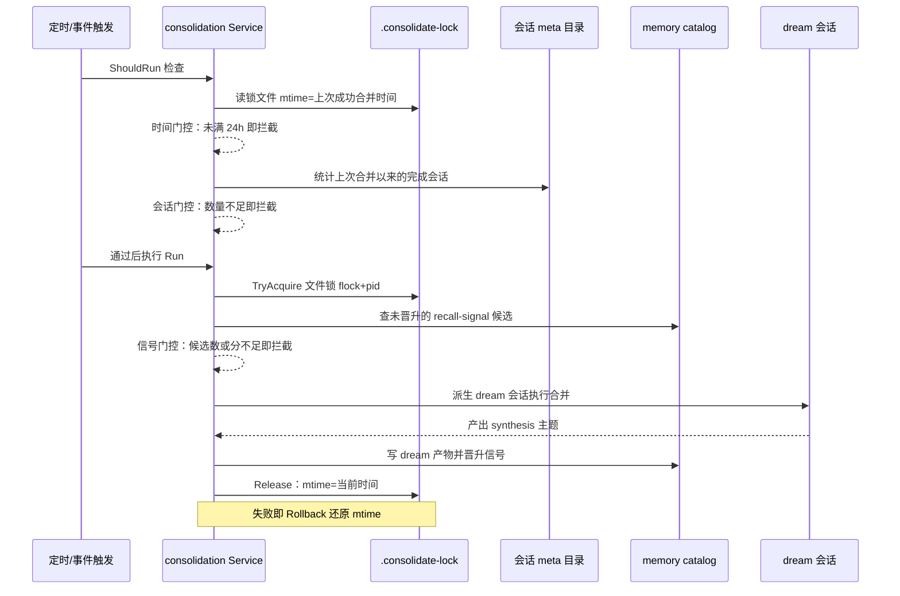

# CompozyOS 记忆系统：作用域隔离、决策 WAL 与信号驱动合并

> 本解读按 **ai-agent 类规格** 产出，解读基线为 compozy 源码 `release/v0.3.0`（HEAD 4efd8de）。

## 角色：去掉记忆域，CompozyOS 缺哪块

README 把 memory 与 loops、approvals 并列，宣称它"不是插件，而是一等对象"。对单进程 daemon 的 agent OS 而言，记忆域承担的是**只有操作系统才有资格做的事**：它不是某个 agent 的私有记事本，而是把"跑过的会话"沉淀为"跨会话、跨 agent、跨工作区仍成立的知识与决策"的系统设施。没有它，loop（无人值守执行）跑得越多，产生的只是更多一次性转写；session（单次对话持久化）只回答"这次聊了什么"，回答不了"下次怎么带着上次的结论继续"。memory 是这两者之上的第三根柱子：session 给记忆提供原材料，loop 给记忆提供重复触达，记忆反过来让二者每次启动都站在历史结论上。

证据链上，记忆域与 session/agent 的接驳不是松散回调，而是一组**被 session 包直接消费的协议实现**：启动时把记忆索引拼进 agent prompt，每条用户消息到来时再按 query 检索注入。换言之，agent 的"世界观"由 memory 提供，session 只是它的载体（见"与其它模块协同"）。

## 根因：为什么 agent 记忆不能是一张 KV 表

传统记忆（KV/向量库）把"记忆"当作**扁平条目**：key 是查询词，value 是文本块，写入即覆盖。这在 agent 场景有三个致命问题，对应本域三个设计主轴：

1. **记忆会写脏，而且写脏的成本极高**。记忆不是数据库记录，而是会被再次注入 prompt、指导未来行为的事实性断言。一条记忆写错（比如把临时调试结论沉淀成项目规则、或藏进 prompt 注入载荷），会在后续所有会话被当成"事实"放大。所以记忆必须先被当"危险代码"审查，再决定是否落盘——这解释了 `scan` 安全规则层、写入 controller 的存在。

2. **记忆是有所有者的，不是全局平铺**。profile（用户级）、workspace（项目级）、agent（某 agent 在某作用域内）拥有不同的生命周期与可信度。Agent 在 workspace A 的偏好不应污染 workspace B；某 agent 的私有决策不该让别的 agent 读到。这要求作用域在**存储物理层与检索逻辑层双重隔离**，而不是在一条记录上加个 tag。

3. **写盘不等于有效**。KV 表写入即终态；但 agent 记忆的语义是"这条到底靠不靠谱"，需要：谁来写（origin）、基于什么写的（source_session_ids）、什么时候被覆盖（superseded）、写错了能否撤销（decision WAL + revert）。人写的笔记不需要 provenance，agent 的自生成记忆必须——因为它自己会遗忘上下文、会重复、会自相矛盾，系统要能回到过去的某个决策点。

4. **知识是"反复被需要"的副产品**。会话中产生的素材大多是一次性噪音，若每条都沉淀，记忆库会迅速腐化。真正值得固化的，是那些**被多次检索到、跨会话反复有用**的片段。这就是 recall signal → consolidation（dream）这条独特管线的存在理由：用"使用频率"做信噪比过滤，把临时素材沉淀为稳定知识。

## 设计思路与核心模式

### 记忆条目模型：Markdown 文件是唯一真源，catalog 是派生索引

记忆的物理载体是**带 frontmatter 的 Markdown 文件**，存放于按作用域划分的目录；`Store` 对它做增删改查，frontmatter 声明条目元数据。读写入口先把正文与 frontmatter 分离并做严格校验，元数据里的 provenance 记录"这条记忆由哪些会话、哪个 actor 产出，被谁取代"。

[internal/memory/document.go:11-12]()
<!-- anchor: func ParseHeader(content []byte) (memcontract.Header, error) { … var header memcontract.Header -->

[internal/memory/contract/types.go:15-16]()
<!-- anchor: // Header contains validated metadata parsed from a memory file frontmatter. … type Header struct { -->

[internal/memory/contract/types.go:84-85]()
<!-- anchor: // Provenance records how a curated memory entry was created or superseded. … type Provenance struct { -->

记忆体量很小，检索却要求词法与语义质量并存。为此 memory 维护了一个 **SQLite derived catalog**（`memory.db`）：Markdown 文件是源，catalog 是可按 scope 全量重建的影子。`open` 时经 store 包施加内嵌迁移流（`MigrationStream`，含 bootstrap `schema.sql` 与 goose 增量迁移、独立版本表 `goose_db_version_memory`），文件变更后同步写 catalog 条目与切块，或打脏标记后按需懒重建。

[internal/memory/migration_stream.go:8-22]()
<!-- anchor: const memoryMigrationVersionTable = "goose_db_version_memory" … SchemaSource: "schema.sql", -->

[internal/memory/catalog.go:136-160]()
<!-- anchor: func (c *catalog) open(ctx context.Context) error { … c.db = db -->

[internal/memory/catalog_readiness.go:77-90]()
<!-- anchor: unlock := s.lockMutations() … return err -->

演进证据：migration `00002_schema.sql` 把旧库 scope 值 `global` 重写为 `profile`（迁移主体把那些行归属到默认 profile），说明"profile 级记忆"是从"全局记忆"演进而来、并加上身份所有者约束的。目录里现在共有 3 个迁移（00001_baseline…00003_profile_decision_identity）+ `atlas.sum`，全量当前态收敛在 `schema.sql`；建表名可见 `memory_catalog_entries / memory_chunks / memory_decisions / memory_events / memory_recall_signals / memory_consolidations / memory_catalog_state`（字段级细节归 data-model 切片）。

[internal/memory/schema/migrations/00002_schema.sql:3-3]()
<!-- anchor: PRAGMA foreign_keys = off; -->

这套 schema 细节本文不展开，只取其架构结论：**写入的真相在文件系统，检索的加速在 SQLite，二者以"可整体重建 + dirty 标记"解耦**。写文件前先落 dirty 标记、写完同步成功才清除；任何时刻出现"源文件与索引不一致"，读路径会检测到并懒重建补齐。

[internal/memory/catalog_dirty_marker.go:23-27]()
<!-- anchor: path, err := s.catalogDirtyMarkerPath(scope) … if err := fileutil.AtomicWrite(path, []byte("dirty\n")); err != nil { -->

### 作用域隔离：profile / workspace / agent 的双重隔离

scope 是闭集，分三级；条目类型另有四类，`type` 与默认写作用域绑定：`user/feedback` 落 profile，`project/reference` 落 workspace。注意代码里常量名是 `profile`，CLAUDE.md 叙述语里沿用旧称 `global`（见"问题"一节）。

[internal/memory/contract/enums.go:13-15]()
<!-- anchor: ScopeProfile   Scope = "profile" … ScopeAgent     Scope = "agent" -->

[internal/memory/contract/enums.go:95-98]()
<!-- anchor: TypeUser      Type = "user" … TypeReference Type = "reference" -->

[internal/memory/contract/enums.go:121-124]()
<!-- anchor: case TypeUser, TypeFeedback: … return ScopeWorkspace, nil -->

隔离的第一层在**文件系统物理路径**：`Store` 是一组 clone-on-bind 的轻视图（`ForWorkspace/ForProfile/ForAgent` 都只重绑定目录与身份字段），`dirForScope` 把 scope 解析到目录——profile 落在全局记忆目录；workspace 落在 `<workspaceRoot>/.compozy/memory`；agent 记忆按 tier 再分叉：global tier 放全局根 `agents/<agent>/memory`，workspace tier 放 workspace 内 `.compozy/agents/<agent>/memory`。路径隔离意味着**越界不再是逻辑判断，而是物理上够不到**。

[internal/memory/store.go:66-70]()
<!-- anchor: func (s *Store) ForWorkspace(workspaceRoot string) *Store { … return &clone -->

[internal/memory/store.go:78-82]()
<!-- anchor: clone.workspaceDir = "" … clone.agentWorkspaceID = "" -->

[internal/memory/store_scope.go:28-45]()
<!-- anchor: case memcontract.ScopeProfile: … case memcontract.ScopeAgent: -->

[internal/memory/store_scope.go:66-71]()
<!-- anchor: case memcontract.AgentTierGlobal: … return filepath.Join(root, "agents", agentName, memoryDirName), nil -->

隔离的第二层在**检索的可见性 SQL**：catalog 每行都带 `profile_id + scope + workspace_id + agent_name + agent_tier` 复合身份。search 的过滤子句把"profile 归属者必须匹配"做成硬谓词，防止另一 profile 的记忆泄漏；recall 则按 profile→workspace→agent 逐层 OR 拼可见范围，agent 级还要求同名与同 tier。

[internal/memory/catalog_query.go:185-189]()
<!-- anchor: // Profile and agent documents are owned by the profile that produced them. … args = append(args, strings.TrimSpace(profileID)) -->

[internal/memory/recall_source.go:284-290]()
<!-- anchor: clauses := []string{`(e.scope = 'profile' AND e.profile_id = ?)`} … if agentName != "" { -->

agent 级记忆的 catalog 文档 ID 把 agent_name 与 tier 编入，同一文件名在不同 agent 下天然不同 ID。

[internal/memory/catalog_document.go:99-109]()
<!-- anchor: if scope.Normalize() != memcontract.ScopeAgent { … strings.TrimSpace(header.Filename), -->

隔离还发生在**召回阶段的遮蔽（shadow）规则**：对同一 `type+slug` 的冲突条目按 scopeDepth 判胜负——agent-workspace(3) > agent-global(2) > workspace(1) > profile(0)，深作用域条目胜出并遮蔽浅作用域同主题条目，且每次遮蔽都写 shadow 事件供审计。这样"个人/项目的窄记忆"天然压过"用户级的宽记忆"，而不是两条一起出现在 prompt 里打架。

[internal/memory/recall/recall_packaging.go:74-86]()
<!-- anchor: func (candidate rankedCandidate) scopeDepth() int { … return 0 -->

[internal/memory/recall/recall_packaging.go:52-58]()
<!-- anchor: func shadowKey(candidate Candidate) string { … return typeName + "::" + slug -->

[internal/memory/recall_source_events.go:151-160]()
<!-- anchor: func (s *Store) RecordShadow(ctx context.Context, shadow memoryrecall.Shadow) error { … recallSourceAgentTierKey: string(shadow.AgentTier.Normalize()), -->

### 写入可信度：scan 安全网 → controller 规则决策 → Decision WAL → 可回滚

记忆写入不直接落盘，而是走提案（candidate）管线，链条上的每一环都可审计：

1. **scan 安全规则**：所有待写正文先经确定性词法扫描（正则规则集），分威胁类（prompt 注入措辞、外泄命令、持久化 payload、不可见 Unicode/bidi 字符）与 WHAT_NOT_TO_SAVE 类（代码块、仓库路径、密钥、转写 dump、调试/任务状态等），命中 reject 即整体拒绝。扫描器对规则命中只输出脱敏原因，不回显匹配正文。

[internal/memory/scan/scan.go:28-31]()
<!-- anchor: // CategoryThreat covers prompt-injection, exfiltration, and persistence payloads. … CategoryWhatNotToSave Category = "what_not_to_save" -->

[internal/memory/scan/scan.go:277-279]()
<!-- anchor: // Candidate scans the candidate content before persistence. … return Content(candidate.Content) -->

2. **controller 规则决策**：`Decide` 按固定次序走确定性分支——scan 拒绝→delete 意图→全文重复（exact hash 命中→noop，不重复写）→实体槽匹配（entity/attribute 精确命中）：0 个目标且无歧义→add 新条目，恰 1 个→内容不变则 noop、变了则 update，多目标→进入歧义处理。歧义且装 tiebreaker 时由 LLM 裁决，否则规则回退为 **noop（宁可不动手）**。匹配单元是"实体+属性槽"，正文相似度只作为歧义提示，不依赖 embedding。

[internal/memory/controller/controller.go:136-137]()
<!-- anchor: if scanResult.Rejected() { … return c.rejectDecision(normalized, scanResult, trace) -->

[internal/memory/controller/controller.go:208-226]()
<!-- anchor: slotMatches := entitySlotTargets(normalized, targets) … return c.addDecision(normalized, trace) -->

[internal/memory/controller/controller.go:227-244]()
<!-- anchor: case 1: … return c.updateDecision(normalized, target, append( -->

[internal/memory/controller/controller_tiebreak.go:24-25]()
<!-- anchor: if c.tiebreaker == nil { … return c.rulesOnlyAmbiguousDecision(candidate, targets, ambiguousTrace) -->

3. **Decision WAL**：决策本身是个带 `CandidateHash/IdempotencyKey/op/targets/PostContent/PostContentHash/PriorContent/RuleTrace/LLMTrace` 的不可变记录——注释直言它"carries enough material to deterministically replay a file mutation"。ID 由幂等键确定性派生：同一候选对同一目标的同一操作永远得到同一个 `dec_…`，且规则失败态只允许 noop/reject 两个安全值。

[internal/memory/contract/types.go:226-227]()
<!-- anchor: // Decision carries enough material to deterministically replay a file mutation. … type Decision struct { -->

[internal/memory/controller/controller_targets.go:171-172]()
<!-- anchor: decision.IdempotencyKey = IdempotencyKey(decision) … decision.ID = "dec_" + hashString(decision.IdempotencyKey)[:24] -->

[internal/memory/controller/controller_candidate.go:110-120]()
<!-- anchor: func IdempotencyKey(decision memcontract.Decision) string { … return hashString(strings.Join(parts, "\x00")) -->

[internal/memory/controller/controller.go:100-103]()
<!-- anchor: func WithDefaultOpOnFail(op memcontract.Op) Option { … case memcontract.OpNoop, memcontract.OpReject: -->

4. **先入账、后生效、可回放**：apply 顺序是 WAL 先行 → 幂等键查重（已 applied 直接返回不再执行）→ 写文件 → mark applied。若进程在中间崩溃，重启后 `ReplayPendingDecisions` 把未 applied 的行按序补放（目标内容 hash 与 PostContentHash 一致才算幂等完成）。

[internal/memory/decision_apply.go:41-45]()
<!-- anchor: if found { … return DecisionApplyResult{Decision: normalized, Applied: false}, nil -->

[internal/memory/decision_catalog_write.go:41-70]()
<!-- anchor: if _, err := tx.ExecContext( … decision.PromptVersion, -->

[internal/memory/replay.go:55-81]()
<!-- anchor: decisions, err := pendingReplayDecisions(ctx, db, s.profileID) … return result, nil -->

5. **可回滚**：每条 decision 按 op 提供撤销：add→删文件、update→用 PriorContent 还原、delete→用 PriorContent 复活。回滚前校验**目标当前内容 hash 仍是该 decision 写入后的 PostContentHash**，一旦期间被其他写入改动就拒绝回滚——防止撤销动作覆盖更新的记忆。

[internal/memory/decision_revert.go:35-45]()
<!-- anchor: case memcontract.OpAdd: … case memcontract.OpDelete: -->

[internal/memory/decision_records.go:216-226]()
<!-- anchor: if strings.TrimSpace(decision.PostContentHash) == "" { … return nil -->

### recall signals：检索本身成为记忆的"训练信号"

每次 turn 级 recall 命中（`RecallAugmenter` 把 top 条目包进 `<turn-recall>` 注入），命中 chunk 就写入一条 **recall signal**（`memory_recall_signals`，按 chunk upsert）。UPSERT 不是简单计数：`recall_count+1`、`recall_score` 做 0.8/0.2 指数滑动平均、`session_count` 按 `last_session_id` 去重累加、首次命中时间只留最早（freshness_started_at 不变）。

[internal/memory/recall_source_events.go:63-67]()
<!-- anchor: ) VALUES (?, ?, ?, 1, ?, ?, ?, ?, ?, ?, ?, ?) … recall_count = memory_recall_signals.recall_count + 1, -->

[internal/memory/recall_source_events.go:79-81]()
<!-- anchor: WHEN excluded.last_session_id IS NOT NULL … THEN 1 ELSE 0 END, -->

信号写入走**有界异步 worker**：队满时先丢弃最老批次再入队新批次，绝不阻塞 recall 主路径，丢弃与失败都有审计事件。这把"检索命中"变成低成本的旁路统计，而 signal 正是后续 dream 的输入燃料。

[internal/memory/recall/signal_recorder.go:176-186]()
<!-- anchor: select { … r.submitted.Add(uint64(len(job.signals))) -->

### consolidation：把"反复有用"固化成知识（dream）

合并不是定时 summarize 一堆 session，而是**由 recall signals 驱动的晋升式固化**：

- 谁有资格被固化：检索过足够多次（`recall_count >= MinRecallCount`）、来自**可注入**片段（`injection = 1`，即非 `_system` 系统文件）、尚未晋升（`promoted_at IS NULL`）的 catalog chunk，经 SQL join 取出。
- 值不值得固化：对每个候选算加权晋升分——`frequency×0.30 + relevance×0.35 + recency×0.20 + freshness×0.15`，recency/freshness 用 14 天半衰期衰减。
- 怎么固化：通过门控后派生一个 **dream session**（type=`dream`），由 agent 自身执行专门的 consolidation prompt，产出"重复主题 synthesis"，再作为一条 `Origin=Dreaming` 的新候选回到 controller；只有 controller 给出 add/update 时源信号才被标记 promoted，形成闭环。

[internal/memory/dream_v2.go:220-222]()
<!-- anchor: `WHERE sig.promoted_at IS NULL`, … `  AND e.injection = 1`, -->

[internal/memory/dream_v2.go:31-33]()
<!-- anchor: defaultDreamMinSignals      = 5 … defaultDreamPromotionScore  = 0.75 -->

[internal/memory/dream_v2.go:36-38]()
<!-- anchor: defaultDreamFrequencyWeight = 0.30 … defaultDreamRecencyWeight   = 0.20 -->

[internal/memory/dream_run.go:163-166]()
<!-- anchor: promoted := 0 … if err != nil { -->

## 核心流程

### 记忆生命周期总览

下面把"一条记忆从提出到被再次使用"画成一条主线。值得注意：**同一个 controller 被所有上游复用**——extractor（转写）、记忆工具（agent 主动写）、checkpoint（会话结束摘要）、dream（合并产物）都汇入同一个决策点，保证无论谁提出都过同一套安全与匹配规则。



### consolidation gate 级联时序

合并的触发由 daemon 端 consolidation runtime 驱动（定时 ticker 与事件 EnqueueCheck 双通道合流）。它先问 `Service.ShouldRun`，通过才调用 `Run`，Run 内部再补一道"以成本递增排序"的锁与信号闸：

[internal/memory/consolidation/runtime.go:136-138]()
<!-- anchor: case <-ticker.C: … case request := <-checkCh: -->



时序要点：时间门（读一次文件 stat，几乎免费）→ 会话门（遍历会话元数据目录）→ 文件锁（跨进程互斥）→ 信号门（对 catalog 做一次带打分的 SQL）→ 才轮到真正昂贵的 LLM dream 会话。低成本闸在前、高成本闸在后的顺序，让绝大多数"不该跑"的情况在花一分钱前就被拦下。

[internal/memory/dream.go:198-229]()
<!-- anchor: if !s.timeGatePasses(lastConsolidatedAt) { … return true, nil -->

[internal/memory/dream.go:19-23]()
<!-- anchor: defaultMinHours    = 24 … defaultMinSessions = 3 -->

[internal/memory/dream_run.go:33-39]()
<!-- anchor: runID, err := s.newDreamRunID() -->

[internal/memory/dream_run.go:122-134]()
<!-- anchor: if gate.active && len(gate.candidates) < s.dreamGate.MinCandidates { … return errors.Join(ErrDreamGateNotSatisfied, s.completeRun(true, priorMtime)) -->

锁文件本身是一物两用：它的 **mtime 即"上次成功合并时间"**（时间门读的就是它），Release 时把 mtime 写成当前时刻；加锁用 flock claim 文件 + PID 内容双保险，进程死亡或超时（默认 1 小时）后可接管；被占锁时直接放弃。时间门/会话门的默认值 24h/3 次会话在 Service 与配置层同源。

[internal/memory/lock.go:22-23]()
<!-- anchor: // ConsolidationLock coordinates cross-process consolidation runs via a PID file … // whose mtime doubles as the last successful consolidation timestamp. -->

[internal/memory/lock.go:127-136]()
<!-- anchor: func (l *ConsolidationLock) Release() error { … return l.writeUnlockedAt(l.now()) -->

[internal/memory/lock.go:90-91]()
<!-- anchor: if state.exists && state.validPID && !l.canReclaim(state) { … return state.modTime, false, nil -->

[internal/memory/lock.go:17-19]()
<!-- anchor: consolidationLockName = ".consolidate-lock" … defaultLockStaleAge   = time.Hour -->

[internal/config/config_memory_defaults.go:93-94]()
<!-- anchor: MinHours:      24, … MinSessions:   3, -->

## 关键实现归组

**写入/提案组（decision*.go、controller/、batch*.go）**
- `ProposeWrite/ProposeDelete/ProposeCandidate` 是三个统一入口，差异只在候选来源与删改标记。候选结构携带内容、frontmatter 与提交时间，delete 意图可由 metadata `operation=delete|forget|remove` 表达。

[internal/memory/decision.go:82-96]()
<!-- anchor: candidate := memcontract.Candidate{ … SubmittedAt: time.Now().UTC(), -->

[internal/memory/decision.go:181-183]()
<!-- anchor: normalized.Origin = normalized.Origin.Normalize() … normalized.Origin = memcontract.OriginExtractor -->

[internal/memory/controller/controller_metadata.go:20-21]()
<!-- anchor: switch strings.ToLower(strings.TrimSpace(raw)) { … case memcontract.OpDelete.String(), "forget", "remove": -->

- `ProposeBatch` 支持对单文档做多步 add/replace/remove 的结构化批改，但**一个批只产生一条 WAL 决策**；replace/remove 要求 old_text 在全文恰匹配一次，否则整批原子失败——防止结构化更新因模糊匹配而撕裂文档。decision ID 由批幂等键派生，重复提交自动重放。

[internal/memory/batch_plan.go:127-133]()
<!-- anchor: matches := strings.Count(body, operation.OldText) … matches, -->

[internal/memory/batch.go:54-58]()
<!-- anchor: if replay, found, replayErr := s.replayBatchDecision( … idempotencyKey, -->

[internal/memory/batch.go:242-243]()
<!-- anchor: func batchDecisionID(idempotencyKey string) string { … return "dec_" + batchHash(idempotencyKey)[:24] -->

- 控制器要对照的"现有目标"由对同 scope 文件的扫描产生，每个目标携带 content hash 与 frontmatter，供 controller 做精确/表面比对（决策目标索引的装载在 Store 侧 `ListTargets`）。

**检索/注入组（recall*.go、recall/、assembler.go、snapshot*.go）**
- recall 用两个 FTS5 虚拟表并行取候选——`memory_chunks_fts`（unicode 分词）与 `memory_chunks_fts_trigram`（trigram，扛中文/长词），按 `bm25` 排序取前 `RawCandidates`，排位换算成 1/(rank+1) 得分，最后在内存按 `unicode×0.55 + trigram×0.20 + recency×0.15 + signal×0.10` 融合排序。

[internal/memory/recall_source.go:181-194]()
<!-- anchor: trigramCandidates, err := queryRecallFTS( … return append(unicodeCandidates, trigramCandidates...), nil -->

[internal/memory/recall_source.go:260-262]()
<!-- anchor: score := 1 / float64(rank+1) … candidate.UnicodeScore = score -->

[internal/memory/recall/recall.go:27-31]()
<!-- anchor: var defaultWeights = Weights{ … Signal:  0.10, -->

- 平凡查询（如"hi"）不触发 recall，避免噪音信号灌入。

[internal/memory/recall/recall_helpers.go:13-18]()
<!-- anchor: func isTrivialQuery(query string) bool { … for _, token := range tokens { -->

- 注入有两个通道：**会话启动**时 `Assembler` 把快照化的作用域 MEMORY.md 索引块拼进 prompt 前段（并实现 resume 时只带 checkpoint）；**每轮消息**由 `NewRecallAugmenter` 按 query 现查现注入，预算很小：top3、1500 字符，包进 `<turn-recall>` 标签。

[internal/memory/assembler.go:102-129]()
<!-- anchor: // PromptStartupSection renders memory using durable startup metadata. … return joinAssemblerSections(snapshot.Section, checkpoint), nil -->

[internal/memory/assembler.go:132-138]()
<!-- anchor: // ResumeContextSection returns only the durable checkpoint needed beside a … if a == nil { -->

[internal/memory/recall.go:33-34]()
<!-- anchor: func NewRecallAugmenter(store *Store) session.PromptInputAugmenter { … return NewProfileRecallAugmenter(store, nil) -->

[internal/memory/recall.go:72-77]()
<!-- anchor: packaged, err := target.Recall(ctx, memcontract.Query{ … RawCandidates: 20, -->

[internal/memory/recall.go:15-16]()
<!-- anchor: maxRecallResults    = 3 … maxRecallCharacters = 1500 -->

- 快照服务保证"同一 session 生成代内只取一次"，记忆一旦变更（mutation revision 递增）整代失效重拍。

[internal/memory/snapshot_service.go:229-233]()
<!-- anchor: func (s *SnapshotService) currentGeneration() uint64 { … return s.generation.Load() + s.storeMutationRevision() -->

**提取组（extractor/）**
- 触发来自 daemon 消息持久化 hook，`HandleSessionMessagePersisted` 只认根 agent 的普通消息（dream/system/子代理消息跳过）；**agent 用记忆工具主动写过的 turn 会被跳过**，避免同一内容既被工具写又被提取写、双重入账。

[internal/memory/extractor/runtime_queue.go:27-30]()
<!-- anchor: if strings.TrimSpace(payload.SessionType) == sessionTypeDream || … return nil -->

[internal/memory/extractor/runtime_queue.go:42-43]()
<!-- anchor: if r.consumeToolWrite(sessionID, seq) { … return nil -->

- 每 session 一飞行一排队 + 同 turn 区间合并节流，产出经 inbox JSONL 落盘、由 consumer FIFO 消费并逐条走 controller；失败进 DLQ、可中断重排队。

[internal/memory/extractor/runtime_queue.go:167-171]()
<!-- anchor: if !state.inFlight && state.queued == nil { … go r.runSession(sessionID, req) -->

[internal/memory/extractor/inbox_consume.go:98-102]()
<!-- anchor: for _, candidate := range candidates { … decision, err := c.sink.ProposeCandidate(ctx, candidate) -->

**连续性工件组（checkpoint_summary*.go）**
- 每个 workspace 维护 `project_checkpoint_summary.md`：会话结束（`OnSessionEnd`）时由 LLM 把本会话增量并入历史摘要，产出经校验（固定顺序的 `## ` 标题集、禁止代码 fence/raw token）后走 `ProposeWrite`——因此它也是 WAL 可回滚记忆。summary 的 provenance 里持续累计最近 32 个来源 session；每次 revert 都保留"消息区间 coverage"，防止回滚 add/update 时丢失已归档转写区间信息。

[internal/memory/checkpoint_summary_update.go:236-241]()
<!-- anchor: result, err := workspaceStore.ProposeWrite( … memcontract.OriginProvider, -->

[internal/memory/checkpoint_summary.go:246-247]()
<!-- anchor: if strings.Contains(trimmed, "```") { … return errors.New("memory: checkpoint summary must not contain Markdown fences") -->

[internal/memory/checkpoint_summary.go:226-227]()
<!-- anchor: SourceActor:      memcontract.OriginProvider, … Confidence:       "summarized", -->

[internal/memory/checkpoint_summary.go:305-310]()
<!-- anchor: target := strings.TrimSpace(sessionID) … if len(normalized) > checkpointSummarySourceLimit { -->

[internal/memory/decision_checkpoint_revert.go:51-66]()
<!-- anchor: if strings.TrimSpace(decision.TargetFilename) != CheckpointSummaryFilename { … document, err := renderCheckpointSummaryState(state) -->

**端到端模板组（prompts/）**
- 五个 LLM 环节的提示词全部嵌入为版本化模板资产：`decide`（tiebreaker）、`checkpoint_summary`、`dream`、`extract`、`what_not_to_save`（后两个一个喂候选提取、一个喂 scan 策略），模板解析开 `missingkey=error` 严格模式。这说明"记忆策略"本身是可版本化升级的资产，而不是散落在代码里的字符串。

[internal/memory/prompts/registry.go:30-36]()
<!-- anchor: NameDecide Name = "decide" … NameExtract Name = "extract" -->

[internal/memory/prompts/registry.go:115-120]()
<!-- anchor: func (r Registry) ParseTemplate(name Name, version string) (*template.Template, error) { … parsed, err := template.New(asset.Filename).Option("missingkey=error").Parse(asset.Content) -->

**恢复与审计组（replay.go、decision_query.go、query_records.go）**
- decision 与操作历史（`memory_events`）按 profile 归属查询，公共可读区对非本人 profile 行做了 SQL 层硬过滤。

[internal/memory/decision_query.go:92-93]()
<!-- anchor: clauses := []string{`(profile_id = ? OR (profile_id = '' AND scope <> 'profile'))`} … args := []any{strings.TrimSpace(profileID)} -->

## 与其它模块协同

在本域源码内可确证的接缝：

- **session 包**：本域直接实现 session 定义的协议——`Assembler` 实现 `session.PromptProvider`/`session.ResumeContextProvider`，`NewRecallAugmenter` 返回 `session.PromptInputAugmenter`；`SnapshotService` 依赖 `session.Type` 决定写姿势（root 会话可写、spawned/子代理快照只读）。会话的**结束**由 memory 侧主动订阅（checkpoint `OnSessionEnd`、provider 生命周期钩子）。

[internal/memory/assembler.go:42-43]()
<!-- anchor: _ session.PromptProvider        = (*Assembler)(nil) … _ session.ResumeContextProvider = (*Assembler)(nil) -->

[internal/memory/snapshot.go:392-394]()
<!-- anchor: func controllerModeForSession(sessionType session.Type) SnapshotControllerMode { … return SnapshotControllerReadOnly -->

- **dream session = 一种特殊 session**：consolidation 的 spawner 通过 `SessionManager.Create(...Type=session.SessionTypeDream)` 派生真正的 agent 会话执行 dream，并带角色 fallback 链。

[internal/memory/consolidation/session_fallback.go:28-37]()
<!-- anchor: return sessions.Create(ctx, session.CreateOpts{ … Type:            session.SessionTypeDream, -->

- **loop / 无人值守**：本域内无直接引用；记忆入料经消息持久化 hook `SessionMessagePersisted` 触达，该 hook 的上游在 session/daemon 侧，loop 会话结束后转写交给 memory 的完整通路未在本域内核实 [WIP]。
- **store/schema**：catalog SQLite 库由 `internal/store` 的通用打开/迁移设施承载（`OpenSQLiteDatabase/Apply/RefuseLegacyDatabaseAtPath`），记忆库迁移与 daemon 主库共用机制但**独立版本表**；catalog db 文件与 daemon 主库的放置位置与生命周期属 store/daemon 装配面，未在本域内核实 [WIP]。
- **config/settings**：写控制器开关、recall 权重、dream 门控等全部收敛在 `config.DefaultMemoryConfig`（Controller/Recall/Dream/Extractor/Session/Daily 多段）；settings 运行时热更新如何重建 Service 的链路在 settings 包，未在本域内核实 [WIP]。

[internal/config/config_memory_defaults.go:11-16]()
<!-- anchor: return MemoryConfig{ … Recall:     defaultMemoryRecallConfig(), -->

- **daemon**：daemon 组装 consolidation runtime 与 extractor runtime、安装 controller factory 与 provider。跨域代码不在本包内，本文只读到了注入点：`SetDecisionControllerFactory`（不装时回落 `controller.New` 纯规则控制器）、`WithWorkspaceResolver` 等。

[internal/memory/decision_controller.go:27-36]()
<!-- anchor: func (s *Store) SetDecisionControllerFactory(factory DecisionControllerFactory) { … s.decisionControllerFactory.mu.Unlock() -->

[internal/memory/decision_controller.go:69-80]()
<!-- anchor: func (s *Store) newDecisionController() memcontract.Controller { … return controller.New(s) -->

[internal/memory/dream.go:124-127]()
<!-- anchor: func WithWorkspaceResolver(resolver workspacepkg.RuntimeResolver) Option { … service.workspaceResolver = resolver -->

- **ACP/agent 侧"看到记忆"**：经 situation/prompt 组装注入（`Assembler`+`RecallAugmenter`），另有可插拔 `MemoryProvider` 生命周期接口供 agent 域接管记忆视图（Initialize/SystemPromptBlock/Recall/Prefetch/SyncTurn/OnSessionEnd/OnSessionSwitch/OnPreCompress/OnMemoryWrite/Shutdown）。

[internal/memory/contract/types.go:424-433]()
<!-- anchor: Initialize(ctx context.Context, init ProviderInit) error … OnMemoryWrite(ctx context.Context, rec WriteRecord) error -->

ACP 工具/系统提示中记忆块的确切装配位置属 session 域，未在本域内核实 [WIP]。

## 关键设计决策

### 决策一：规则优先、LLM 兜底的写入 controller

Why：记忆写入会直接影响未来所有会话的输入，绝不能把"要不要写、写到哪"交给一次随机的 LLM 判断——同一输入在不同温度下可能得到 add/update/reject 三种结果，不可审计不可重放。于是 controller 把**一切能确定化的判断全部确定化**：scan 拒绝、全文重复 noop、实体槽精确匹配决定 add/update、delete 必须显式 target；只有"多个实体槽都合理"这种真正的语义歧义才允许 LLM tiebreaker 出场。tiebreaker 不可用或调用失败时，规则回退不是 reject 而是 **noop**——在记忆域，"不动"比"乱动"安全；`defaultOpOnFail` 也只允许 noop/reject 两个值。

[internal/memory/controller/controller_tiebreak.go:13-43]()
<!-- anchor: func (c *Controller) ambiguousDecision( … return decision, nil -->

[internal/memory/controller/controller.go:100-103]()
<!-- anchor: func WithDefaultOpOnFail(op memcontract.Op) Option { … case memcontract.OpNoop, memcontract.OpReject: -->

权衡：纯规则会误判一些语义近似的"该更新"为"新增/歧义"。代价是偶尔产生语义重复条目，换来的是**每次写入都可在 WAL 里逐条解释（rule_trace 全记录命中/未命中规则）**。替代方案（全 LLM 决策）省了规则编写成本，却丧失确定性、幂等与可回放——对"系统级记忆"不可接受。

### 决策二：WAL 先行、幂等键派生、崩溃后回放

Why：记忆的写路径横跨"SQLite WAL + 文件系统 Markdown + 派生索引"三类存储，任何一步崩溃都会留下半成品。若按"直接写文件"的朴素实现，重复提交会复制文档、崩溃恢复无从谈起。于是决策本身成为不可变记录，**decision ID 是候选内容/目标/操作的确定性 hash**：相同提案重复到达时按幂等键查到已存在行直接返回；进程在写文件前崩了，重启回放把行补放完。

[internal/memory/controller/controller_candidate.go:110-120]()
<!-- anchor: func IdempotencyKey(decision memcontract.Decision) string { … return hashString(strings.Join(parts, "\x00")) -->

权衡：每次写入都多一次 WAL 事务与 content-hash 计算（update 需保留整份 PriorContent），存储开销上升。替代方案（无 WAL、文件即事实）在单文件场景更简单，但牺牲了 revert（没有 prior 就没有撤销依据）与多进程/崩溃一致性。这里选的是"为可撤销性付费"。

### 决策三：consolidation 门控按计算成本排序，把 LLM 放到最末闸

Why：合并的终极动作是"让 agent 再跑一个会话"——这是整个系统里最贵的操作（token + 时长）。天真启发式（"每 N 条新消息就跑一次"）会让成本失控。门控按成本从低到高排成 cascade：stat 文件（时间闸，免费）→ 遍历会话目录（会话数闸）→ flock+pid 文件锁（互斥，防重入）→ catalog SQL 打分（信号闸，约束"值不值得跑"）→ 最后才 spawn dream 会话。锁文件 mtime 同时兼任"上次成功合并时间"，让时间闸与互斥闸共享一个事实来源，无需额外持久化状态。

[internal/memory/dream.go:198-229]()
<!-- anchor: if !s.timeGatePasses(lastConsolidatedAt) { … return true, nil -->

[internal/memory/lock.go:22-23]()
<!-- anchor: // ConsolidationLock coordinates cross-process consolidation runs via a PID file … // whose mtime doubles as the last successful consolidation timestamp. -->

权衡：门控阈值（24h/若干会话/候选分 0.75）是启发式参数，调得保守会让知识沉淀变慢、调得激进会烧 token——但注意它把"何时能跑"与"跑什么"分开：候选质量由 recall signal 的客观使用频率保证，而不是靠模型自评。替代方案（无门控、实时沉淀）省了阈值调参，代价是每条消息都触发昂贵提取与写入风暴——这正是 extractor 侧用 inbox/节流/DLQ 系统性地压制并发的原因。CLAUDE.md 所述"never replace gates with naive heuristics"与这条 cascade 的成本序完全对应。

## 亮点与问题

### 亮点

1. **闭环可信度**：产生（origin+session 溯源）→ 写（scan+controller 决策可解释）→ 沉淀（decision WAL 幂等/可回滚/崩溃回放）→ 固化（recall signal→dream 晋升）→ 再注入（索引快照 + turn recall），每一环都有审计事件与身份边界。记忆不是"写死的记录"，而是一条可审计的决策流。
2. **检索即信号**：把 recall 命中本身变成记忆"应该被固化"的投票，用 0.8/0.2 滑动平均与 session 去重做平滑，是低成本、无监督、免标注的信噪分离——比让模型"总结一下要记住什么"更可靠。
3. **物理与逻辑双重隔离 + shadow 优先级**：scope 先在文件系统层面隔离，再在 SQL 可见性层面过滤，召回阶段再用 scopeDepth 遮蔽解决同主题冲突。窄记忆天然覆盖宽记忆，防止"个人偏好 vs 全局规则"同时进 prompt 打架。
4. **端到端可观测**：`memory_events` 记录从 write/recall/dream/extractor 到 shadow、dropped signal 的全部事件，`decision.RuleTrace` 记录每条决策命中/未命中哪些规则，operator 能回答"这条记忆为什么进、为什么没进"。
5. **可版本化的策略资产**：scan 规则、五个 LLM prompt、dream 评分权重、门控阈值全在嵌入资产与配置里，版本与代码解耦。

### 问题 / 风险

1. **写后同步是"尽力而为 + 懒修复"**：Markdown 写入后同步索引与 catalog，失败只打 dirty 标记、延后重建。在单进程单库上通常一致，但任何绕过 `writeRaw` 的外部改动（用户手改 .md）都依赖 dirty 检测/reindex 收敛——一致性是最终而非即时。若外部直接改写而 daemon 未感知，recall 会短暂读到旧索引。[WIP] 脏标记的触发窗口与竞态覆盖度未对照 `store_sync.go` 全量确认。

[internal/memory/mutation_raw.go:50-63]()
<!-- anchor: directory, err := fileutil.OpenOrCreateDirectory(filepath.Dir(path), dirPerm) … return err -->

2. **合并的高频组件是"纯增量"**：`memStore` 每次 `ForWorkspace` 都是浅拷贝视图，daemon 多 workspace 并发时会持有多个绑定同一 catalog 的 Store 视图；它们共享 catalog 的写锁，但脏标记按目录落盘，跨视图一致性强依赖该锁。[WIP] 多 workspace 并发写入压力下的行为未压测确认。

[internal/memory/store.go:66-70]()
<!-- anchor: func (s *Store) ForWorkspace(workspaceRoot string) *Store { … return &clone -->

3. **noop 也可能阻断 dream promotion**：dream 产物若与已有记忆完全重复，controller 返回 noop，而 promotion 只在 add/update 时把源 signal 标记 `promoted_at`。该候选可能永远留在候选池里反复消耗 dream 名额，除非评分或后续去重另有出路——这是潜在的漏斗堵点 [WIP]：`dreamCandidates` 筛选条件（`promoted_at IS NULL`）之外是否另有去重兜底，需对照实现确认。

[internal/memory/dream_run.go:163-166]()
<!-- anchor: promoted := 0 … if err != nil { -->

4. **CLAUDE.md 与代码默认值存在口径差**：CLAUDE.md 写 consolidation 默认门控是 "5 touched sessions"，而 Service 与 config 的默认 `MinSessions` 都是 3；文档侧"5"可能指信号类候选数（`defaultDreamMinSignals = 5`）。两处口径不同，本文以代码默认值为准对外叙述，"5"与 `MinSessions=3` 的并轨口径待核对 [WIP]。

[internal/memory/dream.go:19-23]()
<!-- anchor: defaultMinHours    = 24 … defaultMinSessions = 3 -->

[internal/memory/dream_v2.go:31-33]()
<!-- anchor: defaultDreamMinSignals      = 5 … defaultDreamPromotionScore  = 0.75 -->

5. **scope 术语在文档/代码间有历史包袱**：CLAUDE.md 用 "agent | workspace | global"，代码 enum 的 profile/workspace/agent 已把旧 `global` 经迁移改写为 `profile`。对外叙述需统一到 profile 语义，避免新读者按旧图理解。
