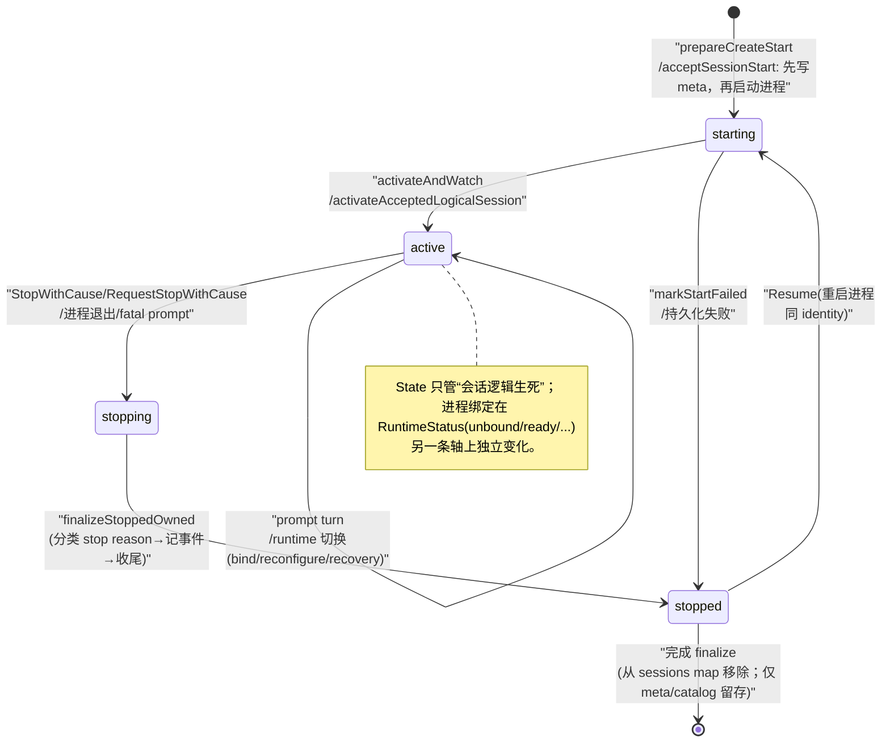
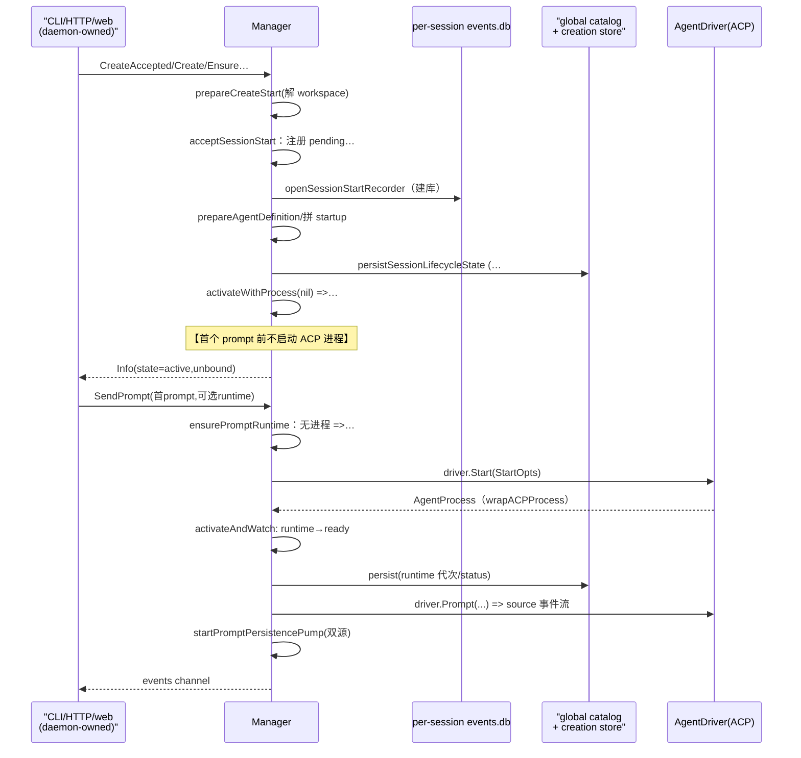
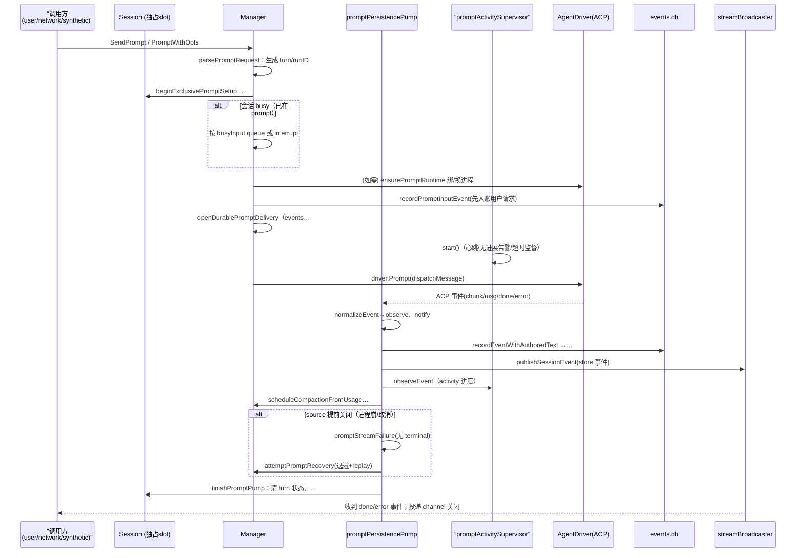
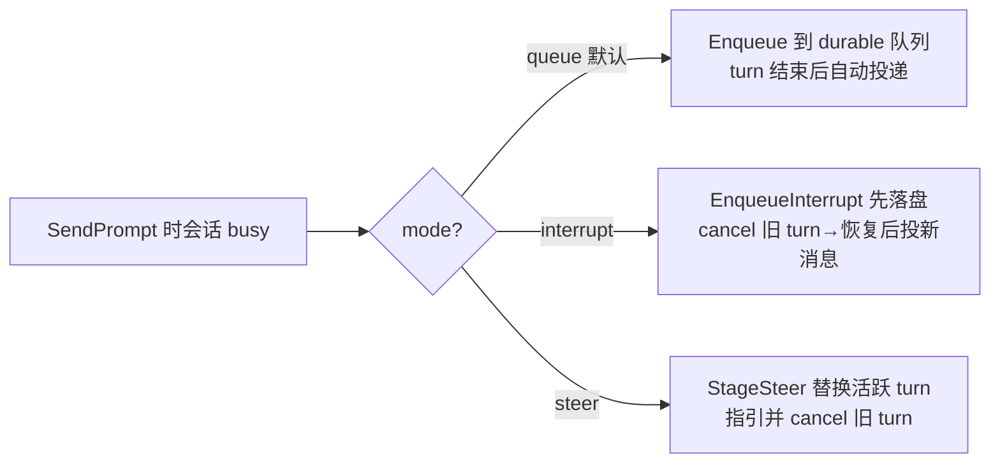

# CompozyOS 会话域解读：状态机、AgentDriver 与先持久化后广播

> 本解读按 **ai-agent 类规格** 产出，解读基线为 compozy 源码 `release/v0.3.0`（HEAD 4efd8de）。

## 一句话总览

session 域把"一个 agent 工作单元"做成**先于进程存在的逻辑对象**：`Session`（内存态）+ `meta.json`（权威生命周期）+ per-session events.db（append-only 事件账本）+ global catalog（可查询投影）。进程（ACP agent runtime）是**按需绑定**的资源，会话本身却 durable。prompt 是进入 Session 的单人对话 turn，事件先落账本再 fan-out，busy 时的输入走 durable 队列而非直接拒绝，agent 死了有自动恢复与 resume replay 兜底。

---

## 角色：去掉 session 域，系统会怎样

控制面（CLI/HTTP/SSE/UDS/web）不能直接跟 ACP agent 进程对话，否则会退化回"Claude Code 被终端绑死"的 v0.2 老路——这正是 CompozyOS 要消灭的东西。session 域是让 ACP agent CLI 变成 daemon 可拥有对象的关键中介：

- **prompt 从瞬时调用变成 durable 对象**：`SendPrompt`（含 busy-input 三模式）、`Prompt`/`PromptWithOpts`、synthetic/network 路径全部汇入同一个 Manager，事件流可回放、可订阅（[internal/session/manager_busy_input.go:20-69]() <!-- anchor: func (m *Manager) SendPrompt(ctx context.Context, id string, opts SendPromptOpts -->，[internal/session/manager_prompt.go:92-110]() <!-- anchor: func (m *Manager) Prompt(ctx context.Context, id string, msg string) (<-chan acp -->）。
- **生命周期与进程解耦**：`CreateAccepted` 允许先建一个无进程的逻辑会话，进程留到首个 prompt 才绑定（[internal/session/manager_create_accepted.go:11-36]() <!-- anchor: // CreateAccepted durably creates an active logical user session. The ACP -->）。
- **agent 死亡不再等于会话丢失**：resume、自动 runtime recovery、crash 分类（[internal/session/manager_resume.go:16-101]() <!-- anchor: func (m *Manager) Resume(ctx context.Context, id string) (resumed *Session, err -->，[internal/session/liveness.go:24-59]() <!-- anchor: func ClassifyInactiveMetaForRecovery(now time.Time, meta store.SessionMeta) (sto -->）。
- **为上层（loop/automation）提供可等待的状态基元**：`WaitForBadge` 与 wait registry（[internal/session/session_wait.go:79-120]() <!-- anchor: func (m *Manager) WaitForBadge(ctx context.Context, req WaitRequest) (outcome Wa … case <-timer.Channel(): -->）是无人值守自动化轮询 session 结束/等待输入的手段；session 结束还有 ledger 物化与 `session_stopped` 事件入账，供下游审计（[internal/session/ledger.go:13-35]() <!-- anchor: func (m *Manager) materializeSessionLedger(ctx context.Context, session *Session -->，[internal/session/manager_lifecycle.go:278-320]() <!-- anchor: func (m *Manager) recordSessionStoppedEvent( -->）。

没有这一域，daemon 就只是个进程管理器而不是 "agent 操作系统"。**它是 runtime 的心脏**：loop/task/automation 等所有后台工作最终都要落到某个 session 上跑。

---

## 解决什么问题、根因

要理解这里的每一条设计，根因必须回到一个问题族：**"用户/上层发起的一次对 agent 的请求，如何才能变成 daemon 拥有、可监督、可恢复、进程死了还能回来的东西？"**

拆开看是四个子问题，session 域逐条对应：

### 进程不等于会话（非确定性生命周期）
ACP agent 是外部 CLI 子进程：可能崩溃、被 kill、daemon 重启后成为孤儿、超时无响应、provider 抽风返回 transport 错误。如果把"会话"和"进程"画等号，那么 agent 一死，用户的工作上下文全没了。所以源码把状态拆成两个正交轴：
- **Session 生命周期 State**：`starting / active / stopping / stopped`，纯逻辑、与进程无关（[internal/session/session.go:30-38]() <!-- anchor: // State is the lifecycle state of a managed runtime session. -->）。
- **Runtime 绑定状态 RuntimeStatus**：`unbound / binding / ready / reconfiguring / recovering / failed`——描述"当前有没有一个可用的 ACP 进程、在做什么切换"（[internal/session/runtime.go:15-24]() <!-- anchor: type RuntimeStatus = store.SessionRuntimeStatus -->）。

两者可以不同步：一个 `active` 的会话可以是 `unbound`（逻辑会话），也可以 `recovering`（进程刚崩正在重启）。

### 超请求生命（daemon detach）
请求发起方（HTTP/SSE/web 会话/CLI 终端）随时会消失或断连。prompt 的执行必须脱离请求上下文继续存活。源码里刻意出现多处 `context.WithoutCancel` 派生：事件入账用无取消上下文但带 5s 超时兜底（[internal/session/ledger.go:27-28]() <!-- anchor: ledgerCtx, cancel := context.WithTimeout(context.WithoutCancel(ctx), defaultLife … defer cancel() -->），fatal prompt 失败后 stop 也用 detached context（[internal/session/manager_prompt_runtime_loop.go:128-134]() <!-- anchor: func detachedPromptStopContext(ctx context.Context, m *Manager) (context.Context -->）。请求 context 只用来决定"投递给请求方的 channel 还要不要"。

### 单 worker 下的并发（一个人/agent 只能同时说一句话）
一个 ACP 子进程同一时刻只能执行一个 prompt。但用户可能在 agent 干活时再发消息、发 slash 命令、甚至想打断当前工作改口。盲选方案是"直接拒绝/排队失败"，但产品需要可控性。于是有了：
- busy-input 的 **queue / interrupt / steer** 三模式 + durable 队列（见后文「busy input：queue / interrupt / steer」）；
- session 内以 `promptSetupCount`/`currentTurnSource` 实现**独占 prompt slot**（[internal/session/session_prompt_state.go:91-99]() <!-- anchor: func (s *Session) IsPrompting() bool { -->）；
- 事件流上一旦出现一个 Error 就存在进程已退出的竞态窗口，pump 需要自行判定 stream 是否"非正常提前关闭"并补一个 terminal 事件（[internal/session/manager_prompt_pump.go:106-128]() <!-- anchor: func promptStreamFailureWithoutTerminal( -->）。

### 持久化真相与多读模型的一致性
前面几篇讲的是"append-only event store + projection"。session 域正是这句话的实现现场：prompt 事件的权威账本是 per-session events.db（`store/sessiondb`），但 UI/CLI 需要低成本地"列出有哪些会话、每个什么状态、要不要提醒我"，所以每次生命周期变更都把内存态快照先写 `meta.json` 再投射进 global catalog（[internal/session/manager_transition.go:12-16]() <!-- anchor: // persistSessionLifecycleState is the lifecycle transition choke point. Callers … // reconciles the catalog from it. --> 的注释把兜底顺序讲得很直白）。这一层一致性是后面所有竞态处理的总纲。

---

## 设计思路（方案、放弃的替代、核心模式）

### 一次创建 = 预分配 durable 身份 + 延迟进程绑定

创建不是"拉起一个 agent"，而是先完成一套**可重入的身份协商**再进入 start 生命周期：

- 身份由三个 digest 组成：`CreationProfileRef`（canonical profile 的 ref）、`PolicySpecDigest`、`CreationDigest`（profile + creation options 的摘要）（[internal/session/session_creation.go:321-346]() <!-- anchor: func identityForCreationProfile( -->）。
- `EnsureCreated` 是幂等创建入口：先查 creation store 里是否已存在同 identity 的会话，命中且 identity 一致就复用并 `ensureExistingSessionActive`（必要时自动 Resume）；不一致返回 typed `CreationError`（[internal/session/session_creation.go:69-185]() <!-- anchor: func (m *Manager) EnsureCreated(ctx context.Context, opts CreateOpts) (EnsureCre -->）。
- 错误携带 `EffectCertainty`（known-false / unknown），让调用方能区分"我可以重试"和"重试也没用"（[internal/session/session_creation.go:37-59]() <!-- anchor: // CreationError carries typed session-creation effect certainty through errors. -->；语义定义 [internal/session/effect_certainty.go:6-11]() <!-- anchor: const ( -->）。

**为什么先 identity 再 start**：后台 loop/automation（下一篇）会反复要"同一个 task 对应的会话"，没有幂等身份键，重启后必然重复建会话。identity mismatch 的 typed 错误是它的护栏。

### AgentDriver：把 ACP 藏到一个五方法接口后面

Manager 不与具体 ACP 驱动耦合，依赖一个极窄接口（使用处定义、实现处注入）：

```go
// AgentDriver defines the ACP functionality consumed by the session manager.
type AgentDriver interface {
	Start(ctx context.Context, opts acp.StartOpts) (*AgentProcess, error)
	Prompt(ctx context.Context, proc *AgentProcess, req acp.PromptRequest) (<-chan acp.AgentEvent, error)
	Cancel(ctx context.Context, proc *AgentProcess) error
	Stop(ctx context.Context, proc *AgentProcess) error
}
```
<!-- anchor: internal/session/interfaces.go:421 原文逐字 -->

关键在 `*AgentProcess`：它是 session 域自己的**进程句柄抽象**，携带 PID/caps/done/wait/stderr/exitStatus/health/权限回调函数集（[internal/session/interfaces.go:163-190]() <!-- anchor: // AgentProcess is the session-owned handle for a running agent process. -->）。acp 包的原生进程通过 `wrapACPProcess` 包一层函数适配（[internal/session/interfaces.go:371-418]() <!-- anchor: func wrapACPProcess(proc *acp.AgentProcess) *AgentProcess { -->）；自定义 driver（如测试替身）可通过 `NewAgentProcess` 注入任意行为（[internal/session/interfaces.go:216-258]() <!-- anchor: func NewAgentProcess(opts AgentProcessOptions) *AgentProcess { -->）。

还有两个**可选扩展接口**用于不替换进程的活配置：
- `RuntimeConfigurator`：进程活着时改 model/speed/ACPOptions（[internal/session/interfaces.go:430-432]() <!-- anchor: type RuntimeConfigurator interface { -->）；
- `ScopedInterrupter`：只中断某个 turn 名下注册的 tool 子进程（[internal/session/interfaces.go:438-440]() <!-- anchor: type ScopedInterrupter interface { -->）。

具体 ACP 实现适配在 `internal/session/acp_driver_adapter.go`：Start 包装原生进程、Cancel/Stop/ConfigureRuntime/Interrupt 均转发，且要求 `proc.native` 必须是 *acp.AgentProcess 才放行（[internal/session/acp_driver_adapter.go:91-101]() <!-- anchor: func (a *ACPDriverAdapter) nativeProcess(proc *AgentProcess) (*acp.AgentProcess, -->）。

### 事件入账（ledger-in，ledger-out）与三类读模型

- **入账唯一入口**：`recordEventWithAuthoredText`。顺序是 ① enrich（补 runID/generation/synthetic 溯源）② `applyAttentionAgentEvent` 先处理"注意力"类事件 ③ marshal 成 Content ④ `RecordPersisted` 拿到权威 `Sequence` ⑤ 广播（[internal/session/manager_prompt_event_storage.go:90-144]() <!-- anchor: func (m *Manager) recordEventWithAuthoredText( -->）。
- **三类读模型**：
  1. `Info`：Session 内存快照，带锁一致性读取（[internal/session/session_info.go:12-20]() <!-- anchor: func (s *Session) Info() *Info { -->）；
  2. `meta.json` + global catalog：权威生命周期（[internal/session/session_meta.go:20-74]() <!-- anchor: func (s *Session) metaLocked() store.SessionMeta { --> 构造，[internal/session/manager_transition.go:26-62]() <!-- anchor: func (m *Manager) persistSessionLifecycleStateLocked(ctx context.Context, sessio --> 落库顺序）；
  3. transcript/events 查询：stopped 会话也能读，用 read-only 打开（[internal/session/manager_options.go:46-53]() <!-- anchor: // WithQueryStore injects the opener used for stopped-session transcript/event --> 明确注释防止 clear/delete 竞态时重建 events.db）。

### broadcast：先持久化、后推送、慢订阅者被断开

没有事件总线。Manager 持有一个 typed in-process broadcaster：
- 订阅者带 `afterSequence` 游标，publish 时按 seq 前进；每个订阅者一个带缓冲的 channel（[internal/session/session_stream_broadcast.go:30-37]()<!-- anchor: type sessionEventSubscriber struct { --> [internal/session/session_stream_broadcast.go:45-94]()<!-- anchor: func (b *sessionEventBroadcaster) subscribe( --> <!-- anchor: type sessionEventSubscriber struct { -->）。
- **溢出策略是断开而非背压**：订阅者消费不及就删订阅、cancel context、close channel（[internal/session/session_stream_broadcast.go:110-126]() <!-- anchor: overflow := false -->）。
- 上游协议要求：调用者订阅后自行从 events.db **catch-up** 再听增量，用 sequence 去重——广播只是增量推送通道，不是真相（[internal/session/session_stream_broadcast.go:162-164]() <!-- anchor: // SubscribeSessionEvents registers an in-process stream subscriber for … // registration and deduplicate by sequence. --> 注释）。同时有单独 wake-only 订阅模式给投影刷新用（[internal/session/session_stream_broadcast.go:205-226]() <!-- anchor: // SubscribeSessionEventWakes registers an unfiltered projection wake subscriber -->）。
- 溢出时补一条结构化诊断事件 `SessionStreamOverflowFallback`，通知下游走回放（[internal/session/session_stream_broadcast.go:247-251]() <!-- anchor: if broadcaster == nil || !broadcaster.publish(event) { -->）。

### 双源 prompt pump + 主动合成 terminal

一次 prompt 的消费者（web/SSE/CLI）拿到的 channel 事件来自**两个源**的合并：`source`（driver.Prompt 的 ACP 事件流）与 `runtime`（activity supervisor 合成的进度/警告/超时事件）。pump 循环用 `nextPromptPumpEvent` 优先探听 source、runtime 到达后回探 source，实现合并（[internal/session/manager_prompt_runtime_loop.go:136-193]() <!-- anchor: func nextPromptPumpEvent( -->）。此外还有 chunk coalescer 把 message delta 攒批以降低落库与推送次数。

当两个源都关但 turn 还没结束，pump 必须**主动判定失败**：检查 lifecycleCtx、用户是否已请求取消、进程是否已退出、或补一个 `PromptStreamIncompleteEvent`（[internal/session/manager_prompt_pump.go:106-128]() <!-- anchor: func promptStreamFailureWithoutTerminal( -->）。换句话说，**流关闭不再被信任为"正常结束"，终止只能由 terminal 事件裁决**。

### 恢复层次：resume replay、自动 recovery、崩溃分类

- **自动 recovery**：turn 中遇到 `FailureProcess/FailureTransport` 时按 `1s/2s/4s` 延迟退避重启进程并带着 replay 继续同一 turn（[internal/session/manager.go:23-23]() <!-- anchor: var defaultPromptRecoveryDelays = []time.Duration{time.Second, 2 * time.Second,  --> 默认延迟；[internal/session/manager_prompt_recovery.go:47-126]() <!-- anchor: func (m *Manager) attemptPromptRecovery( -->）。
- **resume replay**：会话 resume（进程不在）时，从 events.db 把未归档事件组装成消息、去重、包进 `<compozy_context_replay>` 指令块，作为首条 prompt 的上下文前缀——"历史不是新请求，不要重复已完成的工具调用"（[internal/session/resume_replay.go:14-21]()<!-- anchor: const ( --> [internal/session/resume_replay.go:125-131]()<!-- anchor: func promptWithResumeReplay(replayBlock string, message string) string { --> <!-- anchor: const ( -->）。
- **崩溃分类**：daemon 重启后扫 meta，把 active/stopping/starting 的残留改判为 stopped，并依据"子进程是否还活着 + 是否已 stall"给出差异化的 StopDetail（orphaned / stalled / start incomplete）（[internal/session/liveness.go:24-59]() <!-- anchor: func ClassifyInactiveMetaForRecovery(now time.Time, meta store.SessionMeta) (sto -->）。

### 放弃的替代（源码可证的取舍）

1. **放弃"prompt 直接拒绝"作为 busy 默认**：默认是 `queue` 模式 + 超量返回结构化 `session.input_queue.full` 诊断，而不是 error 或无限背压（[internal/session/inputqueue/queue.go:431-447]() <!-- anchor: func queueFullError(sessionID string, queueCap int, cause error) error { … return diagnostics.NewStructuredError(item, cause) -->）。显式 slash/goal 路径仍可 `reject-if-busy`。
2. **放弃对慢订阅者做背压/持久队列**：广播溢出=断连+diagnostic，把恢复成本推给"重连 + after_seq 回放"，符合"广播只是增量通知"的定位。
3. **compaction 不删历史**：压缩触发时把已结束 turn 的事件区间打 summary、标 archived（forensic 行保留），而不是 DELETE（[internal/session/compaction.go:262-290]() <!-- anchor: func archiveCompactionSpan( -->；`internal/session/store` 侧 archive 语义 [internal/store/types_event.go:149-156]() <!-- anchor: const ( -->）。
4. **运行时切换尽量不换进程**：同 provider 下优先 `live configuration`，失败才 fallback 到"先起新进程、验活、再停旧进程"的 swap（[internal/session/manager_prompt_runtime.go:45-66]() <!-- anchor: if snapshot.process != nil && … return m.replacePromptRuntime(ctx, session, &snapshot, plan) -->）。

---

## 核心状态机与流程

### 会话生命周期状态机



**State 四态 + 合法迁移**（不允许回退，started 后只能前进到 stopped）：

```go
const (
	StateStarting State = "starting"
	StateActive   State = "active"
	StateStopping State = "stopping"
	StateStopped  State = "stopped"
)
```

（枚举本体逐字见 [internal/session/session.go:33-38]() <!-- anchor: const ( -->，`transition` 与 `canTransition` 见 [internal/session/session_lifecycle_state.go:95-119]()<!-- anchor: func (s *Session) transition(next State, now time.Time) error { --> [internal/session/session_lifecycle_state.go:152-163]()<!-- anchor: func canTransition(current State, next State) bool { --> <!-- anchor: func (s *Session) transition(next State, now time.Time) error { -->。）

值得注意的三点：
- `active` 态内部其实还叠加了一条**非法但可能的路**：`rollbackActivation` 会把已 active 的会话从 map 摘掉并**退回 starting**，用于 start 后半程失败（[internal/session/session.go:306-323]() <!-- anchor: func (s *Session) rollbackActivation(now time.Time) { -->；[internal/session/manager_helpers.go:160-175]() <!-- anchor: func (m *Manager) rollbackActivation(session *Session, proc *AgentProcess, now t -->）。这条路径绕过 canTransition（直接写字段），是"撤销一个失败的激活"，不是状态机正常弧。
- `prepareStop` 里从 active 直接抢锁变 stopping，同一个锁上做 spawn TTL 的 cause 归类，杜绝"reaper 快照之后、停之前又新进一个 prompt"的窗口（[internal/session/session_stop_state.go:133-155]() <!-- anchor: cause = s.resolveSpawnTTLStopCauseLocked(cause) -->，cause 归类 [internal/session/session_stop_state.go:160-168]() <!-- anchor: func (s *Session) resolveSpawnTTLStopCauseLocked(cause StopCause) StopCause { -->）。
- `stopped` 不是终点语义：remove 会把内存 session 摘掉；此后 Resume 依据 meta 重新 start（[internal/session/manager_resume.go:57-101]() <!-- anchor: func (m *Manager) resumeSession(ctx context.Context, target string) (*Session, e -->），身份指纹仍一致（见「一次创建」小节）。

### 一次创建/启动的时序



（`acceptSessionStart` 后的启动执行主体在 [internal/session/manager_start_launch_accepted.go:43-120]() <!-- anchor: func (m *Manager) launchAcceptedSessionStart(accepted *acceptedSessionStart) err -->；首启 opts 组装链在 [internal/session/manager_start_launch.go:10-72]() <!-- anchor: func (m *Manager) prepareSessionLaunch( … return startOpts, nil -->；`activateAndWatch` 见 [internal/session/manager_helpers.go:78-122]() <!-- anchor: func (m *Manager) activateAndWatch( -->；首个 prompt 触发 runtime bind 见 [internal/session/manager_prompt_runtime.go:18-67]() <!-- anchor: func (m *Manager) ensurePromptRuntime( -->。）

### 一次 prompt 的内部路径（入账/回放要点）



关键事实锚点：submit 主流程 [internal/session/manager_prompt_submit.go:45-126]()<!-- anchor: func (m *Manager) submitPromptRequest(ctx context.Context, req promptRequest) (< --> [internal/session/manager_prompt_submit.go:173-246]()<!-- anchor: func (m *Manager) submitPromptInReservedSlot( -->；pump 循环 [internal/session/manager_prompt_pump.go:46-104]() <!-- anchor: func (m *Manager) runPromptPumpLoop(run *promptPumpRun) { -->；单事件处理 [internal/session/manager_prompt_runtime_loop.go:195-262]() <!-- anchor: func (m *Manager) handlePromptPumpEvent( -->；观察+入账+通知管线 [internal/session/manager_prompt_event_observation.go:16-38]() <!-- anchor: func (m *Manager) observeRecordAndNotifyPromptEvent( -->；turn 收尾（含队列续投）[internal/session/manager_prompt_pump.go:178-251]() <!-- anchor: func (m *Manager) finishPromptPump( -->。

**一致性要点**：输入事件（prompt_input）与输出事件都走同一 recorder，sequence 单调；turn 边界由 `finishPromptTurnIfNeeded` 依据 done/error 裁决（[internal/session/manager_prompt_runtime_loop.go:257-259]() <!-- anchor: if stop := m.finishPromptTurnIfNeeded(ctx, turnState, loop, normalized); stop { -->）。

### 停止 / cancel 的竞态处理

`CancelPrompt`（只打断当前 turn）与 `StopWithCause`（终止会话）是两条不同强度的路径：

- **CancelPrompt**：幂等。置 `promptCancelRequested` → 调 `driver.Cancel`（cooperative cancel 信号）→ 若 driver 支持再发 scoped Interrupt（只杀该 turn 的 tool 子进程）（[internal/session/prompt_cancel.go:27-81]() <!-- anchor: func (m *Manager) CancelPrompt(ctx context.Context, id string) (PromptCancelResu -->；状态位管理 [internal/session/session_prompt_state.go:196-221]() <!-- anchor: func (s *Session) requestCurrentPromptCancellation() ( -->）。
- **StopWithCause**：完整 stop。先 `session.prepareStop` 在锁内 transition active→stopping 并给出 `promptSetupDone` channel，**等正在 setup 的 prompt 让出 slot**，再向 driver 发 Stop（[internal/session/stop_reason.go:132-202]() <!-- anchor: func (m *Manager) StopWithCause(ctx context.Context, id string, cause StopCause, -->；[internal/session/session_stop_state.go:122-155]() <!-- anchor: func (s *Session) prepareStop(now time.Time, cause StopCause, detail string) (bo -->）。
- **finalization 竞争仲裁**：可能同时有"用户主动 stop"和"进程 watcher 发现进程退出"两条路径想收尾。`claimFinalization`/`observeFinalization` 提供 claimable 语义：先到者拥有收尾权，后到者 wait 同一 done channel（[internal/session/manager_finalization.go:17-32]()<!-- anchor: func (m *Manager) claimOrWaitFinalization(ctx context.Context, session *Session) --> [internal/session/manager_finalization.go:70-117]()<!-- anchor: func (m *Manager) claimFinalization(session *Session) (bool, *sessionFinalizatio --> [internal/session/manager_finalization.go:119-146]()<!-- anchor: func (m *Manager) claimOrWaitObservedFinalization( -->）。watcher 里的过程见 [internal/session/manager_lifecycle.go:97-141]() <!-- anchor: func (m *Manager) handleProcessExit( -->（`handleProcessExit`：进程退出若无人 stop 则按 waitErr 归类 CauseProcessExited / CauseCompleted 再 finalize）。

收尾顺序（`finalizeStoppedOwned`）：标记 stopping → 持久化 stop 分类（含 crash bundle）→ 记 process exit / session_stopped 事件 → 停 sandbox → 取消并等 compaction → 通知 finalizing → 关 recorder → mark stopped → **物化 ledger** → 离开 network channel → 摘出 sessions map（[internal/session/manager_stop_finalization.go:29-88]() <!-- anchor: func (m *Manager) finalizeStoppedOwned( -->）。停止原因到 `StopReason` 的归类表在 [internal/session/stop_reason.go:14-67]() <!-- anchor: func classifyStopReason(cause StopCause, waitErr error, detail string) (store.St -->（注意 `CauseUserRequested` 会根据 detail 子串细分出 max_iterations / loop_detected / budget_exceeded——这正是 loop 域要消费的信号）。

### Resume 的两种形态

- 普通 resume：`prepareResumeStart` 读 meta 重建 start spec（cwd/worktree/network/creation identity 全从 meta 恢复），`startResumedSession` 里若 meta 无 `ACPSessionID` 就置 `resumeReplay=true`，走 `buildResumeReplay`（[internal/session/manager_resume.go:84-101]()<!-- anchor: spec, err := m.prepareResumeStart(ctx, meta) --> [internal/session/manager_resume.go:170-185]()<!-- anchor: func (m *Manager) startResumedSession( -->；[internal/session/manager_start.go:35-75]() <!-- anchor: func (m *Manager) prepareResumeStart(ctx context.Context, meta store.SessionMeta -->）。
- 逻辑会话 resume：`isUnboundLogicalResume` 判定 meta 为 unbound（无进程、无 transition、无 acp session），则**不进 ACP load-session**，直接按逻辑会话再激活（[internal/session/manager_resume.go:150-168]() <!-- anchor: func isUnboundLogicalResume(meta store.SessionMeta) bool { -->）。
- provider 不支持 load-session / 资源丢失：recoverFailedResumeStart 清掉 acpSessionID 后降级为 context-replay resume（[internal/session/manager_resume.go:187-233]() <!-- anchor: func (m *Manager) recoverFailedResumeStart( -->）。

### busy input：queue / interrupt / steer

busy 判定 = `IsPrompting`（setup 中或 turn 中，[internal/session/session_prompt_state.go:91-99]() <!-- anchor: func (s *Session) IsPrompting() bool { -->）。命中后 `submitBusyPreparedPrompt` 按 mode 分发（[internal/session/manager_busy_input.go:201-220]() <!-- anchor: func (m *Manager) submitBusyPreparedPrompt( -->）：



三种模式共同点：**先持久化、后取消**——`EnqueueInterrupt` 的注释 "persists replacement input before the active turn is canceled" 点破顺序，避免"先 cancel 后进程死了，新输入也丢"（[internal/session/inputqueue/queue.go:181-200]() <!-- anchor: // EnqueueInterrupt persists replacement input before the active turn is cancele -->）。

队列本身在 `inputqueue/` 子包，纯策略层，持久化走 `store.SessionInputQueueStore`；有 ClaimNext/Release/MarkSent/MarkFailed 的 **lease** 语义，防同一输入被并发 pump 两次（[internal/session/inputqueue/queue.go:283-358]() <!-- anchor: // ClaimNext leases the next input eligible for dispatch. -->）。队列带 `generation`（runtime 代次）做 fencing（[internal/session/inputqueue/queue.go:365-368]() <!-- anchor: // CurrentGeneration reads the current persisted generation for queue fencing. -->），配合 manager 里"仅当 turn 结束后再投下一个"的 gate（[internal/session/manager_prompt_pump.go:249-250]() <!-- anchor: m.startNextQueuedInputPrompt(session.ID) … m.startNextQueuedSyntheticPrompt(session.ID) --> 的 `startNextQueuedInputPrompt`）。slash 命令与 goal 路径走 `prompt admission`（at-most-once 幂等 receipt），见 `EnqueueAdmitted*`（[internal/session/inputqueue/queue.go:153-179]()<!-- anchor: func (s *Service) EnqueueAdmitted( --> [internal/session/inputqueue/queue.go:203-218]()<!-- anchor: func (s *Service) EnqueueAdmittedInterrupt( --> <!-- anchor: func (s *Service) EnqueueAdmitted( -->）。

### compaction 生命周期

触发条件=事件里的 token usage：`ContextUsed/ContextSize >= PressureThreshold` 且启用（[internal/session/compaction.go:118-124]() <!-- anchor: func (m *Manager) compactionPressureReached(usage acp.TokenUsage) bool { -->）。随后：
1. 每个 session 每 turn 有状态机 `sessionCompactionState`：`inFlight / attempts / cooldownUntil` 防重入与失败风暴（[internal/session/compaction.go:23-30]()<!-- anchor: type sessionCompactionState struct { --> [internal/session/compaction.go:69-116]()<!-- anchor: func (m *Manager) maybeCompact(session *Session, usage acp.TokenUsage) error { --> <!-- anchor: type sessionCompactionState struct { -->）；
2. 回放确定"可压缩区间"= **已完整结束的 turn 前缀**（每个 turn 必须有 done/error 终结，transcript 标记与 clarify 例外）（[internal/session/compaction.go:228-260]() <!-- anchor: func completePriorTurnPrefix(events []store.SessionEvent, triggerTurnID string) -->）；
3. 向 handler（memory runtime，late-bound）要 summary，成功后把区间事件标 archived（非删除），并入账 `session_compaction_fired` 事件含 from/to sequence、pressure、strategy（[internal/session/compaction.go:146-210]()<!-- anchor: func (m *Manager) compactPersistedReplaySpan(ctx context.Context, work compactio --> [internal/session/compaction.go:292-311]()<!-- anchor: func (m *Manager) recordCompactionFired( --> <!-- anchor: func (m *Manager) compactPersistedReplaySpan(ctx context.Context, work compactio -->）；
4. stop/finalize 时 `cancelAndWaitSessionCompaction`；daemon shutdown 有 `shutdownCompactions`（[internal/session/compaction_lifecycle.go:30-81]() <!-- anchor: func (m *Manager) cancelAndWaitSessionCompaction(ctx context.Context, sessionID -->）。

---

## 关键文件与职责（按功能归组，非逐文件罗列）

session 域约 210 个非测试 .go 文件，全部满足"≤500 行/文件、一文件一职责"，逻辑碎片化严重。理解时按组读：

**状态机与内存模型**
- `session.go`（State/Type 枚举、Session 结构、锁布局）、`session_lifecycle_state.go`（transition/canTransition/stop 分类清除）、`session_stop_state.go`（prompt slot、prepareStop 锁内转换、spawn TTL cause）、`session_runtime_state.go`（RuntimeStatus 转换、snapshot/restore、自动 recovery 记录）、`session_process_state.go`（进程信息灌入 session：PID/caps/liveness）、`session_prompt_state.go`、`session_info.go`、`session_meta.go`。
- `runtime.go`（RuntimeStatus/Transition/Selection 常量与 store 互转）、`badge.go`（十 token 对外状态折叠）、`stop_reason.go`、`stop_cause.go`、`session_attach.go`。

**Manager 生命周期与创建**
- `manager.go`/`manager_types.go`（Manager 结构：几十把锁、几十个注入接口的图）、`manager_lifecycle.go`（Create/Stop/watch/process-exit 与事件）、`manager_transition.go`（生命周期持久化 choke point）、`manager_start*.go`（start 状态机与启动链）、`manager_create_*.go`、`manager_resume.go` + `resume_*.go`（重放/修复）、`session_creation.go`（幂等 identity）、`manager_finalization.go`/`manager_stop_finalization.go`、`manager_clear*.go` 与 `manager_delete*.go`（conversation clear / session delete 一族）、`manager_shutdown.go`、`manager_attach.go`。
- `liveness.go`（daemon 中断后的 meta 恢复分类）、`manager_options.go`（DI 注入面，读注释即可知道每个依赖用途）、`manager_hooks*.go` + `hooks.go`（HookSet 分面接口与分派）。

**prompt 执行**
- `manager_prompt.go`/`manager_prompt_request.go`（入口与 request 构造：turnID/runID/溯源）、`manager_prompt_submit.go`（slot→入账→投递→pump 全链）、`manager_prompt_pump.go`/`manager_prompt_runtime_loop.go`（双源 pump 主循环）、`manager_prompt_runtime.go`（ensure/configure/replace 进程）、`manager_prompt_recovery.go`、`manager_prompt_event_storage.go`（recordEvent 唯一入账点）、`manager_prompt_event_observation.go`、`manager_prompt_terminal.go`/`manager_prompt_process_exit.go`/`manager_prompt_failure_barrier.go`、`prompt_activity*.go`（activity supervisor：心跳/无进展告警/超时）、`prompt_cancel.go`、`prompt_chunk_coalescer.go`、`manager_prompt_persistence.go`。

**busy input / 队列**
- `manager_busy_input.go`（SendPrompt 与三种模式仲裁）、`manager_busy_input_types.go`、`manager_busy_input_activation.go`、`manager_busy_input_queue.go`（turn 结束后投递下一队首）、`manager_pending_input.go`、`inputqueue/queue.go`（策略）与 `inputqueue/mutation.go`（store 变更抽象）、`manager_prompt_admission*.go`（at-most-once 外部命令 receipt）、`goal_command.go`（/goal 入队）。

**健康 / 存活 / attention / 通知**
- `health.go`（presence 触摸与健康行刷新）、`health_derivation.go`（由 State+prompt+stall 推导 health/badge/可唤醒）、`health_page.go`、`health_refresh.go`、`health_hooks.go`、`health_store.go`、`session_presence.go`（per-client presence lease + seen/settled attention）、`session_notify.go`（operator notification：限流、redact、mute）、`session_attention_publish.go` 等、`notifier.go`（fan-out 富化）。

**账本 / 广播 / transcript**
- `ledger.go`（session 结束物化 ledger；resume 前 discard）、`manager_prompt_event_storage.go`、`session_stream_broadcast.go`、`session_pending.go`/`session_pending_events.go`/`session_pending_resolution.go`（pending interaction 解析）、`transcript.go`/`transcript_epoch.go`/`manager_transcript_marker.go`（transcript marker 事件）、`session_catalog_stream.go`/`catalog_page*.go`、`session_wait.go`/`session_wait_registry.go`（badge 等待）、`soul_*.go`（Soul 快照，另一特性）、`crash_bundle.go`（失败证据包）、`repair*.go`（事件修复）、`query*.go`（Status/事件/transcript 查询）。

**infra 引用（只在需要时读）**
- `internal/store/event_store.go`、`internal/store/types_event.go`、`internal/store/session_meta_types.go`、`internal/store/sessiondb/`（open/archive/transcript projection 在 sessiondb 内实现）——这些是 events 账本的物理实现，本文未深入。

---

## 与其它模块的协同

1. **acp 包**：session 域把 ACP 驱动藏在 `AgentDriver` 后面；但 `AgentProcess.caps/权限回调/session 生命周期` 都映射自 acp 原生类型，尤其是 ACP 进程的 `SessionID`（ACP load-session）会回灌成 Session 的 `ACPSessionID`（[internal/session/interfaces.go:371-418]() <!-- anchor: func wrapACPProcess(proc *acp.AgentProcess) *AgentProcess { --> 的 wrap 层可见）。acp.Driver.Start 的进程树/隔离细节（含 Windows 进程组回退）由 acp 驱动层承载[WIP]。
2. **store / sessiondb**：`openStore` 默认指向 `sessiondb.OpenSessionDB`，Sequence 与 archive 由 sessiondb 的 writer/archive 层发号；`store.EventArchiver`（ArchiveEvents）是 compaction 归档的物理依赖（[internal/session/manager.go:89-91]() <!-- anchor: openStore: func(ctx context.Context, owner store.SessionDBOwner, path string) (E -->；[internal/session/compaction.go:262-290]() <!-- anchor: func archiveCompactionSpan( -->）。sessiondb 的 RecordPersisted 在同一写事务内完成 sequence 分配与 Content 落盘，从而保证 recordEventWithAuthoredText 的入账原子性[WIP]。
3. **store.SessionCatalog / creation store / attention store / health store / ledger materializer**：全部由 daemon 组合根注入（[internal/session/manager_options.go:155-209]() <!-- anchor: // WithSessionHealthStore injects durable metadata-only session health storage. -->）。catalog 是 session 生命周期投影，health store 是"仅元数据"的唤醒判定输入。catalog 的物理库与迁移归属在 globaldb，不在 session 域[WIP]。
4. **loop / automation**：本域只暴露原材料——`SendPrompt` 的三模式结果、`session_stopped`/transcript marker 事件、StopReason 细分（max_iterations/loop_detected/budget_exceeded）、`WaitForBadge`、ledger 记录。loop 域对这些原材料的消费方式（含 `EnsureCreated` identity 语义的复用）在 loop/automation 篇展开[WIP]。
5. **network 域（participation）**：session 用 late-bound `NetworkPeerLifecycle`（join/leave channel）避免反向 import（[internal/session/interfaces.go:81-86]() <!-- anchor: // NetworkPeerLifecycle is the late-bound network join/leave surface consumed by -->；[internal/session/manager_helpers.go:124-158]() <!-- anchor: func (m *Manager) joinNetworkPeer(ctx context.Context, session *Session, capabil -->）。channel 内的网络会话读模型与 session ledger 共用 events 文件[WIP]。
6. **sandbox 域**：进程绑定期 startopts 注入 sandbox 传输、stop 期 `finalizeSandbox` 按 crash/stop 分流 sync reason（[internal/session/manager_start_launch.go:25-28]() <!-- anchor: startOpts, err = m.prepareSandboxForStart(ctx, spec, session, startOpts) -->；[internal/session/manager_lifecycle.go:222-231]() <!-- anchor: func sandboxSyncReasonForStop(session *Session) sandbox.SyncReason { -->）。sandbox 目录生命周期（destroy-on-stop / fork worktree）由 sandbox 域管理[WIP]。
7. **hooks 域**：HookSet 覆盖 lifecycle/prompt/event/agent/conversation/compaction 各点，session 是 hook 主调度方（`internal/session/hooks.go` 分面接口）。hook 引擎的执行并发模型（同步/异步与防重入）由 hooks 域承载[WIP]。
8. **transcript 域（internal/transcript）**：session 只做 marker 事件入账与查询转发，真正的消息组装/去重/分页在 internal/transcript（[internal/session/transcript.go:19-54]() <!-- anchor: func (m *Manager) TranscriptPage( --> 是薄转发）。internal/transcript 的 projection 由 sessiondb 物理承载（transcript_projection_*.go）[WIP]。

---

## 关键设计决策

### 决策 A：会话先于进程；runtime 按 prompt 惰性绑定
逻辑会话（active 但 unbound）是普遍形态，尤其"先建会话占位、首条消息再定 model/provider"的 ACP 工作流（[internal/session/manager_create_accepted.go:25-27]() <!-- anchor: // A logical session has no ACP process yet. Catalog validation belongs to … spec.deferRuntimeValidation = true --> 明确注释）。好处：创建快、不养进程、身份可预分配、上层（loop）可以先拿到 session id 再排活。代价：**状态轴必须两分**（State 与 RuntimeStatus），所有消费方都要同时读两个轴，代码里到处是 `unbound/ready/recovering` 判定；一旦搞混，会出现"会话 active 但没有可用的进程"这类半态。若反过来"创建即拉起进程"，代价是进程泄漏与 agent 冷启动成本，且与 ACP 按需选 runtime 的模型冲突。

### 决策 B：先持久化、后广播；慢订阅者断连而非背压
`recordEventWithAuthoredText` 里 attention 先 commit、recorder 拿到 Sequence 之后才 `publishSessionEvent`（[internal/session/manager_prompt_event_storage.go:119-138]() <!-- anchor: persisted, err := recordPersistedSessionEvent(ctx, recorder, store.SessionEvent{ … m.publishSessionEvent(ctx, session, persisted) -->）；broadcaster 对溢出订阅者直接踢掉并补诊断（[internal/session/session_stream_broadcast.go:110-126]()<!-- anchor: overflow := false --> [internal/session/session_stream_broadcast.go:247-251]()<!-- anchor: if broadcaster == nil || !broadcaster.publish(event) { --> <!-- anchor: overflow := false -->）。这把"系统内一致性"和"对外实时性"解耦：客户端丢了流就重连 + after_seq 回放，不影响服务端事件管线。若反过来"广播优先、落库异步"，会把崩溃窗口暴露给下游；若"持久化每个订阅者的投递进度"，就是重造消息队列，违背无事件总线的原则（CLAUDE.md 权威）。

### 决策 C：finalization 的 claimable 观察者模式 + 进程 watcher
stop 的最终收尾必须恰好执行一次，但触发方可能是 (a) 用户显式 stop、(b) 进程 watcher 看到 Done、(c) fatal prompt 失败，三者并发。解法是 `observeFinalization`（claimable=1）+ done channel：谁 claim 到谁执行 `finalizeStoppedOwned`，其余 wait 同一结果（[internal/session/manager_finalization.go:70-146]() <!-- anchor: func (m *Manager) claimFinalization(session *Session) (bool, *sessionFinalizatio -->）。代价是 Manager 的 `finalizing` map 成为新的生命周期事实源，任何"会话还在吗"的判断都要查 `sessions ∪ finalizing`（[internal/session/manager_finalization.go:45-59]() <!-- anchor: func (m *Manager) stopTarget(id string) (*Session, *sessionFinalization, error) --> 的 stopTarget 可见）；一旦忘记查 finalizing，就会对正在收尾的会话重复发起 stop。替代"全局大锁 + 状态检查后单飞"更简单但会把所有收尾串行化、且 watcher goroutine 的唤醒无法优雅降级。

### 决策 D（补充）：busy 输入的"先落盘后取消"
interrupt/steer 先 Enqueue 再 cancel 旧 turn（见「busy input」小节），保证新消息在取消风暴前已 durable。若反过来，cancel 与新输入间存在丢失窗口——这正是 release note 提到 session-cancel/clear races 要消灭的那类问题。

---

## 亮点与问题

### 亮点
1. **错误的"效果确定性"建模**：创建路径区分 `EffectKnownFalse`（不可重试）与 `EffectUnknown`（可安全重试），配合 typed `CreationError`，让上层 loop 能正确决定重试策略（[internal/session/session_creation.go:37-59]()<!-- anchor: // CreationError carries typed session-creation effect certainty through errors. --> [internal/session/session_creation.go:116-131]()<!-- anchor: created, err := m.startSession(ctx, &spec) --> <!-- anchor: // CreationError carries typed session-creation effect certainty through errors. … return EnsureCreatedResult{SessionID: desiredID, Outcome: EnsureCreatedOutcomeCr -->）。
2. **一切变更都过"入账 + 投影"两段式**：`persistSessionLifecycleState` 把 meta 当 recovery 源、catalog 当投影，注释明说"catalog 写失败由 boot repair 用 meta 对账"（[internal/session/manager_transition.go:12-16]() <!-- anchor: // persistSessionLifecycleState is the lifecycle transition choke point. Callers … // reconciles the catalog from it. -->）——这是零事件总线下处理崩溃的务实方案。
3. **事件富化集中一处**：`enrichRecordedAgentEvent` 把 runID/generation/taskID/claimTokenHash/coordinator 等溯源一次性补齐再落库，保证跨 surface 关联键一致（[internal/session/manager_prompt_event_storage.go:245-290]() <!-- anchor: func (m *Manager) enrichRecordedAgentEvent(session *Session, event acp.AgentEven -->）。
4. **收尾顺序刻意固定**：ledger 物化放在 recorder 关闭之后、离开 network 之前，compaction 必须先行取消否则阻塞收尾（[internal/session/manager_stop_finalization.go:59-70]() <!-- anchor: compactionErr := m.cancelAndWaitSessionCompaction(ctx, session.ID) … errs = appendLifecycleErr(errs, m.leaveSessionNetwork(ctx, session)) -->）——顺序本身即契约。
5. **health 由元数据推导而非心跳表驱动**：`sessionHealthFromInfo` 仅凭 State/activePrompt/stall 即可算 health/badge/可唤醒，daemon 重启后能整表重建（[internal/session/health_derivation.go:71-132]() <!-- anchor: func sessionHealthStateForInfo(info *Info, input sessionHealthInput) heartbeat.S -->）。

### 问题 / 风险（真实代码信号）
1. **锁与共享状态的爆炸**：Manager 一个结构体挂几十把细粒度锁（[internal/session/manager_types.go:134-257]()<!-- anchor: type Manager struct { -->），`sessions/pending/finalizing/conversationFinalizing/…` 并存且互相转换；`Session.mu` 与 `Manager.mu` 存在嵌套获取路径（如 activate 持 Manager.mu 读 Session）。虽然测试极厚（manager_*.test 总量巨大），这类隐式加锁顺序仍是未来死锁高发区，属于"可维护性税"。
2. **attention 先 commit 的语义微妙**：`recordEventWithAuthoredText` 若 events.db 写失败而 attention 已提交，会 warning 并返回 nil（吞掉错误），注释解释是避免"canonical commit 之后重复报错"（[internal/session/manager_prompt_event_storage.go:146-164]() <!-- anchor: func (m *Manager) handleAttentionTranscriptFailure( -->）。这等于在局部把"attention 投影"置于"事件账本"之上，与"账本是权威"叙事存在张力，值得后续章节求证其一致性边界。
3. **广播溢出走诊断事件回放**：断连即踢，若客户端实现没按注释做 after_seq catch-up 去重，会出现丢事件/重复，责任被显式推给协议调用方（[internal/session/session_stream_broadcast.go:162-164]() <!-- anchor: // SubscribeSessionEvents registers an in-process stream subscriber for … // registration and deduplicate by sequence. -->）。
4. **500 行/文件 × 210 文件的碎片化**：真实逻辑（如一次 prompt）横跨 15+ 文件、函数跳转链极长（submitPromptRequest → submitPromptInReservedSlot → pumpPrompt → handlePromptPumpEvent → observeRecordAndNotifyPromptEvent → recordEvent…），新读者成本极高，且 grep 主题需跨文件拼图。
5. **逻辑会话的"半态"容易被误当 bug**：active+unbound 在 UI 上被显示为 badge 推理的基础输入，任何忘记检查 RuntimeStatus 的消费方都会把它当 ready 处理；`IsPrompting` 只查 turn 不查 runtime，未来 ACP 新驱动若不支持 unbound 形态需额外契约。
6. 值得后续单独复核的风险面[WIP]：`manager_clear_*`（conversation clear / delete 一族）与 cancel 竞态的处理细节、`soul_*`（快照）与 compaction 的相互作用、`repair*.go` 的修复准入。
