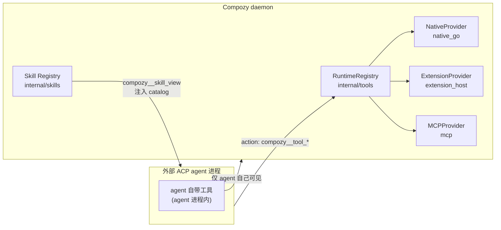
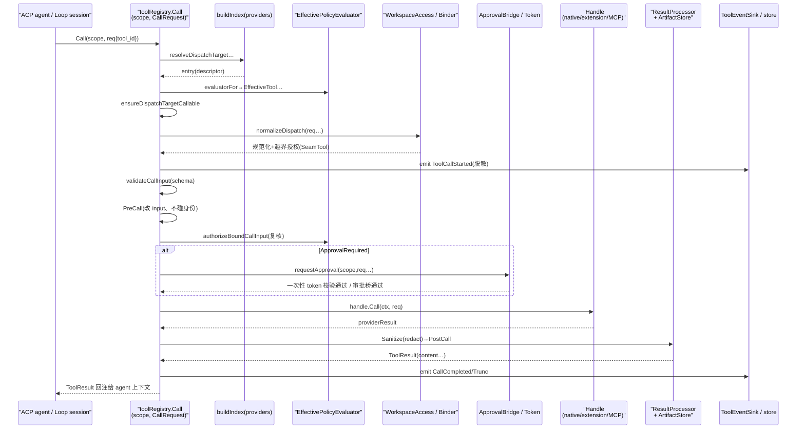
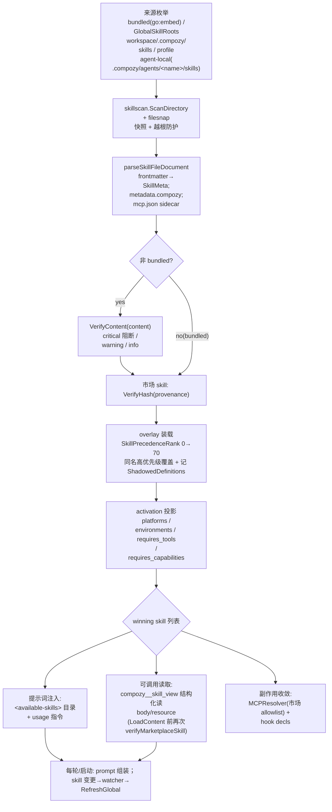

# CompozyOS 工具与 Skill 解读：五段派发管道与八级技能优先级

> 本解读按 ai-agent 类规格 产出，解读基线为 compozy 源码 release/v0.3.0（HEAD 4efd8de）。

---

## 一句话主线

Agent 不能只聊天，它需要「行动」（工具）与「怎么行动」（技能）。`internal/tools` 把 daemon 的所有能力统一成**可描述、可校验、可投影、可授权、可派发**的工具注册表；`internal/skills` 把「完成某类任务的指令资产」做成**可发现、可扫描、按 8 级优先级覆盖、随会话注入**的 SKILL.md 目录；`internal/toolruntime` 则为这些行动所拉起的**外部子进程**提供「谁拥有、谁能中断、重启后怎么收尸」的注册表。三者共同回答一个问题：**如何在不把 daemon 的钥匙直接交给模型的前提下，让 agent 安全地操作 daemon 的能力面。**

---

## 角色：去掉它系统会怎样

| 模块 | 一句话职责 | 去掉它的后果 |
| --- | --- | --- |
| `internal/tools` | 工具的**冷资源形状**（Tool）与**运行时描述符**（Descriptor）统一、多后端（native_go / extension_host / mcp）Provider 注册、作用域投影、策略评估、授权（workspace access / 审批桥 / 输入绑定）、hooks 环绕、结果脱敏/限长/落盘、结构化事件。 | agent/loop 只能各自为政调用零散函数，没有任何单一权威面回答「我这个 session 现在能调哪些工具、为什么另一个被拒」。系统的可治理性、可审计性、跨来源冲突检测全部消失。 |
| `internal/toolruntime` | 长运行工具/终端/钩子进程的**所有权注册表 + 作用域化中断 + 重启对账**。 | daemon 重启后无人能证明「这个 PID 还是不是我起的那个进程」——要么误杀用户进程（PID 复用），要么放任孤儿进程与产物泄漏。session/turn 级中断也无法落点。 |
| `internal/skills` | SKILL.md 目录：**发现（多来源分层扫描）→ 装载（安全扫描 + 市场校验）→ 覆盖（8 级优先级 + shadow 审计）→ 激活门控（platform/env/tools/capabilities）→ 内容注入（提示词 catalog 与 `compozy__skill_view` 结构化读取）**，并把 skill 声明的 MCP server/hooks 收敛给 config/扩展面。 | 没有它，所有「会做事」的知识要么硬编码进系统提示词（不可升级、不可订阅），要么裸读任意文件注入（prompt injection 无防线）。Bundled「compozy」guide 也无从以可升级资产形式随会话路由。 |

一句话：**tools = daemon 的「可调用面」，skills = daemon 的「可注入面」，toolruntime = 行动留下的「进程足迹」。** 三者都是「daemon 侧能力结构化出口」原则（见 CLAUDE.md）的具体落地。

---

## 解决什么问题、根因

### 为什么 daemon 需要自有工具层

外部 ACP agent（Claude/Codex 等）进程内部自带一套工具——那是 **agent 进程内的**能力，daemon 既看不见也管不着。可 CompozyOS 是一个 local-first daemon，它真正拥有的能力（session 生命周期、task、memory、terminal、window manager、network、marketplace、extension 生命周期……）都在 daemon 侧，且必须遵循 CLAUDE.md 的硬约束：**任何可被 agent 管理的能力都要有结构化出口，且既能被 runtime 扩展也能被 agent 管理。** 因此 agent 需要一个「第二工具面」：ID 形如 `compozy__*` 的 daemon 原生工具。



### 根因拆解

- **来源多元**：工具有 daemon 编译的（`native_go`）、扩展宿主提供的（`extension_host`）、MCP server 发现的（`mcp`），未来还有 bridge。若没有统一 descriptor，每类来源各自一套调用协议，策略与审计无法统一施加。
- **身份必须可证明**：模型只能看到「投影后」的视图，绝不能直接拿到后端句柄；所以 descriptor 必须与 handle（可执行物）分离，中间隔着索引、可用性、策略与授权。
- **不可信输入是默认**：skill 是外部文件（市场下载、用户目录、workspace），本质是「外来文本将被注入系统提示词」——因此加载期安全扫描（critical 阻断）不是可选而是必需；同理 MCP 工具经网络进来，默认 external 来源策略是 disabled/ask（保守默认）。
- **升级路径**：`go:embed` 的 bundled skill 不可变 → 免扫描但也不可覆盖时需特殊处理（bundled runtime skill 保护，见后）；市场 skill 需要 hash 证明安装内容没被篡改。

### 与 ACP agent 自带工具如何分工（边界）

- ACP agent 自带工具在 agent 进程内运行，由 agent 自己定义 schema 与权限（那是 acp.md 主题的范畴）。
- daemon native tools 是 daemon 侧能力，经 `toolRegistry` 统一派发：**schema 来自 builtin/ 的 descriptor 或 provider 的 List()，执行回调在 daemon 内（native handler）或经 extension host / MCP executor**。
- 两类工具的分工边界不在代码里，而在**投影面**：hosted session 拿到的 `compozy__*` 工具集合由 `Registry.SessionProjection` 输出（只给 `VisibleToSession && Callable`），策略天花板来自 ACP 宿主协商的权限模式。`EffectiveToolDecision` 里专门记录 `SystemPermissionMode`——daemon 侧策略「在 ACP 权限天花板之下」运算，由 `EffectivePolicyEvaluator` 执行该承诺（[internal/tools/policy.go:122-122]()<!-- anchor: // EffectivePolicyEvaluator computes policy below the ACP permission ceiling. -->）。

---

## 设计思路与核心模式

### tools：冷/热分离 + 五段式派发管道

核心模式是 **冷资源（Tool，持久期望态）与热描述符（Descriptor，运行时索引派发元数据）同构可互转**：`Tool` 是注册表工具的冷期望态资源规格（[internal/tools/descriptor.go:10-10]()<!-- anchor: // Tool is the cold desired-state resource spec for a registry tool. -->），`Descriptor` 是用于索引与派发的归一化运行时元数据（[internal/tools/descriptor.go:34-34]()<!-- anchor: // Descriptor is the normalized runtime metadata used for indexing and dispatch. -->）。
Descriptor 是一张“自描述身份证”：除了 ID/backend/schema（含 schema digest），还带安全分类字段 `Visibility/Risk/ReadOnly/Destructive/OpenWorld/RequiresInteraction/ConcurrencySafe/MaxResultBytes/Toolsets`，并做一致性校验（如 read-only 工具不得 destructive/open-world）。

后端通过 `BackendKind` 区分执行后端类别，常量族如下：

```go
// BackendKind identifies the executable backend class.
type BackendKind string

const (
	// BackendNativeGo executes a daemon-compiled Go handler.
	BackendNativeGo BackendKind = "native_go"
	// BackendExtensionHost executes through the extension host subprocess runtime.
	BackendExtensionHost BackendKind = "extension_host"
	// BackendMCP executes through daemon-owned MCP client adapters.
	BackendMCP BackendKind = "mcp"
	// BackendBridge is reserved for a later bridge adapter TechSpec.
	BackendBridge BackendKind = "bridge"
)
```
常量族见 [internal/tools/tool.go:9-21]()<!-- anchor: // BackendKind identifies the executable backend class. -->：native 工具执行 daemon 内编译的 Go handler、extension 工具经 extension host 子进程运行时执行、MCP 工具经 daemon 拥有的 MCP 客户端适配器执行，bridge 常量预留给后续适配器。

三层契约接口把「注册」与「执行」彻底分离——`Registry` 拥有全部工具面的发现与派发（[internal/tools/tool.go:200-200]()<!-- anchor: // Registry owns tool discovery and dispatch for all surfaces. -->）、`Handle` 是单个工具可执行的运行时契约（[internal/tools/tool.go:208-208]()<!-- anchor: // Handle is the executable runtime contract for one tool. -->）、`Provider` 从一个来源贡献描述符与可执行句柄（[internal/tools/tool.go:215-215]()<!-- anchor: // Provider contributes descriptors and executable handles from one source. -->）。

派发不是 if-else，而是一条**可插拔的五段管道**（RegistryOption 注入每一段），见核心流程图(a) 与关键实现归组。

### skill：优先级即秩序、扫描即信任、激活即投影

Skill 设计上有三层与工具对仗：

1. **来源分层（tier）**是 skill 世界的“风险与秩序模型”：数字越小越底（Bundled 0）越大越贴近具体现场（Agent-local 70），碰撞时**高优先级覆盖低优先级**，且每次覆盖都记录 shadow（审计线索），绝不会静默。这与工具世界的 source-provenance + 冲突检测同构。
2. **装载即安全关口**：非 bundled skill 每次加载都跑 `VerifyContent`（正则扫描注入/滥用模式，critical 阻断、warning/info 仅记日志）；市场 skill 另有 provenance hash 校验；agent-local 走更严格的 `processSkillStrict`。
3. **提供面分“身份”与“内容”**：目录只投递名字+描述（catalog），完整正文由 `compozy__skill_view` 这个**原生工具**按需读取——把“注入”变成“可结构化访问”，降低单次上下文污染。

### 为什么是 8 级优先级 + 每次重扫

根因是**同一 skill 名可能同时存在于多个根**（市场装了一版、用户目录一版、当前 workspace `.compozy/skills/` 又一版）。必须有一个确定性裁决，且被裁掉的定义不能被悄悄丢弃——要能回答「为什么生效的是这版」。8 级权重由 `SkillPrecedenceRank` 显式给出低到高的解析秩：

```go
func SkillPrecedenceRank(source SkillSource) int {
	switch source {
	case SourceBundled:
		return 0
	case SourceMarketplace:
		return 10
	case SourceUser:
		return 20
	case SourceProfile:
		return 30
	case SourceAdditional:
		return 40
	case SourceWorkspace:
		return 50
	case SourceWorkspaceProfile:
		return 60
	case SourceAgentLocal:
		return 70
	default:
		return -1
	}
}
```
实现见 [internal/skills/registry_source.go:34-56]()<!-- anchor: // SkillPrecedenceRank returns an explicit low-to-high resolver rank. -->——数字越小越底层（Bundled 0），越大越贴近具体现场（Agent-local 70），碰撞时高优先级覆盖低优先级。

裁决动作（overlay）由 `overlaySkill` 执行（[internal/skills/registry_override_log.go:52-52]()<!-- anchor: func (r *Registry) overlaySkill(dst map[string]*Skill, skill *Skill) { -->）：先在目标 map 中查同名旧定义（[internal/skills/registry_override_log.go:53-53]()<!-- anchor: if existing, ok := dst[skill.Meta.Name]; ok { -->），把被压掉的旧定义并入新技能的 `ShadowedDefinitions`，供 `skill.shadowed` 事件与诊断展示。

### toolruntime：进程所有权即“可中断性”的前提

派发层解决“能不能调”，toolruntime 解决“调起来的东西怎么停下来且不误伤”。它把「PID」升级为「(PID, 启动时刻, owner 作用域, source) 的所有权记录」：中断前必须验明正身（启动时刻匹配），scope 到 process/tool_call/turn/session/terminal/hook/extension 任意粒度，进程组优先于单进程。默认中断器是 SIGTERM → 宽限 → SIGKILL 的升级序列。

---

## 核心流程：两张 Mermaid 图

### (a) 工具调用全链路（descriptor → 派发 → 授权 → 执行 → 回注）



### (b) skill 装载链路（发现 → 扫描 → 优先级 → 注入）



---

## 关键实现归组

### tools：注册与投影

- **RegistryOption 装配**：`RuntimeRegistry` 字段即“管道槽位”（policy evaluator/hook/approval bridge/binder/workspace access/processor/events/投影失效器）。结构见 [internal/tools/registry.go:16-16]()<!-- anchor: type RuntimeRegistry struct { -->；选项方法群自 `WithProviders`（[internal/tools/registry.go:59-59]()<!-- anchor: // WithProviders registers provider sources for indexing. -->）起，经 `WithWorkspaceAccessPolicy`（[internal/tools/registry.go:122-122]()<!-- anchor: // WithWorkspaceAccessPolicy wires workspace-envelope authorization into dispatc -->）、`WithResultProcessor`（[internal/tools/registry.go:130-130]()<!-- anchor: func WithResultProcessor(processor ResultProcessor) RegistryOption { -->）到 `WithToolEventSink`（[internal/tools/registry.go:151-151]()<!-- anchor: func WithToolEventSink(events ToolEventSink) RegistryOption { -->）。
构造入口 `NewRegistry(opts ...RegistryOption)` 先校验 providers 再返回确定性注册表（[internal/tools/registry.go:41-41]()<!-- anchor: func NewRegistry(opts ...RegistryOption) (*RuntimeRegistry, error) { -->；职责注释见 [internal/tools/registry.go:40-40]()<!-- anchor: // NewRegistry validates providers and returns a deterministic registry. -->）。
- **索引与冲突**：每次 List/Call 现场 `buildIndex`——枚举 provider→List→逐 descriptor 校验→同名冲突记录 ReasonCode（`ReasonConflictedID` 或外部来源净化名冲突），冲突使工具变 `Conflicted` 且不可执行。索引入口 `buildIndex`（[internal/tools/registry_index.go:21-21]()<!-- anchor: func (r *RuntimeRegistry) buildIndex(ctx context.Context, scope Scope) (*registryIndex, error) { -->），冲突在 `index.byID` 已命中同 ID 时触发（[internal/tools/registry_index.go:50-50]()<!-- anchor: if existing, ok := index.byID[descriptor.ID]; ok { -->）；
冲突语义见 [internal/tools/registry_index.go:137-137]()<!-- anchor: func conflictReason(existing *Descriptor, candidate *Descriptor) ReasonCode { --> 的 `conflictReason`：两个外部来源 raw key 不同但净化 ID 撞车报 `ReasonConflictedSanitizedName`，否则 `ReasonConflictedID`。
- **投影三态**：`OperatorProjection`（全量诊断）/ `DiagnosticProjection`（含被拒项）/ `SessionProjection`（只给模型可见且可调用项）。`List` 依据 `Scope.Operator` 选择 operator 或 session 投影（[internal/tools/registry.go:157-157]()<!-- anchor: // List returns an operator or session projection based on Scope.Operator. -->）；session 投影的放行判据是 `VisibleToSession && Callable` 双真（[internal/tools/registry_session_projection.go:116-116]()<!-- anchor: if view.Decision.VisibleToSession && view.Decision.Callable { -->）。
- **会话启动提速**：MCP 这类需外部 I/O 的 provider 可声明“推迟初始发现”，避免把 vendor 启动拖进握手——`DeferredDiscoveryProvider` 标记这类 provider（[internal/tools/registry_session_projection.go:8-8]()<!-- anchor: // DeferredDiscoveryProvider marks providers whose discovery may require external I/O. -->）；`DeferInitialDiscovery` 保证 vendor MCP 启动不进 hosted session 握手（[internal/tools/mcp_discovery.go:3-3]()<!-- anchor: // DeferInitialDiscovery keeps vendor MCP startup out of the hosted session handshake. -->）。

### tools：派发管道细节

- 主顺序在 `dispatch.go`，真正的执行链是 `dispatch`：normalize 输入 → 可调用闸 → bind（可信 scope 写入 input）→ 校验 schema → PreCall hook → 再 bind + 再校验 → authorizeBoundCallInput → requestApproval → `handle.Call` → 结果处理。入口见 [internal/tools/dispatch.go:16-16]()<!-- anchor: func (r *RuntimeRegistry) dispatch(ctx context.Context, scope Scope, req CallRequest) (ToolResult, error) { -->；输入绑定发生在授权之前（[internal/tools/dispatch.go:52-52]()<!-- anchor: req, err := r.bindCallInput(ctx, scope, target.descriptor, req) -->），绑定后授权复核拦截冲突（[internal/tools/dispatch.go:89-89]()<!-- anchor: if err := r.authorizeBoundCallInput(ctx, scope, target.descriptor, patchedReq); err != nil { -->），需审批时走 `requestApproval`（[internal/tools/dispatch.go:95-95]()<!-- anchor: if err := r.requestApproval(ctx, scope, target, &patchedReq); err != nil { -->），最终由目标 handle 执行（[internal/tools/dispatch.go:98-98]()<!-- anchor: providerResult, err := target.handle.Call(ctx, patchedReq) -->）。
- **信任规则**：请求里的 profile/session/workspace/run/generation/agent 字段**不允许与调用方 scope 冲突**，空则回填（bind），冲突即拒（`ReasonScopeMismatch`）。规范化在 `normalizeCallRequest`（[internal/tools/dispatch.go:112-112]()<!-- anchor: func normalizeCallRequest(scope Scope, req CallRequest) (CallRequest, error) { -->），单字段回填/冲突判定在 `bindCallScopeField`（[internal/tools/dispatch.go:151-151]()<!-- anchor: func bindCallScopeField(id ToolID, field string, trusted string, supplied *string) error { -->）。
- **workspace 越界**：请求的 workspace 与调用方不同时，先经 `WorkspaceIDResolver` 规范化（[internal/tools/dispatch_workspace_access.go:11-11]()<!-- anchor: // WorkspaceIDResolver canonicalizes workspace references before policy evaluation. -->），仍不同则走 workspaceaccess 策略授权——`normalizeDispatchCallRequest`（[internal/tools/dispatch_workspace_access.go:21-21]()<!-- anchor: func (r *RuntimeRegistry) normalizeDispatchCallRequest( -->）拒绝时用统一错误吞掉细节（`workspaceAccessDeniedError`，[internal/tools/dispatch_workspace_access.go:94-94]()<!-- anchor: func workspaceAccessDeniedError(id ToolID) error { -->）。
- **hooks 环绕**：PreCall 可以改 input 但不可改 tool_id / 身份字段——`runPreCallHook`（[internal/tools/dispatch_hooks.go:10-10]()<!-- anchor: func (r *RuntimeRegistry) runPreCallHook( -->）内 `validateHookCallRequestIdentity` 校验身份不可变（[internal/tools/dispatch_hooks.go:42-42]()<!-- anchor: if err := validateHookCallRequestIdentity(req, patched); err != nil { -->）；拒绝类 hook 结果直接 Denied。

### tools：策略、审批与授权（工具侧机制）

- **策略输入模型**：`PolicyInputs` 是 config 无关的原子集合（系统权限模式 + 外部来源默认 + trusted/allow sources + allow/deny tools/toolsets + agent/session 层）。
  - **保守默认**：approve-reads + 外部来源 disabled——`DefaultPolicyInputs` 返回保守注册表默认（[internal/tools/policy.go:114-114]()<!-- anchor: // DefaultPolicyInputs returns conservative registry defaults. -->），把系统权限模式置为 `PermissionModeApproveReads`（[internal/tools/policy.go:117-117]()<!-- anchor: SystemPermissionMode: PermissionModeApproveReads, -->）。
  - **外部来源（MCP/extension）三层裁决**：builtin 直通；显式 source grant / tool grant 直通；trusted + 只读直通；否则按 ExternalDefault（enabled/ask/disabled）。裁决入口 `evaluateSourcePolicy`（[internal/tools/policy.go:269-269]()<!-- anchor: func (e *EffectivePolicyEvaluator) evaluateSourcePolicy( -->）先对 builtin 放行（[internal/tools/policy.go:273-273]()<!-- anchor: if d.Source.Kind == SourceBuiltin { -->）。
  - **权限天花板**：除 terminal 写（走代际令牌）外，非只读工具按 ACP 权限模式决定是否 requireApproval——`applyPermissionCeiling` 施加该天花板（[internal/tools/policy.go:335-335]()<!-- anchor: func (e *EffectivePolicyEvaluator) applyPermissionCeiling(d Descriptor, decision *EffectiveToolDecision) { -->）；只读自动放行条件苛刻（`ReadOnly && !Destructive && !OpenWorld && !RequiresInteraction && Risk==read`），封装在 `isReadOnlyAutoApprovable`（[internal/tools/policy.go:357-357]()<!-- anchor: func isReadOnlyAutoApprovable(d Descriptor) bool { -->）。
  - approval 不可达时即便可见也置为不可调用——由 `requireApproval` 决策（[internal/tools/policy.go:371-371]()<!-- anchor: func requireApproval(decision *EffectiveToolDecision, approvalAvailable bool) { -->）。
- **同步审批令牌**：`ApprovalTokenStore` 是**纯 daemon 内存、单次使用、32 字节随机令牌**（[internal/tools/approval_token.go:50-50]()<!-- anchor: // ApprovalTokenStore keeps local approval references in daemon memory only. -->），库里只存 sha256，且绑定 (tool, session, workspace, agent, input digest)；`CreateToolApproval` 铸造绑定到一次调用的令牌（[internal/tools/approval_token.go:115-115]()<!-- anchor: // CreateToolApproval mints a single-use approval token bound to one invocation. -->）；input digest 用恒定时间比较防重放（[internal/tools/approval_token.go:317-317]()<!-- anchor: return subtle.ConstantTimeCompare([]byte(record.inputDigest), []byte(inputDigest)) == 1 -->）。
- **异步审批协调器**：`asyncApprovalCoordinator` 是“持久化 + 超时 + 恢复”的异步生命周期——`NewApprovalCoordinator` 创建持久异步协调器（[internal/tools/approval_async.go:34-34]()<!-- anchor: // NewApprovalCoordinator creates a durable asynchronous approval coordinator. -->）：Begin（建票 + 挂计时器，[internal/tools/approval_async.go:52-52]()<!-- anchor: func (c *asyncApprovalCoordinator) Begin( -->）→ operator Resolve → dispatch 到实际执行（带 10 分钟执行超时）→ Complete；daemon 重启后 `Recover` 过期/悬置项。审批域身份用 context 里的 profile owner 隔离（跨 profile 视为 not found，`WithApprovalProfile`，[internal/tools/approval_scope.go:11-11]()<!-- anchor: // WithApprovalProfile binds a public approval read or mutation to one profile owner. -->）。
- 审批目标不止 tool（还有 client_op / navigate / view），说明这是 daemon 通用审批面（与 approvals-policy 切片交叠处）——`ApprovalTargetKind` 标识一项审批将执行的能力类别（[internal/tools/approval_async_types.go:27-27]()<!-- anchor: // ApprovalTargetKind identifies the capability an approval will execute. -->），如 `ApprovalTargetTool`（[internal/tools/approval_async_types.go:31-31]()<!-- anchor: ApprovalTargetTool     ApprovalTargetKind = "tool" -->）。
- **持久宽授权（tool_approvals 家族）**：agent/tool 粒度、按 workspace+profile 隔离的 allow/reject 记忆——`ApprovalGrantDecision` 是单条原生工具授权键的被记住决策（[internal/tools/approval_grants.go:20-20]()<!-- anchor: // ApprovalGrantDecision is the remembered decision for one native-tool approval key. -->）；越界查询只报 `ErrApprovalGrantNotFound`、不透传他 workspace 行（[internal/tools/approval_grants.go:16-16]()<!-- anchor: // ErrApprovalGrantNotFound reports a missing grant without exposing another workspace's rows. -->）。
- **输入绑定后复核**：`authorizeBoundCallInput`（[internal/tools/dispatch_authorization.go:5-5]()<!-- anchor: func (r *RuntimeRegistry) authorizeBoundCallInput( -->）——CallInputAuthorizer 空插即 no-op，daemon 把它与 CallInputBinder 都指向 workspaceBinder（见“与其它模块协同”的 boot 装配）。

### tools：结果处理与产物

- **Sanitize → PostCall hook → Finalize** 三段：收尾在 `completeDispatch`（[internal/tools/dispatch_result.go:9-9]()<!-- anchor: func (r *RuntimeRegistry) completeDispatch( -->）；其中限长/脱敏由 `DefaultResultProcessor` 做（应用脱敏与 descriptor/默认字节上限，[internal/tools/result_limit.go:24-24]()<!-- anchor: // DefaultResultProcessor applies secret redaction and descriptor/default byte caps. -->），实际预算取 `EffectiveResultLimit` 返回的 descriptor 与配置上限中的较低正值（[internal/tools/result_limit.go:84-84]()<!-- anchor: // EffectiveResultLimit returns the lower positive descriptor and configured result limit. -->，即 `min(descriptorMaxBytes, defaultMaxBytes)`，[internal/tools/result_limit.go:89-89]()<!-- anchor: return min(descriptorMaxBytes, defaultMaxBytes) -->）；Finalize 阶段把超预算结果交给 artifact 存储。工具 descriptor 只能收紧外层预算不能放宽；脱敏字段列表可在 registry 全局配置（sensitiveFields），也能随 CallRequest 携带。
- **ToolResult 信封**：统一 content/structured/preview/artifacts/redactions + `Trust` 标记——`ResultTrust` 声明模型必须独立于内容看待结果（trusted vs untrusted_model_data，[internal/tools/result.go:35-35]()<!-- anchor: // ResultTrust classifies how a model must treat a tool result independently of its content. -->），`ToolResult` 是所有后端统一的规范结果信封（[internal/tools/result.go:43-43]()<!-- anchor: // ToolResult is the canonical result envelope for all backends. -->），为下游“不可信输出必须当成数据而非指令”打基础；敏感元数据键由 `sensitiveMetadataKey` 判定（[internal/tools/result.go:143-143]()<!-- anchor: func sensitiveMetadataKey(key string) bool { -->）。
- **artifact 存储**：`compozy://tool-artifacts/<sha256>` 内容寻址 + workspace 隔离 + 分页读取 + 全局保留策略（count/bytes/age），Page 上限 64KB。`ToolArtifactURIPrefix` 标识被保留的超大工具结果（[internal/tools/artifact.go:13-13]()<!-- anchor: // ToolArtifactURIPrefix identifies retained oversized tool results. -->）；URI 必须过强校验（`art_` + 64 hex，[internal/tools/artifact.go:35-35]()<!-- anchor: toolArtifactIDPattern = regexp.MustCompile(`^art_([0-9a-f]{64})$`) -->）；缺失/过期/异 workspace 统一映射成一个 not-found 错误（`ErrToolArtifactNotFound`，[internal/tools/artifact.go:26-26]()<!-- anchor: // ErrToolArtifactNotFound hides missing, expired, and foreign-workspace artifacts behind one error. -->）。落盘实现 `FilesystemToolArtifactStore`：不可变 content-addressed（保留不可变内容寻址的结果信封，[internal/tools/artifact_store.go:30-30]()<!-- anchor: // FilesystemToolArtifactStore retains immutable content-addressed result envelopes. -->）、原子写（`Put` 一次性发布规范字节并返回不透明引用，[internal/tools/artifact_store.go:73-73]()<!-- anchor: // Put publishes canonical bytes once and returns their opaque reference. -->）、打开即 Sweep 保留。
- **事件与脱敏**：每次派发产出结构化 ToolCallEvent（started/completed/failed/denied/truncated——`ToolCallStarted` 在派发通过身份解析后报告，[internal/tools/tool.go:353-353]()<!-- anchor: // ToolCallStarted reports that dispatch passed identity resolution and began. -->），由 `emit` 统一发出（[internal/tools/dispatch_events.go:23-23]()<!-- anchor: func (r *RuntimeRegistry) emit( -->）；input 脱敏后再取 digest、记录脱敏路径与 redaction 路径（`redactInputForEvents` 先脱敏再摘要，[internal/tools/dispatch_events.go:75-75]()<!-- anchor: InputDigest:   digestRaw(redactInputForEvents(req.Input, req.SensitiveInputFields)), -->）。

### tools：MCP 工具的投影与发现（统一注册表视图）

- MCP 以**动态 provider** 形式并入统一注册表：`MCPProvider` 适配 daemon 拥有的 MCP 发现并把调用接进 registry descriptors（[internal/tools/mcp.go:41-41]()<!-- anchor: // MCPProvider adapts daemon-owned MCP discovery and calls into registry descriptors. -->）；`List` 时列出 daemon 已配置的 MCP sources，按 profile/workspace 作用域做“投影取最佳 rank”，逐个 server ListTools 并规范化为 registry Descriptor（[internal/tools/mcp.go:102-102]()<!-- anchor: // List discovers configured MCP tools and normalizes them into registry descriptors. -->）。
- **ID 规范化**：`mcp__<server>__<tool>`，server/tool 段做字符白名单小写化（`-`/`.`→`_`，禁 `__`、禁头尾 `_`）——`Canonicalize` 把一对 raw server/tool 归一到规范 ToolID（[internal/tools/mcp.go:280-280]()<!-- anchor: // Canonicalize normalizes one raw MCP server/tool pair into the canonical registry ToolID. -->），逐段清洗在 `canonicalMCPSegment`（[internal/tools/mcp.go:393-393]()<!-- anchor: func canonicalMCPSegment(field string, raw string) (string, error) { -->）。
- **默认风险建模**：外部 MCP 工具默认 OpenWorld+RiskOpenWorld（`risk := RiskOpenWorld`，[internal/tools/mcp.go:361-361]()<!-- anchor: risk := RiskOpenWorld -->），只读才降为 read；鉴权状态（needs_login/expired/…）经 `MCPAuthStatusReason` 映射为 reason code（[internal/tools/mcp.go:304-304]()<!-- anchor: // MCPAuthStatusReason maps redacted MCP auth status to registry reason codes. -->）使 handle Availability 直接不可执行——工具层只做投影与可用性；MCP server 生命周期管理归属扩展/宿主侧。可靠性（dead server 屏蔽等）在 `mcp_reliability.go`，本解读仅引用其可用性判断入口：命中 `reliability.dead(...)` 即跳过该 source（[internal/tools/mcp.go:230-230]()<!-- anchor: if h.reliability != nil && h.reliability.dead(ctx, h.descriptor.Source, scope.ProfileID) { -->）。（`internal/tools/mcp_reliability.go` 内部机制未细读 → [WIP]）

### tools/builtin：原生工具是“agent 化的管理面”

- 每个原生工具 = builtin 目录里的 **descriptor 常量 + 分类组**，daemon 侧把同 ID 的 handler 绑进 `NativeProvider`。descriptor 分组由 `NativeDescriptors` 组织（返回 MVP 的 native_go 内置描述符集，[internal/tools/builtin/descriptors.go:29-29]()<!-- anchor: // NativeDescriptors returns the MVP native_go built-in descriptors. -->），内部按组收拢如 `cmdPaletteDescriptors()`（[internal/tools/builtin/descriptors.go:33-33]()<!-- anchor: cmdPaletteDescriptors(), -->）。
- 内置 ID 常量示例（工具面之广）：`compozy__tool_list` 在调用方有效注册表投影里列出工具（`ToolIDToolList`，[internal/tools/builtin_ids.go:9-9]()<!-- anchor: // ToolIDToolList lists tools in the caller's effective registry projection. -->）、`compozy__skill_view`、`compozy__terminal_*`、`compozy__session_*`、`compozy__task_*`、`compozy__window_manager_*`、`compozy__tool_artifact_read`（分页读取一个被保留的超大工具结果，[internal/tools/builtin_ids.go:225-225]()<!-- anchor: // ToolIDToolArtifactRead pages one retained oversized tool result. -->）、`compozy__mcp_status`（探测一个配置的 MCP server、不把登录/登出暴露成工具，[internal/tools/builtin_ids.go:389-389]()<!-- anchor: // ToolIDMCPStatus probes one configured MCP server without exposing login/logout as tools. -->）等。
- toolset（`compozy__catalog`、`compozy__terminal`、`compozy__sessions`…）作为策略可引用的命名集合：`ToolsetIDBootstrap` 归组注册表自省工具（[internal/tools/builtin_ids.go:396-396]()<!-- anchor: // ToolsetIDBootstrap groups registry self-inspection tools. -->），`ToolsetIDTerminal` 归组受监管的终端观察与执行工具（[internal/tools/builtin_ids.go:446-446]()<!-- anchor: // ToolsetIDTerminal groups supervised terminal observation and execution tools. -->）。
- 例子——catalog 自省工具集：`catalogTools` 描述符数组（[internal/tools/builtin/catalog.go:18-18]()<!-- anchor: var catalogTools = []toolspkg.Descriptor{ -->）包含 tool_list/search/info（如 `ToolIDToolSearch`，[internal/tools/builtin/catalog.go:21-21]()<!-- anchor: toolspkg.ToolIDToolSearch, -->），让 agent 能“发现自己的工具面”，描述 “callable or denied” 诊断；schema 严格内联 `additionalProperties:false`（`toolListInputSchema`，[internal/tools/builtin/catalog.go:73-73]()<!-- anchor: const toolListInputSchema = `{ -->）。
- 命令面板工具把 command catalog 变成 model 可调用的 list/invoke：`cmdPaletteDescriptors` 声明该组描述符（[internal/tools/builtin/cmd_palette.go:9-9]()<!-- anchor: func cmdPaletteDescriptors() []toolspkg.Descriptor { -->），例如“通过其声明的执行策略调用一条命令面板命令”（[internal/tools/builtin/cmd_palette.go:29-29]()<!-- anchor: "Invoke one command palette command through its declared execution policy.", -->）。
- Skill 读取工具族（skill_list/search/view）把 skill 内容本身结构化暴露（见 skills 装载覆盖投影小节与图(b) 右侧）：`skillTools` 描述符组（[internal/tools/builtin/skills.go:17-17]()<!-- anchor: var skillTools = []toolspkg.Descriptor{ -->），如“带来源与暴露健康状态读取一个 skill body 或 resource”（[internal/tools/builtin/skills.go:50-50]()<!-- anchor: "Read one skill body or resource with source origin and exposure health.", -->）。

### toolruntime：进程注册表与中断

- **所有权模型**：进程记录含 source（acp_agent/acp_terminal/sandbox_terminal/terminal/hook/extension/subprocess）、owner（session/turn/run/generation/tool_call/terminal/extension/hook/sandbox）、PID + 启动时刻 + 进程组——包职责见 [internal/toolruntime/types.go:1-1]()<!-- anchor: // Package toolruntime tracks long-running tool subprocess ownership and scoped interrupts. -->；`ProcessOwner` 记录用于作用域中断的稳定 owner ID（[internal/toolruntime/types.go:51-51]()<!-- anchor: // ProcessOwner captures stable owner IDs used for scoped interrupts. -->）；命令与参数写入前做敏感参数脱敏（token/secret/password…，`sanitizeArgs`，[internal/toolruntime/types.go:289-289]()<!-- anchor: func sanitizeArgs(args []string) []string { -->）。
- 中断作用域可精确定位任意粒度——`InterruptScope` 指向一个进程、tool call、turn、session、hook 或 extension（[internal/toolruntime/types.go:110-110]()<!-- anchor: // InterruptScope targets one process, tool call, turn, session, hook, or extension. -->），零 selector 视为非法（`IsZero`，[internal/toolruntime/types.go:125-125]()<!-- anchor: // IsZero reports whether the scope carries any selector. -->）。
- **注册表两态合一**：内存 active map（含可执行 InterruptFunc）+ 持久 checkpoint（store）——`Registry` 拥有内存进程句柄与持久 checkpointing（[internal/toolruntime/registry.go:36-36]()<!-- anchor: // Registry owns in-memory process handles and durable checkpointing. -->），`Register` 写入 checkpoint 并返回后续更新句柄（[internal/toolruntime/registry.go:164-164]()<!-- anchor: // Register checkpoints a running process and returns a handle for later updates. -->）；注册时若未给启动时刻则现场观测（`startedAt := cfg.StartedAt`，[internal/toolruntime/registry.go:180-180]()<!-- anchor: startedAt := cfg.StartedAt -->）作为所有权证据。
- **中断语义**：入口 `Interrupt`（[internal/toolruntime/registry_interrupt.go:44-44]()<!-- anchor: func (r *Registry) Interrupt(ctx context.Context, scope InterruptScope) (InterruptReport, error) { -->）scope 命中后先把状态置为 interrupting（[internal/toolruntime/registry_interrupt.go:68-68]()<!-- anchor: if err := r.updateState(ctx, candidate.record.ID, ProcessStateInterrupting, nil, "", nil); err != nil { -->）→ 活进程直接调用其 InterruptFunc；否则必须过 `validateRecovered`（PID 启动时刻验证）才用 Interrupter（[internal/toolruntime/registry_interrupt.go:80-80]()<!-- anchor: if !r.validateRecovered(candidate.record) { -->），验不过的标 stale。
- 默认中断器走“所有权验证 → SIGTERM → 宽限等待 → SIGKILL → 再等 1s”的升级序列，进程组优先整组信号：宽限 250ms 常量 `defaultInterruptGrace`（[internal/toolruntime/registry.go:18-18]()<!-- anchor: defaultInterruptGrace = 250 * time.Millisecond -->），执行体 `defaultInterrupter.InterruptProcess`（[internal/toolruntime/interrupt.go:15-15]()<!-- anchor: func (defaultInterrupter) InterruptProcess(ctx context.Context, record ProcessRecord) error { -->）先验 PID 启动时刻匹配（[internal/toolruntime/interrupt.go:22-22]()<!-- anchor: if !procutil.MatchesStartTime(record.PID, record.StartedAt) { -->）。
- 任何 PID 已消失/被复用都归类为所有权失败（`classifySignalError`，[internal/toolruntime/interrupt.go:66-66]()<!-- anchor: func classifySignalError(record ProcessRecord, sig syscall.Signal, err error) error { -->），不裸发信号。
- **重启对账**：daemon 启动后把 active 状态持久记录逐条验证，能证明存活者打中断、证伪者标 stale——`ReconcileBoot` 即该入口（[internal/toolruntime/registry_reconcile.go:11-11]()<!-- anchor: // ReconcileBoot interrupts validated persisted processes and marks invalid records stale after restart. -->），原因固定为 `"daemon restart reconciliation"`（[internal/toolruntime/registry_reconcile.go:9-9]()<!-- anchor: const bootReconcileReason = "daemon restart reconciliation" -->），逐条 `InterruptProcess` 处理（[internal/toolruntime/registry_reconcile.go:54-54]()<!-- anchor: if interruptErr := r.interrupter.InterruptProcess(ctx, record); interruptErr != nil { -->）。
- **Handle 幂等完成**：`Complete` 只允许一次（exactly-once，[internal/toolruntime/registry_interrupt.go:26-26]()<!-- anchor: // Complete records the terminal process state exactly once. -->），状态机 running→interrupting→interrupted/completed/failed/stale，落点在 `complete`（[internal/toolruntime/registry_lifecycle.go:63-63]()<!-- anchor: func (r *Registry) complete(ctx context.Context, id string, completion ProcessCompletion) error { -->）。
- **谁是它的用户**：daemon boot 在 `boot_session_repair.go` 创建 processRegistry（`state.processRegistry = toolruntime.NewRegistry(...)`，[internal/daemon/boot_session_repair.go:267-267]()<!-- anchor: state.processRegistry = toolruntime.NewRegistry( -->，以事件存储为 Store）；ACP 宿主把 sandbox terminal 子进程以 `ProcessSourceSandboxTerminal` + 可中断回调注册进来（[internal/acp/terminal.go:161-161]()<!-- anchor: handle, err = p.processRegistry.Register(registerCtx, toolruntime.RegisterConfig{ -->，source 见 [internal/acp/terminal.go:162-162]()<!-- anchor: Source: toolruntime.ProcessSourceSandboxTerminal, -->）——即 toolruntime 管的是“ACP 宿主、hook、扩展拉起的 OS 进程”，而不只是纯 Go 工具。

### skills：loader 与安全扫描

- **解析**：`ParseSkillFile` 读取并解析磁盘上的 SKILL.md（[internal/skills/loader.go:59-59]()<!-- anchor: func ParseSkillFile(path string) (*Skill, error) { -->，入口注释见 [internal/skills/loader.go:54-54]()<!-- anchor: // ParseSkillFile reads and parses a SKILL.md file from disk. -->）：SKILL.md = YAML frontmatter + body；名必填；未知 frontmatter 字段告警；skill 对象默认 `Enabled:true`；body 有意不进 Skill 对象、由 `ReadSkillContent` 按需读（身份/内容分离）——loader 只填充解析出的元数据与规范文件位置（[internal/skills/loader.go:56-56]()<!-- anchor: // The loader fills parsed metadata plus canonical file locations. The skill -->）。读文件前先做根内校验（symlink 逃逸防御入口之一）：`ensurePathWithinRoot` 先于读取执行（[internal/skills/loader.go:114-114]()<!-- anchor: if err := ensurePathWithinRoot(filepath.Dir(absPath), absPath); err != nil { -->）。frontmatter 只认白名单字段 `allowedFrontmatterFields`（[internal/skills/loader.go:29-29]()<!-- anchor: var allowedFrontmatterFields = map[string]struct{ -->），未知字段告警。
- **VerifyContent（load-time 安全扫描）**：`VerifyContent` 返回带严重级的告警列表（[internal/skills/verify.go:102-102]()<!-- anchor: func VerifyContent(content string) []Warning { -->），正则黑名单覆盖注入族：ignore/disregard/forget 指令、role-hijack（"you are now …"）、system-prompt override（`SeverityCritical`，[internal/skills/verify.go:26-26]()<!-- anchor: severity: SeverityCritical, -->，消息“content attempts to override existing instructions”，[internal/skills/verify.go:27-27]()<!-- anchor: message:  "content attempts to override existing instructions", -->）、delete all files / rm -rf、凭证提取、敏感路径引用（warning，pattern `sensitive-path-reference`，[internal/skills/verify.go:84-84]()<!-- anchor: pattern: "sensitive-path-reference", -->）、命令链（warning）；>50000 字符记 info。每条带 severity 与稳定 pattern 名。触发点（见下 `processSkillWithDiagnostics`）：**每次加载**（不是只在安装时）且只在非 bundled 上跑。
- **装载管线**：入口 `processSkillWithDiagnostics`（[internal/skills/registry_load.go:243-243]()<!-- anchor: func (r *Registry) processSkillWithDiagnostics( -->）执行 apply disabled → 市场 hash 校验（`verifyMarketplaceSkill`，[internal/skills/registry_load.go:252-252]()<!-- anchor: verifyErr := r.verifyMarketplaceSkill(skill) -->）→ bundled 豁免内容扫描，否则 VerifyContent → warning 记日志 → **任一 critical 即拒绝装载**（[internal/skills/registry_load.go:262-262]()<!-- anchor: if hasCriticalWarning(warnings) { -->，判定在 `hasCriticalWarning`，[internal/skills/registry_snapshot.go:42-42]()<!-- anchor: func hasCriticalWarning(warnings []Warning) bool { -->）并记 `verification_failed` 诊断。agent-local 更严：任何 critical 直接升级为加载错误（整技能层失败可上报）。
- **symlink 逃逸防御**：读路径统一走 `ensurePathWithinRoot`（[internal/skills/path_security.go:10-10]()<!-- anchor: func ensurePathWithinRoot(root string, candidate string) error { -->）→ `fileutil.ResolveExistingPathWithinRoot`（EvalSymlinks + prefix），越根错误 `ErrPathOutsideRoot` 被显式识别（[internal/skills/path_security.go:15-15]()<!-- anchor: if errors.Is(err, fileutil.ErrPathOutsideRoot) { -->）。skill 资源文件同样限制相对且不越 skill 目录：`ReadSkillResourceContent` 只读 filesystem 支持目录内的相对资源文件（[internal/skills/resource.go:22-22]()<!-- anchor: // ReadSkillResourceContent reads a resource file relative to a filesystem-backed skill directory. -->），内部再次 `ensurePathWithinRoot` 拦截越界（[internal/skills/resource.go:34-34]()<!-- anchor: if err := ensurePathWithinRoot(root, targetPath); err != nil { -->）。
- **市场 provenance**：sidecar `.compozy-meta.json`（[internal/skills/provenance.go:22-22]()<!-- anchor: const sidecarFileName = ".compozy-meta.json" -->）记 hash/registry/slug/version/installed_at；目录 hash 为确定性 SHA-256（排除 sidecar 自身，`ComputeDirectoryHash`，[internal/skills/provenance.go:52-52]()<!-- anchor: // ComputeDirectoryHash returns a deterministic SHA-256 digest for a skill -->），**hash 期间若遇指向目录外的 symlink 直接拒绝**（[internal/skills/provenance.go:215-215]()<!-- anchor: if err := ensurePathWithinRoot(root, absPath); err != nil { -->）；`VerifyHash` 重算已安装 payload hash（[internal/skills/provenance.go:146-146]()<!-- anchor: // VerifyHash recomputes the installed skill payload hash for a skill directory -->）。hash 不匹配 → HashMismatchError → `verifyMarketplaceSkill` 记 warn 并拒绝（[internal/skills/registry_load.go:314-314]()<!-- anchor: func (r *Registry) verifyMarketplaceSkill(skill *Skill) error { -->）。

### skills：装载、覆盖与 prompt 投影

- **来源枚举与扫描**：global = bundled(embed) + 每个配置根；入口 `loadGlobalSkills`（[internal/skills/registry_load.go:19-19]()<!-- anchor: func (r *Registry) loadGlobalSkills( -->），扫描用 `skillscan.ScanDirectoryWithin(root.Dir, trustedRoots)` + filesnap 快照（[internal/skills/registry_load.go:65-65]()<!-- anchor: result, err := skillscan.ScanDirectoryWithin(root.Dir, trustedRoots) -->）；多个根对同一 realpath（去 symlink 后）只保留一份，去重选择在 `selectedRootPaths`（[internal/skills/registry_load.go:96-96]()<!-- anchor: func selectedRootPaths(scans []configuredRootScan) map[int][]string { -->），且“根本身是一级 symlink”的候选优先级更低。workspace 层从 resolved workspace 取加载路径；registry_workspace_* 仅浅读（registry_workspace_cache.go / registry_workspace_projection.go 内部机制 → [WIP]）。
- **装载后“覆盖层叠加”语义**：资源权威（resources desired-state，revision 化、代数防旧写覆盖新）把 skill 目录替换为运行时快照——把 skill 纳入 daemon 的 desired-state 资源体系：`ApplyResourceRecords` 是入口（[internal/skills/registry_discovery.go:121-121]()<!-- anchor: func (r *Registry) ApplyResourceRecords( -->），内部 `applyResourceProjectionLocked` 按 revision 建好 user/profile/workspace/workspace_profile 分层投影后整体替换（[internal/skills/registry_discovery.go:166-166]()<!-- anchor: func (r *Registry) applyResourceProjectionLocked(revision int64, projection resourceSkillProjection) { -->）并 `globalVersion.Add(1)`（[internal/skills/registry_discovery.go:180-180]()<!-- anchor: r.globalVersion.Add(1) -->）；同名单后载入者经 `overlaySkill` 覆盖先载入者并记 shadow。
- **合并与 shadow 只读模型**：global 与 workspace 同名单时 workspace 胜出——`mergedSkillList` 合并两 map（[internal/skills/registry_snapshot.go:51-51]()<!-- anchor: func mergedSkillList(globalSkills, workspaceSkills map[string]*Skill) []*Skill { -->），命中 global 同名者（[internal/skills/registry_snapshot.go:83-83]()<!-- anchor: if global := globalSkills[name]; global != nil { -->）被记入胜者 shadow、记录被压掉的 global 定义；shadow 信息进事件。公共 shadow 读模型 `SkillShadows` 描述一个 skill 名下的每次声明（含 winner 与每个被压定义，[internal/skills/types.go:205-205]()<!-- anchor: // SkillShadows describes every declaration for one skill name with the -->）。
- **bundled runtime 保护**：`metadata.compozy.kind: runtime + bundled:true` 的官方 skill（如 compozy）**不可被覆盖层压掉**——`isBundledRuntimeSkill` 判定该形态（[internal/skills/registry_reserved_runtime.go:26-26]()<!-- anchor: func isBundledRuntimeSkill(skill *Skill) bool { -->），`protectBundledRuntimeSkillMap` 把各层同名者剔除或转成 alias（[internal/skills/registry_reserved_runtime.go:43-43]()<!-- anchor: func protectBundledRuntimeSkillMap(skillsByName map[string]*Skill, protected map[string]*Skill) { -->），保证运行时指导永远在场。官方 compozy guide 正是这个形态：go:embed（`embeddedSkills` 存打进二进制 的 bundled skills，[skills/embed.go:8-8]()<!-- anchor: // embeddedSkills stores the bundled skills compiled into the Compozy binary. -->）+ frontmatter `kind: runtime`（[skills/compozy/SKILL.md:7-7]()<!-- anchor: kind: runtime -->）+ `bundled: true`（[skills/compozy/SKILL.md:8-8]()<!-- anchor: bundled: true -->）。它是一张“任务 → 必读 reference”路由表，要求优先走原生工具与结构化出口（第 3 条即“把权威留给 daemon：task/review/session/memory/extension/hooks/network 必须走 CompozyOS 公开面”，[skills/compozy/SKILL.md:69-69]()<!-- anchor: 3. Keep authority with the daemon: task state, review verdicts, session lifecycle, memory, extension lifecycle, hooks, and network sends must use CompozyOS public surfaces. -->）。
- **激活门控**：platform 默认 runtime.GOOS；environments/tools/capabilities 在有需要时才经 `ActivationContextProvider` 惰性解析（避免每次空转拉运行时输入）——`projectSkillActivation` 投影激活（[internal/skills/activation.go:41-41]()<!-- anchor: func (r *Registry) projectSkillActivation( -->），读取 gate 如 `skill.ActivationGates.Platforms`（[internal/skills/activation.go:88-88]()<!-- anchor: if required := skill.ActivationGates.Platforms; len(required) > 0 && -->），结果写回 `skill.Activation`（[internal/skills/activation.go:135-135]()<!-- anchor: skill.Activation = SkillActivation{ -->）；任一 gate 不满足 → 技能 inactive 并给出原因清单（platform_mismatch/missing_tool/…）。未评估过的一律视为 active（宽容默认，`skillIsActive`，[internal/skills/activation.go:142-142]()<!-- anchor: func skillIsActive(skill *Skill) bool { -->）。
- **agent-local overlay 与 AGENT.md 联动**：会话归属具体 agent 定义后，`ForAgentDefSession` 从具体 agent 定义投影 offer-time 技能激活（[internal/skills/registry_agent.go:77-77]()<!-- anchor: // ForAgentDefSession projects offer-time skill activation from the concrete -->），取 `<AGENT.md 目录>/.compozy/skills`（`agentSkillsDir`，[internal/skills/registry_agent.go:108-108]()<!-- anchor: agentSkillsDir := filepath.Join(filepath.Dir(agent.SourcePath), compozyconfig.SkillsDirName) -->）加载 agent-local 层（SourceAgentLocal，第 8 级最高）并 `overlaySkill`（[internal/skills/registry_agent.go:134-134]()<!-- anchor: r.overlaySkill(skillsByName, skill) -->），叠加 agent 的 skills.disabled 墓碑——`SetEnabledForAgent` 把禁用持久写入胜出的 AGENT.md（逻辑墓碑，[internal/skills/registry_agent.go:167-167]()<!-- anchor: // SetEnabledForAgent persists an agent-scoped logical tombstone in the winning AGENT.md. -->），经 `EditAgentDefFile` 落盘（[internal/skills/registry_agent.go:192-192]()<!-- anchor: _, err = compozyconfig.EditAgentDefFile(agent.SourcePath, func(def *compozyconfig.AgentDef) error { -->）。
- **prompt 目录注入**：`ManagedSkillLoadingInstructions` 强制“从托管会话必须走 `compozy__skill_view`，不得 `compozy skill view` 或裸读文件”（[internal/skills/catalog.go:19-19]()<!-- anchor: // ManagedSkillLoadingInstructions keeps managed skill loading on canonical native tools. -->）；`CatalogProvider` 构建按 workspace 作用域、被 prompt 组装面期望的 skill 目录节（[internal/skills/catalog.go:46-46]()<!-- anchor: // CatalogProvider builds the workspace-scoped skill catalog section expected by -->），`BuildCatalog` 渲染注入 agent 的 XML 风格 available-skills 块（name + 截断描述，[internal/skills/catalog.go:156-156]()<!-- anchor: // BuildCatalog renders the XML-like available-skills block injected into agent -->），`BuildCatalogWithinBudget` 在 maxRunes 预算内渲染完整目录（[internal/skills/catalog.go:162-162]()<!-- anchor: // BuildCatalogWithinBudget renders a complete catalog within maxRunes by -->），预算紧张时对描述做二分截断而不丢身份（[internal/skills/catalog.go:244-244]()<!-- anchor: limit := low + (high-low)/2 -->）；每轮有 `current` 权威块 + “catalog 未变”的紧凑标记。输出做 XML 转义（内容不可信，防止目录本身被注，`escapeCatalogText`，[internal/skills/catalog.go:309-309]()<!-- anchor: func escapeCatalogText(value string) string { -->）。
- **变更感知**：Watcher 轮询 global skill 目录与 agent roots——间隔默认 3s（`defaultWatcherInterval`，[internal/skills/watcher.go:25-25]()<!-- anchor: const defaultWatcherInterval = 3 * time.Second -->），`Watcher` 轮询全局 skill 目录并在内容变化时刷新注册表（[internal/skills/watcher.go:36-36]()<!-- anchor: // Watcher polls global skill directories and refreshes the registry when their -->），filesnap 变化即 RefreshGlobal，构造入口 `NewWatcher`（[internal/skills/watcher.go:57-57]()<!-- anchor: func NewWatcher(registry *Registry, interval time.Duration) *Watcher { -->）。

### skills：expose 与 slash command 投影

- **expose = “把既有 skill 链接/复制进其它 provider 根”**，带幂等 preflight、跨目标失败补偿回滚（rollback completed）、名称安全校验（NFC/绝对路径/分隔符/`..` 全禁）：`ExposeManager` 拥有单个精确配置根的 skill-link 生命周期（[internal/skills/expose_manager.go:16-16]()<!-- anchor: // ExposeManager owns skill-link lifecycle for one exact configured root projection. -->），`Expose` 在所有请求目标过 preflight 后创建 provider-root 链接（[internal/skills/expose_operation.go:34-34]()<!-- anchor: // Expose creates provider-root links after every requested target passes preflight. -->），失败时 `rollbackCompletedExposures` 回滚已完成项（[internal/skills/expose_operation.go:86-86]()<!-- anchor: rollbackErr := m.rollbackCompletedExposures(ctx, skill, completed, results) -->）。
- 能 expose 的只有 user/workspace 所有权：bundled 没有盘上家、不可 expose（[internal/skills/expose_manager.go:82-82]()<!-- anchor: if skill.Source == SourceBundled { -->）；profile/workspace-profile 因“不应注入共享根”被拒（[internal/skills/expose_manager.go:149-149]()<!-- anchor: message: "profile-owned skills cannot be exposed into shared provider roots", -->）；名称先过 `validateExposeName`（[internal/skills/expose_path.go:25-25]()<!-- anchor: func validateExposeName(name string) error { -->）；暴露目标根自身有 symlink 父路径即视为不安全（`unsafeRootSymlink`，[internal/skills/expose_path.go:84-84]()<!-- anchor: func unsafeRootSymlink(root string) bool { -->）。
- **slash command 投影**：skill 名称 → slug 命令候选——`CommandCandidatesForAgentSession` 在命名 session agent 下解析候选（[internal/skills/registry_command.go:18-18]()<!-- anchor: // CommandCandidatesForAgentSession resolves one named session agent before -->）；同名冲突时 `shouldProjectQualifiedSkill` 决定输出 source-qualified 版本（[internal/skills/registry_command.go:331-331]()<!-- anchor: func shouldProjectQualifiedSkill(skill *Skill, nameCounts map[string]int) bool { -->，仅跨扫描/代次冲突分组时才加 root digest 后缀，[internal/skills/registry_command.go:389-389]()<!-- anchor: // across scans and generations; collision grouping adds this suffix only when -->）；extension/市场技能是“外部命令”单独 key；goal/worktree/run 等始终 qualified。

### skills：MCP/hook 声明的收敛（decl → 生效）

- skill frontmatter 的 `metadata.compozy.mcp_servers` 或同目录 `mcp.json` sidecar 都会解析成 MCPServerDecl——前者在 `parseMCPServerDecls`（[internal/skills/loader_declarations.go:31-31]()<!-- anchor: func parseMCPServerDecls(skill *Skill, raw any) []MCPServerDecl { -->），后者经 `mergeSkillMCPSidecarFile` 合并（[internal/skills/mcp_sidecar.go:15-15]()<!-- anchor: func mergeSkillMCPSidecarFile(dir string, skill *Skill) error { -->）。
- **MCPResolver** 只在“已启用 skill”上按优先级序收敛声明（后声明覆盖前声明 last-wins——多声明共享同 trimmed server 名时后者胜，[internal/skills/mcp.go:30-30]()<!-- anchor: // When multiple declarations share the same trimmed server name, the later -->；收集入口见 [internal/skills/mcp.go:11-11]()<!-- anchor: // MCPResolver collects and resolves MCP server declarations from enabled skills. -->），且**市场来源的 MCP server 必须命中 allowlist 否则整体 blocked**（`marketplaceSkillAllowed`，[internal/skills/mcp.go:133-133]()<!-- anchor: func marketplaceSkillAllowed(skill *Skill, allowedMarketplace map[string]struct{}) bool { -->，consent 键推导在 `marketplaceConsentKeys`，[internal/skills/mcp.go:153-153]()<!-- anchor: func marketplaceConsentKeys(skill *Skill) []string { -->）；bundled/user/workspace 等本地来源放行。
- skill 也可声明 hooks，统一归一为 internal/hooks.HookDecl（source=skill、带技能级名字推导与旧事件迁移报错）——`parseHookDecls` 解析原始声明（[internal/skills/loader_declarations.go:110-110]()<!-- anchor: func parseHookDecls(skill *Skill, raw any) ([]hookspkg.HookDecl, error) { -->），`normalizeSkillHookDecl` 做归一化（[internal/skills/hook_decl.go:23-23]()<!-- anchor: func normalizeSkillHookDecl(skill *Skill, decl hookspkg.HookDecl, index int, total int) hookspkg.HookDecl { -->）。

### skills/marketplace：浅读与资源化

- skill marketplace 复用内部 `internal/registry`（clawhub client）做 Search/Info/Download/Update——`DefaultSourceLoader` 解析配置的市场源（[internal/skills/marketplace/registry.go:13-13]()<!-- anchor: // DefaultSourceLoader resolves the configured marketplace registry source. -->），以 `registryclawhub.NewClient(registryCfg.BaseURL)` 起客户端（[internal/skills/marketplace/registry.go:23-23]()<!-- anchor: registryclawhub.NewClient(registryCfg.BaseURL), -->），服务包分类 `PackageTypeSkill`（[internal/skills/marketplace/registry.go:59-59]()<!-- anchor: Type:   registrypkg.PackageTypeSkill, -->）。install/update/cleanup 安装事务（installer 系列在 internal/registry）未深读 → [WIP]，归 extension/marketplace 主题。
- **资源化**：skill 可编码为 desired-state `resources.Record`（kind="skill"）——`SkillResourceKind` 是规范资源 kind（[internal/skills/resource_spec.go:14-14]()<!-- anchor: // SkillResourceKind is the canonical desired-state resource kind for skill definitions. -->），skill body 刻意不进资源记录、由 skills 包按需加载（身份索引与内容加载再次解耦，[internal/skills/resource_spec.go:21-21]()<!-- anchor: // The full SKILL.md body intentionally remains outside the resource record and -->），`NewResourceCodec` 构建规范编解码器（[internal/skills/resource_spec.go:43-43]()<!-- anchor: // NewResourceCodec builds the canonical skill resource codec. -->）。校验含 mcp_servers/hooks/provenance 全量再验一遍（资源入口不放过 load 层已放过的错误——逐 server 重验，`for idx, server := range normalized.MCPServers`，[internal/skills/resource_spec.go:148-148]()<!-- anchor: for idx, server := range normalized.MCPServers { -->）。

---

## 与其它模块协同

**本文档内已证实的装配**（引用 daemon 装配作为证据）：
- daemon boot 把 native/extension/mcp 三类 provider + policy resolver + approval bridge + workspace access policy + binder/authorizer + result processor/artifact store + 投影失效一起组装成 `RuntimeRegistry`：`boot_tool_registry.go` 先收拢 `registryOptions := []toolspkg.RegistryOption{...}`（[internal/daemon/boot_tool_registry.go:48-48]()<!-- anchor: registryOptions := []toolspkg.RegistryOption{ -->），再 `toolspkg.NewRegistry(registryOptions...)`（[internal/daemon/boot_tool_registry.go:75-75]()<!-- anchor: registry, err = toolspkg.NewRegistry(registryOptions...) -->）。provider 集合 = nativeProvider + extensionProvider + mcpProvider（`providers := []toolspkg.Provider{nativeProvider}`，[internal/daemon/boot_tool_registry_providers.go:20-20]()<!-- anchor: providers := []toolspkg.Provider{nativeProvider} -->）。
- native 工具 handlers：builtin descriptors 与 daemon handler 绑定表做“全绑定校验”（不允许有描述无实现）——`newDaemonNativeProvider` 构造 daemon 的 native provider（[internal/daemon/native_tools.go:76-76]()<!-- anchor: func newDaemonNativeProvider(deps *daemonNativeToolsDeps) (toolspkg.Provider, error) { -->），用 `builtintools.NativeDescriptors()` 取描述符集（[internal/daemon/native_tools.go:82-82]()<!-- anchor: descriptors := builtintools.NativeDescriptors() -->），每个 handler 外层注入 effective scope 解析。
- toolruntime：boot 时以事件存储为 Store 建 Registry，boot session repair 用之——先探测 `state.registry` 是否实现 `toolruntime.Store`（[internal/daemon/boot_session_repair.go:264-264]()<!-- anchor: if processStore, ok := state.registry.(toolruntime.Store); ok { -->，store 变量声明见 [internal/daemon/boot_session_repair.go:263-263]()<!-- anchor: var store toolruntime.Store -->）。

**跨切片衔接点**（以下各面属其它模块/主题切片，本文档止于接口与装配边界）：
1. session/loop 的 ACP 宿主把 `toolRegistry` 的 session projection（或 bootstrap projection）翻译成 ACP 协议里的 tool 列表、并把 agent 的 tool_call 转成 `Registry.Call`——即“图(a) 左端 AG 的具体接线”在 `internal/session`/`internal/loop`/`internal/acp`（如 session_manager_factory、native_tools harness 部分），超出本文档范围。
2. ApprovalBridge 的具体实现（daemon `bootToolApprovalServices` 返回的 bridge）把 `requestApproval` 连到 session 权限审批策略层——本文档止于接口 `ApprovalBridge.RequestToolApproval` 与审批令牌/协调器；审批策略规则归属 approvals-policy 主题。`approval_async_types.go` 的目标种类含 client_op/navigate/view，证明审批层比 tool 更宽。
3. hooks 围绕 dispatch 的 PreCall/PostCall/PostError 具体实现（`internal/hooks`），以及 skill 声明的 hook 进入同一 HookRunner 的路径；`processRegistry` 与 hook runtime 的接线见 `internal/daemon/hooks_bridge_wiring.go`。
4. extension 提供 `extension_host` 工具的宿主生命周期（daemon extension provider → SDK/handler 进程）归属 extension 主题；本文档只见统一 descriptor `provider_descriptor.go`。
5. MCP server 自身生命周期（sidecar 管理、配置来源、鉴权刷新）归属 mcp/extension/extension-sidecar 主题；本文档覆盖其把 server 的 tools 投影进注册表并建模风险/可用性。
6. skill 目录文本（`<available-skills>`、`<current-available-skills>`、activation projection）写入 agent 系统提示词的时机在 prompt 组装面（loop/session prompt assembler）；`CatalogProvider.PromptSection/PromptAgentSessionSection` 是它的数据源。
7. marketplace 的下载/安装/校验事务（checksum、staging、publication）在 `internal/registry`（installer_*）+ `internal/skills/marketplace`；本文档浅读，安装后进入用户层来源由 `assignMarketplaceProvenance`（发现 `.compozy-meta.json`）接管。
8. `skillscan`（目录扫描/越界防护细节）、`resources` desired-state 收敛循环（resourceAuthority 何时以 revision 驱动 ApplyResourceRecords）分别在各自模块。
9. session 修复用 toolruntime Store 的细节（`boot_session_repair.go` 事件 → store），以及 toolruntime 是否同时服务 extension host 进程注册。

---

## 关键设计决策：Why + 权衡 + 替代代价

### 决策一：工具身份 = 三段式 ID 语法 + 描述符自校验，冲突“宁可不可用”

- **Why**：来源多元（daemon/extension/MCP/未来 bridge）必须有统一且可反向解析的身份。`compozy__`（daemon）、`mcp__<server>__<tool>`、扩展工具各自 canonicalize，任何一段非法字符直接拒载——`validateSegmentedID` 校验分段 ID（[internal/tools/id.go:89-89]()<!-- anchor: func validateSegmentedID(field string, value string) error { -->），如禁头尾下划线（[internal/tools/id.go:104-104]()<!-- anchor: if strings.HasPrefix(segment, "_") || strings.HasSuffix(segment, "_") { -->）；同 ID 撞车显式标记 conflicted 而非后者悄悄覆盖。
- 冲突的工具仍然在 operator 诊断投影可见（可排查），但 session 面不可调用。
- **权衡**：严格语法拒绝了很多“合法外部名”（如 MCP tool 带大写/点），需要在 canonicalize 里做大小写归一与 `-`→`_`。
- **替代代价**：若不统一语法而放任各来源自命名，模型面会出现 ID 二义性、策略表达式（allow/deny 通配）无法可靠匹配，冲突只能靠运行时踩雷发现。

### 决策二：skill 文本先“目录化”，正文走结构化工具读取，而非整体注入

- **Why**：整个 SKILL.md 全量塞系统提示词既贵又可注入面过大。系统设计成：prompt 只注入**身份 + 一句话描述**的 catalog（`<available-skills>`，超预算时截断描述）；正文由 `compozy__skill_view` 这个原生工具在需要时按 `name/command_id` 读回（且 LoadContent 前会再跑一次市场校验）。
- **权衡**：目录化带来“必须二段式”（先 list 再 view）的成本与更大的模型调用面；换取上下文预算可控 + skill 正文只在必要时进入上下文 + 天然适配长文档/资源文件。
- **替代代价**：整体注入会在几百个技能时爆上下文且无法做加载期逐条鉴权。

### 决策三：装载即重扫（安全关口不在安装时，而在每次装载时）

- **Why**：安装期扫描可被“装完再改盘”绕过；市场/本地来源内容随时可变（改一行 SKILL.md 就可能是注入）。因此验证器挂在**每次 load** 与**每次 LoadContent/LoadResource 前**（非 bundled 才跑该闸，见 [internal/skills/registry_load.go:254-254]()<!-- anchor: if skill.Source != SourceBundled { -->）；hash 校验保证市场来源自安装后不可被悄悄篡改。
- **权衡**：每次装载多一次正则扫描 +（市场源）一次目录 hash 的 I/O 成本；换来对“下载后未动过”的强保证。bundled 因 go:embed 不可变而豁免——immutability 直接兑换掉扫描成本。
- **替代代价**：只装一次就信任，等于把防线交给安装时刻的瞬间状态。

---

## 亮点与问题

### 亮点

1. **descriptor 即“可解释的策略输入”**：Risk/ReadOnly/OpenWorld/Destructive/Visibility 是 schema 之外的“第二层类型”，使策略评估无需内省实现；`EffectiveToolDecision` 把各来源裁决原因（session/agent/registry/source/availability/hook）全记成 reason code，工具被拒时可精确解释而非黑盒。决策结构如下：
```go
type EffectiveToolDecision struct {
	VisibleToOperator    bool         `json:"visible_to_operator"`
	VisibleToSession     bool         `json:"visible_to_session"`
	Callable             bool         `json:"callable"`
	ApprovalRequired     bool         `json:"approval_required"`
	SystemPermissionMode string       `json:"system_permission_mode,omitempty"`
	SessionPolicyResult  string       `json:"session_policy_result,omitempty"`
	AgentPolicyResult    string       `json:"agent_policy_result,omitempty"`
	RegistryPolicyResult string       `json:"registry_policy_result,omitempty"`
	SourcePolicyResult   string       `json:"source_policy_result,omitempty"`
	AvailabilityResult   string       `json:"availability_result,omitempty"`
	HookResult           string       `json:"hook_result,omitempty"`
	ReasonCodes          []ReasonCode `json:"reason_codes,omitempty"`
}
```
结构定义见 [internal/tools/tool.go:333-354]()<!-- anchor: type EffectiveToolDecision struct { -->——各字段即被拒时的精确理由来源。
2. **“身份/内容”分离贯穿 tools 与 skills 两侧**：Tool vs Handle；SkillMeta vs Body；ResourceSpec 不含 body；目录只投 catalog。两套体系同一哲学。
3. **信任边界非常克制**：请求的 scope 字段强制与调用方一致；只读自动放行的判定苛刻；外部 MCP 默认 open_world；技能 market MCP 需 allowlist；token 只存 hash 且绑定 input digest；toolruntime 发信号前必须验 PID 出生时刻。整条链路对“越权/误杀/伪造”层层设防。
4. **重启自愈成体系**：toolruntime ReconcileBoot、asyncApproval Recover、artifact store 打开即 Sweep、skill watcher 快照对比——不靠“先杀光再说”，而是用证据（start time / hash / snapshot）做保守收束。
5. **bundled runtime 技能的不可覆盖保护**（registry_reserved_runtime.go）是设计细节点：官方“操作系统说明书”不能被低质覆盖层顶掉。

### 问题 / 值得追问的点

1. `RuntimeRegistry.dispatch` 每次 Call 都重新 `buildIndex`（List 各 provider + 全量校验 + 冲突检测），MCP provider List 会做网络 I/O 与 scope 投影去重；`projectionInvalidator` 的存在说明上层有投影缓存，但**索引构建与投影失效的实时性/成本平衡**值得在 loop/session 主题下核对（可能靠 projectionGeneration + schema digest 做增量）。
2. `SkillPrecedenceRank` 是固定的 0/10/20/…/70 阶梯而非动态；一旦未来出现同 tier 内多来源（如两个 workspace 根、extension vs marketplace 并列），裁决仍需在 RootID/Origin 上再定义 tie-break——现有代码对同 tier 的先后依赖扫描顺序 + command candidate 去重，边界是否完全确定需测试确认。
3. `approval_async.go` 的 dispatch 用全局 `time.AfterFunc` 计时器映射、Completion channel 通知；高并发长生命周期下内存中 timers/completions map 的清理依赖 Close/complete，建议核对是否有泄漏路径。
4. 安全扫描是正则白名单外推（黑名单），对“改写措辞”的注入天然有盲区；`VerifyContent` 是提示词注入的第一道闸，真正的纵深在“把 skill 正文当不可信数据用结构化 read 交付”这一设计上（catalog 的 usage 指令强依赖该纪律）。
5. 本文档未深读文件：`mcp_reliability.go`、`artifact_sweeper.go`、`registry_workspace_cache.go`/`registry_workspace_projection.go`、`expose_lifecycle/expose_events/expose_cleanup/unexpose/reconcile`、`input_declaration_redaction.go`、`extension_command.go` 的调用侧、`registry_toggle.go/registry_config_generation/registry_exposure_roots`、`observe_events/source_events/source_status`、marketplace install/update——均属可补深读项 [WIP]。
