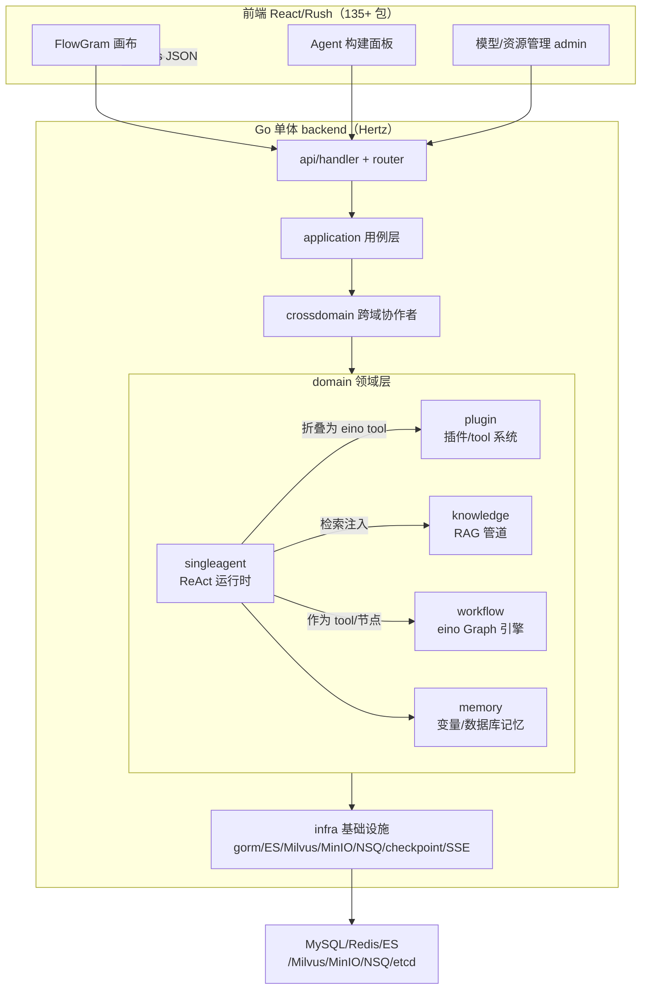

# Coze Studio（扣子开源版）深度解读

> 本解读按 **ai-agent 类规格** 产出，叠加 framework（对外开放 OpenAPI + Chat SDK）与可部署服务关注面。coze-studio 是字节跳动 / coze-dev 基于其商业「Coze 开发平台」开源的 **一站式 AI Agent 开发平台**，Apache-2.0，本地自托管。

## 根因

把服务于数万企业、数百万开发者的「扣子」生产级 Agent 构建引擎完整开源，让开发者在**本地**以无代码 / 低代码方式完成 AI Agent 的**创建、调试、部署**全流程——不是玩具 demo，而是把能支撑真实业务的人工智能体开发平台的门槛从「自研整套 Agent 基建」降到「一条 `make web` 命令跑起来」。

一句话锚点：**Coze Studio 把「商业级 Agent 平台的『人格-知识-工具-模型』四要素编排引擎」做成可自托管的开源产品。**

## 核心能力清单

| 模块 | 能力 | 落地形态 |
| --- | --- | --- |
| Model service | 管理模型列表，接入 OpenAI / 火山方舟 / Claude / Gemini / Qwen / DeepSeek / Ollama 等 | `backend/bizpkg/llm/modelbuilder` 厂商适配器 + 配置模板注入 |
| Build agent | 构建 / 发布 / 管理单 Agent，配置工作流、知识库等资源 | eino ReAct 运行时，见 [`agent-runtime.md`](agent-runtime.md) |
| Build apps / workflow | 创建发布应用，通过可视化画布拖拽构建业务逻辑 | eino Graph 编译执行，见 [`workflow-engine.md`](workflow-engine.md) |
| Develop resources | 创建管理插件、知识库、数据库、Prompt | 插件系统见 [`plugin-system.md`](plugin-system.md)；RAG 见 [`rag-knowledge.md`](rag-knowledge.md) |
| API and SDK | 会话、工作流 OpenAPI，Chat SDK 集成到自有应用 | `backend/api/router/coze` 路由 + 鉴权 |
| 记忆能力 | 基于个人用户历史对话产生更准确的回复 | 变量 / 表级记忆，见 [`agent-runtime.md`](agent-runtime.md) |

## 技术栈一览

| 层 | 选型 | 说明 |
| --- | --- | --- |
| 后端语言/框架 | Go 1.23+ / CloudWeGo Hertz（HTTP） | 单 Go 进程聚合全部 domain |
| 运行时编排 | CloudWeGo **Eino** v0.4.8 | `eino/flow/agent/react`（ReAct）、`eino/compose`（Graph）、`eino/components/tool`——全局叙事主线：扣子站在同为字节开源的 eino 之上，复用云原生 LLM 编排能力而非自研 Agent 循环 |
| 前端 | React 18 + TypeScript + Semi Design + Tailwind，Rush.js 管理 135+ 包，Rsbuild 构建 | 画布用 bytedance/FlowGram |
| 后端架构 | DDD 微服务风格 + 接口适配器（Adapter）解耦 | `api → application → crossdomain → domain → infra` 五层 |
| ORM / 迁移 | gorm + gorm/gen（`.gen.go` 实体生成） + Atlas（schema 迁移） | 草稿/版本/快照三段式，见 [`data-model.md`](data-model.md) |
| 中间件栈 | MySQL + Redis + Elasticsearch(SmartCN) + Milvus + MinIO + NSQ(可选 Nats/Pulsar/RocketMQ) + etcd | 可换 OceanBase，见 [`deployment.md`](deployment.md)，模型与存储选型详见对应子文档 |

## 架构总览

**分层与 DDD 域边界**：后端按 `api(HTTP) → application(用例) → crossdomain(跨域) → domain(领域) → infra(基础设施)` 五层组织。每个领域域（agent / workflow / knowledge / plugin / user / memory / conversation…）自带 `internal/dal/model`（gorm 实体）与 `internal/dal/query`（查询器），跨域引用靠 **逻辑外键 + JSON 快照** 而非物理外键，保证域独立演进。请求经 `api/handler` 进来 → `application` 编排用例 → `crossdomain` 门面（`DefaultSVC()`）→ `domain` 领域逻辑 → `infra` 落地存储，是贯穿全局的分层主线。

## 核心模块导读

| 模块 | 职责 | 深读 |
| --- | --- | --- |
| Agent 运行时 | 四要素折叠成 eino 图 + ReAct 主循环 + CheckPoint 续跑 | [`agent-runtime.md`](agent-runtime.md) |
| 工作流引擎 | 画布 JSON 编译成 eino Graph，可执行/流式/中断恢复/被 Agent 复用 | [`workflow-engine.md`](workflow-engine.md) |
| RAG 知识库 | 解析→分块→嵌入→检索→重排→注入上下文；异步索引 | [`rag-knowledge.md`](rag-knowledge.md) |
| 插件系统 | 第三方 API 声明式折叠成 eino tool，鉴权/加密/版本发布 | [`plugin-system.md`](plugin-system.md) |
| 数据模型 | gorm/gen 实体 + Atlas 迁移；草稿/版本/快照三段式 | [`data-model.md`](data-model.md) |
| 部署 | docker-compose + Helm 双形态，`make web` 一条命令自托管 | [`deployment.md`](deployment.md) |

## 子文档索引

- [`agent-runtime.md`](agent-runtime.md) — 单 Agent 运行时：eino ReAct + compose 编排 + 记忆/工具折叠
- [`workflow-engine.md`](workflow-engine.md) — 工作流运行时：画布→eino Graph 编译执行与流式/中断
- [`rag-knowledge.md`](rag-knowledge.md) — RAG 知识库：processor/searchstore/embedding 三层 + 异步索引
- [`plugin-system.md`](plugin-system.md) — 插件与外部工具系统：声明式折叠 + 鉴权加密 + 版本治理
- [`data-model.md`](data-model.md) — 数据模型：gorm/gen + Atlas；草稿/版本/快照 + 异构存储
- [`deployment.md`](deployment.md) — 部署：docker-compose 与 Helm 双形态 + 安全风险

## 设计哲学与值得借鉴的决策

1. **站在 eino 之上而非自研 Agent 循环**：`react.Agent` 承担 ReAct 主循环、`compose.Graph` 承担编排、CheckPoint 承担续跑，扣子只需做「配置态 → 可执行图」的翻译层。这是最值得借鉴的取舍：把最难执行的「主循环可靠性」交给同源成熟框架，复杂度集中在业务配置的翻译。见 [`agent-runtime.md`](agent-runtime.md) 决策一。
2. **「创作与运行分离」的草稿/版本/快照三段式**：用存储冗余 + `commit_id` 统一指针，换来无可争辩的可回滚、可审计、执行确定性，在 Agent / 工作流 / 插件 / 记忆各资源上反复出现，是从数据层面统一回应「谁见半成品、谁拿可回滚成品」。见 [`data-model.md`](data-model.md)。
3. **资源折叠为统一 tool**：插件/工作流/数据库/变量异源同构收进一个 `[]tool.BaseTool`、一个 `ToolsNode` 调度，让 LLM 面对一致的工具协议。见 [`agent-runtime.md`](agent-runtime.md) 决策二。
4. **环境变量作为唯一配置接口**：docker-compose 与 Helm 共用同一套变量名，后端只认 env、不认编排方式，开发机到 K8s 零改码互迁。见 [`deployment.md`](deployment.md) 决策二。

## 局限与风险

- 深度绑定 eino 版本与 `map[string]any` 泛型形状，eino 升级会波及整个编排层（[`workflow-engine.md`](workflow-engine.md)）
- 插件系统的 **MCP** 是「声明存在、实现缺失」的空壳（`invocation_mcp.go` 返回 not implemented）（[`plugin-system.md`](plugin-system.md)）
- 工作流的 code 节点若配 `CodeRunnerType=local` 会直接本机 `python3 -c` 执行任:意代码，公共网络高 RCE 风险（[`deployment.md`](deployment.md)）
- 跨表无物理外键，一致性靠应用层；JSON 列宽表在复杂检索时受限（[`data-model.md`](data-model.md)）

> 更多权衡、决策依据与逐条 `文件:行号` 真源引用，见各子文档。
