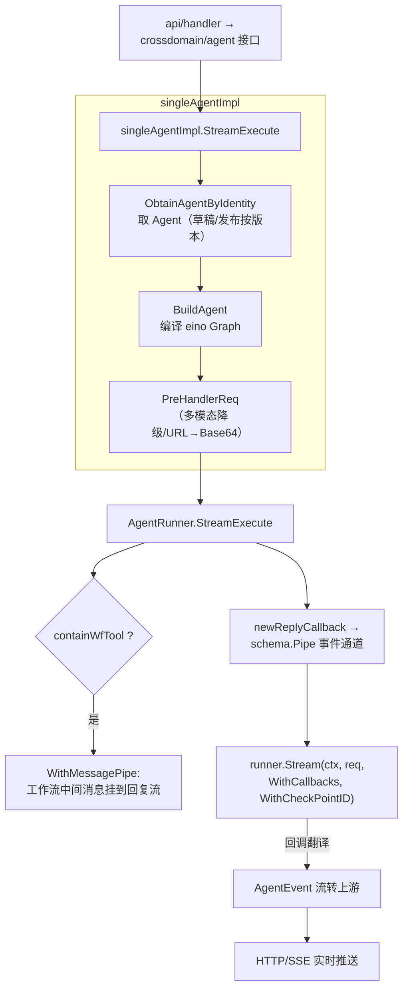
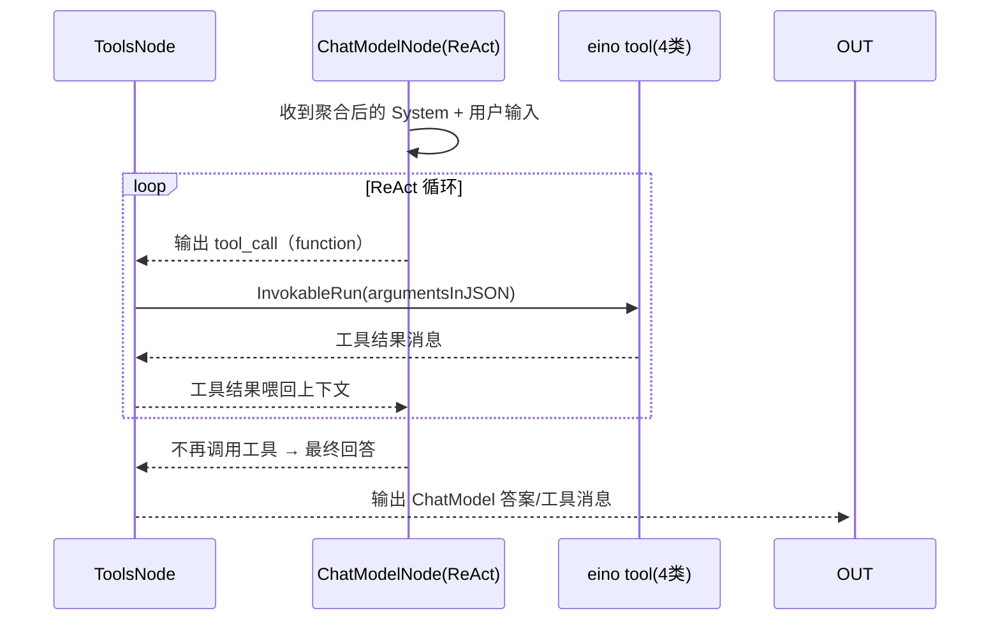

# Agent 运行时（单 Agent 构建与执行）深度解读

> 模块：`backend/domain/agent/singleagent`（单 Agent 运行时）
> 核心代码：`backend/domain/agent/singleagent/internal/agentflow/`
> 叙事主线：把 Agent 的「人格（persona/记忆）＋知识（RAG）＋工具（插件/工作流/数据库/变量）＋模型」四要素折叠成一张 Eino Graph，用 `react.Agent`（ReAct）串起「感知→规划→调用→产出」闭环，以 CheckPoint 支持中断续跑。

## 一句话定位

单 Agent 运行时是扣子 Agent 平台「人格/工具/知识/模型」四要素汇聚的**执行心脏**：去掉它，一个配置了插件、知识库、工作流的 Agent 就只剩一份静态 Persona 文案，失去思考、检索、行动与记忆闭环。

## 在项目中的角色：跨域编排中枢

它在 DDD 分层里是典型的「编排中枢」——`singleagent` 位于 `domain/agent/singleagent`，横跨引用多个其他领域，把下游所有领域资源折叠成统一的 eino `tool`，交给 ReAct 循环调度。这是它与 `workflow` 域最本质的分野：**workflow 是「按图索骥的确定性流程」，singleagent 是「模型自主决策调用资源」。**

- 调用 `crossknowledge`（知识域检索）：`node_retriever.go` / `node_tool_knowledge.go`
- 调用 `crossplugin`（插件域执行）：`node_tool_plugin.go`
- 调用 `crossworkflow`（工作流域）：`node_tool_workflow.go`
- 调用 `crossdatabase` / `crossvariables`（记忆数据库/长期变量）：`node_tool_database.go` / `node_tool_variables.go`
- 通过 `bizpkg/llm/modelbuilder` 构造 eino `ChatModel`：`agent_flow_builder.go`

## 根因：四要素如何编排成「可执行图」

扣子用户只在画布上声明一个 Agent：一段 Persona、勾选知识库、绑定插件、挂一个工作流、配一个模型——这是**声明式配置**。但 LLM 运行时需要的是**过程化的数据流与循环**：注入变量/记忆/时间渲染 Persona、把插件/工作流/数据库翻译成工具描述、走 ReAct 循环、把中间产物以事件流吐出、遇 OAuth/工作流中断能挂起续跑。

如果把「四要素编排」写死在业务代码里（一个请求里 manual 组装 messages 再调模型），每次新增工具类型都要改调用方、无法在图中任意槽位挂回调与 checkpoint、错误恢复退化为「整段重来」。扣子选择**站在 Go 云原生 LLM 编排框架 Eino 之上**：用 `compose.Graph` 表达数据流（静态、可截断、可 checkpoint），用 `react.Agent` 封装主循环，**自己不复刻 Agent 循环，而是做「配置 → 可执行图」的翻译器**。

## 核心结构

### Agent 的「配置态」根：`AgentEvent` / `SingleAgent`

`AgentEvent` 是运行事件的总接口，贯穿 callback → runner → 上游（SSE/消息）整条链：

[backend/crossdomain/agent/model/single_agent.go:42-54]()

<!-- anchor: type AgentEvent struct { … Interrupt       *InterruptInfo -->

- `EventType` 取 `chatmodel_answer` / `tool_mid_answer` / `tools_message` / `func_call` / `suggest` / `knowledge` / `interrupt`；`ToolMidAnswer` / `ChatModelAnswer` 是 eino 的 `schema.StreamReader[*schema.Message]` 流式句柄；`Interrupt *InterruptInfo` 承载继续挂起信息。
- `SingleAgent`（`crossdomain/agent/model/single_agent.go:56-82`，未展示逐行）是扣子侧「Agent = 人格+知识+工具+模型+记忆」的声明载体：`Prompt`、`Knowledge`、`Plugin`、`Workflow`、`Database`、`ModelInfo`、`VariablesMetaID`。`BuildAgent` 的所有输入都来自这份配置态字段。

### 工具的统一收缩口：`tool.BaseTool` / `InvokableTool`

`BuildAgent` 把四类资源异源同构收拢进一个切片：

[backend/domain/agent/singleagent/internal/agentflow/agent_flow_builder.go:147-158]()

<!-- anchor: 	agentTools := make([]tool.BaseTool, 0, len(pluginTools)+len(wfTools)+len(dbTools)+len(avTools)) … 	agentTools = append(agentTools, slices.Transform(avTools, func(a tool.InvokableTool) tool.BaseTool { -->

全部 `appends` 之后 `react.AgentConfig.ToolsConfig.Tools = agentTools`。不同域通过实现同一接口被杀平：插件 `pluginInvokableTool`、工作流 `workflow.ToolFromWorkflow`（额外 `TerminatePlan`）、数据库 `utils.InferTool` 反射 Go 方法成 OpenAPI tool、变量 `utils.InferTool("setKeywordMemory", ...)`。

### ModelBuilder：`ToolCallingChatModel` 的工厂表

`modelbuilder.Service.Build(...)` 是各厂商统一出口，`modelClass2NewModelBuilder` 是注册表：

[backend/bizpkg/llm/modelbuilder/model_builder.go:42-50]()

<!-- anchor: var modelClass2NewModelBuilder = map[developer_api.ModelClass]func(*config.Model) Service{ … 	developer_api.ModelClass_QWen:     newQwenModelBuilder, -->

每个厂商文件同构（`getDefaultConfig + applyParamsToXxxConfig + Build`），`BuildModelBySettings` 在 `agent_flow_builder.go:96` 完成「扣子 ModelInfo → LLMParams → eino ChatModel」链路。一次换模型只需改 map 一处路由。

### CheckPoint 存储：eino CheckPointStore 的 Redis 实现

[backend/infra/checkpoint/redis.go:35-36]()

<!-- anchor: 	checkpointKeyTpl = "checkpoint_key:%s" … 	checkpointExpire = 24 * 7 * 3600 * time.Second -->

生产走 Redis 以便跨实例续跑，`mem.go` 提供进程内实现（测试/单机）。

## 核心流程：Agent 请求生命周期

- 领域服务入口：`single_agent_impl.go:93`（`StreamExecute`）；`single_agent_impl.go:127` 调 `rn.StreamExecute`。
- 流式执行在 `agent_flow_runner.go:67-133`；续跑分支在 `agent_flow_runner.go:100-110`（`resumeInfo.InterruptID` + `WithResumeToolWorkflow`）。

### 事件回调翻译

`replyChunkCallback` 用 eino `callbacks.HandlerBuilder` 挂四个钩子，按 `Component`/`Name` 分流到 `AgentEvent`：
- `OnEnd`（`callback_reply_chunk.go:127`）：`knowledge_retriever` → `EventTypeOfKnowledge`
- `OnStart`（`:109`）：ToolsNode 且有工具调用 → `EventTypeOfFuncCall`
- `OnEndWithStreamOutput`（`:180`）：`re_act_chat_model`/`llm` → `EventTypeOfChatModelAnswer`
- `OnError`（`:68`）：`compose.ExtractInterruptInfo` → `EventTypeOfInterrupt`

## 设计决策与权衡

### 决策一：用 eino `react.Agent` 而非自研主循环

把「规划→工具→反馈→再规划」交给 `react.NewAgent` 生成的子图（`agent_flow_builder.go:173`），本模块只做子图外的「上下文聚合」。eino 与 Coze 同源，能拿到 `ExportGraph` 原始图、`Callbacks`、CheckPoint 一等能力；`react.Agent` 暴露的 `ToolReturnDirectly` 恰好贴合「工作流直接出答案」的产品语义。**放弃自研的代价**：把复杂度集中在「配置→图翻译层」，换来主循环可靠性、错误恢复、流式、checkpoint 全交给 eino。

### 决策二：Agent 如何把 Workflow/Plugin/Database/变量「折叠」成统一工具

所有资源实现同一 eino 接口，进同一个 `agentTools`，由 ReAct 的 `ToolsNode` 统一调度。折叠差异：插件天然契合 function-call；**工作流最特殊**（非纯函数、长流程、可中断、可能直接输出），额外保留 `TerminatePlan` + `ToolReturnDirectly` 语义并在 runner 开专属消息管道与续跑回填（`agent_flow_runner.go:105` 的 `WithResumeToolWorkflow`）——代价是工作流无法进通用 tool 序列，runner/续跑层需特判（`containWfTool`）。

### 决策三：记忆（变量+数据库）当作「模型自主调用的工具」

既把变量**主动注入**上下文（`memory_variables` 段落 + persona Jinja2），又把**写**记忆暴露成 `setKeywordMemory` tool、把**表记忆读写**暴露成 SQL tool，让模型对话中自行调用。主动注入保证首字即个性化；但注入过多挤占 context 预算，故补「按需再查」的 `recallKnowledge`/SQL 兜底。写记忆必须交给模型而非后台定时，因为「何时值得记」依赖对话语义；代价是授予模型持久化写入权限，须靠 tool 描述三条件（`node_tool_variables.go:70-79`）抑制误写。

## 亮点与问题

**亮点：**
1. 「上下文聚合 + ReAct 决策」双层图：外层四节点用 `compose.WithNodeTriggerMode(compose.AllPredecessor)`（`agent_flow_builder.go:268`）并行聚合压低首字延迟，内层子图专注多轮工具决策。
2. 资源全折叠为统一 tool + 用 `modelInfo.Capability.GetFunctionCall()` 在构建期兜底不支持 function-call 的模型（`agent_flow_builder.go:164`）。
3. 工具中断 → CheckPoint 续跑闭环：OAuth/工作流中断被 `ExtractInterruptInfo` 还原成 `InterruptInfo`，`ResumeInfo` 回填 + Redis checkpoint 精确恢复。
4. modelbuilder 工厂一行切模型：新增厂商 = 新增一个同构文件。

**问题 / 风险：**
1. 核心 builder 的测试 `agent_flow_builder_test.go` 自 `:29` 起几乎全部 `//` 注释化（mock 了 ark/plugin/knowledge/workflow/database）——该核心横跨多 crossdomain 域、mock 链极重，回归风险高。
2. 工作流 as tool 的特判散布在 runner/续跑层，与「统一 tool 折叠」理念有裂缝。
3. `isSupportFile()` 恒返回 false（`agent_flow_runner.go:292`），文件理解能力被写死，对需支持文件型 Agent 的场景是显式欠账。

## 与其他模块协同

- **知识域**：预检索塞上下文（`node_retriever.go`）+ 按需再查 `recallKnowledge` tool——「预填充 + 按需 pull」双轨。
- **插件域**：`node_tool_plugin.go` 拉取绑定工具包成 `pluginInvokableTool`，OAuth 中断进入挂起续跑（`parent callback_reply_chunk.go:262`）。
- **工作流域**：`node_tool_workflow.go:33` 调 `WorkflowAsModelTool`，`TerminatePlan()` 判 `return-directly`。另有 BotMode 分支：`domain/conversation/agentrun/internal/chatflow_run.go` 对固定工作流 Agent 直接以该工作流为图执行，不走 ReAct。
- **记忆域**：`node_tool_variables.go` 加载/写入长期变量；`node_tool_database.go` 解析 SQL 校验表名必须等于绑定 `d.name`，把表式记忆当「记忆工具箱」。
